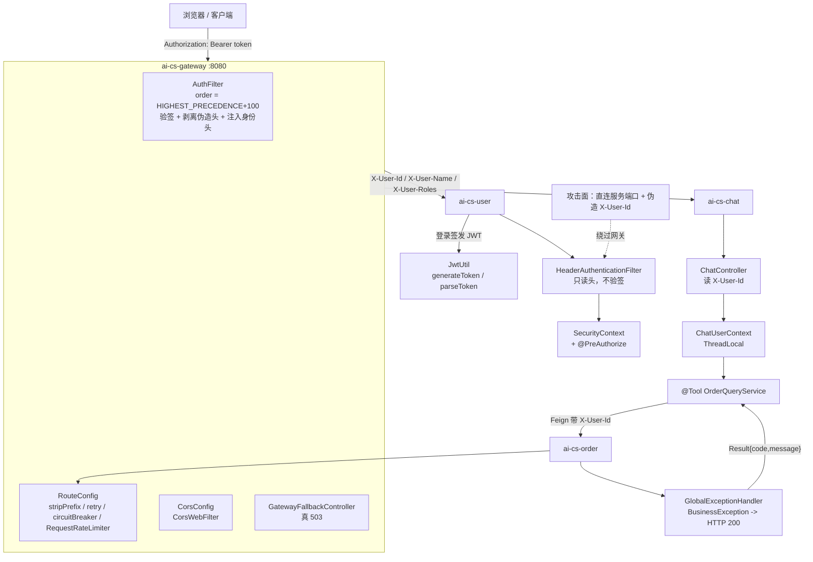
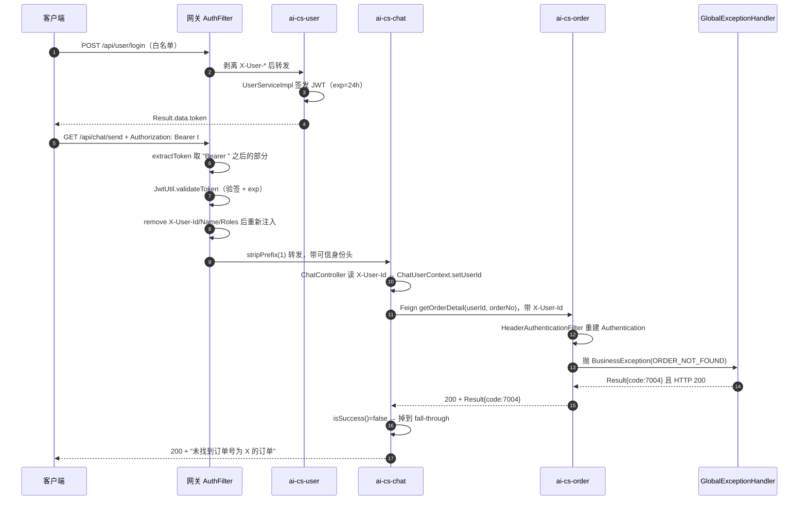

# JWT 不做鉴权：从「可验证的声明容器」到「HTTP 200 带错误码」的一条完整证据链

> **一句话结论**：JWT 本身不鉴权，它只是一个「可被验证的声明容器」——鉴权发生在网关过滤器和服务端的 SecurityContext 里；而调用方能不能看出这次调用失败了，取决于异常处理器有没有把失败翻译成非 2xx。
> **阅读前置**：读得懂 Spring Boot 的 `@RestController` 与 Spring Cloud Gateway 的 `GlobalFilter`；建议先看 [02-Spring微服务/17-SpringMVC请求全链路与参数校验](../02-Spring微服务/17-SpringMVC请求全链路与参数校验.md) 的 §3.9「异常出口」，本篇会直接用到那条链路。
> **证据基线**：A 级 8 处框架源码摘录（`24-源码分析/assets/source`）+ B 级 20 余处本项目真实文件行号 + C 级 3 段本机实测（node 24 / jjwt 0.12.5 实跑 / pwsh 静态统计）；预计阅读 50~65 分钟。

---

## 0. 先看现象

### 现象 1：用户明明有订单，AI 助手却回答「未找到订单」

`ai-cs-chat/src/main/java/com/aics/chat/service/OrderQueryService.java#L37-L56` 里，`@Tool` 方法的最后一行是这样写的：

```java
@Tool(description = "根据订单号查询订单详情，包括订单状态、商品信息、金额、物流等")
public String queryOrderByOrderId(@ToolParam(description = "订单编号，格式如 ORD20260809001") String orderId) {
    Long userId = ChatUserContext.getUserId();
    if (userId == null) {
        return "无法识别当前登录用户身份，请先登录后再查询订单";
    }
    try {
        Result<OrderVO> result = orderFeignClient.getOrderDetail(userId, orderId);
        if (result != null && result.isSuccess() && result.getData() != null) {
            return formatOrderVO(result.getData());
        }
    } catch (Exception e) {
        log.warn("订单服务查询失败: orderId={}, err={}", orderId, e.getMessage());
        return "订单服务暂时不可用，请稍后再试";
    }
    return "未找到订单号为 " + orderId + " 的订单，请检查订单号是否正确";
}
```

> 出处：`ai-cs-chat/src/main/java/com/aics/chat/service/OrderQueryService.java#L37-L56`

这段代码有一个**只靠读代码就能确定的逻辑事实**：`try` 块里的 `catch` 只兜住「抛异常」的情况；而订单服务返回 `{"code":7004,"message":"订单不存在或状态不允许操作"}` 时——HTTP 状态码是 200，Feign 不会抛异常，`result.isSuccess()` 为 `false`，`if` 不成立，于是流程**掉到第 55 行的 fall-through**，把「不属于你」「库存不足」「内部错误」「订单真的不存在」四种完全不同的结果**统一说成「订单不存在」**。

日志里你只会看到 `按订单号查询: ORD20260809001`（`#L41`），看不到任何 `log.warn("订单服务查询失败...")`——因为根本没进 catch。排查这类问题，第一直觉「看有没有异常堆栈」在这里**完全失效**。

### 现象 2：前端 `fetch` 拿到的 `status` 永远是 200，只有 `code` 才有意义

`ai-cs-common/src/main/java/com/aics/common/exception/GlobalExceptionHandler.java#L35-L39`：

```java
@RestControllerAdvice
public class GlobalExceptionHandler {
    private static final Logger log = LoggerFactory.getLogger(GlobalExceptionHandler.class);

    @ExceptionHandler(BusinessException.class)
    public Result<Void> handleBusinessException(BusinessException e, HttpServletRequest request) {
        log.warn("业务异常 [{}] {}: code={}, msg={}", request.getMethod(), request.getRequestURI(), e.getCode(), e.getMessage());
        return Result.fail(e.getCode(), e.getMessage());
    }
}
```

> 出处：`ai-cs-common/src/main/java/com/aics/common/exception/GlobalExceptionHandler.java#L27-L39`

注意方法头上**什么都没有**：没有 `@ResponseStatus`，也没有手工 `response.setStatus(...)`。于是业务异常的正确语义（比如「余额不足」「订单不存在」）只体现在 JSON 的 `code` 字段里，HTTP 状态码保持默认的 **200**。服务端日志则是 `业务异常 [GET] /api/order/ORD20260809001: code=7004, msg=订单不存在或状态不允许操作`——日志看着是「异常」，网关监控、Prometheus 的 5xx 比例、浏览器 Network 面板的红字**全部看不见它**。

同一条链上还有更刺眼的对照组：网关降级端点 `ai-cs-gateway/src/main/java/com/aics/gateway/controller/GatewayFallbackController.java#L20-L24` 明确写了 `@ResponseStatus(HttpStatus.SERVICE_UNAVAILABLE)`，要的就是真 503。**同一个项目里，有人知道要给状态码，有人忘了给。**

### 现象 3：网关 401 的响应体是手写字符串，服务端错误却走 `Result` 序列化

```java
private Mono<Void> unauthorized(ServerHttpResponse response, String message) {
    response.setStatusCode(HttpStatus.UNAUTHORIZED);
    response.getHeaders().add(HttpHeaders.CONTENT_TYPE, "application/json;charset=UTF-8");
    String body = "{\"code\":401,\"message\":\"" + message + "\",\"data\":null,\"timestamp\":" + System.currentTimeMillis() + "}";
    return response.writeWith(Mono.just(response.bufferFactory().wrap(body.getBytes())));
}
```

> 出处：`ai-cs-gateway/src/main/java/com/aics/gateway/filter/AuthFilter.java#L237-L242`

这里状态码是对的（真 401），但 body 是**拼字符串**拼出来的：字段顺序、`null` 处理、转义都由这行代码手工保证，`message` 一旦含引号就会产出非法 JSON。同一个项目里因此存在**两套错误约定**：网关 401/403 用真状态码 + 手写 body；服务业务失败用 200 + `Result` 序列化 body；`ai-cs-user` 的 `UserSecurityConfig#L38-L42` 又是第三套（Spring Security 的 `SC_UNAUTHORIZED`/`SC_FORBIDDEN` + 手写 JSON）。

> **这些现象指向同一件事**：JWT 只回答「这段声明有没有被改过、有没有过期」，它一点也不回答「这次调用成功没有」；而「失败」这条信息要穿过 Controller → 全局处理器 → HTTP 状态码 → Feign 反序列化 → 上层业务判断五道关，**只要中间有一道把失败洗成 200，上面的现象就必然出现**。

---

## 1. 整体地图



**读图说明**

- 看这条主链：`AF`（验签）→ 请求头 `X-User-Id` → `HF`（只信任头）。这是全项目身份传递的唯一正道，**两个方框之间的箭头不是「传 token」而是「传已经验过的结论」**——这是理解整个安全模型的关键，也是本项目 `ai-cs-user/src/main/java/com/aics/user/security/HeaderAuthenticationFilter.java#L17-L23` 注释里明说的前提。
- 看这条虚线：`X`（攻击面）→ `HF`。虚线一旦成立（服务端口从公网可达），身份头就是纯用户可控输入，`HF` 会毫无抵抗地把它变成 `Authentication`。**看错这条箭头的代价**：以为「有 JWT 就安全了」，于是不限制服务端口，任何人不带 token、手写一个 `X-User-Id: 1` 就能以 1 号用户身份操作。
- 看最下面这条回边：`O` → `GEH` → `T`。Feign 调用方的业务判断**只看得见 `Result.code`**，看不见 HTTP 状态码，因为 `GlobalExceptionHandler` 把异常出口统一压成了 200。**看错它的代价**：以为「调下游失败会抛异常」，于是 `try/catch` 写得很认真，却永远进不去 catch，最后掉进 fall-through 返回一句错误的自然语言。

**组件与责任**

| 组件 | 一句话责任 | 谁调用它 | 证据 |
|---|---|---|---|
| `JwtUtil` | 签发/验签 JWT 的唯一入口（HS 系列，靠 key 推断算法） | `UserServiceImpl` 签发、`AuthFilter` 校验 | `ai-cs-common/src/main/java/com/aics/common/util/JwtUtil.java#L46-L86` |
| `AuthFilter` | 网关第一层：白名单、验签、剥离伪造身份头、注入可信身份头、401 | Gateway 过滤器链 | `ai-cs-gateway/src/main/java/com/aics/gateway/filter/AuthFilter.java#L106-L169` |
| `RouteConfig` | 路由、去前缀、重试、熔断降级、Redis 令牌桶限流 | Gateway 启动装配 | `ai-cs-gateway/src/main/java/com/aics/gateway/config/RouteConfig.java#L60-L187` |
| `HeaderAuthenticationFilter` | 服务第二层：把 `X-User-*` 头转成 `Authentication`，**不验签** | Spring Security 过滤器链 | `ai-cs-user/src/main/java/com/aics/user/security/HeaderAuthenticationFilter.java#L31-L56` |
| `UserSecurityConfig` | 无状态 SecurityFilterChain + `@EnableMethodSecurity` + 401/403 出口 | Spring Security 装配 | `ai-cs-user/src/main/java/com/aics/user/security/UserSecurityConfig.java#L21-L42` |
| `GlobalExceptionHandler` | 把 11 类异常翻成 `Result`，其中 10 类带真状态码 | Spring MVC 异常解析 | `ai-cs-common/src/main/java/com/aics/common/exception/GlobalExceptionHandler.java#L27-L154` |
| `Result` / `ResultCode` | 统一响应体与错误码字典 | 所有 Controller、处理器 | `ai-cs-common/src/main/java/com/aics/common/result/Result.java#L18-L80` |
| `ChatUserContext` | 把用户身份从 Controller 传到 `@Tool`（ThreadLocal） | `ChatController`、`OrderQueryService` | `ai-cs-chat/src/main/java/com/aics/chat/util/ChatUserContext.java#L26-L41` |
| `OrderFeignClient` | 服务间调用，`Result<T>` 作返回值，手工透传 `X-User-Id` | `OrderQueryService` | `ai-cs-chat/src/main/java/com/aics/chat/feign/OrderFeignClient.java#L26-L36` |

---

## 2. 关键概念与关键类

- **JWT（JSON Web Token）**：三段 `Base64Url(header).Base64Url(payload).Base64Url(signature)` 的字符串，只有第三段和密钥有关，前两段是**明文**。
- **声明容器（claims container）**：JWT 的定位——它装 `sub`/`exp`/自定义声明，并允许任何人**验证**这些声明没被改过；它不提供权限判断、不提供会话状态。
- **认证（authentication）**：确认「你是谁」。本项目里由网关验签完成，产物是 `X-User-Id`。
- **鉴权（authorization）**：确认「你能不能做这件事」。本项目里由 `@PreAuthorize`（全仓仅 2 处）与业务代码里的归属判断完成。
- **无状态令牌**：服务端不存会话，所有状态在令牌里。代价是**登出无法即时生效**，只能靠短 TTL 或黑名单。
- **身份头（identity header）**：`X-User-Id` / `X-User-Name` / `X-User-Roles`。它的可信度**完全取决于链路**——只要有一跳没清理客户端输入，它就退化成用户可控参数。
- **统一响应体**：`Result{code,message,data,timestamp}`，业务成败编码在 `code` 里。它把「业务失败」和「HTTP 失败」两件事解耦了，副作用是——不写状态码时两者会混淆。
- **ErrorDecoder**：Feign 把非 2xx 响应转异常的地方。本项目全仓 0 个自定义实现，所以 2xx 里的业务失败**永远不会变成异常**。

| 名称 | 位置 | 角色 | 关键方法 / 字段 |
|---|---|---|---|
| `JwtUtil` | `ai-cs-common/src/main/java/com/aics/common/util/JwtUtil.java` | 静态工具类，签发与验签 | `generateToken(subject, claims, secret, exp)` `#L46`、`parseToken` `#L79`、`validateToken` `#L127`、`isTokenExpiringSoon` `#L159` |
| `JwtUtil.DEFAULT_SECRET` | 同上 `#L23` | 写死的兜底密钥（69 字节） | `aics-platform-jwt-secret-key-must-be-at-least-256-bits-long-for-hs256` |
| `AuthFilter` | `ai-cs-gateway/src/main/java/com/aics/gateway/filter/AuthFilter.java` | 网关全局过滤器，第一层验签 | `filter()` `#L106`、`getOrder()` `#L171`、`tryApiKeyAuth()` `#L188`、`unauthorized()` `#L237` |
| `HeaderAuthenticationFilter` | `ai-cs-user/src/main/java/com/aics/user/security/HeaderAuthenticationFilter.java` | 第二层，只读头不验签 | `doFilterInternal()` `#L31`、`SecurityContextHolder.clearContext()` `#L54` |
| `UserSecurityConfig` | `ai-cs-user/src/main/java/com/aics/user/security/UserSecurityConfig.java` | SecurityFilterChain | `csrf.disable()` `#L32`、`STATELESS` `#L33`、`authenticationEntryPoint` `#L38` |
| `GlobalExceptionHandler` | `ai-cs-common/src/main/java/com/aics/common/exception/GlobalExceptionHandler.java` | 全局异常出口 | `handleBusinessException` `#L35-L39`（**无 `@ResponseStatus`**）、`handleException` `#L149-L154` |
| `BusinessException` | `ai-cs-common/src/main/java/com/aics/common/exception/BusinessException.java` | 业务异常载体 | `private final int code` `#L15`，6 个构造器 `#L17-L45` |
| `Result` | `ai-cs-common/src/main/java/com/aics/common/result/Result.java` | 统一响应体 | `isSuccess()` `#L78-L80` 判 `code == 200` |
| `ResultCode` | `ai-cs-common/src/main/java/com/aics/common/result/ResultCode.java` | 错误码字典 | `UNAUTHORIZED(401)` `#L17`、`ORDER_NOT_FOUND(7004)` `#L74-L80` |
| `ChatUserContext` | `ai-cs-chat/src/main/java/com/aics/chat/util/ChatUserContext.java` | 身份透传到 `@Tool` | `setUserId/getUserId/clear` `#L31-L41` |

---

## 3. 原理与证据逐段精读

### 3.1 三段结构：能「解」不等于能「信」

**在干什么**：用 node 复刻 jjwt 的 HS256 语义，生成一个令牌，然后演示「只做 Base64 解码」会发生什么。

```javascript
// 离线复刻：不联网、不发请求，只做 base64url + HMAC
const SECRET = "aics-platform-jwt-secret-key-must-be-at-least-256-bits-long-for-hs256";
const b64u = (x) => Buffer.from(x).toString("base64url");
const sign = (header, payload) => {
  const h = b64u(JSON.stringify(header)), p = b64u(JSON.stringify(payload));
  return h + "." + p + "." + crypto.createHmac("sha256", SECRET).update(h + "." + p).digest("base64url");
};
const verify = (t) => {
  const [h, p, s] = t.split(".");
  return crypto.createHmac("sha256", SECRET).update(h + "." + p).digest("base64url") === s;
};
```

**本机实测输出**（node 24.16.0，`node jwt-probe.mjs`）：

```text
1) 段数 = 3 | 总长 = 205
2) header 明文 = {"alg":"HS256","typ":"JWT"}
3) 未验签解出的 role = USER
4) 篡改 payload 但复用旧签名, 未验签解出 sub/role = 1 / ADMIN
5) 原串验签 = true | 篡改串验签 = false
6) remaining(ms) = 86399553 | expiringSoon(30min) = false
7) 过期 token 验签 = true | exp 已过 = true
8) header 里 alg 声明 = HS256 | 签名段长度 = 43
```

**怎么读这段输出**：第 4 行是本节的核心——把 payload 里的 `sub` 改成 `1`、`role` 改成 `ADMIN`，**任何人不带密钥都能改**，因为 payload 只是 Base64Url 而不是加密；第 5 行说明改动会被签名校验抓住（`false`）；第 7 行是第二个反直觉点——**签名依然有效但令牌已过期**，所以「验签通过」和「令牌可用」是两件事，`exp` 必须由解析器单独检查。

**为什么这么设计**：JWT 要被多方读取（前端要读 `exp` 做续期提示、网关要读 `sub`、日志要读 `jti`），所以 payload 必须可读；安全边界不放在「不可读」，而放在「不可改」——签名只保护完整性，不保护机密性。

**换写法会怎样**：如果把 payload 做加密（JWE），前端就再也读不到 `exp`，续期逻辑要挪到服务端；如果把身份放到不可读的 `sessionId` + 服务端存储里，就退回有状态会话，跨服务要共享存储。两条路都成立，但「JWT + 明文 payload」是最省事的组合。

**常见坑**：把「前端解出 `role: ADMIN`」当成身份来源（本项目前端不做这个判断，但很多教程这么写）；把 `parseToken` 的返回值直接当可信数据——`ai-cs-gateway/src/main/java/com/aics/gateway/filter/AuthFilter.java#L147-L164` 之所以先 `validateToken` 再 `parseToken`，就是因为 `parseToken` 抛异常和返回 `Claims` 是两条路径，必须都走验签。

### 3.2 签名怎么验、用哪种算法：`verifyWith` + key 长度决定一切

框架侧的证据在 jjwt 的 API 上。`pom.xml#L63` 定义 `jjwt.version = 0.12.5`，`pom.xml#L206-L217` 引入 `jjwt-api` / `jjwt-impl` / `jjwt-jackson` 三件套。用 `javap` 直接看这个版本提供了哪些方法（本机实测）：

```powershell
javap -classpath <m2>\io\jsonwebtoken\jjwt-api\0.12.5\jjwt-api-0.12.5.jar io.jsonwebtoken.JwtParserBuilder | Select-String 'verifyWith|setSigningKey'
javap -classpath <m2>\io\jsonwebtoken\jjwt-api\0.12.5\jjwt-api-0.12.5.jar io.jsonwebtoken.JwtParser | Select-String 'parseSignedClaims|parseClaimsJws'
```

```text
public abstract io.jsonwebtoken.JwtParserBuilder setSigningKey(java.security.Key);
public abstract io.jsonwebtoken.JwtParserBuilder verifyWith(javax.crypto.SecretKey);
public abstract io.jsonwebtoken.JwtParserBuilder verifyWith(java.security.PublicKey);
public abstract io.jsonwebtoken.Jws<io.jsonwebtoken.Claims> parseClaimsJws(java.lang.CharSequence) ...
public abstract io.jsonwebtoken.Jws<io.jsonwebtoken.Claims> parseSignedClaims(java.lang.CharSequence) ...
```

**怎么读**：`setSigningKey` 与 `parseClaimsJws` 都还在（0.12 保留但标记为过时），`verifyWith` / `parseSignedClaims` 是新写法。本项目用的是新写法，见 `ai-cs-common/src/main/java/com/aics/common/util/JwtUtil.java#L79-L86`。

**在干什么**：`Jwts.parser().verifyWith(key).build().parseSignedClaims(token).getPayload()` 一口气做了四件事——读 header 里的 `alg`、用同一密钥重算签名并比对、校验 `exp`/`nbf`、反序列化 payload。

**为什么这么设计**：把「验证」前置到 parser 构造期（`verifyWith`），解析期（`parseSignedClaims`）只做数据转换 + 时间断言。这样调用方不可能「先解析再看要不要验」——API 形状上就不给你这个错误机会。

**换写法会怎样**：如果写成 `Jwts.parser().build().parseClaimsJwt(token)`（注意少了 `Signed`），payload 里的 `alg: none` 会被接受，等于**完全放弃验签**。这就是历史上著名的「alg=none」漏洞在库层面的形状。

**常见坑**：算法并不是显式指定的。`JwtUtil#L56` 只写 `.signWith(key)`，jjwt 会**按 key 长度推断算法**。我用项目里那串 `DEFAULT_SECRET` 实跑了一次（本机实测，jjwt 0.12.5 + jackson 2.21.8）：

```text
0) secret bytes = 69
1) segments = 3 | token len = 232
2) header = {"alg":"HS512"}
3) payload = {"sub":"100","userId":100,"username":"alice","role":"USER","iat":1795746293,"exp":1795832693}
4) verified sub = 100 role = USER exp - iat(ms) = 86400000
5) forged decoded (no verify) = {"userId":1,"username":"alice","role":"ADMIN","sub":"100"}
6) forged parse -> io.jsonwebtoken.security.SignatureException
7) expired parse -> io.jsonwebtoken.ExpiredJwtException
8) wrong-secret parse -> io.jsonwebtoken.security.SignatureException
9) weak key -> io.jsonwebtoken.security.WeakKeyException
```

第 2 行值得停下来看：`DEFAULT_SECRET` 是 69 字节（552 bit）≥ 512 bit，jjwt 于是选了 **HS512**，而不是 `JwtUtil.java#L41` 注释里写的「HS256 签名」。**这个注释是错的**——它不影响功能（`verifyWith` 按 header 里的 `alg` 校验，HS512 一样通得过），但会让你在某次安全审计里说错话。第 6/7/8/9 行则给了三种异常的准确类名，正好对应 `JwtUtil.validateToken` 的两个 catch 分支：`ExpiredJwtException` 单独记一条「已过期」日志，其余 `SignatureException`/`WeakKeyException`/`MalformedJwtException` 都落进 `catch (Exception)`。

### 3.3 过期、续期与登出：无状态令牌的三个边界

**在干什么**：`ai-cs-common/src/main/java/com/aics/common/util/JwtUtil.java#L127-L138` 与 `#L159-L168` 是全项目过期判定的唯一实现：

```java
public static boolean validateToken(String token, String secret) {
    try {
        parseToken(token, secret);
        return true;
    } catch (ExpiredJwtException e) {
        log.warn("JWT Token 已过期: {}", e.getMessage());
        return false;
    } catch (Exception e) {
        log.warn("JWT Token 无效: {}", e.getMessage());
        return false;
    }
}

public static boolean isTokenExpiringSoon(String token, String secret, long thresholdMillis) {
    try {
        Claims claims = parseToken(token, secret);
        Date expiration = claims.getExpiration();
        long remaining = expiration.getTime() - System.currentTimeMillis();
        return remaining < thresholdMillis;
    } catch (Exception e) {
        return true;
    }
}
```

> 出处：`ai-cs-common/src/main/java/com/aics/common/util/JwtUtil.java#L127-L168`

**为什么这么设计**：`validateToken` 把「异常」翻译成「boolean」，是为了给网关一个不抛异常的分支（`AuthFilter#L136` 的 `if (!JwtUtil.validateToken(...))`）；`isTokenExpiringSoon` 的 `catch → return true` 是「解析不了就当快要过期」的保守策略——解析不了必然不能用，报「快过期」比报「还早」安全。

**换写法会怎样**：如果 `isTokenExpiringSoon` 的 catch 返回 `false`，前端会一直认为令牌还有效，直到某次请求突然 401，用户体验断崖；如果 `validateToken` 改成抛异常，网关就得写 try/catch，`GlobalFilter` 里一个漏 catch 就变成 500 而不是 401。

**常见坑**：默认有效期来自 `UserServiceImpl#L37-L38` 的 `@Value("${aics.jwt.expire-hours:24}")`，签发时 `jwtExpireHours * 60 * 60 * 1000L`（`#L100-L101`），即 24 小时——**没有 refresh token，没有滑动续期**。24 小时内用户登出、改密码、被封禁，旧令牌依然有效，直到自然过期。这就是无状态令牌的硬边界：**登出只能靠「黑名单」或「短 TTL + 刷新」**。本项目两者都未落地（全仓无 Redis 黑名单写入点、无 refresh 端点），属于**明确未落地**项；要落地，最小改动是在 `AuthFilter` 验签通过后加一次 Redis `EXISTS blacklist:{jti}` 判断，且签发时必须写 `jti`（当前 `JwtUtil.generateToken` 没写 `jti`）。

### 3.4 令牌放哪：Header 与 Cookie 的取舍，以及 CSRF 的连锁反应

**在干什么**：本项目只认 `Authorization: Bearer <token>`，见 `ai-cs-gateway/src/main/java/com/aics/gateway/filter/AuthFilter.java#L226-L232`：头不存在或不以 `Bearer ` 开头就直接返回 `null`。

**为什么这么设计**：放 Header 的最大好处是**浏览器不会自动携带**，因此天然免疫 CSRF——攻击者的跨站表单提交带不上自定义头。放 Cookie（尤其 `HttpOnly` Cookie）虽然能防 XSS 窃取，但浏览器会**自动附加**，于是必须补 CSRF Token、`SameSite`、Origin 校验一整套。

**换写法会怎样**：如果改成 Cookie 承载令牌，`ai-cs-user/src/main/java/com/aics/user/security/UserSecurityConfig.java#L32` 那句 `csrf.disable()` 立刻变成高危——因为自动携带 + 无 CSRF 校验 = 任意站点都能以用户身份发请求。这也是为什么「无状态 + Header」和「csrf.disable()」能安全地同时存在：**是本项目的令牌位置让关掉 CSRF 变得可接受**，而不是 `csrf.disable()` 本身无害。

**常见坑**：CORS 的配置会决定这套方案还能不能维持。`ai-cs-gateway/src/main/java/com/aics/gateway/config/CorsConfig.java#L20-L23` 同时写了 `setAllowedOriginPatterns(List.of("*"))` 和 `setAllowCredentials(true)`——Spring 会因此把请求的 `Origin` 原样反射回 `Access-Control-Allow-Origin`。当前用 Header 传令牌（非 Cookie），实际风险有限；**但只要哪天有人把令牌挪进 Cookie，这条 `*` + credentials 的组合就是「任意站点可带凭证跨域」的直通车**。这条属于「已存在的配置债」，改法：把 `*` 换成明确的前端域名白名单。

### 3.5 网关第一层：验签、剥离伪造头、注入可信身份

**在干什么**：`AuthFilter` 是本项目唯一验签的地方，它的 `filter()` 有四个分支：白名单、无 token、验签失败、验签成功。

```java
if (isWhiteListed(path)) {
    ServerHttpRequest stripped = request.mutate()
            .headers(headers -> {
                headers.remove(USER_ID_HEADER);
                headers.remove(USER_NAME_HEADER);
                headers.remove(USER_ROLES_HEADER);
            })
            .build();
    return chain.filter(exchange.mutate().request(stripped).build());
}
String token = extractToken(request);
if (token == null || token.isEmpty()) {
    Mono<Void> apiKeyResult = tryApiKeyAuth(exchange, chain);
    if (apiKeyResult != null) { return apiKeyResult; }
    log.warn("请求未携带Token: {}", path);
    return unauthorized(exchange.getResponse(), "未认证，请先登录");
}
if (!JwtUtil.validateToken(token, jwtSecret)) {
    Mono<Void> apiKeyResult = tryApiKeyAuth(exchange, chain);
    if (apiKeyResult != null) { return apiKeyResult; }
    log.warn("Token无效或已过期: {}", path);
    return unauthorized(exchange.getResponse(), "Token无效或已过期");
}
```

> 出处：`ai-cs-gateway/src/main/java/com/aics/gateway/filter/AuthFilter.java#L112-L144`

**为什么这么设计**：三个细节都是「防御性」的。① 白名单分支也执行 `headers.remove(...)`——放行的请求同样不许带伪造身份头，否则 `/user/login` 这类接口就成了注入通道；② 验签失败回退 API Key，是为了同时持两种凭证的机器调用方不被误杀；③ 401 全部走 `unauthorized()` 统一出口。

**换写法会怎样**：如果只在成功分支 remove 头，白名单路径（`/api/health`、`/doc.html`、`/v3/api-docs`）就能把 `X-User-Id: 1` 送到下游；如果跳过 `validateToken` 直接 `parseToken`，签名错误的令牌会抛异常落到 `catch`（`#L165-L168`，返回「Token解析失败」），语义上把「伪造」误报成「解析失败」，排查时方向就错了。

**常见坑**：`#L161` 的 `String.valueOf(claims.get("username"))`——令牌里若没有 `username` 声明，`get` 返回 `null`，`String.valueOf(null)` 得到**字符串 `"null"`**，于是下游收到 `X-User-Name: null`（四个字母），而不是缺这个头。消费方若用 `hasText` 判断，会把它当成一个合法用户名。另一个坑是 `getOrder()` 返回 `Ordered.HIGHEST_PRECEDENCE + 100`（`#L171-L174`），限流过滤器是 `+150`，这个顺序是刻意排的：`RateLimitFilter.java#L52-L54` 的注释写明「认证前客户端可伪造 X-User-Id 刷不同的限流桶」，所以限流必须排在认证之后。

### 3.6 服务第二层：只信任头，不验签——以及由此展开的攻击面

**在干什么**：`ai-cs-user/src/main/java/com/aics/user/security/HeaderAuthenticationFilter.java#L31-L56` 把网关注入的头直接变成 `Authentication`：

```java
String userId = request.getHeader(USER_ID);
if (userId != null && !userId.isBlank()) {
    String roles = request.getHeader(USER_ROLES);
    List<SimpleGrantedAuthority> authorities = roles == null ? List.of() :
            Arrays.stream(roles.split(","))
                    .map(String::trim).filter(s -> !s.isBlank())
                    .map(role -> role.startsWith("ROLE_") ? role : "ROLE_" + role.toUpperCase())
                    .map(SimpleGrantedAuthority::new).toList();
    UsernamePasswordAuthenticationToken authentication =
            new UsernamePasswordAuthenticationToken(userId, null, authorities);
    authentication.setDetails(request.getHeader(USER_NAME));
    SecurityContextHolder.getContext().setAuthentication(authentication);
}
try {
    filterChain.doFilter(request, response);
} finally {
    SecurityContextHolder.clearContext();
}
```

> 出处：`ai-cs-user/src/main/java/com/aics/user/security/HeaderAuthenticationFilter.java#L34-L55`

**为什么这么设计**：这是「网关集中验签 + 服务零成本信任」的经典取舍。服务侧不用引入公钥/密钥、不用承担验签开销、不用为每个服务配一套 JWT 依赖；代价是把**网络拓扑变成了安全边界**。同一文件 `#L17-L23` 的类注释把这句话写得很直白：「客户端直连服务端口是部署层必须禁止的」。

**换写法会怎样**：如果每个服务都自己验签（对称密钥分发到 8 个服务），密钥面变大，且密钥轮换要动 8 个服务；如果换成 RS256 + `JWKS`，服务可只拿公钥，代价是引入密钥端点与缓存。两条路都比「信任头」更抗直连，但都更重。

**常见坑**：这个设计的失效点**不在代码里，在部署里**。只要 `ai-cs-user` 的端口从公网可达，`curl -H "X-User-Id: 1" -H "X-User-Roles: ROLE_ADMIN"` 就是一次完整的身份伪造，且**没有任何日志会报警**——因为对服务来说这是一次完全合法的请求。第二个坑是 `finally` 里的 `clearContext()`：它注释写着「OncePerRequestFilter 跨线程池复用，必须清理 ThreadLocal，防身份串线」，删掉这行，Tomcat 线程复用会把 A 用户身份带给 B 用户。第三层坑是权限粒度：全仓 `@PreAuthorize` **仅 2 处**，都在 `ai-cs-user/src/main/java/com/aics/user/controller/UserController.java#L43` 与 `#L50`，其余服务的接口只要过网关就人人可调。

### 3.7 框架视角：认证入口与异常转换点长什么样

**在干什么**：Spring Security 自己处理 Bearer Token 的入口是 `BearerTokenAuthenticationFilter#doFilterInternal`：

```java
protected void doFilterInternal(HttpServletRequest request, HttpServletResponse response, FilterChain filterChain)
        throws ServletException, IOException {
    Authentication authenticationRequest;
    try {
        authenticationRequest = this.authenticationConverter.convert(request);
    }
    catch (OAuth2AuthenticationException invalid) {
        this.logger.trace("Sending to authentication entry point since failed to resolve bearer token", invalid);
        this.authenticationEntryPoint.commence(request, response, invalid);
        return;
    }
    if (authenticationRequest == null) {
        this.logger.trace("Did not process request since did not find bearer token");
        filterChain.doFilter(request, response);
        return;
    }
```

(src: BearerTokenAuthenticationFilter.java.md#L162-L178)

这是本项目 `AuthFilter` 的「框架原型」：**令牌转换失败 → `AuthenticationEntryPoint.commence()`（写 401 并终止）；没有令牌 → 放行给后续过滤器**。差别在于本项目的 `AuthFilter` 属于 Spring Cloud Gateway 的 `GlobalFilter`，作用在**网关进程**，而框架这个过滤器作用在**每个 Servlet 服务**里。

第二个转换点处理「认证通过了但权限不够」：

```java
catch (Exception ex) {
    Throwable[] causeChain = this.throwableAnalyzer.determineCauseChain(ex);
    RuntimeException securityException = (AuthenticationException) this.throwableAnalyzer
        .getFirstThrowableOfType(AuthenticationException.class, causeChain);
    if (securityException == null) {
        securityException = (AccessDeniedException) this.throwableAnalyzer
            .getFirstThrowableOfType(AccessDeniedException.class, causeChain);
    }
    if (securityException == null) { rethrow(ex); }
    if (response.isCommitted()) {
        throw new ServletException("Unable to handle the Spring Security Exception "
                + "because the response is already committed.", ex);
    }
    handleSpringSecurityException(request, response, chain, securityException);
}
```

(src: ExceptionTranslationFilter.java.md#L131-L148)

**为什么这么设计**：注意它是从 c**ause chain**（异常链）里**挖**出来的，而不是 `instanceof` 直接判当前异常——因为 `AccessDeniedException` 常常被包在 `ServletException`、`RuntimeException`、反射调用异常里。[[源码:AuthorizationManagerBeforeMethodInterceptor.java.md#L248-L264]] 的 `attemptAuthorization` 就是这样把方法级授权的拒绝包进去的。

**换写法会怎样**：如果只判顶层类型，`@PreAuthorize` 拒绝（被 AOP 包裹）就漏网，最终冒到 `DispatcherServlet` 变成 500；`ExceptionTranslationFilter` 之后还有一段更细的分支——若是匿名用户被拒，会转成 `InsufficientAuthenticationException` 再送去认证入口（[[源码:ExceptionTranslationFilter.java.md#L188-L202]]），也就是「没登录」走 401 而不是 403；已登录但无权限的则交 `AccessDeniedHandler`（[[源码:ExceptionTranslationFilter.java.md#L204-L210]]）。这正是本项目 `UserSecurityConfig#L38-L42` 能分别写出 401/403 的原因。

**常见坑**：这套转换只对 **Spring Security 的异常**生效。业务异常 `BusinessException` 不属于 `AuthenticationException`/`AccessDeniedException`，会原样 `rethrow`（`#L141`），最终落到 MVC 的 `@RestControllerAdvice`——也就是下一节的 `GlobalExceptionHandler`。两条出口就此分道扬镳。

### 3.8 「没写 `@ResponseStatus`」为什么就等于 HTTP 200

**在干什么**：Spring MVC 处理 `@ExceptionHandler` 方法时，最后统一走 `ServletInvocableHandlerMethod#invokeAndHandle`：

```java
public void invokeAndHandle(ServletWebRequest webRequest, ModelAndViewContainer mavContainer,
        @Nullable Object... providedArgs) throws Exception {
    Object returnValue = invokeForRequest(webRequest, mavContainer, providedArgs);
    setResponseStatus(webRequest);
    if (returnValue == null) {
        if (isRequestNotModified(webRequest) || getResponseStatus() != null || mavContainer.isRequestHandled()) {
            disableContentCachingIfNecessary(webRequest);
            mavContainer.setRequestHandled(true);
            return;
        }
    }
    else if (StringUtils.hasText(getResponseStatusReason())) {
        mavContainer.setRequestHandled(true);
        return;
    }
```

(src: ServletInvocableHandlerMethod.java.md#L114-L130)

关键就在第 118 行那句 `setResponseStatus(webRequest)`，它调的私有方法体是：

```java
private void setResponseStatus(ServletWebRequest webRequest) throws IOException {
    HttpStatusCode status = getResponseStatus();
    if (status == null) {
        return;
    }
```

(src: ServletInvocableHandlerMethod.java.md#L149-L153)

**在干什么**：`getResponseStatus()` 读的就是处理器方法上的 `@ResponseStatus`。**`status == null` 时直接 `return`，响应状态码一个字节都不动**——默认保持 200。

**为什么这么设计**：MVC 把「HTTP 状态码」和「方法体」解耦：想改状态就声明式地加注解，不想改就什么都不做。这是一种合理的默认——对大多数 Controller 方法（正常返回）而言，200 就是对的。

**换写法会怎样**：`GlobalExceptionHandler` 里 11 个 `@ExceptionHandler` 方法、10 个带 `@ResponseStatus`（400×6、405、404、500），唯一没带的是 `handleBusinessException`（`#L35-L39`）。同一个类里两种风格并存，说明这不是「设计选择」而是**遗漏**：作者知道要给状态码，唯独业务异常那个方法忘了。

**常见坑**：调用路径也值得记一笔——`ExceptionHandlerExceptionResolver` 先定位到具体的 `@ExceptionHandler` 方法、再调 `invokeAndHandle`（[[源码:ExceptionHandlerExceptionResolver.java.md#L526-L568]]），也就是说 **`@ExceptionHandler` 方法的执行和普通 Controller 方法共用同一套返回值处理机制**，所以 `return Result.fail(...)` 和 `return Result.success(...)` 在 HTTP 层没有任何区别。想让业务异常返回 4xx/5xx，只有三条路：给方法加 `@ResponseStatus`、注入 `HttpServletResponse` 手工 `setStatus`、或者抛 `ResponseStatusException`。本项目选了「什么都不做」。

### 3.9 缺陷的实测口径：11 与 10

**在干什么**：一条 30 秒内能跑完的静态统计，把「唯一漏网的那个方法」钉死在行号上。

```powershell
$g = 'ai-cs-common\src\main\java\com\aics\common\exception\GlobalExceptionHandler.java'
(Get-Content $g).Count
(Get-Content $g | Select-String '@ExceptionHandler').Count
(Get-Content $g | Select-String '@ResponseStatus').Count
Get-Content $g | Select-String '@ExceptionHandler' | ForEach-Object { "$($_.LineNumber): $($_.Line.Trim())" }
```

**本机实测输出**：

```text
GlobalExceptionHandler 总行数=155
@ExceptionHandler 方法数=11
@ResponseStatus 出现次数=10
35: @ExceptionHandler(BusinessException.class)
44: @ExceptionHandler(MethodArgumentNotValidException.class)
57: @ExceptionHandler(BindException.class)
...
149: @ExceptionHandler(Exception.class)
```

**怎么读**：`11 - 10 = 1`，缺的那一个正是第 35 行的 `BusinessException`。这条统计的价值在于它**可复跑、可进 CI**：把它写成 `if (@ExceptionHandler != @ResponseStatus) exit 1`，这个缺陷就再也不会被悄悄加回来。

**为什么这么设计（这里是反面教材）**：代码作者对业务异常有一个隐含假设——「业务失败也是一种正常响应，用 `code` 表达就够了」。这个假设对**纯前端直连**的场景勉强成立（前端统一看 `code`），但对**服务间调用**是灾难，见 3.10。

**换写法会怎样**：加一行 `@ResponseStatus(HttpStatus.BAD_REQUEST)`（或按 `code` 映射）会让所有 `code ≥ 400` 的业务异常立刻变成真 4xx。但这会**破坏**现有前端与 Feign 调用方：前端若用 `res.ok` 判断，之前走 `then` 的失败分支会突然走 `catch`；Feign 那边 `Result` 反序列化会失败并抛 `FeignException`，反而暴露了真相（同时要求调用方补 `ErrorDecoder`）。所以这个修复不是「加一行」那么简单，必须和调用方一起改——这也是它至今没改的可能原因。

**常见坑**：注意 `handleException`（`#L149-L154`）给了 `INTERNAL_SERVER_ERROR`，所以**未捕获异常是 500**，`BusinessException` 是 200。于是监控上会出现「5xx 比例正常」但业务失败率极高的图景——恰恰是最难排查的组合。

### 3.10 连锁反应：Feign 看不见失败，Seata 看不见失败

**在干什么**：`ai-cs-chat/src/main/java/com/aics/chat/feign/OrderFeignClient.java#L26-L36` 的方法签名就是问题的一半：

```java
@FeignClient(name = "ai-cs-order")
public interface OrderFeignClient {
    @GetMapping("/order/{orderNo}")
    Result<OrderVO> getOrderDetail(@RequestHeader("X-User-Id") Long userId,
                                   @PathVariable("orderNo") String orderNo);

    @GetMapping("/order/list")
    Result<List<OrderVO>> listOrders(@RequestHeader("X-User-Id") Long userId);
}
```

> 出处：`ai-cs-chat/src/main/java/com/aics/chat/feign/OrderFeignClient.java#L24-L37`

返回值是 `Result<T>` 而不是 `OrderVO`。这意味着：**只要 HTTP 是 2xx，Feign 就认为调用成功**，把 body 反序列化成 `Result` 交给调用方；`code=7004` 只是 `Result` 里的一个字段。全仓没有自定义 `ErrorDecoder`（grep 0 命中）、没有 `fallback` 实现类，因此「2xx + 业务失败」这条路径上**没有任何框架代码会抛异常**。

**为什么这么设计**：`Result` 作为返回值的初衷是「服务间保持统一响应格式」，这样网关、前端、Feign 三处只需一套解析。代价是把「调用失败」的判定责任**推给了每个调用方**——而 `OrderQueryService.java#L48` 确实做了 `result.isSuccess()` 判断，只是没有为 `false` 分支准备语义正确的返回。

**换写法会怎样**：三种改法各有代价。① 让 order 服务对业务失败返回真 4xx/5xx + `ErrorDecoder` 抛异常：调用方的 `catch` 终于能生效，但前端体验要重新设计（浏览器会标红）。② Feign 返回值改成 `OrderVO`，失败即 `null`：调用方靠 `null` 判断，丢失错误码。③ 保持现状，但把 `false` 分支拆开：`result.getCode() == 7004` 回「订单不存在」，其余统一回「查询失败，请稍后再试」——这是**成本最低、语义最准**的改法，也是§9 的第一道练习。

**常见坑**：Seata 场景下这个问题更隐蔽。分布式事务靠 `XID` 贯穿，若某个参与方把「回滚」实现成「返回 `Result.fail` + HTTP 200」，上游看到的是「成功」并继续提交，最终数据不一致且**没有任何异常日志**。本项目 Seata AT 模式的细节见 [02-Spring微服务/06-Seata分布式事务AT模式.md](../02-Spring微服务/06-Seata分布式事务AT模式.md)，但「`XID` 分支提交 + 200 掩盖失败」这个组合**未本机实测**（本机无 MySQL/Seata 环境），判读方法是：在参与方入口打 `RootContext.getXID()` 日志，观察分支注册成功但全局回滚后数据仍在的情形，再看该分支的 HTTP 状态码 —— 若为 200，即命中此坑。

---

## 4. 一次完整执行时序



**读图说明**

- 前 4 步是「发牌」：只有 `U` 知道密钥、只发一次令牌，之后每一步都靠**传递结论**而不是传递凭证——第 8 步之后 `CH` 再也看不到 JWT，它看到的只是 `X-User-Id`。
- 第 12~15 步是全篇的核心：`O` 抛了异常、`E` 生成了正确的 `code`，**但 HTTP 状态码是 200**，于是第 16 步 Feign 判定成功、第 17 步调用方走 fall-through。**看错第 15 步的代价**：会以为「异常处理器保证了下游能感知失败」，从而永远找不到「订单明明存在却说找不到」的根因。
- 注意第 10 步的 `stripPrefix(1)`（`RouteConfig` 里逐路由配置）：网关对外是 `/api/xxx`，服务对内是 `/xxx`，所以 `AuthFilter#L83-L96` 的白名单里两种形式都列了——漏一种就会出现「明明加了白名单还是 401」。

**哪一步失败报什么错**

| 失败点 | 抛出/返回什么 | 谁翻译 | 调用方最终看到 |
|---|---|---|---|
| 第 5 步 不带 `Authorization` 或没写 `Bearer ` | `token == null` | `AuthFilter#L132` | **HTTP 401** + `{"code":401,"message":"未认证，请先登录",...}` |
| 第 7 步 令牌过期 | `ExpiredJwtException` → 日志 `JWT Token 已过期` | `JwtUtil#L131-L133` → `AuthFilter#L143` | **HTTP 401** + `"Token无效或已过期"` |
| 第 7 步 payload 被篡改 | `SignatureException` → 日志 `JWT Token 无效` | `JwtUtil#L134-L136` → `AuthFilter#L143` | **HTTP 401** + `"Token无效或已过期"`（与过期不可区分） |
| 第 7 步 令牌格式坏到解析器抛非 `JwtException` | 任意 `Exception` | `AuthFilter#L165-L168` | **HTTP 401** + `"Token解析失败"` |
| 绕过网关直连服务 + 伪造 `X-User-Id` | **无异常** | `HeaderAuthenticationFilter#L34-L48` | **HTTP 200** + 该用户的正常业务数据（越权成功） |
| 第 14 步 业务失败 | `BusinessException(ORDER_NOT_FOUND)` | `GlobalExceptionHandler#L35-L39` | **HTTP 200** + `{"code":7004,...}` → Feign 不抛 → 助手回答「未找到订单」 |
| 参数校验失败 | `MethodArgumentNotValidException` | `GlobalExceptionHandler#L44-L45` | **HTTP 400** + `{"code":400,...}` |
| 未捕获异常 | 任意 `RuntimeException` | `GlobalExceptionHandler#L149-L150` | **HTTP 500** + `{"code":500,...}` |
| 下游熔断 | CircuitBreaker 触发 | `RouteConfig#L180` → `forward:/gateway-fallback` | **HTTP 503** + `{"code":503,...}` |
| Sentinel 限流 | `BlockException` | `ChatController#L100-L104` | **HTTP 200** + `{"code":429,...}`（又一个漏状态码的点） |

---

## 5. 设计取舍

| 方案 | 优点 | 代价 | 本项目怎么选 |
|---|---|---|---|
| JWT（无状态令牌） | 服务端零存储、跨服务天然可验、横向扩展无粘性 | 无法即时登出、令牌泄露窗口 = TTL 长度 | 选它：`expire-hours: 24`，无黑名单、无 refresh |
| 有状态 Session + Redis | 可即时踢人、可查在线 | 每请求一次 Redis、跨域要处理 Cookie | 未选 |
| HS256/HS512（对称） | 一个密钥搞定签发+验签，性能好 | 密钥必须分发到所有验签方，泄露即全盘失守 | 选它：`aics.jwt.secret` 网关与 user 各配一份（实跑证明实际算法为 **HS512**） |
| RS256（非对称） | 验签方只拿公钥，密钥可轮换 | 签名慢、要管 `kid` 与 JWKS 端点 | 未选 |
| 令牌放 Header | 免疫 CSRF、可跨域 | 前端要自己存，XSS 可窃取 | 选它：`Authorization: Bearer`，`csrf.disable()` 因此可接受 |
| 令牌放 Cookie | 防 XSS 窃取、浏览器自动带 | 必须补 CSRF + `SameSite` + Origin 校验 | 未选（但 `CorsConfig` 的 `*` + credentials 已埋雷） |
| 网关集中验签 + 服务信任头 | 服务零成本、依赖最少 | 安全边界=网络拓扑，直连即失守 | 选它：`HeaderAuthenticationFilter#L17-L23` 明写「部署层必须禁止直连」 |
| 每服务自行验签 | 抗直连、纵深防御 | 8 个服务分发密钥，轮换成本高 | 未选 |
| 统一响应体 `Result{code}` | 前端/网关/Feign 一套解析 | 与 HTTP 语义脱钩，容易忘记状态码 | 选它：`Result` + `ResultCode` 全量在用 |
| 业务失败用真 4xx/5xx | 监控、Feign、Seata 全部自动感知 | 前端要改判断，Feign 要补 `ErrorDecoder` | **未落地**：`handleBusinessException` 缺 `@ResponseStatus` |

**可扩展点清单**

- `JwtUtil`：加 `jti` 声明（黑名单的前提）、加 `generateRefreshToken`、把 `signWith(key)` 改成显式 `signWith(key, Jwts.SIG.HS256)` 让算法不再靠 key 长度推断。
- `AuthFilter`：验签后加 Redis 黑名单判断；`X-User-Name` 改为「声明缺失就不注入」而不是 `String.valueOf(null)`。
- `GlobalExceptionHandler`：给 `handleBusinessException` 加 `@ResponseStatus` 或按 `code` 区间动态 `setStatus`。
- Feign 侧：加统一 `ErrorDecoder`（把非 2xx 的 `Result` 解出来抛带 code 的异常）+ `fallbackFactory`（本项目 11 个 `@FeignClient` 一个降级实现都没有）。
- 授权侧：全仓仅 2 处 `@PreAuthorize`，可把 `ai-cs-common` 里的身份常量抽成 `SecurityUtils.currentUserId()`，让归属校验在 Service 层可复用。

---

## 6. 踩坑与调试手法

### 6.1 坑位速查

| 现象 | 根因 | 验证手段 | 解法 |
|---|---|---|---|
| 助手说「订单不存在」，但数据库里有 | 业务失败以 200 返回，Feign 不抛，落进 fall-through `#L55` | 在 `OrderQueryService#L47` 之后打印 `result.getCode()`；或抓 order 服务响应头状态码 | `isSuccess()==false` 时按 `code` 分支返回不同文案 |
| 前端 Network 全绿，但页面提示失败 | `handleBusinessException` 无 `@ResponseStatus` → 200 | §3.9 的 11 vs 10 统计；或 `curl -i` 看状态行 | 加 `@ResponseStatus` + 与调用方同步改判断 |
| 加了白名单仍然 401 | 网关对外 `/api/user/login`、对内 `/user/login`，白名单只列了一种 | 读 `AuthFilter#L83-L96` 与 `#L179-L181` 的 `startsWith` 匹配 | 两种形式都加，或改成 `path.replaceFirst("^/api", "")` 再比 |
| 携带了 token 却报「未认证，请先登录」 | 头里少了 `Bearer ` 前缀 → `extractToken` 返回 `null` | 读 `AuthFilter#L226-L232`；网关日志 `请求未携带Token: {path}` | 前端统一 `Authorization: 'Bearer ' + token` |
| 下游收到 `X-User-Name: null` | `String.valueOf(claims.get("username"))` 把 `null` 变成字符串 | `claims.containsKey("username")` 判断 | 声明缺失时不注入该头 |
| 直连服务端口可以任意冒充用户 | `HeaderAuthenticationFilter` 不验签，只读头 | `curl -H "X-User-Id: 1"` 打到服务端口（**需在隔离环境**） | 部署层：K8s Service/防火墙只放网关与服务间流量 |
| 令牌 24 小时都能用，改密码后旧令牌仍有效 | 无状态令牌无黑名单 | 读 `UserServiceImpl#L37-L38`；全仓 grep 黑名单 0 命中 | 先短 TTL + refresh，再补 Redis 黑名单 |

### 6.2 真调试手法一：把「篡改 payload 仍被当身份」在本地复现出来

不启动服务、不联网，只用 node 的 `crypto` 复刻 HS256 语义（脚本见 §3.1）。要点是**三次输出对照**：`未验签解出的 role`（能改）、`篡改串验签 = false`（改写会被抓）、`过期 token 验签 = true`（验签不覆盖过期）。这条脚本可以直接放进代码评审材料里，用来向「用 Base64 解 payload 当身份」的实现者演示后果。

### 6.3 真调试手法二：用 `javap` 确认你到底调的是哪个验签 API

版本升级后最常见的事故是「方法还在，但语义变了」。一条命令看清 0.12.5 同时存在新旧两套 API（`setSigningKey`/`parseClaimsJws` 与 `verifyWith`/`parseSignedClaims`），再 `Select-String` 项目代码里实际用的是哪套：

```powershell
Select-String -Path ai-cs-common\src\main\java\com\aics\common\util\JwtUtil.java -Pattern 'verifyWith|setSigningKey|parseSignedClaims|parseClaimsJws|signWith'
```

判读方法：只出现 `verifyWith`/`parseSignedClaims` 说明已经是 0.12 的新写法；若出现 `setSigningKey`，说明代码是 0.11 时代迁移过来的，需要确认 `alg` 是否仍被 header 里声明的值决定（`parseClaimsJwt` 会忽略签名，务必排除）。

### 6.4 真调试手法三：用一段 jjwt 程序验证「注释说的算法」和「实际算法」

把 `JwtUtil.generateToken` 的逻辑原样复制进一个 `main`，只打印 header 段并 Base64 解码。我这样跑出来的是 `{"alg":"HS512"}`，而 `JwtUtil.java#L41` 的注释写「HS256 签名」——**同一个工具类里，注释与行为不一致**。判读方法：看 header 的 `alg` 字段，不要相信注释；若需要固定算法，显式传 `Jwts.SIG.HS256`。同时这段程序还输出了三个异常类名（`SignatureException` / `ExpiredJwtException` / `WeakKeyException`），可以用来反查日志里出现过的异常究竟对应哪种攻击。

### 6.5 日志关键字清单（直接 grep 即可定位）

- 网关：`请求未携带Token`、`Token无效或已过期`、`Token解析异常`（`AuthFilter#L131/L142/L166`）。
- 工具类：`JWT Token 已过期`、`JWT Token 无效`（`JwtUtil#L132/L135`）。
- 服务端异常出口：`业务异常 [{}] {}: code={}, msg={}`（`GlobalExceptionHandler#L37`）——看到这条且 HTTP 是 200，就是本篇主题。
- Feign 调用方：`订单服务查询失败`（`OrderQueryService#L52`）——**看不到这条基本可以断定没抛异常**，问题在业务码分支。

---

## 7. ⚠️ 版本差异

| 旧写法 | 当前基线 | 变化点 | 迁移动作 |
|---|---|---|---|
| `Jwts.parser().setSigningKey(key).parseClaimsJws(token)` | `.verifyWith(key).build().parseSignedClaims(token)` | jjwt 0.12 重命名 + 类型化（`verifyWith` 区分 `SecretKey`/`PublicKey`） | 换方法名；旧方法仍在但已过时，升级到 0.13 前必须改完 |
| `Jwts.builder().signWith(SignatureAlgorithm.HS256, secret)` | `.signWith(key)` 由 key 长度推断 | 算法推断规则：69 字节密钥 → **HS512**（本机实跑 header 为 `{"alg":"HS512"}`） | 需要锁定算法就显式传 `Jwts.SIG.HS256`；同时修正 `JwtUtil.java#L41` 那句「HS256 签名」的注释 |
| 旧稿写 `ResultCode.PARAM_ERROR(400,"参数错误")` | `ResultCode.BAD_REQUEST(400,"请求参数错误")` | 真实枚举里**没有 `PARAM_ERROR`**，参数错误统一叫 `BAD_REQUEST`（`ResultCode.java#L16`） | 旧文档曾这样写，现在实际是 `BAD_REQUEST`；引用错误码前先读枚举 |
| 旧稿说 `GlobalExceptionHandler` 是「模板方法模式」 | `@RestControllerAdvice` + `@ExceptionHandler` 的异常解析机制（`ExceptionHandlerExceptionResolver#L526/L568`） | 反射+责任链，与模板方法（父类定骨架、子类填空）无关 | 旧文档曾这样写，现在按「约定式异常解析」理解 |
| 旧稿说「网关验证 Token → 解析用户信息 → 转发」 | 还有一步**剥离客户端伪造身份头**（`AuthFilter#L113-L119`、`#L155-L159`） | 白名单分支与成功分支都要 `remove` 三个 `X-User-*` | 缺这一步就等于给下游留了注入通道 |
| 旧稿把 `isTokenExpiringSoon` 写成裸调 `parseToken` | 真实实现有 `try/catch`，异常时 `return true`（`JwtUtil#L159-L168`） | 「解析不了就当快过期」的保守策略 | 复述代码时不要省略 catch 分支 |
| Spring Security 5 的 `AccessDecisionManager` + `@Secured` | `@EnableMethodSecurity` + `AuthorizationManager`（`AuthorizationManagerBeforeMethodInterceptor#L248-L264`） | 授权决策对象化，拒绝时抛 `AuthorizationDeniedException` | 新代码统一用 `@PreAuthorize`；本项目仅 `UserController#L43/L50` 两处 |
| 旧稿暗含「业务失败用 `code` 表达即可」 | HTTP 状态码须与语义一致（MVC 只在 `@ResponseStatus` 存在时才改状态，`ServletInvocableHandlerMethod#L150-L153`） | 框架默认不改状态码，200 是「默认值」而不是「设计选择」 | 给 `handleBusinessException` 补状态码，并同步改前端与 Feign 判定 |

---

## 8. 面试高频问与答

1. JWT 的三段分别是什么？为什么 payload 是明文却还算安全？
2. 为什么不能只做 Base64 解码就把 payload 当成用户身份？
3. `alg: none` 攻击是怎么发生的？jjwt 用哪个 API 形状来避免它？
4. HS256 与 RS256 的取舍是什么？微服务下密钥该怎么分发？
5. 令牌里该不该放角色？放了角色，用户被降权后怎么让它立刻生效？
6. 无状态令牌怎么实现「登出」和「强制下线」？各有什么代价？
7. 令牌放 Header 还是 Cookie？分别把 CSRF/XSS 的风险推向哪一边？
8. 为什么网关验签之后，下游服务可以直接信任 `X-User-Id`？这个前提被破坏会怎样？
9. 网关白名单和 `stripPrefix` 组合时容易出什么错？
10. `@PreAuthorize` 的拒绝最终是谁写成 403 的？（提示：`ExceptionTranslationFilter` 与 `AccessDeniedHandler`）
11. 为什么 `@RestControllerAdvice` 里不写 `@ResponseStatus`，业务异常会返回 200？框架哪一行决定了这件事？
12. 「HTTP 200 + 业务错误码」对 Feign、Seata、监控告警分别有什么连锁影响？
13. 如果让你在不改前端的前提下修掉 200 这个缺陷，你会怎么做？有哪些兼容性风险？
14. `ThreadLocal` 保存用户身份为什么必须在 `finally` 里清理？不清理会发生什么？

---

## 9. 动手练习

**练习 1：修掉「订单不存在」的误导文案**
改 `ai-cs-chat/src/main/java/com/aics/chat/service/OrderQueryService.java#L46-L55`，让 `isSuccess()==false` 时按 `result.getCode()` 分支返回不同文案（7004 → 订单不存在；其余 → 查询失败请稍后再试）。
**验收标准**：手工构造 `Result.fail(ResultCode.ORDER_NOT_FOUND)` 与 `Result.fail(ResultCode.INTERNAL_ERROR)` 两种入参，两个 `@Tool` 方法返回不同句子；`mvn -pl ai-cs-chat test -Dtest=OrderQueryServiceTest` 通过（不要求新增容器）。

**练习 2：给业务异常补上状态码，并评估破坏面**
给 `GlobalExceptionHandler#L35-L39` 加 `@ResponseStatus(HttpStatus.BAD_REQUEST)`，然后 grep 前端与 Feign 侧所有依赖「200 + code」的判断点。
**验收标准**：产出两份清单——受影响的调用方文件清单（至少包含 `ai-cs-chat` 的 Feign 调用点）与「必须先改哪一处」的顺序说明；不要求真的提交改动。

**练习 3：写一条 CI 可跑的一致性检查**
用 node 写脚本：扫所有 `*Handler`/`@RestControllerAdvice` 类，统计 `@ExceptionHandler` 与 `@ResponseStatus` 数量，不等就非 0 退出。
**验收标准**：对当前仓库运行输出 `handlers=11 statuses=10` 并以非 0 退出；把 `handleBusinessException` 补上注解后退出码变 0。

**练习 4：用 30 秒脚本证明「验签不覆盖过期」**
把 §3.1 的 node 脚本改造成「生成一个 `exp` 在 1 秒后的令牌 → 立刻验签通过 → 等 2 秒后再解析应报过期」。
**验收标准**：输出三段：`verify=true`、`remaining<0`、解析异常类名为 `ExpiredJwtException`（或在纯 node 版本里为自定义判定 `expired=true`）。

**练习 5：把伪造身份头的攻击面画进部署图**
基于 `HeaderAuthenticationFilter#L17-L23` 的注释，画出「网关 → 服务」与「公网 → 服务」两条路径，标出哪条路径上 `X-User-Id` 是可信的。
**验收标准**：图中明确写出一条网络策略（K8s NetworkPolicy 或安全组规则）来阻断第二条路径，并指出该策略失效时 `@PreAuthorize` 是否还能兜底（答案：不足以兜底，因为攻击者可自带 `X-User-Roles: ROLE_ADMIN`）。

**练习 6：给 `AuthFilter` 加一条黑名单钩子（不实现 Redis）**
在 `AuthFilter#L147` 之后加一个 `if (isBlacklisted(jti))` 的调用点，`jti` 从 claims 读，方法体留空并写 TODO，同时说明为什么当前 `JwtUtil.generateToken` 必须先补 `jti`。
**验收标准**：代码能编译（`mvn -pl ai-cs-gateway -am compile -o` 或 IDE 编译），且注释里写明「`generateToken` 未写 `jti`，此钩子当前恒不命中」。

---

## 小结

- JWT 是「可验证的声明容器」：payload 明文可读、签名只保证不可改，**验签 ≠ 鉴权 ≠ 会话有效**。
- 验签的成败全在解析 API 的形状上：`verifyWith + parseSignedClaims` 是唯一正解，`parseClaimsJwt`（无 `Signed`）等于放弃验签。
- 算法不是显式写死的：`.signWith(key)` 由 key 长度推断，本项目 69 字节密钥实际产出 **HS512**，而注释写的是 HS256——注释与行为不一致，别信注释。
- 过期与登出是无状态令牌的结构性弱点：本项目 24 小时 TTL、无 refresh、无黑名单，登出只能等自然过期（**明确未落地**）。
- 网关验签 + 服务信任头，把安全边界从代码挪到了网络拓扑：`HeaderAuthenticationFilter` 的类注释就是这条边界，直连端口即失守。
- 「HTTP 200 带错误码」的精确位置是 `GlobalExceptionHandler#L35-L39` 缺 `@ResponseStatus`：同类 11 个 handler 只有它没写，框架层原因是 `ServletInvocableHandlerMethod#L150-L153` 在 `status == null` 时直接返回、不动状态码。
- 可操作归纳：**先**用 §3.9 的一条命令确认 `11 vs 10`，**再**用 §3.10 的 `isSuccess()` 分支确认 Feign 侧有没有把业务失败当成功，**最后**决定改「文案」还是改「状态码」——改状态码要连带改前端与 `ErrorDecoder`，改文案只需一处，先止血再动架构。

---

## 自测题

**题 1**：JWT 的三段各是什么？签名验证发生在哪一段上？

<details>
<summary>参考答案</summary>

三段是 `Base64Url(header).Base64Url(payload).Base64Url(signature)`，以 `.` 分隔；验签只作用于第三段。`JwtUtil.parseToken`（`ai-cs-common/src/main/java/com/aics/common/util/JwtUtil.java#L79-L86`）用 `verifyWith(key).build().parseSignedClaims(token)` 一次完成验签与时间校验。
</details>

**题 2**：为什么不能把 Base64 解出来的 payload 当成用户身份？

<details>
<summary>参考答案</summary>

因为 payload 只是 Base64Url 编码而非加密，任何人都能改。node 离线实跑显示：把 `role` 改成 `ADMIN` 后未验签可解出 `ADMIN`，但 `verify` 返回 `false`——只有走 `verifyWith` 才拦得住改动。
</details>

**题 3**：`JwtUtil.validateToken` 如何区分「已过期」和「被伪造」？日志各是什么？

<details>
<summary>参考答案</summary>

它先 `parseToken` 成功才返回 `true`（`#L128-L130`）；`ExpiredJwtException` 单独捕获并记 `JWT Token 已过期`，其余异常（`SignatureException`、`WeakKeyException`、`MalformedJwtException`）落进 `catch (Exception)` 记 `JWT Token 无效`。
</details>

**题 4**：客户端把令牌直接放进 `Authorization` 头但不写 `Bearer ` 前缀，会得到什么响应？

<details>
<summary>参考答案</summary>

`AuthFilter#L226-L232` 的 `extractToken` 要求以 `Bearer ` 开头，否则返回 `null`；于是 `filter` 走 `#L125-L133` 的「未携带 Token」分支，返回 HTTP 401「未认证，请先登录」，而不是「Token 无效」。
</details>

**题 5**：`AuthFilter` 为什么在**白名单**分支里也要移除身份头？

<details>
<summary>参考答案</summary>

白名单分支（`#L112-L121`）与验签成功分支（`#L155-L159`）都先 `remove` 掉 `X-User-Id`/`X-User-Name`/`X-User-Roles` 再注入。否则 `/user/login`、`/api/health`、`/v3/api-docs` 这类放行路径就成了把伪造身份头直送下游的通道。
</details>

**题 6**：服务端凭什么信任 `X-User-Id`？这个前提被破坏会怎样？

<details>
<summary>参考答案</summary>

`HeaderAuthenticationFilter#L34-L48` 只读头不验签，直接构造 `UsernamePasswordAuthenticationToken(userId, null, authorities)` 放进 `SecurityContext`；前提是「服务端口不可直连」，见其类注释 `#L17-L23`。前提一旦破坏，`curl -H "X-User-Id: 1" -H "X-User-Roles: ROLE_ADMIN"` 就是一次无日志的完整身份伪造。
</details>

**题 7**：`@ExceptionHandler` 方法上不写 `@ResponseStatus`，为什么业务异常会返回 HTTP 200？框架里哪一行决定了这件事？

<details>
<summary>参考答案</summary>

`ServletInvocableHandlerMethod#L149-L153` 的 `setResponseStatus` 先取 `getResponseStatus()`，为 `null` 就直接 `return`，不改状态码；而 `invokeAndHandle#L118` 是 MVC 调用处理器方法的统一入口，`@ExceptionHandler` 方法也走这里。于是 `GlobalExceptionHandler#L35-L39` 的 `handleBusinessException` 只改 body、不改状态行。
</details>

**题 8**：`@PreAuthorize` 拒绝后，403 是谁写出来的？为什么框架要从异常链里挖异常？

<details>
<summary>参考答案</summary>

是 `ExceptionTranslationFilter` 写的：它捕获异常后从 **cause chain** 里先找 `AuthenticationException`、再找 `AccessDeniedException`（`#L131-L148`），匿名用户被拒转成 `InsufficientAuthenticationException` 走认证入口（`#L197-L202`），已登录用户则交 `AccessDeniedHandler`（`#L210`）。用异常链是因为 `AccessDeniedException` 常被 AOP 与 Servlet 异常包裹，顶层 `instanceof` 判不到。
</details>

**题 9**：为什么 `OrderQueryService` 的 `catch` 接不住「订单不存在」这种业务失败？

<details>
<summary>参考答案</summary>

因为 `ai-cs-chat/src/main/java/com/aics/chat/feign/OrderFeignClient.java#L26` 的返回类型是 `Result<OrderVO>`，HTTP 200 时 Feign 直接把 body 反序列化，不抛异常；全仓也没有自定义 `ErrorDecoder`。所以 `isSuccess()==false` 之后没有分支处理，流程掉到 `#L55` 的 fall-through。
</details>

**题 10**：`AuthFilter` 的 order 是 100，限流过滤器是 150，为什么必须是这个顺序？

<details>
<summary>参考答案</summary>

限流键取 `X-User-Id`（`RouteConfig#L155-L167`），而认证前这个头是客户端可控的。`RateLimitFilter.java#L52-L54` 的注释写明「认证前客户端可伪造 X-User-Id 刷不同的限流桶」，所以限流必须排在认证之后（`+150 > +100`）。
</details>

**题 11**：`ChatUserContext` 为什么必须在 `finally` 里 `clear()`？为什么 `userId` 可能是 `null`？

<details>
<summary>参考答案</summary>

它用静态 `ThreadLocal<Long>`（`#L26`）存身份，Tomcat 线程复用会把上一个请求的值带给下一个请求，`ChatController#L83-L90` 因此在 `finally` 里 `clear()`。`userId` 取自 `@RequestHeader(required = false)`，缺头时为 `null`，`@Tool` 方法会返回「无法识别当前登录用户身份」。
</details>

**题 12**：网关 `CorsConfig` 同时开 `*` 与 `allowCredentials(true)` 有什么风险？什么时候会真的出事？

<details>
<summary>参考答案</summary>

`setAllowedOriginPatterns(List.of("*"))`（`#L20`）配 `setAllowCredentials(true)`（`#L23`）会让 Spring 把请求 `Origin` 原样反射回来。当前令牌走 Header、浏览器不自动携带，风险有限；一旦改为 Cookie 承载令牌，这条组合就等于「任意站点可带凭证跨域」。
</details>

**题 13**：如果只能改一处来让「调用方看得出业务失败」，你会改哪里？

<details>
<summary>参考答案</summary>

没有唯一答案，验收看三点：① 是否先量出 `GlobalExceptionHandler` 的 `11 vs 10`；② 是否说明改状态码会波及前端 `res.ok` 判断与 Feign 反序列化（需补 `ErrorDecoder`）；③ 是否给出「先按 `code` 分支止血、再动状态码」的迁移顺序。
</details>

**题 14**：想给本项目加「强制下线」，最少要先补哪两样东西？

<details>
<summary>参考答案</summary>

先补 `jti`：`JwtUtil.generateToken`（`#L46-L58`）目前只设 `subject/claims/issuedAt/expiration`，黑名单需要令牌唯一标识。再补存储与判定：`AuthFilter` 验签通过后查 Redis 黑名单。否则只能缩短 TTL（当前 `UserServiceImpl#L37-L38` 是 24 小时）。
</details>
---

## 交叉阅读

- [02-接口安全与限流策略.md](02-接口安全与限流策略.md)：限流维度与身份可信度的关系（`RouteConfig#L155-L167` 的键解析）。
- [03-SpringSecurity微服务两层安全模型.md](03-SpringSecurity微服务两层安全模型.md)：网关可信角色透传 + 服务侧 `HeaderAuthenticationFilter` 的完整落地记录。
- [../02-Spring微服务/08-Feign熔断与降级语义.md](../02-Spring微服务/08-Feign熔断与降级语义.md)：`fallback`/`fallbackFactory` 与「降级返回值的业务语义」，本篇 §3.10 的延伸。
- [../02-Spring微服务/17-SpringMVC请求全链路与参数校验.md](../02-Spring微服务/17-SpringMVC请求全链路与参数校验.md)：§3.9 异常出口与 advice 匹配优先级，本篇 §3.8 的前置知识。
- [../02-Spring微服务/04-SpringCloudGateway网关.md](../02-Spring微服务/04-SpringCloudGateway网关.md)：`GlobalFilter` 与路由过滤器工厂的装配细节。
- [../02-Spring微服务/06-Seata分布式事务AT模式.md](../02-Spring微服务/06-Seata分布式事务AT模式.md)：分支事务提交与 `XID` 传播，与「200 掩盖失败」的连锁影响相关。
