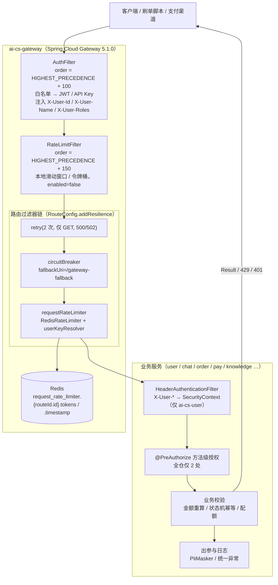
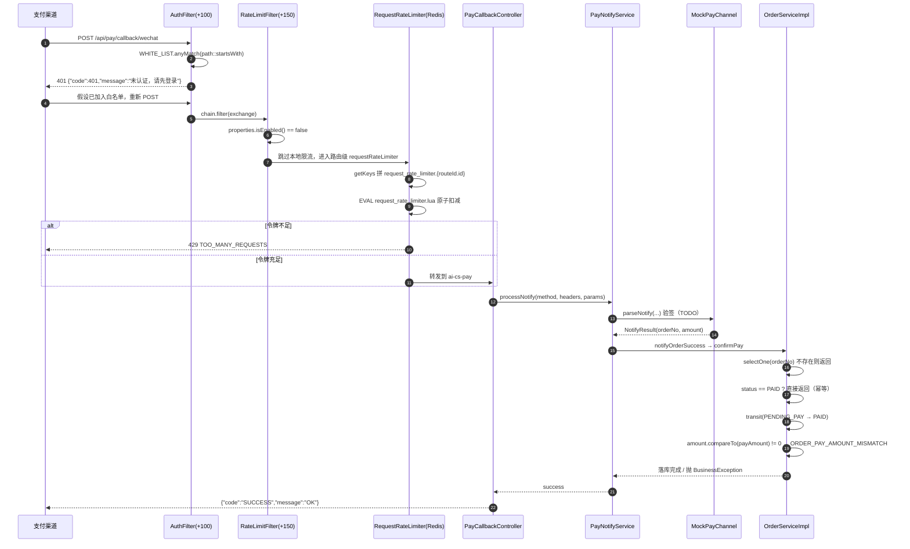

# 接口安全的四件事：身份、权限、流量、数据

> **一句话结论**：接口安全不是"在网关加一个过滤器"能解决的事——身份可以在网关注入，但权限必须贴着资源（方法级）判、限流键要等认证之后才拿得到、数据脱敏要在出入参/日志/错误信息三个出口同时收口；本项目第 1 件事做了七成、第 2 件事只做了 2 个注解、第 3 件事配置成 `enabled: false`、第 4 件事只覆盖了日志一路。
> **阅读前置**：读过 Spring Security 的 `SecurityFilterChain` 与服务端方法鉴权；知道 Spring Cloud Gateway 有 GlobalFilter / 路由过滤器工厂两种扩展点；对 Redis `SET NX EX`、Lua 脚本原子性、429/401/403 的语义有基本印象。
> **证据基线**：Spring Cloud Gateway 5.1.0（`RedisRateLimiter` + `request_rate_limiter.lua`，A 级归档）、Spring Security 7.2.0（`PreAuthorizeAuthorizationManager`，A 级归档）、本项目 Spring Boot 4.2.0 / JDK 17 代码快照（B 级行号均为当次 `read` 核对）、C 级为 node 24 纯算术模拟与本机 pwsh 静态统计（无服务、无网络、无中间件）。预计阅读 40 分钟。

## 0. 先看现象

### 症状一：验证码接口被脚本匀速刷，网关日志里一条限流警告都没有

`RateLimitFilter` 的限流分支长这样（`ai-cs-gateway/src/main/java/com/aics/gateway/filter/RateLimitFilter.java#L50-L63`）：

```java
    @Override
    public Mono<Void> filter(ServerWebExchange exchange, GatewayFilterChain chain) {
        // 学习点：限流过滤器放在认证之后（order +150 > AuthFilter +100）——
        // 认证前客户端可伪造 X-User-Id 刷不同的限流桶，认证后只能拿到可信身份，
        // 所以优先用“可信用户ID”做限流键，未认证/白名单路径退化为客户端 IP。
        if (!properties.isEnabled()) {
            return chain.filter(exchange);
        }
        String key = resolveKey(exchange);
        if (!tryAcquire(key)) {
            log.warn("请求触发限流: key={}, path={}", key, exchange.getRequest().getPath());
            return tooManyRequests(exchange.getResponse());
        }
        return chain.filter(exchange);
    }
```

而配置里这个开关是关的：`aics.gateway.rate-limit.enabled: false`（`ai-cs-gateway/src/main/resources/application.yml#L36-L49`），那几行注释自己写了原因——本地内存限流单机配额、多实例不共享，已由路由级 `RequestRateLimiter`（Redis 令牌桶）替代，Redis 不可用时再改回 `true` 兜底。

于是脚本刷 `/user/captcha` 时：本机这把枪（`RateLimitFilter`）没上膛（`enabled: false`），路由级那把枪（Redis 令牌桶）虽然装着，但**被刷的路径根本不受它保护**——它是按路由配的，而 `/user/captcha` 在白名单里、连认证都不做。更荒诞的是这个接口在白名单里躺着、实现却不存在：

```text
PS> Get-ChildItem -Recurse -Include *.java ai-cs-* | Select-String -Pattern 'captcha' | Select-Object -First 10
ai-cs-gateway\src\main\java\com\aics\gateway\filter\AuthFilter.java:86:            "/user/captcha",
ai-cs-gateway\src\main\java\com\aics\gateway\filter\AuthFilter.java:89:            "/api/user/captcha",
```

全仓 `captcha` 只命中这两行白名单，没有任何 Controller。也就是说：**白名单比真接口还宽**——任何人用脚本扫 `/user/captcha` 拿到的都是 404，但这条 404 的链路完全不经过认证、也不经过任何限流（白名单分支直接放行）。

### 症状二：限流一开，整个公司办公网的同事集体 429

`resolveKey` 的逻辑是"有可信用户头就按用户、否则按 IP"（`ai-cs-gateway/src/main/java/com/aics/gateway/filter/RateLimitFilter.java#L80-L89`）：

```java
    private String resolveKey(ServerWebExchange exchange) {
        ServerHttpRequest request = exchange.getRequest();
        String userId = request.getHeaders().getFirst(USER_ID_HEADER);
        if (userId != null && !userId.isBlank()) {
            return "u:" + userId;
        }
        String ip = request.getRemoteAddress() == null
                ? "unknown" : request.getRemoteAddress().getAddress().getHostAddress();
        return "ip:" + ip;
    }
```

对**未登录**的接口（登录、注册、验证码、支付回调）永远拿不到 `X-User-Id`，必然退化成 IP 键。用 node 复现一个 200 人的办公网（同一出口 IP、每人每 10 秒点一次刷新、共 12000 次请求、桶参数对齐网关的 `cap=10 / rate=5/s`）：

```text
PS> node %TEMP%\nat-key-sim.mjs
ip-shared       total=12000 allowed=3009  rejected=8991 rejectRate=74.92%
per-user        total=12000 allowed=12000 rejected=0    rejectRate=0.00%
```

同一个流量模型，共享一个 IP 桶时 **74.92% 的正常请求被拒**；按人分桶时 0 拒绝。这就是"按 IP 限流误伤 NAT"的量化版本——不是"可能误伤"，是三个人里拒两个。

### 症状三：支付回调"被重放两次扣款"——但本项目连第一次都进不来

真实渠道回调的路径是 `POST /api/pay/callback/{paymentMethod}`（网关侧路由 `/api/pay/**` → `lb://ai-cs-pay`）。而网关白名单是 12 条写死的路径，里面没有它（`ai-cs-gateway/src/main/java/com/aics/gateway/filter/AuthFilter.java#L83-L96`）：

```java
    private static final List<String> WHITE_LIST = List.of(
            "/user/login",
            "/user/register",
            "/user/captcha",
            "/api/user/login",
            "/api/user/register",
            "/api/user/captcha",
            "/api/health",
            "/health",
            "/doc.html",
            "/webjars/",
            "/v3/api-docs",
            "/swagger-resources"
    );
```

所以渠道通知到达网关就是 401「未认证，请先登录」，渠道侧判定失败并进入重试队列——"重放"在这里不是攻击，是**平台自己把正常通知拒了、渠道按约定重发**。

假设有人为了跑通把它加进白名单，事情会更好吗？不会，因为回调入口根本没验签（`ai-cs-pay/src/main/java/com/aics/pay/channel/MockPayChannel.java#L64-L76`）：

```java
    public NotifyResult parseNotify(String paymentMethod, Map<String, String> headers, Map<String, String> params) {
        // TODO: 真实渠道在这里验签（微信 v3 验签+解密 / 支付宝 RSA2 验签 / 银联证书验签）
        log.info("[MockPay] 模拟回调验签通过");
        String orderNo = params.getOrDefault("orderNo", "");
        boolean success = !"FAIL".equalsIgnoreCase(params.getOrDefault("result", "SUCCESS"));
        String amountStr = params.getOrDefault("amount", "0");
        ...
                .amount(new BigDecimal(amountStr))
```

任何人 `curl -X POST /api/pay/callback/wechat -d 'orderNo=xxx&amount=0.01'` 就能把一笔待支付订单标成已支付。真正挡住它的只剩订单侧的两道校验：金额一致性（`ORDER_PAY_AMOUNT_MISMATCH`）与状态机幂等（已 PAID 直接返回）——**如果攻击者把 amount 填成订单真实金额，这两道也挡不住**。

### 这些现象指向同一件事

三个症状分别缺的是**流量**（限流没开、开了又按错维度）、**身份+数据**（白名单比接口宽、回调不验签）、**权限+幂等**（回调入口没有任何服务端校验兜底）。它们共用同一个根因：**安全被当成"网关的一层过滤器"来设计，而网关只能看见 HTTP 的壳，看不见"这个订单是谁的""这次回调是不是重放""这个金额该不该信"。**

## 1. 整体地图



> **读图说明**：图分上下两半，中间那条 `PRL --> HAF` 就是**信任边界**——网关把"你是谁"压缩成三个 HTTP 头交给服务，服务无条件相信。上半部分（网关）能做的是**身份（AF）、流量（RLF + PRL）**，下半部分（服务）才做得到**权限（PRE）、数据（BIZ/OUT）**。三条容易看错的连线：① `AF → RLF → RT` 的先后不是随便排的，`AuthFilter` 用 `+100`、`RateLimitFilter` 用 `+150`，差 50 就是为了"先认证再限流"，否则限流键里的 `X-User-Id` 是客户端自己填的；② `RT → CB → PRL` 是**由外到内**的三层，重试在最外层、限流在最内层，意味着被限流的 429 不会被重试放大（`retry` 只认 GET+500/502），但也意味着断路器看到的是"限流器之后"的结果；③ 下半部分只有 `ai-cs-user` 一个服务有 `HAF` 和 `@EnableMethodSecurity`，其它 7 个服务的 `PRE` 框实际上是个**空框**——把 `@PreAuthorize` 写上去也不会生效。图中没有画 Sentinel 的 `chat-send` 规则，它挂在方法级（第三层限流点），见 §3.8。

### 组件、责任、调用方

| 组件 | 责任 | 调用方 | 本项目状态 |
|---|---|---|---|
| `AuthFilter`（网关 GlobalFilter，+100） | 白名单放行、JWT 校验、API Key 回退、把身份压成 `X-User-Id/X-User-Name/X-User-Roles` | Spring Cloud Gateway 的 `FilteringWebHandler` | 已落地，12 条白名单用**前缀匹配**，无 `/api/pay/callback` |
| `RateLimitFilter`（网关 GlobalFilter，+150） | 本地单机限流（滑动窗口 / 令牌桶），按用户或 IP 分桶 | 同上 | **配置默认关闭**（`enabled: false`） |
| `RateLimitProperties` | `aics.gateway.rate-limit.*` 绑定 | Spring Boot 配置绑定 | 默认 false、`sliding-window`、60 次/60 秒 |
| `RedisRateLimiter` + `request_rate_limiter.lua` | 分布式令牌桶，Lua 原子扣减 | 路由级 `RequestRateLimiter` 过滤器 | 已通过 `RouteConfig#redisRateLimiter` 注册为 Bean |
| `userKeyResolver` | 路由级限流键：`u:{userId}` 或 `ip:{ip}` | `RequestRateLimiter` | 已落地，只读 `getRemoteAddress()` |
| `HeaderAuthenticationFilter` | 把网关注入的三个头转成 `Authentication` | `UserSecurityConfig` 的 filter chain | 仅 `ai-cs-user` 有 |
| `@PreAuthorize` + `@EnableMethodSecurity` | 方法级授权（谁能对哪个资源做什么） | Spring Security 拦截器 | **全仓 2 处注解、1 处开启** |
| `IdempotentAspect`（`@Idempotent`） | 请求级幂等（Redis `SET NX EX`） | 业务方法 | 组件齐全，**main 代码 0 处使用** |
| `PiiMasker` | 手机/身份证/银行卡/邮箱/地址脱敏 | 审计与 trace 记录器 | 3 处引用，**未用于接口出参** |
| `QuotaService` | 按用户/模型的 token 与成本配额 | chat 服务 | fail-open |
| `SentinelFlowConfig` | 方法级 QPS 限流（`chat:send` 预热模式） | `@SentinelResource` | 已注册规则 |

## 2. 关键概念与关键类

先把四个词钉死，后面不再解释：

- **认证（Authentication）**=「你是谁」，产出 `Authentication` 对象；**授权（Authorization）**=「你能对这条资源做什么」，产出 allow/deny。两者可以在同一个过滤器里做，但**责任不能合并**——认证是全局一次的，授权是每条业务语义不同的。
- **水平越权**=同一角色的人访问别人的资源（用户 A 看用户 B 的订单）；**垂直越权**=低权限干高权限的活（普通用户调管理接口）。前者靠"资源归属校验"，后者靠"角色/权限校验"。
- **nonce / timestamp / 幂等键**：nonce 是一次性随机串（服务端用 `SET NX` 记住 TTL 窗口内用过没有），timestamp 用来卡住"过期请求"，幂等键（本项目用 `orderNo`）用来让"同一业务操作只生效一次"。三者解决的是同一个问题：**重复到达**。
- **fail-open / fail-closed**：安全组件自己坏掉时是"放行"还是"拒绝"。限流器、幂等、配额都可以选；但**支付与鉴权不能 fail-open**。本项目 `RedisRateLimiter` 和 `IdempotentAspect` 都选了 fail-open（见 §3.4、§3.6）。
- **限流键（key）**：限流永远不是"限总量"，而是"限某个主体的速率"。主体选 IP/用户/租户/接口，直接决定误伤面与绕过成本（见 §3.7）。
- **令牌桶 / 漏桶 / 固定窗口 / 滑动窗口**：四种"桶的形状"，区别只在"允不允许突发"和"要存多少状态"（见 §3.6）。
- **熔断 vs 降级**：熔断是**停止调用**下游（状态机 OPEN），降级是**给替代响应**。熔断通常配一个降级响应，但降级不一定要熔断（见 §3.9）。
- **429 + `Retry-After`**：被限流的**契约**——状态码告诉客户端"是限流不是出错"，`Retry-After` 告诉它"多久之后再来"，缺了后者客户端会立刻重试，把限流打成自我 DDoS（见 §3.10）。

| 名称 | 位置 | 角色 | 关键方法 |
|---|---|---|---|
| `AuthFilter` | `ai-cs-gateway/src/main/java/com/aics/gateway/filter/AuthFilter.java` | 网关统一认证 + 身份注入 | `filter`（L100-L170）、`isWhiteListed`（L179-L181）、`tryApiKeyAuth`（L188-L199）、`getOrder`（L171-L174） |
| `RateLimitFilter` | `ai-cs-gateway/src/main/java/com/aics/gateway/filter/RateLimitFilter.java` | 网关本地限流 | `filter`（L50-L64）、`tryAcquire`（L70-L75）、`resolveKey`（L80-L89）、`tooManyRequests`（L94-L100） |
| `RateLimitProperties` | `ai-cs-gateway/src/main/java/com/aics/gateway/config/RateLimitProperties.java` | 限流配置绑定 | getter/setter（L28-L46） |
| `TokenBucketRateLimiter` | `ai-cs-gateway/src/main/java/com/aics/gateway/filter/TokenBucketRateLimiter.java` | 单机令牌桶 | `tryAcquire`（L35-L53） |
| `RouteConfig` | `ai-cs-gateway/src/main/java/com/aics/gateway/config/RouteConfig.java` | 路由 + 三层韧性 + 限流键 | `redisRateLimiter`（L50-L54）、`userKeyResolver`（L155-L167）、`addResilience`（L174-L187） |
| `RedisRateLimiter` | spring-cloud-gateway-server-webflux 5.1.0（A 级归档） | 分布式令牌桶 | `isAllowed`（L245-L298）、`getKeys`（L160-L171）、`getHeaders`（L314-L323） |
| `request_rate_limiter.lua` | 同上（A 级归档） | 原子补充 + 扣减 | 全脚本 27 行，核心 L14-L27 |
| `HeaderAuthenticationFilter` | `ai-cs-user/src/main/java/com/aics/user/security/HeaderAuthenticationFilter.java` | 头 → `Authentication` | `doFilterInternal`（L34-L49） |
| `UserSecurityConfig` | `ai-cs-user/src/main/java/com/aics/user/security/UserSecurityConfig.java` | 打开方法级鉴权 + 401/403 处理 | `userSecurityFilterChain`（L29-L45） |
| `PreAuthorizeAuthorizationManager` | spring-security-core 7.2.0（A 级归档） | 解析并求值 `@PreAuthorize` 表达式 | `authorize`（L80-L89） |
| `AuthorizationManagerBeforeMethodInterceptor` | 同上（A 级归档） | AOP 拦截器，调用前鉴权 | `invoke`（L195-L198）、`attemptAuthorization`（L248-L264） |
| `IdempotentAspect` | `ai-cs-common/src/main/java/com/aics/common/idempotent/IdempotentAspect.java` | 请求级幂等 | `around`（L49-L75） |
| `OrderServiceImpl#confirmPay` | `ai-cs-order/src/main/java/com/aics/order/service/impl/OrderServiceImpl.java` | 支付结果落库（金额 + 状态机两道闸） | `confirmPay`（L115-L151） |
| `PiiMasker` | `ai-cs-chat/src/main/java/com/aics/chat/util/PiiMasker.java` | 日志/审计脱敏 | `mask`（L78-L92）、`luhnValid`（L115-L136） |

## 3. 原理与证据逐段精读

### 3.1 认证与授权的分离：网关只回答"你是谁"

**在干什么**：`AuthFilter` 校验 JWT 后，把 `subject` 和角色写成三个请求头往下游传（`ai-cs-gateway/src/main/java/com/aics/gateway/filter/AuthFilter.java#L146-L164`）：

```java
        // 解析用户信息并透传至下游
        try {
            String userId = JwtUtil.getSubject(token, jwtSecret);
            Map<String, Object> claims = JwtUtil.parseToken(token, jwtSecret);
            String role = String.valueOf(claims.getOrDefault("role", "USER"));
            String normalizedRole = role.startsWith("ROLE_") ? role : "ROLE_" + role.toUpperCase();
            ServerHttpRequest mutatedRequest = request.mutate()
                    // 3.2 F2 身份可信透传：先移除客户端伪造的 X-User-Id/X-User-Name，
                    // 再注入从 JWT 解析的可信身份，下游只信任网关透传的身份头
                    .headers(headers -> {
                        headers.remove(USER_ID_HEADER);
                        headers.remove(USER_NAME_HEADER);
                        headers.remove(USER_ROLES_HEADER);
                    })
                    .header(USER_ID_HEADER, userId)
                    .header(USER_NAME_HEADER, String.valueOf(claims.get("username")))
                    .header(USER_ROLES_HEADER, normalizedRole)
                    .build();
            return chain.filter(exchange.mutate().request(mutatedRequest).build());
```

下游 `ai-cs-user` 用一个 `OncePerRequestFilter` 把头翻译成 `Authentication`，**不重新校验任何签名**（`ai-cs-user/src/main/java/com/aics/user/security/HeaderAuthenticationFilter.java#L34-L55`）：

```java
        String userId = request.getHeader(USER_ID);
        if (userId != null && !userId.isBlank()) {
            String roles = request.getHeader(USER_ROLES);
            List<SimpleGrantedAuthority> authorities = roles == null ? List.of() :
                    Arrays.stream(roles.split(","))
                            .map(String::trim)
                            .filter(s -> !s.isBlank())
                            .map(role -> role.startsWith("ROLE_") ? role : "ROLE_" + role.toUpperCase())
                            .map(SimpleGrantedAuthority::new)
                            .toList();
            UsernamePasswordAuthenticationToken authentication =
                    new UsernamePasswordAuthenticationToken(userId, null, authorities);
            authentication.setDetails(request.getHeader(USER_NAME));
            SecurityContextHolder.getContext().setAuthentication(authentication);
        }
        try {
            filterChain.doFilter(request, response);
        } finally {
            SecurityContextHolder.clearContext();
        }
```

真正回答"你能干什么"的是方法上的 `@PreAuthorize`，它由 `AuthorizationManagerBeforeMethodInterceptor` 在**方法调用前**求值：`attemptAuthorization` 里先 `this.authorizationManager.authorize(this::getAuthentication, mi)`，捕获 `AuthorizationDeniedException` 就转 `handle(...)`，拿到 `AuthorizationResult` 后**只有 `isGranted()` 为假才拦**，否则 `mi.proceed()` —— 也就是说"没有注解"和"注解通过"走的是同一条放行路径 [[源码:AuthorizationManagerBeforeMethodInterceptor.java.md#L248-L264]]。

而 `PreAuthorizeAuthorizationManager` 只做一件事——拿到注解上的表达式就求值，**没有注解就返回 `null`（表示"不归我管"）**：

```java (src: PreAuthorizeAuthorizationManager.java.md#L80-L89)
	public AuthorizationResult authorize(Supplier<Authentication> authentication, MethodInvocation mi) {
		ExpressionAttribute attribute = this.registry.getAttribute(mi);
		if (attribute == null) {
			return null;
		}
		return ExpressionUtils.evaluate(attribute.getExpression(), authentication.get(), mi);
	}
```

**为什么这么设计**：认证是**全局的、一次性的、只看凭证本身**——网关做一次，省掉每个服务都解析一遍 JWT、都持有密钥。授权是**逐资源的**——"查订单"要知道订单归谁，"删用户"要知道角色，这些信息在网关根本不存在。如果把授权塞进网关，网关就得连业务库（或写一堆路径正则），网关立刻从"基础设施"退化成"业务耦合点"，任何一个接口改权限都要改网关。

**换写法会怎样**：把"只能看自己的订单"写成网关的路径规则，比如 `/api/order/*` 只允许带 `X-User-Id` 的请求。这条规则里**没有"这个订单属于谁"的信息**，所以它一个水平越权都挡不住；要想挡住，网关必须拿到 `orderId` 再去查库——那是把一次业务查询变成两次，还让网关依赖 order 服务，路由一挂全网关挂。

**常见坑**：
1. **信任边界的默认假设没写下来**。`HeaderAuthenticationFilter` 无条件相信 `X-User-Id`，它的安全前提是"外部请求只能经过网关"。本项目没有任何一层在验证这个前提（无 mTLS、无内网 ACL、无共享密钥头），只要有人能直连 `ai-cs-user` 的 8081 端口，`curl -H "X-User-Id: 1"` 就是超级管理员。`AuthFilter` 只做了**一半**防护：白名单分支和 JWT 分支都会先 `remove` 或覆盖客户端自带的三个头，所以"伪造头穿过网关"是挡住的，但"绕过网关"没有。
2. **只开了 `anyRequest().authenticated()` 就以为有权限**。它保证"有身份"，不保证"有权限"。`ai-cs-user` 的 `SecurityFilterChain` 里 `requestMatchers(...).permitAll()` 之后是 `anyRequest().authenticated()`——任何合法用户的任意请求都能通过，剩下全靠那 2 个 `@PreAuthorize`。
3. **`@EnableMethodSecurity` 只在 `ai-cs-user` 出现过一次**。其它服务的 Controller 上写 `@PreAuthorize` 不会报错、也不会生效（没有拦截器织入），属于**静默失效**——比报错危险得多。

### 3.2 越权的两类与检测手法

**在干什么**：全仓唯一的两处水平越权防护，靠"token 里的用户名 == 路径/请求体里的 id"（`ai-cs-user/src/main/java/com/aics/user/controller/UserController.java#L42-L52`）：

```java
    @GetMapping("/{id}")
    @PreAuthorize("authentication.name == #p0.toString() or hasRole('ADMIN')")
    public Result<User> getUserById(@PathVariable("id") Long id) {
        return userService.getUserById(id);
    }

    @PutMapping
    @PreAuthorize("authentication.name == #p0.id?.toString() or hasRole('ADMIN')")
    public Result<Void> updateUser(@Validated(UserValidationGroups.Update.class) @RequestBody User user) {
        return userService.updateUser(user);
    }
```

垂直越权则由 `hasRole('ADMIN')` 那一半兜住。

**为什么这么设计**：`authentication.name` 来自 `HeaderAuthenticationFilter` 的 `principal`，也就是网关验过的 `userId`——**它是唯一不可伪造的事实来源**。`#p0` 是**位置参数引用**，SPEC 里不需要参数名（`#id` 那种写法要开 `-parameters` 编译参数才能用，很容易在换构建配置时静默失效）。

**换写法会怎样**：常见错法是"从请求体里取 `userId`，再和 token 里的比"——多一步、多一个可篡改字段；更常见是"前端传 `userId`，后端直接用它查"——那就是把一个任意读接口拱手送人。另一种错法是靠"业务上没人会这么调"：`GET /user/1` 改成 `GET /user/2` 只需要改一个字符。

**常见坑**：
1. **只给"能想到的接口"加注解**。本项目 8 个 Java 服务里只有 user 的 2 个方法有 `@PreAuthorize`；order、product、message、notify、knowledge、search 的资源归属校验全靠 Service 内部自己写（有就有效，没就没）。越权检测的正确姿势是**从注解覆盖率开始查**，而不是从接口清单开始查：

全仓检索 `@PreAuthorize|@Idempotent|@PostAuthorize` 命中 5 行，其中真注解只有 2 条（`UserController.java#L43`、`#L50`），另外 3 条是 javadoc 与注释——**"注释里写着 `@Idempotent(key = 'pay:callback:' + #orderNo)`" 是最容易骗过 review 的东西**，而实际使用数是 0（命令与真实输出见 §6 坑 3）。
5 条命中里 3 条是注释/javadoc，真注解 2 条。**"注释里写着 `@Idempotent(key = "'pay:callback:' + #orderNo")`" 是最容易骗过 review 的东西**：它看起来像"支付回调已经幂等了"，而实际使用数是 0。
2. **水平越权的检测要交叉改两个维度**：用 A 的 token + B 的资源 id（`GET /user/{B}`）、用 A 的 token + 请求体里塞 B 的 userId（`PUT /user`）、用过期 token 重放。三条里前两条本项目有防护，第三条靠网关的 `validateToken`。
3. **`getRemoteAddress()` 不是客户端 IP**（见 §3.7），同理"按 IP 做权限/审计"也是错的。
4. **这两处注解只挡住了"改哪个 id"，没挡住"改哪些字段"**：`updateUser` 直接把 `@RequestBody User` 绑到实体上（返回值也是 `Result<User>` 而非 VO），`@PreAuthorize` 只校验 `#p0.id` 是不是本人，请求体里多带的 `status`、`role`、`balance` 之类字段能否落地全看 `userService.updateUser` 里怎么写 SQL。这就是 **mass assignment（批量赋值）**：注解解决了"水平越权到别人"，不解决"给自己提权"。正确写法是入参用 `UserUpdateDTO`（只暴露可改字段）、出参用 `UserVO`（去掉密码哈希、手机号等），而不是拿实体当契约。

### 3.3 参数篡改与金额校验：服务端必须自己重算

**在干什么**：下单时**完全不信任前端送来的任何金额**，而是用库里商品价乘数量重算，再走促销规则（`ai-cs-order/src/main/java/com/aics/order/service/impl/OrderCreateTxService.java#L97-L101`）：

```java
            // 3. 计算价格
            BigDecimal totalAmount = cartItems.stream()
                    .map(item -> item.getProductPrice().multiply(BigDecimal.valueOf(item.getQuantity())))
                    .reduce(BigDecimal.ZERO, BigDecimal::add);
            PriceCalcBO priceCalc = promotionService.calculatePrice(totalAmount, userId, couponId);
```

支付回调落库时，再拿"渠道说的金额"和"订单自己记的金额"对一次（`ai-cs-order/src/main/java/com/aics/order/service/impl/OrderServiceImpl.java#L125-L143`）：

```java
        // 状态机是迁移唯一入口：PAID 回调仍幂等，其他非法态忽略。
        if (OrderStatus.PAID.getCode().equals(order.getStatus())) {
            log.info("订单已支付，忽略重复确认: orderNo={}", orderNo);
            return;
        }
        try {
            order.setStatus(orderStateTransitionService.transit(order.getStatus(), OrderEvent.PAY).getCode());
        } catch (BusinessException e) {
            log.warn("订单状态不允许支付确认，忽略: orderNo={}, status={}", orderNo, order.getStatus());
            return;
        }
        // 金额校验（安全红线：回调金额必须与订单金额一致）
        if (amount != null && order.getPayAmount() != null
                && amount.compareTo(order.getPayAmount()) != 0) {
            log.error("支付金额与订单不一致: orderNo={}, callbackAmount={}, orderAmount={}",
                    orderNo, amount, order.getPayAmount());
            throw new BusinessException(ResultCode.ORDER_PAY_AMOUNT_MISMATCH);
        }
```

**为什么这么设计**：金额是**服务端事实**，客户端送来的任何数字都是"意图"不是"事实"。重算保证"售价与数量不被篡改"，比对保证"渠道实际收的钱和订单应受的钱一致"。两道校验的输入不同（前者来自商品库，后者来自渠道），所以能互相校验。

**换写法会怎样**：直接把前端 `payAmount` 存进订单，攻击者把 1999 改成 0.01，订单就以 0.01 成立——这是电商最常见的资损漏洞之一。只在**回调侧**校验金额而不在**下单侧**重算，则攻击者可以下一笔"金额 0.01 的合法订单"，回调校验也照样通过。

**常见坑**：
1. **校验点的位置决定了它保护什么**。金额一致性校验在 `confirmPay` 内部、在状态机迁移之后——它保证"钱对了才置 PAID"，但它保护不了"这笔单本来就不该这个价"。所以重算（下单侧）和比对（回调侧）缺一不可。
2. **金额相等 ≠ 收到了钱**。`MockPayChannel` 不验签，任何人构造一个 `orderNo` + 真实金额的 POST 就能把订单推到 PAID。金额校验此时只验证了"数字对得上"，验证不了"钱到账"。要补的是**验签 + 渠道主动查单（`queryOrder`）**，本项目 TODO 就挂在这两行上。
3. **回调入口的鉴权与"是否走网关"是两件事**。`PayOrderController` 的注释写着"由独立支付服务调用，不走网关鉴权"——这类"内部接口"的安全性完全依赖网络隔离，而当前仓库里没有任何隔离声明（无 NetworkPolicy、无内网 ACL）。它一旦暴露，`amount` 参数就由调用方随便填，只剩订单侧比对兜底。
4. **金额之外还要校验数量与折扣**：重算覆盖了"单价×数量"和"促销结果"，但 `quantity` 为负、`couponId` 被遍历套用，都需要 `@Min` / 限领这类参数与业务校验，不在重算范围内。

### 3.4 重放与幂等：三道闸，最后一闸必须自己写

**在干什么**：本项目的幂等有三层设计、实现了一层：

1. **渠道验签 + 时间戳窗**（未实现，`MockPayChannel#parseNotify` 的 TODO）；
2. **请求级幂等键**（组件齐全、0 处使用）：`@Idempotent` 切面用 Redis `SET NX EX` 抢"首次占位"（`ai-cs-common/src/main/java/com/aics/common/idempotent/IdempotentAspect.java#L55-L74`）：

```java
        String redisKey = properties.getKeyPrefix() + resolveKey(joinPoint, idempotent);
        Duration ttl = Duration.ofSeconds(idempotent.ttlSeconds());
        ValueOperations<String, String> ops = redisTemplate.opsForValue();
        boolean acquired;
        try {
            acquired = Boolean.TRUE.equals(ops.setIfAbsent(redisKey, TOKEN, ttl));
        } catch (RuntimeException e) {
            log.warn("幂等组件 Redis 异常，fail-open 放行 key={}", redisKey, e);
            return joinPoint.proceed();
        }
        if (!acquired) {
            throw new IdempotentRejectException(idempotent.message());
        }
        try {
            return joinPoint.proceed();
        } catch (Throwable t) {
            tryRelease(redisKey);
            throw t;
        }
```

3. **业务级状态机幂等**（已实现，是最后一道）：`confirmPay` 先看订单是否已 PAID 直接返回，再用状态机 `transit(PENDING_PAY → PAID)` 保证"只有一次迁移能成功"。

**为什么这么设计**：重放有两个完全不同的来源——**攻击者主动重放**（截获回调报文再发一次）和**渠道被动重试**（我方超时，渠道按约定重发 3 次）。第 1、2 层处理"报文级重复"，第 3 层处理"业务级重复"。只有第 3 层是**业务真相所在**（订单状态只有一个），所以它必须自己实现，不能外包给网关或 Redis。

**换写法会怎样**：只靠 Redis 幂等键——`IdempotentAspect` 在 Redis 异常时 **fail-open 直接放行**，Redis 抖一下，重放保护就全没了；只靠状态机——重复请求会打到下游所有逻辑（查单、记账、发 MQ），只是最后一步被挡，浪费资源且日志噪音大。所以"便宜的挡在前面、权威的挡在最后"是正确结构，本项目缺的是第 1、2 层。

**常见坑**：
1. **幂等键选错**：用 `userId` 做 key → 用户第二次正常支付也被拒；用"整个报文哈希" → 渠道每次重试的 `nonce` 都不同，哈希不同，等于没做。支付场景的键就是 `orderNo`（业务主键）。
2. **幂等键的释放时机**：成功路径必须让 key 走到 TTL 自然过期（否则事务提交前就放开，并发窗口打开）；失败路径要主动释放（`tryRelease`），否则用户重试被自己挡住 5 分钟。
3. **fail-open 用在支付上是错的**：`IdempotentAspect` 选择"Redis 挂就放行"对查询类接口合理，对资金类接口应该 fail-closed（宁可拒绝，让渠道重试）。这是**按接口选失败语义**的典型例子。

### 3.5 敏感字段的三个出口：出参、日志、错误信息

**在干什么**：本项目只覆盖了中间一路（日志/审计），另外两路基本裸奔（`ai-cs-chat/src/main/java/com/aics/chat/util/PiiMasker.java#L78-L92`）：

```java
    public String mask(String text) {
        // 学习点（脱敏顺序）：先长后短、先具体后宽泛——
        // 身份证（18位）→ 银行卡（13-19位+Luhn）→ 手机号（11位）→ 邮箱 → 地址。
        // 学习点（数字边界）：所有定长数字类正则必须带 (?<!\d)(?!\d) 前后向断言。
        // 实战踩坑：20 位订单号 "20260814000000123456" 曾先被身份证正则（18位子串）、
        // 再被手机号正则（11位子串）在长数字串内部滑动命中——加边界后不再误伤。
        String masked = ID_CARD.matcher(text).replaceAll("$1********$2");
        masked = maskBankCards(masked);
        masked = PHONE.matcher(masked).replaceAll("$1****$2");
        masked = EMAIL.matcher(masked).replaceAll("***@$1");
        masked = ADDRESS_NO.matcher(masked).replaceAll("***$2");
        return masked;
    }
```

错误信息的出口更值得看——`GlobalExceptionHandler` 里只有 `handleBusinessException` **没有** `@ResponseStatus`（`ai-cs-common/src/main/java/com/aics/common/exception/GlobalExceptionHandler.java#L35-L39`）：

```java
    @ExceptionHandler(BusinessException.class)
    public Result<Void> handleBusinessException(BusinessException e, HttpServletRequest request) {
        log.warn("业务异常 [{}] {}: code={}, msg={}", request.getMethod(), request.getRequestURI(), e.getCode(), e.getMessage());
        return Result.fail(e.getCode(), e.getMessage());
    }
```

同一个类里其它 10 个 handler 全都带 `@ResponseStatus`（`BAD_REQUEST`、`METHOD_NOT_ALLOWED` 等），只有这一路漏了——于是**所有业务失败（含越权、金额不符、幂等拒绝）对外都是 HTTP 200**，body 里才是 `code: 4xx/5xx`。

**为什么这么设计**：脱敏放在"出口"而不是"存储"，是因为同一份数据在不同出口的暴露风险不同：出参给的是本人（可以看全量），日志给的是运维/ELK（不该看全量），错误信息给的是**任意调用方**（包括攻击者）。`PiiMasker` 放在日志和审计侧，正是"日志给的范围最小、必须脱敏"的落地。

**换写法会怎样**：在 DAO 层脱敏 → Service 永远拿不到原值，业务做不了；在 `toString()` 里脱敏 → 只保护"打整个对象"的日志，`log.info("phone={}", phone)` 照样泄露；用 `@JsonSerialize` 全局脱敏出参 → 本人也看不到自己的手机号，得按角色分支。所以正确做法是**按出口分别处理，并让"默认安全"**。

**常见坑**：
1. **顺序与边界**。`PiiMasker` 类注释里记着一个真实误伤：20 位订单号 `20260814000000123456` 曾被"18 位身份证正则"和"11 位手机号正则"在长数字串内部滑动命中，加了 `(?<!\d)…(?!\d)` 边界才修好。**脱敏做错不是"少脱一个"，是"把一个正常订单号打成一串星号"**，比不脱更糟。
2. **日志脱敏只覆盖显式调用点**。全仓 `PiiMasker` 只有 3 处 main 引用（审计、trace、视觉对话），`log.info("user={}", user)` 这类"打对象"的日志完全不经过它。
3. **错误信息就是情报**。`PayCallbackController` 直接回 `e.getMessage()`，把内部异常文本（可能含 SQL、类名、栈里的表名）交给任意调用方；`GlobalExceptionHandler` 已经做了笼统化，但这个 Controller 自己拼了响应，绕过了它。
4. **业务失败恒 200 的连锁后果**：网关/监控统计不到失败率（只统计 5xx），客户端 SDK 不重试，前端要靠解析 body 判断——安全性上也更差：攻击者用 200 就能确认"接口真实存在且被走到了"。

### 3.6 限流四算法：先看同一份流量在四种算法下的实际差异

**在干什么**：用一个计数器或桶状态，把"某主体单位时间的新增请求"压在阈值内。四种经典实现的状态差异如下（本机 node 24 纯算术模拟，无网络/无中间件，脚本 `%TEMP%\limit-algo-sim.mjs`，统一口径 **10 秒窗口 10 个请求**）：

```javascript
const mkFixed = (limit, W) => { const c = new Map(); return t => { const k = Math.floor(t / W); const n = c.get(k) || 0; if (n >= limit) return false; c.set(k, n + 1); return true; }; };
const mkSlideLog = (limit, W) => { let q = []; return t => { q = q.filter(x => x > t - W); if (q.length >= limit) return false; q.push(t); return true; }; };
const mkSlideCount = (limit, W) => { let cur = 0, prev = 0, start = 0; return t => { const w = Math.floor(t / W); if (w !== start) { prev = (w === start + 1) ? cur : 0; cur = 0; start = w; } const ratio = 1 - (t - start * W) / W; if (prev * ratio + cur >= limit) return false; cur++; return true; }; };
const mkBucket = (cap, rate) => { let tok = cap, last = null; return t => { if (last === null) last = t; tok = Math.min(cap, tok + Math.max(0, t - last) / 1000 * rate); last = t; if (tok >= 1) { tok -= 1; return true; } return false; }; };
const mkLeaky = gap => { let next = 0; return t => { if (t < next) return false; next = t + gap; return true; }; };

const STREAM = [];
for (let i = 0; i < 10; i++) { STREAM.push({ t: 9900 + 10 * i, p: 'P1' }); STREAM.push({ t: 10090 + 10 * i, p: 'P1' }); }
for (let i = 0; i < 20; i++) STREAM.push({ t: 20000 + 1000 * i, p: 'P2' });
for (let i = 0; i < 20; i++) STREAM.push({ t: 50000 + 5 * i, p: 'P3' });
for (let i = 0; i < 8; i++) STREAM.push({ t: 90000 + 10 * i, p: 'P4' });
STREAM.sort((a, b) => a.t - b.t);

function run(algo, stream) {
  const passed = [];
  const perPhase = { P1: 0, P2: 0, P3: 0, P4: 0 };
  for (const r of stream) if (algo(r.t)) { passed.push(r.t); perPhase[r.p]++; }
  let max = 0;
  for (let i = 0, j = 0; i < passed.length; i++) { while (passed[i] - passed[j] >= 1000) j++; max = Math.max(max, i - j + 1); }
  return { allowed: passed.length, rejected: stream.length - passed.length, perPhase, max };
}

const algos = { 'fixed_10s10': mkFixed(10, 10000), 'slide_log': mkSlideLog(10, 10000), 'slide_count': mkSlideCount(10, 10000), 'token_bucket': mkBucket(10, 5), 'leaky_1per_s': mkLeaky(1000) };
console.log('algo'.padEnd(14) + 'allow deny  P1/P2/P3/P4  maxInAny1s');
for (const [name, a] of Object.entries(algos)) { const r = run(a, STREAM); console.log(name.padEnd(14) + String(r.allowed).padEnd(6) + String(r.rejected).padEnd(6) + [r.perPhase.P1, r.perPhase.P2, r.perPhase.P3, r.perPhase.P4].join('/').padEnd(14) + r.max); }
```

```text
PS> node %TEMP%\limit-algo-sim.mjs
algo          allow deny  P1/P2/P3/P4  maxInAny1s
fixed_10s10   58    10    20/20/10/8    20
slide_log     48    20    10/20/10/8    10
slide_count   48    20    11/19/10/8    11
token_bucket  49    19    11/20/10/8    11
leaky_1per_s  23    45    1/20/1/1      1
```

**怎么读这张表**：同一个"10 秒 10 次"的阈值，五种实现放行数从 23 到 58，差 2.5 倍——**"限流"不是一个阈值，是"阈值 + 算法"两件事**。关键看两列：`P1`（跨窗口边界的两波共 20 个请求）和 `maxInAny1s`（任意 1000ms 滑动窗内的最大放行数，用滚动窗口算，不能按秒取整——否则 9.9s~10.18s 的 20 个会被劈到两个整数秒里，正好把临界问题藏起来）。

- **固定窗口** `P1=20`、`maxInAny1s=20`：第 9.9 秒用光 10 个，第 10.09 秒又拿到 10 个，**瞬时速率达到阈值 2 倍**。这就是"临界问题"，任何"每分钟 N 次"的粗暴计数都有这个洞，而它恰好是最容易实现的那种。
- **滑动窗口**：日志式 `P1=10`、`allowed=48`，存最近 10 秒的**每个请求时间戳**，精确但内存 O(活跃主体 × 阈值)；计数式 `P1=11`、`P2=19`，只存"当前窗口计数 + 上一窗口计数"按时间比例加权，内存 O(1)，代价是**依然不精确**——跨边界会多放进 1 个（11 > 10），匀速流量会被错拒 1 个（19 < 20）。
- **滑动窗口（计数式）** `P1=11`、`P2=19`：只存"当前窗口计数 + 上一窗口计数"按时间比例加权，内存 O(1)，代价是**依然不精确**——跨边界会多放进 1 个（11 > 10），匀速流量会被错拒 1 个（19 < 20）。工程上常用它就是图 O(1)。
- **令牌桶** `P1=11`、`P3=10`、`P2=20`：允许**一次突发用掉整个桶**（容量 10），然后按 5/s 匀速补充。`maxInAny1s=11` 说明它在"桶满 + 补充"的瞬间会略超名义速率 1 个——这是令牌桶的正常语义，不是 bug；**突发上限由 `burstCapacity` 决定，平均速率由 `replenishRate` 决定**，两个旋钮分开。
- **漏桶** `P3=1`、`P4=1`、`maxInAny1s=1`：不管你来多少，出口恒定 1/s，**平滑但会被拒/排队**。适合"必须匀速打到下游"的场景（第三方 API 有严格 QPS 合同），不适合面向人的 Web 接口——人本来就是一阵一阵的。

本项目两条实现路径正好对应两种：

```lua (src: request_rate_limiter.lua.md#L11-L27)
local fill_time = capacity / rate
local ttl = math.floor( fill_time * 2 )
local last_tokens = tonumber(redis.call("get", tokens_key)) or capacity
local last_refreshed = tonumber(redis.call("get", timestamp_key)) or 0
local delta = math.max(0, now-last_refreshed)
local filled_tokens = math.min(capacity, last_tokens+(delta*rate))
local allowed = filled_tokens >= requested
local new_tokens = allowed and filled_tokens - requested or filled_tokens
if ttl > 0 then
    redis.call("setex", tokens_key, ttl, new_tokens)
    redis.call("setex", timestamp_key, ttl, now)
end
return { allowed and 1 or 0, new_tokens }
```

这段脚本是**令牌桶的完整定义**：读上次令牌数 → 按经过时间补 `delta*rate` → 封顶 `capacity` → 够就扣、不够就拒 → 两把键一起 `setex`。`ttl = fill_time * 2` 的意思是"桶空到满所需时间的 2 倍"，闲置超过这个时间键就过期，下一个请求从 `capacity` 重新开始——**用 TTL 代替了"清理不活跃用户"的定时任务**。

**为什么这么设计**：四种算法的差异本质是"用多少内存换多少精度、允不允许突发"。固定窗口 O(1) 但临界翻倍；滑动日志精确但要存时间戳；令牌桶 O(1) 且能表达"突发上限"；漏桶 O(1) 但把突发转成延迟。工程上 90% 的 API 限流答案是**令牌桶**，因为它把"平均速率"和"瞬时突发"两个旋钮分开了（`replenishRate` 与 `burstCapacity`）。

**换写法会怎样**：用固定窗口做登录防刷，攻击者在窗口边界前后各打 10 次，实测 `maxInAny1s=20`，等于把阈值放大一倍；用滑动日志全量存时间戳，1 万个活跃用户 × 60 次/分钟 = 60 万个时间戳常驻内存；用漏桶做 Web API 限流，正常用户会感到"明明没超量却被延迟"。

**常见坑**：
1. **`burstCapacity < replenishRate` 直接被框架拦**。A 级归档里 `setBurstCapacity` 有断言"BurstCapacity 必须 ≥ replenishRate"，且上限是 `9007199254740991`（Lua number 安全整数）。配成 `rate=10, burst=5` 启动就炸，很多人以为是自己配置写错，其实是"桶容量小于每秒补充量"物理上没意义。
2. **令牌用整数会饿死低 QPS 场景**。本项目本地实现特意用 `double` 存令牌（`TokenBucketRateLimiter` L35-L53 的注释写着低 QPS 下整数截断永远补不上），`qps=0.5` 时整数实现每秒补 0 个，服务永久不可用。
3. **分布式下必须原子**。`get → 计算 → set` 三步在并发下会超发（两个请求同时读到 9 个令牌，都认为"够"）。Lua 脚本一次执行完这三步，这是这套实现存在的唯一理由。
4. **Redis Cluster 的键必须在同一个 slot**。`RedisRateLimiter#getKeys` 把前缀写成 `request_rate_limiter.{routeId.id}.`，`{}` 是 hash tag —— 两把键（`tokens`/`timestamp`）因此落在同一节点，否则 Lua 里跨 slot 访问直接报错。
5. **本地实现的 `enabled` 语义容易骗人**。`RateLimitFilter` 的类注释写"enabled（默认 true）"，而 `RateLimitProperties` 里默认是 `false` —— 看注释的人会以为限流开着，看代码的人知道没开。文档/注释与默认值不一致，是"以为有防护"的经典来源。

### 3.7 限流键：按 IP 限流是最常见的自伤

**在干什么**：键的选择在两条链路上是**重复实现**的两份代码——`RateLimitFilter#resolveKey`（L80-L89）和 `RouteConfig#userKeyResolver`（L155-L167），策略完全一致：有 `X-User-Id` 就 `u:{id}`，否则 `ip:{ip}`（`ai-cs-gateway/src/main/java/com/aics/gateway/config/RouteConfig.java#L155-L167`）：

```java
    @Bean
    public KeyResolver userKeyResolver() {
        return exchange -> {
            ServerHttpRequest request = exchange.getRequest();
            String userId = request.getHeaders().getFirst("X-User-Id");
            if (userId != null && !userId.isBlank()) {
                return Mono.just("u:" + userId);
            }
            InetSocketAddress remote = request.getRemoteAddress();
            String ip = remote == null ? "unknown" : remote.getAddress().getHostAddress();
            return Mono.just("ip:" + ip);
        };
    }
```

**为什么这么设计**：限流的目的是"保护资源不被某个主体打满"，所以键必须**尽量接近真实的施害者**。已登录时用户 id 是最准的（一人一桶，互不影响）；未登录时没有更细的标识，只能退化到 IP——这是"可用标识"与"公平性"的折中。

**换写法会怎样**：这就是 §0 症状二的量化版本——200 人共享出口 IP 时，`cap=10 / rate=5/s` 的桶把 74.92% 的**正常**请求拒掉。办公网、校园网、手机运营商 NAT 都是这个形状。反过来，只按用户限流也有洞：注册机可以批量注册新账号，每个账号一个干净桶。

**常见坑**：
1. **`getRemoteAddress()` 拿到的常常不是客户端 IP**。在反向代理/LB/K8s Ingress 后面，它是**最近一跳的地址**（网关自己或 LB），于是**所有外网请求共享一个桶**——比"公司出口 IP 共享"更糟，是全网共享。正确做法是解析 `X-Forwarded-For` / `X-Real-IP`，并且**只信任可信代理链最右侧的那一段**（否则客户端自己填一个假 IP 就换了桶）。本项目两条限流链路都没有取 `X-Forwarded-For`（`Select-String 'X-Forwarded-For'` 在 gateway main 里 0 命中），这类"上了生产才发现限流把所有人限死"的故障，根因就在这里。
2. **键必须带接口维度**。`RedisRateLimiter#getKeys` 的键前缀里包含 `routeId`，所以"登录接口"和"下单接口"各有各的桶；如果自研限流只写 `u:{id}`，用户刷登录接口会把自己的下单额度也刷没。本项目 `RateLimitFilter` 的本地键**没有接口维度**（只有 `u:`/`ip:`），所以它一旦打开，是全局限流而不是分类限流。
3. **组合键**。生产上的常见组合是"接口级总闸 + 用户级 + IP 级兜底 + 设备指纹"，阈值层层放宽。单维度永远在"太松"和"误伤"之间摇摆。
4. **未认证接口的限流必须单独设计**。登录、注册、验证码、支付回调天生拿不到 `X-User-Id`，按 IP 会误伤、按账号又还不存在——正确做法是"按 IP + 设备指纹 + 全局总量"三重，并给这些接口单独更严的阈值（本项目没有区分，`requests: 60` 对所有路径一视同仁）。

### 3.8 限流放在哪：三个位置、一个顺序

**在干什么**：本项目同时存在三个限流点，各自的"视野"完全不同：

| 位置 | 实现 | 能看到的主体 | 生效范围 | 本项目状态 |
|---|---|---|---|---|
| 网关 GlobalFilter | `RateLimitFilter`（order `+150`） | `X-User-Id` / IP | 所有经过网关的请求 | `enabled: false`（关） |
| 网关路由级过滤器 | `RouteConfig#addResilience` 里的 `requestRateLimiter` | `userKeyResolver` 的结果 | 按路由（17 条）配置 | 已注册，用 Redis 令牌桶 |
| 服务方法级 | `SentinelFlowConfig` 的 `chat-send` 规则 | 资源名 + 方法参数 | 单方法 | 已加载规则 |（`ai-cs-chat/src/main/java/com/aics/chat/config/SentinelFlowConfig.java#L27-L45`）

```java
    @PostConstruct
    public void initFlowRules() {
        FlowRule sendRule = new FlowRule();
        sendRule.setResource(SentinelRules.RESOURCE_CHAT_SEND);
        sendRule.setGrade(RuleConstant.FLOW_GRADE_QPS);
        sendRule.setCount(SentinelRules.CHAT_SEND_QPS_THRESHOLD);
        sendRule.setControlBehavior(SentinelRules.CONTROL_BEHAVIOR_WARM_UP);
        sendRule.setWarmUpPeriodSec(SentinelRules.WARM_UP_PERIOD_SEC);

        FlowRule ragRule = new FlowRule();
        ragRule.setResource(SentinelRules.RESOURCE_CHAT_RAG);
        ragRule.setGrade(RuleConstant.FLOW_GRADE_QPS);
        ragRule.setCount(SentinelRules.CHAT_RAG_QPS_THRESHOLD);

        FlowRuleManager.loadRules(List.of(sendRule, ragRule));
        log.info("Sentinel 流控规则已注册: chat-send QPS<={} (WarmUp {}s), chat-rag QPS<={}",
                SentinelRules.CHAT_SEND_QPS_THRESHOLD, SentinelRules.WARM_UP_PERIOD_SEC,
                SentinelRules.CHAT_RAG_QPS_THRESHOLD);
```

类注释把分工写得很清楚：**Sentinel 管入口限流，Resilience4j 管对下游的熔断/超时/重试**——同一份流量既被"入口闸"（QPS）管，又被"下游保护闸"（熔断）管，但它们不是同一件事（见 §3.9）。

**为什么这么设计**：越靠外的限流点越省资源（在网关就把洪水挡住，不占用服务的线程/连接/DB），但越不知道"这次请求的业务重量"；越靠内的越精确（方法级能按"这个用户是不是 VIP""这个请求带多少 token"限），但已经消耗了网关和连接资源。所以生产上是**分层叠加**：网关做粗粒度总量保护（防 DDoS），服务做细粒度业务限流（防成本失控）。

**顺序为什么是 `+100` 再 `+150`**：`RateLimitFilter` 的类注释直接给了答案——"限流过滤器放在认证之后，认证前客户端可伪造 `X-User-Id` 刷不同的限流桶"。如果限流在认证之前，攻击者每次请求换一个 `X-User-Id`，就能让每个桶都是全新的（桶要按用户 id 建），限流完全失效。**"先认证再限流"不是洁癖，是限流键可信性的前提。**

**换写法会怎样**：把限流写在 `AuthFilter` 之前（`+50`）→ 上面的伪造攻击成立；把限流写在路由之前但在认证之后、却用 IP 做键 → 白名单接口和登录接口共用一个桶（本项目正是这样）；只在方法级限流 → 洪水已经打穿网关、占满连接池，方法级的 QPS 限制救不了网关。

**常见坑**：
1. **两个限流器同时打开会双计**。本项目 `enabled: false` 就是为此——本地限流和路由级限流同时生效时，同一个请求被扣两次额度（一次本地桶、一次 Redis 桶），且两个桶的阈值不同（60/60s vs 5/s+burst 10），实际生效的是更严的那个；`application.yml` 的注释明确写了这是"替代"关系而不是"叠加"关系。
2. **`retry → circuitBreaker → requestRateLimiter` 的顺序不是随便排的**：`retry` 在最外层，只对 GET + 500/502 生效，所以**被限流返回的 429 不会被重试**（否则一次客户端请求会被放大成 3 次，等于帮攻击者刷自己的桶）；`circuitBreaker` 在限流器外层，意味着它观测到的是"限流之后"的结果——限流期大量 429 会不会被算成失败、把断路器打开，取决于断路器有没有把 429 排除在失败统计之外（本项目 `RouteConfig#addResilience` 只设了 name 和 fallbackUri，未做状态码过滤）。这一点**未本机实测**（见 §6 的复现命令）。
3. **Sentinel 的 `WARM_UP` 需要预热时长**，冷启动时阈值远低于 `count`；配置了 `warmUpPeriodSec` 却把 `count` 设成一个刚好够用的值，等于启动即限流。

### 3.9 熔断与降级：一个停止调用，一个替代回答

**在干什么**：本项目在网关给每条路由挂了断路器，并把降级响应统一指到一个 URI（`ai-cs-gateway/src/main/java/com/aics/gateway/config/RouteConfig.java#L174-L187`）：

```java
    private GatewayFilterSpec addResilience(GatewayFilterSpec f, String cbName,
                               RedisRateLimiter redisRateLimiter, KeyResolver userKeyResolver) {
        f.retry(c -> c.setRetries(2)
                        .setMethods(HttpMethod.GET)
                        .setStatuses(HttpStatus.INTERNAL_SERVER_ERROR, HttpStatus.BAD_GATEWAY))
                .circuitBreaker(c -> c.setName(cbName)
                        .setFallbackUri("forward:/gateway-fallback"))
                .requestRateLimiter(c -> {
                    c.setRateLimiter(redisRateLimiter);
                    c.setKeyResolver(userKeyResolver);
                    // 超限默认响应 429 TOO_MANY_REQUESTS（RequestRateLimiter 内置默认）
                });
        return f;
    }
```

**为什么这么设计**：三个组件解决三种不同的病：`retry` 治"偶发抖动"（一次 502 再试一次就好），`circuitBreaker` 治"下游持续挂"（快速失败，不再把线程耗在超时上），`requestRateLimiter` 治"下游被打爆"（从源头减少请求）。它们的作用对象也不同：限流保护**自己**，熔断保护**调用链**，降级保**业务可用性**。方法参数注释还特意强调 `cbName` 必须按路由独立命名——共享一个断路器实例会让 17 条路由的失败统计混在一起，一条路由挂了全部熔断。

**换写法会怎样**：只加重试不熔断 → 下游已经挂了，重试把压力放大 3 倍（`setRetries(2)` = 最多 3 次），这是"重试风暴"的标准成因；只加熔断不降级 → 熔断后返回 503，前端白屏；只降级不熔断 → 每个请求都要等一次超时才走降级，延迟恒定在超时值。

**常见坑**：
1. **降级不能伪装成成功**。`/gateway-fallback` 如果返回 HTTP 200 + 空数据，前端会当成"业务成功但没数据"，用户看到空白页却没有错误提示。降级响应必须带显式标记（`code`/`degraded: true`）和正确的状态码语义。
2. **重试只对幂等方法**。`setMethods(HttpMethod.GET)` 是对的；如果哪天有人把它放宽到 POST，支付回调会被重试三次——这就是"重试"与"幂等"必须一起设计的原因。
3. **熔断打开时的 429/5xx 混淆**：限流返回 429 如果被断路器计为失败，高峰期会出现"限流 → 熔断 → 降级"的连锁，用户拿到的错误原因与真实原因不符。排查时看断路器指标（失败率/状态迁移）而不是只看状态码。

### 3.10 限流后的响应契约：429 + `Retry-After`

**在干什么**：两条限流链路给出的 429 长得完全不同。路由级 `RequestRateLimiter` 用框架默认（`RouteConfig` 注释："超限默认响应 429 TOO_MANY_REQUESTS"），并且 `RedisRateLimiter` 默认会写四个限流头（A 级归档 L111 `includeHeaders = true`，L314-L323 写 `X-RateLimit-Remaining/Replenish-Rate/Burst-Capacity/Requested-Tokens`）。本地 `RateLimitFilter` 则手拼了一个 JSON（`ai-cs-gateway/src/main/java/com/aics/gateway/filter/RateLimitFilter.java#L94-L100`）：

```java
    private Mono<Void> tooManyRequests(ServerHttpResponse response) {
        response.setStatusCode(HttpStatus.TOO_MANY_REQUESTS);
        response.getHeaders().add(HttpHeaders.CONTENT_TYPE, "application/json;charset=UTF-8");
        String body = "{\"code\":429,\"message\":\"请求过于频繁，请稍后再试\",\"data\":null,\"timestamp\":"
                + System.currentTimeMillis() + "}";
        return response.writeWith(Mono.just(response.bufferFactory().wrap(body.getBytes())));
    }
```

这段代码有两处值得对照：**它给出了项目统一的 `Result` 结构**（`code/message/data/timestamp`）——这是对的，客户端不用区分"限流 429"和"业务 429"的解析方式；**但它没有任何限流头**，既没有 `Retry-After`，也没有 `X-RateLimit-*`，客户端不知道"该等多久"。

**为什么这么设计**：429 是**唯一一个"客户端可以自己治好"的错误**——只要告诉它等多久。`Retry-After` 就是那个"多久"，缺了它，客户端的重试策略只能退化成"固定间隔重试"，而固定间隔重试会在限流期间持续加压，把限流从"保护"变成"放大器"。`X-RateLimit-Remaining` 则是让客户端**主动自限**（SDK 可以在剩 0 时就不发请求），比被拒了再退避更优雅。

**换写法会怎样**：返回 `200 + {code:429}` → 网关、LB、监控全认为成功，限流指标归零，容量规划失真；返回 `503` → 语义错了，客户端会以为是服务端故障并触发重试；只返回 429 不带 `Retry-After` → 客户端 SDK 用默认指数退避（往往从 1s 起），对 5/s 的桶照样打穿。

**常见坑**：
1. **本项目全仓没有 `Retry-After`**（gateway main 代码 `Select-String 'Retry-After|retryAfter'` 命中 0 行）。加它只需要两行：在 `tooManyRequests` 里 `response.getHeaders().add("Retry-After", "1")`，路由级则要自定义 `RequestRateLimiter` 的 `statusCode` 与响应处理。
2. **多个限流点返回的 429 无法区分来源**。网关本地限流、路由级限流、服务方法级（Sentinel）都返回 429，body 里没有 `scope` 字段时，线上只能靠日志猜"是哪一层拦的"。建议在 body 里加 `{"scope":"gateway-route:chat"}`。
3. **`Retry-After` 的值要和算法匹配**：令牌桶的合理值是 `1/replenishRate`（本项目 `replenish-rate: 5` → 200ms，向上取整到 1s）；固定窗口应给"距离窗口结束的剩余秒数"，给错了等于误导客户端。

### 3.11 防刷与风控：速率只是一维

**在干什么**：本项目现有的防刷手段其实只有三样——网关限流（关着）、`QuotaService` 的成本配额（fail-open）、以及"计划中的验证码端点"（白名单里有，实现没有，见 §0）。真正的风控维度（同设备多账号、同 IP 多账号、行为序列、名单）完全没有。

**为什么这么设计**：限流只能回答"多快"，风控要回答"像不像人"。撞库、注册机、羊毛党的共同特征是**速率低但成功率高**，用 QPS 阈值根本抓不到——单 IP 每分钟 1 次、每次换一个账号，任何限流都放行。

**换写法会怎样**：只堆限流阈值 → 要么松到拦不住，要么紧到误伤（§3.7 的 74.92%）；只上验证码 → 被接码平台破解，且伤正常用户体验；只做名单 → 永远滞后于攻击者。

**常见坑**：
1. **验证码端点不存在时，"防刷第一步"是空的**。要加防刷，先得有一个真的 `/user/captcha`（生成 + 校验 + 一次性消费），否则白名单里的两行只是攻击面。
2. **风控要有可观测性才调得动**：拦截率、误杀率、每规则命中数。没有埋点的风控规则，上线后没人敢调阈值。
3. **成本闸门不是安全门禁**。`QuotaService` 的 fail-open 注释已经说明它是"成本治理"；把它当防刷手段，Redis 一抖就全线放行。
4. **限流和风控应该串联**：限流先挡量，风控再判质，最后才是验证码挑战。顺序反了（先挑战再限流），攻击者可以用挑战接口本身做 DDoS。

## 4. 一次完整执行时序：支付回调从网关到订单落库



> **读图说明**：这张图的主线是"渠道的每一次通知都要穿过五道关"，而**每一道关的失败表现都不一样**：① 第 2-3 步是白名单的前缀匹配，没命中就 401——这是当前**真实发生**的路径（渠道重试由此而来）；② 第 6 步 `properties.isEnabled()` 为 false，本地限流整段跳过，注意这一步是"跳过"而不是"拒绝"，所以关掉限流不会产生任何日志，排查时只能看配置；③ 第 8-10 步是 Redis Lua 的原子扣减，超限返回 429 且**不会重试**（`retry` 只认 GET+500/502）；④ 第 13 步 `parseNotify` 现在是空实现（只打一行"模拟回调验签通过"），所以这张图里"验签"这个框是假的——它不影响时序，但决定了整条链路的安全等级；⑤ 第 17-19 步是订单侧的两道闸（状态机 + 金额），它们**抛出的 `BusinessException` 在 Controller 层被 catch 成 `{"code":"FAIL"}` 且 HTTP 200**，所以渠道看到的是"成功收到"，不会重试——同一份 200 语义，既掩盖了失败也阻止了重试，两面性都在这张图上。

**每一步失败会报什么**：

| 步骤 | 失败原因 | 客户端看到 | 渠道/客户端行为 |
|---|---|---|---|
| 2 | 路径不在 12 条白名单 / 前缀不匹配 | `401 {"code":401,"message":"未认证，请先登录"}` | 渠道判失败并重试（永不成功） |
| 3 | Token 过期 | `401 {"code":401,"message":"Token无效或已过期"}` | 客户端跳登录 |
| 6 | 本地限流关闭 | 无日志、无响应变化 | — |
| 9 | Redis 不可用 | **放行**（`onErrorResume` → `[1, -1]`） | 限流失效但不报错 |
| 10 | 令牌不足 | `429`（框架默认，无 body 约定、无 `Retry-After`） | 客户端应退避；本项目不重试 |
| 13 | 验签失败（未实现） | 无 | — |
| 19 | 金额不一致 | `200 {"code":"FAIL","message":"..."}` | 渠道认为已送达，不重试；订单永久待支付 |
| 17 | 重复回调 | `200 {"code":"SUCCESS"}`（幂等返回） | 正常 |

## 5. 设计取舍

**限流放哪里**：

| 位置 | 优点 | 代价 | 适用 | 本项目 |
|---|---|---|---|---|
| 网关 GlobalFilter | 一处生效、可统一响应结构 | 只看到 HTTP 壳、单机内存不共享、键维度粗 | 全站总量保护、IP 级兜底 | `enabled: false` |
| 网关路由级（`RequestRateLimiter`） | 分布式（Redis）、按路由配阈值、自带 `X-RateLimit-*` | 失败 fail-open、键依赖 `KeyResolver` | 每接口的 QPS 保护 | 17 条路由已配 |
| 服务方法级（Sentinel） | 能拿到方法参数与业务身份 | 流量已经过网关、规则分散在各服务 | 成本敏感操作（AI 调用） | `chat:send` QPS + 预热 |
| 网关内嵌服务（WebFilter） | 能读 body、能做签名校验 | 网关逻辑膨胀、body 只能读一次 | 幂等/验签（不推荐） | 未采用 |

**四种算法的工程取舍**：

| 算法 | 状态大小 | 突发 | 临界问题 | 实现成本 | 本项目 |
|---|---|---|---|---|---|
| 固定窗口 | O(1) | 窗口边界翻倍 | 有（实测 `maxInAny1s=20`） | 最低 | 未采用 |
| 滑动窗口（日志） | O(阈值) | 不允许 | 无 | 中 | 本地默认算法（`sliding-window`） |
| 滑动窗口（计数） | O(1) | 近似 | 轻微 | 中 | 中间件常见 |
| 令牌桶 | O(1) | 允许（≤ burst） | 无 | 中（需原子脚本） | `RedisRateLimiter` + Lua、本地 `token-bucket` |
| 漏桶 | O(1)+队列 | 转为延迟 | 无 | 中 | 未采用 |

**失败语义**：

| 组件 | 坏了怎么办 | 本项目选择 | 是否合适 |
|---|---|---|---|
| 限流（Redis） | 放行 or 拒绝 | fail-open（`onErrorResume` → 允许，A 级 L271-L273/L289-L297，注释："We don't want a hard dependency on Redis to allow traffic"） | 网关侧合理：可用性优先，配告警 |
| 幂等（Redis） | 放行 or 拒绝 | fail-open（`IdempotentAspect` L62-L65） | 查询类合理，**支付类应 fail-closed** |
| 配额（Redis） | 放行 or 拒绝 | fail-open（`QuotaService`） | 合理：成本治理不是安全门禁 |
| 认证（JWT 校验） | — | fail-closed（校验失败即 401） | 正确 |

**可扩展点清单**（都是"加配置/加一个类"级别，不需要改架构）：

1. 给 `GlobalExceptionHandler#handleBusinessException` 补 `@ResponseStatus`（或按 `ResultCode` 映射 HTTP 状态），让业务失败不再是 200。
2. 把 `AuthFilter` 的 12 条白名单从 `startsWith` 换成精确匹配 + 显式前缀白名单（`/webjars/` 这类才用前缀），并删掉没有实现的 `/user/captcha`、`/api/user/captcha`。
3. 支付回调 `/api/pay/callback/**` 单列一条"验签专用"路径：不在 JWT 白名单里，而是走独立的渠道验签（微信 v3 / 支付宝 RSA2）。
4. 给 `ai-cs-order`、`ai-cs-pay` 等需要鉴权的服务补 `SecurityFilterChain` + `@EnableMethodSecurity`，并把 `HeaderAuthenticationFilter` 下沉到 `ai-cs-common`。
5. 服务侧校验"请求来自网关"（共享密钥头 + 内网 ACL / mTLS），把"信任边界"从注释变成代码。
6. `RateLimitFilter#tooManyRequests` 补 `Retry-After` 与 `X-RateLimit-*`，并在 body 里加 `scope` 字段。
7. `userKeyResolver`/`resolveKey` 支持 `X-Forwarded-For`（只信任可信代理链最右段），并把接口维度加进键。
8. 支付回调加 `@Idempotent(key = "'pay:callback:' + #orderNo", ttlSeconds = 300)`，并把它的失败语义改成 fail-closed。
9. 出参脱敏：`UserVO` 等含 PII 的 VO 用 Jackson 序列化器统一脱敏，与 `PiiMasker` 共用正则。

## 6. 踩坑与调试手法

### 坑 1：注释说"默认 true"，代码是 false —— 以为限流开着

`RateLimitFilter` 的类注释（L32-L34）写着"enabled（默认 true）…"，而 `RateLimitProperties` 里字段默认值是 `false`。线上表现是"限流一点用没有，日志里连一条 `请求触发限流` 都没有"。

**调试手法**：不要看注释、不要看 YAML，直接看**默认值声明**和**属性类绑定结果**：

```text
PS> Select-String -Path ai-cs-gateway\src\main\java\com\aics\gateway\config\RateLimitProperties.java -Pattern 'enabled|requests|windowSeconds|qps|replenishRate|burstCapacity' | ForEach-Object { $_.LineNumber.ToString()+': '+$_.Line.Trim() }
28:     private boolean enabled = false;
31:     private String algorithm = "sliding-window";
34:     private int requests = 60;
37:     private int windowSeconds = 60;
40:     private int qps = 5;
43:     private int replenishRate = 5;
46:     private int burstCapacity = 10;
```

**判读**：`enabled = false` 是硬编码默认值，而 `application.yml` 又显式写成 `false`——两处一致，结论"限流关闭"是确定的。若两者不一致（比如 YAML 写 true、代码 false），则以 YAML 生效，但要在启动日志里确认绑定值。

### 坑 2：白名单用 `startsWith`，`/user/loginByEmail` 也白名单

`isWhiteListed` 是 `WHITE_LIST.stream().anyMatch(path::startsWith)`——只要路径**以前缀开头**就放行。把这段匹配逻辑抄出来单独跑：

```text
/user/login                        放行
/user/loginByEmail                 放行
/user/login/../user/1/delete       放行
/healthy-admin                     放行
```

**判读**：四条探针全部放行。`/user/loginByEmail` 若存在（本项目里没有，但这是典型演进路径），它就是一个**不需要登录的登录接口变体**；`/user/login/../user/1/delete` 借路径穿越也走白名单；`/healthy-admin` 这类"看起来像健康检查"的路径被 `"/health"` 前缀放行。**修法**：只有目录型白名单（`/webjars/`）用 `startsWith`，其余用 `equals` 或 `PathPattern` 精确匹配。

### 坑 3：加了 `@PreAuthorize` 却发现"没生效"，也没报错

**调试手法**：先确认"这个服务到底有没有开启方法级鉴权"，再看注解。用 `jar tf` 确认基类存在，用 `Select-String` 确认项目里有没有 `@EnableMethodSecurity`：

```text
PS> Get-ChildItem -Recurse -Include *.java ai-cs-*\src\main | Select-String -Pattern 'EnableMethodSecurity' | ForEach-Object { $_.Path.Replace($PWD.Path+'\','')+':'+$_.LineNumber }
ai-cs-user\src\main\java\com\aics\user\security\UserSecurityConfig.java:22

PS> jar tf "$env:USERPROFILE\.m2\repository\org\springframework\security\spring-security-config\7.2.0\spring-security-config-7.2.0.jar" | Select-String 'EnableMethodSecurity'
org/springframework/security/config/annotation/method/configuration/EnableMethodSecurity.class
```

**判读**：全仓只有 `ai-cs-user` 一处开启。所以在 `ai-cs-order` 的 Controller 上写 `@PreAuthorize("hasRole('ADMIN')")` **不会报错、不会拦人**——没有 `AuthorizationManagerBeforeMethodInterceptor` 织入，注解就是一段没人读的元数据。这类"静默失效"的检测方法只有一个：**数开启点，再数注解点**。

### 坑 4：限流一上线，整个办公网 429

**调试手法**：不要在生产上调阈值，先用一段纯算术脚本把"同一份流量在两种键下的结果"跑出来（`%TEMP%\nat-key-sim.mjs`，200 用户 × 每 10 秒 1 次 × 600 秒）：

```text
PS> node %TEMP%\nat-key-sim.mjs
mode=ip-shared   requests=12000 allowed=3009  rejected=8991 rejectRate=74.92%
mode=per-user    requests=12000 allowed=12000 rejected=0    rejectRate=0.00%
```

**判读**：74.92% 的拒绝率不是"阈值太小"，而是**键选错了**——把 200 个互不相关的主体塞进一个桶。调大阈值只能缓解（比如阈值 ×200），但那时单个人可以打满全部额度。正确修法是换键（§3.7 组合键），不是调参。

### 坑 5：429 返回了，客户端疯狂重试，压力反而更大

**调试手法**：查 429 响应里有没有 `Retry-After`，用静态检索 + 真实请求两头验证：

```text
PS> (Get-ChildItem -Recurse -Include *.java ai-cs-gateway\src\main | Select-String -Pattern 'Retry-After|retryAfter').Count
0
```

```text
# 复现命令（需要网关与 Redis 就绪，本机未实测，仅给命令与判读方法）
curl -i -H "X-User-Id: 1" http://localhost:8080/api/chat/send   # 连打到 429
# 判读：看响应头是否含 Retry-After / X-RateLimit-Remaining；429 但两者都没有 → 客户端只能盲退避
```

**判读**：静态检索 0 命中说明网关自己从不写这个头；路由级 `RedisRateLimiter` 的 `X-RateLimit-*` 由框架写（`includeHeaders` 默认 true），但 `Retry-After` 不在其中——**框架的 429 也没有 Retry-After**，需要自己配。

### 坑 6：业务失败全是 200，监控看不到错误率

**调试手法**：数"带 `@ResponseStatus` 的 handler"和"总 handler"：

```text
PS> Select-String -Path ai-cs-common\src\main\java\com\aics\common\exception\GlobalExceptionHandler.java -Pattern '@ExceptionHandler|@ResponseStatus' | ForEach-Object { $_.LineNumber.ToString()+': '+$_.Line.Trim() } | Select-Object -First 14
```

**判读**：`@ExceptionHandler(BusinessException.class)` 那一组后面没有 `@ResponseStatus`，其余分组都有。所以 `Result.fail(...)` 走的是 HTTP 200——**限流、越权、金额不符在 LB/网关监控里都算成功**。

## 7. ⚠️ 版本差异

| 旧写法 | 当前基线 | 变化点 | 迁移动作 |
|---|---|---|---|
| `spring-cloud-starter-gateway`（3.x 单体 artifact） | `spring-cloud-starter-gateway-server-webflux` 5.1.0（本项目 `ai-cs-gateway/pom.xml` L22） | Spring Cloud Gateway 4.x/5.x 拆成 `-server-webflux` / `-server-mvc` 两条 | 依赖坐标改名；`spring.cloud.gateway.*` 配置前缀不变，但 MVC 版不认 `RequestRateLimiter` 的响应式实现 |
| `@EnableGlobalMethodSecurity(prePostEnabled = true)` | `@EnableMethodSecurity`（Security 6+ 默认开启 pre/post） | 注解更名，`prePostEnabled` 参数消失；`spring-security-config-7.2.0.jar` 里只有 `EnableMethodSecurity.class` | 换注解；老注解在 Security 7 已移除，编译直接失败 |
| `WebSecurityConfigurerAdapter` + `configure(HttpSecurity)` | `SecurityFilterChain` Bean（本项目 `UserSecurityConfig` L29-L45） | 7.2.0 的 config jar **无** `WebSecurityConfigurerAdapter`（`jar tf` 实测） | 继承改 Bean；filter 顺序用 `addFilterBefore/After` |
| `authorizeRequests().antMatchers(...)` + `AccessDecisionManager`/投票器 | `authorizeHttpRequests().requestMatchers(...)` + `AuthorizationManager`（core jar 有 `authorization/AuthorizationManager.class`，无 `access/AccessDecisionManager`） | 决策模型从"投票"改成"授权管理器"，`@PreAuthorize` 由 `PreAuthorizeAuthorizationManager` 求值 | 表达式写法不变，但自定义鉴权要改成实现 `AuthorizationManager` |
| 自定义限流器继承 `AbstractRateLimiter` 手写"读-算-写" | `RedisRateLimiter` + `request_rate_limiter.lua`（5.1.0 归档 L245-L298） | 原子性交给 Lua；`Config` 新增 `requestedTokens`（默认 1）与 `X-RateLimit-Requested-Tokens` 头 | 直接用 `RequestRateLimiter` 工厂；自定义实现必须用 Lua 保证原子 |
| `setBurstCapacity` 随便填 | 断言 `burstCapacity >= replenishRate` 且 `<= 9007199254740991`（归档 L350-L357） | 4.x 起对配置做启动期校验 | 检查存量配置；`rate=5, burst=10` 合法，`rate=10, burst=5` 启动失败 |
| JDK 8/11 + Boot 2.x | JDK 17 + Spring Boot 4.2.0 + Spring Framework 7.1.0 | `javax.*` → `jakarta.*`；Security 7 移除大量废弃 API | 全量 `javax` → `jakarta`；按 7.x 迁移指南清理废弃方法 |

## 8. 面试高频问与答

> 本节只列问题，答案见 §3 对应小节与 §自测题。

1. 认证和授权为什么不能合并成"网关一个过滤器"？各自由谁负责、边界在哪？
2. 水平越权和垂直越权分别怎么防？为什么 `@PreAuthorize` 里的 `authentication.name` 比请求体里的 `userId` 可信？
3. 下单接口为什么必须服务端重算金额？只在下单侧重算、不在回调侧比对，会漏什么？反过来呢？
4. `nonce + timestamp` 和"幂等键"分别解决什么问题？为什么支付场景里状态机幂等必须自己写？
5. 固定窗口的"临界问题"具体怎么发生？滑动窗口为什么能解决？代价是什么？
6. 令牌桶和漏桶都能限速，什么场景该选哪个？`burstCapacity < replenishRate` 为什么是非法的？
7. 分布式限流为什么必须用 Lua？Redis Cluster 下 `request_rate_limiter.{routeId.id}.` 里的 `{}` 是干什么的？
8. 限流键按 IP 有什么问题？在 LB 后面 `getRemoteAddress()` 拿到的是谁？正确做法是什么？
9. 限流应该放在网关、路由还是方法级？为什么"先认证再限流"？如果顺序反了会被怎么绕过？
10. 熔断和降级的区别？重试为什么只能对幂等方法？限流返回的 429 被断路器计为失败会发生什么？
11. 429 为什么要带 `Retry-After`？不带会引发什么问题？`X-RateLimit-Remaining` 的作用是什么？

## 9. 动手练习

**练习 1：把"默认关"改成"真开"，并解释为什么不生效**
把 `aics.gateway.rate-limit.enabled` 改成 `true`、`algorithm` 改成 `token-bucket`，用脚本对 `/api/user/login` 打 100 次（1 秒内），观察 `请求触发限流` 日志与 429 响应。
*验收标准*：能说出"为什么打开后仍可能限不住某些路径"（路由级另有一套、白名单路径 limit 维度退化到 IP），并给出一次实测的放行/拒绝计数。

**练习 2：把单桶模拟改成"按主体分桶"，量化误伤**
把 §3.6 的五个算法各包一层 `Map<key, state>`，键分别取"共享 IP"与"每用户"，用 200 个用户 × 60 轮、按时间排序后的请求流重跑，输出 `allow / deny / rejectRate`。
*验收标准*：能复现"共享 IP 桶拒绝率 74.92%、每用户桶拒绝率 0.00%"，并能解释为什么这两者的差异不是算法差异而是**键的选择**（同一份流量、同一个算法）。

**练习 3：给支付回调补齐"验签 + 幂等"**
在 `MockPayChannel#parseNotify` 里按 TODO 加一个最小可用的验签（比如 HMAC-SHA256 校验 `X-Signature` + 时间戳窗），在 `PayNotifyService#processNotify` 上挂 `@Idempotent(key = "'pay:callback:' + #orderNo")`。
*验收标准*：同一报文连发两次，第二次被幂等拒绝且订单只被置 PAID 一次；签名错误/时间戳超过 5 分钟时返回明确错误而不是 `e.getMessage()`。

**练习 4：让 429 变成可协商的响应**
给 `RateLimitFilter#tooManyRequests` 加 `Retry-After` 与 `X-RateLimit-Remaining`，并给路由级限流也配一个统一的 429 响应体（含 `scope` 字段标识哪一层）。
*验收标准*：`curl -i` 能看到 `Retry-After: 1` 与 `X-RateLimit-Remaining: 0`；两个限流点的 429 body 结构一致且 `scope` 不同。

**练习 5：把限流键换成组合键并量化误伤**
改 `userKeyResolver`：键 = `routeId + ":u:" + userId` 或 `routeId + ":ip:" + clientIp`（`clientIp` 从 `X-Forwarded-For` 最右可信段取），然后跑一遍 §3.7 的模拟脚本对比拒绝率。
*验收标准*：模拟里 200 人共享出口 IP 的拒绝率从 74.92% 降到 0%，且同一用户刷不同接口时两个桶互不影响。

## 小结

- 接口安全是**四件事**：身份（网关注入）、权限（服务方法级判）、流量（按主体限）、数据（出入参/日志/错误信息三出口），任何一件"只在网关做"都不成立——网关看不见资源归属、看不见回调来历、也看不见金额该不该信。
- 本项目的实际状态：身份做得最好（12 条白名单 + JWT + API Key 常量时间比较），**权限只有 2 个 `@PreAuthorize` 且只在一个服务开启了方法鉴权**，**限流默认关闭**（本地那套 `enabled: false`，路由级那套只保护路由内路径），数据侧只有日志脱敏一路，出参与错误信息基本裸奔。
- 限流的三个可调参数里，**键比阈值重要**：按 IP 分桶在 NAT 后面实测拒绝 74.92% 的正常请求，而在 LB 后面 `getRemoteAddress()` 拿到的根本不是客户端 IP——"按 IP 限流"是自伤率最高的一种配置。
- 四种算法的取舍只有一句话：**要突发用令牌桶，要平滑用漏桶，要省内存用滑动计数窗口，要精确用滑动日志窗口**；固定窗口的临界问题会把阈值实际放大到 2 倍（实测 `maxInAny1s=20`）。
- 幂等/限流/配额的 **fail-open 是选择而不是默认**：网关限流与配额 fail-open 合理（可用性优先），支付幂等必须 fail-closed——`IdempotentAspect` 现在是 fail-open，接支付前必须改。
- 下一步最小动作（按性价比排序）：① 删掉白名单里没有实现的 captcha 两条 + 改精确匹配；② 给 `handleBusinessException` 补 `@ResponseStatus`；③ 给 429 补 `Retry-After`；④ 支付回调加验签 + `@Idempotent`；⑤ 给 order/pay 开 `@EnableMethodSecurity`。

## 自测题

> 先自己答，再点开对照；答不上来的回 §3 对应小节重读那一段。

1. **认证与授权为什么不能合并成"网关一个过滤器"？边界怎么划？**
<details><summary>参考答案</summary>
认证回答"你是谁"，产出 `Authentication`；授权回答"你能对这条资源做什么"，依赖资源归属这类业务事实——网关没有订单表、也不知道出参里有什么字段。把授权塞进网关，网关就得连业务库、就得随每个接口改权限规则，从基础设施退化成业务耦合点。本项目网关只做认证（`AuthFilter`），授权靠服务侧 `@PreAuthorize`。参考 §3.1。
</details>

2. **`@PreAuthorize("authentication.name == #p0.toString()")` 里的 `authentication.name` 为什么比请求体里的 `userId` 可信？**
<details><summary>参考答案</summary>
它来自网关验签后的 JWT `subject`，经 `HeaderAuthenticationFilter` 写进 `SecurityContext`，客户端改不了；请求体里的 `userId` 完全由调用方控制。注意 `#p0` 是位置参数引用，不需要 `-parameters` 编译参数，比 `#id` 稳。参考 §3.1/§3.2。
</details>

3. **网关把身份压成 `X-User-Id` 传给下游，这个方案的隐含前提是什么？前提塌了会怎样？**
<details><summary>参考答案</summary>
前提是"外部请求只能经过网关"。本项目没有任何一层在验证这个前提（无 mTLS、无内网 ACL、无共享密钥头），谁直连 `ai-cs-user` 的 8081 端口并带上 `X-User-Id: 1`，谁就是超级管理员。`AuthFilter` 只挡住了"伪造头穿过网关"（先 `remove` 再注入），没挡"绕过网关"。补法：共享密钥头 / mTLS / 内网 ACL，并在服务侧校验。参考 §3.1 常见坑 1。
</details>

4. **注解挡住了"改哪个 id"，还漏了什么？**
<details><summary>参考答案</summary>
漏了"改哪些字段"。`updateUser` 直接用 `@RequestBody User` 绑实体（返回值也是 `Result<User>` 而非 VO），`@PreAuthorize` 只校验 `#p0.id` 是不是本人，多带的 `status`/`role`/`balance` 能不能落地取决于 Service 里的 SQL——这就是 mass assignment。修法是入参 DTO、出参 VO，与实体彻底分离。参考 §3.2 常见坑 4。
</details>

5. **金额对得齐就等于收到钱了吗？**
<details><summary>参考答案</summary>
不等于。`MockPayChannel#parseNotify` 的验签是 TODO，只打一行"模拟回调验签通过"，任何人构造 `orderNo` + 真实金额的 POST 就能把订单推到 PAID——金额校验只验证了"数字对得上"。要补的是渠道验签 + 主动查单，`PayCallbackController` 还应当停止把 `e.getMessage()` 直接回给调用方。参考 §3.3 常见坑 2、§3.5 常见坑 3。
</details>

6. **`nonce`、`timestamp`、幂等键各解决什么？为什么支付场景最后一道闸必须是业务状态机？**
<details><summary>参考答案</summary>
timestamp 卡住过期请求，nonce 保证一次性（`SET NX` + TTL），幂等键让"同一业务操作只生效一次"。Redis 那层是 fail-open（`IdempotentAspect` 在 Redis 异常时直接放行），只有业务状态机（订单从 PENDING_PAY 迁移到 PAID 只可能成功一次）是权威真相，所以必须自己写。参考 §3.4。
</details>

7. **幂等键用 `userId`、用报文哈希、用 `orderNo` 分别错在哪？失败路径为什么还要主动释放 key？**
<details><summary>参考答案</summary>
`userId` 会把用户第二次正常支付也拒掉；报文哈希在渠道每次重试 `nonce` 不同时必然不同，等于没做；`orderNo` 才是业务主键。成功路径要让 key 走到 TTL 自然过期（避免事务提交前放开并发窗口），失败路径必须主动 `tryRelease`，否则用户重试被自己挡住 5 分钟。参考 §3.4 常见坑 1、2。
</details>

8. **固定窗口的"临界问题"怎么发生？实测数据是什么？**
<details><summary>参考答案</summary>
第 9.9 秒把本窗口 10 个额度用光，第 10.09 秒又拿到新窗口的 10 个，瞬时速率达到阈值 2 倍。本机 node 模拟（§3.6）实测 `maxInAny1s=20`（阈值 10）。滑动窗口用"最近 N 秒的真实请求"替代"对齐的格子"，代价是内存（日志式 O(阈值)）或精度（计数式跨边界会多放 1 个、匀速流量会错拒 1 个）。参考 §3.6。
</details>

9. **令牌桶和漏桶怎么选？分布式限流为什么必须用 Lua，`request_rate_limiter.{routeId.id}.` 里的 `{}` 又是什么？**
<details><summary>参考答案</summary>
要"允许偶尔猛一下、平均速率受限"选令牌桶（`replenishRate` 管平均、`burstCapacity` 管突发）；要"必须匀速打到下游"选漏桶（实测 `maxInAny1s=1`）。`get → 计算 → set` 在并发下会超发，Lua 在 Redis 里单线程执行整段才原子；`{}` 是 Cluster hash tag，保证 `tokens` 与 `timestamp` 落同一 slot。参考 §3.6。
</details>

10. **按 IP 限流的实测误伤有多大？在 LB 后面 `getRemoteAddress()` 拿到的是谁？**
<details><summary>参考答案</summary>
200 人共享出口 IP、桶参数对齐网关（cap=10 / rate=5/s）时，12000 个请求只放行 3009 个，拒绝率 74.92%；按人分桶是 0.00%。在反向代理/LB/Ingress 后面，`getRemoteAddress()` 是最近一跳（LB 或网关自己），于是所有外网请求共用一个桶。正确做法是解析 `X-Forwarded-For` 且只信任可信代理链最右段，并把接口维度加进键（`RedisRateLimiter` 的键前缀里已经含 `routeId`）。参考 §3.7。
</details>

11. **敏感数据在哪些出口会泄露？业务失败恒返回 HTTP 200 有什么后果？**
<details><summary>参考答案</summary>
三个出口：出参（`UserVO`/实体直出，本项目无脱敏）、日志与 trace（`PiiMasker` 只覆盖 3 处显式调用点，`log.info("user={}", user)` 绕不过去）、错误信息（`PayCallbackController` 回 `e.getMessage()`）。`handleBusinessException` 缺 `@ResponseStatus`，于是越权、金额不符、幂等拒绝对外都是 200——监控统计不到失败率，客户端不重试，攻击者还能据此确认接口存在。参考 §3.5、§6 坑 6。
</details>
