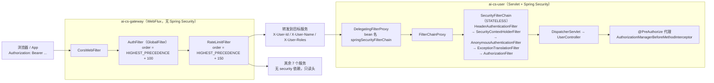
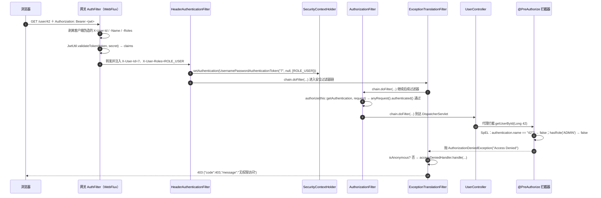

# 03-Spring Security 微服务两层安全模型：网关认证一次，服务只做授权

> **一句话结论**：在微服务里，Spring Security 的正确位置不是"每个服务把 JWT 再验一遍"，而是把**认证**收敛到网关（验签 JWT / API Key，清洗客户端伪造头、注入可信身份头），把**授权**留在服务内部（`FilterChainProxy` 选中的那条 `SecurityFilterChain` 负责"这个请求带没带身份"，`AuthorizationManager` 与 `@PreAuthorize` 负责"这个身份能不能干这件事"）；两层之间唯一的契约是那几个可信头，加上"客户端不许直连服务端口"这条部署红线——红线没守住，前面所有配置等于没有。
>
> **阅读前置**：读完同目录 [01-JWT鉴权与异常处理.md](01-JWT鉴权与异常处理.md)（知道 JWT 三段结构与验签）与 [02-接口安全与限流策略.md](02-接口安全与限流策略.md)（知道网关 `GlobalFilter` 与 order 的含义）；会用 Servlet `Filter` 链、Spring AOP 代理、SpEL 表达式三样基础；不要求你写过 Spring Security 配置。
>
> **证据基线**：Spring Security 7.2.0 / Spring Boot 4.2.0 源码摘录（`learning-docs/24-源码分析/assets/source/`，A 级，共 908 份）、本仓库 `ai-cs-gateway` 与 `ai-cs-user` 的真实文件与行号（B 级）、本机 `.m2` 里 jar 的 `javap` / `jar tf` 实测输出（C 级）。凡"未本机实测"的结论都会明说。预计阅读 50~65 分钟。

## 0. 先看现象

先看三个真实场景，它们分别对应"两层模型"里最容易断的三根接缝：身份没传下去、身份传下去了但没人判、以及判完了结果被吞掉。

### 现象 1：网关放行了，下游却回 403

把 `X-User-Id: 7` 直接塞进请求打到 user 服务，访问别人的资源（下面这段断言来自真实测试，不是示意）：

路径：`ai-cs-user/src/test/java/com/aics/user/security/UserSecurityIntegrationTest.java#L52-L62`

```java
// 用户 7 的身份头，但访问的是用户 42 的数据
mockMvc.perform(get("/user/42").header("X-User-Id", "7"))
    .andExpect(status().isForbidden())
    .andExpect(jsonPath("$.message").value("无权限访问"));
```

403 的正文由服务自己写死，不是 Spring 的默认页：

路径：`ai-cs-user/src/main/java/com/aics/user/security/UserSecurityConfig.java#L38-L42`

```java
.exceptionHandling(ex -> ex
    .authenticationEntryPoint((req, res, e) -> writeError(res, HttpStatus.UNAUTHORIZED, "未认证，请先登录"))
    .accessDeniedHandler((req, res, e) -> writeError(res, HttpStatus.FORBIDDEN, "无权限访问")))
```

说明身份确实穿过来了（否则不会是 403 而是 401），但"7 号身份访问 42 号数据"被方法级授权拦住了。这一层拦得对不对，取决于三件事同时成立：网关注入了头、服务的过滤器把头变成了 `SecurityContext`、`@PreAuthorize` 真的被代理执行。任何一件不成立，表象都会变（详见 §4 的失败表）。

### 现象 2：日志里出现 `An Authentication object was not found in the SecurityContext`

这句话不是谁随手写的日志，它是 Spring Security 的固定异常文案，出现在两个地方：

- `AuthorizationFilter#getAuthentication` —— context 里根本没有 `Authentication` 时抛出（`[[源码:AuthorizationFilter.java.md#L139-L146]]`）
- `AuthorizationManagerBeforeMethodInterceptor#getAuthentication` —— 方法级授权取身份时同样抛（`[[源码:AuthorizationManagerBeforeMethodInterceptor.java.md#L295-L302]]`）

```text
org.springframework.security.authentication.AuthenticationCredentialsNotFoundException:
An Authentication object was not found in the SecurityContext
```

出现它，几乎总是同一个根因：**执行到授权那一刻的线程，不是当初塞身份的那个线程**。典型触发点是 `@Async`、`CompletableFuture`、`parallelStream`、以及流式响应（SSE / WebFlux / Spring AI 的 `Flux<String>` 下游异步回推）。这一点在 §3.7 用 `SecurityContextHolder` 的源码讲透。

### 现象 3：权限失败被 HTTP 200 掩盖，前端以为成功

`ai-cs-common` 的统一异常处理器里，业务异常的处理器**没有** `@ResponseStatus`：

路径：`ai-cs-common/src/main/java/com/aics/common/exception/GlobalExceptionHandler.java#L35-L39`

```java
@ExceptionHandler(BusinessException.class)
public Result<Void> handleBusinessException(BusinessException e, HttpServletRequest request) {
    log.warn("业务异常: {}", e.getMessage());
    return Result.error(e.getCode(), e.getMessage());   // ← 没有 @ResponseStatus，HTTP 状态恒为 200
}
```

同一个文件里，参数校验异常却明确标了状态码（`GlobalExceptionHandler.java#L44-L52` 的 `@ResponseStatus(HttpStatus.BAD_REQUEST)`）。一个标、一个不标，会训练出"看到 200 就当成功"的错觉；更要紧的是，这个 advice 里**没有任何** `AuthenticationException` / `AccessDeniedException` / `AuthorizationDeniedException` 的 handler——安全异常一旦在服务里被抛出而没人接，落到默认错误页或 500，形状和网关手写的 `{"code":401,...}` 完全不一样。

> 这些现象指向同一件事：**认证与授权被拆到了两个进程里，而它们之间的交接物（可信头、`SecurityContext`、被选中的那条过滤器链）没有任何编译期约束，只有运行时表现。** 所以排查这类问题不能"看配置猜"，只能按"头进来了吗 → 变成 Authentication 了吗 → 授权决策执行了吗 → 结果被谁改写了"这四步走。

## 1. 整体地图



> **读图说明**：只看一条箭头——`FWD → DFP`。这条箭头跨越了进程边界，也是整篇文档的重点：在网关那一侧，身份被"算出来"写进 HTTP 头；到了服务这一侧，`DelegatingFilterProxy` 才把它重新变成 `SecurityContext` 里的 `Authentication`。**看错这条箭头的代价**：如果把 `AuthFilter` 和 `SecurityFilterChain` 当成"同一套过滤器链的两段"，就会以为网关的 `AuthFilter` 在服务里也生效，从而漏掉 `HeaderAuthenticationFilter` 这一步——于是 `@PreAuthorize` 里的 `authentication` 为 null，一切都变成 500/401，而你会去网关反复加白名单。另一条容易看错的是 `RL → OTHER`：限流器**消费**了身份头（用 `X-User-Id` 做限流键），但它不产生身份，别把它的存在当成"下游服务一定拿到头"的保证。

| 组件 | 责任 | 参与方（谁依赖它） |
|------|------|--------------------|
| `CorsWebFilter`（网关，唯一 CORS 实现） | 统一处理跨域预检与响应头，**只此一处** | 前端；chat 服务的 `CorsConfig` 已注释掉以避免重复头 |
| `AuthFilter`（`ai-cs-gateway/src/main/java/com/aics/gateway/filter/AuthFilter.java`，243 行） | 三件事：白名单放行（但仍先剥离伪造头）、验签 JWT 或比对 API Key、注入 `X-User-Id`/`X-User-Name`/`X-User-Roles` | 所有下游服务；`RateLimitFilter` 与 `RouteConfig` 的限流键解析也依赖它注入的头 |
| `RateLimitFilter`（order +150） | 限流，键优先取 `X-User-Id`，未认证退化为 IP | 网关内部；注释见 `ai-cs-gateway/src/main/java/com/aics/gateway/filter/RateLimitFilter.java#L52` |
| `DelegatingFilterProxy` | 按 bean 名 `springSecurityFilterChain` 从容器取出真正的过滤器，把 Servlet 容器与 Spring Bean 两个世界接起来 | 只在引了 security starter 的服务里存在（本项目仅 user 服务） |
| `FilterChainProxy` | 持有全部 `SecurityFilterChain`，为每个请求**选一条**并把控制权交给它的过滤器列表 | `DelegatingFilterProxy`；调试时你看到的 `Will secure ...` 日志就是它打的 |
| `SecurityFilterChain` | 一个"匹配器 + 过滤器列表"的二元组，是服务端安全策略的载体 | `FilterChainProxy`；每个 `@Bean SecurityFilterChain` 是一条链 |
| `HeaderAuthenticationFilter`（项目自定义） | 把可信头翻译成 `UsernamePasswordAuthenticationToken`（principal = userId），请求结束 `clearContext()` | user 服务；**不验签**，安全性完全押在网关清洗与网络隔离上 |
| `AuthorizationFilter` | 按 `AuthorizationManager` 对 URL 做授权决策（本项目等价于 `anyRequest().authenticated()`） | 每条链的尾部 |
| `AuthorizationManagerBeforeMethodInterceptor` | AOP 拦截器，执行 `@PreAuthorize` 的 SpEL 表达式 | `@EnableMethodSecurity` 装配；全仓仅 2 处注解用到它 |

两层模型真正需要"闭合"的接缝只有四道，出问题也总是这四道之一：

| 接缝 | 如果没闭合会怎样 | 判据（怎么确认它闭合了） |
|------|------------------|--------------------------|
| 网关剥离伪造头 → 注入真实头 | 客户端自带的 `X-User-Roles: ROLE_ADMIN` 直达下游，越权 | 抓包看转发请求里三个身份头只有一个来源；`AuthFilter` 在所有分支（含白名单、API Key）都先 `remove` 再 `header` |
| 服务把头变成 `Authentication` | `@PreAuthorize` 拿到 null，抛未认证异常或被静默跳过 | DEBUG 日志的过滤器名单里有 `HeaderAuthenticationFilter`；`authentication.name` 能取到值 |
| 授权规则真的执行 | 接口"看起来受保护"，实际谁都能调 | 造一个低权限身份去调，必须拿到 403；拿到 200 就是没执行 |
| 部署层禁止直连 | 前三道全部失效（攻击者绕过网关自己造头） | 服务用 `ClusterIP`/内网监听，`NetworkPolicy` 只放行网关与内部服务 |

## 2. 关键概念与关键类

| 术语 | 一句话定义 | 在本项目的落点 |
|------|------------|----------------|
| 认证（Authentication） | 证明"你是你说的那个人"：验签、比对密码、查库 | 网关 `AuthFilter`（JWT 验签 + API Key 常量时间比较） |
| 授权（Authorization） | 判断"这个已证明的身份能不能做这件事" | 服务的 `AuthorizationFilter` + `@PreAuthorize` |
| 主体（Principal） | 身份本身；`String` 型时 `getName()` 就是它 | 网关写入 `X-User-Id`，下游作为 principal |
| 权限（Authority） | 身份具备的字符串标签，通常 `ROLE_` 前缀 | `X-User-Roles` → `SimpleGrantedAuthority` |
| 安全上下文（`SecurityContext`） | 本次请求的身份容器，默认存在 `ThreadLocal` | `HeaderAuthenticationFilter` 写入、`finally` 清理 |
| 安全过滤器链（`SecurityFilterChain`） | "匹配器 + Filter 列表"，一个应用可有多条 | `UserSecurityConfig` 里那条 STATELESS 链 |
| 两层模型 | 认证集中一次、授权分散就近 | 网关只认人，服务只判权限，中间靠可信头 |

| 名称 | 位置 | 角色 | 关键方法 |
|------|------|------|----------|
| `SecurityFilterChain` | `org.springframework.security.web`（`[[源码:SecurityFilterChain.java.md#L33-L38]]`） | 链的抽象：只有匹配与取过滤器两个动作 | `matches(HttpServletRequest)`、`getFilters()` |
| `FilterChainProxy` | `org.springframework.security.web`（`[[源码:FilterChainProxy.java.md#L245-L257]]`） | 链的调度者；真正的 `springSecurityFilterChain` bean | `doFilter`、私有的 `getFilters(HttpServletRequest)` |
| `DefaultSecurityFilterChain` | `org.springframework.security.web`（`[[源码:DefaultSecurityFilterChain.java.md#L47-L47]]`） | 默认实现，构造时打印命中的过滤器名单 | `matches`、`toString` |
| `AuthorizationFilter` | `org.springframework.security.web.access.intercept`（`[[源码:AuthorizationFilter.java.md#L76-L106]]`） | URL 级授权决策点，替代了旧的 `FilterSecurityInterceptor` | `doFilter`、`getAuthentication` |
| `AuthorizationManager` | `org.springframework.security.authorization`（`[[源码:AuthorizationManager.java.md#L33-L57]]`） | 授权决策函数式接口，唯一抽象方法返回 `AuthorizationResult` | `authorize(Supplier, Object)`、`verify` |
| `RequestMatcherDelegatingAuthorizationManager` | 同上（`[[源码:RequestMatcherDelegatingAuthorizationManager.java.md#L66-L89]]`） | 把 `authorizeHttpRequests` 的每条规则翻译成"匹配器→委托者" | `authorize`、`add` |
| `Authentication` | `org.springframework.security.core`（`[[源码:Authentication.java.md#L56-L56]]`） | 身份容器：principal / credentials / authorities / authenticated | `getPrincipal`、`getAuthorities`、`isAuthenticated` |
| `SecurityContextHolder` | `org.springframework.security.core.context`（`[[源码:SecurityContextHolder.java.md#L55-L67]]`） | 上下文的线程级存取；策略可换 | `getContext`、`setContext`、`clearContext` |
| `SecurityContextHolderFilter` | `org.springframework.security.web.context`（`[[源码:SecurityContextHolderFilter.java.md#L72-L88]]`） | 只加载上下文、**不自动保存**的新一代过滤器 | `doFilter` |
| `SessionManagementConfigurer` | `org.springframework.security.config.annotation.web.configurers`（`[[源码:SessionManagementConfigurer.java.md#L362-L395]]`） | `sessionCreationPolicy` 的实现者，决定上下文存哪 | `init`、`isStateless` |
| `EnableMethodSecurity` | `org.springframework.security.config.annotation.method.configuration`（`[[源码:EnableMethodSecurity.java.md#L40-L52]]`） | 方法级安全的总开关 | `prePostEnabled`、`securedEnabled`、`jsr250Enabled` |
| `AuthorizationManagerBeforeMethodInterceptor` | 同上（`[[源码:AuthorizationManagerBeforeMethodInterceptor.java.md#L248-L267]]`） | `@PreAuthorize` 的执行者 | `invoke`、`attemptAuthorization` |
| `PreAuthorizeAuthorizationManager` | 同上（`[[源码:PreAuthorizeAuthorizationManager.java.md#L80-L89]]`） | 把 `@PreAuthorize` 的字符串当成 SpEL 求值 | `authorize` |
| `MethodSecurityExpressionRoot` | 同上（`[[源码:MethodSecurityExpressionRoot.java.md#L35-L42]]`） | SpEL 里能引用的根对象（`authentication`、`#p0`、`filterObject`…） | `getAuthentication`、`getFilterObject` |
| `ExceptionTranslationFilter` | `org.springframework.security.web.access`（`[[源码:ExceptionTranslationFilter.java.md#L188-L221]]`） | 把认证异常翻译成 401、授权异常翻译成 403（含匿名特判） | `handleAccessDeniedException`、`sendStartAuthentication` |

## 3. 原理与证据逐段精读

### 3.1 请求怎么进入安全世界：从 `DelegatingFilterProxy` 到 `FilterChainProxy`

**在干什么**：Boot 在 Servlet 容器里注册一个 `DelegatingFilterProxyRegistrationBean`，它的 filter 名字是常量 `DEFAULT_FILTER_NAME`（值为 `springSecurityFilterChain`），order 取 `SecurityFilterProperties.order`——默认由 `OrderedFilter.REQUEST_WRAPPER_FILTER_MAX_ORDER - 100` 算出，官方的意图写在注释里："排在其它注册到容器的过滤器之前"。

```java (src: SecurityFilterAutoConfiguration.java.md#L43-L54)
private static final String DEFAULT_FILTER_NAME = AbstractSecurityWebApplicationInitializer.DEFAULT_FILTER_NAME;

@Bean
@ConditionalOnBean(name = DEFAULT_FILTER_NAME)
DelegatingFilterProxyRegistrationBean securityFilterChainRegistration(
        SecurityFilterProperties securityFilterProperties) {
    DelegatingFilterProxyRegistrationBean registration = new DelegatingFilterProxyRegistrationBean(
            DEFAULT_FILTER_NAME);
    registration.setOrder(securityFilterProperties.getOrder());
    registration.setDispatcherTypes(getDispatcherTypes(securityFilterProperties));
    return registration;
}
```

`DelegatingFilterProxy` 本身不含逻辑，它按名字去容器里找 bean。找到的那个 bean 就是 `FilterChainProxy`——由 `WebSecurityConfiguration` 把容器里所有 `SecurityFilterChain` bean 收集起来装配而成（该文件已入库：`assets/source/WebSecurityConfiguration.java.md`，418 行；本文不逐行引用其内部，只借助它说明"链的集合从哪来"）。

**为什么这么设计**：Servlet 容器的过滤器由容器创建，Spring Bean 由容器管理，两者生命周期不同。用"代理 + 名字"这一层薄薄的间接，让 Spring 可以任意替换背后的实现（今天是 `FilterChainProxy`，以前是 `FilterSecurityInterceptor` 那条老链），而容器只认识一个固定的名字。同一套机制也让 `dispatcherTypes` 默认覆盖 `EnumSet.allOf(DispatcherType.class)`（`[[源码:SecurityFilterProperties.java.md#L42-L47]]`）——包括 `ASYNC` 与 `ERROR` 分派，这正是后文 `AuthorizationFilter` 里 `filterAsyncDispatch = true`、`filterErrorDispatch = true` 有意义的前提。

**换写法会怎样**：如果你按 Spring 老文档在 `web.xml` 或第三个 `@Bean FilterRegistrationBean` 里手工注册，很容易把 order 搞错——安全过滤器跑到业务过滤器之后，`SecurityContext` 在业务代码里就是 null，而 401/403 却还能正常返回（因为那时授权还没执行），这种"半生效"最难查。也见过把 `spring.security.filter.order` 调大以"让日志更清楚"，结果 `RequestContextHolder`/`LocaleContextHolder` 的清理顺序被打乱。

**常见坑**：① 以为 `springSecurityFilterChain` 是个类，去 IDE 里搜不到就以为配置没生效；② 在 WebFlux 服务（本项目网关）里找 `FilterChainProxy`——那边是 `WebFilterChainProxy`，`jar tf` 能看到它就在同一个 jar 里（`org/springframework/security/web/server/WebFilterChainProxy.class`），两套模型不能混谈；③ 自建 `SecurityFilterChain` 后仍指望 Boot 的默认链兜底（见 3.9）。

### 3.2 选哪条链：`FilterChainProxy` 的匹配与"首个命中即结束"

**在干什么**：`FilterChainProxy` 拿到请求后，按顺序问每一条链"你匹配吗"，**第一条说匹配的就直接返回它的过滤器列表，后面的链完全不再看**。

```java (src: FilterChainProxy.java.md#L245-L257)
private List<Filter> getFilters(HttpServletRequest request) {
    for (SecurityFilterChain chain : this.filterChains) {
        if (logger.isTraceEnabled()) {
            logger.trace(LogMessage.format("Trying to match request against %s (%d/%d)", chain, i, size));
        }
        if (chain.matches(request)) {
            return chain.getFilters();
        }
    }
    return null;
}
```

拿到列表后，它把这个 List 包成一个 `VirtualFilterChain` 逐节执行（`[[源码:FilterChainProxy.java.md#L359-L390]]`）：`currentPosition` 自增、每个过滤器调 `nextFilter.doFilter(request, response, this)`，走完最后一个就调原始链。如果列表为 `null`（没有链匹配），只打一条 trace `No security for ...` 然后**直接放行**。

**为什么这么设计**：@Order 让"顺序"变成可声明的策略，而"首个命中"让语义可预测——你不需要推理"多条链会不会叠加"，只需要推理"哪条先命中"。代价是：**`anyRequest()` 那条兜底链必须排在最后**，否则它会吃掉后面所有更具体的链。

**换写法会怎样**：很多团队喜欢写一条链用 `.requestMatchers("/api/**").authenticated()`、另一条链处理 `/admin/**`，但两条都没写 `@Order`——顺序取决于 bean 的注册顺序，重构一次 `@Configuration` 的顺序就可能把 `/admin/**` 交给弱策略那条链。正确做法是给每条链显式 `@Order(1..n)`、兜底链 `@Order(Ordered.LOWEST_PRECEDENCE)`，并像 6.1 那样用日志验证命中关系。

**常见坑**：`getFilters(HttpServletRequest)` 是 **private**，外部拿不到"这个请求命中了哪条链"的 API。本机实测可以直接证明（命令与输出见 §6.2）：`javap` 出来的 public 视图里只有 `getFilters(java.lang.String)`（按 bean 名取整条链的过滤器），没有按请求取的那个。所以判断只能靠日志，或者 `DefaultSecurityFilterChain#toString()`（它输出 `matching [匹配器] and having filters [过滤器类名列表]`，见 `[[源码:DefaultSecurityFilterChain.java.md#L94-L115]]`）。

顺带一个容易漏的细节：`FilterChainProxy#doFilter` 用请求属性 `FILTER_APPLIED` 防重入，并在 `finally` 里无条件 `clearContext()`：

```java (src: FilterChainProxy.java.md#L186-L211)
boolean clearContext = request.getAttribute(FILTER_APPLIED) == null;
if (!clearContext) {
    doFilterInternal(request, response, chain);
    return;
}
try {
    request.setAttribute(FILTER_APPLIED, Boolean.TRUE);
    doFilterInternal(request, response, chain);
}
// ... catch Throwable → 找 RequestRejectedException → requestRejectedHandler.handle(...)
finally {
    this.securityContextHolderStrategy.clearContext();
    request.removeAttribute(FILTER_APPLIED);
}
```

注意 `finally` 里的 `clearContext()` 是**兜底**：它保证请求线程回池前上下文被清空。项目里 `HeaderAuthenticationFilter` 自己也写了 `finally clearContext()`——这不是重复劳动，而是因为一旦有人把安全链缩小到只匹配某些路径，兜底就可能在你的路径上不执行（见 `ai-cs-user/src/main/java/com/aics/user/security/HeaderAuthenticationFilter.java#L50-L55`，注释就写着"OncePerRequestFilter 跨线程池复用，必须清理 ThreadLocal，防身份串线"）。

### 3.3 认证与授权的分离点：`Authentication` 是容器，`AuthorizationManager` 是函数

**在干什么**：`Authentication` 只是一个**数据容器**——principal（谁）、credentials（凭证，认证后通常被擦除）、authorities（权限标签）、authenticated（是否已认证）。它不含任何"能不能访问"的判断逻辑（`[[源码:Authentication.java.md#L56-L120]]`）。

授权被抽成了一个函数式接口，只有一个抽象方法：

```java (src: AuthorizationManager.java.md#L42-L57)
default void verify(Supplier<Authentication> authentication, T object) {
    AuthorizationResult result = authorize(authentication, object);
    if (result != null && !result.isGranted()) {
        throw new AuthorizationDeniedException("Access Denied", result);
    }
}

@Nullable
AuthorizationResult authorize(Supplier<? extends @Nullable Authentication> authentication, T object);
```

`AuthorizationFilter` 在过滤器链尾部调用它：

```java (src: AuthorizationFilter.java.md#L76-L106)
AuthorizationResult result = this.authorizationManager.authorize(this::getAuthentication, request);
// ... 发布授权事件
if (result != null && !result.isGranted()) {
    throw new AuthorizationDeniedException("Access Denied", result);
}
chain.doFilter(request, response);
```

**为什么这么设计**：三个细节值得单独拎出来。

1. 传的是 `Supplier<Authentication>` 而不是 `Authentication`。这样"取身份"这一步是**懒执行**的：当决策只依赖 URL 时（比如 `permitAll`），根本不用碰上下文；而当决策确实需要身份却没有身份时，`AuthorizationFilter#getAuthentication` 会抛 `AuthenticationCredentialsNotFoundException`（`[[源码:AuthorizationFilter.java.md#L139-L146]]`）——这是一个 `AuthenticationException` 的子类，语义是"没认证"，不是"没权限"。这就是 401 与 403 的机制分界。
2. 返回值可空，且 **`null` 表示"我弃权"而不是"我拒绝"**。`RequestMatcherDelegatingAuthorizationManager` 的行为最能说明这套约定：命中某条规则就委托给该规则的 manager；**一条都不命中时返回 `DENY`**（`[[源码:RequestMatcherDelegatingAuthorizationManager.java.md#L54-L89]]`，常量 `private static final AuthorizationDecision DENY = new AuthorizationDecision(false);`）。而组合器 `AuthorizationManagers.anyOf(...)` 在"全部弃权"时的默认结论是 `false`、`allOf(...)` 是 `true`（`[[源码:AuthorizationManagers.java.md#L45-L93]]`）——默认值方向相反，是很容易记混的一对。
3. 决策结果不只是 boolean。`AuthorizationDeniedException extends AccessDeniedException implements AuthorizationResult`（`[[源码:AuthorizationDeniedException.java.md#L30-L30]]`），所以它能携带"为什么被拒"的完整结果对象，交给 `HandleAuthorizationDenied` 做定制响应。

`ExceptionTranslationFilter` 负责把这两类异常翻译成 HTTP：`AuthenticationException` 走 `authenticationEntryPoint`（401），`AccessDeniedException` 先问"这个身份是不是匿名"，是匿名就**当成没认证**再走 entry point（`[[源码:ExceptionTranslationFilter.java.md#L188-L221]]`）。匿名身份从哪来？链里那个 `AnonymousAuthenticationFilter`——它把空的上下文填成一个 `AnonymousAuthenticationToken`：

```java (src: AnonymousAuthenticationFilter.java.md#L96-L101)
public void doFilter(ServletRequest req, ServletResponse res, FilterChain chain)
        throws IOException, ServletException {
    Supplier<SecurityContext> deferredContext = this.securityContextHolderStrategy.getDeferredContext();
    this.securityContextHolderStrategy
        .setDeferredContext(defaultWithAnonymous((HttpServletRequest) req, deferredContext));
    chain.doFilter(req, res);
}
```

**换写法会怎样**：如果你自己实现一个 `AuthorizationManager` 并返回 `new AuthorizationDecision(false)` 表示"我不关心"，就会变成**全拒**——因为 `false` 是明确的拒绝，只有 `null` 才代表弃权。反过来，如果一个自定义 manager 在拿不到用户时 `return null` 想"放行"，实际效果是"这条规则没意见"，随后链上更宽松的规则（例如 `anyRequest().permitAll()`）会接手，最终放行——看起来一样，但一旦你加了 `denyAll()` 兜底，行为立刻反转。

**常见坑**：① 把 `AnonymousAuthenticationToken` 当成"未认证"来写逻辑，于是 `authentication != null` 就以为用户登录了（它的 `isAuthenticated()` 返回 `true`）；② 认为 403 一定是"权限不够"，其实"匿名 + 无权限"会被翻译成 401；③ 在 `permitAll()` 的路径上期望 `SecurityContext` 有值——`permitAll` 的规则命中了就不会再去要身份，上下文里可能只有匿名 token 甚至什么都没有。

### 3.4 方法级安全：`@EnableMethodSecurity` 到拦截器的那条装配线

**在干什么**：注解本身不干活，它只是 `@Import(MethodSecuritySelector.class)`（`[[源码:EnableMethodSecurity.java.md#L40-L44]]`）。选择器按开关注册对应的 AOP 拦截器：`prePostEnabled()` 默认 `true`，`securedEnabled()`、`jsr250Enabled()` 默认 `false`（`[[源码:EnableMethodSecurity.java.md#L52-L65]]`）。`@PreAuthorize` 的拦截器由工厂方法造出来，pointcut 由"带 `@PreAuthorize` 注解的方法"决定，order 取 `AuthorizationInterceptorsOrder.PRE_AUTHORIZE`（`[[源码:AuthorizationManagerBeforeMethodInterceptor.java.md#L87-L116]]`）。

真正执行时走的是：

```java (src: AuthorizationManagerBeforeMethodInterceptor.java.md#L248-L267)
Authentication authentication = this.getAuthentication();   // 无身份 → AuthenticationCredentialsNotFoundException
this.logger.debug(LogMessage.format("Authorizing method invocation %s", mi));
AuthorizationResult result = this.authorizationManager.authorize(this::getAuthentication, mi);
if (result != null && !result.isGranted()) {
    this.logger.debug(LogMessage.format("Failed to authorize %s with %s using %s", mi, result, this.authorizationManager));
    this.handle(mi, result);
    return;    // 不 proceed，方法体不执行
}
this.logger.debug(LogMessage.format("Authorized method invocation %s", mi));
return proceed(mi);
```

而 `@PreAuthorize` 的 manager 做的是"把注解里的字符串当 SpEL 求值"：

```java (src: PreAuthorizeAuthorizationManager.java.md#L80-L89)
public AuthorizationDecision authorize(Supplier<? extends Authentication> authentication, MethodInvocation mi) {
    ExpressionAttribute attribute = this.registry.getAttribute(mi);
    if (attribute == null) {
        return null;     // 方法上没有 @PreAuthorize → 弃权 → 放行
    }
    EvaluationContext ctx = createEvaluationContext(authentication, mi);
    return new ExpressionAttribute(...) ... ExpressionUtils.evaluate(...);
}
```

**为什么这么设计**：把"哪些方法要判"交给 pointcut、"怎么判"交给 SpEL、"判失败怎么办"交给 `MethodAuthorizationDeniedHandler` 三段解耦。同一套拦截器还能服务 `@PostAuthorize`（`AuthorizationManagerAfterMethodInterceptor`）、`@Secured`（`SecuredAuthorizationManager`）、`@PreFilter`。表达式根对象是 `MethodSecurityExpressionRoot`，它在 Web 版根对象上多了三个属性：`filterObject`、`returnObject`、`this`（被代理的目标对象）（`[[源码:MethodSecurityExpressionRoot.java.md#L35-L42]]`），所以 `@PreAuthorize` 能写 `#p0.id` 这种参数访问。

**换写法会怎样**：不用注解，在 Service 里手写 `if (!currentUser.equals(id) && !hasRole("ADMIN")) throw ...`——可读、可调试，但规则会散落在每个方法里，而且新加一个入口（比如 MQ 消费者调同一个 Service）时很容易漏。反过来，全都压给网关也不行：网关不知道"42 号用户能不能改 7 号的数据"这种领域规则。

**常见坑**（这是"@PreAuthorize 写了不生效"的完整清单，按这个顺序排查最快）：① 类上没 `@EnableMethodSecurity`——此时拦截器压根不存在，注解形同注释；② 方法不是被 Spring 代理调用的：同类内部 `this.foo()` 自调用绕过代理、`private`/`final` 方法不能被 CGLIB 覆盖、直接 `new UserController(...)` 当然也不生效；③ 表达式里的参数名解析失败（见 3.5）；④ 上下文里没有 `Authentication`，于是抛的是 `AuthenticationCredentialsNotFoundException`（401 语义）而不是"拒绝"（403 语义）——表象是"配了注解却报未认证"。本项目目前只把这一套用在 user 服务的两个方法上（`ai-cs-user/src/main/java/com/aics/user/controller/UserController.java#L43`、`#L50`），全仓仅此 2 处；**其余 7 个服务连 `spring-boot-starter-security` 都没引入，它们的接口没有任何方法级授权**，安全性完全依赖"网关注入的可信头"和"端口不对外"。这一点必须写进你的架构认知里，不能因为这篇文档讲了 `@PreAuthorize` 就以为项目里到处都是授权。

### 3.5 SpEL 与参数名：`#p0` 还是 `#id`，以及 `authentication.name` 到底是谁

**在干什么**：项目里两个表达式的写法是：

路径：`ai-cs-user/src/main/java/com/aics/user/controller/UserController.java#L41-L53`

```java
@PreAuthorize("authentication.name == #p0.toString() or hasRole('ADMIN')")
@GetMapping("/{id}")
public Result<User> getUserById(@PathVariable("id") Long id) { ... }

@PreAuthorize("authentication.name == #p0.id?.toString() or hasRole('ADMIN')")
@PutMapping
public Result<Void> updateUser(@Validated(UserValidationGroups.Update.class) @RequestBody User user) { ... }
```

旧稿写的是"项目未启用 `-parameters`，所以只能用 `#p0`"。**这个说法被本机实测证伪**：根 pom 第 34 行是 `<maven.compiler.parameters>true</maven.compiler.parameters>`，编译产物的 `MethodParameters` 属性里参数名清清楚楚是 `id`、`user`、`request`（命令与真实输出见 §6.3）。也就是说 `#id`、`#user` 本来可用。

**为什么仍建议写 `#p0`**：因为它把表达式与"编译参数是否携带参数名"解耦。一旦哪天有人为了体积或兼容性把 `-parameters` 关掉、或者把方法签名从 `(Long id)` 改成 `(Long userId)`，`#p0` 完全不受影响，`#id` 会直接报参数名解析失败。代价是可读性：`#p0.id?.toString()` 需要你记住"第 0 个参数是 User"。折中做法是保留 `#p0` 但在注释里写明参数顺序，或者用 `#user.id` 并**在 CI 里加一条断言**（例如读 `MethodParameters` 属性存在）来兜住编译参数。

再看 `authentication.name` 是什么。`SecurityExpressionRoot#getAuthentication()` 只是 `this.authentication.get()`（`[[源码:SecurityExpressionRoot.java.md#L170-L172]]`），而 `name` 走的是 `Authentication#getName()`，实现里有四级回退：

```java (src: AbstractAuthenticationToken.java.md#L84-L95)
public String getName() {
    if (this.getPrincipal() instanceof UserDetails userDetails) {
        return userDetails.getUsername();
    }
    if (this.getPrincipal() instanceof AuthenticatedPrincipal authenticatedPrincipal) {
        return authenticatedPrincipal.getName();
    }
    if (this.getPrincipal() instanceof Principal principal) {
        return principal.getName();
    }
    return (this.getPrincipal() == null) ? "" : this.getPrincipal().toString();
}
```

项目里 principal 是 `String` 类型的 userId，所以走到最后一行 `toString()`——`authentication.name` 就是 `"42"`。这也解释了两件事：为什么表达式里要写 `#p0.toString()`（`Long` 与 `String` 直接 `==` 永远不等），以及为什么 `X-User-Id` 必须是字符串形式的数字。

**换写法会怎样**：把 principal 换成 `UserDetails` 实现（更"标准"），`authentication.name` 就变成 `getUsername()`，表达式不用改；但同时 `principal` 就不再是 id，任何 `(String) authentication.getPrincipal()` 的旧代码会 `ClassCastException`。反过来，把 principal 换成整个 `User` 对象，表达式要写 `authentication.principal.id`——能跑，但把"身份"和"业务对象"耦在一起，改字段就炸授权。

**常见坑**：`hasRole('ADMIN')` 与 `hasAuthority('ROLE_ADMIN')` 混用。`hasRole` 在 `DefaultAuthorizationManagerFactory` 下会把传入的 `ROLE_` 前缀剥掉再比（源码注释写着这是为了兼容旧的 `hasRole('ROLE_A')` 写法，`[[源码:SecurityExpressionRoot.java.md#L134-L152]]`），默认前缀常量是 `"ROLE_"`（`[[源码:SecurityExpressionRoot.java.md#L48-L48]]`）。而 `hasAuthority('ADMIN')` 会拿 `"ADMIN"` 去和 `"ROLE_ADMIN"` 严格相等——永远不匹配。这正是网关要做前缀标准化的原因：`role.startsWith("ROLE_") ? role : "ROLE_" + role.toUpperCase()`（`ai-cs-gateway/src/main/java/com/aics/gateway/filter/AuthFilter.java#L147-L168`）。注意 `toUpperCase()` 带来的副作用：`agent` 会变 `ROLE_AGENT`，但 `ROLE_AGENT` 传进来不会再被大写，所以库里存 `Role_Agent` 这种混合大小写就会与 `hasRole('AGENT')` 失配。

### 3.6 STATELESS 到底改了什么：上下文存哪、谁来 save

**在干什么**：`.sessionManagement(s -> s.sessionCreationPolicy(STATELESS))` 不是"打印一行日志"。`SessionManagementConfigurer.init` 在**没有显式指定 `SecurityContextRepository`** 时，按是否 stateless 走两个完全不同的分支：

```java (src: SessionManagementConfigurer.java.md#L362-L395)
boolean stateless = isStateless();
if (this.securityContextRepository == null) {
    if (stateless) {
        http.setSharedObject(SecurityContextRepository.class, new RequestAttributeSecurityContextRepository());
        this.sessionManagementSecurityContextRepository = new NullSecurityContextRepository();
    }
    else {
        HttpSessionSecurityContextRepository securityContextRepository = new HttpSessionSecurityContextRepository();
        // ... disableUrlRewriting / allowSessionCreation / trustResolver
        this.sessionManagementSecurityContextRepository = new DelegatingSecurityContextRepository(
                new RequestAttributeSecurityContextRepository(), securityContextRepository);
    }
}
if (this.requestCache == null && stateless) {
    http.setSharedObject(RequestCache.class, new NullRequestCache());
}
```

关键词是 `NullSecurityContextRepository`：**不存**。身份只在本次请求的内存里活着，请求结束即消失——这正是"每次请求都靠网关头重建身份"的实现基础。同时 `RequestCache` 也被换成 `NullRequestCache`，意味着"未认证请求先存起来，登录后跳回去"这套 302 流程彻底关闭（本来对 API 就没意义）。

第二个变化在上下文的"写入"环节：`SecurityContextConfigurer` 里 `requireExplicitSave` 默认为 `true`（`[[源码:SecurityContextConfigurer.java.md#L70-L70]]`），选了新一代 `SecurityContextHolderFilter`：

```java (src: SecurityContextHolderFilter.java.md#L72-L88)
Supplier<SecurityContext> deferredContext = this.securityContextRepository.loadDeferredContext(request);
this.securityContextHolderStrategy.setDeferredContext(deferredContext);
chain.doFilter(request, response);      // 不会在 downstream 结束后自动 save
// finally: clearContext() + removeAttribute(FILTER_APPLIED)
```

对比旧的 `SecurityContextPersistenceFilter`（当 `requireExplicitSave=false` 时才会被装上，`[[源码:SecurityContextConfigurer.java.md#L110-L131]]`）：老过滤器会在响应前**自动**把上下文写回 session，新过滤器只加载、不保存。所以"我在过滤器里 `setAuthentication` 了，为什么下一个请求还要重新认证"这类问题的答案在新版里是**设计如此**：上下文本就不跨请求存活。

**为什么这么设计**：显式保存能避免"无意间把半成品上下文写进 session"导致的会话污染与内存放大；对无状态 API 而言，自动保存纯属浪费。

**换写法会怎样**：如果保留默认的 `IF_REQUIRED` 并在服务里手动 `session.setAttribute`，你就回到了有状态模型：需要粘性会话或共享 session 存储，扩容时用错（比如两个实例各存各的）就会出现"刷新一下就要重新登录"。和网关的 JWT 模型叠加时更糟：网关认证无状态、下游会话有状态，`X-User-Id` 与 session 里的用户不一致时会产出"看起来登录了但身份是上一个人的"这种诡异 bug。

**常见坑**：① STATELESS 下仍然写 `.logout()` 相关配置，期待它清 session——没有 session 可清；② 忘了 CSRF 的默认存储是 `HttpSessionCsrfTokenRepository`（`[[源码:CsrfConfigurer.java.md#L93-L95]]`，默认 `CsrfFilter.DEFAULT_CSRF_MATCHER`），在 STATELESS 下 CSRF 令牌无处安放，于是大家都 `csrf.disable()`——**这是"csrf 全关"误配置的因果链起点**，真正的判断依据是"凭证是否由浏览器自动携带"（Cookie/Session 才需要 CSRF，`Authorization: Bearer` 头不会自动附带）；③ 把 `STATELESS` 当成"安全"本身，其实它只是"上下文不落盘"，与授权强度无关。

### 3.7 `SecurityContext` 的线程模型与异步/流式下的丢失

**在干什么**：默认策略是 `MODE_THREADLOCAL`，实现是 `ThreadLocalSecurityContextHolderStrategy`：

```java (src: SecurityContextHolder.java.md#L55-L67)
public static final String MODE_THREADLOCAL = "MODE_THREADLOCAL";
public static final String MODE_INHERITABLETHREADLOCAL = "MODE_INHERITABLETHREADLOCAL";
public static final String MODE_GLOBAL = "MODE_GLOBAL";
public static final String SYSTEM_PROPERTY = "spring.security.strategy";
private static String strategyName = System.getProperty(SYSTEM_PROPERTY);
private static SecurityContextHolderStrategy strategy = new ThreadLocalSecurityContextHolderStrategy();
```

**为什么这么设计**：`ThreadLocal` 是"请求级作用域"的最便宜实现——写入、读取都是 O(1)，无需参数透传。代价被写在注释里：`MODE_GLOBAL` "definitely inappropriate for server use"，`setStrategyName` 的方法注释明确警告"不要在同一个 JVM 上调用多次"（`[[源码:SecurityContextHolder.java.md#L168-L178]]`）。

在微服务的服务端，丢失发生在这些地方：`@Async`/自定义线程池里的任务、`CompletableFuture.supplyAsync`、`parallelStream`、定时任务复用线程、以及最典型的**流式响应**——`SseEmitter`、WebFlux 的 `Flux`、Spring AI 的流式输出，都是"请求线程把流交出去，由另一个线程持续回推"。此时授权注解里的 `authentication` 取不到值，表象就是 §0 现象 2 的那句 `An Authentication object was not found in the SecurityContext`。

**换写法会怎样**：三条路。① 用 `DelegatingSecurityContextExecutor` / `DelegatingSecurityContextRunnable` 包一层线程池，把上下文显式传过去（Spring Security 自带）；② 设 `MODE_INHERITABLETHREADLOCAL`——它只在线程**创建时刻**复制一次，池化线程复用后就是错的，别指望它；③ 项目里最稳的做法：**不要把身份留在 ThreadLocal 里跨线程用**，在入口把 userId/roles 解析成方法参数或显式对象传下去（本项目 `HeaderAuthenticationFilter` 的 principal 就是字符串 userId，取出来传参几乎没有成本）。

**常见坑**：① 在 `@Async` 方法里做"本人校验"，永远不会命中，因为 `authentication` 为 null → 抛的是未认证异常，看起来像"网关没传头"，会误导排查方向；② 流式接口里先 `@PreAuthorize` 再返回 `Flux`：授权在请求线程执行是安全的，但**订阅后**在别的线程里再读上下文就空了——所以"授权要前置到方法入口，不要写在流元素的 `map` 里"；③ 忘记 `clearContext()`：线程池复用时上一个用户的身份会串到下一个请求，这类事故在压测报告里表现为"偶发地看到别人的数据"。

### 3.8 JWT 的两种接法：自定义 Filter vs `oauth2ResourceServer`

**在干什么**：两条路线做的是同一件事——"从请求里取出 token、验证、构造 `Authentication`、塞进 `SecurityContext`"，区别在于谁来做、依赖是什么、异常形状如何。

**路线 A：自定义过滤器（本项目）**。网关用 WebFlux 的 `GlobalFilter` 完成验签与注入（`ai-cs-gateway/src/main/java/com/aics/gateway/filter/AuthFilter.java`，243 行），服务里用一个 57 行的 `OncePerRequestFilter` 把头翻译成 token：

路径：`ai-cs-user/src/main/java/com/aics/user/security/HeaderAuthenticationFilter.java#L34-L48`

```java
String userId = request.getHeader(USER_ID);
if (StringUtils.hasText(userId)) {
    String roles = request.getHeader(USER_ROLES);
    List<GrantedAuthority> authorities = ...;   // 逗号分割 + ROLE_ 前缀标准化 → SimpleGrantedAuthority
    UsernamePasswordAuthenticationToken authentication =
            new UsernamePasswordAuthenticationToken(userId, null, authorities);
    authentication.setDetails(request.getHeader(USER_NAME));
    SecurityContextHolder.getContext().setAuthentication(authentication);
}
```

优点：零额外依赖、异常体可以完全自控（网关手写 `{"code":401,...}`、服务手写 `{"code":403,"message":"无权限访问"}`）、能与白名单/API Key/限流键共存。缺点：验签与 claim 映射全靠自己维护；**它不验签**（类注释 L17-L23 明说"本过滤器不校验 JWT：认证由网关 AuthFilter 完成…客户端直连服务端口是部署层必须禁止的"），所以安全性是一个"部署条件"而不是"代码保证"。

**路线 B：`oauth2ResourceServer().jwt()`**。由 Spring Security 提供的 `BearerTokenAuthenticationFilter` 处理：

```java (src: BearerTokenAuthenticationFilter.java.md#L162-L204)
protected void doFilterInternal(HttpServletRequest request, HttpServletResponse response, FilterChain filterChain) {
    Authentication authenticationRequest;
    try {
        authenticationRequest = this.authenticationConverter.convert(request);
    }
    catch (OAuth2AuthenticationException invalid) {
        this.authenticationEntryPoint.commence(request, response, invalid);   // 401 + WWW-Authenticate
        return;
    }
    if (authenticationRequest == null) {
        filterChain.doFilter(request, response);    // 没带 token → 交给后面的过滤器
        return;
    }
    AuthenticationManager authenticationManager = this.authenticationManagerResolver.resolve(request);
    Authentication authenticationResult = authenticationManager.authenticate(authenticationRequest);
    SecurityContext context = this.securityContextHolderStrategy.createEmptyContext();
    context.setAuthentication(authenticationResult);
    this.securityContextHolderStrategy.setContext(context);
    // ... finally: 按 disposeOnCompletion 决定是否 clearContext
}
```

它的权限来自 JWT 的 scope/scope 声明，映射成 `SCOPE_` 前缀的 authority，表达式用 `hasAuthority('SCOPE_read')`；异常形状是标准的 `WWW-Authenticate: Bearer error="invalid_token"`，要自定义成项目的 `Result` 就得覆盖 entry point 与 `AuthenticationEntryPoint`。

**为什么这么设计**：`oauth2ResourceServer` 走的是一条**标准化**的路——把"解析令牌"（`BearerTokenResolver`/`AuthenticationConverter`）、"验证令牌"（`AuthenticationManager` + `JwtDecoder`）、"把结果放进上下文"三段拆开，每段都可替换，异常形状由 `AuthenticationEntryPoint` 统一收口，因此能同时支持 JWT、不透明令牌（introspection）、DPoP 绑定等变体（`BearerTokenAuthenticationFilter` 的 `doFilterInternal` 里就有 `isDPoPBoundAccessToken` 的拒绝分支）。自定义 `Filter` 走的是**最省事**的路：身份已经是网关算好的，服务只做协议适配，所以 57 行就够，代价是所有标准化收益都要自己重建。

**关键差异对照**：

| 维度 | 自定义 Filter（本项目） | `oauth2ResourceServer().jwt()` |
|------|------------------------|-------------------------------|
| 验签位置 | 网关（服务完全不验） | 每个服务自己验（需公钥/JWK 或对称密钥） |
| 主体类型 | `String` userId | `JwtAuthenticationToken`，principal 是 `Jwt` |
| 权限来源 | `X-User-Roles` 头 | token 的 `scope`/`authorities` claim |
| 表达式习惯 | `hasRole('ADMIN')` | `hasAuthority('SCOPE_read')` |
| 401 形状 | 项目自定义 `{"code":401,...}` | 标准 `WWW-Authenticate` 头 |
| 额外依赖 | 无 | `spring-security-oauth2-resource-server` + `spring-security-oauth2-jose` |
| 失配风险 | 头可被直连伪造（靠网络隔离兜底） | 密钥分发错误导致全体 401 |

**换写法会怎样**：本项目现在走不了路线 B 的"离线版"。本机 `.m2` 里 spring-security 相关目录只有 bom / config / core / crypto / rsa / test / web 七个，**没有 `spring-security-oauth2-resource-server`，也没有 `oauth2-jose`**（真实输出见 §6.2）。要切换必须先补依赖，而本机无网（本文实测环境约束）——所以下面这些结论明确标注为**未本机实测**：切换后需把 `@PreAuthorize` 的表达式从 `authentication.name == #p0` 改成基于 `Jwt` claim 的写法（例如 `authentication.token.claims['uid'] == #p0`），否则 `authentication.name` 会变成 JWT 的 `sub`。

**常见坑**：① 两条路线混用——网关验过签，服务又配了 `oauth2ResourceServer`，于是服务端拿不到公钥导致全体 401；② 只加 `spring-security-oauth2-resource-server` 不加 jose，`jwt()` 的 `NimbusJwtDecoder` 类缺失，启动报 `ClassNotFoundException`；③ 用 `hasRole('ADMIN')` 匹配 scope，scope 是 `SCOPE_ADMIN` 语义，正确写法是 `hasAuthority('SCOPE_ADMIN')`。

### 3.9 该关什么、不该关什么：`formLogin`/`httpBasic`、`csrf`、以及"整个安全"

**在干什么**：先说一个反直觉的事实——**Boot 的默认安全链在你自己声明 `SecurityFilterChain` 之后会整体退避**：

```java (src: ServletWebSecurityAutoConfiguration.java.md#L58-L78)
/**
 * The default configuration for web security. ... If the user specifies their own
 * SecurityFilterChain bean, this will back-off completely and the users should specify
 * all the bits that they want to configure as part of the custom security configuration.
 */
@Configuration(proxyBeanMethods = false)
@ConditionalOnDefaultServletWebSecurity
static class SecurityFilterChainConfiguration {

    @Bean
    @Order(SecurityFilterProperties.BASIC_AUTH_ORDER)
    SecurityFilterChain defaultSecurityFilterChain(HttpSecurity http) {
        http.authorizeHttpRequests((requests) -> requests.anyRequest().authenticated());
        http.formLogin(withDefaults());
        http.httpBasic(withDefaults());
        return http.build();
    }
}
```

也就是说，`formLogin` 与 `httpBasic` 是**那条默认链**的内容；你写了自己的链，它就不存在了。项目里 `UserSecurityConfig` 从头到尾**没有**写 `.formLogin(form -> form.disable())` 或 `.httpBasic(basic -> basic.disable())`——不是漏了，而是不需要（`ai-cs-user/src/main/java/com/aics/user/security/UserSecurityConfig.java#L29-L45`）。所以"服务里要 disabled formLogin/basic"这句话本身是个**历史口诀**：在 Boot 2.0 时代默认链与自定义链共存得更暧昧，网上大量教程要求显式 disable；在 4.2 的现状下，只要你的链里没有 `.formLogin()`，登录页就不会出现。

**为什么这么设计**：默认链的存在是为了"引了依赖就有基本安全"（任何请求都要认证），而不是"默认开一个登录页给 API 用"。自定义即接管（back-off），语义干净。

**该关什么、判据是什么**：

| 能力 | 本项目 | 判据（怎么确认它真的没了/真的需要关） |
|------|--------|--------------------------------------|
| `formLogin` / `httpBasic` | 不存在（自定义链未启用） | 看 DEBUG 日志 `Will secure ... with filters: [...]` 的列表里有没有 `UsernamePasswordAuthenticationFilter` / `BasicAuthenticationFilter` |
| `csrf` | 显式 `disable()` | 凭证是否由浏览器自动携带：Bearer 头 → 不需要；一旦引入 Cookie 会话就必须开回来 |
| `sessionManagement` | `STATELESS` | 看是否出现 `JSESSIONID` 响应头/Set-Cookie；以及 `NullSecurityContextRepository` 分支生效（见 3.6） |
| 整个 `spring-boot-starter-security` | **不能关**（user 服务）；其余服务本来就没引 | 关掉后 `FilterChainProxy`、匿名 token、`ExceptionTranslationFilter`、`AuthorizationFilter` 一起消失，`@PreAuthorize` 即使有 `@EnableMethodSecurity` 也没有上下文与异常翻译可用 → 全部放行 |

**换写法会怎样**：想"轻量"而 `exclude = SecurityAutoConfiguration.class`，或者干脆 `spring.main.web-application-type=none`，都会让 §0 那三个现象同时消失——不是修好了，而是**没有东西在判**。第二个危险写法是 `permitAll` 越写越大：本项目 `UserSecurityConfig` 放行了 `/user/register`、`/user/login`、`/actuator/**`、`/v3/api-docs/**`、`/swagger-ui/**`、`/swagger-ui.html`（`#L34-L37`）。`/actuator/**` 与 Swagger 在生产环境是信息泄露面；正确做法是分环境（profile）配置或用 `@Order` 给它们单独一条链，而不是在主链里无条件放行。

**常见坑**：① 以为 `csrf().disable()` 是"无状态应用的标配"而抄进有 Cookie 的场景；② `permitAll` 用了 `requestMatchers("/user/**")` 这类大范围模式，把 `/{id}` 的授权整体废掉；③ 服务里禁用 security 之后，`@PreAuthorize` 静默失效——**没有任何报错**，这是最贵的一种坑。

### 3.10 `permitAll` 的匹配是"首个命中即定"，顺序写错就等于没写

**在干什么**：`authorizeHttpRequests` 的每条规则最终被装进 `RequestMatcherDelegatingAuthorizationManager` 的 `mappings` 列表，`authorize` 时逐条试匹配，**第一条命中的就决定结论，后续规则不再参与**：

```java (src: RequestMatcherDelegatingAuthorizationManager.java.md#L66-L89)
for (Mapping mapping : this.mappings) {
    MatchResult matchResult = mapping.matcher.matcher(request);
    if (matchResult.isMatch()) {
        return mapping.manager.authorize(authentication, new RequestAuthorizationContext(request, matchResult.getVariables()));
    }
}
this.logger.trace("Denying request since did not find matching RequestMatcher");
return DENY;
```

这与 3.2 的"首个匹配即返回"是同一套思路的两次出现：**链之间看顺序，链内规则之间也看顺序**。项目里六条 `permitAll` 排在 `anyRequest().authenticated()` 之前（`ai-cs-user/src/main/java/com/aics/user/security/UserSecurityConfig.java#L34-L37`），所以顺序是对的；如果哪天有人把 `anyRequest().authenticated()` 挪到中间，后面所有放行规则直接失效——现象是"接口突然全要 401"，而配置里明明写着放行。

**为什么这么设计**：语义可预测。如果做成"所有命中规则取最严格"或"取最宽松"，你就无法通过阅读代码判断结论，只能把整个规则集当黑盒求解。首个命中把推理成本压到"读前几行"。

**换写法会怎样**：把 `requestMatchers("/user/**").permitAll()` 放在最前面图省事，等于把 `/user/{id}` 的 `@PreAuthorize` 之外的一切保护全部打开——注意方法级授权仍然会执行（它在 Controller 里，与 URL 规则不是同一层），所以这种写法常常"看起来还拦得住"，直到某天有人加了一个没有注解的接口。这是最危险的一类误配置：**URL 层被废掉、方法层还没覆盖**，中间就是敞开的。

**常见坑**：① 顺序敏感却没写注释，后来又有人插入规则；② 路径写法与实际请求不一致——`requestMatchers` 走 `PathPattern` 语义（Boot 4 里还有 `PathPatternRequestMatcher.Builder` bean，`[[源码:ServletWebSecurityAutoConfiguration.java.md#L47-L54]]`），`/user/**` 不匹配 `/user`，`/user/{id}` 不匹配 `/user/42/detail`；③ 把网关白名单和服务白名单当成同一份清单维护——网关那份是**前缀匹配**（`AuthFilter.java#L179-L181` 的 `path::startsWith`），服务那份是路径模式匹配，两套语义混用迟早对不上（见 6.8）。

## 4. 一次完整执行时序



> **读图说明**：最关键的两步是第 6 步和第 11 步。第 6 步（`HF → SCH`）是"头 → 身份"的唯一转换点，它不发生，后面每一步都会失效；第 11 步（`MS -->> ETF`）是反向箭头——异常沿着调用栈**反向**穿过 `ExceptionTranslationFilter` 的 `try/catch`，是它把异常翻译成 403，而不是 `AuthorizationFilter` 直接写响应。**看错第 11 步的方向**会让你去 `AuthorizationFilter` 里找"为什么没返回 JSON"，实际上响应体是 `ExceptionTranslationFilter` → `AccessDeniedHandler` 写的；本项目里就是 `UserSecurityConfig#writeError` 手写的那段 `LinkedHashMap`。

| 失败步骤 | 典型错误/响应 | 说明 |
|----------|---------------|------|
| 2～4（网关） | `401 {"code":401,"message":"未认证，请先登录"}` 或 `"Token无效或已过期"` | 白名单判断是前缀匹配（`AuthFilter.java#L179-L181`），路径写法不一致会误命中/漏命中 |
| 5（转发） | 下游 401，网关日志无异常 | 头没注入（例如走了 API Key 分支且 `X-API-Key` 未配置）或服务未部署到同一内网 |
| 6（HeaderAuthenticationFilter） | `AuthenticationCredentialsNotFoundException: An Authentication object was not found in the SecurityContext` | 头没到 / 过滤器没注册（`addFilterBefore` 缺失）/ 被 `@WebMvcTest` 之类切片测试排除 |
| 9（AuthorizationFilter） | 401 而不是 403 | `anyRequest().authenticated()` 未通过且身份为匿名 |
| 10～11（方法级） | 403 `"无权限访问"` | 表达式为假；若类上缺 `@EnableMethodSecurity`，这里会**静默放行** |
| 12（异常翻译） | 500 或 HTML 错误页 | 没有 `authenticationEntryPoint`/`accessDeniedHandler`，或异常被 `@RestControllerAdvice` 抢先处理 |
| 任意步（异步线程） | `AuthenticationCredentialsNotFoundException` 或身份为 null | 执行跨线程，见 3.7 |

## 5. 设计取舍

| 决策点 | 当前选择 | 代价 | 替代方案与它的代价 |
|--------|----------|------|--------------------|
| 认证在哪做 | 网关做一次，服务完全信任头 | 服务端口一旦可达就等于零安全；需要 NetworkPolicy/防火墙 | 每服务自验 JWT：密钥分发、时钟漂移、性能重复，但单点失守不致命 |
| 身份怎么传递 | 三个自定义头 `X-User-*` | 头是明文、可伪造，安全依赖"清洗 + 隔离"两道工序 | 签名头（网关用私钥签 `X-Identity`，服务验签）：能防直连伪造，代价是每个服务都要一把公钥 |
| 授权粒度 | 仅 user 服务 2 处 `@PreAuthorize` | 其余 7 个服务"只要过了网关就全通" | 全面铺开方法级授权：规则维护成本、表达式调试成本，需配套约定 |
| 上下文存储 | `STATELESS` + `NullSecurityContextRepository` | 每次请求重建身份；不能跨请求缓存 | 有状态 session：需要粘性会话/共享存储，扩容复杂 |
| 异常形状 | 服务手写 JSON（未复用 `Result` 类） | 与网关的 `{"code":401,...}` 靠人工对齐，字段漂移无人拦 | 统一 `Result` + 共享 advice：需把 security 依赖抽到 common（会传染全部服务） |
| `csrf` 策略 | 全局 `disable()` | 一旦未来引入 Cookie 会话就会裸奔 | 保留 CSRF 并改 `CookieCsrfTokenRepository`：前端要配合带 token，联调成本高 |

**可扩展点清单**（按投入产出排序，均为"未落地"设想）：

1. **Starter 化**：把 `HeaderAuthenticationFilter` + 一条基础 `SecurityFilterChain` 抽成 `ai-cs-security-spring-boot-starter`，条件装配（classpath 有 `SecurityFilterChain` 才装配、`aics.security.enabled=true` 才开启），各服务只写自己的方法级规则。当前故意没做，是为了避免 security 依赖经 common 传递后一次锁死全部服务。
2. **身份头签名**：网关对 `X-User-Id|X-User-Name|X-User-Roles|X-Exp` 拼串签名，服务侧过滤器验签后再建 `Authentication`，把"部署红线"变成"代码保证"。
3. **审计闭环**：`PiiMasker` 目前只被 `SecurityAuditRecorder` 引用，可把"授权拒绝事件"（`AuthorizationDeniedException`）也送进审计链路，形成"谁在什么时候被拒"的可用报表。
4. **限流与授权对齐**：限流键已经能用 `X-User-Id`（`ai-cs-gateway/src/main/java/com/aics/gateway/config/RouteConfig.java#L152` 注释），可进一步按角色分档（`ROLE_SERVICE` 走内部配额）。
5. **表达式契约测试升级**：现在只有反射断言字符串（`UserAuthorizationContractTest`），可换成"表达式求值快照测试"——给定 principal/roles/参数，断言 SpEL 的布尔结果，这样改表达式时能被测试挡住。

## 6. 踩坑与调试手法

### 6.1 真调试手法一：用 TRACE 日志确定"命中了哪条链、装了哪些过滤器"

`FilterChainProxy` 与 `DefaultSecurityFilterChain` 把关键信息全打在日志里，而且这些字符串可以直接在字节码里反查，不必启动服务就能确认版本是否支持：

```powershell
$w = "$env:USERPROFILE\.m2\repository\org\springframework\security\spring-security-web\7.2.0\spring-security-web-7.2.0.jar"
javap -p -c -cp $w org.springframework.security.web.DefaultSecurityFilterChain |
  Select-String -Pattern 'Will secure|Will not secure'
```

```text
      16: ldc           #28                 // String Will not secure %s
      99: ldc           #82                 // String Will secure %s with filters: %s
```

**怎么读**：常量池里存在 `Will secure %s with filters: %s`，说明该版本的 `DefaultSecurityFilterChain` 构造时会把"命中的匹配器 + 过滤器名单"打到 DEBUG。于是运行期只要把日志级别开到 DEBUG（`logging.level.org.springframework.security=DEBUG`），就能看到类似 `Will secure any request with filters: [...]` 的行——这是判断"我的链到底装没装 `HeaderAuthenticationFilter`、formLogin 的过滤器在不在"的最快手段。要看逐条过滤器的执行顺序，再开到 TRACE，会依次出现 `Trying to match request against ...`（选链，`[[源码:FilterChainProxy.java.md#L245-L257]]`）、`Securing ...` / `Secured ...`（进链与出链，`[[源码:FilterChainProxy.java.md#L213-L238]]`）、`Invoking XxxFilter (i/n)`（逐个执行，`[[源码:FilterChainProxy.java.md#L359-L390]]`）。没有链匹配时只有一条 `No security for ...` 然后直接放行——看到这条就说明你的 URL 没被任何 `SecurityFilterChain` 覆盖，`@PreAuthorize` 的上下文也不会被填。

### 6.2 真调试手法二：用 `javap` / `jar tf` 判断"类到底在不在、方法是公有还是私有、版本对不对"

排查"配置不生效"时，先确认 classpath 里的东西是不是你以为的那个版本：

```powershell
Get-ChildItem "$env:USERPROFILE\.m2\repository\org\springframework\security" -Directory |
  Select-Object -ExpandProperty Name
```

```text
spring-security-bom
spring-security-config
spring-security-core
spring-security-crypto
spring-security-rsa
spring-security-test
spring-security-web
```

**怎么读**：没有 `spring-security-oauth2-resource-server`、也没有 `oauth2-jose` → 本项目不可能走 3.8 的路线 B（`.oauth2ResourceServer(jwt(...))`），连编译都过不了。这就是"版本/依赖层面的判据"，比翻文档可靠。

再看 `FilterChainProxy` 的 public 视图：

```powershell
$w = "$env:USERPROFILE\.m2\repository\org\springframework\security\spring-security-web\7.2.0\spring-security-web-7.2.0.jar"
javap -cp $w org.springframework.security.web.FilterChainProxy
```

```text
public void doFilter(jakarta.servlet.ServletRequest, jakarta.servlet.ServletResponse, jakarta.servlet.FilterChain)
public java.util.List<jakarta.servlet.Filter> getFilters(java.lang.String);
public java.util.List<org.springframework.security.web.SecurityFilterChain> getFilterChains();
public void setFirewall(org.springframework.security.web.firewall.HttpFirewall);
public void setRequestRejectedHandler(org.springframework.security.web.firewall.RequestRejectedHandler);
public void setFilterChainValidator(org.springframework.security.web.FilterChainProxy$FilterChainValidator);
public void setFilterChainDecorator(org.springframework.security.web.FilterChainProxy$FilterChainDecorator);
```

**怎么读**：`getFilters` 的参数是 `String`（按 bean 名取整条链），**没有**接收 `HttpServletRequest` 的公开重载——那个是按请求选链用的私有方法。结论：不要写代码去问"这个请求命中了哪条链"，只能靠 6.1 的日志。

**同类手法的一个坑**：用 `jar tf ... | Select-String 'AuthorizationFilter'` 时如果猜错包名会得出"类不存在"的错误结论。实测它的真实位置是 `org/springframework/security/web/access/intercept/AuthorizationFilter.class`（与源码里 `AuthorizationFilter.java.md` 的 `package org.springframework.security.web.access.intercept` 一致），用 `access/AuthorizationFilter` 去匹配是匹配不到的。**排查时先 `jar tf` 全量列一遍再 grep，别用猜的路径。**

### 6.3 真调试手法三（本项目特有）：`#p0` 与参数名争议，用 `javap -v` 一次定案

旧稿说"未启用 `-parameters`，只能用 `#p0`"。要验证这句话，不用跑测试，看编译产物就行：

```powershell
javap -p -l -cp "ai-cs-user\target\classes" com.aics.user.controller.UserController
```

```text
public com.aics.common.result.Result<com.aics.user.entity.User> getUserById(java.lang.Long);
  LocalVariableTable:
    Start  Length  Slot  Name   Signature
        0      11     0  this   Lcom/aics/user/controller/UserController;
        0      11     1    id   Ljava/lang/Long;
```

`LocalVariableTable` 只说明调试信息在（`javac -g`），**不能**证明 `-parameters`。要看那个再看一层：

```powershell
javap -v -p -cp "ai-cs-user\target\classes" com.aics.user.controller.UserController |
  Select-String -Pattern 'MethodParameters' -Context 0,3
```

```text
>     MethodParameters:
        Name                           Flags
        id
```

**怎么读**：`MethodParameters` 属性真实存在且参数名是 `id`，配合根 pom 第 34 行 `<maven.compiler.parameters>true</maven.compiler.parameters>`，结论是——**`#id` 本来就能用**，`#p0` 的选择理由是"对编译参数与参数改名免疫"，不是"名字拿不到"。写文档、评审别人代码时，这个区别决定了你该说"建议"还是"必须"。

### 6.4 坑：401 与 403 互换，罪魁是匿名 token

**症状**：未带任何凭证访问受保护接口，返回 403 而不是 401；或者反过来，带了无效 token 却拿到 403。

**怎么读**：`ExceptionTranslationFilter#handleAccessDeniedException` 先问 `authenticationTrustResolver.isAnonymous(authentication)`（`[[源码:ExceptionTranslationFilter.java.md#L188-L210]]`）。链里 `AnonymousAuthenticationFilter` 已经把上下文填成了匿名 token（`isAuthenticated()==true`），所以"没登录的人点了受保护资源"会先被 `AuthorizationFilter` 判为"已认证但无权限" → 抛 `AccessDeniedException` → 再由异常翻译器识别出"这其实是匿名" → 转成 `InsufficientAuthenticationException` → 走 401。**因此：返回 403 往往意味着"上下文里有一个非匿名的身份"，而不是"权限不够"**——顺着这个线索去查 `HeaderAuthenticationFilter` 是不是给了一个不该给的身份（例如读到了脏的 `X-User-Id`）。

### 6.5 坑：CORS 响应头被写两次，浏览器报 Network Error 而 curl 一切正常

**症状**：`curl -i` 看到 `Access-Control-Allow-Origin: *` 出现两行；浏览器控制台报跨域错误，网络面板显示请求失败且无状态码。

**本项目现状**：全仓只有一个 CORS 实现——网关的 `ai-cs-gateway/src/main/java/com/aics/gateway/config/CorsConfig.java#L18`（`CorsWebFilter`）。chat 服务的 CORS 配置被注释掉了，注释写得很直白：

路径：`ai-cs-chat/src/main/java/com/aics/chat/config/CorsConfig.java#L14`

```java
// @Configuration  // CORS 统一由网关处理，避免重复响应头导致浏览器 Network Error（2026-08-07）
```

**怎么判断**：`curl -i` 看响应头是否重复；重复时沿调用链数"谁在写这个头"——网关 `CorsWebFilter` + 服务 `CorsFilter`/`@CrossOrigin` + Nginx `add_header` 任意两处同时存在就会重复。注意 `allowCredentials(true)` 与 `allowedOriginPatterns("*")` 的组合在标准里是受限的（不能同时 `*` 且带凭证），所以一旦前端改成带 cookie，这里还要再收一次。

### 6.6 坑：异步与流式接口里的身份丢失

**症状**：同步接口授权正常，一改成 `@Async`、`CompletableFuture` 或流式返回，就抛 `AuthenticationCredentialsNotFoundException`，或者授权判断永远为假。

**怎么判断**：在表达式里临时加一段能暴露线程的日志（例如在方法入口 `log.info("thread={}, principal={}", Thread.currentThread().getName(), SecurityContextHolder.getContext().getAuthentication())`），对比"请求线程"和"真正执行业务的线程"的名字。默认策略是 `MODE_THREADLOCAL`，跨线程就是空的。**修法**（按推荐度）：把 userId/roles 作为参数显式传下去 > `DelegatingSecurityContextExecutor` 包装线程池 > `MODE_INHERITABLETHREADLOCAL`（只对新建线程有效，池化后失效，不推荐）。

### 6.7 坑：网关白名单是"前缀匹配"，一个 `startsWith` 能顺带放行一个旁系接口

**症状**：明明只把 `/user/login` 加进白名单，`/user/loginAudit`（假想的旁系接口，或任何以 `/user/login` 开头的路径）也被无条件放行。

**本项目现状**：`AuthFilter` 的白名单判断是

路径：`ai-cs-gateway/src/main/java/com/aics/gateway/filter/AuthFilter.java#L179-L181`

```java
private boolean isWhiteListed(String path) {
    return WHITE_LIST.stream().anyMatch(path::startsWith);
}
```

`path::startsWith` 是**字符串前缀**，不是路径段边界，所以 `/user/login` 会同时覆盖 `/user/loginAudit`、`/user/loginfoo`。更细的坑是白名单里带了尾斜杠与否的差异（`/api/` 与 `/api/health` 同时存在于清单中，见 `AuthFilter.java#L83-L96`）——这类清单通常是为了"兼容"而层层叠出来的，叠到最后没人能说清边界。

**怎么判断**：把白名单常量抄出来，用 `-match` 逐条渲染成"会匹配哪些路径"，再对照真实路由表（网关 `RouteConfig` 里每条路由的 `Path`）核对。**修法**：改成路径段匹配（`path.equals("/user/login")`，或抽一条正则 `^/user/login(/|\?|$)`），并给白名单本身加单元测试——白名单是所有安全的前提，它比 `@PreAuthorize` 更该被测到。

### 6.8 坑：服务端口被直连——所有配置白做

**症状**：本地联调时为了省事关掉网关直接调 `localhost:<服务端口>`，带着手写的 `X-User-Id: 1`（管理员）就能调通所有接口，且没有任何人觉得不对。

**怎么判断**：`HeaderAuthenticationFilter` 的类注释本身就是判据（`ai-cs-user/src/main/java/com/aics/user/security/HeaderAuthenticationFilter.java#L17-L23`）："本过滤器不校验 JWT…客户端直连服务端口是部署层必须禁止的"。所以这条不是"代码 bug"而是"部署契约"，验收要落在 `deploy/` 的网络策略上（K8s `NetworkPolicy` 只允许网关与内部服务访问、Service 用 `ClusterIP` 而非 `NodePort`/`LoadBalancer`）。**若哪天你真的在公网能访问到 8081/8082 这类服务端口，那么本文两层模型的安全结论立刻全部失效。**

## 7. ⚠️ 版本差异

| 旧写法 | 当前基线（Spring Security 7.2.0 / Boot 4.2.0） | 变化点 | 迁移动作 |
|--------|-----------------------------------------------|--------|----------|
| `extends WebSecurityConfigurerAdapter` + `configure(HttpSecurity)` | 声明 `@Bean SecurityFilterChain`（`[[源码:SecurityFilterChain.java.md#L33-L38]]`） | 5.7 起弃用、6.0 移除适配器类 | 把 `configure` 方法体搬进 `@Bean` 方法，`http.build()` 返回 |
| `authorizeRequests()` + `antMatchers()` | `authorizeHttpRequests()` + `requestMatchers()` | 走 `AuthorizationManager` 新模型；Boot 4 还提供 `PathPatternRequestMatcher.Builder` bean（`[[源码:ServletWebSecurityAutoConfiguration.java.md#L47-L54]]`） | 逐个替换；`mvcMatchers` 一并并入 `requestMatchers` |
| `AccessDecisionManager` + `Voter`（`FilterSecurityInterceptor`） | `AuthorizationManager` + `AuthorizationFilter`（`[[源码:AuthorizationManager.java.md#L33-L57]]`，摘录里该抽象方法的签名标注 `@since 6.4`） | 决策从"多数投票"变成"函数返回 `AuthorizationResult`"，`null`=弃权 | 自定义 `Voter` 改成实现 `AuthorizationManager`；注意别把 "弃权" 返回成 `false` |
| `SecurityContextPersistenceFilter` 自动保存上下文 | `SecurityContextHolderFilter` + `requireExplicitSave = true`（默认） | 只 `loadDeferredContext`，不自动 save（`[[源码:SecurityContextHolderFilter.java.md#L72-L88]]`） | 需要持久化时显式调 `SecurityContextRepository#saveContext`，或把 `requireExplicitSave` 设为 false |
| `@EnableGlobalMethodSecurity(prePostEnabled = true)` | `@EnableMethodSecurity`（`prePostEnabled` 默认已是 `true`） | 开关默认值反转；`securedEnabled`/`jsr250Enabled` 默认 false（`[[源码:EnableMethodSecurity.java.md#L52-L65]]`） | 换注解；原来依赖 `@Secured` 的要把 `securedEnabled = true` 显式打开 |
| `csrf().disable()` / `and()` 链式 | Lambda DSL：`csrf(csrf -> csrf.disable())` | 链式 API 在 6.x 收窄、7.x 移除 | 全量替换；本项目已按 Lambda 写法（`UserSecurityConfig.java#L32`） |
| CSRF 令牌只存 session（`HttpSessionCsrfTokenRepository`，`[[源码:CsrfConfigurer.java.md#L93-L95]]`） | 新增一键切 Cookie 仓库的便捷入口（摘录 L232-L235 的 `@since 7.0` 方法直接赋 `CookieCsrfTokenRepository.withHttpOnlyFalse()`） | 前后端分离项目不再必须自己 new 一个仓库 | 需要 CSRF 时优先用该便捷方法，并配 `SpaCsrfTokenRequestHandler` 类方案 |
| 教程口诀"自定义链后要 `formLogin().disable()`、`httpBasic().disable()`" | 自定义 `SecurityFilterChain` 后 Boot 默认链整体退避（`[[源码:ServletWebSecurityAutoConfiguration.java.md#L58-L78]]`） | 默认链带 `formLogin` + `httpBasic`，自定义后不再存在 | 不必再写 disable；用 6.1 的过滤器名单日志确认即可 |
| JWT 只能自己写 Filter 验签 | `oauth2ResourceServer().jwt()` + `BearerTokenAuthenticationFilter`（`[[源码:BearerTokenAuthenticationFilter.java.md#L162-L204]]`） | 标准化资源服务器支持、scope→`SCOPE_` 前缀 | 需要新增 `spring-security-oauth2-resource-server` 与 `oauth2-jose` 依赖（本项目 `.m2` 中缺失，见 6.2） |

> 表里的行号来自 `learning-docs/24-源码分析/assets/source/` 的摘录文件；版本号取自摘录文件头的 `origin:` 元数据（`spring-security:*:7.2.0`、`spring-boot-security:4.2.0`）。凡涉及"迁移后行为"的推论，都以源码摘录里的分支为准，没有实测的一律按"迁移动作"给出验证手段。

## 8. 面试高频问与答

1. 微服务里为什么不让每个服务都验一次 JWT？两种做法的失效模式有什么不同？
2. `FilterChainProxy` 怎么决定用哪条 `SecurityFilterChain`？多条链都不写 `@Order` 会怎样？
3. `SecurityFilterChain` 只有 `matches` 和 `getFilters` 两个方法，为什么这样抽象就够用了？
4. 认证（Authentication）和授权（Authorization）在代码上的"分离点"具体在哪一行？为什么传的是 `Supplier<Authentication>` 而不是 `Authentication`？
5. `AuthorizationManager#authorize` 返回 `null` 和返回 `new AuthorizationDecision(false)` 有什么区别？各自在什么场景用？
6. 一个请求没登录访问受保护接口，为什么有时是 401、有时是 403？`AnonymousAuthenticationFilter` 在其中扮演什么角色？
7. `@PreAuthorize` 由谁执行？为什么同一个类里 `this.method()` 调用会让它失效？
8. `hasRole('ADMIN')` 与 `hasAuthority('ADMIN')`、`hasAuthority('ROLE_ADMIN')` 三者的匹配关系是什么？为什么网关要做 `ROLE_` 前缀标准化？
9. `SessionCreationPolicy.STATELESS` 在实现层面禁用了什么、保留了什么？为什么它会让 CSRF 变得尴尬？
10. `SecurityContext` 为什么在 `@Async`/流式响应里会丢？`MODE_INHERITABLETHREADLOCAL` 为什么不能真正解决问题？
11. 自定义 `Filter` 验 JWT 与 `oauth2ResourceServer().jwt()` 各自的主体类型、权限前缀、401 形状有何不同？
12. 只信任 `X-User-*` 头的架构，它的安全前提是什么？如果服务端口暴露到公网，攻击链怎么走？
13. 自定义 `SecurityFilterChain` 之后，为什么通常不需要再 `formLogin().disable()`？什么情况下仍然需要？

## 9. 动手练习

**练习 1（判链）**：给 user 服务开 `logging.level.org.springframework.security=DEBUG` 与 `TRACE`，访问 `/user/42`，把日志里 `Trying to match request against`、`Will secure ... with filters`、`Invoking ...(i/n)` 三类行按顺序抄下来。
**验收标准**：能指出命中的是哪条链、过滤器总数 n 是多少、`HeaderAuthenticationFilter` 排在第几个、以及有没有 `UsernamePasswordAuthenticationFilter`。

**练习 2（造一次 401 → 403 转换）**：临时在 `HeaderAuthenticationFilter` 里把空 `X-User-Id` 也构造成一个 `"0"` 的 token（模拟"给了脏身份"），再请求受保护接口。
**验收标准**：未带头时的响应由 401 变成 403，并能用 `ExceptionTranslationFilter#handleAccessDeniedException` 的匿名判断解释（`[[源码:ExceptionTranslationFilter.java.md#L188-L210]]`）；改完必须还原。

**练习 3（验证 `#p0` vs `#id`）**：把 `getUserById` 的表达式从 `#p0.toString()` 改成 `#id.toString()`，跑 `UserSecurityIntegrationTest`。
**验收标准**：测试仍然全绿（因为 `-parameters` 生效，见 6.3）；再用 `javap -v` 证明 `MethodParameters` 属性存在，并在笔记里写清"为什么仍建议 `#p0`"。

**练习 4（异步丢失复现）**：写一个测试向的临时 Service 方法，用 `CompletableFuture.supplyAsync` 在新线程里读 `SecurityContextHolder.getContext().getAuthentication()`；再包一层 `DelegatingSecurityContextExecutor` 重跑。
**验收标准**：第一次读到 `null`（或抛 `AuthenticationCredentialsNotFoundException`），包装后能读到 principal；两次的线程名不同，且能解释为什么 `MODE_INHERITABLETHREADLOCAL` 对池化线程无效。

**练习 5（误配置复核）**：用静态检索把本仓库所有安全相关的"关"逐一列出并给判据。

```powershell
cd D:\Projects\Persion\ai-customer-service
Select-String -Path (Get-ChildItem -Recurse -Filter *.java ai-cs-*).FullName -Pattern 'csrf\(csrf -> csrf\.disable\(\)\)|permitAll\(\)|sessionCreationPolicy|addFilterBefore' |
  Select-Object -ExpandProperty Line -Unique
```

**验收标准**：统计出 `csrf disable` 1 处（user 服务）、`permitAll` 的路径清单 6 条、`addFilterBefore` 1 处；并对每条写出"它关掉/放行了什么、风险是什么、生产环境要不要保留"。

**练习 6（可扩展点落地设计）**：为"身份头签名"方案写一页设计：签名内容、算法与密钥分发、服务端验签位置（放在 `HeaderAuthenticationFilter` 之前还是之内）、失败时的响应形状。
**验收标准**：设计里必须回答"签名失败返回 401 还是 403"，并说明为什么（提示：那不是授权失败）；以及"网关与服务的时钟偏差容忍度"如何配置。

**练习 7（CORS 唯一性核查）**：用静态检索找出全仓库所有会写 `Access-Control-*` 响应头的地方（`CorsWebFilter`、`CorsFilter` bean、`@CrossOrigin`、`WebMvcConfigurer#addCorsMappings`、Nginx `add_header`），确认只有一个生效。

```powershell
cd D:\Projects\Persion\ai-customer-service
Select-String -Path (Get-ChildItem -Recurse -Include *.java,*.yml,*.conf,*.yaml -Path ai-cs-*,deploy -ErrorAction SilentlyContinue).FullName `
  -Pattern 'CorsWebFilter|CorsFilter|@CrossOrigin|addCorsMappings|add_header' |
  Select-Object Path,LineNumber,Line
```

**验收标准**：输出里能区分"真正注册成 Bean 的"与"被注释掉的"（`ai-cs-chat/src/main/java/com/aics/chat/config/CorsConfig.java#L14` 属于后者）；结论必须落到"生效的只有网关一处"，并说明如果再启用一处会出现什么现象（重复响应头 → 浏览器 Network Error，见 6.5）。

## 小结

- 微服务的两层模型不是"两套安全"，而是**一次认证 + 分散授权**：网关产出可信身份，服务消费可信身份并做领域授权。
- Spring Security 在服务端的入口是 `DelegatingFilterProxy` → `FilterChainProxy`；**首个匹配的 `SecurityFilterChain` 独占本次请求**，所以兜底链必须排最后。
- `Authentication` 是数据容器，`AuthorizationManager` 是决策函数；`null` 表示弃权、`false` 表示拒绝，两者混淆会造成"某条规则一加就全拒"或"某条兜底一加就全放"。
- 401/403 的分界不在注解里，而在 `ExceptionTranslationFilter` 对"是否匿名"的判断，以及 `getAuthentication` 抛的是"没身份"还是"没权限"。
- 方法级安全的三件套必须齐：`@EnableMethodSecurity` + 被代理的方法 + 上下文里有 `Authentication`；缺一件就静默失效或被判为未认证。
- `STATELESS` 的真实含义是 `NullSecurityContextRepository`（不存）+ `NullRequestCache`（不缓存），它同时让基于 session 的 CSRF 令牌无处安放——这才是 `csrf.disable()` 的因果起点，而不是"无状态服务都应该关 CSRF"。
- `SecurityContext` 默认是线程级的，跨线程（`@Async`、流式回推）必然丢失；最稳的修法是**把身份作为参数显式传下去**，而不是调 strategy。
- **可操作归纳**：遇到"授权不生效"先按 6.1 开 DEBUG 看链与过滤器名单，再用 6.2 的 `javap` 确认版本与类，最后才去读表达式；本项目当前只有 user 服务 2 处 `@PreAuthorize`，其余服务**没有服务内授权**，任何把"网关放行"当成"已授权"的理解都必须当场纠正。

## 自测题

**1. `FilterChainProxy` 遍历 `SecurityFilterChain` 时，第一条匹配的链之后还会继续遍历吗？**
<details><summary>参考答案</summary>
不会。`getFilters` 一旦命中就 `return chain.getFilters()`，后续链完全不参与（`[[源码:FilterChainProxy.java.md#L245-L257]]`，javadoc 也明确"首个匹配定义全部 Filters"）。因此 `anyRequest()` 的兜底链必须用 `@Order` 排在最后，否则更具体的链永远没机会命中。
</details>

**2. 一个请求没有任何 `SecurityFilterChain` 匹配，会发生什么？**
<details><summary>参考答案</summary>
`getFilters` 返回 `null`，`FilterChainProxy` 只打一条 trace `No security for ...` 后直接放行，安全过滤器一个都不执行。此时 `SecurityContext` 为空、`@PreAuthorize` 也拿不到身份——看着像"配置没生效"，其实是"没有链覆盖这个 URL"。
</details>

**3. 为什么 `AuthorizationFilter` 传给 `AuthorizationManager` 的是 `Supplier<Authentication>`？**
<details><summary>参考答案</summary>
为了懒取与语义区分。决策不需要身份时（如 `permitAll`）根本不碰上下文；需要而没有时，`getAuthentication()` 会抛 `AuthenticationCredentialsNotFoundException`，这条路径对应"未认证"（401），与"已认证但被拒"（403）严格分开（`[[源码:AuthorizationFilter.java.md#L139-L146]]`）。
</details>

**4. `authorize(...)` 返回 `null` 与返回 `new AuthorizationDecision(false)` 的差别？**
<details><summary>参考答案</summary>
`null` 是弃权：交给上层的组合器或后续规则决定（`PreAuthorizeAuthorizationManager` 在方法没有注解时就返回 `null`）；`false` 是明确拒绝，`verify` 会立刻抛 `AuthorizationDeniedException`。把弃权误写成 `false`，会让"我只是不想管这条"变成"我拒绝一切"。
</details>

**5. 未登录访问受保护接口，为什么可能返回 403 而不是 401？**
<details><summary>参考答案</summary>
链里 `AnonymousAuthenticationFilter` 会把空上下文填成匿名 token，`AuthorizationFilter` 因此判为"已认证但无权限"，抛 `AccessDeniedException`；`ExceptionTranslationFilter` 再用 `isAnonymous` 判断把它转成 `InsufficientAuthenticationException` 走 401。如果上下文里存在一个**非匿名**身份（例如被塞了脏的 `X-User-Id`），就真的走 403。
</details>

**6. `@PreAuthorize` 写了却完全不生效，列出四个可能原因。**
<details><summary>参考答案</summary>
① 类上缺 `@EnableMethodSecurity`，拦截器没被装配；② 调用没经过代理（同类自调用、`private`/`final` 方法、直接 `new` 对象）；③ 表达式参数名解析失败（关掉了 `-parameters` 又用了 `#id`）；④ 上下文无身份导致抛的是未认证异常，看起来像"没生效"。
</details>

**7. `hasRole('ADMIN')`、`hasAuthority('ADMIN')`、`hasAuthority('ROLE_ADMIN')` 哪个能在权限是 `ROLE_ADMIN` 时通过？**
<details><summary>参考答案</summary>
`hasRole('ADMIN')` 与 `hasAuthority('ROLE_ADMIN')` 通过；`hasAuthority('ADMIN')` 不通过。`hasRole` 会按 `defaultRolePrefix = "ROLE_"` 补前缀再比（并兼容传入 `ROLE_A` 的旧写法，见 `[[源码:SecurityExpressionRoot.java.md#L134-L152]]`），而 `hasAuthority` 是严格字符串相等。
</details>

**8. `SessionCreationPolicy.STATELESS` 到底改变了什么？**
<details><summary>参考答案</summary>
在未显式指定仓库时，`init` 会装配 `RequestAttributeSecurityContextRepository` 并把 `sessionManagementSecurityContextRepository` 置为 `NullSecurityContextRepository`，请求缓存换成 `NullRequestCache`（`[[源码:SessionManagementConfigurer.java.md#L362-L395]]`）。即：身份不落盘、不跨请求存活、不做"登录后跳回"。
</details>

**9. 为什么新版不再"自动保存" `SecurityContext`？**
<details><summary>参考答案</summary>
因为 `SecurityContextConfigurer#requireExplicitSave` 默认 `true`，装配的是 `SecurityContextHolderFilter`——它 `loadDeferredContext` 后就 `chain.doFilter`，`finally` 只 `clearContext`，不 save（`[[源码:SecurityContextHolderFilter.java.md#L72-L88]]`）。好处是避免半成品上下文被写进存储；代价是需要持久化时必须自己显式 save。
</details>

**10. `SecurityContext` 在流式响应里为什么会丢？怎么修？**
<details><summary>参考答案</summary>
默认策略 `MODE_THREADLOCAL` 把上下文放在当前线程的 `ThreadLocal` 里；流式回推由另一个线程执行，读不到。修法优先级：把 userId/roles 作为参数显式传下去 > `DelegatingSecurityContextExecutor`/`Runnable` 包装线程池 > `MODE_INHERITABLETHREADLOCAL`（只对新建线程有效，池化后失效，不推荐）。
</details>

**11. 本项目为什么不能直接改用 `oauth2ResourceServer().jwt()`？**
<details><summary>参考答案</summary>
本机 `.m2` 里 spring-security 相关 artifact 只有 bom/config/core/crypto/rsa/test/web 七个，缺 `spring-security-oauth2-resource-server` 与 `oauth2-jose`（§6.2 真实输出），而当前环境无网无法补依赖；此外切换后主体从 `String` userId 变成 `Jwt`，`authentication.name` 语义会变，`@PreAuthorize` 表达式需要重写。
</details>

**12. 自定义 `SecurityFilterChain` 之后，还需要 `formLogin().disable()` 吗？**
<details><summary>参考答案</summary>
通常不需要。`formLogin`/`httpBasic` 属于 Boot 的 `defaultSecurityFilterChain`，而该配置带 `@ConditionalOnDefaultServletWebSecurity`，用户一旦声明自己的 `SecurityFilterChain` 就整体退避（`[[源码:ServletWebSecurityAutoConfiguration.java.md#L58-L78]]`）。本项目 `UserSecurityConfig` 里也确实没有 disable。判据是 §6.1 的过滤器名单日志里没有 `UsernamePasswordAuthenticationFilter`。
</details>

**13. 只信任 `X-User-*` 头的架构，最大的风险点是什么？**
<details><summary>参考答案</summary>
服务端口可达。`HeaderAuthenticationFilter` 不验签（类注释明说），任何人都能构造 `X-User-Roles: ROLE_ADMIN` 直连服务；所以安全前提是"网关清洗所有入站身份头 + 网络层禁止客户端直连"。这条属于部署契约，必须用 K8s `NetworkPolicy`/防火墙落实，代码层面无法自证。
</details>

**延伸阅读**：同目录 [01-JWT鉴权与异常处理.md](01-JWT鉴权与异常处理.md)（令牌从签发到验签的完整链路）、[02-接口安全与限流策略.md](02-接口安全与限流策略.md)（网关过滤器顺序与限流键）、[04-设计模式在微服务中的实战.md](04-设计模式在微服务中的实战.md)（责任链与代理在本篇里的影子）；AOP 代理为何是方法级安全的前提，见 [15-SpringAOP与声明式事务原理.md](../02-Spring微服务/15-SpringAOP与声明式事务原理.md)。
