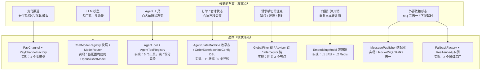
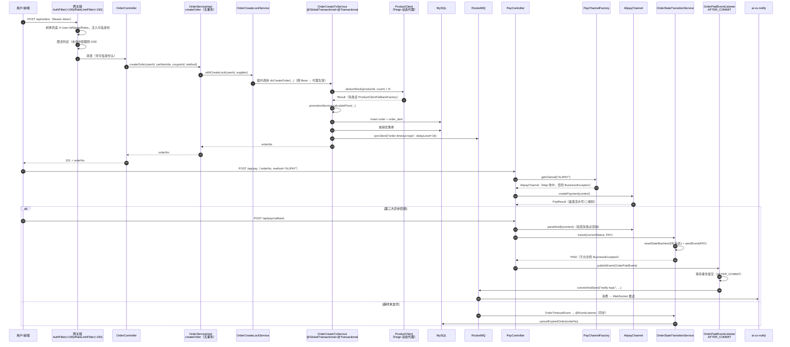

# 设计模式在微服务里的真正价值：不是类图更好看，而是变化点被隔离

> **一句话结论**：本项目里的设计模式不是"上课讲的 23 个"逐个落地，而是每个模式都恰好压在一个**已知会变**的点上——支付渠道会加、模型会换、限流算法会调、通知会多一种投递方式；模式的作用是把这类变化收进一个接口、一个注册表、一个快照，所以"加一个渠道 = 加一个类"，而不是"改 12 个 if-else"。反过来，凡是抽象了却没有变化点撑着的地方（`@Idempotent` 生产 0 处使用、`GatewayFilter` 0 处实现），抽象本身就是负债；凡是变化点暴露在外面的地方（支付渠道码有 8 处字面量、重试语义散成 4 套），模式形同虚设。
>
> **阅读前置**：需要会写 Spring Boot 业务代码，知道 `@Component`/构造器注入、`@Transactional` 依赖代理、`GlobalFilter` 与 `HandlerInterceptor` 大致是干什么的；不要求读过 Spring 源码，本文用到的框架内部行号会给出锚点，读不懂可以跳过，不影响主线。
>
> **证据基线**：JDK 17 ｜Spring Boot 4.2.0 ｜Spring Cloud 2026.0.0（Gateway 走 gateway-server-webflux 5.1.0）｜Spring Cloud Alibaba 2025.1.0.0 ｜Spring AI 2.1.0 ｜Sentinel 1.8.10 ｜A 级：8 个框架类逐段精读（`24-源码分析/assets/source` 已入库摘录，21 处 `[[源码:...]]` 锚点）｜B 级：本项目 42 个真实文件、60 处带行号的路径引用｜C 级：3 条 30 秒内可复现命令 + 3 段真实输出｜预计阅读：55 分钟。

---

## 0. 先看现象：三处"模式写了但没兜住"的现场

**现象 1：加一个支付渠道，要改的地方不止一处。**

`PayChannel` 接口的注释写着一个很漂亮的承诺——新增支付方式 = 新增一个实现类（`ai-cs-pay/src/main/java/com/aics/pay/channel/PayChannel.java#L8-L9`）。但渠道码本身在两个地方各写了一遍：4 个实现类的 `getMethod()` 返回字面量，`PaymentMethod` 枚举里又有 4 个枚举码。把全仓 main 代码里这 4 个字面量扫一遍，命中 8 处（本机实测，命令见 §6.6）：

```text
ai-cs-common/src/main/java/com/aics/common/enums/PaymentMethod.java:13
ai-cs-common/src/main/java/com/aics/common/enums/PaymentMethod.java:14
ai-cs-common/src/main/java/com/aics/common/enums/PaymentMethod.java:15
ai-cs-common/src/main/java/com/aics/common/enums/PaymentMethod.java:17
ai-cs-pay/src/main/java/com/aics/pay/channel/MockPayChannel.java:41
ai-cs-pay/src/main/java/com/aics/pay/channel/WechatNativeChannel.java:72
ai-cs-pay/src/main/java/com/aics/pay/channel/UnionpayChannel.java:73
ai-cs-pay/src/main/java/com/aics/pay/channel/AlipayChannel.java:77
```

8 处、2 个真源、0 处编译期绑定。也就是说：策略模式把"每种渠道怎么实现"隔离住了，却没把"渠道码是什么"这个同样会变的东西隔离住——加第 5 个渠道时，少改一处枚举，代码照样编译通过，运行时 `PayChannelFactory.getChannel()` 抛 `BusinessException`。

**现象 2：同一个词"重试"，在项目里有 4 套语义。**

按代码注释原文摘录（每条都可在对应文件当次核对）：

```text
ai-cs-chat/src/main/java/com/aics/chat/service/impl/ResilientAiService.java:52     瞬时重试：仅对连接/超时类瞬时故障重试一次
ai-cs-chat/src/main/java/com/aics/chat/agent/workflow/AfterSaleAgentService.java:468 手写重试循环（重试后仍失败转人工）
ai-cs-chat/src/main/java/com/aics/chat/feign/TraceFeignClient.java:35              以 requestId 为幂等键对抗 HTTP 重试
ai-cs-chat/src/main/java/com/aics/chat/observability/OnlineEvalService.java:85      评分失败不重试（LLM 重试会重复花钱）
```

四种语义都对，但它们是四份**彼此不知道对方存在**的实现：一份靠 Resilience4j 注解、一份是 for 循环、一份是幂等键、一份是"明确不重试"的注释。没有一处能回答"这个系统一共重试几次、超时算不算、重试要不要去重"。这就是**变化点没有收进边界**的典型症状——不是缺模式，是模式只落在了一个方法里。

**现象 3：AOP 切不到自调用。**

项目自己的故障案例库把这件事记成了 C1（`docs/28-故障案例库.md#L23`），其中两句原文最关键：

```text
docs/28-故障案例库.md:30  锁内调用的方法根本没有事务（已由集成测试证实）
docs/28-故障案例库.md:69  OrderServiceTest 用 @InjectMocks 创建的是裸实例，没有 Spring 代理，自然测不出"注解没生效"
```

修复后的形态是把事务方法拆进独立 Bean：`ai-cs-order/src/main/java/com/aics/order/service/impl/OrderServiceImpl.java#L57-L59` 的入口 `createOrder` 只负责"加锁 + 委派"，真正的 `@GlobalTransactional`+`@Transactional` 落在 `ai-cs-order/src/main/java/com/aics/order/service/impl/OrderCreateTxService.java#L78-L79`。代理模式在这里不是"设计技巧"，而是**注解生效的物理前提**：只隔了一个 `this`，切面就不存在。

这些现象指向同一件事：**设计模式的价值不在类图对称，而在"变化点是否被一个边界挡住"——边界挡得住，加需求是加类；挡不住，加需求是改调用链。**

---

## 1. 整体地图

下面这张图只画一件事：本项目里 7 类会变的东西，分别被哪个边界挡住，边界背后的实现写在括号里。读图时不要看方块数量，看"变化点 → 边界"这条竖线。



> **读图说明**：
> - 最该盯住的是中间那一列——**变化点几乎都被边界挡住了，唯一分叉的是 `C7`**：消息通道（`B7`）与下游降级（`B8`）同属"外部依赖"，但一个是适配器、一个是降级工厂，硬合成一个接口只会让两边都变形。看错这条箭头会得出"外部依赖有一个统一抽象"的错误结论。反过来，**看漏的是边界漏风的地方**：`C1` 右侧那条线目前漏在边界外面（`PaymentMethod` 枚举与 4 个 `getMethod()` 各写一遍），它是本项目唯一一处"有边界但没挡住"的位置，详见 §0 现象 1。
> - 第二条要看的是 `C5 → B5`：网关的 `GlobalFilter`、Spring AI 的 `Advisor`、Spring MVC 的 `HandlerInterceptor` 是三种**不同的链**，不是一条链。看错这条箭头会得出"责任链有一处实现"的错误结论，实际是三套框架各自的链，本项目只在网关这条链上加了 3 个节点。
> - 第三条是 `C4 → B4`：状态机有**两个完全不同的实现**（订单用 Spring Statemachine DSL，售后 Agent 用手写 `EnumMap`），不是同一个东西的两个视图。

| 组件 | 责任 | 谁调用它 |
| --- | --- | --- |
| `PayChannel` + `PayChannelFactory`（策略接口 + 注册表） | 声明"一次支付要做的 5 个动作"（下单/查单/回调解析/关单/退款）；启动时把 `List<PayChannel>` 收成 `Map<method, channel>`，未命中抛业务异常 | `PayController`、`PayNotifyService` |
| `ChatModelRegistry` + `ModelRouter`（注册表+快照 / 策略选择器） | 按配置构建 `ChatClient` 并整体替换 `volatile` 快照；按场景候选链过滤"存在/健康/有该能力"，配额超限时降级到便宜模型 | `RoutedChatClientFactory`、`ResilientAiService` |
| `AgentStateMachine`（状态机） | 声明 11 个状态的合法迁移，以及"哪个状态允许调哪个工具" | `AgentToolRegistry`、`AfterSaleAgentService` |
| `OrderStateMachineConfig` + `OrderStateTransitionService`（状态机） | 用 Spring Statemachine DSL 声明 5 条订单迁移，运行时按 DB 当前状态重放 | `OrderServiceImpl` |
| `AuthFilter` / `RateLimitFilter`（责任链节点） | 剥离伪造身份头 + 注入可信身份；限流（算法可切换） | Gateway 的 `FilteringWebHandler`（框架） |
| `CachingEmbeddingModel`（装饰器） | 在 `EmbeddingModel` 外面套一层缓存，未命中才穿透到 delegate | `VectorStore`（框架侧调用） |
| `MessagePublisher`（适配器接口） | 把"发消息/延迟发消息"收敛成 3 个方法，MQ 二选一由条件装配决定 | `WorkOrderProducer`、`ChatMessageProducer`、各 MQ Listener 侧 |
| `IdempotentAspect`（AOP 代理） | 用 Redis `setIfAbsent` 做接口幂等，Redis 不可用时 fail-open | 被 `@Idempotent` 标注的方法（**当前生产 0 处**） |
| `*FallbackFactory`（降级适配器） | Feign 下游失败时按方法性质决定"抛异常"还是"降级返回" | Feign 生成的动态代理 |

---

## 2. 关键概念与关键类

先把 7 个反复出现的词对齐，后面不再解释：

- **变化点（axis of change）**：本文唯一的判据。指"业务上确定会新增/替换的东西"——渠道、模型、工具、状态、中间件。有变化点才谈模式，没有变化点谈模式就是 §5.2 的"过早抽象"。
- **策略（Strategy）与注册表（Registry）**：前者是"一个接口 + 多个实现 + 一个持有者"，后者是以"标识 → 实现"的 Map 取代 `if-else` 分派。本项目里策略的持有者通常就是注册表，而不是某个 `if` 分支；有两处用构造器注入 `List<T>` 收集实现：`PayChannelFactory`、`AgentToolRegistry`。
- **快照替换（copy-on-write snapshot）**：先把新的映射表完整建好，再一次性赋给 `volatile` 字段，让并发读永远看到"要么全旧、要么全新"的配置。`ChatModelRegistry` 用的就是这招。
- **责任链（Chain of Responsibility）**：请求依次穿过若干节点，每个节点可以短路。**关键区别**：链本身通常由框架持有（Gateway 的 `FilteringWebHandler`、Spring MVC 的 `HandlerExecutionChain`），业务只贡献节点。
- **装饰器（Decorator）**：实现与目标同一个接口，持有目标实例，在调用前后加行为，且可叠加。`CachingEmbeddingModel` 是教科书形态。
- **代理（Proxy）**：调用方拿到的不是目标对象本身，而是一个"同样接口"的替身，替身负责织入横切逻辑。Spring AOP 与 Feign 都是这一支——**它们是"框架替你写代理"，不是"你写一个 Proxy 类"**。

| 名称 | 位置（模块） | 角色 | 关键方法 |
| --- | --- | --- | --- |
| `PayChannel` + 4 个实现（`AlipayChannel`/`WechatNativeChannel`/`UnionpayChannel`/`MockPayChannel`） | `ai-cs-pay`（本项目） | 策略接口 + 策略实现 ×4 | `getMethod()`、`createPayment()`、`parseNotify()`、`refund()`；4 个 `getMethod()` 各返回一个字面量 |
| `PayChannelFactory` / `PaymentMethod`（枚举，**第二真源**） | `ai-cs-pay` / `ai-cs-common`（本项目） | 注册表 / 渠道码枚举 | `getChannel(String)`、`allChannels()` / 4 个枚举常量 |
| `ChatModelRegistry` | `ai-cs-chat`（本项目） | 注册表 + 快照 | `rebuild()`、`get(String)`、`contains(String)` |
| `ModelRouter` / `RoutedChatClientFactory` | `ai-cs-chat`（本项目） | 策略选择器 / 工厂门面 | `route(RouteRequest)`、`cheapestEligible()` / `chatClientFor(ModelScenario)` |
| `AgentTool` / `AgentToolRegistry` | `ai-cs-chat`（本项目） | 策略接口 / 注册表 + 授权 | `name()`、`assertToolAllowed()` |
| `AgentStateMachine` | `ai-cs-chat`（本项目） | 状态机（手写表） | `canTransit()`、`allowedTools()` |
| `OrderStateMachineConfig` / `OrderStateTransitionService` | `ai-cs-order`（本项目） | 状态机（Spring DSL）/ 执行器 | `orderStateMachine()`（`@Bean`）/ `transit(String, OrderEvent)` |
| `AuthFilter` / `RateLimitFilter` | `ai-cs-gateway`（本项目） | 责任链节点 | `filter()`、`getOrder()` |
| `CachingEmbeddingModel` | `ai-cs-chat`（本项目） | 装饰器 | `call(EmbeddingRequest)`（只覆写这一个） |
| `MessagePublisher` | `ai-cs-common`（本项目） | 适配器接口 | `send()`、`sendDelayed()`、`brokerType()` |
| `IdempotentAspect` | `ai-cs-common`（本项目） | AOP 代理（切面） | `@Around` 幂等占位 |
| `DefaultSingletonBeanRegistry` | spring-beans 7.1.0 | 框架侧单例实现（双重检查） | `getSingleton(String, ObjectFactory)` |
| `JdkDynamicAopProxy` / `CglibAopProxy` / `FeignClientFactoryBean` | spring-aop 7.1.0 / spring-cloud-openfeign | 框架侧代理生成（AOP 两种、Feign 一种） | `invoke()` / `getProxy()` / `getObject()` |
| `AbstractGatewayFilterFactory` | spring-cloud-gateway-server-webflux 5.1.0 | 框架侧过滤器工厂（模板方法） | 抽象 `apply()` 由子类实现 |

## 3. 原理与证据逐段精讲

以下每一小节都按四层展开：**在干什么 → 为什么这么设计 → 换写法会怎样 → 常见坑**。每一层都要能落回一个可核对的依据（接口签名行号、注册表构造器、框架源码锚点、或本机命令输出）。如果你的疑问是"为什么不直接 if-else"，直接跳到 §5；如果你的疑问是"这段注释写了但代码没做"，看 §6。

### 3.1 策略模式：`PayChannel` 把"渠道差异"压进 5 个动作

**在干什么**：定义一个接口，把"一次支付在业务上必须完成的动作"写死，把"每个渠道怎么做"留给实现类。

```java
public interface PayChannel {
    String getMethod();
    PayResult createPayment(PayContext context);
    String queryPayment(String orderNo);
    NotifyResult parseNotify(NotifyContext context);
    void closeOrder(String orderNo);
    RefundResult refund(String orderNo, BigDecimal refundAmount);
}
```

（上述片段节选自 `ai-cs-pay/src/main/java/com/aics/pay/channel/PayChannel.java#L42-L68`，省略了字段常量 `STATUS_PENDING/STATUS_SUCCESS/STATUS_CLOSED`（L31-L37）与逐方法 javadoc。）

这 5 个动作不是随便挑的：它们对应支付链路上**必须由渠道自己完成**的四类事——下单、查单、**回调验签解析**（`parseNotify` 的 javadoc 明确写"验签失败必须抛出异常，防止伪造通知"，`ai-cs-pay/src/main/java/com/aics/pay/channel/PayChannel.java#L53-L58`）、退款/关单。上游业务（下单、回调、退款流程）只认接口，不认渠道。

**为什么这么设计**：支付是这个项目里变化最频繁的一块。每接一个渠道，差异集中在三个地方——参数组装、签名算法、回调格式。把这三件事收进接口后，"新增渠道"从"改下单服务 + 改回调服务 + 改退款服务"变成"加一个类"。接口注释就是这么承诺的（`PayChannel.java#L8-L9`：新增支付方式 = 新增一个实现类并在 Spring 中注册，无需改动下单/回调/退款业务流程）。

**换写法会怎样**：如果不用策略，代码会退化成 `switch (method) { case "ALIPAY": ... case "WECHAT": ... }` 分散在下单、回调、退款三处，且三处必须同步增长。本项目已经有反例可对照——`AI` 侧的 `IntentClassifierService` 就是这种形态（`ai-cs-chat/src/main/java/com/aics/chat/agent/intent/IntentClassifierService.java#L187-L236`，一个方法里 5 组并列 `if`）。两者的区别不是"优雅 vs 不优雅"，而是**新增一个渠道要动 1 个文件还是 3 个文件**。

**常见坑**（按踩到的概率排序）：

1. **标识符不在接口里**。`getMethod()` 返回的是字符串，不是枚举——所以"渠道码是什么"这件事没有被类型系统管住，直接导致 §0 现象 1。标准策略模式通常把 key 收敛为枚举或常量；本项目是**变形**，变形原因是"渠道码要能从数据库/前端直接透传"。
2. **实现类的数量 ≠ 策略的数量**。`MockPayChannel` 是为本地联调存在的（`ai-cs-pay/src/main/java/com/aics/pay/channel/MockPayChannel.java#L32` 用一个 `ConcurrentHashMap` 存渠道状态，`markPaid`/`markClosed` 直接改内存），它和真实渠道共用接口，意味着**接口里不能塞只有真渠道才有的语义**（比如"证书轮换"）；**接口越胖，策略越假**。这是 5 个方法能撑住、15 个方法撑不住的原因：接口一胖，实现类就得写一堆空方法或抛 `UnsupportedOperationException`，那时"策略"就变成了"被迫实现"。

### 3.2 工厂 + 注册表：`PayChannelFactory` 用构造器注入把实现收成 Map

**在干什么**：Spring 启动时把所有 `PayChannel` 类型的 Bean 塞进一个 `List`，工厂把它变成"渠道码 → 实现"的 Map，并对外只暴露 `getChannel`。

```java
@Component
public class PayChannelFactory {
    private final Map<String, PayChannel> channelMap;
    public PayChannelFactory(List<PayChannel> channels) {
        this.channelMap = channels.stream()
                .collect(Collectors.toMap(PayChannel::getMethod, Function.identity()));
        log.info("已注册支付渠道: {}", channelMap.keySet());
    }
    public PayChannel getChannel(String method) {
        PayChannel channel = channelMap.get(method);
        if (channel == null) {
            throw new BusinessException(ResultCode.ORDER_PAYMENT_METHOD_INVALID,
                    "不支持的支付方式: " + method);
        }
        return channel;
    }
}
```

（上述片段节选自 `ai-cs-pay/src/main/java/com/aics/pay/channel/PayChannelFactory.java#L31-L47`，`allChannels()` 在 L49-L51。）

**为什么这么设计**：三件事同时达成。① **零 if**：路由变成一次 `Map.get`，复杂度 O(1)，新增实现自动被收集，工厂代码永远不用改；② **启动即暴露**：`log.info("已注册支付渠道: {}", channelMap.keySet())`（L37）让"到底装了哪几个渠道"在启动日志里一眼可见，这是可观测性里最便宜的一条；③ **失败语义明确**：未命中不是返回 null，而是抛带错误码的 `BusinessException`，错误码 `ORDER_PAYMENT_METHOD_INVALID` 由全局异常处理统一翻译。

**换写法会怎样**：两种退化路径。一是 `if ("ALIPAY".equals(method)) return alipayChannel;`——工厂方法随渠道数线性增长，且新增渠道必须改工厂。二是用 `applicationContext.getBeansOfType(PayChannel.class)` 在 `getChannel` 里每次查——把启动期的错误推到运行期，且失去了"启动日志能看出注册了哪些"的好处。

**常见坑**：

1. **`Collectors.toMap` 遇到重复 key 会抛 `IllegalStateException`**，且异常信息只说"Duplicate key"，不说是哪两个类冲突。本项目靠"渠道码唯一"这个人工约定保证；更强的做法是给 `toMap` 传第三个参数 `(a, b) -> { throw new IllegalStateException(...) }`。
2. **构造器注入 `List<T>` 是"隐式注册"**：新写的实现类只要加了 `@Component` 就会自动进注册表，没有显式注册清单。好处是零改动，坏处是**没人知道一共有几个**——所以 L37 那行日志不是装饰；**注册表只能覆盖"按 key 选一个"的场景**。`PayChannelFactory` 里没有"按金额选渠道""按用户分层选渠道"的位置；一旦业务要这类规则，加的应该是 `PayChannelSelector` 而不是往工厂里塞 if。

### 3.3 状态机：两个状态机，两种完全不同的实现

**在干什么**：把"哪些状态迁移合法"从散落的 `if` 里抽出来，变成一张可检查的表。本项目有两个状态机，实现方式截然不同：

```java
// 订单侧：Spring Statemachine DSL（声明式）
@Bean
public StateMachine<OrderStatus, OrderEvent> orderStateMachine() throws Exception {
    StateMachineBuilder.Builder<OrderStatus, OrderEvent> builder = StateMachineBuilder.builder();
    ...
    builder.configureTransitions()
            .withExternal().source(OrderStatus.PENDING_PAY).target(OrderStatus.PAID).event(OrderEvent.PAY)
            .and().withExternal().source(OrderStatus.PENDING_PAY).target(OrderStatus.CANCELLED).event(OrderEvent.CANCEL)
            .and().withExternal().source(OrderStatus.PENDING_PAY).target(OrderStatus.CANCELLED).event(OrderEvent.TIMEOUT)
            .and().withExternal().source(OrderStatus.PAID).target(OrderStatus.REFUNDING).event(OrderEvent.REFUND_REQUEST)
            .and().withExternal().source(OrderStatus.REFUNDING).target(OrderStatus.REFUNDED).event(OrderEvent.REFUND_SUCCESS);
    return builder.build();
}
```

（上述片段节选自 `ai-cs-order/src/main/java/com/aics/order/statemachine/OrderStateMachineConfig.java#L18-L29`，省略了 `initial(...).states(EnumSet.allOf(OrderStatus.class))`（L21-L23）。）

```java
// 售后 Agent 侧：纯 Java 静态表（手写；无 Spring 依赖，便于单测）
private static Map<AfterSaleState, Set<AfterSaleState>> buildTransitions() {
    Map<AfterSaleState, Set<AfterSaleState>> m = new EnumMap<>(AfterSaleState.class);
    m.put(AfterSaleState.START, EnumSet.of(AfterSaleState.CLASSIFY_INTENT));
    m.put(AfterSaleState.CLASSIFY_INTENT, EnumSet.of(AfterSaleState.LOCATE_ORDER, AfterSaleState.HANDOFF));
    m.put(AfterSaleState.LOCATE_ORDER, EnumSet.of(AfterSaleState.CHECK_POLICY, AfterSaleState.LOCATE_ORDER,
            AfterSaleState.COMPLETED, AfterSaleState.FAILED));
    ...
    m.put(AfterSaleState.COMPLETED, Set.of());
    return m;
}
```

（上述片段节选自 `ai-cs-chat/src/main/java/com/aics/chat/agent/state/AgentStateMachine.java#L30-L50`，完整的 11 个状态见 `ai-cs-chat/src/main/java/com/aics/chat/agent/state/AfterSaleState.java#L20-L45`。）

**为什么这么设计**：两者服务的目标不同，所以形态不同。

- **订单状态机要"能被外部工具检查"**：Spring Statemachine 的 DSL 可以画图、可以被别的组件复用，但它**不用内存 persister**——`OrderStateTransitionService.transit()` 每次先用 DB 里的当前状态 `resetStateMachine` 再 `sendEvent`（`ai-cs-order/src/main/java/com/aics/order/statemachine/OrderStateTransitionService.java#L21-L33`）。这个变形的原因是：订单状态的唯一事实来源是数据库，状态机只是"合法性判定器"，不是"状态持有者"。看错这一点会得出"重启后状态丢失"的错误结论——状态从来不在这里存。
- **Agent 状态机要"能在单测里裸跑"**：售后 Agent 的迁移表是 `static` 的 `EnumMap`，没有 Spring 上下文也能断言 `canTransit`。它还多承担了一个职责——**工具白名单**：`LOCATE_ORDER` 只允许 `order_locator`/`product_recommend`，`EXECUTE_AFTER_SALE` 只允许 `create_after_sale`（`AgentStateMachine.java#L52-L60`）。

**换写法会怎样**：如果两个都用 `if (status == PENDING_PAY && event == PAY)`，会有三个后果：① 迁移规则散落在多个 Service 方法里，没人能回答"这个状态能到哪"；② 新增一条迁移必须全文搜索，漏一处就出现"某条路径能跳状态"；③ 无法生成"状态图"给产品/测试对账。反过来说，如果两个都强行用 Spring Statemachine，Agent 侧的 `EnumMap` 白名单仍要另写——因为**状态机框架管迁移，不管"这个状态允许调用哪个工具"**。

**常见坑**：

1. **状态机的 `synchronized` 是有原因的**：`OrderStateTransitionService` 在同一台 JVM 内 `synchronized (orderStateMachine)`（L23），因为 Spring Statemachine 的实例是有状态的。多实例部署时它**不保证**跨节点互斥——跨节点的正确性依赖 DB 的乐观锁/条件更新，这一点必须清楚，否则会误以为状态机自带分布式锁。
2. **两条边指向同一个目标不是重复**：`PENDING_PAY → CANCELLED` 有 `CANCEL` 和 `TIMEOUT` 两个事件，语义不同（用户取消 vs 超时关单），合并会让审计日志丢失原因。
3. **允许自环要显式写**：`LOCATE_ORDER → LOCATE_ORDER`、`COLLECT_EVIDENCE → COLLECT_EVIDENCE`、`CONFIRM_ACTION → CONFIRM_ACTION` 都写进了迁移表。不写自环，Agent 的"用户补充信息后重试同一步"会被判非法迁移——这是 Agent 场景与订单场景最大的差异；**工具白名单与迁移表要同源**：`AgentToolRegistry.assertToolAllowed()` 的判定来自 `AgentStateMachine.allowedTools()`（`ai-cs-chat/src/main/java/com/aics/chat/agent/tool/AgentToolRegistry.java#L63-L69`），如果两者分头维护，就会出现"状态说能调、注册表说不能"。

### 3.4 工厂 + 注册表（进阶）：`ChatModelRegistry` 的快照替换 vs `AgentToolRegistry` 的启动定格

**在干什么**：同样是"注册表"，两个实现采取了完全不同的更新策略：

```java
public synchronized void rebuild() {
    properties.validate();
    Map<String, ModelClientHolder> next = new HashMap<>();
    for (ModelDefinition definition : properties.getModels()) {
        if (!definition.isEnabled()) {
            continue;
        }
        ModelClientHolder existing = this.clients.get(definition.getId());
        if (existing != null && sameDefinition(definition, existing.getDefinition())) {
            next.put(definition.getId(), existing);
            continue;
        }
        // 构建 OpenAiChatModel + ChatClient（略）
        ...
    }
    this.clients = Map.copyOf(next);
}
```

（上述片段节选自 `ai-cs-chat/src/main/java/com/aics/chat/modelrouter/ChatModelRegistry.java#L44-L83`，省略了客户端构建细节（L60-L78）与失败处理（L84-L90）。）

**为什么这么设计**：`clients` 字段声明是 `private volatile Map<String, ModelClientHolder> clients = Map.of();`（L32），`rebuild()` 是 `synchronized`，但**读路径不加锁**——`get()` 直接读 `volatile` 快照。做法是"先在局部变量 `next` 里把整张表建好，最后一行 `this.clients = Map.copyOf(next)` 一次性替换"。这样并发请求要么看到旧的全量配置、要么看到新的全量配置，不会看到"删了一半的中间态"。触发点有两个：`@PostConstruct` 首次构建（L34-L37），以及 `@EventListener(RefreshScopeRefreshedEvent.class)` 配置刷新（L39-L42）——这是 Nacos 配置热更新能生效的关键接缝。

**换写法会怎样**：如果直接 `this.clients.put(...)` 增量修改，配置刷新期间会有请求读到"新模型已加、旧模型已删"的混合状态，表现为偶发的 `model not registered`。更糟的是失败处理：本实现里如果新配置构建失败，`clients.isEmpty()` 才 fail-fast 抛 `IllegalStateException("failed to initialize model registry")`（L84-L88），否则 `log.error("模型路由配置刷新失败，保留旧配置…")`（L89）——**保留旧配置**这个语义，只有在"整体替换"的前提下才成立。

**对照 `AgentToolRegistry`**：它的注册只有一次——构造器里 `toolList.forEach(t -> tools.put(t.name(), t))`（`AgentToolRegistry.java#L25-L29`）。它不需要 `volatile`，因为工具集合在运行期不变；`all()` 返回 `Map.copyOf` 只是防止外部改动。**同一个"注册表模式"，一个需要热更新、一个不需要，所以一个用快照、一个用定格——模式相同，并发策略必须不同。**

**常见坑**：

1. **`volatile` 只保证引用可见，不保证 Map 内部可见**，所以必须 `Map.copyOf`（不可变副本）。如果赋值 `this.clients = next`（`next` 是可变 `HashMap`），别的线程可能看到未完成的状态。
2. **`synchronized` 加在 `rebuild` 上、不加在读上**，这是有意的；如果为了"安全"给 `get()` 也加锁，热路径会退化成串行；**能力过滤不是注册表的职责**：`ChatModelRegistry` 只按 `capabilities.contains(ModelCapability.TOOL_CALLING)` 决定"要不要挂工具回调"（L76-L78），"这次请求需要一个有视觉能力的模型"是 `ModelRouter` 的事。把两者混在一起，注册表就会带上业务语义。

### 3.5 策略选择器：`ModelRouter` 的候选链是"逐层剪枝"，不是"打分排序"

**在干什么**：它把"这次请求该用哪个模型"变成一串可解释的剪枝，并把"选不出来"作为**正常返回**而不是异常：

```java
public RouteDecision route(RouteRequest request) {
    if (!properties.isEnabled()) {
        return noEligible();
    }
    List<String> candidates = new ArrayList<>();
    var scenarioRoute = properties.getScenarios().get(request.getScenario());
    ...
    candidates.removeIf(id -> !registry.contains(id)
            || !healthRegistry.isAvailable(id)
            || !hasCapabilities(id, required));
    ...
}
```

（上述片段节选自 `ai-cs-chat/src/main/java/com/aics/chat/modelrouter/ModelRouter.java#L20-L40`，配额降级分支在 L47-L58，`cheapestEligible()` 在 L66-L78。）

**为什么这么设计**：三点。① **剪枝条件是可列举的**：模型不存在（`!registry.contains`）、不健康（`!healthRegistry.isAvailable`）、能力不够（`!hasCapabilities`）。把三个条件写在一个 `removeIf` 里，读代码的人一眼能看出"为什么这个模型被排除"。② **fallback 永远不会落到不可用的模型上**——因为 fallback 与 primary 一起进候选链，然后统一过同一组剪枝。③ **`noEligible()` 返回 `RouteReason.NO_ELIGIBLE_MODEL` 而不是抛异常**（L92-L99）：模型选不出来是**降级路径**的一部分（上层 `RoutedChatClientFactory` 拿到空候选才抛），不让它变成 5xx 是这条链的设计目标。

**换写法会怎样**：如果按"优先级排序后取第一个"，会漏掉"最高优先级模型不健康"的情况，把故障从"选备用模型"放大成"请求失败"。如果给每个模型打分（延迟/价格/成功率加权），代码可解释性会掉一个档：现在每个 `RouteReason` 都能对应一句人话（`SCENARIO_DEFAULT`/`PRIMARY_UNAVAILABLE`/`QUOTA_DOWNGRADE`/`QUOTA_NO_CHEAPER_MODEL`/`NO_ELIGIBLE_MODEL`），打分制只能说"综合分最低"。

**常见坑**：

1. **配额降级只在 `quota.enabled` 且 `request.isQuotaExceeded()` 时触发**（L47-L54）。如果调用方忘了把配额状态传进来，降级永远不会发生——`RoutedChatClientFactory` 在非流式/无配额上下文里就是显式传 `quotaExceeded(false)`（`ai-cs-chat/src/main/java/com/aics/chat/modelrouter/RoutedChatClientFactory.java#L18-L22`）。
2. **`cheapestEligible()` 的"便宜"是 `priority` 倒序**（L66-L78），不是价格字段——`ModelDefinition` 里的 `tier`/`priority` 是人工标注，不是实时计费数据。把它当成本优化会算错账；**场景没配置就全盘不可用**：`properties.getScenarios().get(...)` 返回 null 时不会回退到"默认模型"，而是走 `noEligible()`。新增一个 `ModelScenario` 枚举值必须同步加配置，这条约束只能靠配置校验（`properties.validate()`，L46）兜住。

### 3.6 装饰器：`CachingEmbeddingModel` 一个 `call()` 就套住了整个接口

**在干什么**：在真正的 `EmbeddingModel` 外面套一层缓存，命中就返回，未命中才穿透。

```java
@Override
public EmbeddingResponse call(EmbeddingRequest request) {
    List<String> texts = request.getInstructions();
    List<float[]> vectors = new ArrayList<>(texts.size());
    List<String> missTexts = new ArrayList<>();
    List<Integer> missIndexes = new ArrayList<>();
    for (int i = 0; i < texts.size(); i++) {
        float[] cached = cache.get(modelKey, texts.get(i));
        vectors.add(cached);
        if (cached == null) {
            missTexts.add(texts.get(i));
            missIndexes.add(i);
        }
    }
    if (missTexts.isEmpty()) {
        return respond(vectors);
    }
    EmbeddingResponse response = delegate.call(new EmbeddingRequest(missTexts, request.getOptions()));
    ...
}
```

（上述片段节选自 `ai-cs-chat/src/main/java/com/aics/chat/cache/CachingEmbeddingModel.java#L43-L74`，`respond()` 在 L90-L96。）

**为什么这么设计**：因为 `EmbeddingModel` 这个框架接口的设计刚好让装饰器极其便宜——**它只有 2 个抽象方法**，其余 7 个是 `default`（其中 1 个是桥接方法）。本机 `javap` 实测（命令见 §6.6）：

```text
public interface org.springframework.ai.embedding.EmbeddingModel
  public abstract EmbeddingResponse call(EmbeddingRequest);
  public abstract float[] embed(Document);
  public float[] embed(String);
  public java.util.List<float[]> embed(java.util.List<java.lang.String>);
  public java.util.List<float[]> embed(java.util.List<Document>, EmbeddingOptions, BatchingStrategy);
  public EmbeddingResponse embedForResponse(java.util.List<java.lang.String>);
  public java.lang.String getEmbeddingContent(Document);
  public int dimensions();
  public default EmbeddingResponse call(ModelRequest);
```

关键点：`embed(String)`、`embed(List<String>)`、`embedForResponse(...)` 这些 `default` 方法的实现最终都汇聚到 `call(...)`（`[[源码:EmbeddingModel.java.md#L83-L90]]`：`embed(List<String>)` 内部就是 `this.call(new EmbeddingRequest(...))`）。所以**只要覆写 `call()` + `embed(Document)` 两个抽象方法，整条上层 API 全都被缓存住**——这就是 §3.6 标题里"一个 `call()` 套住整个接口"的物理原因。再看 `[[源码:EmbeddingModel.java.md#L49-L60]]`，`embed(String text)` 是 `default` 且转调 `this.embed(List.of(text))`，所以装饰器不需要逐个实现重载。

**换写法会怎样**：三种退化都很有意思。① **用继承**：写 `class CachedOpenAiEmbeddingModel extends OpenAiEmbeddingModel`，就把缓存和某个具体厂商绑死了，换模型要重写一遍；装饰器只依赖接口。② **在调用方加缓存**：那就是把缓存逻辑复制到每个 RAG 检索点，`CachingEmbeddingModel` 存在的意义就是让 `VectorStore` 无感。③ **只缓存 `embed(String)`**：`default` 方法的多态性决定了这样缓存会漏掉批量调用——`embed(List<String>)` 走的是 `call()`，不经过 `embed(String)`。

**常见坑**：

1. **必须覆写 `embed(Document)`**，否则文档级调用绕过缓存。本实现覆写了它，并且刻意用 `document.getFormattedContent()` 作为缓存键（`CachingEmbeddingModel.java#L77-L88`）——因为 `Document` 的 Metadata 会影响实际嵌入内容，用 `getText()` 做键会把不同 metadata 的文档混成一条。
2. **缓存键必须带模型命名空间**：`VectorCacheStore.cacheKey(modelKey, text)` 是 `modelKey + ":" + sha256Hex(text)`（`ai-cs-chat/src/main/java/com/aics/chat/cache/VectorCacheStore.java#L101-L103`）。不带模型名的后果是"换模型后所有向量都是错的，且看起来全命中"——这是最难查的一类故障。
3. **L2 缓存异常必须降级而不是失败**：`VectorCacheStore.get()` 在 Redis 异常时 `log.warn("向量缓存 L2 读取失败，降级 L1-only…")` 并返回 null（L73-L77），让请求回落到底层模型；如果这里抛异常，缓存故障就会放大成对话不可用；**L1 的 LRU 用 `LinkedHashMap` 的 `accessOrder=true` + `removeEldestEntry`**（L48-L54）。自己写 LRU 容易漏掉"读也要重排"这一点，`accessOrder=false` 的 `LinkedHashMap` 是 FIFO 不是 LRU。

### 3.7 观察者 / 领域事件：本项目没有 GoF 观察者，只有两种 Spring 事件语义

**在干什么**：把"主流程完成后要发生的事"从主流程里摘出去，交给事件监听器。本项目里只有 3 个事件监听点，且分属两种语义：

```java
@TransactionalEventListener(phase = TransactionPhase.AFTER_COMMIT)
public void onOrderPaid(OrderPaidEvent event) {
    NotifyContext notify = ...;
    try {
        rocketMQTemplate.convertAndSend("notify-topic", notify);
    } catch (Exception e) {
        log.warn("事务提交后支付成功通知投递失败…", e);
    }
}
```

（上述片段节选自 `ai-cs-order/src/main/java/com/aics/order/event/OrderPaidEventListener.java#L30-L40`，事件本身是 `record OrderPaidEvent(String orderNo, Long userId)`。）

```java
@EventListener
public void handle(OrderTimeoutEvent event) {
    orderService.cancelExpiredOrder(event.orderNo());
}
```

（上述片段节选自 `ai-cs-order/src/main/java/com/aics/order/event/OrderTimeoutEventListener.java#L23-L26`。）

**为什么这么设计**：两个监听器看着像同一个模式，语义完全相反，而且**这个差异是有人刻意决策并写在 javadoc 里的**：

- `OrderPaidEventListener` 用 `@TransactionalEventListener(AFTER_COMMIT)`：支付成功后的"发通知"是**副作用**，必须等本地事务真的提交了才发；提前发会出现"通知已发、事务回滚"的资损级不一致。注意它的 catch 只 `log.warn`——通知失败不能反噬已提交的事务。
- `OrderTimeoutEventListener` 用普通 `@EventListener`（同步）：因为它是在 **RocketMQ 消费线程**里被触发的，`OrderTimeoutEventListener.java#L12-L14` 的 javadoc 明说"RocketMQ 消费线程只有关单逻辑返回后才算消费完成"，所以关单必须同步做完，不能异步甩出去。
- `@EventListener` 另一处出现在 `ChatModelRegistry#L39`，监听 `RefreshScopeRefreshedEvent` 重建模型快照——那是 §3.4 的热更新接缝。

**换写法会怎样**：如果两处都用 `@EventListener`，支付通知会在事务提交前发出，回滚时无法撤回；如果两处都用 `AFTER_COMMIT`，超时关单变成异步，MQ 消费在关单完成前就返回成功，消息丢失时订单永远停在待支付。**"用哪个事件语义"不是风格问题，是事务边界问题。**

**常见坑**：

1. **本项目的"观察者"数量极少**：全仓 `@TransactionalEventListener` 1 处、`@EventListener` 2 处、`@Async` 0 处、`implements ApplicationListener` 0 处（本机实测，见 §6.6）。所以"观察者模式"在这里不是主力模式；把它当主力会得出错误判断（以为项目事件驱动做得很重）。
2. **`AFTER_COMMIT` 里不要写必须成功的逻辑**：事务已提交，抛异常也回滚不了，只会让调用方看到"支付成功但接口 500"；**没有 `@Async` 意味着监听器同步执行**：`OrderPaidEventListener` 里那行 `convertAndSend` 是同步阻塞的，会把支付回调的响应时间拉长——这是当前实现的一个已知代价（见 §5）。

### 3.8 代理：AOP 与 Feign 都是"框架替你生成代理"，你只写接口/切面

**在干什么**：让调用方以为自己在调用目标对象，实际拿到的是织入了横切逻辑的替身。本项目有两种：

- **AOP 代理**：全仓唯一一个切面是 `IdempotentAspect`，`@Around("@annotation(idempotent)")`（`ai-cs-common/src/main/java/com/aics/common/idempotent/IdempotentAspect.java#L49-L50`），用 Redis `setIfAbsent` 占位做幂等。
- **远程代理**：13 个 `@FeignClient` 接口，例如 `ai-cs-chat/src/main/java/com/aics/chat/feign/TraceFeignClient.java#L29-L30`，只有接口没有实现类。

框架侧的证据分三层。第一层，JDK 动态代理的入口就是 `InvocationHandler`：

```java
final class JdkDynamicAopProxy implements AopProxy, InvocationHandler, Serializable {
```

（`[[源码:JdkDynamicAopProxy.java.md#L69-L69]]`）它在 `invoke()` 里取出拦截器链再调用：

```java
List<Object> chain = this.advised.getInterceptorsAndDynamicInterceptionAdvice(method, targetClass);
...
MethodInvocation invocation = new ReflectiveMethodInvocation(proxy, target, method, args, targetClass, chain);
```

（`[[源码:JdkDynamicAopProxy.java.md#L203-L217]]`）

第二层，CGLIB 路径把同样的链塞进 `MethodInterceptor`：`Callback aopInterceptor = new DynamicAdvisedInterceptor(this.advised);`（`[[源码:CglibAopProxy.java.md#L330-L330]]`），而 `DynamicAdvisedInterceptor` 本身是 `implements MethodInterceptor`（`[[源码:CglibAopProxy.java.md#L701-L701]]`）。

第三层，Feign 的代理由工厂 Bean 产出：`public Object getObject() {`（`[[源码:FeignClientFactoryBean.java.md#L474-L474]]`），最终交给 `Targeter`：`return targeter.target(this, builder, feignClientFactory, resolveTarget(...));`（`[[源码:FeignClientFactoryBean.java.md#L526-L527]]`）。

**为什么这么设计**：横切逻辑（幂等、事务、重试、鉴权、trace）本质上是"每个方法都要做、但没人愿意在每个方法里写"的东西。代理把这段从业务代码里彻底移出。代价是**必须有代理对象存在**——这正是 §0 现象 3 的根因：`this.doCreateOrder(...)` 调用的是裸对象，不经过代理，注解等于没写。

**换写法会怎样**：不用代理就得显式模板：`transactionTemplate.execute(...)`、`idempotentService.run(...)`。好处是"一眼能看出有事务"，坏处是每个调用点都要写，且漏写不会报错。项目里已经有过这种混合形态——`OrderCreateTxService` 把事务收在独立 Bean 上的方法里（`ai-cs-order/src/main/java/com/aics/order/service/impl/OrderCreateTxService.java#L78-L79`），本质上是"用一个 Bean 边界换取代理生效"，而不是改用编程式事务。

**常见坑**：

1. **自调用、`private` 方法、`final` 类/方法都不走代理**。项目把这个坑写进了故障案例（`docs/28-故障案例库.md#L55`）。
2. **单测用 `@InjectMocks` 测不出代理问题**：`docs/28-故障案例库.md#L69-L72` 记录得很直白——裸实例没有代理，测不出"注解没生效"。所以 `OrderCreateTxWiringTest` 这类**装配级测试**不可省。
3. **Feign 的代理是 JDK 动态代理，只能代理接口**：`contextId` 必须唯一（`TraceFeignClient.java#L19-L22` 的 javadoc 讲的就是同服务多接口的 Bean 名冲突）。给 Feign 接口加 `default` 方法要小心——默认方法不会走远程代理的那套编解码；**切面里的 Redis 故障要 fail-open**：`IdempotentAspect` 在 Redis 抛 `RuntimeException` 时 `return joinPoint.proceed()`（L62-L65），否则 Redis 抖动会变成全站接口不可用。这是一个"安全能力反而制造可用性风险"的经典取舍。

### 3.9 单例与双重检查：Spring 里的等价物不是"写个 `getInstance()`"

**在干什么**：保证一个类只有一个实例。Spring 的答案是容器级单例——Bean 默认 `singleton` 作用域，由 `DefaultSingletonBeanRegistry` 统一管理。它的实现里就有教科书级的双重检查：

```java
public Object getSingleton(String beanName, ObjectFactory<?> singletonFactory) {
    Assert.notNull(beanName, "Bean name must not be null");
    Thread currentThread = Thread.currentThread();
    Boolean lockFlag = isCurrentThreadAllowedToHoldSingletonLock();
    boolean acquireLock = !Boolean.FALSE.equals(lockFlag);
    boolean locked = (acquireLock && this.singletonLock.tryLock());
    try {
        Object singletonObject = this.singletonObjects.get(beanName);
        if (singletonObject == null) {
```

（上述片段节选自 `DefaultSingletonBeanRegistry.java.md#L255-L265`，即 `[[源码:DefaultSingletonBeanRegistry.java.md#L255-L265]]`。）

第一次检查是上面这段的 `singletonObjects.get(beanName)`（无锁快路径）；没命中才去 `this.singletonLock.lock()`（`[[源码:DefaultSingletonBeanRegistry.java.md#L290-L290]]`），拿到锁后**再查一次**——源码里那行注释写得很直白：`Singleton object might have possibly appeared in the meantime`（`[[源码:DefaultSingletonBeanRegistry.java.md#L293-L293]]`）。这就是"双重检查"的第二次检查：等锁期间别人可能已经建好了。

**为什么这么设计**：单例创建是启动期热点（几百个 Bean），如果每次 `getBean` 都加锁，启动会被串行化。所以用"无锁读 + 有锁创建 + 创建后再读一次"的三段式。字段本身是 `private final Map<String, Object> singletonObjects = new ConcurrentHashMap<>(256);`（`[[源码:DefaultSingletonBeanRegistry.java.md#L86-L86]]`），`addSingleton` 用 `putIfAbsent`（`[[源码:DefaultSingletonBeanRegistry.java.md#L159-L160]]`）。

**换写法会怎样**：手写 `getInstance()` 的经典坑（不加 `volatile` 导致指令重排、锁加在方法上导致每次调用都串行）在 Spring 里**都不存在**，因为你根本不该手写。项目里的证据是反向的：全仓 `class ... extends` 只有 6 处，其中 4 处是自定义异常，剩下 2 处是框架基类（`NotifyWebSocketHandler extends TextWebSocketHandler`、`HeaderAuthenticationFilter extends OncePerRequestFilter`）——**没有一个手写单例**。Python 侧的 `ai-cs-py-recommend` 用 `@lru_cache` 达到同样效果，同样不是手写。

**常见坑**：

1. **"单例 Bean"里不能存请求级状态**。`OrderStateTransitionService` 是单例，却持有一个有状态的 `StateMachine` 实例，所以它必须 `synchronized (orderStateMachine)`（`ai-cs-order/src/main/java/com/aics/order/statemachine/OrderStateTransitionService.java#L23`）。单例 + 可变成员 = 必须自己管并发。
2. **`static` 字段就是手写单例的变体**：`NotifyWebSocketHandler` 用 `private static final ConcurrentHashMap<String, WebSocketSession> SESSION_MAP`（`ai-cs-notify/src/main/java/com/aics/notify/websocket/NotifyWebSocketHandler.java#L25`）存会话。它能工作，但意味着**多实例部署时会话表不共享**——这是当前实现的规模上限；**原型作用域要显式声明**：需要"每次注入一个新对象"时必须 `@Scope("prototype")`，否则默认单例把状态串了。本项目目前没有原型 Bean，所以这个问题还没暴露。

### 3.10 适配器：多模型、多 MQ、多支付供应商都被"接口 + 条件装配"收住了

**在干什么**：把"外部系统的方言差异"翻译成项目内部统一接口。本项目有三处：

**（1）多 MQ：`MessagePublisher`**

```java
public interface MessagePublisher {
    void send(String topic, String key, Object payload);
    void sendDelayed(String topic, String key, Object payload, long delayMillis);
    String brokerType();
}
```

两个实现把各自中间件的方言差异吃在自己肚子里：`RocketMqMessagePublisher` 把延迟时间映射到 RocketMQ 的 18 个固定延迟级别（`ai-cs-common/src/main/java/com/aics/common/mq/rocketmq/RocketMqMessagePublisher.java#L25-L30` 的级别表 + L83-L94 的 `resolveDelayLevel`，超过 2 小时抛 `IllegalArgumentException`）；`KafkaMessagePublisher` 没有原生延迟消息，于是 `log.warn("Kafka 无原生延迟消息，降级为进程内调度（重启会丢失）…")` + `delayScheduler.schedule`（`ai-cs-common/src/main/java/com/aics/common/mq/kafka/KafkaMessagePublisher.java#L60-L71`）。**这就是适配器的价值：让"Kafka 没有延迟消息"这个事实只影响一个类**。

选择谁由条件装配决定，而不是 if：

```java
@ConditionalOnProperty(prefix = "aics.mq", name = "type", havingValue = "rocketmq", matchIfMissing = true)
```

（上述片段节选自 `ai-cs-common/src/main/java/com/aics/common/mq/MessagePublisherAutoConfiguration.java#L41-L43`，两个分支各带 `@ConditionalOnMissingBean(MessagePublisher.class)`（L47/L63）。）

**（2）多模型：`EmbeddingModel` 的两个实现**

`HashEmbeddingModel implements EmbeddingModel`（`ai-cs-common/src/main/java/com/aics/common/ai/embedding/HashEmbeddingModel.java#L29`）用双哈希投影出 768 维向量，javadoc 明说"零依赖，用于开发/测试环境跑通检索链路，生产可替换为 Ollama/MiniMax/OpenAI 的 EmbeddingModel Bean"。这就是适配器 + 可替换实现的组合：**同一接口，开发环境一个实现、生产环境另一个实现，上层 RAG 代码零改动**。

**（3）多支付供应商**：§3.1/§3.2 的 `PayChannel` + `PayChannelFactory` 本身就是适配器 + 注册表，这里不重复。

**为什么这么设计**：外部依赖的差异分两类——**能力差异**（Kafka 没有延迟消息）和**方言差异**（RocketMQ 的 topic:key 拼接、支付渠道的验签格式）。适配器把两者都关在实现类里，接口只暴露项目需要的语义。注意 `MessagePublisher` 里那个 `brokerType()` 是**为了让调用方能做能力判断**——当某个业务强依赖延迟消息时，它可以问一句"你是哪种 broker"再决定要不要用 `sendDelayed`。

**换写法会怎样**：不用适配器，业务代码里直接 `rocketMQTemplate.syncSend(...)`。项目里确实还有这种残留（`OrderCreateTxService` L144-L146 直接调 `rocketMQTemplate.syncSend("order-timeout-topic", …, 5000, 16)`），后果是"换 MQ"这件事从"改配置 + 一个实现类"变成"改所有发送点"。这不是风格问题，是**迁移成本的数量级差异**。

**常见坑**：

1. **适配器不能抹平语义差异**：`sendDelayed` 在 Kafka 上"重启会丢失"，接口签名看不出来。所以 javadoc 里必须写清楚（它确实写了）。
2. **`@ConditionalOnMissingBean` 是接缝，也是陷阱**：两处分支都带它，意味着业务侧自己定义 `MessagePublisher` 会静默覆盖内置实现——好处是测试可替换，坏处是"我以为在用 RocketMQ，其实被覆盖了"；**`matchIfMissing = true` 让 RocketMQ 成为默认**：不配 `aics.mq.type` 时选 RocketMQ。这个默认值在只部署 Kafka 的环境里会造成启动失败（找不到 `RocketMQTemplate`），属于"默认值即决策"。

### 3.11 模板方法：项目自己 0 个抽象类，全部发生在框架侧

**在干什么**：父类固定算法骨架，子类只填钩子。本项目的实测结论很干脆：**全仓 main 代码里 `abstract class` 零命中**。所有模板方法都在框架里，项目只是"填钩子的那一方"：

- **网关过滤器工厂**：`public abstract class AbstractGatewayFilterFactory<C> extends AbstractConfigurable<C> implements GatewayFilterFactory<C>, ApplicationEventPublisherAware`（`[[源码:AbstractGatewayFilterFactory.java.md#L31-L32]]`），子类只实现 `apply(C config)`。
- **WebSocket 处理器**：`NotifyWebSocketHandler extends TextWebSocketHandler`（`ai-cs-notify/src/main/java/com/aics/notify/websocket/NotifyWebSocketHandler.java#L22`），只覆写 `afterConnectionEstablished`（L28）、`handleTextMessage`（L39）等钩子。
- **一次性过滤器**：`HeaderAuthenticationFilter extends OncePerRequestFilter`，只实现 `doFilterInternal`。
- **Sentinel 的 slot 链**：`public abstract class ProcessorSlotChain extends AbstractLinkedProcessorSlot<Object>`（`[[源码:ProcessorSlotChain.java.md#L23-L23]]`），提供 `addFirst`/`addLast`（`[[源码:ProcessorSlotChain.java.md#L30-L37]]`）把各个 slot 串起来——这既是模板方法（骨架固定）也是责任链（节点可变）。

**为什么这么设计**：模板方法的收益在"骨架稳定、步骤会变"时最大。HTTP 过滤器、WebSocket 会话、网关过滤器这些骨架**由框架保证**，项目只需要填业务钩子——这种"别人写骨架、我填钩子"的关系是最划算的。反过来，在项目内部自己写 `AbstractXxxService` 往往是把"未来可能不同"的假设提前固化，收益极小。

**换写法会怎样**：如果项目自己写 `AbstractMessageHandler` 让 3 个 Handler 继承，一旦某个 Handler 需要不同的异常处理骨架，就得改父类——**继承是编译期绑定的，改动会横向扩散**。这就是本项目"0 个抽象类"的原因：能用接口（`PayChannel`、`MessagePublisher`、`AgentTool`）就不用抽象类，需要复用骨架时优先组合（`CachingEmbeddingModel` 持有 delegate）。

**常见坑**：

1. **别把"抽象类=模板方法"当判据**：本项目 0 个抽象类，但模板方法用得很到位——判据是"骨架是否由框架固定、可变部分是否在子类"。用 `abstract class` 数量统计模式使用率，会得出完全错误的结论（旧稿就在这里踩过坑，见 §7）。
2. **钩子的可见性有约定**：`OncePerRequestFilter` 的 `doFilterInternal` 是 `protected abstract`，写成 `public` 也不会报错，但会破坏"只能被父类调用"的意图；**`GlobalFilter` vs `GatewayFilter` 是两种扩展点**：本项目 3 个过滤器全部实现 `GlobalFilter`（`AuthFilter`/`RateLimitFilter`/`InstanceInFlightFilter`），`GatewayFilter` 实现数是 **0**。差别在于 `GlobalFilter` 对所有路由生效，`GatewayFilter` 需要挂到具体路由上（`RouteConfig` 里的 `addResilience` 用的就是框架提供的工厂生成 `GatewayFilter`）。看到"0 个 `GatewayFilter` 实现"不要以为项目没做路由级过滤，它用的是框架工厂 + YAML/代码装配。

## 4. 一次完整执行时序：从"下单"到"支付成功通知"，六种模式各就各位

下面这条链是本项目里模式密度最高的一条：一次下单到支付成功，会依次穿过责任链、代理、策略、注册表、状态机、观察者。**注意第 7 步和第 27~29 步的区别**：第 7 步是"锁内跨 Bean 调用，事务在 `OrderCreateTxService` 上开启"，第 27~29 步是"事件发出 → 等事务提交 → 才投递"——这两步是 §0 现象 3 的直接后果。



> **读图说明**：
> - 最该盯住的是第 5~7 步这一组：`OrderServiceImpl` → `OrderCreateLockService` → `OrderCreateTxService` 是**三个 Bean**，不是"一个方法套一个方法"。这个拆分不是为了好看，而是为了让 `@Transactional` 有代理可织入（`ai-cs-order/src/main/java/com/aics/order/service/impl/OrderServiceImpl.java#L57-L59`）。**看错这条箭头（以为是同类自调用）会得出"事务注解没用"的错误结论**——那正是修复前的状态。
> - 第二个要看的是第 24~26 步与第 31~32 步：`SM` 在 `alt` 的两个分支里**被两种不同的事件语义驱动**——回调分支走同步调用 + `AFTER_COMMIT` 发通知，超时分支走同步 `@EventListener`。看错会以为"通知都是异步的"。
> - 第三个是第 18~19 步的 `F-->>PC`：注册表命中失败是**业务异常**而不是 null，所以整条链的失败语义是"要么拿到渠道、要么 4xx"，不存在"半个渠道"。

| 失败步骤 | 典型错误 | 说明 |
| --- | --- | --- |
| 1~2 网关鉴权 | `401`（`AuthFilter.unauthorized` 手写 JSON，`ai-cs-gateway/src/main/java/com/aics/gateway/filter/AuthFilter.java#L237-L242`） | token 无效/缺失；注意伪造的 `X-User-Id` 会被先剥离再注入，不会命中 |
| 3 网关限流 | `429`（`TOO_MANY_REQUESTS`） | `RateLimitProperties.enabled` 默认 `false`，此时这道闸是**关的**（见 §7） |
| 8 扣库存 | `BusinessException`（`GATEWAY_SERVICE_UNAVAILABLE`，`ai-cs-order/src/main/java/com/aics/order/client/fallback/ProductClientFallbackFactory.java#L36-L39`） | 关键写操作降级**必须抛**，绝不假成功 |
| 10 优惠计算 | `BusinessException(ORDER_CART_EMPTY)` 在更早的 L84，价格异常在下单前拦 | 空购物车不会进入事务体 |
| 11~13 事务提交 | `GlobalTransactionException`/`TransactionSystemException` | 分支事务回滚由 Seata 驱动，入口方法本身没有事务注解 |
| 18 渠道查找 | `BusinessException(ORDER_PAYMENT_METHOD_INVALID)` | `method` 与 `getMethod()` 字面量不同步时命中，即 §0 现象 1 |
| 24 状态迁移 | `BusinessException(BAD_REQUEST, "订单状态不允许迁移: …")` | 见 `OrderStateTransitionService.java#L29-L32` |
| 29~30 投递通知 | 只 `log.warn`，**不影响**已提交的支付 | 通知失败不能反噬事务 |

---

## 5. 设计取舍

先说清一件事：下面每一条取舍，代价列都是真实存在的代价，不是"为了客观"凑上去的。

| 决策点 | 当前选择 | 代价 | 替代方案与它的代价 |
| --- | --- | --- | --- |
| 支付渠道扩展 | 接口 + 构造器注入注册表 | 渠道码是字符串，与 `PaymentMethod` 枚举形成两个真源 | 全枚举 + `switch`：编译期安全，但每加渠道要改 3 处流程代码 |
| 模型选择 + 配置刷新 | `ModelRouter` 逐层剪枝；`ChatModelRegistry` `volatile` 快照整体替换 | 判断条件写死在 `removeIf` 里；`rebuild()` 期间新旧客户端短暂共存 | 打分排序 + 逐个替换：更灵活、更省内存，但不可解释，且失败时无法"保留旧配置" |
| 订单状态 + Agent 状态 | 订单用 Spring Statemachine DSL（DB 为唯一事实源），Agent 用手写 `EnumMap` + 工具白名单 | 订单每次迁移都要 `resetStateMachine` 且 `synchronized` 只保 JVM 内；Agent 的迁移表与工具表要人工保持一致 | 统一用一套状态机：一致，但 Agent 单测要起上下文，白名单仍得另写 |
| 幂等 | `@Idempotent` + Redis `setIfAbsent`，fail-open | 生产 0 处使用，等于"有了锤子没钉钉子" | 业务侧手写去重：可控，但每个接口重复一遍 |
| 消息发送 | `MessagePublisher` 适配 + 条件装配 | `sendDelayed` 在 Kafka 上语义不同（重启丢失） | 直接依赖 `RocketMQTemplate`：简单，但换 MQ 要改所有发送点（项目里仍有 1 处这样写） |
| 观察者语义 | 副作用用 `AFTER_COMMIT`，消费链路用同步 `@EventListener` | 同步监听拉长响应时间（无 `@Async`） | 全部异步：响应快，但关单与消费确认的顺序会被打破 |
| 向量缓存 | 装饰器 + L1 LRU/L2 Redis | 缓存键依赖 `sha256(text)`，热文本才有收益 | 不缓存：少一层不一致风险，但重复嵌入的 token 成本上升 |

**可扩展点清单（按实用度）**：

1. **`PayChannel`**：能换掉"支付渠道实现"；本项目用它装了 4 个渠道，加第 5 个只需实现类 + 让 `getMethod()` 与 `PaymentMethod` 对齐。
2. **`EmbeddingModel`**：能换掉"向量化后端"；本项目开发/测试用 `HashEmbeddingModel`，生产可换任一家厂商的 Bean，上层 `VectorStore` 不动。
3. **`MessagePublisher`**：能换掉"消息中间件"；本项目用它支持 RocketMQ/Kafka 二选一，代价是延迟消息语义不齐。
4. **`AgentTool` + `ModelDefinition`（接口 + 配置）**：前者能换掉"Agent 能做的事"（本项目 5 个实现，新增工具只需 `@Component` + 状态机白名单授权）；后者能换掉"接哪家 LLM"（声明 baseUrl/apiKey/能力/上下文窗口，加模型不改代码）。
5. **`FallbackFactory` + `GlobalFilter`**：前者能换掉"下游故障时的行为"（关键写抛异常、尽力写降级、读抛异常三类语义分开）；后者能换掉"网关横切逻辑"（3 个节点：鉴权、限流、在途计数，新增只需 `@Component` + `getOrder()`）。

### 5.2 五类反模式在本项目的实况

模式讲完，必须看反面。下面每一条都带可核对的位置，且**都不是"假设某天会犯"，而是当前代码里就有的形态**。

| 反模式 | 本项目实况（可核对） | 为什么是问题 | 最小改动方向 |
| --- | --- | --- | --- |
| Service 上帝类 | `ai-cs-chat/src/main/java/com/aics/chat/service/impl/ChatServiceImpl.java` 共 1100 行、12 个 `private final` 依赖、8 个 public 方法、35 个 `if`、22 个 `catch` | 任何一处改动都可能影响对话主链路；22 个 catch 说明它同时兜着很多种失败 | 按"编排/降级/参数校验/落库"拆成 3~4 个协作类，编排类只留顺序 |
| 贫血 + 硬编码 if 瀑布 | `ai-cs-chat/src/main/java/com/aics/chat/agent/intent/IntentClassifierService.java` 276 行 24 个 `if`，`ruleBasedClassify`（L187-L236）里含写死的 `text.contains("有没有") && text.contains("耳机")` 特例 | 产品特例写进通用分类器，换商品就要改分类器；规则与 LLM 两条路径的判断标准会漂移 | 把关键词表外置成配置/资源文件，产品特例下沉到 `ProductRecommendTool` |
| 配置类里写业务 | `ai-cs-chat/src/main/java/com/aics/chat/config/SentinelFlowConfig.java#L27-L45` 在 `@PostConstruct` 里构造 `FlowRule` 并 `FlowRuleManager.loadRules`；`Resilience4jConfig` 类体为空只剩注释（L10-L12 说明配置已外移到 `application.yml`） | 限流阈值写死在代码里，调参要发版；两个配置类风格相反（一个外移、一个内写） | 规则改走 Nacos 数据源，`SentinelRules` 只留资源名常量 |
| 用继承代替组合 | 全仓 `class ... extends` 仅 6 处：4 个自定义异常 + `NotifyWebSocketHandler`/`HeaderAuthenticationFilter`（都是被迫继承框架基类） | **本项目这条没踩**，作为对照写在这里：项目用接口 + 组合，`CachingEmbeddingModel` 就是持有 delegate 而非继承 | 保持；新增复用需求时先想"持有"再想"继承" |
| 过早抽象 | `IdempotentAspect` + `@Idempotent` 注解 + 自动装配一整套（`ai-cs-common/src/main/java/com/aics/common/idempotent/`），但生产代码里 `@Idempotent` 使用数为 **0**（只有注解自己的 javadoc 示例和它的单测） | 抽象点没有变化点撑着，维护成本全付、收益为零；更糟的是让后来者误以为"幂等已统一处理" | 要么在 3 个真实重复提交风险点用起来（下单/退款/工单），要么删掉 |

---

## 6. 踩坑与调试手法

### 6.1 "我在同一个类里调了带注解的方法"——代理根本没生效

**现象**：给方法加了 `@Transactional`，日志里却没有事务开始/结束；异常抛出后数据没回滚。

**原因**：Spring 只对"穿过代理"的调用织入切面，同类 `this.xxx()` 不经过代理。

**本项目实况**：`docs/28-故障案例库.md#L55` 记录了修复前的写法——`createOrder` 本身没有事务注解，`doCreateOrder` 的注解又因为自调用被绕过。修复方式是把事务方法搬进独立 Bean（`OrderCreateTxService`），入口只负责加锁与委派。

**怎么防**：装配级测试 + 静态检查。`OrderCreateTxWiringTest` 存在的意义就是"用真实代理跑一遍"；此外 §6.6 的手法三可以直接从字节码里看出"哪个方法真的带了注解"。

### 6.2 用缩写路径写证据，文档校验直接报错

**现象**：`node tools/check-doc.mjs 09-安全与设计模式` 报 4 个 error，全部指向同一类写法：用省略号缩写的路径（`ai-cs-chat/…/observability/OnlineEvalService.java#L85` 这种）。

**原因**：校验脚本的 B 级路径正则要求**完整相对仓库根的路径**存在（`ai-cs-[A-Za-z0-9-]+/…`），`...` 这种省略法无法解析。行号不校验，但路径必须真实存在。

**怎么改**：写全 `ai-cs-chat/src/main/java/com/aics/chat/observability/OnlineEvalService.java#L85`。改完 `files=5 errors=0 warnings=3`，且 3 个 warning 全在别人的文件（文件名含大写字母），本文 0 error 0 warning。

**教训**：文档里的每个路径都是一次"可验证性投资"——省略号省 20 个字符，代价是这条证据从此不可机器校验。

### 6.3 以为"接口有 5 个方法，装饰器就要写 5 个"

**现象**：想给 `EmbeddingModel` 加缓存，先被方法数量吓住。

**原因**：只看接口声明数量，没看 `default` 方法的分流关系。

**本项目实况**：`CachingEmbeddingModel` 只覆写了 2 个抽象方法（`call`、`embed(Document)`），其余 7 个 `default` 全都自动获得缓存能力，因为它们最终都汇聚到 `call(...)`（`[[源码:EmbeddingModel.java.md#L83-L90]]`）。

**判读方法**：`javap` 看 `default` 与 `abstract` 的分界（§6.6 手法二）。**这是决定"装饰器成本"的第一手数据**，比读文档快。

### 6.4 把 `@EventListener` 和 `@TransactionalEventListener` 当同义词

**现象**：支付成功通知偶发"发了但订单没变已支付"。

**原因**：普通 `@EventListener` 在事务提交**前**触发，通知先到、事务后回滚。

**本项目实况**：`OrderPaidEventListener` 用 `AFTER_COMMIT`（`ai-cs-order/src/main/java/com/aics/order/event/OrderPaidEventListener.java#L30`），而 `OrderTimeoutEventListener` 故意用同步 `@EventListener`（javadoc L12-L14 解释了为什么）。**同一个项目里两种语义并存，且都有理由**。

**判读方法**：看监听器要不要"等事务结果"。副作用 → `AFTER_COMMIT`；消费链路 → 同步。

### 6.5 限流配置改了没生效——因为总开关是关的

**现象**：调了 `aics.gateway.rate-limit.requests`，压测仍然打穿。

**原因**：`RateLimitProperties.enabled` 默认 `false`（`ai-cs-gateway/src/main/java/com/aics/gateway/config/RateLimitProperties.java#L28`），而 `RateLimitFilter.filter()` 第一句就是 `if (!properties.isEnabled()) return chain.filter(exchange);`（`ai-cs-gateway/src/main/java/com/aics/gateway/filter/RateLimitFilter.java#L55-L57`）。

**本项目实况**：真正生效的限流是 `RouteConfig` 里按路由挂的 `RequestRateLimiter`（Redis 分布式令牌桶，`ai-cs-gateway/src/main/java/com/aics/gateway/config/RouteConfig.java#L172-L187`），内存版 `RateLimitFilter` 已被注释说明"配额不跨实例共享"（`RateLimitProperties.java#L23-L27`）。

**判读方法**：先确认"哪一层在限流"，再看配置项属于哪一层——本项目有 3 层（网关内存 / 网关 Redis / Sentinel 入口），改错层等于没改。

### 6.6 三把尺子：30 秒内验证"模式到底有没有落地"（真调试手法）

模式类文档最容易写成"应该这样"，所以这里给三条**可执行、可复现、结果可判读**的尺子。三条命令都在仓库根执行，单条 30 秒内。

**手法一：数实现类——"这个接口到底有几个实现"**

```powershell
Get-ChildItem -Recurse -Filter *.java ai-cs-* | Where-Object { $_.FullName -notmatch '\\target\\|\\test\\' } |
  Select-String -Pattern 'implements\s+(\w+)' |
  ForEach-Object { $_.Matches[0].Groups[1].Value } | Group-Object | Sort-Object Count -Descending
```

真实输出（本机实测，节选与本主题相关的行）：

```text
Count Name
----- -----
    5 AgentTool
    4 PayChannel
    3 GlobalFilter
    2 EmbeddingModel
    2 MessagePublisher
    2 FallbackFactory
```

**怎么读**：`PayChannel 4` 与 `EmbeddingModel 2`、`MessagePublisher 2` 是"策略/适配器真的有多实现"的直接证据；`GlobalFilter 3` 说明网关责任链有 3 个节点；**`GatewayFilter` 完全没出现在榜上 = 0 个实现**（路由级过滤走框架工厂）。如果某个接口只有 1 个实现，就该怀疑它是不是过早抽象——`@Idempotent` 的切面就属于这类（用 `Select-String -Pattern '@Idempotent'` 在生产代码里是 0 命中）。

**手法二：看接口的"抽象方法 vs default"分界——决定装饰器成本**

```powershell
javap -p -cp "$env:USERPROFILE\.m2\repository\org\springframework\ai\spring-ai-model\2.1.0\spring-ai-model-2.1.0.jar" org.springframework.ai.embedding.EmbeddingModel
```

真实输出（本机 JDK 17.0.19 实测，已按签名简化）：

```text
public interface org.springframework.ai.embedding.EmbeddingModel
  public abstract EmbeddingResponse call(EmbeddingRequest);
  public abstract float[] embed(Document);
  public default float[] embed(String);
  public default java.util.List<float[]> embed(java.util.List<java.lang.String>);
  public default java.util.List<float[]> embed(java.util.List<Document>, EmbeddingOptions, BatchingStrategy);
  public default EmbeddingResponse embedForResponse(java.util.List<java.lang.String>);
  public default java.lang.String getEmbeddingContent(Document);
  public default int dimensions();
  public default EmbeddingResponse call(ModelRequest);
```

**怎么读**：**2 个 abstract、7 个 default**（其中 1 个是桥接 `call(ModelRequest)`）。abstract 数就是你写装饰器必须实现的方法数——2 个，所以 `CachingEmbeddingModel` 只有 97 行。把 `~/.m2` 换成 `ai-cs-chat/target/classes` 还能看自己的类，比如确认 Feign 接口只有 `TraceFeignClient.class` 而没有实现类（证明它是运行时生成的代理）。

**手法三：把注解归位到方法——"哪个方法真的带了 `@Transactional`"**

```powershell
$out = javap -v -cp ai-cs-order/target/classes com.aics.order.service.impl.OrderServiceImpl
$cur = ''
foreach ($line in $out) {
  if ($line -match '^\s{2}(public|protected|private).*\(') { $cur = ($line -split '\(')[0].Trim() }
  if ($line -match 'Transactional\(') { "$cur  <-- 带事务注解" }
}
```

真实输出（本机实测，两个类的结果合起来看；行尾 `<-- 带事务注解` 是脚本打的标签，箭头左边是 `javap` 原文的方法签名）：

```text
OrderServiceImpl: cancelOrder  <-- 带事务注解
OrderServiceImpl: confirmPay   <-- 带事务注解
OrderServiceImpl: cancelExpiredOrder <-- 带事务注解
OrderServiceImpl: refundConfirm <-- 带事务注解
OrderCreateTxService: doCreateOrder <-- 带事务注解
```

**怎么读**：`createOrder` **不在**列表里，`doCreateOrder` 在——这两条一起才证明了 §0 现象 3 的修复形态：入口无事务，事务在独立 Bean 上，锁在事务外层。这个方法比"读代码找注解"可靠，因为它在**编译产物**上做判断，不会被注释掉的注解骗过。同理可以 `javap -v` 查 `GlobalTransactional(`，会看到它和 `Transactional` 落在同一个方法上。

---

## 7. ⚠️ 版本差异

| 主题 | 旧写法 / 旧结论 | 当前基线（4.2.0 世代） | 变化点 | 迁移动作 |
| --- | --- | --- | --- | --- |
| Spring 单例创建 | 老版本靠 `synchronized (this.singletonObjects)` 加锁 | `final Lock singletonLock = new ReentrantLock()`（`[[源码:DefaultSingletonBeanRegistry.java.md#L83-L83]]`）+ `tryLock()` + 二次检查（`#L290-L293`） | 从监视器锁换成显式锁，并引入 `lenientCreationLock`/`lenientCreationFinished` 处理"宽限创建" | 业务代码无感；自定义 `BeanFactory` 子类若假设 `synchronized(this)` 语义需改 |
| 网关选型 | `spring-cloud-starter-gateway`（旧坐标） | `spring-cloud-starter-gateway-server-webflux`（`ai-cs-gateway/pom.xml`） | 5.x 拆分为 webflux/webmvc 两端，`GatewayFilter` 工厂基类随之迁移 | 过滤器实现改为 `GlobalFilter` + `Ordered`（本项目 3 个都是），路由级过滤器用工厂生成 |
| 网关限流 | 用内存 `SlidingWindowRateLimiter`/`TokenBucketRateLimiter` + `if` 分派算法 | `RouteConfig` 每路由 `RequestRateLimiter` + `RedisRateLimiter`（L172-L187）；内存版 `enabled=false` | 单机配额不跨实例，改为 Redis+Lua 分布式令牌桶 | 把 `aics.gateway.rate-limit.enabled` 保持 `false`，调 `replenishRate`/`burstCapacity` |
| 熔断/重试配置 | 在 `Resilience4jConfig` 里用代码注册实例 | 配置外移到 `application.yml`（`ai-cs-chat/src/main/java/com/aics/chat/config/Resilience4jConfig.java#L10-L12` 明确写了这一点），注解在 `ResilientAiService` 上引用 | 从"Java DSL 注册"改为"YAML + 注解名对齐" | 改名/加实例时同时改 YAML 与注解 `name=`，否则启动即报找不到实例 |
| Sentinel 规则 | Dashboard 手工推规则 | `SentinelFlowConfig#L27-L45` 在启动时用 `FlowRuleManager.loadRules` 注册（代码即真源），Dashboard/Nacos 为可选 | 代码注册保证"环境重建后规则不丢" | 新增资源先用 `SentinelRules` 常量收敛资源名，再在配置类注册 |
| 模板方法判据 | 旧稿结论："grep `abstract class` 零命中 → 项目没用模板方法" | 零命中是事实，但模板方法在框架侧大量存在（`AbstractGatewayFilterFactory`、`TextWebSocketHandler`、`ProcessorSlotChain`） | 判据从"自己写没写抽象类"改为"有没有填钩子" | 统计口径改为 `extends` + 覆写钩子；本项目 `extends` 仅 6 处，2 处是钩子 |
| 领域事件 | 旧稿把 `ModelUsageRecorder` 当作观察者实例 | 真正的观察者只有 3 处监听：`@TransactionalEventListener` 1 处、`@EventListener` 2 处；`@Async` 0、`implements ApplicationListener` 0 | 从"异步计量上报器"这个近亲，回到严格意义的事件监听 | 讨论观察者时明确区分"事件监听"与"异步上报"，两者边界不同 |
| Spring AI 工具回调 | 在 `ChatClient` 上无条件挂工具 | `chatClientCustomizer` 不挂工具（`ai-cs-chat/src/main/java/com/aics/chat/config/SpringAiConfig.java#L277-L289`），是否具备 `TOOL_CALLING` 由 `ModelDefinition.capabilities` 决定（`ChatModelRegistry.java#L76-L78`） | 能力位从"全局开关"下移到"每模型声明" | 新增模型必须声明 `capabilities`，否则工具调用静默不可用 |
| Seata 版本 | 文档常写 2.x | `pom.xml` 声明 **1.7.1** | 1.x 的 AT 模式 API 与 2.x 有差异（`@GlobalTransactional` 名称/超时属性） | 按 1.7.1 写配置；升级时重点回归分支事务注册与回滚日志清理 |

> 说明：本表"当前基线"一列中，带 `[[源码:...]]` 锚点的行来自 `24-源码分析/assets/source` 入库摘录的逐行核对（锚点用原始 `.java` 行号）；其余行来自本项目 `pom.xml` 与对应源文件当次读取。凡是本机无法验证的（如 Seata 运行时行为），只给"迁移动作"不给结论。

---

## 8. 面试高频问与答

1. 你怎么判断一个地方"该不该上设计模式"？举一个你项目里"上了但没落地"的例子。
2. 策略模式和 `if-else` 的真实分界线是什么？如果渠道只有 2 个，你还会抽接口吗？
3. 工厂 + 注册表为什么比 `switch` 好？`Collectors.toMap` 遇到重复 key 会发生什么？
4. 构造器注入 `List<T>` 收集实现，隐式注册的风险是什么？怎么在启动期暴露它？
5. `ChatModelRegistry` 为什么用 `volatile` + 整体替换，而不是 `ConcurrentHashMap` 增量更新？
6. 双重检查锁为什么需要 `volatile`？Spring 自己的单例创建是怎么做的？
7. Spring AOP 什么情况下不生效？自调用、`private`、`final` 分别是哪个环节断掉的？
8. `@EventListener` 和 `@TransactionalEventListener` 的差别在哪？你项目里为什么两种都用？
9. 责任链的链是谁维护的？`GlobalFilter`、`GatewayFilter`、`HandlerInterceptor`、Spring AI 的 `Advisor` 分别属于哪条链？
10. 装饰器模式下，如果被装饰接口有 20 个方法，你会怎么办？`default` 方法在这里起什么作用？
11. 状态机用框架还是手写表？订单与 Agent 两个场景为什么选了不同实现？
12. 你怎么在 30 秒内验证"某个横切能力真的生效了"？不许启动服务。
13. 过早抽象的判据是什么？你项目里哪一处属于过早抽象，你怎么处理？

---

## 9. 动手练习

1. **给支付渠道码收一个真源**：把 `PaymentMethod` 枚举与 4 个 `getMethod()` 字面量对齐，并在 `PayChannelFactory` 构造器里加启动自检（枚举值是否都有实现、实现是否都在枚举里）。**验收标准**：临时把某个 `getMethod()` 改成不存在的码，应用启动必须失败并打印出"哪个渠道缺实现/哪个枚举没实现"；改回后启动成功，且启动日志里"已注册支付渠道"数量等于枚举数。
2. **给 `ModelRouter` 加一条剪枝维度**：新增"模型上下文窗口 ≥ 本次请求预估 token"的过滤，并把新原因加进 `RouteReason`。**验收标准**：为一个场景配置两个模型（一个 `contextWindow` 很小），构造超长请求，路由结果必须选到窗口足够的那一个；把两个都配成小窗口时，返回 `NO_ELIGIBLE_MODEL` 而不是抛 5xx。
3. **把 `CachingEmbeddingModel` 的命中率做成可观测**：给 `call()` 加命中/未命中计数并输出到日志或 Micrometer 计数器。**验收标准**：连续两次对同一文本调用 `embed(String)`，第二次日志显示"全命中"且未调用 delegate（可用一个计数用 Mock 的 delegate 断言调用次数为 1）。
4. **给 `AgentToolRegistry` 加一个"非法工具"启动检查**：校验 `AgentStateMachine.ALLOWED_TOOLS` 里出现的工具名，都必须在注册表里存在。**验收标准**：在白名单里写一个不存在的工具名，启动必须失败并指出是哪个状态、哪个工具名；移除后启动成功。
5. **把 `@Idempotent` 真正用起来一处**：给退款接口加 `@Idempotent(key = "#orderNo")`，并用 Redis 不可用的场景验证 fail-open。**验收标准**：同一 `orderNo` 连续两次请求，第二次返回幂等拒绝（HTTP 200 + 业务码）而不是重复退款；把 Redis 连接断掉后，请求仍能走完（fail-open），日志里有降级告警。
6. **写一个 `GlobalFilter` 节点并验证顺序**：新增一个记录耗时的过滤器，`getOrder()` 放在 `HIGHEST_PRECEDENCE + 120`（介于鉴权与限流之间）。**验收标准**：日志能证明它排在 `AuthFilter` 之后、`RateLimitFilter` 之前；把它改成 `+50` 后顺序必须变化——顺序改变可观察，才算真的进了链。
7. **用 §6.6 的三把尺子给你的模块做一次盘点**：统计你负责模块里"实现数 ≥ 2 的接口"与"生产 0 使用的自定义注解"。**验收标准**：产出一张表，每个接口标注"有几处真实变化点"；0 使用的注解必须给出"用起来"或"删掉"的结论，不接受"以后可能用得上"。

---

## 小结

- 本项目**不按 23 个模式铺开**，而是"一个变化点一个边界"：支付渠道 → `PayChannel`+注册表；模型 → `ModelRouter`+`ChatModelRegistry`；工具 → `AgentTool`+状态机白名单；状态 → 两个状态机；横切 → 三条不同的链。
- **注册表是策略的常用落点**，但并发策略必须跟着变化频率走：`ChatModelRegistry` 用 `volatile` 快照整体替换（要热更新），`AgentToolRegistry` 用构造器一次定格（不热更新）。
- **代理不是可选的技巧，是注解生效的物理前提**：`OrderServiceImpl → OrderCreateLockService → OrderCreateTxService` 三个 Bean 的拆分，本质是在给 `@Transactional` 造一个能织入的接缝。
- **装饰器的成本由接口的 `default` 方法数量决定**：`EmbeddingModel` 只有 2 个抽象方法，所以装饰器 97 行就够；这个数字必须用 `javap` 测，不能靠印象。
- **失败原因高度集中**：本文三个现象（渠道码双真源、重试四套语义、AOP 自调用）都指向同一类问题——**变化点存在，但边界划在了错误的位置**（划在流程里、划在单个方法里、划在 `this` 之内）。
- **抽象本身有成本**：`@Idempotent` 一整套（切面 + 注解 + 自动装配）在生产的落地数是 0，这类"有了锤子没钉钉子"的抽象比"没抽象"更糟——它让后来者误判现状。而**反模式的判据比模式的判据更实用**：`ChatServiceImpl` 1100 行 / 12 依赖 / 22 catch、`IntentClassifierService` 24 个 `if` 里写死"耳机"特例——这些数字一旦被统计出来，"要不要重构"就不再是审美问题。
- 可操作归纳：**先数变化点（谁真的会新增），再定边界（接口/注册表/快照/链），最后用三条尺子验证落地（实现类计数、`javap` 抽象方法分界、注解归位）**；三者缺一，文档里写的模式和代码里跑的模式就会是两回事。

---

## 自测题

**1. 本项目支付模块里，"渠道码"一共有几个真源？分别在哪里？**

<details><summary>参考答案</summary>

两个：`ai-cs-common/src/main/java/com/aics/common/enums/PaymentMethod.java#L13-L17` 的 4 个枚举码，以及 4 个 `PayChannel` 实现类 `getMethod()` 返回的 4 个字符串字面量（`AlipayChannel` L77、`WechatNativeChannel` L72、`UnionpayChannel` L73、`MockPayChannel` L41）。两者之间没有编译期绑定，全仓共有 8 处相关字面量。

</details>

**2. `PayChannelFactory` 为什么能把"新增渠道"变成"加一个类"？它靠什么机制收集实现？**

<details><summary>参考答案</summary>

靠 Spring 的构造器注入 `List<PayChannel>`，容器把该类型的所有 Bean 注入进来，工厂用 `Collectors.toMap(PayChannel::getMethod, identity)` 转成 Map（`ai-cs-pay/src/main/java/com/aics/pay/channel/PayChannelFactory.java#L34-L37`）。新增实现只要标 `@Component` 就被自动收集，工厂代码不需要改。代价是"隐式注册"——所以那行 `log.info("已注册支付渠道: {}")` 是必要的可观测点。

</details>

**3. `ChatModelRegistry` 为什么用 `volatile Map` + 整体替换，而不是 `ConcurrentHashMap` 增量更新？**

<details><summary>参考答案</summary>

因为配置刷新（`RefreshScopeRefreshedEvent`）需要"要么全旧、要么全新"的原子可见性：增量更新会让并发请求看到删了一半的中间态，表现为偶发 `model not registered`。同时"失败时保留旧配置"这个语义只有整体替换才能成立——新表构建成功才赋值（`ChatModelRegistry.java#L83`），失败就只 `log.error`（L89）。`Map.copyOf` 保证替换后的表不可变，`volatile` 保证引用可见。

</details>

**4. `ModelRouter` 里有几个剪枝条件？为什么它返回 `NO_ELIGIBLE_MODEL` 而不是抛异常？**

<details><summary>参考答案</summary>

三个：模型未注册（`!registry.contains`）、不健康（`!healthRegistry.isAvailable`）、能力不足（`!hasCapabilities`），写在一个 `removeIf` 里（`ai-cs-chat/src/main/java/com/aics/chat/modelrouter/ModelRouter.java#L38-L40`）。返回原因而非抛异常，是为了让"选不出模型"成为可处理的降级路径（上层 `RoutedChatClientFactory` 拿到空候选才抛 `IllegalStateException`），不让模型选择直接变成 5xx。

</details>

**5. 网关里有 3 个过滤器，它们的顺序靠什么保证？各自是多少？**

<details><summary>参考答案</summary>

靠 `Ordered.getOrder()`：`AuthFilter` 是 `Ordered.HIGHEST_PRECEDENCE + 100`（`ai-cs-gateway/src/main/java/com/aics/gateway/filter/AuthFilter.java#L172-L174`）、`RateLimitFilter` 是 `+150`（L106-L108）、`InstanceInFlightFilter` 是 `ReactiveLoadBalancerClientFilter.LOAD_BALANCER_CLIENT_FILTER_ORDER + 1`（L50-L52）。前两个是"先鉴权拿到可信身份、再按身份限流"；第三个紧贴负载均衡之后，用于统计在途请求数。

</details>

**6. `RateLimitFilter` 里的算法切换算什么模式？为什么不标准？**

<details><summary>参考答案</summary>

它想做成策略模式，但 `SlidingWindowRateLimiter` 与 `TokenBucketRateLimiter` 没有共同接口，`tryAcquire` 里靠 `if ("token-bucket".equalsIgnoreCase(...))` 分派（`RateLimitFilter.java#L70-L75`），两个实现还是直接 `new` 出来而非注入（L47-L48）。这是"变形策略"：变化点（算法）存在，但边界（接口）没划出来，所以新增算法要改过滤器。补齐方式是抽 `RateLimiter` 接口 + `Map<String, RateLimiter>`。

</details>

**7. 装饰器 `CachingEmbeddingModel` 只覆写了哪两个方法？为什么这样就能缓存整个接口？**

<details><summary>参考答案</summary>

覆写 `call(EmbeddingRequest)`（L43-L74）与 `embed(Document)`（L77-L88）。其余 7 个 `default` 方法最终都汇聚到 `call(...)`，例如 `embed(List<String>)` 内部就是 `this.call(new EmbeddingRequest(...))`（`[[源码:EmbeddingModel.java.md#L83-L90]]`），所以覆写汇聚点即可覆盖全部上层 API。用 `javap` 可确认接口只有 2 个抽象方法。

</details>

**8. 为什么缓存键必须带模型名？不带会出什么故障？**

<details><summary>参考答案</summary>

`VectorCacheStore.cacheKey()` 是 `modelKey + ":" + sha256Hex(text)`（L101-L103）。不带模型名时，换模型后旧向量仍会命中，表现为"缓存命中率 100%，但检索结果全错"——因为不同模型的向量空间不可比。这类故障极难定位，因为所有指标看起来都正常。

</details>

**9. 订单状态机为什么不把状态存在内存里？它怎么做到"按 DB 状态判定迁移"？**

<details><summary>参考答案</summary>

DB 的 `status` 是唯一事实来源，状态机只做合法性判定，所以 `OrderStateMachineConfig` 不用内存 persister（类注释 L10-L13）。`OrderStateTransitionService.transit()` 每次先 `resetStateMachine(new DefaultStateMachineContext<>(current, ...))` 把状态机拉到 DB 当前状态，再 `sendEvent`，不接受就抛 `BusinessException(BAD_REQUEST, "订单状态不允许迁移: …")`（L21-L33）。

</details>

**10. `@TransactionalEventListener(AFTER_COMMIT)` 与 `@EventListener` 在本项目分别用在哪？为什么不能互换？**

<details><summary>参考答案</summary>

`OrderPaidEventListener` 用 `AFTER_COMMIT`（支付成功后的通知是副作用，必须等事务提交，否则会"通知已发、事务回滚"）；`OrderTimeoutEventListener` 用同步 `@EventListener`（在 RocketMQ 消费线程里，关单必须完成后才算消费成功，异步会丢消息）。互换的后果：前者造成资损级不一致，后者造成订单永久停在待支付。

</details>

---

## 交叉阅读

- 代理与拦截器链的框架侧逐行证据：`../24-源码分析/01-Spring框架/02-AOP与代理/02-代理方式-jdk与cglib.md`、`../24-源码分析/01-Spring框架/02-AOP与代理/03-拦截器链-调用与通知顺序.md`
- 单例与"Bean 只创建一次"是怎么做出来的：`../24-源码分析/01-Spring框架/01-IoC容器与Bean生命周期/02-bean-创建全流程-getbean与createbean.md`、`../24-源码分析/01-Spring框架/01-IoC容器与Bean生命周期/03-循环依赖与三级缓存.md`
- 责任链的框架实现（网关过滤器链、Sentinel slot 链、Spring AI 的 Advisor 链）：`../24-源码分析/04-SpringCloud/04-网关Gateway/01-route-路由断言与过滤器链.md`、`../24-源码分析/04-SpringCloud/06-熔断限流与容错/02-sentinel-限流降级原理.md`、`../24-源码分析/06-SpringAI/01-ChatClient与模型抽象/02-advisor-链与对话记忆.md`、`../24-源码分析/06-SpringAI/02-工具调用与RAG/01-toolcalling-工具调用循环源码.md`
- 同主题的项目侧章节：`../02-Spring微服务/12-订单状态机治理.md`、`../02-Spring微服务/13-支付渠道集成与回调一致性.md`、`../02-Spring微服务/14-分布式幂等设计.md`
- 相关横切能力：`../02-Spring微服务/15-SpringAOP与声明式事务原理.md`、`../02-Spring微服务/08-Feign熔断与降级语义.md`、`../02-Spring微服务/09-SpringCache与事务领域事件.md`、`../02-Spring微服务/10-自定义Starter与自动装配.md`、`../04-中间件/06-Sentinel限流与熔断降级.md`
- 事务失效的完整案例（第 0 节现象 3 的原始出处）与支付链路业务视角：`../../docs/28-故障案例库.md`、`../../docs/22-支付接入方案.md`、`../../docs/23-支付流程学习指南.md`
