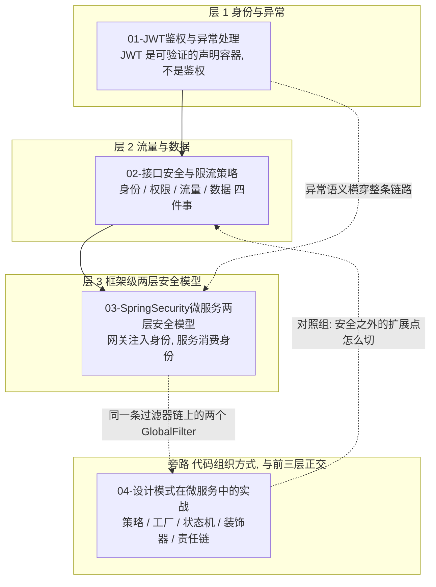
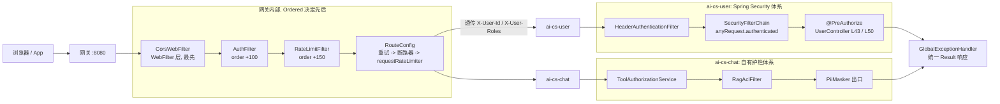

# 09-安全与设计模式：身份、权限、流量、数据四条线，与一把隔离变化的刀

> **一句话结论**：安全不是"加个拦截器"，而是「身份在哪一层被确认 → 权限贴在哪一行 → 流量在哪一环被削 → 敏感数据在哪个出口被抹掉」四条线的合力；设计模式则是把"会变的那一点"从"不变的主流程"里剥出来的工具——本模块的每一篇都用本仓库的真实类名和行号来证明这两个说法，**也诚实标出证不了的地方**（设计稿、`enabled: false`、只写了 2 个注解）。

> **阅读前置**：知道 `GlobalFilter`（Spring Cloud Gateway 里对每个请求生效、能改请求头的过滤器）和 `SecurityFilterChain`（Spring Security 的过滤器链定义，决定"哪些 URL 放行、哪些要认证"）大致是什么即可，不要求写过 Spring Security。先读 [02-Spring微服务/04-SpringCloudGateway网关](../02-Spring微服务/04-SpringCloudGateway网关.md)（网关过滤器执行顺序）和 [02-Spring微服务/15-SpringAOP与声明式事务原理](../02-Spring微服务/15-SpringAOP与声明式事务原理.md)（Spring 的代理与拦截机制）会明显省力——方法级授权本质就是"在代理上挂一个拦截器"。

> **证据基线**：Spring Security 7.2.0、Spring Cloud Gateway（`gateway-server-webflux`）、Spring AI 2.1.0、本仓库 `ai-cs-*` 模块；A 级 6 处（`24-源码分析/assets/source/` 已入库源码摘录，可逐行核对）、B 级 22 处引用 / 18 个本仓库文件（真实路径 + 行号，2026-11 本机实测）、C 级 2 段共 6 条纯静态统计命令（单条 3 秒内完成，不启动服务、不连中间件、不跑 mvn）。预计阅读 25 分钟。

## 1. 定位：四条线的合力，和一把隔离变化的刀

### 1.1 四条线：任何一条断了，另外三条都白做

一个请求从浏览器到数据库，安全要连续回答四个问题。把它们拆开看的价值不在"背概念"，而在于**每一条线断掉时，你看到的症状完全不同**，所以排障入口也不同。

| 线 | 它回答的问题 | 断掉时的可观测症状 | 本仓库落点（实测） |
|----|--------------|--------------------|--------------------|
| **身份** | "你是谁，这句话是谁说的？" | 无 token 也能拿到业务数据；日志里只有一行 `请求未携带Token: /chat/...` 就再无下文 | 网关 `AuthFilter` 统一认证（`ai-cs-gateway/src/main/java/com/aics/gateway/filter/AuthFilter.java#L43-L48`，`getOrder()` 在 `#L173` 返回 `HIGHEST_PRECEDENCE + 100`） |
| **权限** | "你这个身份，能不能碰这条资源？" | 越权且静默：A 用户 `GET /user/2` 拿到 B 用户数据，HTTP 200，日志无异常 | 只有 `ai-cs-user` 的 2 处 `@PreAuthorize`（Spring Security 的方法级授权注解：调用方法**之前**用一条 SpEL 表达式投票，false 就抛 `AccessDeniedException`；`ai-cs-user/src/main/java/com/aics/user/controller/UserController.java#L43`、`#L50`） |
| **流量** | "同一个身份，单位时间能做多少次？" | 429 从不出现，先撑爆的是连接池；`X-RateLimit-Remaining` 响应头缺位，你无法判断是被限了还是下游慢了 | 旧内存限流 `enabled: false`（`ai-cs-gateway/src/main/resources/application.yml#L40`）；分布式限流在 `ai-cs-gateway/src/main/java/com/aics/gateway/config/RouteConfig.java#L181-L184` 逐路由挂载 |
| **数据** | "这份数据出去时，允许长什么样？" | 日志/链路摘要/审计表里出现完整手机号、身份证号 | `PiiMasker` 仅 3 个类 4 处调用（`ai-cs-chat/src/main/java/com/aics/chat/util/PiiMasker.java#L21-L22` 定义，调用点在 `AgentTraceRecorder.java#L85-L86`、`SecurityAuditRecorder.java#L71`、`VisionChatServiceImpl.java#L160`） |

**四条线不是并列的四个开关，它们有先后顺序，顺序排错就是功能缺陷。**

- **限流的键必须来自已经认证的身份**。`AuthFilter` 的 order 是 `HIGHEST_PRECEDENCE + 100`（`AuthFilter.java#L173`），`RateLimitFilter` 是 `+150`（`ai-cs-gateway/src/main/java/com/aics/gateway/filter/RateLimitFilter.java#L107`），中间这 50 个位就是"身份先注入、限流后取键"的物理保障。把两者 order 调反，`RateLimitFilter` 拿到的 `X-User-Id` 永远为空，所有匿名请求挤进同一个桶——限流器还在工作，但限的是"全体用户"而不是"某个用户"，这是最难发现的伪装成"限流不生效"的 bug。另一个可观测抓手是响应头：`RedisRateLimiter` 会把 `X-RateLimit-Remaining` / `X-RateLimit-Replenish-Rate` / `X-RateLimit-Burst-Capacity` 写回响应（`[[源码:RedisRateLimiter.java.md#L87-L102]]`），**响应头缺失就说明这条路由没挂限流器**，比看日志快得多。
- **数据脱敏必须在最后一个出口做**。在入口脱敏，业务逻辑用到的还是假数据；在 Service 中间脱敏，异常栈和审计日志那条路会漏。所以脱敏点的正确位置是"每一条离开进程的通道"——本项目只收口了日志/摘要这一路，出参和错误 message 两路仍然裸奔（见 §4）。
- **权限必须贴在资源上，不能贴在网关上**。网关只看得到 URL 前缀，看不出"这个 `/user/{id}` 里的 id 是不是调用者自己"，只有方法级表达式能拿到方法参数。框架层面这个限制是硬编码在类型里的：`[[源码:DefaultSecurityFilterChain.java.md#L103-L106]]` 的 `matches(HttpServletRequest)` 只把请求交给 `requestMatcher` 判断，方法参数根本不在它的可见范围内——所以"在网关上做资源级授权"这件事不是没做，是做不到。

### 1.2 每条线断掉时，日志和状态码长什么样

把"症状"具体化，是这套分解法最实用的部分——**排查时你手里只有一行日志和一个状态码，得能立刻反推是哪条线断了。**

**身份断（401）**：`ai-cs-gateway/src/main/java/com/aics/gateway/filter/AuthFilter.java#L131-L132` 先打一行 `请求未携带Token: {}`，随后走 `unauthorized(response, "未认证，请先登录")` 返回 401。读法：出现这行说明请求**没进业务代码**，别去翻 Service 日志，去看前端有没有带 `Authorization` 头、以及路径是否命中白名单（`#L83-L96`）；同一分支还有 `Token无效或已过期`（`#L142-L143`），两者要分清"没给"和"给错了"。

**权限断（403）**：`ai-cs-user/src/main/java/com/aics/user/security/UserSecurityConfig.java#L38-L56` 的 `accessDeniedHandler` 调 `writeError(response, SC_FORBIDDEN, "无权限访问")`，body 固定四字段 `code/message/data/timestamp`（`code` 直接取 HTTP 状态码）。读法：401 与 403 的区别是"没认证"与"认证了但不许"，后者意味着身份是对的、表达式判 false——去核对 `@PreAuthorize` 里的 `authentication.name` 与目标资源的归属是否真的一致。

**流量断（429 或 403，且极易搞混）**：请求超过 `RedisRateLimiter` 的桶容量时默认 429；但**如果 `KeyResolver` 返回了空 key**，`denyEmptyKey` 默认为 `true`，此时不是 429 而是 `403 FORBIDDEN`，见 `[[源码:RequestRateLimiterGatewayFilterFactory.java.md#L75-L80]]`（`denyEmptyKey = true`、`emptyKeyStatusCode = HttpStatus.FORBIDDEN`）。读法：看到"认证明明是通的却 403"，先怀疑 key 为空，而不是权限表达式。

**数据断（无报错，只有审计记录里多了一串真手机号）**：`PiiMasker` 只对"摘要/描述"这类出口生效，`ai-cs-chat/src/main/java/com/aics/chat/service/impl/VisionChatServiceImpl.java#L160` 是典型正确用法（`return piiMasker.mask(description)`）；反例是出参实体和 `BusinessException` 的 message，它们不经过 `PiiMasker`。读法：这条线**永远不会抛异常**，只能靠"故意构造一个含手机号的请求，再看日志/响应/审计三处"来验证。

### 1.3 设计模式的位置：它是"变化点隔离"的工具，不是背诵清单

判断一个地方该不该上模式，本项目用的是三条判据，缺一条就别上：

1. **存在明确的、会随需求增加而增加的分支**（渠道、算法、状态、步骤）——而不是"将来可能也许要扩展"。
2. **主流程不想每次都被迫修改**（开闭原则的现代表达：新增 = 新增一个类 + 交给 Spring 扫到）。
3. **变化点的契约能用一句话说清**（接口只有 3~7 个方法；说不清就说明抽象错了，先别抽）。

按这三条，本仓库真正成立的模式实例只有下面这些，其余都是"看起来像"：

| 变化点 | 隔离手段 | 本仓库实例 | 为什么成立 |
|--------|----------|------------|------------|
| 支付渠道会增加（支付宝/微信/银联/模拟） | 策略 + 工厂 | `ai-cs-pay/src/main/java/com/aics/pay/channel/PayChannel.java`（5 个业务方法）+ `PayChannelFactory.java#L34-L38`（构造器注入 `List<PayChannel>` 建索引） | 新增渠道 = 新增一个 `@Component` 实现类，工厂和调用方零改动 |
| 请求要先验身份、再限流、再转发 | 责任链 | `AuthFilter`(+100) → `RateLimitFilter`(+150) | 顺序即语义，`Ordered` 返回值就是链条本身 |
| Embedding 调用要加缓存但不改调用方 | 装饰器 | `ai-cs-chat/src/main/java/com/aics/chat/cache/CachingEmbeddingModel.java`（`implements EmbeddingModel` + 持委托 + `VectorCacheStore`，标 `@Primary`） | 调用方仍然只认 `EmbeddingModel` 接口 |
| 订单状态流转要可审计、可拒绝非法跳转 | 状态机 | `ai-cs-order/src/main/java/com/aics/order/statemachine/OrderStateMachineConfig.java`（Spring Statemachine DSL）与 `ai-cs-chat/src/main/java/com/aics/chat/agent/state/AgentStateMachine.java`（手写 `EnumMap` + 每状态工具白名单） | 转移表是数据，不是 if-else |

反过来，**明确没有实例**的：模板方法（主源码 grep `abstract class` 零命中）、GoF 观察者（最近亲是 Spring 事件监听）、原型/享元/命令。这条"没什么"很重要——面试里被问"你们项目用了哪些设计模式"，答"该用的用了、不该用的没用"比背 23 个名字可信得多。

## 2. 模块地图：三层递进 + 一条正交旁路



> **读图说明**：实线 `A1 → A2 → A3` 是**认知顺序**，不是代码依赖顺序——三篇讲的是同一个请求的三种视角（声明能不能信 / 四件事各自落在哪 / 落到 Spring Security 的具体类），代码里它们同时生效。关键虚线是 `A3 -.-> A4`：03 篇里 `AuthFilter → RateLimitFilter` 这条责任链，正是 04 篇"责任链 + 策略（限流算法 `SlidingWindowRateLimiter`/`TokenBucketRateLimiter`）"的素材来源，两篇共用同一批类。**看错这条虚线会得出"设计模式篇是可选的理论补充"**——实际上它是给前三层提供"下次要加第五件安全能力时该往哪插"的答案；而把 `A4` 当成"模式大全"去背 23 个名字，则会得出"本项目没用设计模式"的错误结论。

**推荐顺序（以及为什么不能换）：**

1. **先 01（JWT 与异常）**：它是全模块的地基。"JWT 只证明声明没被篡改，不证明这个人现在被允许做这件事"这句话不立住，后面所有讨论都会滑向"鉴权 = 验签"。
2. **再 02（接口安全四件事）**：把散点变成清单，你会拿到一张"身份/权限/流量/数据"的核对表，各条线各自的失败症状一次看全。
3. **然后 03（两层安全模型）**：把 02 的清单落到 Spring Security 的具体类和行号上：网关负责认证、方法级负责授权、下游只信任被剥离后重新注入的头。
4. **最后 04（设计模式）**：前三篇留下"每次加一种安全能力就要改一遍过滤器/拦截器"的隐痛，04 篇正好回答"怎么让第五种能力不用改主流程"。顺序颠倒会读成背诵清单。
5. **随时回查**：`ai-cs-chat/src/main/java/com/aics/chat/security/` 下的 12 个类（`ContentReviewer`、`ToolAuthorizationService`、`RagAclFilter`、`SqlGuard`、`SecurityAuditRecorder` 等）是"AI 场景下的第五、六件事"，它们不在 Spring Security 体系里，04 篇末尾与 [05-AI集成/01-SpringAI框架集成/06-AI安全网关与Guardrails实现文档](../05-AI集成/01-SpringAI框架集成/06-AI安全网关与Guardrails实现文档.md) 衔接。

### 2.1 换一个视角：一个真实请求穿过哪些组件

上面那张图是"学习顺序"，这张图是"运行时拓扑"。两张图对不上是正常的——学习顺序按认知难度排，运行顺序被 `Ordered` 决定。



> **读图说明**：三个关键箭头决定了这一章的全部结论。①`C3 -->|透传 X-User-Id| US`：身份是**网关算好、下游只读**，所以 `HeaderAuthenticationFilter` 只做"翻译"不做"验证"，它信任头也就意味着**头只能由网关注入**，一旦某个服务端口被直连，整套认证作废。②`U2 --> U3`：`anyRequest().authenticated()` 只保证"登录了"，"登录了" != "有权限"，方法级注解才是授权。③`H3` 那条边：**chat 完全不走 `SecurityFilterChain`**，它的 `ToolAuthorizationService`/`RagAclFilter` 是自研护栏——看错这条边会得出"AI 服务的安全由 Spring Security 保证"的错误结论，进而在排障时去翻一个根本不存在的过滤器链。

## 3. 每篇一句话：解决什么问题、落到什么程度

| 篇 | 一句话解决什么问题 | 本项目落地程度（实测） | 证据类型 |
|----|--------------------|------------------------|----------|
| [01-JWT鉴权与异常处理](01-JWT鉴权与异常处理.md) | JWT 到底证明了什么、没证明什么；为什么"验签通过"离"允许访问"还有两步；异常怎么映射成 HTTP 语义 | **部分落地**：网关验签 + 注入头已上线；但 `GlobalExceptionHandler#L35-L39` 的业务异常没有 `@ResponseStatus`，业务失败恒 HTTP 200 | A（jjwt/`ResponseStatus` 源码摘录）+ B（`GlobalExceptionHandler`、`UserSecurityConfig`、`OrderQueryService`）+ C（node/jjwt 实跑、pwsh 统计） |
| [02-接口安全与限流策略](02-接口安全与限流策略.md) | 身份可在网关注入、权限必须贴资源、限流键要等认证后才有、脱敏要在每个出口收口 | **四件事分别：七成 / 2 个注解 / 一个开关是关的 / 脱敏只覆盖日志与摘要** | A（`RedisRateLimiter`、`PreAuthorizeAuthorizationManager`、`RequestRateLimiterGatewayFilterFactory`）+ B（`RateLimitFilter`、`application.yml`、`RouteConfig`、`PiiMasker`）+ C（静态统计、429 复现命令未本机实测） |
| [03-SpringSecurity微服务两层安全模型](03-SpringSecurity微服务两层安全模型.md) | 网关 `AuthFilter` 认证 + 下游 `HeaderAuthenticationFilter` 消费 + `SecurityFilterChain` 授权，这条"两层"到底怎么接起来 | **已落地**（2026-08 记录）：`AuthFilterTest`/`HeaderAuthenticationFilterTest`/`UserAuthorizationContractTest`/`UserSecurityIntegrationTest` 全绿；但**只覆盖 user 一个服务**，Starter 化（`aics.security.enabled=true` 条件装配）是**设计稿** | A（`FilterChainProxy`、`DefaultSecurityFilterChain`）+ B（`UserSecurityConfig#L29-L45`、`HeaderAuthenticationFilter`、`UserController#L43/#L50`）+ C（`jar tf` 验证 7.2.0 无 `WebSecurityConfigurerAdapter`） |
| [04-设计模式在微服务中的实战](04-设计模式在微服务中的实战.md) | 变化点隔离：策略/工厂/双状态机/装饰器/责任链在本仓库有哪些真实例、哪些是"看着像" | **已落地**（2026-09 记录）：`PayChannel` 四渠道、`PayChannelFactory`、`CachingEmbeddingModel`、`AuthFilter→RateLimitFilter`；**如实盘点没有**模板方法/GoF 观察者/原型 | A（Spring AI `QuestionAnswerAdvisor` 相关摘录）+ B（`PayChannel.java`、`PayChannelFactory.java#L34-L38`、`OrderStateMachineConfig`、`AgentStateMachine`、`Resilience4jConfig`）+ C（grep `abstract class` 零命中） |

### 3.1 读完每篇应能当场回答的问题（答不出就回去补）

这些是"读完了"与"读懂了"的分界线，每篇只列三问，都能在本模块内用文件路径和行号作答：

- **01 篇之后**：JWT 的签名到底证明了什么、没证明什么？为什么把角色列表放进 JWT 会导致"降权要等 token 过期"？业务异常返回 200 时，网关重试/监控大盘/前端判错分别会做什么错事？
- **02 篇之后**：四件事里哪一件可以放在网关、哪一件必须贴资源？为什么限流键来自 `X-User-Id` 而不是来源 IP（提示：NAT 后的企业网、以及伪造 `X-Forwarded-For`）？脱敏为什么不能只做一个出口？
- **03 篇之后**：`HeaderAuthenticationFilter` 为什么必须 `finally` 清 `SecurityContextHolder`（Tomcat 线程池复用会让上一个请求的身份串到下一个请求；框架自己在 `[[源码:FilterChainProxy.java.md#L222-L226]]` 的 `finally` 里做同一件事，代码里的 `clearContext()` 与它是同一个道理）？`@PreAuthorize` 为什么写 `#p0` 不写 `#id`？白名单分支为什么也要剥离 `X-User-*`？
- **04 篇之后**：`PayChannelFactory` 的构造器注入为什么比 `if ("ALIPAY".equals(method))` 更能抗变化？`AgentStateMachine` 手写 `EnumMap` 与 Spring Statemachine DSL 各适合什么规模？本仓库哪些模式是"看着像但不是"？

## 4. 本仓库安全现状真实盘点

### 4.1 先给命令，再给结论

下面的数字全部来自本机静态统计，命令可原样复现（`learning-docs` 上一级即仓库根）：

```powershell
# 1) 方法级授权与安全配置的真实数量（排除 target 构建产物）
Get-ChildItem -Recurse -Filter *.java | Where-Object { $_.FullName -notmatch '\\target\\' } |
  Select-String -Pattern '@PreAuthorize\(|@EnableMethodSecurity\b' |
  Group-Object { $_.Path.Replace((Get-Location).Path + '\','') } |
  Select-Object Count, Name
# 2) 业务异常是否带 HTTP 语义
Select-String -Path "ai-cs-common\src\main\java\com\aics\common\exception\GlobalExceptionHandler.java" -Pattern '@ResponseStatus'
# 3) 网关限流开关的当前值
Select-String -Path "ai-cs-gateway\src\main\resources\application.yml" -Pattern 'enabled:'
```

真实输出（2026-11 本机，JDK 17 环境，未启动任何服务）：

```text
Count Name
----- ----
    2 ai-cs-user\src\main\java\com\aics\user\controller\UserController.java
    1 ai-cs-user\src\main\java\com\aics\user\security\UserSecurityConfig.java

GlobalExceptionHandler.java:45:@ResponseStatus(HttpStatus.BAD_REQUEST)
GlobalExceptionHandler.java:58:@ResponseStatus(HttpStatus.BAD_REQUEST)
GlobalExceptionHandler.java:71:@ResponseStatus(HttpStatus.BAD_REQUEST)
GlobalExceptionHandler.java:85:@ResponseStatus(HttpStatus.BAD_REQUEST)
GlobalExceptionHandler.java:98:@ResponseStatus(HttpStatus.BAD_REQUEST)
GlobalExceptionHandler.java:110:@ResponseStatus(HttpStatus.BAD_REQUEST)
GlobalExceptionHandler.java:120:@ResponseStatus(HttpStatus.METHOD_NOT_ALLOWED)
GlobalExceptionHandler.java:130:@ResponseStatus(HttpStatus.NOT_FOUND)
GlobalExceptionHandler.java:140:@ResponseStatus(HttpStatus.BAD_REQUEST)
GlobalExceptionHandler.java:150:@ResponseStatus(HttpStatus.INTERNAL_SERVER_ERROR)

application.yml:40:enabled: false
```

10 行全部集中在参数校验/方法不支持/404/兜底等 handler 上——**L35-L39 的业务异常 handler 一行都没有**，这就是第 7 号缺口的全部证据。

**怎么读**：第一条命令的输出只有两行、合计 3 处命中——这就是全部的方法级授权基础设施。注意它排除了 `target/`，否则 `eff-*.xml`、编译产物和测试文案会让你误以为"注解很多"。第二条命令的意义在于**同一个文件里 10 处 `@ResponseStatus` 与 0 处**的对比：说明作者是知道该标注的，唯独业务异常这条最常走的路没标，这不是"框架不支持"，是遗漏。

### 4.2 盘点表

| # | 能力 | 期望（生产基线） | 本仓库实测 | 判定 |
|---|------|------------------|------------|------|
| 1 | 网关统一认证 | 无有效凭证一律 401 | `AuthFilter` 除白名单（`AuthFilter.java#L83-L96`）外均校验 JWT，失败回退 API Key，再失败 401「未认证，请先登录」 | ✅ 已落地 |
| 2 | 防伪造身份头 | 入口剥离客户端自带的 `X-User-*` | 白名单分支也 remove `X-User-Id`/`X-User-Name`/`X-User-Roles` 后再转发（`AuthFilter.java#L112-L121`） | ✅ 已落地（这是最容易被忽略的一条） |
| 3 | 微服务侧 Spring Security | 每个对外服务一条 `SecurityFilterChain` | 全仓 **1** 条：`ai-cs-user/src/main/java/com/aics/user/security/UserSecurityConfig.java#L29-L45` | ⚠️ 1/10 个业务服务 |
| 4 | 方法级授权开关 | `@EnableMethodSecurity` | 全仓 **1** 处：`UserSecurityConfig.java#L22` | ⚠️ 同上 |
| 5 | 方法级授权注解 | 每个"改别人资源"的接口都要有 | `@PreAuthorize` **2 处**，都在 `UserController.java#L43`（`authentication.name == #p0.toString() or hasRole('ADMIN')`）与 `#L50`。求值机制见 `[[源码:PreAuthorizeAuthorizationManager.java.md#L95-L104]]`：取不到注解属性就返回 `null`（**不投票**，即不拦），取到才把方法调用塞进 SpEL 上下文求值——这正是 `#p0` 能指到参数的原理 | ⚠️ 2 个接口 / 676 个 Java 源文件 |
| 6 | 其它服务的授权依赖 | 引入 `spring-boot-starter-security` | 声明该依赖的只有 `ai-cs-user/pom.xml#L27`；全仓 12 个 Spring Boot 应用里其余 9 个业务服务 + 网关均未引（`ai-cs-order/eff-order.xml` 里的 starter 是 effective-pom 产物，不是声明） | ❌ 缺口 |
| 7 | 异常 → HTTP 状态码 | 业务失败按语义返回 4xx | `GlobalExceptionHandler.java#L35-L39` 无 `@ResponseStatus` → 恒 200（同文件另有 10 处标了） | ❌ 真实缺陷 |
| 8 | 网关限流（旧内存版） | 开箱可用 | `application.yml#L40` `enabled: false`，注释写明"已由 RouteConfig 里每路由 RequestRateLimiter 替代，Redis 不可用时改回 true 兜底" | ⚠️ 依赖 Redis 才算真限流 |
| 9 | 网关限流（分布式） | 每路由都能限 | `RouteConfig.java` 共 **16 处** `addResilience(...)` 调用，链条为 GET 重试 → 断路器 → `.requestRateLimiter(...)`（`#L181-L184`），超限默认 429 | ✅ 已落地（单机无 Redis 时不生效） |
| 10 | CORS 单一所有者 | 全链路只有一个 `CorsWebFilter` | 只有 `ai-cs-gateway/src/main/java/com/aics/gateway/config/CorsConfig.java#L17-L29`；`ai-cs-chat/src/main/java/com/aics/chat/config/CorsConfig.java#L14` 的 `@Configuration` 已被注释（2026-08-07 重复响应头导致浏览器 `Network Error` 的处置） | ✅ 结构正确 / ⚠️ 允许任意来源 + `allowCredentials(true)` 是配置债 |
| 11 | 敏感数据脱敏 | 每个出口（出参/日志/错误信息/审计）都收口 | `PiiMasker` 一处定义、**3 个类 4 处调用**（`AgentTraceRecorder.java#L85-L86`、`SecurityAuditRecorder.java#L71`、`VisionChatServiceImpl.java#L160`），全部是"摘要/日志/描述"出口 | ⚠️ 1/4 面 |
| 12 | AI 侧工具授权 / 知识库 ACL | 工具能调什么、文档能不能看 | chat 自有 12 个类，**不是 Spring Security**：`ToolAuthorizationService.authorize(Long userId, String toolName, String paramsDigest)` 在 `ai-cs-chat/src/main/java/com/aics/chat/security/ToolAuthorizationService.java#L36`，`RagAclFilter.filter(String knowledgeBase, List<Document> docs, Long userId)` 在 `ai-cs-chat/src/main/java/com/aics/chat/security/RagAclFilter.java#L39` | ✅ 已落地（但需要意识到它不是框架级授权） |
| 13 | 安全行为的可验证性 | 有自动化用例守住 | 9 个 `.feature`：chat 7 篇（`ai-cs-chat/src/test/resources/features/security/01_prompt_injection.feature` … `07_audit_trail.feature`）+ gateway 2 篇（`ai-cs-gateway/src/test/resources/features/gateway/02_trusted_identity.feature` 等），配 `SecurityGuardrailSteps` 对象级步骤 | ✅ 有 / ⚠️ 不进 CI（`.github/workflows/` 只有 python 校验） |

### 4.3 三处"看着做了其实没做"，加一处口径更正

**① 业务失败恒 HTTP 200。** `GlobalExceptionHandler.java#L35-L39` 返回的是 `Result.fail(code, message)`，方法上没有 `@ResponseStatus`。后果不是"前端显示错"，而是**所有按状态码工作的基础设施全部失效**：网关重试策略把失败当成功不重试、监控的 4xx/5xx 大盘永远平、SLA 统计把失败算成成功。真实报错长相就是"HTTP/1.1 200 + `{"code":1001,"message":"库存不足"}`"，你只能靠 body 判错。

**② `enabled: false` 不等于"限流没做"。** 这个开关关掉的是 `RateLimitFilter`（本地内存、单机配额、多实例不共享）；真正在跑的是 `RouteConfig` 给每条路由挂的 `RedisRateLimiter`。两个实现同时在代码库里、一个死一个活，是最容易说错话的地方：说"限流做了"要说清是哪一套，说"限流没做"则会被 429 打脸（前提是本机有 Redis，本项目环境无 Redis，故**未本机实测 429**，复现命令见 02 篇 §6）。

**③ `@PreAuthorize` 只有 2 处，缺的不是注解而是模型。** 更严重的是第 6 行那个事实：其余服务连 `spring-boot-starter-security` 都没引。这意味着"网关认证过了，所以下游安全了"是本项目最大的隐性假设——网关只认 URL 前缀，看不到方法参数，任何走"网关内网直连"或"服务间 Feign 调用"的路径都绕过了它。

**④ 一处口径更正：`PiiMasker` 不是"单点引用"。** 如果只 grep `SecurityAuditRecorder` 就下结论，会以为脱敏只接了审计一条路；实测主源码有 **3 个类 4 处调用**（`AgentTraceRecorder` 两处、`SecurityAuditRecorder` 一处、`VisionChatServiceImpl` 一处）。这个更正的意义在于：**"缺口"从"只接了一路"变成"接了三路、但都不是出参与错误信息"**——后者才是真正的风险面，因为泄漏最容易发生在响应体和异常 message 里，而不是日志里。

### 4.4 换一个仓库怎么评：10 分钟安全成熟度打分

这套手法可以直接搬到任何 Java 微服务仓库，五步，全部是静态统计，不需要跑起来：

1. **数授权**：`Get-ChildItem -Recurse -Filter *.java | Select-String -Pattern '@PreAuthorize\(|@EnableMethodSecurity' | Measure-Object`——注解数除以对外接口数是第一个比值。
2. **数依赖**：`Get-ChildItem -Recurse -Filter pom.xml | Select-String 'spring-boot-starter-security'`——只有少数模块引，说明安全是"局部试点"而不是"平台能力"。
3. **看异常语义**：`Get-ChildItem -Recurse -Filter GlobalExceptionHandler.java | Select-String -Pattern '@ResponseStatus|ResponseEntity'`——业务异常那一支有没有状态码。
4. **看配置开关**：`Get-ChildItem -Recurse -Filter application.yml | Select-String -Pattern 'enabled:\s*false'`——每一个 `false` 都要能说出"替代方案是什么"，说不出来就是被关掉的功能。
5. **看有没有人守**：`.github/workflows/` 里有没有跑这些服务的测试；没有 CI 的 `.feature` 只是文档。

对照打分（本项目 2026-11 的落点已标在括号里）：

| 级别 | 判据 | 本项目 |
|------|------|--------|
| L0 裸奔 | 无认证、无授权、无脱敏 | — |
| L1 入口认证 | 网关统一认证 + 剥离伪造头 | ✅ 达到 |
| L2 局部授权 | 有 `@EnableMethodSecurity`，少量接口贴了 `@PreAuthorize` | ✅ 达到（2 个接口） |
| L3 全链路授权 | 每个对外服务都有 `SecurityFilterChain` + 资源级表达式 | ❌ 1/10 个业务服务 |
| L4 可验证 | 安全用例进 CI，异常语义正确，脱敏覆盖全部出口 | ❌ 三者都缺 |

**这个表的价值**：它把"我们做了安全吗"这种会吵架的问题，变成"我们在 L2，缺的三件事分别是什么、谁来补"。

## 5. 两条阅读路线

### 5.1 路线 A：一周补齐安全基线（面向"要能改代码"）

| 天 | 读什么 | 动什么 | 验收（可验证行为） |
|----|--------|--------|--------------------|
| D1 | 01 篇 §0~§3 | 只读，不改代码 | 能口述"验签通过 → 认证通过 → 授权通过"三步分别由哪个类负责，各在哪个文件 |
| D2 | 01 篇 §4~§6 + `GlobalExceptionHandler` | 给 `handleBusinessException` 补 `@ResponseStatus`（或改用 `ResponseEntity`） | 单测里 MockMvc 断言业务失败返回 4xx；`Select-String -Pattern '@ResponseStatus'` 的命中数从 10 → 11 |
| D3 | 02 篇 §全 + `AuthFilter`/`RateLimitFilter` | 读 `getOrder()` 两个返回值，画出过滤器先后 | 能说出把 order 调反会出现什么现象（匿名请求共用一个桶） |
| D4 | 02 篇限流 + `RouteConfig#L170-L184` | 给一个没有 `KeyResolver` 的路由补 key，理解 `denyEmptyKey` 默认给了 403 而非 429 | 用 `[[源码:RequestRateLimiterGatewayFilterFactory.java.md#L178-L181]]` 佐证默认状态码来源 |
| D5 | 03 篇全 + `UserSecurityConfig`/`HeaderAuthenticationFilter` | 给第 2 个服务复制这条"两层"骨架（先取消注释 pom 依赖） | 该服务 `curl` 无 token 返回 401 JSON（`code/message/data/timestamp` 四字段） |
| D6 | 03 篇 §方法级 + `UserController#L43` | 给一个新接口加 `@PreAuthorize`，注意用 `#p0` 而不是 `#id` | 越权用例返回 403；若写 `#id` 会报 `Name for argument not specified` |
| D7 | 04 篇全 | 用 `PayChannel` 当模板，把一处 `if/else` 渠道分支改成策略 + 工厂 | 新增一个假渠道实现类后，调用方零改动即可路由到它 |

### 5.2 路线 B：面试速通（两天，每问都要能指到文件）

**第一天读 01 + 02**，回答：① JWT 里到底该放什么、为什么不能放权限列表；② 验签通过为什么不等于能访问；③ 网关认证后下游为什么还要再认证一次（提示：内部调用、伪造头）；④ 限流键为什么必须等认证之后；⑤ 令牌桶和滑动窗口在"允许突发"上的差别；⑥ 业务异常返回 200 有什么连锁后果。**第二天读 03 + 04**，回答：⑦ 网关 `GlobalFilter` 与 Servlet `Filter` 的执行顺序关系（提示：`FilterChainProxy` / `WebFilter` 层）；⑧ `@PreAuthorize` 的表达式在哪一刻求值、失败抛什么；⑨ 两层安全模型的失效场景（服务被直连）；⑩ 策略模式与"一堆 if/else"的边界在哪。延伸问题在 [05-AI集成/面试题/07-AI安全与Guardrails](../05-AI集成/面试题/07-AI安全与Guardrails.md)。

### 5.3 两条路线怎么选

| 维度 | 路线 A（一周补齐基线） | 路线 B（面试速通） |
|------|----------------------|-------------------|
| 产出物 | 3 个可合并的 PR：异常状态码、第二个服务的两层安全、一处策略化改造 | 一份能指到文件和行号的口述答案，10 问全部可作答 |
| 前置成本 | 需要能本地编译（JDK 17，`mvn -pl ... -am verify`） | 零环境要求，只需要读 |
| 最大风险 | 给各服务加 `spring-boot-starter-security` 后静态资源/Swagger 被拦，表现为 401 一片 | 只记结论不记机制，追问"为什么"就断，尤其"为什么 403 不是 429"这类细节 |
| 建议搭配 | 完成后走一遍路线 B 的 10 问做复盘 | 完成后挑 D2（异常状态码）做一次小改造，把"知道"变成"改过" |

两条路线的共同第一步都是 **§4.1 那三条命令**：先量出自己在 L 几，再决定是补功能还是补认知。跳过测量的结果通常是——花一周把已经做过的部分又做一遍。

## 6. 依赖关系

| 关系 | 模块 | 为什么必须（不给理由的依赖列表就是目录罗列） |
|------|------|------------------------------------------|
| 前置 | [02-Spring微服务](../02-Spring微服务/README.md) | 不先懂网关过滤器顺序与 Spring 代理，03 篇的 `addFilterBefore` 和 04 篇的装饰器都只能死记 |
| 前置 | [04-中间件/06-Sentinel限流与熔断降级](../04-中间件/06-Sentinel限流与熔断降级.md) | 本模块只讲"网关限流"（入口），Sentinel 讲"接口级熔断降级"（服务内），两处都讲"削峰"但键与作用域不同 |
| 前置 | [02-Spring微服务/04-SpringCloudGateway网关](../02-Spring微服务/04-SpringCloudGateway网关.md) | `CorsWebFilter` 在 `WebFilter` 层、先于网关全局过滤器执行——这是 10 号 CORS 结论的前提 |
| 相关 | [05-AI集成/01-SpringAI框架集成/06-AI安全网关与Guardrails实现文档](../05-AI集成/01-SpringAI框架集成/06-AI安全网关与Guardrails实现文档.md) | 提示词注入、工具授权、RAG ACL 这些"第五件事"的完整实现，本模块只给入口 |
| 相关 | [24-源码分析/05-SpringSecurity](../24-源码分析/05-SpringSecurity/README.md) | 想追 `FilterChainProxy` 怎么选链、`@PreAuthorize` 怎么投票，去源码篇按行读 |
| 相关 | [04-中间件/23-Nginx应用实战与域名IP配置](../04-中间件/23-Nginx应用实战与域名IP配置.md) | CORS 重复响应头导致 `Network Error` 的排查手法与"只留一个所有者"的判断 |
| 相关 | [22-Python速成/23-安全编码与常见漏洞](../22-Python速成/23-安全编码与常见漏洞.md) | 参数化查询、路径规范化、密码哈希在 Python 侧的同一套原则 |
| 相关 | [08-测试/04-Cucumber-BDD行为驱动实战](../08-测试/04-Cucumber-BDD行为驱动实战.md) | 13 号盘点里那 9 个 `.feature` 为什么"写了但不进 CI"，测试篇有完整解释 |
| 后续 | 本模块自身 4 篇 | 见 §2 推荐顺序 |

**一句话概括依赖方向**：这个模块是"消费方"——它消费 `02-Spring微服务` 的网关与代理机制、`04-中间件` 的限流与 Nginx 手段，然后把结论抛给 `05-AI集成` 的护栏实现和 `24-源码分析` 的机制追问。**不建议提前读的**：`24-源码分析/05-SpringSecurity` 的逐行解析（没有 §4 的实测数字打底，会读成源码朗读）、`05-AI集成` 的 Guardrails 实现细节（先有"四条线"的框，才知道每个护栏补的是哪条线）、以及任何 OWASP 类目清单（清单是查漏工具，不是学习路径）。

## 7. 检查点清单

读完并动手之后，下面每条都应该是"能当场做出来"的能力，而不是"听说过"：

- [ ] 能说出本仓库里**哪一个类**负责认证、**哪一行**决定它的执行顺序，并把 `+100` / `+150` 两个数字对应到"身份先于限流"。
- [ ] 能解释为什么白名单分支也要 remove `X-User-*`（`AuthFilter.java#L112-L121`），并构造一个"如果没 remove 会怎样"的攻击场景。
- [ ] 能指出 `GlobalExceptionHandler` 里 10 处 `@ResponseStatus` 与 1 处缺失的差异，并说明它如何污染监控大盘。
- [ ] 能区分本仓库两套限流：`RateLimitFilter`（内存、`enabled: false`）与 `RouteConfig` 的 `RedisRateLimiter`（Redis、逐路由），并说明各自失效条件。
- [ ] 能解释 `denyEmptyKey` 默认为 `true` 时"KeyResolver 返回空"会得到 403 而不是 429，并知道怎么改成 429。
- [ ] 能画出"网关 `AuthFilter` → `HeaderAuthenticationFilter` → `SecurityFilterChain` → `@PreAuthorize`"四个环节，指出每一环的失败状态码（401/403）。
- [ ] 能解释 `@PreAuthorize` 里为什么写 `#p0`：Maven 未开 `-parameters` 时参数名不可用，写 `#id` 会抛 `Name for argument not specified`。
- [ ] 能列出 `PiiMasker` 的 3 个调用类，并指出它还缺哪几个出口（出参、错误 message）。
- [ ] 能用本模块的三条判据判断"某处该不该上策略模式"，并举出本仓库一个"看着像但不是"的例子。
- [ ] 能复述 §4.1 的三条命令，并在不启动任何服务的前提下重算出同样数字。

## 8. 诚实清单

这一节存在的意义：本仓库的安全代码"部分真实、部分设计稿"，把两者混着讲，读者上手就会踩空。

| 结论 | 状态 | 证据 / 说明 |
|------|------|-------------|
| 网关认证 + 剥离伪造头 + 注入可信头 | **已落地** | `AuthFilter.java#L43-L48`、`#L112-L121`、`#L173`；`AuthFilterTest` 覆盖 |
| user 服务的两层安全模型（FilterChain + 方法级授权） | **已落地** | `UserSecurityConfig.java#L29-L45`、`UserController.java#L43/#L50`；4 个测试类全绿 |
| 分布式限流（Redis 令牌桶） | **已落地但未本机验证** | 代码在 `RouteConfig.java#L181-L184`；本机无 Redis/无 Docker，**未实测 429**，给出命令与判读方法见 02 篇 §6 |
| 旧内存限流 | **主动关闭** | `application.yml#L40`，注释即设计说明；Redis 不可用时是兜底 |
| 安全 Starter 化（`aics.security.enabled=true` 条件装配） | **设计稿，未落地** | 03 篇 §后续规划；当前每个服务要手工复制 Filter + Config |
| 其余 7 个服务的方法级授权 | **未落地** | 只有 `ai-cs-user/pom.xml#L27` 引了 `spring-boot-starter-security`；其余服务的 `anyRequest().authenticated()` 都不存在 |
| 业务异常按语义返回 4xx | **未落地，且是真实缺陷** | `GlobalExceptionHandler.java#L35-L39` |
| 脱敏覆盖全部出口 | **部分落地** | 3 个类 4 处，仅日志/摘要/描述；出参与错误 message 未收口 |
| CORS 单一所有者 | **已落地，但配置有债** | 网关 `CorsConfig.java#L20-L23` 同时 `setAllowedOriginPatterns(List.of("*"))` 与 `setAllowCredentials(true)`；chat 侧 `CorsConfig.java#L14` 已注释 |
| AI 侧工具授权 / RAG ACL / SQL 守卫 / 内容审核 | **已落地（非 Spring Security）** | `ai-cs-chat/src/main/java/com/aics/chat/security/` 12 个类；别在面试里说成"我们用 Spring Security 做了 AI 授权" |
| 安全行为进 CI | **未落地** | `.github/workflows/` 只有 `python-learning-validate.yml`；9 个 `.feature` 依赖手工 `mvn verify` |
| 旧稿（本文件上一版）里的 `SecurityConfig` + `@EnableWebSecurity` 示例 | **已过期** | 那是教程通用写法，与本仓库实际的"网关认证 + 下游 `SecurityFilterChain`"不同；7.2.0 已无 `WebSecurityConfigurerAdapter`（`jar tf` 实测），照抄旧稿会直接编译失败 |

### 8.1 不相信这张表？三条命令自己验

```powershell
# ① 除 user 之外，还有谁引了 Spring Security？
Get-ChildItem -Recurse -Filter pom.xml | Where-Object { $_.FullName -notmatch '\\target\\' } |
  Select-String -Pattern 'spring-boot-starter-security' | ForEach-Object { "$($_.Path):$($_.LineNumber)" }
# ② 业务异常到底有没有状态码？（看那个方法前后 5 行）
Select-String -Path "ai-cs-common\src\main\java\com\aics\common\exception\GlobalExceptionHandler.java" -Pattern 'handleBusinessException' -Context 3,4
# ③ PiiMasker 到底被谁用了？（排除测试与 target）
Get-ChildItem -Recurse -Include *.java -Path ai-cs-chat | Where-Object { $_.FullName -match '\\src\\main\\' } |
  Select-String -Pattern '\bpiiMasker\.' | ForEach-Object { "$($_.Filename):$($_.LineNumber)" }
```

真实输出分别是：① 只有 `ai-cs-user/pom.xml:27`（`112` 那行是 `spring-security-test`，属测试作用域）；② `handleBusinessException` 上方的注解只有 `@ExceptionHandler(BusinessException.class)`，没有 `@ResponseStatus`；③ 四行命中、分布在 3 个文件（`AgentTraceRecorder`×2、`SecurityAuditRecorder`×1、`VisionChatServiceImpl`×1）。**如果哪天这三条命令的输出变了，改这篇文档，别改结论去迁就文档。**

**一句话收尾**：本模块能教会你的不是"安全做完了"，而是"如何用 3 条命令在 10 分钟内判断一个微服务仓库的安全到了几成"——先量，再改，最后才谈模式。
