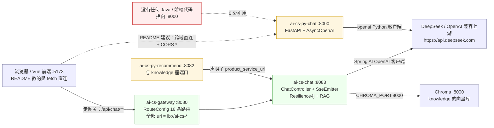
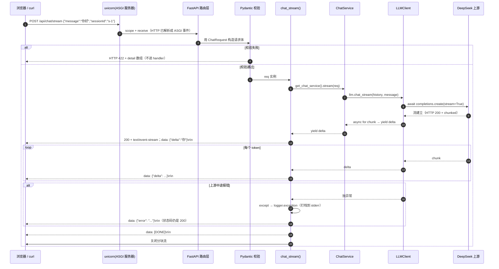

# FastAPI 对话服务：一条没接进治理体系的旁路能力，它的机制与代价

> **一句话结论**：`ai-cs-py-chat` 在这套架构里的真实位置是**旁路能力**（对话实验田），它的价值是用 13 个 `.py`、不到 350 行源码把"OpenAI 兼容协议 + SSE 流式"完整跑通一遍，代价是它同时缺掉了 Java 侧那一整套外挂——没有网关路由、没有鉴权、没有超时/重试/熔断、没有生命周期钩子、没有结构化日志，甚至连全局异常处理器都没有；所以它不是"第二套对话服务"，而是一块**用来验证模型效果的试验台**。
>
> - **阅读前置**：写过 Spring MVC 的 Controller/Service/DTO；知道 HTTP 请求体校验、SSE 是"服务端推文本帧"；知道"协程"是单线程内靠 `await` 切换任务的并发模型（不知道也没关系，§2 有解释）；不要求写过 Python。
> - **证据基线**：本机实测 Python 3.12.10 / fastapi 0.141.1 / starlette 1.6.0 / pydantic 2.13.4 / pydantic-settings 2.15.0 / openai 3.5.0 / uvicorn 0.52.4 ｜A 级：`assets/source` 入库的 Spring AI 与 Spring MVC 摘录 6 个（`ChatClient`、`DefaultChatClient`、`ChatClientMessageAggregator`、`DefaultListableBeanFactory`、`RequestMappingHandlerAdapter`、`AbstractJackson2HttpMessageConverter`）｜B 级：本项目 12 个文件逐行核对｜C 级：11 条 30 秒内可复现命令（全部不联网、不起服务、不装包）｜预计阅读：65 分钟。

---

## 0. 先看现象：三个"看起来能用"的现场

**现象 1：改了 `.env` 的端口，服务还是起在旧端口。**

这不是"配置没读到"，而是配置被**冻结在第一次调用时**。C 级实测（只调配置工厂，不启动服务）：

```text
$ .\.venv\Scripts\python.exe probe.py
first  port: 8000 | id: 1872134505568
second port: 8000 | id: 1872134505568 | same object: True      # 期间设置了 APP_PORT=9999
after cache_clear port: 9999 | same object: False
```

现场脚本只有三行：`get_settings()` → 改 `os.environ["APP_PORT"]` → 再 `get_settings()`。两次拿到的是**同一个对象**（`id` 相同），所以第二次读到的仍是 8000；只有 `cache_clear()` 之后才变成 9999。机制在 `ai-cs-py-chat/app/config.py#L29-L32`：`@lru_cache` 把 `Settings()` 的返回值按"无参调用"缓存成了一个进程级单例。

**现象 2：同一次上游 401，两种端点给出两种"失败形状"。**

C 级实测（用 `TestClient` 在进程内直接调 ASGI 应用，替身 LLM 抛 `RuntimeError("Error code: 401 - invalid api key")`）：

```text
non-stream status: 500
non-stream content-type: text/plain; charset=utf-8
non-stream body: "Internal Server Error"

stream status: 200
stream body: "data: {\"delta\": \"x\"}\n\ndata: {\"error\": \"Error code: 401 - invalid api key\"}\n\ndata: [DONE]\n\n"
```

**怎么读这两段**：非流式端点把异常一路抛给 FastAPI 的默认异常处理器，客户端拿到的是 500 + 纯文本 `Internal Server Error`（不是项目统一的 `Result` JSON，也没有 traceId）；流式端点因为 `return StreamingResponse(...)` 已经把 200 和响应头发出去了（`ai-cs-py-chat/app/api/chat.py#L48-L52`），错误只能被 `except` 捕获后塞进一个 `data: {"error": ...}` 帧（`#L42-L45`）。**对监控来说这是致命的**：流式请求的 HTTP 状态码永远是 200，你按 5xx 比例建的告警永远不响。

**现象 3：两个 Python 服务抢同一批端口，而且抢的是别人的端口。**

```text
ai-cs-knowledge/src/main/resources/application.yml#L3 : port: 8082
ai-cs-py-recommend/app/config.py#L31                 : app_port: int = 8082
ai-cs-py-chat/app/config.py#L25                      : app_port: int = 8000
ai-cs-knowledge/src/main/resources/application.yml#L34: port: ${CHROMA_PORT:8000}
deploy/scripts/check-local.ps1#L106                   : @{ Port = 8000;  Label = 'Chroma' }
```

`ai-cs-py-recommend` 的 8082 与知识库服务撞车，`ai-cs-py-chat` 的 8000 与本机 Chroma 撞车（`deploy/k8s/chroma.yaml#L20` 也把 Chroma 定为 8000）。这两个默认值是**写在代码里的真实配置，不是笔误**——所以本地同时起三个东西时那句 `[Errno 10048] error while attempting to bind on address ('0.0.0.0', 8000)` 不是环境问题。

这些现象指向同一件事：**这个服务的"骨架"（FastAPI + Pydantic + 异步客户端）是对的，但"外壳"（配置生效时机、错误契约、端口与编排、生命周期）一件都没装；它跑得通，是因为只有你一个人在本地按文档用 `curl` 调它。**

---

## 1. 整体地图：它站在哪，谁真的调它



**读图说明**：

- 看**三条进入 LLM 的实线怎么起步**：`Browser → GW → Chat → DeepSeek` 是主链路（带网关注入的 `X-User-Id`、限流、熔断）；`Browser -.-> PyChat` 是虚线，因为它只是 `ai-cs-py-chat/README.md#L84-L97` **建议**的接法（`const PY_CHAT = 'http://localhost:8000'`），前端 `src/` 里 0 处引用 8000。**看错这条虚线的代价**：你会以为"前端已经能用 Python 对话服务了"，然后把"改前端"当成排障方向，而真实情况是这条边从没通电。
- 看 `Nobody -.-> PyChat` 这条标注：本机实测全仓（排除 `node_modules`/`target`/`.venv`/`learning-docs`）在 `.py/.java/.yml/.yaml/.xml/.js/.ts/.vue/.ps1/.sh` 里匹配 `py-chat|py_chat` 只有 **4 处，且全部在 `ai-cs-py-chat` 自己目录内**；把范围收窄到 `.java/.yml/.xml` 命中 **0 处**。也就是说——**没有调用方**。"2 处引用"的旧口径与本机 4 处的差异来自统计的文件类型范围，结论一致：它是孤儿模块。
- 看下面那条 `Chat --> Chroma`：Chroma 与 py-chat 都占 8000，这是"旁路服务"和"基础设施"争同一个号段的典型后果，不是两个业务服务争端口。

| 组件 | 责任 | 谁调用它（真实存在的关系） |
| --- | --- | --- |
| `ai-cs-py-chat`（:8000） | 非流式 `/api/chat` + SSE `/api/chat/stream` + `/api/health`，薄到只有"组装消息 → 调上游 → 回文本" | **无人调用**；只有 `README` 里的 `curl`/`fetch` 示例与 6 条 pytest |
| `ai-cs-gateway`（:8080） | 路由、JWT 校验、剥离伪造身份头、限流、熔断 | 前端；`RouteConfig` 16 条路由的 `uri` 全部是 `lb://ai-cs-*`，没有一条指向 8000 |
| `ai-cs-chat`（:8083） | 真正的对话主链路：`ChatController` 278 行、`ChatServiceImpl` 上千行、RAG/Agent/NL2SQL | 网关；也被压测脚本误当成 py-chat 的替代目标 |
| `LLMClient`（`app/core/llm.py`） | 封装 `AsyncOpenAI`，负责协议细节与消息组装 | `ChatService` |
| `ChatService`（`app/services/chat_service.py`） | 业务编排：把 `ChatRequest` 变成"回复 + 模型名" | 路由层通过 `get_chat_service()` 取单例 |
| `Settings` / `get_settings()` | 读 `.env` + 环境变量，进程级单例 | `create_app()`、`LLMClient` |
| DeepSeek / 硅基流动 | OpenAI 兼容上游，流式与非流式都支持 | `LLMClient`（HTTP + SSE 客户端侧） |

---

## 2. 关键概念与关键类

先对齐六个术语（后面不再解释）：

- **ASGI**：Async Server Gateway Interface，Python 版的"Servlet 规范"。它规定"一个可调用对象接收 `scope`（请求元信息）、`receive`（读消息）、`send`（写消息）"。FastAPI 应用就是一个 ASGI callable，**它自己不监听端口**。
- **uvicorn**：ASGI 服务器（≈ Tomcat）。它监听 8000、解析 HTTP、把请求交给 ASGI callable、把 `send()` 出去的字节写回 socket。
- **路由（`APIRouter`）**：一组前缀相同、可批量挂载的端点集合（≈ `@RequestMapping` 标注的 Controller 类）。
- **Pydantic 模型**：靠类型注解做运行时校验的类；FastAPI 用它在**进入函数之前**把 JSON 变对象，失败即 422（≈ `@Valid` + `@RequestBody`，但校验点是函数入参绑定）。
- **依赖注入 `Depends`**：一个可调用对象声明"我需要什么"，FastAPI 每请求解析一次并注入（≈ `@Autowired`，但**没有容器、没有作用域、没有循环依赖检测**）。本服务一处都没用——原因见 §5。
- **`@lru_cache` 单例**：用"缓存无参函数返回值"实现的进程级单例，是本项目的 DI 替代品；它的生命周期等于**进程**，不随请求变化，也不随配置变化。
- **SSE（Server-Sent Events）**：`Content-Type: text/event-stream` 的长连接，服务端按 `data: xxx\n\n` 一帧一帧推纯文本，客户端按空行切帧。它只有一个方向（服务端→客户端）。

| 名称 | 位置 | 角色 | 关键方法/字段 |
| --- | --- | --- | --- |
| `create_app()` | `ai-cs-py-chat/app/main.py#L12-L39` | 应用工厂：造 `FastAPI`、按配置挂 `CORSMiddleware`、`include_router` | `create_app` |
| 模块级 `app` | `ai-cs-py-chat/app/main.py#L42` | uvicorn 用 `app.main:app` 导入字符串定位的对象 | 全局变量 `app` |
| `Settings` | `ai-cs-py-chat/app/config.py#L7-L26` | 11 个配置字段，`.env` + 环境变量双来源 | `model_config = SettingsConfigDict(...)` |
| `get_settings()` | `ai-cs-py-chat/app/config.py#L29-L32` | 进程级配置单例 | `@lru_cache` |
| `router` | `ai-cs-py-chat/app/api/chat.py#L12` | `APIRouter(prefix="/api")`，3 个端点都挂在这 | `get` / `post` 装饰器 |
| `health()` | `ai-cs-py-chat/app/api/chat.py#L15-L18` | 应用级健康：只证明"进程活着、路由能进" | 返回 `{"status": "up"}` |
| `chat()` | `ai-cs-py-chat/app/api/chat.py#L21-L24` | 非流式端点，`response_model=ChatResponse` | `await ...reply(req)` |
| `chat_stream()` | `ai-cs-py-chat/app/api/chat.py#L27-L52` | 流式端点，内层异步生成器 `event_gen()` 逐帧 `yield` | `StreamingResponse` |
| `ChatRequest` | `ai-cs-py-chat/app/schemas/chat.py#L18-L25` | 入参模型：`message` 必填且 `min_length=1`、`session_id` 别名 `sessionId`、`history` 默认空列表 | `Field(...)`、`populate_by_name` |
| `ChatResponse` | `ai-cs-py-chat/app/schemas/chat.py#L28-L35` | 出参模型：`sessionId` / `reply` / `model` | 同上 |
| `LLMClient` | `ai-cs-py-chat/app/core/llm.py#L11-L51` | 封装 `AsyncOpenAI`；`_build_messages` 拼 system + history + user | `chat`、`chat_stream` |
| `get_llm_client()` | `ai-cs-py-chat/app/core/llm.py#L54-L57` | LLM 客户端单例（`lru_cache`） | `@lru_cache` |
| `ChatService` | `ai-cs-py-chat/app/services/chat_service.py#L8-L22` | 业务编排，构造时可注入替身 `llm` | `reply`、`stream` |
| `get_chat_service()` | `ai-cs-py-chat/app/services/chat_service.py#L25-L33` | **手写**懒汉单例（不是 `lru_cache`），测试靠 monkeypatch 替换 | 模块级 `_service` |

---

## 3. 原理与证据逐段精读

### 3.1 ASGI 与 uvicorn：`FastAPI()` 只是"应用对象"，不是服务器

```python
def create_app() -> FastAPI:
    settings = get_settings()
    app = FastAPI(
        title="ai-cs-py-chat",
        description="简单 AI 对话服务(OpenAI 兼容协议,默认 DeepSeek)",
        version="0.1.0",
    )
    ...
    app.include_router(chat_router)
    return app


app = create_app()


if __name__ == "__main__":
    import uvicorn

    _settings = get_settings()
    uvicorn.run("app.main:app", host=_settings.app_host, port=_settings.app_port, reload=True)
```

（`ai-cs-py-chat/app/main.py#L12-L49`，中间省略的 CORS 分支见 §3.2）

**在干什么**：`create_app()` 只负责**装配**——造对象、挂中间件、挂路由，全程不碰 socket。真正监听端口的是 `uvicorn.run(...)`，它按 `"app.main:app"` 这个**导入字符串**去 `import` 模块、取全局 `app`、然后起事件循环收请求。这和 Spring Boot 的 `@SpringBootApplication` + 内嵌 Tomcat 是同一分工：`FastAPI()` ≈ `ApplicationContext`，`uvicorn` ≈ Tomcat。

**为什么这么设计**：ASGI 把"协议解析"和"业务处理"彻底分开，所以同一个 `app` 对象可以被三种东西复用——`uvicorn`（生产）、`TestClient`（测试，进程内调用，不起端口）、云函数/ASGI 网关（如 Lambda 适配器）。本项目的 6 条 pytest 能 **2.00 秒跑完**，靠的就是这条边界（§3.11 有实测输出）。

**换写法会怎样**：把 `uvicorn.run(app, ...)`（传对象）而不是 `uvicorn.run("app.main:app", ...)`（传字符串），`--reload` 和 `--workers` 会直接失效——uvicorn 源码里写得很直白：

```text
.venv/Lib/site-packages/uvicorn/main.py#L606:
    logger.warning("You must pass the application as an import string to enable 'reload' or 'workers'.")
    sys.exit(STARTUP_FAILURE)
```

因为"热重载"要重启的是**子进程里的导入**，手里攥着一个已构造好的对象，重启后还是同一个旧对象。本项目传的是字符串，所以 `reload=True` 有效。

**常见坑**：`__main__` 块里的 `reload=True` 只适合本地开发；它让 uvicorn 起一个文件监听器并**把真正的服务放进子进程**。一旦有人在生产照抄这段，改动的代价是：没有优雅停机、监听器占 CPU、`sys.exit` 路径多变。生产应该用命令行 `uvicorn app.main:app --workers N`（§7 说明 `--reload` 与 `--workers` 的互斥关系）。

### 3.2 工厂函数 + 模块级 `app`：为什么要写两遍

**在干什么**：`create_app()` 是可复用的工厂（测试可以造多个隔离实例），`app = create_app()` 是给 uvicorn 和 `TestClient` 用的默认实例（`ai-cs-py-chat/app/main.py#L42`）。CORS 分支也在工厂里，按"配置是 `*` 还是具体来源列表"两套参数装配：`*` 时**不传** `allow_credentials`（`#L22-L28`），具体来源时才 `allow_credentials=True`（`#L30-L36`）。

**为什么这么设计**：`allow_origins=["*"]` 与 `allow_credentials=True` 在浏览器规范下是**互斥**的（带凭据的跨域不允许通配来源），所以要分两套分支——这是 2026 年仍然常见的写法，注释也写明了理由（`#L20` 的"开发环境默认全放开……生产在 `.env` 配置具体来源"）。

**换写法会怎样**：如果只写一套 `CORSMiddleware(allow_origins=origins, allow_credentials=True, ...)`，当 `origins=["*"]` 时浏览器会拒绝带 Cookie 的请求（且响应头里 `access-control-allow-origin` 不会是 `*`）。反过来，如果生产也用 `*`，那么任何站点都能跨域读你的对话接口——本服务没有鉴权，等于把 API Key 背后的额度公开。

**常见坑**：`origins == ["*"]` 这个判断是**字符串级**的（`#L21-L22`）；写成 `CORS_ORIGINS="*,http://localhost:5173"` 就不会命中通配分支，而会退化成"来源列表里有一个字面量 `*`"，既不匹配真实 Origin，也不会报错——配置看起来生效了，实际所有跨域请求都失败。C 级验证手法见 §6.4。

### 3.3 路由与前缀：`APIRouter(prefix="/api")` 与它的一个 2026 年的新坑

```text
GET    /api/health          reqModel=-                summary=Health
POST   /api/chat            reqModel=ChatRequest      summary=Chat
POST   /api/chat/stream     reqModel=ChatRequest      summary=Chat Stream
```

这是本机实测的路由表，命令是 `sorted(app.openapi()["paths"])`（不启服务，直接读应用对象）。三条端点全部来自 `router = APIRouter(prefix="/api")`（`ai-cs-py-chat/app/api/chat.py#L12`）与 `app.include_router(chat_router)`（`app/main.py#L38`），前缀在挂载时拼好，所以 `@router.get("/health")` 最终是 `/api/health`。

**在干什么**：装饰器负责把"路径 + 方法 + 函数 + 入参模型 + 出参模型"注册成一条 route；`include_router` 负责把子路由表合并进父应用。**Pydantic 模型是注册的一部分**——所以 `ChatRequest` 既进了校验，也自动进了 OpenAPI 文档（`/docs` 页面的请求体示例就是这么来的）。

**为什么这么设计**：把"契约"（模型）和"挂载"（router）绑定成声明式结构，才能让 OpenAPI 文档、客户端 SDK、422 校验三件东西**从同一份定义推导出来**，不会漂移。Java 侧要装 SpringDoc 才能达到同样效果（`ChatController` 上的 `@Operation` 就是干这个的）。

**换写法会怎样**：把 `req: ChatRequest` 换成 `req: dict`，路由照样能进，但你会**同时失去三样东西**：422 校验、`/docs` 的请求体示例、`response_model` 的出参裁剪。本项目 `app/api/chat.py#L21` 明确写了 `response_model=ChatResponse`，所以即使业务返回了多余字段也不会泄漏出去。

**常见坑（2026 年新增）**：想"打印所有路由"时，老代码常用 `for r in app.routes: print(r.path)`。本机实测在 fastapi 0.141.1 / starlette 1.6.0 下，`app.routes` 里放的是 `_IncludedRouter` 对象（惰性展开），打印 `path` 拿不到端点：

```text
$ python probe_routes.py
_IncludedRouter ... inner routes: None
```

**正确姿势**是读 `app.openapi()["paths"]`（权威路由表），或 `app.router.effective_candidates`。这是一次真实的"框架小版本改了内部结构、老调试脚本静默失效"的案例，属于 §7 版本差异表的一行。

### 3.4 Pydantic 模型即校验：422 的真实形状与三个反直觉行为

```text
=== A. 空 message ===
status: 422
body: {"detail": [{"type": "string_too_short", "loc": ["body", "message"], "msg": "String should have at least 1 character", "input": "", "ctx": {"min_length": 1}}]}

=== B. 缺 message 字段 ===
status: 422
body: {"detail": [{"type": "missing", "loc": ["body", "message"], "msg": "Field required", "input": {"sessionId": "s1"}}]}

=== C. 两种命名都收，未知字段静默丢弃 ===
sessionId  -> s1
session_id -> s2
未知字段   -> message='hi' session_id=None history=[]
```

**在干什么**：请求体到达函数之前，FastAPI 用 `ChatRequest` 做一次**构造**：`message: str = Field(..., min_length=1)` 是必填 + 长度下限（`ai-cs-py-chat/app/schemas/chat.py#L23`），`session_id: str | None = Field(None, alias="sessionId")` 是"对外叫 `sessionId`、对内叫 `session_id`"，`ConfigDict(populate_by_name=True)`（`#L21`）让两种名字都能被接受。失败时构造异常被翻译成 **HTTP 422** 和上面那种结构化 `detail` 数组——注意它**不是** 400，也不是项目统一的 `Result` 结构。

**为什么这么设计**：`alias` + `populate_by_name` 是跨语言协作的标准解法。JSON 侧（前端、Java）习惯 camelCase，Python 侧 PEP 8 要求 snake_case，与其在业务代码里手写 `data["sessionId"]`，不如在**边界**上做一次映射——这也正是 `schemas/chat.py#L3-L4` 的文档注释所写的"一个字段两个名字"。相比之下，Java 侧要引入 `@JsonProperty` / `@JsonNaming` 才能达到同样效果（本项目 `ai-cs-chat` 的 DTO 用的是 Lombok + Jackson 默认命名）。

**换写法会怎样**：如果用 `dict` + 手写 `if "message" not in body: raise HTTPException(400)`，你会得到 400、消息文案自定、OpenAPI 文档里请求体变成 `{}`——三样都退化。反过来，如果只用 `alias` 不开 `populate_by_name`，那么 Python 内部构造 `ChatRequest(session_id="x")` 会直接 `ValidationError`（因为只认别名），测试里造数据会踩。

**常见坑**：
1. **未知字段被静默丢弃**（上面 C 段实测：传 `foo=1` 不报错，`foo` 直接消失）。`model_config` 里没有 `extra="forbid"`，所以前端拼错字段名时你得到的是"字段丢了但请求成功"。契约严格的场合要显式 `extra="forbid"`。
2. **422 不是 400**：前端要按 422 分支处理，否则"表单校验提示"永远不弹。
3. **`history` 用 `default_factory=list` 而不是 `= []`**（`schemas/chat.py#L25`）：可变默认值在类级别共享，Pydantic 会警告；`default_factory` 是唯一正确写法（Java 里没有对应坑，因为 Java 的字段默认值也不会跨实例共享）。

### 3.5 pydantic-settings 与 `@lru_cache`：配置的"快照语义"

**在干什么**：`Settings(BaseSettings)` 在**构造时**读一次 `.env` 与环境变量（`ai-cs-py-chat/app/config.py#L10-L26`），`get_settings()` 用 `@lru_cache` 把这个实例缓存住（`#L29-L32`）。所以配置的真实语义是"**进程启动时的一张快照**"，不是"每次访问都重新读文件"。

**为什么这么设计**：配置在进程生命周期内不应变化——变了就意味着一部分请求用旧参数、一部分用新参数，这是最难查的一类不一致。Java 侧同样如此：`@ConfigurationProperties` 的 Bean 在容器启动时绑定一次；`@RefreshScope` 才会重建。

**换写法会怎样**：把 `@lru_cache` 去掉，每请求 `Settings()` 一次，你会得到"改 `.env` 立即生效"的假象，代价是每请求一次文件 I/O + 一次校验，且**同一个请求内不同组件可能读到不同配置**（`create_app` 读一次、`LLMClient` 再读一次）。反过来，用 `@lru_cache` 就必须接受 §0 现象 1：**改配置要重启进程**，测试要换配置必须 `cache_clear()` 或 monkeypatch。

**常见坑**：`.env.example` 与 `Settings` 不同步。本机核对：`.env.example` 有 `LLM_BASE_URL/LLM_API_KEY/LLM_MODEL/LLM_TEMPERATURE/LLM_MAX_TOKENS/APP_HOST/APP_PORT/CORS_ORIGINS/SYSTEM_PROMPT` 共 9 项，**没有 `LLM_TIMEOUT`**，而 `Settings` 里有 `llm_timeout: float = 60.0`（`config.py#L18`）。运维照着示例文件调超时，会发现"没有这个变量可填"，只能改代码默认值——这就是"默认值藏了参数"的典型。

### 3.6 异步 LLM 客户端：`AsyncOpenAI` 与 `async for`

```python
    async def chat_stream(self, history: Sequence[ChatMessage], message: str) -> AsyncIterator[str]:
        stream = await self._client.chat.completions.create(
            model=self.settings.llm_model,
            messages=self._build_messages(history, message),
            temperature=self.settings.llm_temperature,
            max_tokens=self.settings.llm_max_tokens,
            stream=True,
        )
        async for chunk in stream:
            if chunk.choices and chunk.choices[0].delta.content:
                yield chunk.choices[0].delta.content
```

（`ai-cs-py-chat/app/core/llm.py#L40-L51`）

**在干什么**：`chat()` 是一次 `await` 拿整段文本（`#L30-L38`）；`chat_stream()` 先 `await` 建立流，再 `async for` 逐块取增量。`_build_messages` 负责拼 `[system] + history + [user]`（`#L23-L28`），与服务无关的协议细节（`temperature`、`max_tokens`、`stream`）全被关在这个类里。

**为什么这么设计**：这是"协议适配层"的标准做法——上层 `ChatService` 只关心"文本进、文本出"，换供应商（DeepSeek → 硅基流动 `Qwen/Qwen3-8B`，`.env.example` 里有现成样例）只改配置不改代码。Java 侧的对应物是 Spring AI 的 `ChatClient`：

```java (src: DefaultChatClient.java.md#L812-L814)
		public Flux<ChatResponse> chatResponse() {
			return doGetObservableFluxChatResponse(this.request).mapNotNull(ChatClientResponse::chatResponse);
		}
```

`DefaultChatClient` 把流式响应包装成 `Flux<ChatResponse>`（`[[源码:DefaultChatClient.java.md#L812-L822]]`，其中 `content()` 再 `map` 出纯 `String` 流），接口层则显式声明了三种流式视图（`[[源码:ChatClient.java.md#L433-L439]]`）。**两边是同一个抽象的两个语言实现**：Python 的"异步生成器" ≈ Java 的"`Flux` 冷流"。

**换写法会怎样**：用同步 `OpenAI` 客户端 + `def`（非 `async`）函数，FastAPI 会把它丢进线程池执行（`run_in_threadpool`），能跑但每个请求占一个线程；用 `AsyncOpenAI` 却在函数里同步阻塞（例如 `stream.read()` 而不是 `async for`），则直接冻结事件循环（§3.7 有 347ms 的实测证据）。

**常见坑**：`AsyncOpenAI` 内部持有 `httpx.AsyncClient` 连接池，**本文件从头到尾没有 `close`/`aclose`**（C 级核对：`app/core/llm.py` 里 `aclose|.close(|__aenter__|lifespan` 命中 **0** 次，整个 `app/` 目录里 `lifespan|on_event|shutdown` 也是 **0** 次）。后果是：进程退出时连接池靠 GC 与进程销毁回收，优雅停机时既不能排空 in-flight 请求，也没有地方在关闭时把连接体面关掉。这正是"缺 `lifespan`"的直接代价（§3.10）。

### 3.7 异步与同步混用：一次 `time.sleep` 让所有请求陪跑

**在干什么（实测）**：同一个事件循环里跑一个"每 50ms 打一次卡"的后台协程，中间分别用 `await asyncio.sleep(0.3)` 和 `time.sleep(0.3)` 制造 300ms 的"等待"：

```text
A) await asyncio.sleep(0.3) gaps(ms): [52, 63, 61, 62, 61, 61, 61, 47, 61, 61, 62, 63, 61, 62, 61]
B) time.sleep(0.3)          gaps(ms): [59, 60, 347, 52, 63, 44, 63, 61, 62, 60, 64, 61, 61, 60, 61]
```

**怎么读**：理想间隔是 50ms（实测 60ms 上下，因为 Windows 定时器精度约 15.6ms）。A 组全程稳定；B 组出现一个 **347ms 的空洞**——在那 0.3 秒里，后台协程一次都没被调度，整个进程的**所有**请求一起停摆。

**为什么这么设计**：asyncio 是"单线程 + 协作式调度"。`await` 是**主动交出控制权**的语法（"我去等 I/O，你继续跑别人"），`time.sleep` 是**操作系统级阻塞**，它不让出控制权，事件循环只能干等。所以规则是：**事件循环里只能有非阻塞调用**。

**换写法会怎样**：如果一定要调用同步阻塞库（`requests`、`pymysql`、本地 CPU 重活），正确的是 `await asyncio.to_thread(func, ...)`（或 `run_in_executor`）把它丢到线程池；或者把整个端点写成 `def`（非 `async`），FastAPI 会自动用线程池执行。**反例**：在 `event_gen()` 里同步调用一个 `requests.post(..., stream=True)` 去读上游——流式接口会变成"攒满才吐"，SSE 的打字机效果彻底消失。

**常见坑**：这个服务目前**全链路异步**（`AsyncOpenAI`），所以坑是"未来引入同步库时"的定时炸弹。而 `ai-cs-py-recommend` 已经是现场：它在**模块导入时**就 `start_http_server(8001)` 起 Prometheus 端口（`ai-cs-py-recommend/app/main.py#L16-L20`），测试一 import 就抢端口——这是"导入期副作用"的同类问题（§7 有一行）。

### 3.8 `StreamingResponse` 与 SSE 分帧：真实帧长什么样

```text
status: 200 | content-type: text/event-stream; charset=utf-8 | cache-control: no-cache | x-accel-buffering: no
raw: "data: {\"delta\": \"你好\"}\n\ndata: {\"delta\": \"，\"}\n\ndata: {\"delta\": \"world\"}\n\ndata: [DONE]\n\n"
frames:
   0 | data: {"delta": "你好"}
   1 | data: {"delta": "，"}
   2 | data: {"delta": "world"}
   3 | data: [DONE]
```

**在干什么**：`app/api/chat.py#L38-L52` 里的 `event_gen()` 是一个异步生成器，`StreamingResponse` 每拿到一段 `yield` 就写进 socket；每帧格式是 `data: ` + JSON + **两个换行**，JSON 用 `json.dumps(..., ensure_ascii=False)` 保证中文按 UTF-8 原文出流；最后一帧固定是 `data: [DONE]` 哨兵；响应头带 `Cache-Control: no-cache`（禁中间层缓存）和 `X-Accel-Buffering: no`（禁 Nginx 缓冲）。

**为什么这么设计**：SSE 是**文本协议**，所以"业务 JSON"必须塞进 `data:` 行；两个换行是帧分隔符（只认 `\n\n`，不是 `\n`）；`[DONE]` 是 OpenAI 生态的既定哨兵，前端一看到它就知道"流正常结束"，不需要靠 `onclose` 猜"是结束了还是断了"。`X-Accel-Buffering: no` 的存在说明作者清楚"SSE 最大的敌人是反向代理攒包"——Java 侧同样要处理这件事，`ChatController.java#L167` 用 `produces = MediaType.TEXT_EVENT_STREAM_VALUE` + `SseEmitter`，机制不同、协议一致。

**换写法会怎样**：
- 用 `media_type="application/json"` 就不是 SSE 了，`EventSource` 直接报错。
- 用单换行 `\n` 结尾：浏览器会把多帧粘成一帧，前端 `json.loads` 全挂——本项目的 pytest 正是按 `\n\n` 切帧断言的（`ai-cs-py-chat/tests/test_chat_api.py#L83`）。
- 去掉 `X-Accel-Buffering: no`：本地直连正常，一挂 Nginx 就变成"等 30 秒一次性吐完"，此时你怀疑是模型慢，其实是代理在攒包。
- 用 `ensure_ascii=True`（默认值）：中文变成 `\u4f60\u597d`，流量变大、日志不可读（`learning-docs/15-计算机基础/07-字符编码与时区.md` 也以本例作为对照）。

**常见坑**：`StreamingResponse` 一旦开始发送，**状态码与响应头就锁定了**。任何后续异常都只能"在流里说"，不能改状态码（§3.9 实测）。另外 `media_type="text/event-stream"` 会自动补 `charset=utf-8`，实测响应头是 `text/event-stream; charset=utf-8`，前端做 `includes()` 判断时要按前缀匹配而不是全等。

### 3.9 异常处理的两条路：500 与"200 + error 帧"

```text
=== 上游抛 401 ===
non-stream status: 500 | content-type: text/plain; charset=utf-8 | body: "Internal Server Error"
stream     status: 200 | body: 'data: {"delta": "x"}\n\ndata: {"error": "Error code: 401 - invalid api key"}\n\ndata: [DONE]\n\n'
```

**在干什么**：非流式端点（`ai-cs-py-chat/app/api/chat.py#L21-L24`）**没有任何 try/except**，异常一路抛到 FastAPI 的默认处理器：`logger` 打整条栈到 stderr、客户端收 500 纯文本。流式端点在内层生成器里 `try/except Exception`（`#L39-L46`），把错误序列化成一帧 `{"error": ...}` 再补 `[DONE]` 收尾。

**为什么这么设计**：流式端点的 `except` 是**必要**的——如果不捕获，生成器中途抛异常时客户端会看到连接被掐断（`Transfer-Encoding: chunked` 没有终止块），前端拿不到任何解释，只能显示"连接错误"；捕获后至少能告诉用户"上游报错"。作者的注释也写明了意图："流中途出错也以 SSE 事件告知前端,保证 [DONE] 收尾"（`#L43`）。

**换写法会怎样**：
- 两个端点都加全局异常处理器（`@app.exception_handler(Exception)`）+ 统一响应体，能同时解决"500 纯文本"和"契约不一致"——本项目**没做**（全仓 `app/` 目录里既没有 `exception_handler`，也没有 `HTTPException` 的使用）。
- 流式端点改成"先探测上游、失败就别返回 `StreamingResponse`"（即先 `await` 一次连接再决定状态码），代价是牺牲首字延迟换正确状态码——这是流式接口的经典权衡。
- 想让监控看见错误：必须在**帧里**埋可识别字段并让日志上报，不能依赖 HTTP 状态码。这是本项目"旁路能力"在可观测性上的最大缺口。

**常见坑**：`except Exception` 把错误转成普通文本帧后，**调用方无法区分**"模型输出了一句话'Error code: 401'"和"真的报错了"。生产要么加 `event: error` 这种 SSE 事件类型（协议支持 `event:` 字段），要么加 `code` 字段。

### 3.10 生命周期：`lifespan` 缺失意味着什么

**在干什么（缺席的证据）**：C 级核对，`ai-cs-py-chat/app` 下所有 `.py` 里 `lifespan|on_event|shutdown` 命中 **0** 次；`LLMClient` 也没有 `close/aclose`。也就是说这个服务**没有任何启动/关闭钩子**。

**为什么这么设计（合理的那部分）**：这个服务的依赖只有"一个 HTTP 客户端"，没有数据库连接池、没有消息队列、没有向量库，所以"不写生命周期"在功能上确实能跑——连接池懒初始化、进程退出即释放。

**换写法会怎样**：一旦接入任何需要优雅关闭的资源（Redis、MySQL、Chroma 客户端），就必须补：

```python
from contextlib import asynccontextmanager

@asynccontextmanager
async def lifespan(app: FastAPI):
    yield
    await get_llm_client()._client.close()

app = FastAPI(lifespan=lifespan)
```

对照项就在同一个仓库里：`ai-cs-py-recommend` 用的是**已废弃**的 `@app.on_event("startup")` / `@app.on_event("shutdown")`（`ai-cs-py-recommend/app/main.py#L79-L92`），而且函数体只有 `pass` + TODO（Nacos 注册/注销并未落地）。两个 Python 服务加起来，**"生命周期"这件事全仓没有一处真正实现**。

**常见坑**：没有 `lifespan` 就不能做"启动即校验"。本项目因此允许 `llm_api_key=""` 时**照常启动**：

```python
        # api-key 为空时用占位符启动,保证服务能起(真调用时会 401,由路由层兜底)
        self._client = AsyncOpenAI(
            base_url=self.settings.llm_base_url,
            api_key=self.settings.llm_api_key or "not-configured",
            timeout=self.settings.llm_timeout,
        )
```

（`ai-cs-py-chat/app/core/llm.py#L16-L21`）

注释里那句"由路由层兜底"其实**兜不住**：路由层只是把错误变成一帧文本（§3.9 实测）。所以这个服务最典型的故障是"健康检查绿、对话全 401"——`/api/health` 只返回 `{"status": "up"}`（`app/api/chat.py#L15-L18`），它不校验任何下游依赖。

### 3.11 测试：`FakeLLM` + `monkeypatch` 替身

```text
$ cd ai-cs-py-chat; .\.venv\Scripts\python.exe -m pytest -q
......                                                                   [100%]
6 passed in 2.00s
```

**在干什么**：`tests/test_chat_api.py` 用两个手段做到"零网络、零容器"：一是 `FakeLLM`（`#L16-L30`，`chat` 返回 `echo:xxx`、`chat_stream` 逐字符 yield、`calls` 记录入参）；二是 fixture 里 `monkeypatch.setattr(chat_service, "get_chat_service", lambda: ChatService(llm=fake))`（`#L33-L43`）——**替换的是模块级的工厂函数**，不是 HTTP 层。

**为什么这么设计**：因为本项目没有 IoC 容器，"注入点"就是那个全局函数，所以"替换工厂"等价于 Spring 里的 `@MockitoBean`。更关键的是 `ChatService.__init__(self, llm: LLMClient | None = None)`（`ai-cs-py-chat/app/services/chat_service.py#L11-L12`）留了构造注入入口——这是这个项目里**唯一一处**标准的依赖注入痕迹（对比 `get_settings`/`get_llm_client` 用的 `@lru_cache`，`get_chat_service` 用手写懒汉单例，见 `#L25-L33`）。

**换写法会怎样**：如果用 `responses`/`respx` mock HTTP，测试就绑定在 openai SDK 的请求形状上，SDK 升级（本项目实测 openai 3.5.0，`requirements.txt` 只写了下限 `>=1.40.0`）就得改测试。替换工厂的方式对 SDK 完全无感。

**常见坑**：`get_chat_service()` 用模块级 `_service` 全局变量，monkeypatch 只能改**函数名绑定**；如果哪天有人把路由里的 `chat_service.get_chat_service()` 改成 `from app.services.chat_service import get_chat_service`（直接导入函数），monkeypatch 就失效，测试会真的去打上游。这正是"`@lru_cache` 单例 vs 手写单例"两种写法并存的代价。

---

### 3.12 前端怎么接这条流：为什么必须用 `fetch` + `ReadableStream`，不能用 `EventSource`

**在干什么**：`/api/chat/stream` 是 `POST` + JSON 请求体（`ChatRequest` 里有 `message`、`history`、`sessionId`），而浏览器原生 `EventSource` **只支持 GET、不能带请求体、不能自定义请求头**。所以现实中的接法是 `fetch` + 手写分帧：

```javascript
const resp = await fetch('http://localhost:8000/api/chat/stream', {
  method: 'POST',
  headers: { 'Content-Type': 'application/json' },
  body: JSON.stringify({ message: '你好', sessionId: 's-1' }),
});
const reader = resp.body.getReader();
const decoder = new TextDecoder('utf-8');
let buf = '';
for (;;) {
  const { value, done } = await reader.read();
  if (done) break;
  buf += decoder.decode(value, { stream: true });
  let i;
  while ((i = buf.indexOf('\n\n')) >= 0) {
    const frame = buf.slice(0, i);
    buf = buf.slice(i + 2);
    if (!frame.startsWith('data: ')) continue;
    const payload = frame.slice(6);
    if (payload === '[DONE]') return;
    const { delta, error } = JSON.parse(payload);
    if (error) throw new Error(error);
    appendToBubble(delta);
  }
}
```

**为什么这么设计**：这是"POST 语义"与"EventSource 能力"之间的硬冲突，不是实现偷懒。`ai-cs-py-chat/README.md#L84-L97` 给的前端示例正是 `fetch` 版本，而不是 `new EventSource(...)`——这份示例是本文档里唯一"真的考虑过前端"的地方。

**换写法会怎样**：用 `EventSource` 时你只能把消息塞进 query string（`/chat/stream?message=...`），长文本会撞 URL 长度上限、中文要手动 `encodeURIComponent`、且请求变成 GET 会被某些网关缓存/重试——把一个写操作放在 GET 上是典型的语义错误。反过来，如果把后端改成 `GET + query` 来迁就 `EventSource`，你就把"对话"变成了"可被代理重放的幂等请求"。

**常见坑**：
1. **分帧必须在客户端缓冲**：`reader.read()` 返回的 `value` 边界与 `\n\n` 边界无关，一次可能读到半帧（甚至半个 UTF-8 字符）。这就是上面代码里 `TextDecoder(..., { stream: true })` 与 `buf` 的作用——少了任意一个，长中文回复就会间歇性 `JSON.parse` 失败。
2. **不给 `Content-Type: application/json`**：Pydantic 收到的是字符串而不是对象，直接 422。
3. **跨域**：这条前端代码打的是 `:8000`，与页面 `:5173` 不同源，所以必须依赖 `CORSMiddleware`（§3.2）——而它当前是 `allow_origins=["*"]`。**一旦按 README 的建议把生产来源写进 `.env`，本地 `npm run dev` 就会突然被 CORS 拦住**，这是最容易在"上线前一刻"炸的配置。

---

## 4. 一次完整执行时序：用户发一句话，到屏幕上逐字出现



**读图说明**：

- 注意 `P-->>B` 这条**跳线**：校验失败时请求根本没进 `chat_stream()`，所以任何"在 handler 里打日志看有没有进来"的排查都会得出错误结论——422 的日志只出现在访问日志里，业务日志一行都没有。
- 注意 `R-->>B` 那一组箭头的**单向性**：`StreamingResponse` 只写不回（客户端不能在同一个连接上继续发消息）；要双向就得换 WebSocket。
- 注意 `alt 上游中途报错` 那一段：**没有从 R 指回 B 的 500 箭头**，只有一帧 `error`。这就是 §0 现象 2 的时序解释，也是"流式接口的错误率不能靠 HTTP 状态码统计"的根因。

**哪一步失败报什么错**（每条都能用 §6 的手法复现）：

| 失败点 | 现象（客户端看到什么） | 现象（服务端看到什么） | 定位手法 |
| --- | --- | --- | --- |
| JSON 不合法（不是 JSON） | 422，`type: json_invalid` | 无业务日志 | 看 `detail[0].type` |
| `message` 缺失 / 空串 | 422，`type: missing` / `string_too_short` | 无业务日志 | 同上；`loc` 指出字段名 |
| 上游 401 / 403（key 未配） | 非流式：500 纯文本；流式：200 + `{"error": ...}` | `logger.exception("流式对话出错")` 打整条栈 | 看 stderr 栈的第一行 `openai.AuthenticationError` |
| 上游超时（`llm_timeout=60s`） | 非流式：500；流式：200 + error 帧 | 同上，异常类型 `APITimeoutError` | 栈里出现 `Timeout`；改 `.env` 无效见 §3.5 |
| 端口被占 | 连接被拒 / `[Errno 10048]` | uvicorn 启动失败退出 | §0 现象 3 的端口对照表 |
| 服务没起（`/docs` 404） | 404 | 无进程 | `Test-Path`/`Test-NetConnection`；见 `deploy/scripts/check-local.ps1#L106` 的端口探测思路 |

---

## 5. 设计取舍：为什么它必须"薄"，以及薄在哪

### 5.1 与 Spring 服务的正面对照（同类项一一对应）

| 关注点 | Spring 侧（`ai-cs-chat`） | FastAPI 侧（`ai-cs-py-chat`） | 缺口的后果 |
| --- | --- | --- | --- |
| Controller | `ChatController#chatStreamSse`（`ai-cs-chat/src/main/java/com/aics/chat/controller/ChatController.java#L167`） | `chat_stream()`（`ai-cs-py-chat/app/api/chat.py#L27`） | 语义一致，能力差一整层 |
| Service | `ChatServiceImpl#chatStreamSse`（`ai-cs-chat/src/main/java/com/aics/chat/service/impl/ChatServiceImpl.java#L520`） | `ChatService#stream`（`ai-cs-py-chat/app/services/chat_service.py#L19-L22`） | Java 侧还有缓存、RAG、引用溯源 |
| DTO / 校验 | `@RequestParam @NotBlank` + `Result<T>` 包装 | Pydantic `ChatRequest` + 422（无统一包装） | 前端要写两套错误处理 |
| 依赖注入 | 容器 → `DefaultListableBeanFactory#doResolveDependency`（`[[源码:DefaultListableBeanFactory.java.md#L1676-L1679]]`） | `@lru_cache` / 手写懒汉单例 / 构造注入 | 无作用域、无循环依赖检测、替换靠 monkeypatch |
| 路由注册 | `RequestMappingHandlerMapping` 扫描 `@RequestMapping`，`RequestMappingHandlerAdapter#invokeHandlerMethod` 调用（`[[源码:RequestMappingHandlerAdapter.java.md#L904-L905]]`） | 装饰器直接注册，`router` 合并进 `app` | Java 多一层 handler 适配（参数解析、返回值处理），Python 少一层 |
| JSON 序列化 | `AbstractJackson2HttpMessageConverter#writeInternal`（`[[源码:AbstractJackson2HttpMessageConverter.java.md#L462-L463]]`） | Pydantic 的 `model_dump` / `response_model` | Java 可插拔 `ObjectMapper`，Python 绑死模型 |
| 配置 | `application.yml#L37-L44`（`base-url`/`model`/`temperature` 全部可覆盖） | `.env` + `Settings`（`llm_timeout` 未进示例文件） | 超时不可配 |
| 异常处理 | `ai-cs-common` 的 `GlobalExceptionHandler`（注意它把业务异常变成 HTTP 200） | **无**全局处理器：500 纯文本 / 200 + error 帧 | 错误契约不存在 |
| 中间件 | 网关 `CorsWebFilter` + `AuthFilter` + `RateLimitFilter` | 应用内 `CORSMiddleware(allow_origins=["*"])` | 谁都能调，无限流无鉴权 |
| 流式 | `SseEmitter`（超时 5 分钟，`ChatServiceImpl.java#L156`）+ `Flux<String>` | `StreamingResponse` + 异步生成器（无超时上限） | Python 侧连接可能永不超时 |
| 超时与弹性 | Resilience4j 三处 `timeout-duration`（`30s/60s/5s`，`ai-cs-chat/src/main/resources/application.yml#L78-L86`）+ 重试/熔断 | 只有 `openai` 客户端 `timeout=60.0` | 上游抖动时 Python 侧无重试无熔断 |
| 生命周期 | `@PostConstruct` / 优雅停机 `timeout-per-shutdown-phase: 30s`（同文件 `#L7`） | 无 `lifespan`（§3.10） | 不能预热、不能优雅关闭 |
| 可观测 | Actuator + Micrometer + 链路追踪 | 只有 `logger.exception`（`app/api/chat.py#L11`） | 指标/链路全缺 |

### 5.2 取舍表：它选了什么、放弃了什么

| 决策 | 选了什么 | 放弃了什么 | 换来什么 | 适用边界 |
| --- | --- | --- | --- | --- |
| 语言 | Python + FastAPI | Java 生态里已有的网关/鉴权/限流/指标 | 最少代码验证模型效果（13 个 `.py`、约 350 行） | 原型、评测、算法同学自己改得动 |
| 部署形态 | 独立进程 + 直连上游 | 服务注册、网关路由、K8s 清单（无 Dockerfile） | 零编排、`uvicorn` 一条命令就起 | 只在本机/内网跑 |
| 鉴权 | 不做（`CORS: *`） | 用户身份、配额、审计 | 前端能直连调试 | 绝不能对外暴露 |
| 单例 | `@lru_cache` / 模块级变量 | 容器化的作用域与可替换性 | 无框架、调试直观 | 单进程（多 worker 会各持一份，§7） |
| 流式错误 | 帧内 `{"error":...}` | HTTP 语义正确性（永远 200） | 前端能拿到原因、一定有 `[DONE]` | 监控必须换指标口径 |
| 校验 | Pydantic 模型 | 业务级校验（长度上限、敏感词） | 入口契约 + 自动文档 | 严格契约要补 `extra="forbid"` |
| 工程化 | 只有 `requirements.txt` | `pyproject.toml`（可锁版本）、Dockerfile | 三条命令能跑 | 版本漂移靠实测兜（§7） |

**可扩展点清单**（按"性价比"排序，都是本文证据能直接支撑的）：

1. `lifespan` + `await get_llm_client()._client.close()`：补优雅关闭与启动自检（§3.10）。
2. `@app.exception_handler(Exception)` + 统一错误体：让非流式端点不再吐纯文本 500（§3.9）。
3. 统一鉴权钩子（`Depends(verify_token)`）：这才是 `Depends` 在本项目唯一真正值得用的地方（§2 说明了它为何一处未用）。
4. 接网关路由：`RouteConfig` 加一条 `uri("http://localhost:8000")` 的 route，前端就不用跨域直连（当前 16 条路由全是 `lb://ai-cs-*`）。
5. `pyproject.toml` + 锁版本：`requirements.txt` 全是 `>=` 下限，实测已漂到 fastapi 0.141.1 / openai 3.5.0（§7）。
6. 结构化日志 + 请求 id：现在只有 `logger.exception` 一处日志。
7. 端口改正：8000 → 8001 之类，避开 Chroma；`py-recommend` 8082 → 8091，避开 knowledge。
8. Dockerfile + compose/K8s：与 `ai-cs-py-recommend` 对齐（它有 Dockerfile 与 `pyproject.toml`）。

---

## 6. 踩坑与调试手法

### 6.1 改了 `.env` 不生效，第一反应是"Pydantic 没读到"

不是没读到，是只读了一次。判据：打印 `id(get_settings())`，两次相同就是缓存命中（§0 现象 1）。真正要改配置时：重启进程；测试里 `get_settings.cache_clear()`；或者用 fixture 返回自造的 `Settings(...)` 实例（**不要**改 `os.environ` 后指望生效）。

### 6.2 空 API Key 也能启动，于是"健康检查绿、对话全红"

`llm.py#L16-L19` 用 `"not-configured"` 占位，启动不校验。判据：`/api/health` 只报进程状态（`app/api/chat.py#L15-L18`）；真正的探活应该打一次最小对话或直接检查 `settings.llm_api_key`。修法：在 `lifespan` 里 `if not settings.llm_api_key: raise RuntimeError(...)`。

### 6.3 流式接口的 HTTP 状态码永远是 200

§3.9 已实测。后果：任何按 `status >= 500` 建的告警对流式端点完全失效；压测里"成功率 100%"可能是"全都在报错"。判据：在帧里 grep `"error"`。这就是 `learning-docs/08-测试/05-性能压测实战-k6与JMeter.md` 里那句"check 必挂、时延指标却好得像教科书"的机制来源。

### 6.4 三种真调试手法（都不需要起服务、不需要联网）

**手法一：用 `TestClient` 抓 SSE 原文，而不是起服务再 `curl`。** 本机 2 秒内复现，替身 LLM 完全可控：

```python
from types import SimpleNamespace
from fastapi.testclient import TestClient
from app.main import app
from app.api import chat as chat_api
from app.services.chat_service import ChatService

class Boom:
    settings = SimpleNamespace(llm_model="fake-model")
    async def chat(self, history, message): raise RuntimeError("Error code: 401")
    async def chat_stream(self, history, message):
        yield "x"; raise RuntimeError("Error code: 401")

chat_api.chat_service.get_chat_service = lambda: ChatService(llm=Boom())
c = TestClient(app, raise_server_exceptions=False)   # 关键：False 才能看到 500 而不是异常上抛
print(c.post("/api/chat", json={"message": "hi"}).status_code)      # 500
with c.stream("POST", "/api/chat/stream", json={"message": "hi"}) as r:
    print(r.status_code, "".join(r.iter_text()))                     # 200 + error 帧
```

**怎么读**：`raise_server_exceptions=False` 是本次调试的关键参数——默认 `True` 时异常会直接抛到测试进程里，你根本看不到"客户端其实收到 500 纯文本"这件事。**这一步是本篇最容易被跳过、又最能定性的一步。**

**手法二：读 `app.openapi()["paths"]` 核对路由，而不是遍历 `app.routes`。** §3.3 已说明 fastapi 0.141 / starlette 1.6 下 `app.routes` 是惰性结构；`openapi()["paths"]` 还能顺带告诉你每个端点的 `requestBody` 是哪个模型（实测输出见 §3.3 表格），一眼能看出"哪个端点忘了声明模型"。

**手法三：孤儿模块判据（一次 grep 定生死）。**

```powershell
Get-ChildItem -Recurse -File -Include *.py,*.java,*.yml,*.yaml,*.xml,*.js,*.ts,*.vue,*.ps1,*.sh |
  Where-Object { $_.FullName -notmatch '\\node_modules\\|\\target\\|\\.venv\\|\\learning-docs\\|\\\.git\\|\\dist\\' } |
  Select-String -Pattern 'py-chat|py_chat'
```

实测 4 条命中，**全部在 `ai-cs-py-chat` 自己目录里**（`app/main.py#L15` 的 `title`、`app/__init__.py#L1` 的 docstring、`ai-cs-py-chat/scripts/run.ps1#L1-L2` 的注释）；收窄到 `.java/.yml/.xml` 是 **0 条**。**判读规则**：命中全在自身目录 = 没有调用方 = 没有真实流量 = 没有验收与 SLO。这条规则同样适用于你接手任何"看起来很重要"的模块。

### 6.5 端口冲突：先查"谁先占了",再改 py 侧

判据链：`ai-cs-py-recommend/app/config.py#L31`（8082）↔ `ai-cs-knowledge/src/main/resources/application.yml#L3`（8082）；`ai-cs-py-chat/app/config.py#L25`（8000）↔ Chroma（`application.yml#L34` 的 `${CHROMA_PORT:8000}`、`deploy/scripts/check-local.ps1#L106`）。**别改 Java 侧**——8082 已经在 `deploy/k8s/services/knowledge-service.yaml#L21` 和多个 compose 文件里被引用（`deploy/docker-compose/docker-compose-all.yml#L208`），改它要改一整套部署清单；改 Python 的默认值成本最低。

### 6.6 `--reload` 与 `--workers` 同时给：workers 被静默忽略

`main.py#L48-L49` 里写的是 `uvicorn.run(..., reload=True)`。如果你想在压测时加 worker，会踩这个坑——uvicorn 源码是 `if/elif` 结构：

```text
.venv/Lib/site-packages/uvicorn/main.py#L614-L621:
        if config.should_reload:
            sock = config.bind_socket()
            ChangeReload(config, target=server.run, sockets=[sock]).run()
        elif config.workers > 1:
            sock = config.bind_socket()
            Multiprocess(config, sockets=[sock]).run()
        else:
            server.run()
```

同处 `#L116` 的 `--workers` 帮助文本也写着 `"Not valid with --reload."`。**判据**：`ps` 里只有 1 个 python 进程、但日志说 reload 已开启，就是命中这个分支。生产必须去掉 `--reload` 才能用多 worker。

### 6.7 单例在多 worker 下不共享（推理结论，未本机实测）

`@lru_cache`（`config.py#L29`）与模块级 `_service`（`chat_service.py#L25`）都是**进程内**状态。`--workers 4` 时是 4 个独立进程，每个进程各有一份 `Settings` 和 `LLMClient`（也就各有一个 HTTP 连接池）。**未本机实测**（本文禁止起服务），给出判读命令：`uvicorn app.main:app --workers 4` 后用 `Get-Process python | Measure-Object` 数进程，再看 `/docs` 里 `title` 是否一致——若你哪天在里面加了"计数器"或"内存会话"，4 个 worker 会给出 4 个不同答案。

---

### 6.8 本文全部实测命令速查（每条 30 秒内，都不起服务、不联网、不装包）

| 想知道什么 | 命令（在 `ai-cs-py-chat` 目录下） | 真实输出特征 | 怎么判读 |
| --- | --- | --- | --- |
| 装了哪些版本 | `.\.venv\Scripts\python.exe -m pip list` | `fastapi 0.141.1`、`starlette 1.6.0`、`pydantic 2.13.4`、`openai 3.5.0`、`uvicorn 0.52.4` | 与 `requirements.txt` 的下限对比，判断漂了多远 |
| 测试还活着吗 | `.\.venv\Scripts\python.exe -m pytest -q` | `6 passed in 2.00s` | 2 秒内跑完说明全程无网络（有网络会慢一个量级） |
| 路由到底有哪些 | `.\.venv\Scripts\python.exe -c "from app.main import app; print(sorted(app.openapi()['paths']))"` | `['/api/chat', '/api/chat/stream', '/api/health']` | 与 `router` 前缀拼起来对得上；对不上就是挂载漏了 |
| 配置是快照吗 | `.\.venv\Scripts\python.exe -c "from app.config import get_settings as g; print(g().app_port, id(g()))"` | 两次 `id` 相同 | 相同 = 进程内单例，改 `.env` 必须重启 |
| 有没有生命周期钩子 | `Select-String -Path app\*.py,app\**\*.py -Pattern 'lifespan|on_event|shutdown'` | 0 条命中 | 0 = 没有启动/关闭钩子（§3.10） |
| 客户端有没有关闭 | `Select-String -Path app\core\llm.py -Pattern 'aclose|\.close\(|async with'` | 0 条命中 | 0 = 连接池靠进程退出回收 |
| 有没有异常处理器 | `Select-String -Path app\**\*.py -Pattern 'exception_handler|HTTPException'` | 0 条命中 | 0 = 错误契约不存在（§3.9） |
| 有没有调用方 | §6.4 手法三的 grep | 4 条、全在自身目录 | 全在自身目录 = 孤儿模块 |

**怎么读这张表**：它把本文所有结论都还原成了可重跑的动作——**任何一条你复现不出来，就当本文写错了**。特别注意"0 条命中"这类结果的信息量：它比"有命中"更能定性（本项目缺的生命周期、错误契约、资源关闭，全部表现为 0）。

---

## 7. ⚠️ 版本差异

| 主题 | 旧写法 / 旧结论 | 当前基线（本机实测） | 变化点 | 迁移动作 |
| --- | --- | --- | --- | --- |
| 依赖声明 | `requirements.txt` 全用 `>=` 下限（本仓 8 条依赖，`fastapi>=0.115.0` 等） | 实测已解析到 fastapi 0.141.1 / starlette 1.6.0 / pydantic 2.13.4 / openai 3.5.0 / uvicorn 0.52.4 | 下限写法让"同一份 requirements 在不同月份装出不同行为" | 换 `pyproject.toml` 锁版本，或用 `pip freeze > constraints.txt` |
| 读取路由 | `for r in app.routes: print(r.path)` | `app.routes` 里是 `_IncludedRouter`（实测 `inner routes: None`） | starlette 1.6 惰性展开子路由 | 改读 `app.openapi()["paths"]` 或 `app.router.effective_candidates` |
| 生命周期 | `@app.on_event("startup")` / `("shutdown")` | `on_event` 已 deprecated，推荐 `lifespan`；本仓 `ai-cs-py-chat` 干脆没有，`ai-cs-py-recommend/app/main.py#L79-L92` 仍在用旧写法 | 官方 API 迁移 | 用 `@asynccontextmanager` 写 `lifespan`，把建连/关连接都搬进去 |
| Pydantic 配置 | v1 的 `class Config: allow_population_by_field_name = True` | v2 用 `model_config = ConfigDict(populate_by_name=True)`（`app/schemas/chat.py#L12`） | 字段与语义改名 | 老代码里 `Config` 类写法在 v2 会直接失效（`min_length` 也从 `min_items` 改名） |
| 设置类 | v1 的 `BaseSettings` 在 `pydantic` 包里 | `from pydantic_settings import BaseSettings`（`app/config.py#L4`） | 拆成独立包 | 装 `pydantic-settings`，否则 `ImportError` |
| OpenAI SDK | 1.x 时代的 `openai.AsyncOpenAI` + `chat.completions.create` | openai 3.5.0 仍是同一入口，但异常类层次与流对象细节变动 | 大版本跳跃 | 别信旧博客里的 `openai.error`，用 `openai.APIError` 家族 |
| ASGI 应用传递 | `uvicorn.run(app)` 传对象 | 传对象时 `--reload`/`--workers` 直接 `sys.exit`（`uvicorn/main.py#L606-L607`） | 强制导入字符串 | 永远写 `"app.main:app"` |
| 工程化清单 | 只需 `requirements.txt` | `ai-cs-py-chat` 仍只有 `requirements.txt`，无 `Dockerfile`/`pyproject.toml`/`.env`；`ai-cs-py-recommend` 四项齐全 | 两服务不对称 | 照 py-recommend 补齐 |
| 健康检查 | `/health` 返 `{"status":"up"}` 就算数 | 同左；Java 侧 `AgentController` 也只报应用自检 | 没有变化 | 要做"依赖级"健康要么接 Actuator 风格分组，要么自己查下游 |

> 说明：本表"当前基线"列的版本号全部来自本机 `.venv` 实测（`python -c "import fastapi; print(fastapi.__version__)"` 一类命令），不是文档抄写；`requirements.txt` 的下限值来自该文件原文。

---

## 8. 面试高频问与答

1. FastAPI 应用和 uvicorn 各是什么？为什么 `FastAPI()` 自己不能监听端口？
2. ASGI 与 WSGI 的核心差别是什么？为什么 SSE/流式响应在 ASGI 下更自然？
3. `Depends` 与 Spring 的 `@Autowired` 有什么本质区别？为什么本项目一处 `Depends` 都没用？
4. Pydantic 校验发生在请求生命周期的哪一步？为什么错误码是 422 而不是 400？
5. `alias` + `populate_by_name` 解决了什么跨语言问题？不开 `populate_by_name` 会怎样？
6. `@lru_cache` 当单例有什么隐患？为什么它会导致"改了 `.env` 不生效"？
7. 事件循环被同步调用阻塞时，症状是什么？怎么用一条命令量出来？
8. `StreamingResponse` 与 `SseEmitter` 分别在什么模型下工作？两者的协议层是否一致？
9. 为什么流式接口的错误不能用 HTTP 状态码表达？那监控该看什么？
10. SSE 的三要素（`data:` 前缀、`\n\n` 分帧、`[DONE]` 哨兵）各自缺失会怎样？
11. `X-Accel-Buffering: no` 是给谁看的？不加会发生什么？
12. `--reload` 和 `--workers` 能不能一起用？多 worker 时进程内单例会发生什么？
13. 没有 `lifespan` 会缺哪些能力？如何用 `lifespan` 优雅关闭 `AsyncOpenAI`？
14. 一个模块"有没有调用方"怎么用一条命令判定？这跟你该投入多少精力在它身上有什么关系？
15. `requirements.txt` 全是 `>=` 下限会带来什么风险？本机的实际版本漂到了哪？

---

## 9. 动手练习

1. **复现"配置快照"**：在 `ai-cs-py-chat` 下写一个 10 行脚本，打印 `id(get_settings())` 两次并在中间改 `os.environ["APP_PORT"]`，然后加 `get_settings.cache_clear()` 再打印。**验收标准**：能解释三次 `id` 的相同/不同，并说出"生产环境怎么让新配置生效"（重启进程，而不是改文件）。
2. **补一个全局异常处理器**：给 `create_app()` 注册 `@app.exception_handler(Exception)`，返回统一 JSON（含 `code`/`message`/`traceId`），让 `/api/chat` 在上游报错时不再吐纯文本 `Internal Server Error`。**验收标准**：用 §6.4 手法一的 `BoomLLM` 复现，改前 500 纯文本、改后 500 JSON；流式端点行为不变（仍 200 + error 帧），并能解释"为什么流式改不了状态码"。
3. **给流式错误加事件类型**：把流里的错误帧从 `data: {"error":...}` 改成 `event: error\ndata: {...}\n\n`。**验收标准**：写一条 pytest，断言错误帧里同时出现 `event: error` 与 `data:`；能说出前端 `EventSource` 需要 `addEventListener("error", ...)` 才能收到。
4. **补 `lifespan` 并验证关闭**：加 `@asynccontextmanager` 的 `lifespan`，在里面 `await get_llm_client()._client.close()`（关闭前打一行日志）。**验收标准**：`TestClient(app)` 的 `with` 块退出时日志出现关闭行；能说明"没有这一步时进程退出会发生什么"。
5. **解决端口冲突**：把 `app_port` 默认值改成 8001、`py-recommend` 的 8082 改成 8091，并在 `.env.example` 里同步。**验收标准**：`Select-String` 全仓搜 `8000`/`8082` 后，能逐个说明每一处命中的归属（Chroma / knowledge / compose / 脚本），不再有"两个服务同号"。
6. **手写一次 SSE 客户端解析**：用 `httpx.stream("POST", ...)` 读 `/api/chat/stream`，按 `\n\n` 切帧、`removeprefix("data: ")` 取载荷、遇 `[DONE]` 退出。**验收标准**：能打印每帧的 `delta` 与最终拼接全文；故意把切帧分隔符改成 `\n` 后观察"帧粘在一起导致 `json.loads` 失败"。
7. **写一条"孤儿判据"脚本并跑全仓**：把 §6.4 手法三的命令存成 `tools/check-orphan.ps1`（只读，不改别人文件），输出"模块名 → 外部引用数"。**验收标准**：`ai-cs-py-chat` 报 0 处外部引用，`ai-cs-common` 报 >0；能据此给出一句"哪些模块该配 CI、哪些可以不配"的结论。

---

## 小结

- 这个服务的定位是**旁路能力**：13 个 `.py`、约 350 行，换来"OpenAI 兼容协议 + SSE + Pydantic 校验 + 毫秒级 pytest"的完整最小实现；它不在主链路上，全仓代码/配置/前端/脚本层对它只有 4 处引用且全在自身目录（`.java/.yml/.xml` 为 0）。
- FastAPI 的骨架是 **ASGI 分层**：`FastAPI()` 只是"应用对象"，监听端口的是 uvicorn；所以它能被 `TestClient` 在进程内直接调用，6 条测试 2.00 秒跑完，也不需要容器。
- **Pydantic 就是校验层**：422 带结构化 `detail`，`alias` + `populate_by_name` 让 camelCase 与 snake_case 共存；但它**静默丢弃未知字段**，严格契约要显式 `extra="forbid"`。
- **`@lru_cache` 单例 = 配置快照**：改 `.env` 必须重启进程（实测两次 `id` 相同），这是"配置不生效"类问题的第一判据。
- **事件循环怕阻塞**：`time.sleep(0.3)` 让后台任务出现 347ms 空洞（对照 `await` 组的 ~60ms 稳定间隔），所以"同步库只能进线程池"。
- **流式的错误表达与一次成型相反**：非流式失败是 500 纯文本，流式失败是 HTTP 200 + `{"error":...}` 帧 + `[DONE]`；监控不能按 5xx 统计，必须在帧里找 `error`。
- 它缺的不是"功能"而是"外壳"：无 `lifespan`（连接不关、启动不自检）、无全局异常处理器、无鉴权/限流、无网关路由、无 Dockerfile，两个 Python 服务还各撞一个端口（8082 撞 knowledge、8000 撞 Chroma）。
- 可操作归纳：**判断一个"看起来像核心链路"的模块值不值得投入，先跑一条 grep 数外部引用；对 `ai-cs-py-chat` 这类旁路服务，正确用法是"当试验台"——改模型、试提示词、量效果，然后把它验证过的结论搬回 `ai-cs-chat`，而不是给它补鉴权、接网关、上 K8s。**

---

## 自测题

**1. `FastAPI()` 实例和 uvicorn 各负责什么？为什么 `FastAPI()` 自己不能监听端口？**

<details><summary>参考答案</summary>

`FastAPI()` 是一个 ASGI callable（`app.main:app`），只负责路由匹配、依赖解析、校验、序列化；监听端口、解析 HTTP、维护连接的是 ASGI 服务器 uvicorn。分层的收益是同一个应用对象可以被 uvicorn（生产）、`TestClient`（进程内测试）、ASGI 网关复用。`if __name__ == "__main__"` 里那句 `uvicorn.run("app.main:app", ...)` 才是"真正启动"（`ai-cs-py-chat/app/main.py#L45-L49`）。

</details>

**2. 为什么 `uvicorn.run(app)` 传对象会让 `--reload` / `--workers` 失效？**

<details><summary>参考答案</summary>

因为这两个能力都靠"在子进程里重新导入模块"实现：reload 要重启子进程重新 import，workers 要 fork/派生多个进程各自 import。手里只有一个已构造好的对象时无法重建，uvicorn 于是直接告警并 `sys.exit`（`.venv/Lib/site-packages/uvicorn/main.py#L606-L607`）。所以永远传导入字符串。

</details>

**3. Pydantic 校验失败为什么是 422，而不是 400/500？**

<details><summary>参考答案</summary>

422 Unprocessable Entity 的语义是"请求格式合法但语义/内容不可处理"，正好对应"JSON 解析成功、但字段缺失或长度不达标"。FastAPI 把 `RequestValidationError` 统一映射成 422 + `detail` 数组（本机实测 `type: missing` / `string_too_short`，`loc` 指出字段路径）。500 是服务端异常，400 通常是客户端请求语法错误。

</details>

**4. `alias="sessionId"` + `populate_by_name=True` 各起什么作用？只开 `alias` 会怎样？**

<details><summary>参考答案</summary>

`alias` 让对外 JSON 用 camelCase（`sessionId`），`populate_by_name=True` 允许内部仍用 Python 名 `session_id` 构造。只开 `alias` 时，`ChatRequest(session_id="x")` 会抛 `ValidationError`（只认别名），业务代码与测试都得写 `sessionId=`，破坏 Python 命名规范。实测两种名字都能接收（`sessionId -> s1`、`session_id -> s2`）。

</details>

**5. 为什么改 `.env` 后服务行为不变？给出两种正确做法。**

<details><summary>参考答案</summary>

`get_settings()` 被 `@lru_cache` 缓存（`app/config.py#L29-L32`），首次调用后永远返回同一实例，实测两次 `id` 相同。正确做法：①改完配置重启进程；②测试里 `get_settings.cache_clear()` 或直接用 fixture 注入自造的 `Settings(...)` 实例（不要靠改 `os.environ` 再调用，因为缓存还在）。

</details>

**6. 一个同步阻塞调用会怎样影响其他请求？用本文的数字说明。**

<details><summary>参考答案</summary>

asyncio 是单线程协作式调度，阻塞调用不让出控制权，整个事件循环停摆。实测：以 50ms 为节拍的后台协程，在 `await asyncio.sleep(0.3)` 时最大间隔 63ms；换成 `time.sleep(0.3)` 时出现一个 **347ms** 的空洞，即这 0.3 秒内所有协程都得不到调度。修法：`asyncio.to_thread` / `run_in_executor`，或把端点写成同步 `def` 交给线程池。

</details>

**7. `StreamingResponse` 已经发出响应头之后，还能改状态码吗？**

<details><summary>参考答案</summary>

不能。响应头在开始发送时就已定型，后续异常只能写进数据帧。实测同一个上游 401：非流式返回 `500 text/plain "Internal Server Error"`，流式返回 `200` + `data: {"error": ...}` + `data: [DONE]`。所以流式接口的错误可观测性必须靠帧内字段 + 日志，不能靠 HTTP 状态码。

</details>

**8. SSE 的三要素是什么？各去掉一个会怎样？**

<details><summary>参考答案</summary>

①每帧 `data: ` 前缀 —— 去掉后浏览器不认为这是事件数据，`EventSource` 收不到；②帧间 `\n\n`（两个换行）—— 改成单换行，多帧会被粘成一帧，前端按帧 `json.loads` 全失败（本项目 pytest 正是按 `\n\n` 切帧）；③`[DONE]` 哨兵 —— 去掉后前端只能靠连接关闭推断结束，无法区分"正常结束"与"中途断流"。另外 `ensure_ascii=False` 保证中文按原文出流。

</details>

**9. `X-Accel-Buffering: no` 是给谁看的？不加会有什么现象？**

<details><summary>参考答案</summary>

给反向代理（Nginx）看的，指示它不要缓冲这个响应。不加时本地直连正常，一旦前面有 Nginx，流会被攒成一大块一次性吐出，"打字机效果"消失、首字延迟变成总耗时；此时容易误判成"模型慢"。`Cache-Control: no-cache` 则是禁中间层缓存响应。

</details>

**10. 为什么说 `ai-cs-py-chat` 是孤儿模块？给出判据命令和本机实测结果。**

<details><summary>参考答案</summary>

判据：全仓（排除 `node_modules`/`target`/`.venv`/`learning-docs`）搜 `py-chat|py_chat`，若命中全部落在自身目录即无调用方。本机实测在 `.py/.java/.yml/.yaml/.xml/.js/.ts/.vue/.ps1/.sh` 上命中 4 处，全在 `ai-cs-py-chat` 目录内（`app/main.py#L15`、`app/__init__.py#L1`、`ai-cs-py-chat/scripts/run.ps1#L1-L2`）；收窄到 `.java/.yml/.xml` 为 0 处。含义：没有真实流量、没有验收方、没有 SLO，投入应以"验证结论"为目标而非"补齐生产能力"。

</details>

**11. 本项目两个 Python 服务各撞了什么端口？为什么应该改 Python 侧？**

<details><summary>参考答案</summary>

`ai-cs-py-recommend/app/config.py#L31` 的 8082 撞 `ai-cs-knowledge/src/main/resources/application.yml#L3` 的 8082；`ai-cs-py-chat/app/config.py#L25` 的 8000 撞 Chroma（同文件 `#L34` 的 `${CHROMA_PORT:8000}`、`deploy/scripts/check-local.ps1#L106` 也把 8000 当 Chroma）。改 Python 侧成本最低，因为 8082 已被 `deploy/k8s/services/knowledge-service.yaml#L21`、`deploy/docker-compose/docker-compose-all.yml#L208` 等多处部署清单引用。

</details>

**12. 为什么 `/api/health` 通过不代表服务可用？**

<details><summary>参考答案</summary>

它只返回 `{"status": "up"}`（`app/api/chat.py#L15-L18`），证明进程活着、路由能进，不校验任何下游。配合 `llm.py#L16-L19` 的"空 key 用占位符启动"，就出现"健康检查绿、所有对话 401"的经典误报。真正的健康检查要区分 liveness（进程）与 readiness（依赖可用），并在 `lifespan` 启动时做一次自检。

</details>

**13. 没有 `lifespan` 具体缺了什么？补的时候写在哪？**

<details><summary>参考答案</summary>

缺三件事：启动自检（配置/密钥合法性）、资源预热（连接池）、优雅关闭（关闭 `AsyncOpenAI` 内部的 `httpx` 连接、排空 in-flight 请求）。本机核对 `app/` 下 `lifespan|on_event|shutdown` 命中 0 次，`LLMClient` 也没有 `close/aclose`。补法是 `@asynccontextmanager` 定义 `lifespan` 并传给 `FastAPI(lifespan=lifespan)`；对照反面教材 `ai-cs-py-recommend/app/main.py#L79-L92` 仍在用已废弃的 `@app.on_event` 且函数体是 `pass`。

</details>

**14. `--workers 4` 时，`@lru_cache` 单例会有什么后果？**

<details><summary>参考答案</summary>

会变成 4 份独立状态：4 个进程各有一份 `Settings`、一个 `LLMClient`（各一个连接池）。配置类单例无害（四份内容相同）；但任何"进程内累加/内存缓存/会话表"都会不一致。本文未本机实测（禁止起服务），判读方法：起多 worker 后数 python 进程数，再看某个自增计数端点是否在多个值之间跳变。

</details>

**15. 为什么本项目一处 `Depends` 都没用，而这是在"合理取舍"范围内的？**

<details><summary>参考答案</summary>

因为它只有两个单例（`Settings`、`LLMClient`）和一个业务对象（`ChatService`），用 `@lru_cache` / 模块级懒汉单例就够，`Depends` 的收益（每请求/每作用域解析、可替换、可叠加）在这里没有落点——现有测试用 monkeypatch 替换工厂函数也达成了同样的可替换性。真正值得引入 `Depends` 的时机是第一个横切关注点出现时：鉴权、请求 id、多租户上下文。

</details>

---

## 交叉阅读

- FastAPI 逐行对照 Spring Boot 的入门篇：[22-Python速成/11-FastAPI实战-对着SpringBoot学](../22-Python速成/11-FastAPI实战-对着SpringBoot学.md)
- 同一份 SSE 分帧在 Java 与 Python 两端的实现差异：[04-中间件/18-gRPC与Protobuf跨语言调用](../04-中间件/18-gRPC与Protobuf跨语言调用.md)
- "两个都像对话服务"的模块到底该改哪个：[05-AI集成/01-SpringAI框架集成/07-AI集成](../05-AI集成/01-SpringAI框架集成/07-AI集成.md)
- 协程 vs 线程池的调度代价（本文 §3.7 的同源加强版）：[15-计算机基础/01-进程线程与调度](../15-计算机基础/01-进程线程与调度.md)
- 被误当压测目标的 Python 服务：[08-测试/05-性能压测实战-k6与JMeter](../08-测试/05-性能压测实战-k6与JMeter.md)
