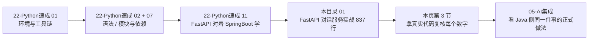
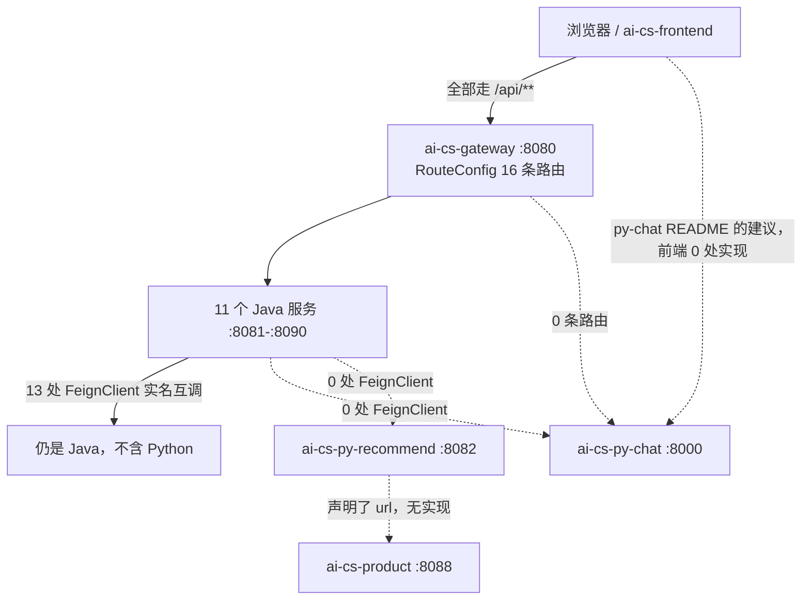

# 10-Python服务

> **一句话结论**：这套仓库里的两个 Python 服务都是**旁路实验台**，不是第二套生产链路——`ai-cs-py-chat`（端口 8000）全仓 0 处 Java / 网关 / 前端代码引用它，`ai-cs-py-recommend`（端口 8082）的默认端口与 `ai-cs-knowledge` 撞号，且它声明的 Redis、Nacos、下游 HTTP 调用一样都没接。所以本模块只写一篇正文：把一个"服务起来了、但没接进治理体系"的 FastAPI 应用讲透，并逐条标出它与 Java 主链路的差距。
>
> - **阅读前置**：读得懂 Spring Boot 的 Controller / Service / `application.yml` 三层分工；Python 只有语法基础也行，但建议先过 [22-Python速成](../22-Python速成/README.md) 的第 01、02、07、11 篇（环境、语法、模块与依赖、FastAPI 对着 Spring Boot 学），否则正文里"构造注入""中间件"两边对照会跟不上。另外要能分清"进程起来了"和"服务可用了"。
> - **证据基线**：本仓库当前工作区；Java 侧 `pom.xml#L30` 写死 `java.version=17`，Python 侧 `ai-cs-py-recommend/pyproject.toml#L10` 要求 `>=3.12`。证据 A 级 3 处（`learning-docs/24-源码分析/assets/source/` 已入库摘录）、B 级 22 处（本仓库真实文件 + 行号，写稿时逐条 `read` 核对）、C 级 4 条命令（单条 30 秒内，不启服务、不联网、不装包）。预计阅读 25 分钟。

---

## 1. 定位：这套 Java 微服务里，为什么还留着两个 Python 服务

在这套 12 个 Maven 模块的仓库里，Python 只被允许干一件事：**在把某个能力正式写进 Java 之前，先用最短路径验证它值不值得写**。它换来的不是性能，是试错成本。以对话服务为例，换一次模型或改一次请求参数，在 Python 侧只是改 `.env` 两行——`ai-cs-py-chat/app/config.py#L13` 的 `llm_base_url` 与 `#L15` 的 `llm_model`——然后 `python ai-cs-py-chat/scripts/run.ps1` 起来就有一份带 `/docs` 的可点接口；同样的试错在 Java 侧要动 starter 依赖、`ChatClient` 装配、重新编译并等待 Spring 上下文启动。**实验阶段比的是每轮迭代的分钟数，不是 QPS。**

代价也很明确：这些服务不在任何治理链路里。三条硬证据（命令在第 3 节）：根 `pom.xml#L14-L27` 只有 12 个 `<module>`，没有这两个 Python 目录；网关 `ai-cs-gateway/src/main/java/com/aics/gateway/config/RouteConfig.java` 的 16 条路由全是 `lb://ai-cs-*` 的 Java 服务；全仓 13 处 `@FeignClient`（11 处在 `ai-cs-chat/src/main/java/com/aics/chat/feign/`，2 处在 `ai-cs-order/src/main/java/com/aics/order/client/`）没有一处指向 Python。**如果有文档告诉你"Java 编排调用 Python 推荐服务"，那是错的**——Java 侧的推荐能力落在 `ai-cs-product`：`ai-cs-chat/src/main/java/com/aics/chat/feign/ProductRecommendFeignClient.java#L15-L16` 声明的是 `@FeignClient(name = "ai-cs-product")`，对应实现在 `ai-cs-product/src/main/java/com/aics/product/controller/ProductRecommendController.java#L38`。

### 与 22-Python速成 的分工

| 维度 | [22-Python速成](../22-Python速成/README.md) | 本模块 10-Python服务 |
|------|------------------------------------------|----------------------|
| 回答什么问题 | Python 这门语言怎么写、工具链怎么用 | Python 写成服务后，**在这套仓库里**缺什么 |
| 体量 | 29 篇 / 17591 行 | 1 篇正文 837 行 + 本页 |
| 典型内容 | 环境隔离、语法、模块与依赖、pytest、FastAPI 对着 Spring Boot 学、Nacos 服务发现 | 一条 SSE 流式对话接口的逐层拆解：绕过了哪些治理、代价是什么 |
| 读完的检验 | 能独立写出一个 FastAPI 应用 | 能指出这个 FastAPI 应用为什么进不了生产 |

一句话记法：**22 是语言课，10 是落地审计。** 同一份 `app/main.py`，在 22 里是"怎么写出来的"，在这里是"写出来之后缺了什么"。

### 同一件事，两侧长什么样

这条旁路值得单独讲，不是因为它把 Java 代码翻译了一遍，而是**同一批语义在两侧由完全不同的机制实现**，而差异点恰好就是坑点：

| 能力 | Java 侧（本仓库基线） | Python 侧（本仓库实况） |
|------|----------------------|------------------------|
| 流式输出 | `ChatClient.stream()` 拿 `StreamResponseSpec`，`content()` 给 Reactor 的 `Flux<String>`（[[源码:ChatClient.java.md#L534]]、[[源码:ChatClient.java.md#L424]]） | `AsyncOpenAI(stream=True)` 后 `async for chunk`（`ai-cs-py-chat/app/core/llm.py#L40-L51`），再手工拼 `data: ...` 帧 |
| 配置绑定 | `SystemEnvironmentPropertyMapper` 做 relaxed binding：剥前缀、`_` 转 `.`、大小写归一，javadoc 明写 `SERVER_PORT` 映射为 `server.port`、`HOST_0` 映射为 `host[0]`（[[源码:SystemEnvironmentPropertyMapper.java.md#L35-L42]]） | pydantic-settings 只按字段名匹配环境变量（大小写不敏感），没有前缀剥离，也没有 `host[0]` 这种下标结构 |
| 依赖装配 | 容器管生命周期、作用域、`@Primary` 优先级 | 手写模块级单例（`ai-cs-py-chat/app/services/chat_service.py#L25-L33`）或 `@lru_cache`（`ai-cs-py-chat/app/config.py#L29-L32`） |
| 参数错误格式 | 统一 `Result` 信封 + `@RestControllerAdvice` 兜底 | Pydantic 校验失败自动返回 422，形状是 FastAPI 的 `detail` 数组，与 Java 侧信封不一致 |

第一行最容易被误读：Java 侧的 `Flux` 意味着下游可以自行背压与取消；Python 侧的异步生成器同样支持取消，但**帧一旦 `yield` 出去就没有改状态码的机会了**——这正是第 6 节第 6 条那个坑的根。

### 什么时候不该在这套仓库里用 Python

- **要事务的地方**：`ai-cs-order`、`ai-cs-pay`、`ai-cs-mq` 的库存扣减与订单状态流转，Python 侧没有任何事务模板、没有消息事务表，仓库里也没有样本可抄。
- **要统一鉴权的地方**：网关 `AuthFilter` 剥离伪造身份头、注入可信身份，是 Java 侧的唯一入口；Python 服务不在网关后面，等于每个服务自己判断"谁在调我"——而它们连判断的代码都没有。
- **要服务发现的地方**：Nacos 注册在 py-recommend 里还是 TODO（第 3.4 节），意味着调用方只能写死 IP 和端口。

---

## 2. 模块地图：为什么这里只有一篇正文

| 文件 | 行数 | 覆盖什么 | 状态 |
|------|------|----------|------|
| `README.md`（本页） | — | 模块定位、两个服务的真实盘点、检查点、诚实清单 | 你正在读 |
| [01-FastAPI对话服务实战.md](01-FastAPI对话服务实战.md) | 837 | 12 节标准结构：逐层拆 `ai-cs-py-chat` 的配置、路由、服务层、LLM 客户端、SSE 分帧，并逐段对照 Java 侧 `ChatClient` | 完整 |

**先把旧账说清**：上一版本页的导航表里还列过"Python 与 Java 混合架构""异步编程最佳实践""数据处理服务"三篇。这三个文件在仓库里**从来不存在**，本次重写已删除，避免你按链接一路 404。

**为什么只剩一篇**：不是因为没东西可写，而是这两个服务本身很薄。`ai-cs-py-chat` 共 13 个 `.py` / 369 行，`ai-cs-py-recommend` 共 19 个 `.py` / 1398 行，其中 487 行是测试、两个核心算法方法还是 TODO 空壳。把 369 行的服务写一篇 837 行的精读，密度已经足够；再拆成四篇，只会把同一份证据重复四遍。

缺的东西也要点名，免得你以为读完这页就"学完了 Python 微服务"：

| 缺的内容 | 本应写在哪 | 现状（B 级证据） |
|----------|-----------|------------------|
| py-recommend 的独立正文 | 本目录 | 只有它自己的 304 行 README 与一批 TODO；算法两处 `app/services/recommend_service.py#L94-L106`、`#L108-L124` 都是待实现空壳 |
| 跨语言调用正文 | 本目录 | 全仓没有一条 Java → Python 的调用样本，写不出真实案例，因此不写（不编造） |
| Python 侧的部署与治理正文 | 本目录 / [07-运维部署](../07-运维部署/README.md) | `ai-cs-py-chat` 无 Dockerfile、无 pyproject.toml；py-recommend 只有 Dockerfile |

### 推荐阅读顺序



> **读图说明**：两个关键箭头是 `C --> D` 与 `D --> F`。`C --> D` 表示"没读 11 篇就别读 01 篇"——01 篇的 12 节大量用 Spring Boot 分层做对照物，缺了对照物，它会退化成一节普通的 FastAPI 教程。`D --> F` 是最容易被跳过的一步：读完 Python 实现必须回 [05-AI集成](../05-AI集成/README.md) 看 Java 侧的流式返回长什么样——Spring AI 的 `ChatClient.stream()` 返回的是 Reactor 的 `Flux`（[[源码:ChatClient.java.md#L534]] 声明 `StreamResponseSpec stream();`，`content()` 在 [[源码:ChatClient.java.md#L424]] 返回 `Flux<String>`），而 Python 侧是异步生成器 + 手写 `data:` 帧。看错的代价：把旁路实验台的写法当成本仓库的标准做法抄进 Java 服务。

---

## 3. 本仓库 Python 服务真实盘点（本机现测）

下面每个数字都来自本机现测，命令在 3.5 节，可逐条复跑。盘点遵循一个顺序：**先看有没有人用它，再看它实现了什么**——顺序颠倒的话，很容易被一份写得很完整的 README 骗过去。

### 3.1 一张总表

| 项 | `ai-cs-py-chat` | `ai-cs-py-recommend` |
|----|-----------------|----------------------|
| 目录 | `../../ai-cs-py-chat/` | `../../ai-cs-py-recommend/` |
| 代码量 | 13 个 `.py` / 369 行（app 下 11 个） | 19 个 `.py` / 1398 行（tests 4 文件 / 487 行） |
| 入口 | `ai-cs-py-chat/app/main.py#L42` 模块级 `app = create_app()`；`#L45-L49` 自带 `uvicorn.run` | `ai-cs-py-recommend/app/main.py#L23-L94` 同为工厂函数；`#L101-L110` `uvicorn.run` |
| 端口 | 8000（`ai-cs-py-chat/app/config.py#L25`） | 8082（`ai-cs-py-recommend/app/config.py#L31`）+ 8001 指标端口（`app/main.py#L20`） |
| 依赖声明 | `requirements.txt` 13 行，全部 `>=` 不锁版本 | `pyproject.toml` 53 行，全部 `==` 锁版本；另有 `requirements.txt` |
| 打包 | **无 Dockerfile、无 pyproject.toml** | Dockerfile 36 行（两阶段 `python:3.12-slim`）+ pyproject.toml |
| 测试 | 1 个文件 / 6 个 test 函数 / 106 行 | 4 个文件 / 15 个 test 函数 / 487 行 |
| 被谁调用 | **没有人**（3.2） | **没有人**（3.2） |
| 进 CI 吗 | 否，workflow 触发路径不含它（第 6 节） | 是，唯一被 CI 覆盖的 Python 模块 |

### 3.2 结论一：`ai-cs-py-chat` 是孤儿模块

C 级命令（本机 pwsh，30 秒内跑完）：

```powershell
cd D:\Projects\Persion\ai-customer-service
Get-ChildItem -Recurse -File |
  Where-Object { $_.FullName -notmatch 'learning-docs|node_modules|target|\.venv|__pycache__|\.git|\.worktrees' -and
                 $_.Extension -in '.py','.java','.yml','.yaml','.xml','.js','.ts','.vue','.ps1','.sh','.toml','.txt','.md' } |
  Select-String -Pattern 'py-chat|py_chat' |
  Select-Object -ExpandProperty Path -Unique
```

实测输出：**9 个文件命中**，其中 4 个在它自己目录里（`ai-cs-py-chat/README.md`、`ai-cs-py-chat/app/main.py#L15` 的 title、`ai-cs-py-chat/app/__init__.py#L1`、`ai-cs-py-chat/scripts/run.ps1#L1-L2`），其余是别人"提到"它的文字（`ai-cs-py-recommend/README.md#L299` 的反向链接、`docs/00-项目总览与架构图.md#L143`、`scripts/loadtest/README.md`、`.workbuddy` 记忆文件）。把范围收窄到**可执行配置**（`.java / .yml / .yaml / .xml / .toml`）：**0 处**。

怎么读这条输出：判断一个模块是不是孤儿，看的不是它 README 怎么写，而是**别人**有没有引用它。0 处配置引用意味着三件事同时成立——网关不转发给它（`RouteConfig.java` 16 条路由无一 Python）、Java 不 Feign 调它、前端没有硬编码它的地址（在 `ai-cs-frontend/src` 里搜 `localhost:8000` 为 0 命中）。它的 `README.md#L5` 写"服务独立运行在 http://localhost:8000……现有前端可直接跨域调用，不需要改动 Java 网关"，能力上说得通（`app/main.py#L22-L28` 在 `cors_origins="*"` 时不带 `allow_credentials`，确实放开），但**至今没有任何前端代码这么做过**；`#L110-L114` 的"后续扩展：接网关统一鉴权"自己也承认是没做的。

把这两条命令的结论画成一张图，比读十行文字快：



> **读图说明**：重点是**虚线——所有连到 Python 的边都是虚线**。两条实线（前端 → 网关 → Java 服务）才是这套仓库唯一存在的调用链；`GW -.-> PYC` 与 `J -.-> PYC` 是 3.2 那两条命令的可视化。看错的代价：把这些虚线当成"待接入的规划"，就会在没有契约、没有鉴权的前提下给 Python 服务导上游流量——而它连 Dockerfile（py-chat）与 Nacos 注册（py-recommend）都还没有。

### 3.3 结论二：`8082` 同时被 knowledge 和 py-recommend 占着

C 级命令：

```powershell
cd D:\Projects\Persion\ai-customer-service
node -e "
const fs=require('fs');
const rows=[];
for(const d of fs.readdirSync('.').filter(d=>d.startsWith('ai-cs-')&&fs.existsSync(d+'/src/main/resources/application.yml'))){
  const t=fs.readFileSync(d+'/src/main/resources/application.yml','utf8');
  const m=t.match(/port:\s*(\d+)/); if(m) rows.push([m[1],d]);
}
rows.push(['8000','ai-cs-py-chat (app/config.py:25)']);
rows.push(['8001','ai-cs-py-recommend metrics (app/main.py:20)']);
rows.push(['8082','ai-cs-py-recommend (app/config.py:31)']);
rows.sort((a,b)=>a[0]-b[0]);
const seen={}; rows.forEach(([p,n])=>{(seen[p]=seen[p]||[]).push(n); console.log(p.padStart(5), n);});
console.log('-- 撞号:', Object.entries(seen).filter(([,v])=>v.length>1));
"
```

实测输出（15 条端口，按号排序）：`8000 py-chat`、`8001 py-recommend 指标`、`8080 gateway`、`8081 user`、**`8082 knowledge` + `8082 ai-cs-py-recommend`**、`8083 chat`、`8084 search`、`8085 message`、`8086 notify`、`8087 order`、`8088 product`、`8089 pay`、`8090 mq`、`9999 order`（management 端口），末行 `-- 撞号: [[ '8082', [...] ]]`。

怎么读：唯一的同号冲突是 8082，来源是 `ai-cs-knowledge/src/main/resources/application.yml#L3` 与 `ai-cs-py-recommend/app/config.py#L31`。两种后果都要知道——本机同时起这两个进程，后起的那个直接 `bind: address already in use` 起不来；部署到同一节点且占用 hostPort 时更糟，是**跨服务串流量**，报错远不如启动失败直观。顺带一个更隐蔽的错位：py-recommend 声明了 `product_service_url="http://localhost:8085"`（`ai-cs-py-recommend/app/config.py#L45`）与 `order_service_url="http://localhost:8086"`（`#L46`），但按上表，**8085 是 message、8086 是 notify**，product 在 8088、order 在 8087。这两个 URL 目前没人用（见 3.4），一旦有人照着写调用，商品查询会打到消息服务上。

### 3.4 第二张表更值得记：声明 vs 落地

| 声明在哪 | 声明了什么 | 真实落地 | 判定依据 |
|----------|-----------|----------|----------|
| `pyproject.toml` + `app/config.py` | `redis[hiredis]==5.0.7`；`redis_url`（`#L40`）、`cache_ttl=3600`（`#L42`） | 缓存是**进程内 dict**，TTL 只存不判 | `ai-cs-py-recommend/app/repositories/cache.py#L34` 是 `dict[str, tuple]`；`#L70` 只把 ttl 存进去；`#L46-L49` 的 `get` 只判 `key in` 不判过期；`import redis` 全仓 **0 处** |
| `pyproject.toml` + config | `nacos-sdk-python==0.1.9`；`nacos_hosts` / `service_name`（`#L35-L37`） | **没有注册** | `ai-cs-py-recommend/app/main.py#L79-L86` 的 startup 钩子函数体是 `pass`，`#L85` 是 `# TODO: Nacos 服务注册（见 26 篇）`；`import nacos` 全仓 0 处 |
| `pyproject.toml` | `prometheus-client==0.20.0` | 真接了，但接法很硬 | `ai-cs-py-recommend/app/main.py#L20` 的 `start_http_server(8001)` 在**模块导入时**就抢端口，于是 `tests/conftest.py#L9` 只要 `from app.main import create_app`，跑测试也会 bind 8001 |
| `pyproject.toml` | `python-json-logger==2.0.7` | 自己手写了一份 | `ai-cs-py-recommend/app/core/observability.py#L19-L67` 手搓 `JSONFormatter`；顺带一个 bug：`setup_logging` 在 `#L76` 取了 `settings` 却没用，`#L79` 用的是形参 `level`，配置里的 `log_level` 被忽略 |
| `pyproject.toml` | `opentelemetry-*==1.27.0` | 真接了 | `ai-cs-py-recommend/app/core/observability.py#L87-L106` 的 `JaegerExporter(agent_port=6831)` + `BatchSpanProcessor` |
| `py-chat/requirements.txt` | 7 个包，无版本锁 | 基本都用上了 | `openai` → `AsyncOpenAI`（`ai-cs-py-chat/app/core/llm.py#L14-L21`）；`pydantic-settings` → `app/config.py`；`httpx` 只在 `fastapi.testclient` 的间接依赖链上 |
| `py-recommend/README.md#L213-L224` | Python vs Java 三行基准数字（1.2x～1.6x） | **没有来源** | `ai-cs-py-recommend/` 下搜 `bench` / `perf` / `load` 0 命中，无压测脚本、无数据文件。本文因此**不引用任何倍率数字** |
| `py-recommend/README.md#L228-L253` | `from nacos import NacosClient` 注册代码 + "启动后在 Nacos 控制台查看" | **文件不存在** | 代码里没有 `app/core/nacos_client.py`，`import nacos` 0 处 |

一句话：这个模块的 README（304 行）比它的代码（app 下约 911 行）更乐观。读 Python 侧文档时，先拿这张表校准预期，再读正文。

### 3.5 自己复核：四条命令

| 你想知道 | 用哪条 | 判读标准 |
|----------|--------|----------|
| 这模块有没有外部引用 | 3.2 的 `Select-String` | 命中全在自身目录 = 孤儿 |
| 端口有没有撞 | 3.3 的 node 脚本 | 末行 `-- 撞号:` 为空才算干净 |
| 声明的包有没有真用 | 扫 `app/` 下的 `import` | 0 命中 = 只写在 requirements 里，没落地 |
| 行数对不对（**这里有坑**） | 见下 | 同一文件两个数，差 9 行 |

```powershell
# 直接数行数：本机 pwsh 默认按 GBK 解码中文 .py，会少数
(Get-Content ai-cs-py-recommend/app/repositories/cache.py).Count                           # 92，错
(Get-Content -Encoding utf8 ai-cs-py-recommend/app/repositories/cache.py).Count            # 101，对
node -e "console.log(require('fs').readFileSync('ai-cs-py-recommend/app/repositories/cache.py','utf8').split(/\r\n|\n|\r/).length-1)"  # 101，对
```

怎么读：同一份 101 行的文件，前两条命令给出 92 与 101 两个数，差额来自 GBK 把多字节字符解错、进而打乱了行的切分，伴随的还有中文乱码（"缓存"被解成"缂撳瓨"）。**这是本仓库做静态统计最常踩的坑**：行数偏小、`Select-String` 匹配不到中文关键词、看起来"某功能没实现"其实是没搜到。本文所有 `.py` 行数都用 node 版本复核过。

### 3.6 两个目录长什么样（读代码前的 30 秒）

```text
ai-cs-py-chat/                      # 旁路实验台：13 个 .py / 369 行
├── README.md  (114 行)             # 含"前端可直接跨域调用"的建议，至今无人实践
├── requirements.txt  (13 行)       # 全部 >=，无 lock
├── .env.example                    # 注意：没有 Dockerfile，也没有 pyproject.toml
├── app/
│   ├── main.py  (49 行)            # create_app() 工厂 + 模块级 app + uvicorn.run
│   ├── config.py  (32 行)          # pydantic-settings，port=8000
│   ├── api/chat.py  (52 行)        # /api/health、/api/chat、/api/chat/stream
│   ├── services/chat_service.py (33 行)   # 薄服务层，手写懒汉单例
│   └── core/llm.py  (57 行)        # AsyncOpenAI 封装，含流式
├── scripts/  (内含 run.ps1)        # 本地启动脚本
└── tests/test_chat_api.py (106 行) # 6 个测试，FakeLLM 替身
```

```text
ai-cs-py-recommend/                 # 目标生产形态：19 个 .py / 1398 行
├── Dockerfile  (36 行)             # 两阶段 python:3.12-slim，探针端口写死 8082
├── pyproject.toml  (53 行)         # 依赖全锁版本 + mypy strict
├── README.md  (304 行)             # 比代码更乐观，见 3.4
├── app/
│   ├── main.py  (107 行)           # 导入即 start_http_server(8001)，startup 是 pass
│   ├── config.py  (72 行)          # port=8082，声明 nacos / redis / 下游 URL
│   ├── api/recommend.py (107 行)   # POST 有双层 try/except，GET 整段没有
│   ├── services/recommend_service.py (154 行)  # 算法两处 TODO 空壳
│   ├── repositories/product_repo.py (181 行)   # 内存 SQLite + 固定 0.85 相似度
│   ├── repositories/cache.py (101 行)          # 内存 dict，TTL 只存不判
│   └── core/observability.py (106 行)          # 手写 JSON 日志 + Jaeger
└── tests/  (4 文件 / 487 行)       # 15 个测试，conftest 导入即抢 8001
```

怎么读这两棵树：差别一眼可见——py-chat 缺**打包**（无 Dockerfile、无 pyproject），py-recommend 缺**实现**（算法 TODO、缓存是 dict、注册是 `pass`）。这也解释了为什么本模块的正文只写 py-chat：它的注意力在"最小可跑"，正好能逐层讲透；py-recommend 骨架虽全，但关键实现是空的，为它写正文只会写成设计意图。

---

## 4. 依赖关系：先读什么，读完接着读什么

### 前置（不读会卡住）

| 文档 | 为什么是前置 |
|------|--------------|
| [22-Python速成 · README](../22-Python速成/README.md)（29 篇 / 17591 行） | 语言与工具链底座，缺它读不懂 01 篇的语法级解释 |
| [22-Python速成 · 07-模块、包与依赖管理](../22-Python速成/07-模块、包与依赖管理.md) | 判断 3.4 里"声明了却没 import"这类问题的前提 |
| [22-Python速成 · 11-FastAPI实战-对着SpringBoot学](../22-Python速成/11-FastAPI实战-对着SpringBoot学.md)（883 行） | 01 篇的对照物，两边的分层术语在这里对齐 |
| [05-AI集成 · README](../05-AI集成/README.md) | Java 侧同一件事的正式实现（`ChatClient`、RAG、Function Calling） |

### 相关（对照着读）

| 文档 | 关系 |
|------|------|
| [02-Spring微服务 · README](../02-Spring微服务/README.md) | 网关 → 服务分层；本模块讲的正是"不在这套分层里会发生什么" |
| [04-中间件 · 18-gRPC与Protobuf跨语言调用](../04-中间件/18-gRPC与Protobuf跨语言调用.md) | 真要做跨语言调用时，契约先行，而不是靠本地 8000 端口裸调 |
| [07-运维部署 · README](../07-运维部署/README.md) | Python 侧缺的部署、探针、CI 都在这一册补 |

> 一处校正：任务式文档里常提的"07-AI集成"在本系列**不存在**——第 07 册是 [07-运维部署](../07-运维部署/README.md)，AI 相关正文全在第 05 册 [05-AI集成](../05-AI集成/README.md)。按上表链接读，别按册号猜。

---

## 5. 检查点清单

每条都能当场验证，不靠感觉。

**读之前**

- [ ] 能说出 `ai-cs-py-chat/app/main.py#L12-L39` 的 `create_app()` 与 `#L42` 的 `app = create_app()` 各是什么角色，并解释为什么 `tests/test_chat_api.py#L41` 的 `TestClient(app)` 用后者更方便。
- [ ] 能说清 `requirements.txt` 的 `>=` 与 `pyproject.toml` 的 `==` 在可复现构建上的差别（提示：py-chat 没有 lock 文件）。
- [ ] 知道 FastAPI 的 `APIRouter(prefix="/api")` 与 Spring 的 `@RequestMapping("/api")` 是同一件事的两个名字。

**读 01 篇时**

- [ ] 跑通 3.5 的第 4 条命令，亲眼看到 92 与 101 两个数。
- [ ] 能指出 SSE 响应里 `data: [DONE]` 是谁生成的（`ai-cs-py-chat/app/api/chat.py#L46`），以及它为什么不能交给框架自动生成。
- [ ] 能解释 `AsyncOpenAI(api_key=settings.llm_api_key or "not-configured")`（`ai-cs-py-chat/app/core/llm.py#L14-L21`）为什么让"没配 key 也能启动、第一次真调用才 401"。

**读完之后（能独立判定）**

- [ ] 给任意一个 `ai-cs-py-*` 目录，5 分钟内用 3.2 的命令判定它是不是孤儿模块。
- [ ] 能解释 3.4 里"缓存声明了 TTL 却永不过期"这一条，并给出最小修法（`get` 时比对 `time.monotonic()`）。
- [ ] 能说出这套仓库里"业务失败也返回 HTTP 200"的那个坑在哪：`ai-cs-common/src/main/java/com/aics/common/exception/GlobalExceptionHandler.java#L35-L39` 的 `handleBusinessException` 没有 `@ResponseStatus`，而紧随其后的 `#L44-L45` 参数校验分支却标了 `@ResponseStatus(HttpStatus.BAD_REQUEST)`——两相对比就知道是漏标而非设计。Python 侧虽然有 `HTTPException`，但流式接口一旦开始推帧，状态码同样已经发出去了。
- [ ] 能举出至少一处"README 说做了、代码没做"的证据，并且是带行号的。

---

## 6. 诚实清单：这个模块没做到的事，逐条给证据

1. **没有进构建**。根 `pom.xml#L14-L27` 只有 12 个 Maven 模块，两个 Python 目录都没有 `pom.xml`。`mvn clean install` 完全不认识它们，产物里也不会有它们。
2. **CI 只覆盖一半，而且是软门禁**。`.github/workflows/python-learning-validate.yml`（120 行，全仓唯一 workflow）里，`test-py-recommend` 这个 job 会跑 `pytest tests/ -v --cov=app`，但 `black` 与 `mypy` 都以 `|| true` 结尾（`#L66`、`#L71`），`codecov` 是 `fail_ci_if_error: false`（`#L83`）——也就是说只有 ruff 的 lint 与 pytest 的结果会真正卡住构建。更关键的是触发路径只监听 `learning-docs/22-Python速成/**` 与 `ai-cs-py-recommend/**`（`#L8-L14`）：**改 `ai-cs-py-chat` 不会触发任何 CI**，它的 6 个测试只能靠本地手动跑。
3. **没有鉴权，而且默认对全世界开放**。`ai-cs-py-chat/app/config.py#L26` 的 `cors_origins` 默认 `"*"`，`app/main.py#L22-L28` 在这个分支下连凭据都关掉、直接放行任何来源；同时它不在网关后面（第 3.2 节）。合起来的后果是：任何拿到地址的人都能直接调你的模型、烧你的 token 配额。py-recommend 的 `cors_origins="*"`（`#L32`）一样。
4. **没有治理接入**。py-recommend 声明了 `nacos_hosts` / `service_name`（`ai-cs-py-recommend/app/config.py#L35-L37`），但 `app/main.py#L79-L86` 的 startup 是 `pass` + TODO，`import nacos` 全仓 0 处——服务发现没落地，调用方只能写死地址；`README.md#L228-L253` 演示的注册代码在仓库里根本不存在。限流、熔断、超时预算同理：py-chat 唯一的时间上限是 `AsyncOpenAI(timeout=settings.llm_timeout)`（`ai-cs-py-chat/app/core/llm.py#L14-L21`），没有重试、没有舱壁隔离。
5. **测试只验通路，不验失败**。py-chat 的 6 个测试全部基于 `FakeLLM`（`ai-cs-py-chat/tests/test_chat_api.py#L16-L30`）+ `monkeypatch` 换掉 `get_chat_service`（`#L39`），覆盖的是路由、参数校验、分帧格式、CORS 预检；**不覆盖** LLM 超时、上游 5xx、流中途断开。py-recommend 有 15 个测试，但它的推荐算法本体是两个 TODO，测的是骨架。
6. **错误处理不对称**。py-recommend 的 `POST /api/recommend/` 有完整两层 `except`（`app/api/recommend.py#L62-L75`：`ValueError` → 404 带原因，其余 → 500 脱敏文案），而紧邻的 `GET /user/{user_id}`（`#L78-L100`）整段没有 `try`。py-chat 的普通对话接口 `app/api/chat.py#L21-L24` 也没有 `except`，只有流式接口在生成器内部兜住了异常、把它塞进 `data: {"error": ...}` 帧（`#L39-L46`）——此时 HTTP 状态码早已是 200。
7. **打包能力不齐**。`ai-cs-py-chat` 无 Dockerfile、无 pyproject.toml、无类型检查配置；py-recommend 有 Dockerfile（36 行，两阶段 `python:3.12-slim`）与 `[tool.mypy] strict = true`（`pyproject.toml#L46-L49`），但它的健康检查用同步 `httpx.get` 且端口写死 8082（Dockerfile `#L30-L31`、`#L36`），一旦按第 3.3 节改端口，镜像里的探针先坏。

这七条不是"待办列表"，而是**读这套代码时需要主动打折的地方**：凡是涉及"生产可用"的判断，都应默认不成立，直到你在别处看到证据。

---

## 7. 常见问题直达表

| 你遇到的现象 | 大概率原因 | 直接去看 |
|--------------|-----------|----------|
| 起 py-recommend 报 `address already in use` | 8082 已被 `ai-cs-knowledge` 占用 | 3.3；`ai-cs-knowledge/src/main/resources/application.yml#L3` |
| 改了 `cache_ttl` 但缓存不过期 | 缓存实为内存 `dict`，`get` 不判 ttl | 3.4；`ai-cs-py-recommend/app/repositories/cache.py#L46-L70` |
| Nacos 控制台看不到 `ai-cs-py-recommend` | startup 钩子是 `pass` + TODO | 3.4；`ai-cs-py-recommend/app/main.py#L79-L86` |
| 跑 pytest 时报 8001 端口被占 | 导入 `app.main` 就执行 `start_http_server(8001)` | 3.4；`ai-cs-py-recommend/app/main.py#L20`、`tests/conftest.py#L9` |
| 网关请求 `/api/...` 打到 Python 全都 404 | 网关 16 条路由里没有 Python 服务 | 3.2；`ai-cs-gateway/src/main/java/com/aics/gateway/config/RouteConfig.java` |
| 以为 Java 侧调了 Python 推荐服务 | 13 处 `@FeignClient` 无一指向 Python，推荐能力在 `ai-cs-product` | 1；`ai-cs-chat/src/main/java/com/aics/chat/feign/ProductRecommendFeignClient.java#L15-L16` |
| py-recommend 调商品/订单接口调不通 | `product_service_url` 写 8085、`order_service_url` 写 8086，真实端口是 message/notify | 3.3；`ai-cs-py-recommend/app/config.py#L45-L46` |
| 数出来的行数比实际少、中文变乱码 | pwsh 默认 GBK 解码 | 3.5 的第 4 条命令 |
| LLM 没配 key 也能启动，第一次对话才 401 | `api_key or "not-configured"` 兜底 | 检查点第 3 条；`ai-cs-py-chat/app/core/llm.py#L14-L21` |
| 流式接口报错，但客户端收到的状态码是 200 | 异常被塞进 `data:` 帧，响应头早已发出 | 6 的第 6 条；`ai-cs-py-chat/app/api/chat.py#L39-L52` |

---

模块正文从这里开始：[01-FastAPI对话服务实战.md](01-FastAPI对话服务实战.md)。
