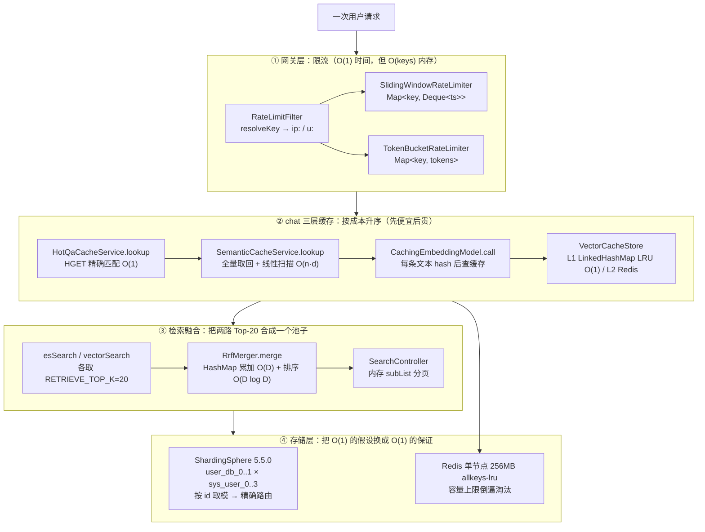
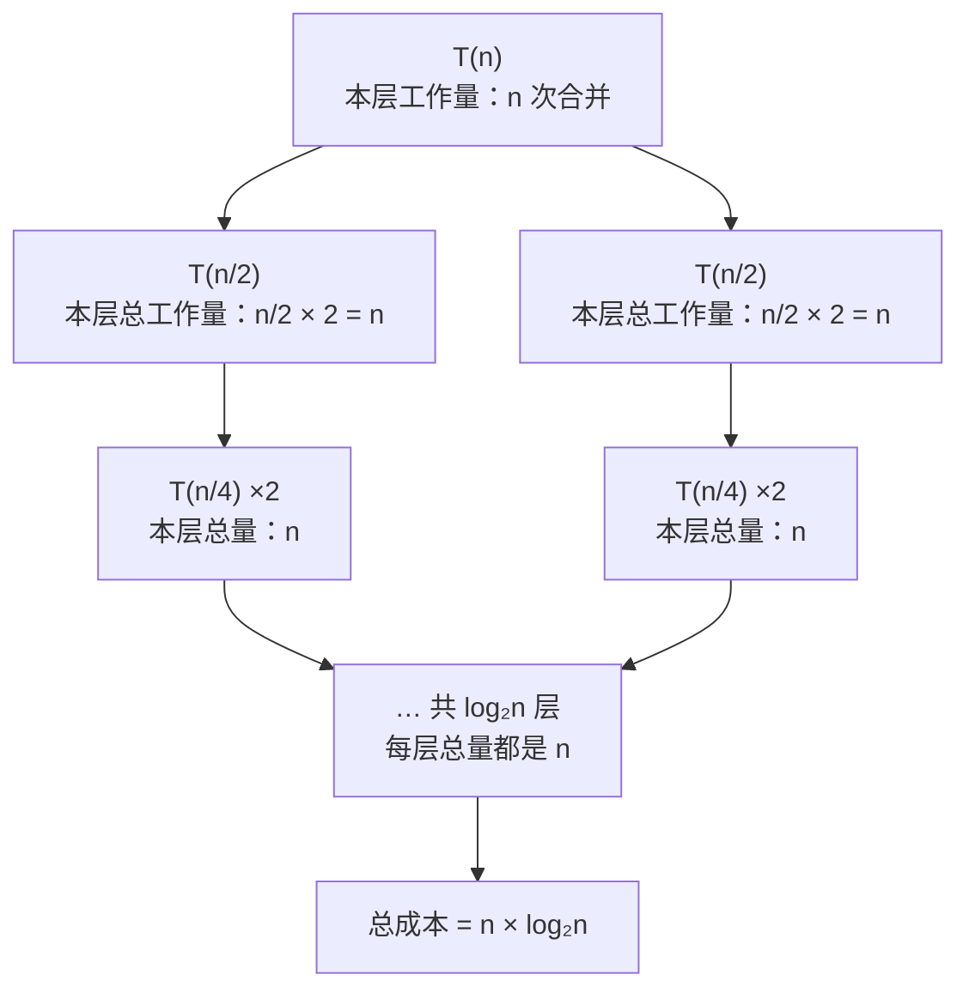
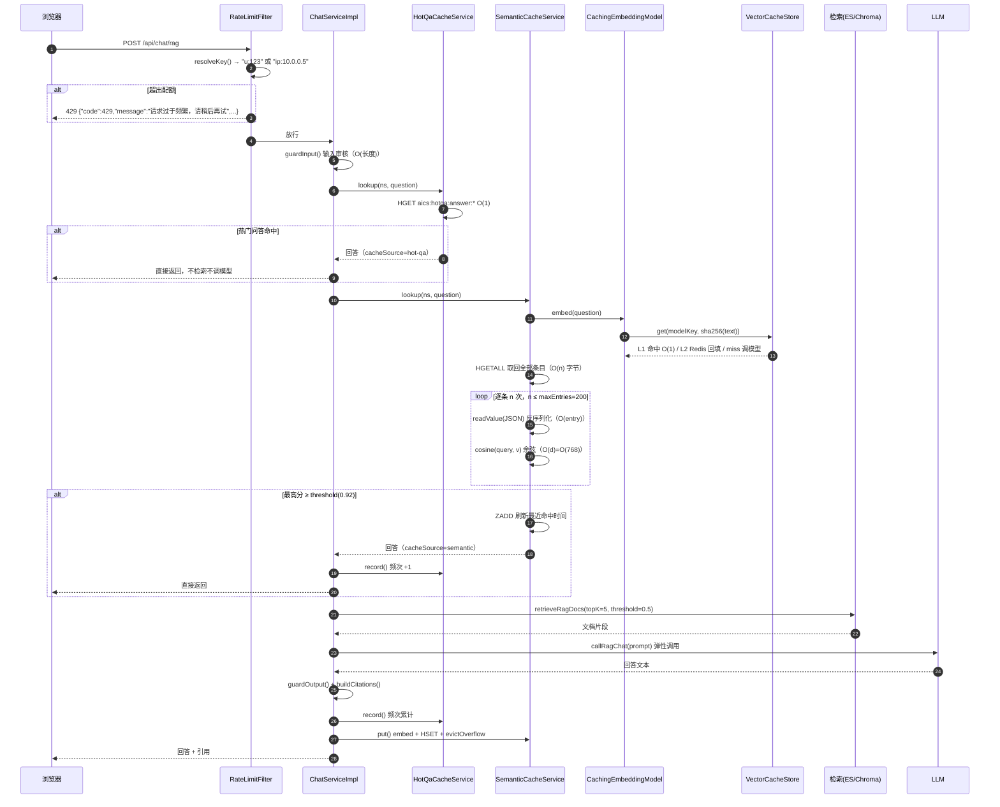

# 复杂度分析：不是背 O(n log n)，而是算清「数据量翻 10 倍时架构要不要换」

> **一句话结论**：复杂度是"数据量增长时成本怎么变"的决策工具，不是符号游戏——本项目语义缓存用 O(n) 线性扫描硬扛住 200 条上限（实测一次 lookup 7.13 ms），一旦放开到 20000 条就是 742 ms/次，而且 97% 的时间根本不在余弦相似度上、在 JSON 反序列化上；所以正确结论不是"优化余弦计算"，而是"这个上限绝对不能动"。
> **阅读前置**：能读 Java、会写 for 循环即可；不需要会积分、不需要背主定理公式（本文给的是直觉版）；知道 Redis Hash、余弦相似度、LRU 是什么就行。
> **证据基线**：A 级 = `learning-docs\24-源码分析\assets\source\` 里的源码摘录（本篇引用 Spring Cloud Gateway 5.1.0 的限流脚本）；B 级 = 本仓库当次核对的真实代码行号（ai-cs-chat / ai-cs-search / ai-cs-gateway / ai-cs-user）；C 级 = node v24.16.0 实跑脚本与原始输出（脚本正文全部贴在对应小节，可原样复现）。预计阅读 35 分钟。

术语先约定三个（后文反复用）：

- **复杂度**：指"输入规模 n 变大时，成本（时间或空间）增长的速度"，只管**量级**不管常数。
- **n**：本篇统指"你要处理的数据条数"，可以是缓存条目数、文档数、请求数、数组长度。
- **摊还（amortized）**：把偶发的一次大开销，平摊到此前此后的一堆小操作上算平均；它是"总量/次数"，**不等于**"每次都这么快"。

---

## 0. 先看现象

### 现象一：搜索接口的 `page` 参数，接了、打了日志、然后就没用了

`ai-cs-search\src\main\java\com\aics\search\service\impl\SearchServiceImpl.java#L51-L58` 的原文：

```java
public Result<List<Map<String, Object>>> search(String index, String query, int page, int size) {
    log.info("全文搜索(Chroma): knowledgeBase={}, query={}, page={}, size={}", index, query, page, size);
    try {
        SearchRequest searchRequest = SearchRequest.builder()
                .query(query)
                .topK(Math.max(1, size))
```

`page` 出现在第 52 行的日志里，然后在第 56 行彻底消失——`topK` 只跟 `size` 有关。翻到第 2 页、第 20 页，请求发给向量库的永远是同一句"取前 size 条"。这不是手误，是**复杂度直觉的缺口**：写代码的人把"分页"当成一个参数传递问题，而分页本质是"跳过前 (page-1)×size 条"这个成本问题，一旦后端是"取 Top-K"语义（K 由算力决定，不是由游标决定），分页就没有落脚点。

### 现象二：混合检索翻到第 3 页，`total` 永远不超过 40，`records` 永远空

`ai-cs-search\src\main\java\com\aics\search\controller\SearchController.java#L50-L58` 的原文：

```java
// 融合取前 page*size 条，再在内存中分页
int topK = currentPage * pageSize;
List<HybridSearchResult> all = hybridSearchService.hybridSearch(index, query, topK);
int from = (currentPage - 1) * pageSize;
List<HybridSearchResult> records = from >= all.size()
        ? List.of()
        : all.subList(from, Math.min(from + pageSize, all.size()));
HybridResultPageVO vo = new HybridResultPageVO();
vo.setTotal(all.size());
```

`topK` 按 `page*size` 放大，看起来是对的。但 `ai-cs-search\src\main\java\com\aics\search\hybrid\HybridSearchServiceImpl.java#L41` 把单路召回数钉死在 20：

```java
/** 单路召回条数 */
private static final int RETRIEVE_TOP_K = 20;
```

两路各 20 条，去重融合后的池子上限就是 40 条（实际更少）。于是 `all.size()` 最多 40，`total` 也最多 40；`from ≥ 40` 的分页一律返回 `List.of()`。**池子大小是常量，分页参数是变量，变量再大也撞不穿常量。**

### 现象三：语义缓存"加了缓存反而更慢"的临界点，藏在一条配置里

`ai-cs-chat\src\main\java\com\aics\chat\cache\SemanticCacheService.java#L69-L87` 的原文（省略守卫代码）：

```java
Map<Object, Object> entries = redisTemplate.opsForHash().entries(ENTRY_KEY + knowledgeBase);
...
for (Map.Entry<Object, Object> e : entries.entrySet()) {
    CachedEntry entry = objectMapper.readValue(String.valueOf(e.getValue()), CachedEntry.class);
    ...
    double score = EmbeddingMath.cosine(queryVector, entry.getVector());
```

每次查询**把整个 Hash 全取回**，然后逐条反序列化 + 逐条算余弦。受 `ai-cs-chat\src\main\java\com\aics\chat\cache\CacheProperties.java#L33` 的 `maxEntries` 默认值 200 保护，它才没出事。把 n 放大看看这条 O(n) 曲线（C 级实测，脚本见 §3.8）：

```text
      n      仅点积(ms)     点积+JSON.parse(ms)       反序列化占比        本次取回的数据量
     50        0.062                 1.942          97%           0.2MB
    200        0.230                 7.130          97%           0.9MB
   1000        1.217                42.999          97%           4.7MB
   5000        5.655               190.312          97%          23.4MB
  20000       26.389               742.088          96%          93.6MB
```

**怎么读这张表**：n 从 200 涨到 20000 是 100 倍，耗时 7.13 ms → 742 ms 是 104 倍，斜率就是线性，符合 O(n) 预期；但真正要命的是最后一列——每次查询都要从 Redis 拖 93.6 MB 数据过来（这还没算网络往返）。如果只盯着"余弦相似度是 O(n·d)"，你会去优化那个 1.217 ms 的点积；而 97% 的时间在 `objectMapper.readValue`，优化点积最多省 3%。

### 现象四：递归写法的墙不是"慢"，是直接崩

同一个求和任务，递归版在 n 还没到 2 万时就直接抛异常（C 级实测，脚本见 §3.5）：

```text
最后一个成功的 n = 8,000，第一个失败的 n = 10,000
  抛出的异常原文：RangeError: Maximum call stack size exceeded
对照：循环求和 n = 1e8 正常返回 —— 同一道题，空间复杂度不同结局不同。
```

时间上递归求和只是 O(n)，跟循环一模一样；但栈空间是 O(n) 个栈帧，撑到 1 万层就爆。**只算时间复杂度会漏掉这类事故。**

**这些现象指向同一件事：复杂度不是"这段代码快不快"，而是"这段代码在 n 变成 10 倍、100 倍时会变成什么样"——而 n 变大时先崩的往往不是你以为的那一项（不是余弦，是序列化；不是时间，是栈；不是 SQL，是召回池上限）。**

---

## 1. 整体地图



> **读图说明**：这张图不是画调用链，是画"每一层各自被什么复杂度约束着"，四条线要分开看。
> ① 网关的箭头指向两个限流器：只看 `RateLimitFilter`，你会以为限流成本是 O(1)；只看 `SlidingWindowRateLimiter`，你会发现它内存是 `O(键数 × 窗口内请求数)` 且键没有过期驱逐——真正的风险是"办公网 200 个人共享一个出口 IP，键退化成 `ip:` 前缀"，不是 CPU。这条箭头只说明"选择哪套算法"，不说明"键怎么选"（键在 `resolveKey` 里选错了，再好的算法也没用）。
> ② 缓存这三层是按**单位成本升序**串起来的：`HotQaCacheService` 是 Redis 一次 `HGET`（O(1)）；`SemanticCacheService` 是"全量取回 + 线性扫描"（O(n·d)，n 受 `maxEntries=200` 封顶）；`CachingEmbeddingModel` + `VectorCacheStore` 是把"调一次 embedding 模型"换成"查 L1/L2"（O(1) 查表，省掉的是秒级推理）。只看 ② 的前两个节点，你会得出"我们有缓存所以很快"的错结论——第三个节点才告诉你：前三层全部 miss 时，一次请求仍然要付模型推理的钱。
> ③ 检索融合这一段，只看 `esSearch`/`vectorSearch` 会觉得"两路并行挺快"；只看 `RrfMerger` 会觉得"排序也就 40 条"。两条合起来才暴露真问题：`RETRIEVE_TOP_K=20` 是**编译期常量**，它把下游分页的可用空间封死在 40 条，`SearchController` 的 `topK = page*size` 再大都无意义。
> ④ 存储层的箭头是反向约束：分片算法（`UserIdLast4ModShardingAlgorithm` + `sharding-count: 2 / 4`）之所以能成立，是因为"按 id 查"能精确路由到 1 个库 1 张表（O(1) 次查询）；反过来，任何"不带 id 的查询"就退化成 8 张表全扫（O(分片数) 次查询 + 内存归并）。Redis 那条 `allkeys-lru` 同理：容量上限是 256MB，它把"内存无限"这个假设换成了淘汰策略。

各组件责任与复杂度负担（B 级证据均为当次核对的行号）：

| 组件 | 责任 | 复杂度负担（主导项） | 证据 |
| --- | --- | --- | --- |
| `RateLimitFilter` | 选择限流算法、决定限流键 | O(1)/请求；键选错则变成 `O(IP 数)` 个桶 | `ai-cs-gateway\src\main\java\com\aics\gateway\filter\RateLimitFilter.java#L70-L89` |
| `SlidingWindowRateLimiter` | 滑动窗口精确计数 | 时间 O(窗口内请求数) 惰性清理，内存 `O(键数)` 无驱逐 | `ai-cs-gateway\src\main\java\com\aics\gateway\filter\SlidingWindowRateLimiter.java#L27-L47` |
| `TokenBucketRateLimiter` | 令牌桶平滑放行 | 单次 O(1)，状态 O(键数) | `ai-cs-gateway\src\main\java\com\aics\gateway\filter\TokenBucketRateLimiter.java#L35-L53` |
| `HotQaCacheService` | 热门问答精确命中 | `HGET` O(1) | `ai-cs-chat\src\main\java\com\aics\chat\cache\HotQaCacheService.java#L58-L80` |
| `SemanticCacheService` | 相近问题复用回答 | O(n·d) 扫描 + O(n) 反序列化，n ≤ 200 | `ai-cs-chat\src\main\java\com\aics\chat\cache\SemanticCacheService.java#L63-L106` |
| `VectorCacheStore` | 向量结果 L1/L2 缓存 | L1 O(1)（`LinkedHashMap` accessOrder），L2 Redis 往返 | `ai-cs-chat\src\main\java\com\aics\chat\cache\VectorCacheStore.java#L48-L78` |
| `CachingEmbeddingModel` | 批量子集回填 | O(批大小) 次缓存查询 | `ai-cs-chat\src\main\java\com\aics\chat\cache\CachingEmbeddingModel.java#L42-L74` |
| `HybridSearchServiceImpl` | 双路召回 + 降级 | 两路各 O(log N) 查询，常量封顶 20 | `ai-cs-search\src\main\java\com\aics\search\hybrid\HybridSearchServiceImpl.java#L41-L74` |
| `RrfMerger` | RRF 倒数排名融合 | O(D) 累加 + O(D log D) 排序，D ≤ 40 | `ai-cs-search\src\main\java\com\aics\search\hybrid\RrfMerger.java#L35-L47` |
| 分片规则 | 用户表水平切分 | 带 id 查询 O(1) 次；不带 id 则 O(8) 次 + 归并 | `ai-cs-user\src\main\resources\sharding-user.yaml#L67-L88` |

---

## 2. 关键概念与关键类

先把术语一次说清（后文直接用中文，不再夹生英文）：

- **渐进上界（大 O）**：`f(n) = O(g(n))` 的意思是"存在常数 C 和 n₀，当 n > n₀ 时 f(n) ≤ C·g(n)"。人话：**n 大到一定程度后，f 被 g 的某个倍数压住**。它描述的是"增长趋势的上限"，不是"精确耗时"。
- **最坏 / 平均 / 摊还**：最坏 = 单次操作的上界；平均 = 按概率分布求期望；摊还 = "连续 m 次操作的总成本 / m" 的上界，不涉及概率。
- **主定理（Master Theorem）**：解 `T(n) = a·T(n/b) + f(n)` 这种"分成 a 个 b 分之一大小的子问题 + 合并成本 f(n)"的递推式的公式。本文只给直觉版：**比较"子问题总量 n^(log_b a)"和"合并成本 f(n)"谁大，谁大听谁的**。
- **缓存友好的常数因子**：两个算法都是 O(n)，但一个顺序扫内存、一个满内存乱跳，实测能差 10 倍以上（§3.6 实测 12.4 倍）。复杂度相同不代表耗时相同。

| 名称 | 位置 | 角色 | 关键方法 / 关键点 |
| --- | --- | --- | --- |
| `SemanticCacheService` | `ai-cs-chat\src\main\java\com\aics\chat\cache\SemanticCacheService.java` | O(n) 线性扫描的活标本 | `lookup()` #L63、`put()` #L111、`evictOverflow()` #L143-L157 |
| `CacheProperties` | 同目录 `CacheProperties.java` | 给 O(n) 曲线装刹车 | `getSemantic().getMaxEntries()` 默认 200（#L33）、`threshold` 0.92（#L31）、`getVector().getL1MaxEntries()` 4096（#L53） |
| `EmbeddingMath` | 同目录 `EmbeddingMath.java` | 单条成本的单位 | `cosine()` #L18-L34（O(d)，d=向量维度）、`normalizeQuestion()` #L41-L47 |
| `VectorCacheStore` | 同目录 `VectorCacheStore.java` | O(1) LRU 的正确姿势 | `Collections.synchronizedMap(new LinkedHashMap<>(128, 0.75f, true){...})` #L48-L54 |
| `CachingEmbeddingModel` | 同目录 `CachingEmbeddingModel.java` | 批量场景 per-item cache-aside | 只覆写 `call(EmbeddingRequest)` #L42-L74 |
| `HotQaCacheService` | 同目录 `HotQaCacheService.java` | O(1) 对照实验组 | `opsForHash().get(...)` #L63、`incrementScore` #L97 |
| `RrfMerger` | `ai-cs-search\src\main\java\com\aics\search\hybrid\RrfMerger.java` | O(D log D) 融合 | `merge()` #L35-L47、`addScores()` #L58-L75 |
| `HybridSearchServiceImpl` | 同目录 `HybridSearchServiceImpl.java` | 常量封顶 20 的召回池 | `RETRIEVE_TOP_K=20` #L41、`RRF_K=60` #L44、`hybridSearch()` #L50-L74 |
| `SlidingWindowRateLimiter` | `ai-cs-gateway\src\main\java\com\aics\gateway\filter\SlidingWindowRateLimiter.java` | 内存随键数增长 | `ConcurrentHashMap<String, Deque<Long>>` #L17、`tryAcquire()` #L27-L47 |
| 分片算法 | `ai-cs-user\src\main\resources\sharding-user.yaml` + `UserIdLast4ModShardingAlgorithm` | 复杂度的"路由收益" | `actualDataNodes: user_db_${0..1}.sys_user_${0..3}` #L67、`sharding-count: 2 / 4` #L82/#L88 |

---

## 3. 原理与证据逐段精读

### 3.1 大 O 的严格定义，和三个最贵的误区

**在干什么。** 大 O 在比较"两条曲线的形状"，不是比较"两个数字"。`f(n) = O(g(n))` 的形式定义是：存在常数 C > 0 和 n₀，使得所有 n > n₀ 都有 f(n) ≤ C·g(n)。所以 O(2n) 和 O(n) 是同一个类（C 取 2 就压住了），O(n) 和 O(n²) 永远不是（n 再大，C 再大，也压不住）。

**为什么这么设计。** 因为常数因子高度依赖机器、编译器和数据（§3.6 会实测：同一个 O(n)，顺序访问和随机访问差 12.4 倍），把它写进"复杂度"里就没法跨机器比较了。而**增长趋势**是跨机器的：n 从 1 万涨到 10 万，O(n) 涨 10 倍这件事，在任何机器上都成立。这就是复杂度唯一的用途——**预测增长**，而不是预测耗时。

三个必须在第一段就打掉的误区：

1. **"忽略常数" ≠ "忽略数量级"**。O(n) 忽略的是系数，不是"n 和 n log n 差一层"。反过来说，忽略常数不等于"常数不重要"：工程上常数经常是胜负手（§3.6 实测对象数组比 `Float64Array` 慢 2.3~3.0 倍，复杂度一模一样）。
2. **均摊 ≠ 最坏 ≠ 平均**。摊还分析是"连续 m 次操作的**总成本**除以 m"，它对概率一无所知；平均分析要假设输入分布；最坏是单次上界。三者结论可以差一个量级：动态数组 `push` 摊还 O(1)（§3.3 实测均摊 0.105 μs），但单次最坏 O(n)（实测 1106 μs）——**差了 1 万倍**，而线上被这条尾巴打死的服务，比被平均耗时打死的多。
3. **空间换时间是有价格的，价格常常是 GC 和缓存未命中**。`SemanticCacheService` 就是典型：为了"少调一次 LLM"，它每次查询把整个 Hash 拖回本地（实测 n=20000 时 93.6 MB/次），换来的是 97% 的时间花在反序列化。空间换时间成立的前提是"换来的时间**确实**是瓶颈"（§3.8 给判定流程）。

**换写法会怎样。** 如果按"每次操作耗时"来评估算法，你会得出荒谬结论：二分查找在小 n 时比线性扫描慢（§3.4 实测 n=4 时 0.0079 μs vs 0.0037 μs，慢一倍多），于是"二分没用"。复杂度视角说的是：n 从 256 涨到 1e7（约 4 万倍），二分只多 2~3 次比较，线性多 4 万倍。

**常见坑。** 把"O(1)"当成"快"：`ai-cs-gateway` 的 `SlidingWindowRateLimiter` 单次 `tryAcquire` 是 O(窗口内请求数)，看起来是常数，但它维护的 `ConcurrentHashMap<String, Deque<Long>>`（`ai-cs-gateway\src\main\java\com\aics\gateway\filter\SlidingWindowRateLimiter.java#L17`）**没有键过期**——键的数量随 IP 数无限增长，内存是 O(键数)，且 `synchronized` 加在每条 Deque 上，高并发下锁竞争也是成本。O(1) 说的是单次操作，不是整机资源。

### 3.2 常见量级的量级感：什么样的 n 该开始担心 O(n²)

**在干什么。** 把抽象符号落到"这台机器上大概是几毫秒"。下面三组实测用同一套骨架：数据用固定种子的线性同余发生器（LCG）造伪随机整数装进 `Float64Array`（避免 `Math.random` 的抖动，也避免装箱），每组跑 3 次取中位数（抹掉一次 GC/JIT 的抖动）。骨架（三组共用，保存为 `scale.mjs`）：

```js
const now = () => Number(process.hrtime.bigint()) / 1e6;             // 毫秒
function makeData(n, seed = 20261127) {                              // 固定种子，可复现
  const a = new Float64Array(n); let s = seed >>> 0;
  for (let i = 0; i < n; i++) { s = (s * 1664525 + 1013904223) >>> 0; a[i] = s % 1000000; }
  return a;
}
function timed(fn, runs = 3) {                                       // 中位数计时
  const t = []; let sink = 0;
  for (let r = 0; r < runs; r++) { const t0 = now(); sink += fn(); t.push(now() - t0); }
  t.sort((x, y) => x - y); return { ms: t[t.length >> 1], sink };    // sink 防止被优化掉
}
```

**组 A：在 n 个元素里找 1 个元素（目标值一定不存在 = 最坏情况）**

```js
const lin = timed(() => { for (let i = 0; i < n; i++) if (a[i] === -1) return i; return -1; });
const map = new Map(); for (let i = 0; i < n; i++) map.set(a[i], i);  // 建表成本不计入
const has = timed(() => (map.get(-1) === undefined ? -1 : 1));
const sorted = Float64Array.from(a).sort();                          // 排序成本不计入
const bin = timed(() => { let lo = 0, hi = n - 1;
  while (lo <= hi) { const m = (lo + hi) >>> 1;
    if (sorted[m] === -1) return m; if (sorted[m] < -1) lo = m + 1; else hi = m - 1; } return -1; });
```

```text
        n       线性扫描(ms)      哈希表(ms)     二分(ms)
   100000         0.5545       0.0320     0.0110
  1000000           1.62       0.0004     0.0013
 10000000          13.30       0.0007     0.0015
```

**怎么读**：线性扫描 n 每涨 10 倍耗时涨约 10 倍（0.55 → 1.62 → 13.3），这是 O(n) 的形状；哈希和二分几乎不动（1e7 时仍在 0.001~0.002 ms），因为 O(1)/O(log n) 在这个 n 区间里都被"常数项"（函数调用、缓存命中）淹没了。n=1e6 时哈希的 0.0004 ms 比 n=1e5 的 0.0320 ms 还小，这不是哈希变快了，而是 n=1e5 那次踩到了"Map 刚建完、缓存还没热"——**单点测量噪声可达两个数量级，这正是必须取中位数、且必须看趋势不看单值的原因**。适用边界：三种结构都"数据已在内存"，不含磁盘和网络；哈希表忽略了建表成本（分布式场景里"建表"= 把数据搬过来，往往才是最贵的部分）。

**组 B：只要前 20 名（全排序 vs 一次扫 + 20 元素小顶堆）**

```js
const full = timed(() => { const c = Float64Array.from(a); c.sort(); return c[c.length - 1]; });
const K = 20;
function topK(arr) {                                  // 单次扫描 + 容量 K 的小顶堆
  const h = new Float64Array(K); let size = 0;
  const down = (i) => {                               // 下沉，O(log K)
    for (;;) {
      let m = i; const l = 2 * i + 1, r = l + 1;
      if (l < size && h[l] < h[m]) m = l;
      if (r < size && h[r] < h[m]) m = r;
      if (m === i) return;
      const t = h[i]; h[i] = h[m]; h[m] = t; i = m;
    }
  };
  for (let i = 0; i < arr.length; i++) {
    if (size < K) {                                   // 上浮，O(log K)
      h[size] = arr[i]; let j = size++;
      while (j > 0) { const p = (j - 1) >> 1; if (h[p] <= h[j]) break;
        const t = h[p]; h[p] = h[j]; h[j] = t; j = p; }
    } else if (arr[i] > h[0]) { h[0] = arr[i]; down(0); } // 只有比堆顶大才进来
  }
  return h[0];                                        // 堆顶即第 K 大
}
const heap = timed(() => topK(a));
```

```text
        n       全排序(ms)    Top20堆(ms)       倍数
   100000          15.28          1.98      7.7
  1000000            183          5.98     30.5
 10000000          2492         38.59     64.6
```

**怎么读**：全排序是 O(n log n)（1e7/1e5 = 100 倍，耗时 2492/15.28 ≈ 163 倍，略高于 100 是因为 n log n 的 log 也涨了）；堆是 O(n log K)，K=20 是常量，所以它随 n 线性增长（1e5 → 1e7 涨 19.5 倍，实测比 100 倍小很多，说明小 n 时被固定开销主导）。**结论不是"堆比排序快"，而是"当 K 远小于 n 时，把 log n 换成 log K"**——这就是 `RrfMerger.merge` 之后 `SearchController` 敢写 `topK = page*size` 的底气，也是 ES 深分页"慢"的根本原因：`from + size` 越大，协调节点要归并的候选越多，它本质上是"K 逼近 n"的 Top-K 问题。

**组 C：O(n²) 到底在哪个 n 上开始要命**

```js
const q = timed(() => { let s = 0; for (let i = 0; i < n; i++) for (let j = 0; j < n; j++) s += (i ^ j) & 1; return s; });
```

```text
        n    O(n²)(ms)   O(nlogn)(ms)   n²/nlogn     外推 n=1e5 的 n²(ms)
     1000         1.01         0.2353        4.3                    10100
     2000         3.60         0.2391       15.0                     9000
     4000        13.94         0.6771       20.6                     8713
     8000        57.19           1.13       50.7                     8936
    16000          214           2.16       99.2                     8359
    32000          865           4.62      187.3                     8447
```

**怎么读**：n 每翻一倍，O(n²) 列涨 4 倍左右（1.01 → 3.60 → 13.94 → 57.19 → 214 → 865，比值的均值约 3.9），O(n log n) 列只涨 2 倍多一点，两者比值从 4.3 一路涨到 187。最后一列**不是实测**，是拿该行实测值乘 `(1e5/n)²` 外推出来的（读者可按比例核对）：n=1e5 时约 8.4~10.1 秒。你可以直接用这个数做"要不要改架构"的判断：**一个接口里只要有一次 n=1e5 规模的双层循环，它就不可能满足 200 ms 预算**。

适用边界要说清：① 这里的内层是极轻的算术（`(i^j)&1`），真实业务的循环体里有对象分配、字符串拼接、SQL 调用，常数因子可能大 100 倍，所以"n=1e4 就 13.94 ms"在不同实现下可能变成"n=1000 就 100 ms"；② 反过来，如果内层循环能被向量化/批处理（比如换成一次 SQL `IN` 查询），O(n²) 的**次数**不变但常数塌到几乎为零——这就是"批量接口"存在的意义。

**量级感经验表**（本机实测 + 常见经验，标注了来源，别当定律）：

| 量级 | n = 1e3 | n = 1e5 | n = 1e7 | 什么时候该动手 |
| --- | --- | --- | --- | --- |
| O(1) / O(log n) | 观测 ~0.001 ms | ~0.001 ms | ~0.001 ms（实测二分 0.0015 ms） | 不用管 |
| O(n) | ~0.001 ms | 0.55 ms（实测线性扫描） | 13.3 ms（实测） | 每次请求都跑、且 n 会到 1e7 才管 |
| O(n log n) | 0.2353 ms（实测） | ~30 ms（由 1e4 的 3.38 ms 外推） | ~2500 ms（实测排序 2492 ms） | 亚秒级接口里 n 别超 1e6 |
| O(n²) | 1.01 ms（实测） | 外推 8.4~10.1 s | ——（约 15 分钟，外推） | n > 5000 就想办法消灭它 |
| O(2ⁿ) | 指数级递归 n=30 已 10.87 ms（实测 §3.4） | 不可行 | 不可行 | 立刻换 DP/记忆化 |

**为什么这么设计。** 因为工程决策只需要"量级对得上"，不需要"精确到毫秒"：知道 n=1e5 的双层循环要 10 秒，就足够让你去改成哈希表或分批；而知道精确值 8.4 秒还是 10.1 秒，对决策毫无影响。

**换写法会怎样。** 如果不做这一步实测，常见两种错法：① 在 n=200 的语义缓存上大谈"O(n) 扫描是性能隐患"（实际 7.13 ms，且 97% 不是扫描），过度优化；② 在一条每天只跑 1 次的离线任务里为 O(n²) 焦虑，把代码复杂度翻三倍，收益为零。**判断标准是"n 有多大 × 多久跑一次"，不是"复杂度符号有多丑"**。

**常见坑。** 把"实测"当"复杂度"。实测值里混着 JIT 预热、GC、缓存命中率、CPU 频率调节；本文所有实测只用来给"常数因子的量级感"，复杂度结论一律用大 O 严格表述——比如组 C 只能说"O(n²) 随 n 平方增长（实测比值 ≈ 3.9/翻倍），外推 n=1e5 约 10 秒级"，不能说"n=1e5 就是 8.4 秒"。

### 3.3 均摊分析：动态数组扩容与 HashMap 扩容

**在干什么。** 动态数组（Java 的 `ArrayList`、本项目里 Redis 的 `Deque`、Java 的 `LinkedHashMap` 内部数组）装满了要扩容：申请更大数组、把老元素整段拷过去。拷一次是 O(n)，但**不是每次都拷**，所以"连续 n 次 push 的总拷贝量"是 O(n)，摊还下来每次 O(1)。

实测（`amortized.mjs`，模拟三种增长策略，n=1e6 次 push，每次都真实拷贝并对每次操作单独计时）：

```js
function run(grow, initial, n = 1e6) {
  let cap = initial, buf = new Float64Array(cap), size = 0, copied = 0, grows = 0;
  const ops = new Float64Array(n);
  for (let i = 0; i < n; i++) {
    const t0 = Number(process.hrtime.bigint()) / 1e3;   // 微秒
    if (size === cap) { const nb = new Float64Array(grow(cap)); nb.set(buf); copied += size; grows++; buf = nb; cap = nb.length; }
    buf[size++] = i;
    ops[i] = Number(process.hrtime.bigint()) / 1e3 - t0;
  }
  return { copied, grows, ops };
}
```

```text
策略                     扩容次数       拷贝总元素数      拷贝/元素    均摊(μs)  p50(μs)  p99(μs)   max(μs)
×2 增长                    16      1048560       1.05     0.105    0.100    0.200    1106.4
×1.5 增长                  27      2010543       2.01     0.113    0.100    0.200    1564.3
+1000 固定增量              999    499500000     499.50     1.472    0.100    0.200    7349.8
```

**怎么读**：×2 增长把"每个元素平均被拷贝 1.05 次"钉死在常数（几何级数 1 + 2 + 4 + … + n < 2n），×1.5 是 2.01 次（仍是常数，只是大一点），而固定增量 +1000 是 499.5 次——**每次元素都会被反复搬家，摊还复杂度从 O(1) 退化成 O(n)**。注意 p50 三者都是 0.100 μs，差异全在尾部（max：1106 μs vs 7350 μs）。这就是"摊还分析只看总量、不看分布"的代价，下一节（§3.7）补上分布视角。

**为什么这么设计。** 倍数扩容的数学本质是**几何级数求和**：拷贝总量 = 1+2+4+…+n < 2n，所以摊还 O(1)；固定增量是**等差数列**：n/k 次扩容、平均拷 n/2 个元素，总拷贝 O(n²/k)，摊还 O(n)。JDK 的 `ArrayList` 用 `oldCapacity + (oldCapacity >> 1)`（1.5 倍，兼顾内存碎片与拷贝次数），Redis 的 `dict` 用 2 倍，本项目 `VectorCacheStore` 的 `LinkedHashMap` 初始容量 128 + 负载因子 0.75（`ai-cs-chat\src\main\java\com\aics\chat\cache\VectorCacheStore.java#L50`）也是同一套思想的参数化。

**HashMap 扩容实测**（同一脚本，链地址法实现，桶数组翻倍 + 全量 rehash，n=1e6 次 put）：

```text
扩容次数=17  rehash 元素总数=1572852  rehash/put=1.57  均摊=0.820μs  p50=0.100μs  max=340810.4μs
```

**怎么读**：17 次扩容、平均每次 put 摊销 1.57 次 rehash，均摊 0.820 μs——符合 O(1) 摊还。但 `max = 340810.4 μs`（340 ms）**不可能是扩容造成的**：17 次扩容里最大的一次也只是拷几十万个元素。这 340 ms 是一次垃圾回收（GC）停顿被记在了某次 put 头上——这不是噪声，这是"复杂度之外的真实成本"（§3.6）的现场证据，也解释了为什么生产环境要按 p99.9 而不是平均值做容量规划。

**换写法会怎样。** 如果按固定增量扩容，n=1e6 时总拷贝量是 5 亿个元素（实测 499.5 次/元素），均摊 1.472 μs——单看数字只慢 14 倍，但它在 n 更大时**会继续恶化**（O(n) 摊还），而倍数扩容永远稳在 O(1)。这就是"改一行常数，换一个复杂度类"的经典案例。

**常见坑。** ① 只算时间不算内存峰值：扩容瞬间老数组和新数组同时存在，×2 策略的峰值是 3n（老 n + 新 2n），在 256MB 的 Redis 或小堆容器里这就是 OOM 的直接原因（本项目 Redis 是单节点 256MB + `allkeys-lru`，见 §5）。② 把摊还当最坏去设计 SLA：摊还 O(1) 只保证"长期平均"，单次 1106 μs（实测）的停顿落在一次 HTTP 请求上，就是一次超时。

### 3.4 递推式、递归树与主定理的直觉版

**在干什么。** 递归代码的复杂度不写在循环里，写在**递推式**里。同一个"把问题变小"的动作，写错一处就是量级灾难。实测（`recursion.mjs`，每组 5 次取中位数）：

**A 组：`T(n) = T(n-1) + T(n-2)`（朴素斐波那契，指数级）**

```js
function fib(n) { return n < 2 ? n : fib(n - 1) + fib(n - 2); }
```

```text
    n       耗时(μs)       比上一行          调用次数上界 1.618^n
   20         83.1          -                  15,121
   22        195.7      2.35×                  39,585
   24        900.5      4.60×                 103,630
   26       2003.0      2.22×                 271,295
   28       5809.1      2.90×                 710,229
   30      10869.3      1.87×               1,859,326
```

**怎么读**：n 每加 2，耗时涨 2.2~4.6 倍（平均接近 1.618² ≈ 2.6 倍），完全对上"调用次数上界 1.618ⁿ"。n=30 只要 10.87 ms 看起来无害，但 n=50 按这个斜率就是 1.618²⁰ ≈ 1.5 万倍 → 约 160 秒。**这就是指数复杂度的可怕之处：它在小 n 上表现得完全正常。**

**B 组：`T(n) = 2T(n/2) + O(n)`（手写归并）vs 引擎内置排序（同为 O(n log n)）**

```text
        n       手写归并(ms)      内置排序(ms)       内置/手写
    10000           2.89          1.60         0.6
   100000          32.60         16.13         0.5
  1000000         325.29        194.03         0.6
```

**怎么读**：两者都随 n 涨 10 倍而耗时涨约 10 倍（多出来的是 log 项），比值稳定在 0.5~0.6——**同为 O(n log n)，常数差近 2 倍**，原因是手写版每次 `slice` 都在分配新数组（内存+GC），内置版用 `Float64Array.sort` 原地排。这条实测的意义是：**复杂度定胜负的边界之外，常数因子才是日常战场**，而常数因子最容易改善的往往是"少分配"。

**递归树读法（不用背公式）**：把递归展开成树，每层写下"这一层的总工作量"和"这一层有多少个节点"。



> **读图说明**：这棵树每一层的总工作量都是 n（因为子问题数量翻倍、单个规模减半，乘起来不变），一共有 log₂ n 层，所以总和是 O(n log n)。这张图只看"层数"会得出"层数多所以慢"的错结论——层数只有 log₂n（n=1e6 时约 20 层）；真正的成本是"每层都要把所有元素过一遍"。对比 A 组的斐波那契：它的递归树**每层总量还在增长**（节点数指数增长而每个节点工作量不变），所以是 O(1.618ⁿ) 而不是 O(n·层数)。**判据只有一条：每层的总工作量是"不变量"还是"在膨胀"。**

**主定理的直觉版**（不做公式推导，只做比较）：`T(n) = a·T(n/b) + f(n)` 里，`n^(log_b a)` 是"所有叶子节点的总数"（子问题彻底铺开后的规模），`f(n)` 是"合并成本"。

- 叶子总量 `n^(log_b a)` 更大 → 总成本由叶子决定，即 `Θ(n^(log_b a))`（归并排序：a=2,b=2 → 叶子 n¹=n，合并 n，两者同阶 → O(n log n)）。
- 合并成本 `f(n)` 更大 → 总成本由每层的合并决定，即 `Θ(f(n))`（二分查找：a=1,b=2 → 叶子 n⁰=1，合并 O(1)，但只走一条分支 → O(log n)）。
- 两者同阶 → 乘上一个 log 层数（归并排序就是这一档）。

**为什么这么设计。** 因为递归写法的"分法"和"合并成本"是分离的两个决策：分法决定树的形状（几叉、每叉多大），合并成本决定每层多贵。把它们分开看，才能在改代码时预判影响——比如把"两路归并"改成"K 路归并"，树变浅了（log_K n 层），但每层合并要用堆选最小（O(n log K)），总成本常数变差。这正是 `RrfMerger` 的场景：它不是分治，而是"K 路有序链表的 Top-K 合并"，所以它用哈希表累加（O(D)）+ 一次排序（O(D log D)），而不是反复两两归并。

**换写法会怎样。** 朴素斐波那契加一个 `memo`（记忆化）就把 O(1.618ⁿ) 降到 O(n)——因为它把"重复子问题"从"重新算一遍"变成"查表 O(1)"。这个动作与 §3.3 的扩容、§3.8 的缓存是同一个思想：**用空间换掉重复计算**。但它有前提：子问题必须**真的重复**。归并排序的子问题不重复（每个子数组只算一次），加 memo 只会白白占内存。

**常见坑。** ① 递归层数 = 空间复杂度，很多人只算时间（§3.5 实测 1 万层就爆栈）。② 尾递归在 Java/JS 里**不会**被优化成循环（JVM 不保证、V8 不实现），所以"写成尾递归就安全了"是错的。③ 递归里做 `subList` / `slice` / `stream().collect()` 会引入大量临时对象，把 O(n log n) 的常数抬到不可接受——实测里手写归并比内置排序慢 2 倍，就是这条的代价。

### 3.5 空间复杂度：递归栈是真实存在的墙

**在干什么。** 同一个求和，递归版时间 O(n)、循环版时间 O(n)，复杂度"一样"，但空间一个 O(n) 个栈帧、一个 O(1)。实测（`recursion.mjs` 的 C 组，直接调用来测，不额外包一层函数以免多一层栈帧）：

```js
function naiveSum(n) { return n === 0 ? 0 : n + naiveSum(n - 1); }
let lastOk = 0, firstFail = null, errMsg = null;
for (const n of [8000, 10000, 12000, 13000, 14000, 16000, 20000, 40000, 100000]) {
  try { naiveSum(n); lastOk = n; } catch (e) { firstFail = n; errMsg = e.name + ': ' + e.message; break; }
}
```

```text
最后一个成功的 n = 8,000，第一个失败的 n = 10,000
  抛出的异常原文：RangeError: Maximum call stack size exceeded
对照：循环求和 n = 1e8 正常返回 —— 同一道题，空间复杂度不同结局不同。
```

**怎么读**：递归深度上限在同一台机器上多次运行并不固定（另有两次运行分别在 12000 层和 10326 层失败），因为栈帧大小受 JIT 内联决策影响。**所以这种数字只能用来判断"量级是 1 万还是 100 万"，不能当精确指标**——但结论足够硬：栈深度是 O(n) 的递归，n 到 1e4 量级就得改成循环或显式栈。适用边界：V8 的默认栈约 984 KB（可通过 `--stack-size` 调整），JVM 默认 `-Xss` 1 MB 左右，二者量级相同，Java 里深递归同样是 `StackOverflowError`。

**为什么这么设计。** 因为栈是"调用约定的副产品"，不是可以随便扩容的数据结构：每层调用要保存返回地址、参数、局部变量，它必须连续、必须 LIFO，所以只能定长。JVM 选择"爆栈即错误"而不是"自动扩容"，是为了保住"栈地址递增即可判空"的极简实现。

**换写法会怎样。** 改成循环（或显式 `Deque` 当栈）立刻从 O(n) 空间降到 O(1)，代价是代码可读性——所以工程上的分界线是"递归深度是否受控"。受控（深度 ≤ log n，如归并/快排/树遍历）就放心递归；不受控（深度 = n，如链表遍历、深 JSON 解析、目录扫描）就必须改成循环或加深度上限。本项目里 `SemanticCacheService` 的 `objectMapper.readValue` 解析缓存条目就是深度受控的（结构固定），但如果哪天缓存里存的是用户提交的任意 JSON，就必须配 `StreamReadConstraints` 限制嵌套深度——这不是理论风险，是 Jackson 的 CVE 高发区。

**常见坑。** ① 把空间复杂度理解成"变量个数"：`int a, b, c` 是 O(1)，但 `new int[n]`、递归深度 n、`list.stream().sorted()` 的归并缓冲都是 O(n)。② 忘了"隐式空间"：`String.substring`（JDK 7 起）会复制，`List.subList` 是视图不复制但会**持有**原数组引用——`SearchController` 的 `all.subList(from, ...)`（`ai-cs-search\src\main\java\com\aics\search\controller\SearchController.java#L54-L56`）本身不贵，但返回的视图让整个 `all` 无法被回收，只要响应还没写出去，那 40 条记录就连着它的容器一起活着。

### 3.6 复杂度之外的真实成本：缓存未命中、分支预测、GC、网络往返

**在干什么。** 两个算法都是 O(n)，实测能差 12 倍——差异不在"计算次数"，在"内存怎么被访问"。实测（`locality.mjs`，1e7 次加法，只有访问模式不同）：

```js
const a = new Float64Array(1e7);            // 80MB，远超 L3
// 顺序：for (let i = 0; i < N; i++) t += a[i];
// 随机：先 Fisher-Yates 打乱 1e7 个下标，再 for (let i = 0; i < N; i++) t += a[idx[i]];
```

```text
=== A 组：1e7 次加法，只有内存访问模式不同 ===
顺序访问   11.68 ms
随机访问   145 ms   （慢 12.4 倍）

=== B 组：1e6 次加法，只有数据布局不同 ===
Float64Array      1.71 ms
对象数组 [{v}]     3.92 ms   （慢 2.3 倍）

=== C 组：1e6 个 (x,y) 求 x+y，结构体数组 vs 平行数组 ===
对象数组 [{x,y}]  4.95 ms
平行 TypedArray  1.64 ms   （对象数组慢 3.0 倍）
```

**怎么读**：加法次数完全相同（都是 1e7 次），时间差 12.4 倍，唯一变量是"下一次读的内存地址是不是紧挨着上一次"。CPU 每次取数按 64 字节的缓存行（cache line）为单位，顺序访问时一次取数顺带把后面 8 个 double 都装进缓存行（硬件预取器还会提前取）；随机访问时每次几乎都 miss，要等内存（约 100 ns 级，比 L1 命中慢两个数量级）。B/C 组是同一现象的另一面：`{v: number}` 对象数组里每个元素是堆上独立对象，访问 `objs[i].v` 要先读指针再跳一次，还带着 GC 头，等于"随机访问 + 双倍内存"。

**另外三项"复杂度之外"的常客**，都能用前面的实测指认：

| 成本项 | 现象证据 | 工程量级 | 什么时候会咬人 |
| --- | --- | --- | --- |
| GC 停顿 | §3.3 哈希实测 `max=340810.4 μs`，远超任何一次 rehash 的理论成本 | 十到几百 ms 一次 | 大对象、大批量反序列化（§3.8 的每请求 93.6 MB） |
| 反序列化 | §3.8 实测 97% 的时间在 `objectMapper.readValue` | 单条约 30 μs（7.13 ms / 200 条反推，含点积） | 每次请求都要解析全量条目 |
| 网络往返 | `SemanticCacheService` 每次 lookup 至少一次 `HGETALL` 级往返；`opsForHash().entries()` 一次取回全部 | 同机房 0.2~1 ms 量级（**本项目未实测**，此处只作量级提示） | 在循环里调 Redis（N+1 往返），或取回体积随 n 线性增长 |

**为什么这么设计。** 现代 CPU 的算力过剩、访存瓶颈：一个 L1 命中约 1 ns，一次主存访问约 100 ns，差 100 倍；一次跨机房网络往返 1~10 ms，差 6 个数量级。第三个常被忽略的是分支预测：流水线里猜错一次分支要冲刷十几个周期，所以"可预测的循环"比"随机跳转的等价逻辑"快得多——本文没有单独测它（要精确测需要构造 50% 随机命中的分支数组并用性能计数器读 `branch-misses`），但你只要记住它是**同一份 O(n) 代码里另一个免费/昂贵的分水岭**。所以复杂度分析告诉你"计算次数怎么长"，而性能工程要问的是"**这些计算落在哪一层存储上、分支是否可预测**"。两条结论经常冲突：哈希表 O(1) 比二分 O(log n) 更好，但如果哈希表大到装不进缓存、且每次探查都是随机地址（不可预测的分支 + 缓存未命中），二分在有序数组上的顺序访问反而更快——这就是"数组比 HashMap 快"的经典场景。

**换写法会怎样。** 把 `SemanticCacheService` 的"全量取回 + 逐条反序列化"改成"向量单独存二进制（Redis 支持 `SET` 原始 byte）"，就能砍掉 97% 的时间而不改任何算法——复杂度还是 O(n·d)，但常数塌了一个数量级。反过来，只优化余弦点积（比如用 SIMD）最多省 3%。**这就是"先估后测"要解决的问题：把钱花在占比最大的那一项上。**

**常见坑。** ① 用平均值掩盖尾部：`VectorCacheStore` 的 L1 是 `Collections.synchronizedMap`（`ai-cs-chat\src\main\java\com\aics\chat\cache\VectorCacheStore.java#L48-L54`），每次 `get` 都要抢一把全局锁——平均耗时很小，但高并发下所有线程排同一把锁，p99 会突然抬头。② 在"看起来是 O(1)"的地方做 I/O：`HotQaCacheService.lookup` 是 O(1) 的 `HGET`，但它是**一次网络往返**，比本地 O(n) 扫描 200 条（7.13 ms？不，是这个数量级的 1/7）未必更便宜——所以 `ChatServiceImpl` 才把成本低的放前面、并且全都要 try-catch 降级（`ai-cs-chat\src\main\java\com\aics\chat\service\impl\ChatServiceImpl.java#L184-L194`）。

### 3.7 摊还 vs 最坏：尾延迟的工程含义

**在干什么。** 摊还分析回答"长期平均多少"，SLA 关心"最慢的那 1% 有多慢"。两者的差距可以到 1 万倍（§3.3 实测：动态数组 `p50=0.100 μs`，`max=1106.4 μs`；固定增量策略 `max=7349.8 μs`）。

再看一组随 n 变化的尾部数据（同一脚本，只跑固定增量 +1000 策略）：

```text
=== 固定增量 +1000 的单次最坏耗时随 n 的变化（尾延迟会不会随数据量变糟）===
        n    max 单次(μs)   p50(μs)  max/p50
   100000        1037.8     0.100    10378
   500000        2195.0     0.100    21950
  1000000        6264.6     0.100    62646
```

**怎么读**：p50 一动不动（0.100 μs），max 随 n 涨了 6 倍，max/p50 从 1 万涨到 6 万。**只看平均值/中位数，你会发现"这套代码在 1e5 和 1e6 数据量下性能一样"；只看尾部，你会发现它在恶化。** 这就是为什么容量规划要看 p99/p999，以及为什么"平均耗时没变"不能成为"扩容无需评估"的理由。

**为什么这么设计（为什么工程上要区分）。** 因为摊还是**统计性质**，SLA 是**每次请求的性质**：一个用户撞上一次 340 ms 的 GC 停顿，和撞上十次 34 ms，体验完全不同（后者还能重试）。所以架构上通常这样分工：

- 用摊还复杂度做**容量与算法选择**（选 ×2 扩容，不选固定增量）；
- 用最坏复杂度做**超时与降级设计**（网关超时、限流、熔断、缓存失败必须降级）。

本项目里两层都有落点：`SemanticCacheService.lookup` 整段包在 `try-catch` 里，任何异常都 `return Optional.empty()`（`ai-cs-chat\src\main\java\com\aics\chat\cache\SemanticCacheService.java#L102-L105`），这是"最坏情况下不能拖垮主链路"；`RateLimitFilter` 超限直接返回 429 而不是排队（`ai-cs-gateway\src\main\java\com\aics\gateway\filter\RateLimitFilter.java#L94-L100`），这是"最坏情况下保护自己"。

**换写法会怎样。** 如果只用摊还视角，你会觉得"限流器是 O(1)，随便加"——但 `SlidingWindowRateLimiter` 的真正风险在内存：`Map<String, Deque<Long>>` 每个键持有一个双端队列，窗口 60 秒、QPS 60 时每个键最多 60 个 `Long`（约 60×16 字节 + 队列开销），键数 = 活跃 IP 数。它没有过期驱逐，IP 一旦换（办公网 NAT 出口、移动网络重连），旧键就永久留在 map 里。这是"**最坏情况下的空间泄漏**"，摊还分析完全看不见。

**常见坑。** ① 用平均值做压测结论。② 把"摊还 O(1)"写进接口 SLA。③ 只在单机、单线程、数据量小的情况下测尾延迟——尾部往往由 GC、锁竞争、页缺失决定，这些小规模测不出来。

### 3.8 先估后测：怎么决定优化对象

**在干什么。** 优化对象的选择应该是一个**两步流程**：先用复杂度/规模估算"哪个环节的量级最可能成为瓶颈"，再实测"它到底占多少时间"，最后只改占比最大的那一项。跳过第一步会优化错方向，跳过第二步会优化错位置。

以 `SemanticCacheService.lookup` 为例走一遍。第一步（估）：`lookup` 的成本是"1 次向量化（有缓存则 O(1) 查表）+ 1 次 `HGETALL` 全量取回（网络 + O(n) 字节）+ n 次反序列化（O(n·|entry|)）+ n 次余弦（O(n·d)）"。n ≤ 200（`CacheProperties.maxEntries`），d = 768。量级上最大项是反序列化和余弦，二者都是 O(n)——但常数量级判断题：反序列化要建对象、解析字符串、分配内存，点积只是 768 次乘加。**预估应该是反序列化占大头。** 第二步（测）：验证它。

```js
// semcache.mjs：造 n 条 768 维向量，一份存成 JSON 字符串（模拟 Redis Hash 里的值），一份留成数组
for (let i = 0; i < n; i++) { const v = makeEntry(); vecList[i] = v; jsonList[i] = JSON.stringify(v); }
// 变体 1：只算点积（向量已在内存）
for (let i = 0; i < n; i++) { const c = cosine(query, vecList[i]); if (c > best) best = c; }
// 变体 2：完整模拟真实实现（逐条 JSON.parse + 点积）
for (let i = 0; i < n; i++) { const v = JSON.parse(jsonList[i]); const c = cosine(query, v); if (c > best) best = c; }
```

```text
      n      仅点积(ms)     点积+JSON.parse(ms)       反序列化占比        本次取回的数据量
     50        0.062                 1.942          97%           0.2MB
    200        0.230                 7.130          97%           0.9MB
   1000        1.217                42.999          97%           4.7MB
   5000        5.655               190.312          97%          23.4MB
  20000       26.389               742.088          96%          93.6MB
```

**怎么读**：预估被证实且被量化——反序列化占 97%，点积只占 3%。所以：① 在 n=200 的现状下，`lookup` 的 7.13 ms 里约 6.9 ms 花在 JSON 上，**优化点积是无效劳动**；② 真正的优化方向是"别再逐条反序列化"（改二进制存储、或把向量单独放一个 Hash 用 `HMGET` 批量取 byte），或者"别每次全量取回"（用 Redis 的向量检索能力，本项目未使用）；③ 更重要的结论是**这个 200 的上限不能动**——表里 n=20000 时单次 742 ms，已经超过一次 LLM 生成的时间，缓存就失去意义了。数字本身就是"上限为什么是 200"的答案。

**为什么这么设计（为什么要"先估"）。** 因为实测是昂贵的：造数据、跑多轮、排除噪声、还要在别人的机器上复现。估算是免费的（读代码、数循环、看数据量），而且能给出**候选排序**。工程上的顺序永远是：估算 → 挑 1~2 个候选 → 实测确认 → 只改确认过的那个。反过来"先改再看"通常得到的是"改了很多处、总耗时没变、不知道谁在起作用"。

**换写法会怎样。** 如果跳过估算直接测，你会倾向于测最容易测的东西（比如点积的微基准），然后得出"点积很快，缓存没问题"的结论——完全错过 97%。如果跳过实测只靠估算，你会把 3% 的项当成瓶颈去重构，风险大收益零。

**常见坑。** ① 用微基准（microbenchmark）代替真实链路：V8 会把热点函数内联优化，`cosine` 单独测和放在大循环里测结果不同；Java 端更明显（JIT 分层编译，需要预热几万次）。② 忽略"取回数据的体积"：n=20000 时每次 93.6 MB，这不只是慢，是**带宽与内存压力**，会把同机其他服务一起拖慢。③ 测完不记录适用边界：这条曲线的前提是"768 维、JSON 文本格式、单机内存已热"，换成 1024 维或二进制格式结论会变。

---

## 4. 一次完整执行时序

下面这条链路是"复杂度如何在真实请求里排队收钱"的全过程：每一步标了它的量级，以及它失败时到底报什么。



> **读图说明**：这张时序图要按"钱的流向"读，别按顺序读。
> 最贵的一步不在最后，在第 10~12 步的 `loop`：n 次反序列化 + n 次余弦，命中阈值才 0.92，绝大部分请求都要把 200 条全部算完才发现"没命中"，也就是说**miss 是最贵的路径**（实测 n=200 时 7.13 ms，其中 6.9 ms 是反序列化）。
> 第 8~9 步（`embed` → `VectorCacheStore`）是唯一一个"看起来贵其实便宜"的环节：嵌入模型推理是秒级，但 L1 `LinkedHashMap` 命中是 O(1)，所以这条箭头画在语义缓存之前——顺序本身就是"按成本升序"的设计。
> 第 17 步之后（检索 + LLM）是秒到十秒级，前面所有 O(n) 的争吵在它面前都不值一提——这正是"先估后测"必须做的那道除法：加 7 ms 的缓存判断去省 5 秒的模型调用，怎么算都值；但如果在 7 ms 里再抠 0.2 ms，收益是 0.03%。
> 图里所有 `alt` 分支都是"降级"而不是"报错"：限流 `alt` 是唯一会返回错误码的（429）；缓存两个 `alt` 命中就走人；缓存内部异常一律吞掉继续走主链路——**失败被设计成"变慢"而不是"失败"**。

失败点与错误原文对照（都是当次核对的代码/文案）：

| 时序步骤 | 失败表现 | 错误原文 / 日志文案 | 证据 |
| --- | --- | --- | --- |
| 3 限流超限 | HTTP 429，请求不进业务 | `{"code":429,"message":"请求过于频繁，请稍后再试","data":null,"timestamp":...}` | `ai-cs-gateway\src\main\java\com\aics\gateway\filter\RateLimitFilter.java#L94-L100` |
| 7~9 缓存读异常（Redis 抖动、反序列化失败） | 不报错，退化为 miss，请求变慢 | `语义缓存读取失败（不影响业务）: kb={}, err={}` | `ai-cs-chat\src\main\java\com\aics\chat\cache\SemanticCacheService.java#L102-L105` |
| 热门问答读异常 | 同上，退化为 miss | `热门问答缓存读取失败（不影响业务）: kb={}, err={}` | `ai-cs-chat\src\main\java\com\aics\chat\cache\HotQaCacheService.java#L75-L79` |
| 17 检索两路全空 | 不报错，拿空上下文去问模型（回答会变差） | `混合检索两路均无结果: knowledgeBase={}, query={}` | `ai-cs-search\src\main\java\com\aics\search\hybrid\HybridSearchServiceImpl.java#L56-L59` |
| 17 单路异常（ES 挂/向量挂） | 自动降级为另一路结果 | `ES 路无结果/异常，降级为仅向量结果` | 同上 #L60-L68 |
| 18 LLM 调用异常 | 抛业务异常，前端收到错误码 | `BusinessException(ResultCode.CHAT_AI_SERVICE_UNAVAILABLE, "AI服务调用失败: " + ...)` | `ai-cs-chat\src\main\java\com\aics\chat\service\impl\ChatServiceImpl.java#L478-L481` |
| 20 缓存回填异常 | 不报错，只是这次回答没被缓存 | `put()` 从 #L116 起整段包在 `try` 里 | `ai-cs-chat\src\main\java\com\aics\chat\cache\SemanticCacheService.java#L111-L116` |
| 另一个入口：纯向量搜索异常 | 抛业务异常 | `SEARCH_QUERY_FAIL` / `"搜索查询失败: " + e.getMessage()` | `ai-cs-search\src\main\java\com\aics\search\service\impl\SearchServiceImpl.java#L78-L81` |

---

## 5. 设计取舍

复杂度上的每个选择都是"拿一种成本换另一种"，下表是本篇涉及的所有权衡，含"谁付账"：

| 决策 | 换来的好处 | 付账的成本 | 本项目落点 |
| --- | --- | --- | --- |
| 语义缓存用 O(n) 线性扫描，不上向量索引 | 实现极简（一个 Hash + 一个 ZSET）、无外部依赖、可读可调 | 单次 O(n·d) + O(n) 反序列化，必须靠 `maxEntries=200` 封顶；扩容即崩（实测 n=20000 → 742 ms） | `SemanticCacheService#L63-L106` + `CacheProperties#L33` |
| 缓存前缀固定（`aics:semcache:entry:`+namespace） | 隔离清晰，能按知识库 + 用户维度整体淘汰 | 键的数量 = 知识库 × 用户，条目分散后单库命中率下降 | `SemanticCacheService#L49-L51` |
| 召回池用常量 20 封顶 | 响应时间可控、无需分页游标、两路可并行 | 排序池上限 40，分页参数再大也无用（第 3 页必空） | `HybridSearchServiceImpl#L41` + `SearchController#L51-L58` |
| RRF 融合用"哈希累加 + 一次排序" | O(D) 累加 + O(D log D) 排序，跨量纲（只看排名不看分数） | 需要额外 D 个 Map 条目（空间 O(D)），且丢失原始分数量纲 | `RrfMerger#L35-L47` |
| L1 用 `LinkedHashMap` accessOrder + 全局锁 | 手写 LRU 只要 6 行、O(1) 淘汰、无需依赖 Caffeine（全仓未引入） | 每次 get/put 抢同一把锁，高并发下尾延迟抬头；容量上限靠 `l1MaxEntries=4096` 硬编码 | `VectorCacheStore#L48-L78` |
| 限流放进程内（令牌桶/滑动窗口），不用 Redis+Lua | 零依赖、单次 O(1)、无网络往返 | 多实例各限各的（实际配额 × 实例数）；`Map` 无驱逐 → 键随 IP 无限增长 | `RateLimitFilter#L70-L89`、`SlidingWindowRateLimiter#L17` |
| 按 `id` 取模分库分表（2 库 × 4 表） | 带 id 查询 O(1) 次路由；单表规模降到 1/8 | 不带 id 的查询要扫 8 张表（O(8) 次 + 归并）；扩容需数据重分布 | `sharding-user.yaml#L67-L88` |
| Redis 单节点 256MB + `allkeys-lru` | 容量有硬上限，逼着写代码的人算体积 | 内存压力大时**随机淘汰**（连热门问答也可能被踢），缓存命中率不稳定 | 部署侧配置，本文按已知事实陈述 |

**可扩展点清单**（哪些地方现在能改、改了会影响什么）：

1. **把语义缓存的向量改成二进制存**：`SemanticCacheService#L77` 的 `readValue` 换成读 `byte[]` 再 `ByteBuffer.asFloatBuffer()`，预期砍掉 97% 的时间（§3.8 实测依据），复杂度不变但常数塌一个量级。
2. **给 `maxEntries` 加"按维度限量"**：现在 200 是总数上限，改成"按 namespace 均分 + 全局上限"，可避免单用户把池子占满导致其他人永远 miss。
3. **召回池常量改为配置项**：把 `RETRIEVE_TOP_K` 从 `private static final int` 提到 `@ConfigurationProperties`，才能让 `SearchController` 的 `topK = page*size` 真正生效（当前它被常量封死）。**响应时间会随 topK 线性上涨，需要同时加超时。**
4. **给滑动窗口的 `Map` 加过期驱逐**：定时扫描 + 惰性删除，把内存 O(键数) 的无限增长变成 O(活跃键数)。
5. **限流改集中式**：多实例部署前必须换 Redis + Lua（A 级参考实现见 §7），否则配额是"每实例一份"。
6. **分片数扩容**：`sharding-count: 4` 改成 8 时，`id % 4` 的历史数据要迁移；要么双写过渡，要么引入一致性哈希（代价是范围查询更差）。

明确标注**未落地 / 未实测**的能力（避免把设计当成事实）：

- **ES 深分页（`search_after` / `scroll`）**：仓库内无相关实现（全仓无 `max_result_window`、`search_after`、`scroll` 命中），本篇只按复杂度做推演：`from + size` 越大，协调节点归并成本越接近"全排序"，与 §3.2 组 B 的形状一致。
- **按 `create_time` 的分区表**：仓库内无 `PARTITION BY RANGE` 实现，本篇不写成"已实现"。
- **Redis + Lua 令牌桶**：本项目网关未使用（`ai-cs-gateway` 下无 `.lua` 文件），只在 A 级库里有 Spring Cloud Gateway 的官方脚本作参考。
- **Caffeine**：全仓 0 命中，L1 是手写 `LinkedHashMap` LRU。

---

## 6. 踩坑与调试手法

| # | 现象 | 根因（复杂度视角） | 验证手段 | 解法 |
| --- | --- | --- | --- | --- |
| 1 | 接口"加了缓存反而更慢"，n 越大越慢 | 缓存查询本身是 O(n)，且 n 无上限 | 用斜率法：把数据量翻倍看耗时倍数（2× → O(n)，4× → O(n²)） | 给 n 设硬上限（`maxEntries=200`）+ 减少每条的常数（二进制存储） |
| 2 | 同一个查询，第 1 页有 10 条，第 3 页空 | 召回池是常量 20×2=40，`topK = page*size` 大不过常量 | 打印 `all.size()` 与 `total`（`SearchController#L58` 直接把它当 total 返回） | 要么放开 `RETRIEVE_TOP_K` 并加超时，要么前端改成"只做首页 + 不做翻页" |
| 3 | 分页参数传了没反应，翻页返回同一批数据 | `page` 没有进入查询（`SearchServiceImpl#L52` 只进了日志） | 单元测试断言 page=2 与 page=1 结果不同，直接红 | 后端改成"跳过前 (page-1)*size"或明确声明该接口不分页 |
| 4 | 某接口平时 20 ms，偶发 300 ms+ | 摊还 O(1) 的尾部（扩容/GC），平均值掩盖了它 | 记录每次耗时算 p99/p999 与 max，而不是只看平均值（§3.3 实测 max/p50 可达 6 万倍） | 容量规划按 p99 做；避免在请求路径上做大数组复制/大批量反序列化 |
| 5 | 递归处理深层结构时进程直接死 | 时间 O(n) 但空间 O(n) 个栈帧，1 万层左右爆栈（§3.5 实测） | 构造 n=1e4 的深层数据跑一次，看是否 `StackOverflowError` / `RangeError` | 改显式栈/循环，或加深度上限 + 分批 |
| 6 | 两个都是 O(n) 的函数，实测差 12 倍 | 内存访问模式不同（顺序 vs 随机，§3.6 实测 12.4 倍） | 用 `--cpu-prof` 看火焰图里是不是 `stalled on memory`；对比 TypedArray 与对象数组 | 换紧凑布局（TypedArray / 平行数组）、按访问顺序重排数据 |
| 7 | 单机压测没问题，多实例上线后限流形同虚设 | 限流状态在进程内（`ConcurrentHashMap`），实例间不共享 | 起 2 个实例，各打一半流量，观察总放行量是否翻倍 | 换集中式限流（Redis + Lua，原子性由脚本保证） |
| 8 | Redis 内存到 256MB 后命中率突然掉一半 | `allkeys-lru` 是**所有键**随机淘汰，热门问答与普通缓存一视同仁 | `INFO memory` 看 `used_memory` 与 `evicted_keys` 曲线 | 拆分实例或改用 `volatile-lru` + 给不同业务设 TTL |

真实可用的调试手法（这两条能直接抄去用）：

**手法 A：斜率法判定复杂度（30 秒出结论，不用分析代码）。** 把输入规模按 2、4、8 倍递增，只记耗时，看倍数：耗时随 n 等比例涨 = O(n) 或 O(n log n)（近似线性）；涨 4 倍 = O(n²)；基本不动 = O(log n) 或 O(1)；指数涨 = 有嵌套循环或重复递归。本文 §3.2 组 C 就是这么判的（每翻倍涨 3.9 倍 ≈ 4），比读代码猜准得多，因为它把"被忽略的常数"和"隐藏的嵌套"一起暴露出来。

**手法 B：在真实链路上插分段计时，而不是给函数做微基准。** 以 `SemanticCacheService.lookup` 为例，把 4 个阶段分别打点（`embed` / `HGETALL` / `readValue` / `cosine`），跑 100 次取中位数，立刻能看到钱花在哪——§3.8 的 97% 结论就是这么来的。Node 侧用 `process.hrtime.bigint()`（纳秒精度、单调时钟，不受系统时间调整影响）；Java 侧用 `System.nanoTime()` 配 JFR 的 `jdk.ObjectAllocationSample` 看分配热点。**注意必须在真实链路里测**：V8 与 JIT 都会根据调用上下文做内联和逃逸分析，孤立的微基准结论经常反过来。

---

## 7. 版本差异

| 维度 | 旧写法 / 旧版本 | 当前基线 | 变化点 | 迁移动作 |
| --- | --- | --- | --- | --- |
| 网关限流实现 | Spring Cloud Gateway 官方 `RequestRateLimiter` + Redis + Lua 脚本（A 级库 5.1.0，`org.springframework.cloud:spring-cloud-gateway-server-webflux:5.1.0` 的 `request_rate_limiter.lua`） | 本项目自研进程内 `TokenBucketRateLimiter` / `SlidingWindowRateLimiter` | 从"Redis 集中式、Lua 保证原子性"退化为"单机内存、实例间不共享" | 多实例部署前换回集中式；或按"实例数 × 配额"反算单实例参数（应急但不精确） |
| 限流脚本的写法细节 | 手写"读到内存—判断—写回"三步，需要各自加锁/事务 | Lua 里一次 `EVAL` 完成（`request_rate_limiter.lua` 第 17~20 行惰性补充 + 判定 + 写回） | 原子性由"脚本在 Redis 内单线程执行"保证，不需要分布式锁 | 若要落地，直接复用官方脚本，`KEYS=[tokens,timestamp]`、`ARGV=[rate,capacity,now,requested]` |
| 融合排序 | 旧稿的 `MultiQueryMerger`（多查询两两归并，O(k·m) 次比较且要反复分配中间列表） | `RrfMerger.merge`：两个 `HashMap` 累加 + 一次 `sorted().limit(topK)` | 从"多次归并"变成"一次哈希累加 + 一次排序"，O(D) + O(D log D) | 已落地，无需迁移；注意 `D ≤ 两路条数之和` 这个前提依赖 `RETRIEVE_TOP_K` |
| 语义缓存 | 旧稿引用片段与现实现不一致（旧稿按"取前 N 条"描述） | `opsForHash().entries()` 全量取回 + 逐条 `readValue` + 逐条 cosine + ZSET 淘汰 | 明确 O(n) 全量扫描，n 受 `maxEntries=200` 约束 | 若要放开上限，先改存储格式（二进制向量）再动上限 |
| JDK 集合扩容 | JDK 6 起 `ArrayList` 扩容即 `oldCapacity + (oldCapacity >> 1)`（1.5 倍）；`HashMap` JDK 8 起引入红黑树化（链表长度 ≥ 8 且桶数组 ≥ 64） | JDK 17 / 21（本项目编译 JDK 17+，本地 JDK 21） | 1.5 倍策略未变；`HashMap` 最坏查询从 O(n) 降到 O(log n) | 无需迁移；但要知道"最坏 O(log n)"只对**哈希冲突**成立，对"自定义 key 的 hashCode 恒定"依然退化为 O(n) |
| V8 排序 | node 12 以前：短数组插入排序 + 长数组快排（不稳定） | node v24.16.0：`Array.prototype.sort` 为 TimSort（稳定，最坏 O(n log n)） | 稳定性 + 最坏复杂度都变好；`TypedArray.sort` 一直是数值序、原地、不稳定 | 依赖"排序稳定"的代码可以删掉 tie-breaker，但跨引擎（浏览器旧版）仍要保守 |

> 上表中 JDK 与 V8 的行是按公开实现与实测行为写的**基线说明**，本仓库 `learning-docs\24-源码分析\assets\source\` 未收录 `ArrayList` / `HashMap` / V8 源码（已核对目录，无对应文件），因此这几行不作 A 级引用；A 级只用 Spring Cloud Gateway 的 Limiter 脚本。

---

## 8. 面试高频问与答

（只列问题，答案自己按 §3 的四层结构组织）

1. 大 O 的定义里为什么要"存在常数 C 和 n₀"？去掉这两个量词会出什么问题？
2. 什么情况下两个 O(n) 的代码实测差 10 倍以上？请举出至少两个原因。
3. 均摊 O(1)、平均 O(1)、最坏 O(1) 三者的区别？动态数组 `push` 各是多少，为什么？
4. 为什么动态数组扩容要按倍数（1.5×/2×）而不是固定增量？请从级数求和的角说清总拷贝量。
5. `T(n) = 2T(n/2) + O(n)` 和 `T(n) = T(n/2) + O(1)` 分别是什么复杂度？主定理的直觉判据是什么？
6. 朴素递归斐波那契为什么是指数级？加记忆化之后为什么变成 O(n)，前提条件是什么？
7. 递归函数的时间复杂度是 O(n)，为什么还会崩？空间复杂度与栈深度的关系是什么？
8. 设计一个"只取前 20 名"的接口：全排序 O(n log n) 和定长堆 O(n log K) 你选哪个，K 多大时这个选择会反转？
9. 为什么 ES 的 `from + size` 深分页会越来越慢？`search_after` 是怎么绕开这个问题的（本仓库未落地，说清原理即可）？
10. 一个接口 p50 是 5 ms、p99 是 300 ms，你的优化目标是什么？为什么会先怀疑 GC 或锁竞争？
11. 缓存的查询本身是有成本的：什么时候"加缓存"会让系统更慢？判断依据是什么？
12. 分库分表之后，"带 id 查"和"按 create_time 范围查"的复杂度差多少？为什么前者能落地、后者要多加一层（如 ES/数仓）？

---

## 9. 动手练习

1. **复现 §3.2 组 C 的斜率**：写一个 `quad(n)` 双层循环，n 取 1e3、2e3、4e3、8e3，各跑 3 次取中位数，算出"每翻一倍耗时的比值"。
   验收标准：四个比值都落在 3.5~4.5 之间，并能用 O(n²) 解释为什么不是 2 倍。
2. **给 `SemanticCacheService.lookup` 做分段计时**：在 `embed` / `entries` / `readValue` / `cosine` 四处插 `System.nanoTime()`，跑 100 次输出四段的中位数与占比。
   验收标准：四段占比之和 ≈ 100%，其中 `readValue` 占比 > 80%，且你能量化说出"优化 cosine 最多省多少"。
3. **把 LRU 换成 LFU 并测命中率**：用 §3.2 的 LCG 造一段"含热点"的访问序列（如 80% 请求落在 20% 的 key 上），分别用 `LinkedHashMap` LRU 和计数 LFU 跑，统计命中率。
   验收标准：给出两种策略在缓存容量 128 / 1024 下的命中率表，并解释"有热点时 LFU 更好、无热点时 LRU 更好"的原因（关键：LFU 的"历史荣耀"问题）。
4. **验证"顺序 vs 随机"的常数差**：用 `Float64Array(1e7)` 跑顺序求和、随机下标求和，再换成对象数组跑一遍。
   验收标准：得到与你机器一致的 5~20 倍差距，并能说出缓存行大小与预取器各自的作用。
5. **给 `SearchController` 的分页写一个会失败的测试**：断言 `page=3` 时 `records` 非空。
   验收标准：测试先红（证明现象二），然后你把 `RETRIEVE_TOP_K` 提成配置并放大到 `page*size`，测试转绿，同时记录响应时间随 topK 的变化。
6. **算清 Redis 缓存的内存账**：按本篇的条目结构（768 维 float + 回答文本）估算 `aics:semcache:entry:*` 在 200 条时占用多少 MB，与 256MB 实例的比例是多少。
   验收标准：给出估算过程（JSON 文本每条约 4~5 KB，200 条约 0.9 MB，占实例 0.35%），并指出"如果上限改成 2 万条会占多少"（约 90 MB，占 35%，接近淘汰红线）。

---

## 小结

- **复杂度的唯一用途是预测增长**：n 翻 10 倍时耗时翻几倍，才是它回答的问题；精确耗时它不管。
- **"忽略常数"不等于"常数不重要"**：同为 O(n)，顺序访问与随机访问实测差 12.4 倍，对象数组与 `Float64Array` 差 2.3~3.0 倍。
- **量级感必须自己测一次**：本机实测 1e5 线性扫描 0.55 ms、1e6 排序 183 ms、1e5 规模 O(n²) 外推约 10 秒——这三个数决定了你在评审里能不能一句话否掉一段代码。
- **均摊不是最坏**：动态数组 `push` 摊还 0.105 μs，单次最坏 1106 μs，比值可以到 1 万倍；SLA 要按 p99 定，容量要按摊还算。
- **递归先看栈再算时间**：时间 O(n) 的朴素递归在 1 万层就爆栈，尾部递归在 JVM/V8 里也不保证被优化。
- **优化的第一步是估算占比，不是改代码**：`SemanticCacheService` 里 97% 的时间在反序列化，优化余弦只能省 3%。
- **本项目被复杂度坑过的地方都有明确落点**：语义缓存 O(n) 扫描靠 `maxEntries=200` 兜住、召回池常量 20 导致第 3 页必空、`SearchServiceImpl` 的 `page` 参数被吞、限流键退化成 `ip:` 且 map 无驱逐。
- **可操作归纳**：拿到一段"看起来慢"的代码，先做三件事——① 找出它的 n 是什么、n 会长到多大；② 用斜率法测一次倍数关系，确认量级；③ 在真实链路上分段计时，找占比最大的那一项，只改那一项。

---

## 自测题

先自己答，再逐题点开参考答案对照。

1. **`f(n) = O(g(n))` 里"存在常数 C 和 n₀"这两个量词各自的作用是什么？**
2. **为什么说"大 O 忽略常数"不代表"常数不重要"？请用本篇的实测数字说明。**
3. **动态数组 `push` 的最坏、摊还、平均复杂度分别是多少？为什么 ×2 扩容的总拷贝量是 O(n)？**
4. **`ArrayList` 如果改成"每次 +1 容量"，n 次 push 的总拷贝量是多少？摊还复杂度变成什么？**
5. **主定理的直觉判据是什么？用二分查找与归并排序各验证一遍。**
6. **朴素斐波那契的递归树"每层总量"和归并排序的递归树"每层总量"有什么本质区别？**
7. **时间 O(n) 的递归为什么会在 n≈1e4 时崩？这和空间复杂度什么关系？**
8. **Top-K 问题里，全排序与定长小顶堆的复杂度各是什么？K 多大时两者会打平？**
9. **`SemanticCacheService.lookup` 的时间复杂度怎么写？为什么实测里 97% 的时间不在余弦上？**
10. **`SearchController` 的 `total` 为什么永远不超过 40？这是哪个常量造成的？**
11. **网关限流键退化成 `ip:` 前缀后，复杂度视角下的问题是什么（不是"误伤用户"，而是"资源增长"）？**
12. **一个接口 p50=5 ms、p99=300 ms，你的排查顺序是什么？为什么先怀疑 GC 与锁而不是算法？**
13. **"加缓存反而更慢"在什么条件下成立？给出两个判据。**

<details>
<summary>第 1 题参考答案</summary>

`C` 允许两条曲线差任意常数倍（跨机器可比），`n₀` 允许小规模时"慢算法反而更快"的倒挂（渐进分析只管 n 足够大之后）。去掉 `n₀` 就会出现"n=4 时二分比线性慢一倍"的反例；去掉 `C` 则 O(n) 与 O(2n) 不能视为同类，大 O 就失去跨实现比较的能力。

</details>

<details>
<summary>第 2 题参考答案</summary>

本篇实测：同样 1e7 次加法，顺序访问 11.68 ms、随机访问 145 ms，差 12.4 倍；同样 1e6 次加法，`Float64Array` 1.71 ms、对象数组 3.92 ms，差 2.3 倍；同样 1e6 次 `push`，×2 扩容均摊 0.105 μs、+1000 固定增量 1.472 μs，差 14 倍。复杂度相同而耗时成倍差，说明常数因子（访存模式、分配次数、对象布局）在工程实践中经常是决定性的。

</details>

<details>
<summary>第 3 题参考答案</summary>

最坏 O(n)（那一次扩容要拷全部元素）；摊还 O(1)（n 次 push 的总拷贝量 < 2n）；平均不适用（扩容时机是确定性的，与输入分布无关，所以严格说它是摊还而非平均）。×2 时总拷贝量 = 1+2+4+…+n < 2n，是几何级数，因此摊销到每次是常数。

</details>

<details>
<summary>第 4 题参考答案</summary>

每次 +1 容量时，第 k 次 push 要拷 k−1 个元素，总拷贝量 = 0+1+2+…+(n−1) = n(n−1)/2 = O(n²)，摊还 O(n)。本篇实测 n=1e6 时总拷贝 499,500,000 个元素（499.5 个/元素），均摊 1.472 μs，且会随 n 继续恶化。

</details>

<details>
<summary>第 5 题参考答案</summary>

判据：比较"叶子总量 n^(log_b a)"与"每层合并成本 f(n)"谁更大，大的一方决定总成本；同阶则乘一个 log 层数。二分查找 `T(n)=T(n/2)+O(1)`：a=1,b=2，叶子 n⁰=1，合并 O(1)，同阶 → O(log n)（层数）。归并排序 `T(n)=2T(n/2)+O(n)`：a=2,b=2，叶子 n¹=n，合并 O(n)，同阶 → O(n log n)。

</details>

<details>
<summary>第 6 题参考答案</summary>

归并排序的递归树每层总工作量恒为 n（子问题数翻倍、规模减半，乘积不变），所以总成本 = n × 层数 = O(n log n)。朴素斐波那契的递归树每个节点工作量是 O(1)、节点数按 1.618ⁿ 增长，**每层总量在膨胀**，所以总成本 = O(1.618ⁿ)。判据只有一条：每层总量是不变量还是在膨胀。实测印证：n 每加 2，耗时涨约 2.2~4.6 倍（1.618² ≈ 2.6）。

</details>

<details>
<summary>第 7 题参考答案</summary>

时间 O(n) 但空间 O(n)：每层递归要保存返回地址、参数、局部变量，栈是定长连续的，撑到 1 万层左右就 `StackOverflowError`（Java）/`RangeError: Maximum call stack size exceeded`（Node）。本篇实测：朴素递归求和最大成功 n≈8000~12000（多次运行不同，受 JIT 内联影响），而循环版 n=1e8 正常返回。解法：改显式栈/循环，或加深度上限 + 分批。

</details>

<details>
<summary>第 8 题参考答案</summary>

全排序 O(n log n)；定长小顶堆 O(n log K)（K 小的时候 log K 近似常数，等于 O(n)）。打平点在 K 接近 n 时——此时堆的 `log K` 逼近 `log n`，而堆还要额外付"每次比较都要上下调整"的常数，反而不如一次快排/内置排序。本篇实测 k=20 时：n=1e5 快 7.7 倍、n=1e6 快 30.5 倍、n=1e7 快 64.6 倍——**n 越大优势越大**，因为 log n 与 log K 的差距在拉大。

</details>

<details>
<summary>第 9 题参考答案</summary>

时间 O(n·d + n·|entry|)：n 条条目，每条一次反序列化（O(|entry|)）+ 一次余弦（O(d)=768 次乘加），另加一次 `HGETALL` 的全量取回（O(n·|entry|) 字节的网络与内存）。实测 n=200 时 7.13 ms，其中仅点积 0.230 ms（3%），反序列化占 97%——因为解析字符串、建对象、分配内存的常数远大于 768 次浮点乘加。

</details>

<details>
<summary>第 10 题参考答案</summary>

`HybridSearchServiceImpl` 的 `RETRIEVE_TOP_K = 20`（`#L41`）把两路召回各封在 20 条，融合池上限 40 条（去重后更少），而 `SearchController#L58` 把 `vo.setTotal(all.size())` 当作总数返回，所以 `total ≤ 40`；`from ≥ all.size()` 的分页一律 `List.of()`，第 3 页（size=10 时 from=20）之后很快必空。

</details>

<details>
<summary>第 11 题参考答案</summary>

键退化成 `ip:` 之后，键的数量从"用户数"变成"出口 IP 数 + 历史上出现过的所有 IP"，而 `SlidingWindowRateLimiter` 的 `ConcurrentHashMap<String, Deque<Long>>` 没有过期驱逐：每个键还持有一个窗口内的 `Long` 队列。于是内存是 O(出现过的主机数 × 窗口内请求数) 且只增不减——这是"最坏情况下的空间泄漏"，摊还分析看不见。叠加 NAT 共享出口，还会让同 IP 的多个用户共享一份配额（配额被提前耗尽）。

</details>

<details>
<summary>第 12 题参考答案</summary>

先看分布再看代码：① 画耗时直方图/分位（p50 与 p99 差 60 倍说明是"尾部事件"而非"整体慢"，算法问题通常整体一起慢）；② 查 GC 日志/`jstat`、看是否有大对象分配（本篇实测过一次 340 ms 的停顿被记在单次 `put` 上）；③ 查锁竞争与线程池排队（`VectorCacheStore` 的全局锁、`SlidingWindowRateLimiter` 的 `synchronized`）；④ 最后才是算法与内存访问模式。理由：算法复杂度决定"平均斜率"，GC 与锁决定"尾部尖峰"。

</details>

<details>
<summary>第 13 题参考答案</summary>

成立条件：① 缓存查询本身的成本随数据量增长（O(n) 或 O(n·|entry|)），且 n 没有硬上限——`SemanticCacheService` 在 n=200 时 7.13 ms、n=20000 时 742 ms，后者已超过被缓存对象（LLM 调用）的收益；② 缓存每次查询要搬的数据量超过它省下的工作（n=20000 时每次 93.6 MB）。判据：把"缓存查询耗时"与"miss 后主链路耗时"比一比，前者超过后者的 5%~10% 就该重新设计（上限、存储格式、索引），而不是继续加大缓存。


