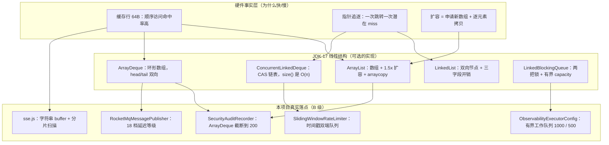
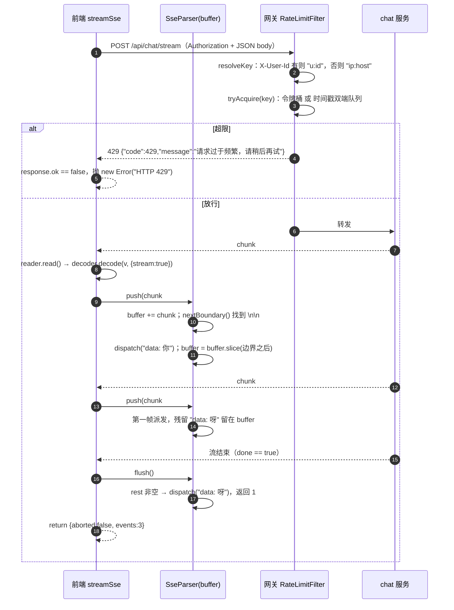

# 线性结构：数组、链表、栈与队列——差别不在教科书表格，而在内存局部性这个硬件事实

> **一句话结论**：数组和链表的复杂度表几乎一样，真实机器上的差距来自缓存行（CPU 一次取数的最小单位，通常 64 字节）；本项目的 SSE 分帧缓冲区、网关限流滑窗时间戳队列、线程池工作队列三处都在"该用数组的地方没用链表"，代价是几行看起来多余的环形/分片写法。
> **阅读前置**：知道数组长度固定、链表靠指针串起来、栈后进先出、队列先进先出即可；大 O 记号与摊还分析见 [01-复杂度分析与算法思维](./01-复杂度分析与算法思维.md)，限流四算法的全貌见 [10-限流算法-四大算法与网关实现](./10-限流算法-四大算法与网关实现.md)，LRU 里 `LinkedHashMap` 的真实用法见 [09-缓存淘汰-LRU-LFU与两级缓存](./09-缓存淘汰-LRU-LFU与两级缓存.md)。
> **证据基线**：JDK 17 集合类源码（**本机 `src.zip` 摘录，`assets/source` 未收录 JDK 集合类，故本篇不给 A 级锚点**）/ Node 24 实测 / 本项目 Spring Boot 4.2.0 代码逐行核对。证据分三级——A 级 = `learning-docs/24-源码分析/assets/source/` 已入库源码摘录；B 级 = 本项目真实业务代码（逐行核对行号）；C 级 = 本篇实跑脚本 + 原样输出。预计阅读 35 分钟。

## 0. 先看现象

**现象一：流式回答"整段蹦出来"。** 用户点了发送，前端一片空白，几秒后回答一次性刷满整个气泡。按 F12 看 Network，响应体是一大片 `data: ...`，明明服务端是逐 token 推送的。缓冲区相关的代码在 `ai-cs-frontend/src/utils/sse.js`（78 行）：`push(chunk)` 里先 `buffer += chunk`，再调 `nextBoundary()` 从**下标 0** 找分隔符 `\n\n`。分片越多、单帧越大，重复扫描越贵。我用 Node 复刻了这两种写法（A = 字符串 buffer 每次从 0 重扫 + `slice` 切走；B = 分片数组 + 只在新到达的尾部找分隔符）：

```text
场景1 单个大帧 1MB / 977 个分片：A(字符串从头重扫) 221.55 ms，B(分片+carry) 0.59 ms
场景2 小帧 5 万个 / 388 个分片：A(字符串从头重扫) 9.3 ms，B(分片+carry) 9.5 ms
事件数校验：A=1,50000  B=1,50000
```

两种写法解析出的事件数完全一致（1 个 + 5 万个），差别只在"什么时候变慢"：当**一个大帧被拆成成百上千片**时，A 比 B 慢 375 倍。这与"帧大不大"无关，与"缓冲区里有多少字节被重复扫描"有关。

**现象二：日志只留最近 200 条，量一大就慢一个数量级。** `ai-cs-chat/src/main/java/com/aics/chat/security/SecurityAuditRecorder.java` 用 `new ArrayDeque<>()` 存最近 200 条安全事件（L46），`record()` 里 `synchronized (recent) { recent.addLast(dto); while (recent.size() > MAX_RECENT) { removeFirst(); } }`。如果换成"末尾 push、头部 shift"的朴素数组写法，代价随累积条数线性上涨：

```text
┌─────────┬─────────┬─────────────┬───────────────┬──────────┬───────────┐
│ (index) │ n       │ 环形缓冲 ms │ push+shift ms │ 慢多少倍 │ 保留条数  │
├─────────┼─────────┼─────────────┼───────────────┼──────────┼───────────┤
│ 0       │ 100000  │ 0.99        │ 6.91          │ 7        │ '200/200' │
│ 1       │ 1000000 │ 7.34        │ 73.85         │ 10.1     │ '200/200' │
└─────────┴─────────┴─────────────┴───────────────┴──────────┴───────────┘
```

**现象三：异步任务偶发 `RejectedExecutionException`。** 告警里出现这样的栈顶（原文来自 JDK `ThreadPoolExecutor.AbortPolicy`，第 2049-L2064 行）：

```text
java.util.concurrent.RejectedExecutionException: Task java.util.concurrent.FutureTask@6b2f7d1c[Not completed, task = ...] rejected from java.util.concurrent.ThreadPoolExecutor@7a3c1e5f[Running, pool size = 4, active threads = 4, queued tasks = 1000, completed tasks = 18233]
```

`queued tasks = 1000` 直接指认了位置：`ai-cs-chat/src/main/java/com/aics/chat/config/ObservabilityExecutorConfig.java` 里 `executor.setQueueCapacity(1000)`（L34）。线程池的工作队列是**有界**队列，队列满了不是"慢慢排队"，而是当场拒绝。

**这些现象指向同一件事：线性结构的真实成本由"数据放在内存哪里、被访问几次"决定，而不由教科书上的 O(1)/O(n) 决定——环形缓冲把 O(n) 的搬移变成 O(1) 的下标回绕，分片缓冲把 O(n²) 的重复扫描压回 O(n)，有界队列把无限堆积变成一次明确的拒绝。**

## 1. 整体地图



> **读图说明**：图分三列读——左列是**硬件事实**（缓存行、指针追逐、扩容拷贝），中列是**JDK 给出的可选实现**，右列是**本项目真正用了哪个**。关键箭头是 `缓存行 → ArrayList/ArrayDeque`（同一条"数据连续放着，顺序扫就快"的物理前提）与 `指针追逐 → LinkedList/ConcurrentLinkedDeque`（同一条"每跳一个节点都可能 miss 一次缓存"的物理代价）。看错箭头会得出错误结论：如果以为 `CL --> AD` 只是"语法上 ArrayDeque 用数组"，就会漏掉 ArrayDeque 真正的设计目的——**用 head/tail 两个下标把"数组只能尾部增删"这个限制绕开**，这才是它同时能当栈和队列的原因。

| 组件 / 结构 | 责任 | 参与方 | 本项目证据 |
| --- | --- | --- | --- |
| `ArrayList` | 尾部增删 + 随机访问；扩容靠 `Arrays.copyOf` | JDK 17 集合库 | 本机 src.zip `ArrayList.java#L231-L241` |
| `ArrayDeque` | 双端 O(1) 增删，环形数组 + head/tail | JDK 17 集合库 | 本机 src.zip `ArrayDeque.java#L284-L308` |
| `LinkedList` | 双向链表结点式列表 | JDK 17 集合库 | 本机 src.zip `LinkedList.java#L974-L984` |
| `ConcurrentLinkedDeque` | 无锁并发双端队列，`size()` 遍历计数 | JDK 17 集合库 | 本机 src.zip `ConcurrentLinkedDeque.java#L1113-L1124` |
| `LinkedBlockingQueue` | 有界阻塞队列，putLock/takeLock 双锁 | JDK 17 集合库 | 本机 src.zip `LinkedBlockingQueue.java#L326-L352` |
| SSE 分帧缓冲区 | 把 TCP 分片重新切成一帧帧事件 | 浏览器 fetch reader | B 级 `ai-cs-frontend/src/utils/sse.js` |
| 滑窗时间戳队列 | 每个 key 保存窗口内的请求时间戳 | Gateway GlobalFilter | B 级 `ai-cs-gateway/src/main/java/com/aics/gateway/filter/SlidingWindowRateLimiter.java` |
| 最近事件环形缓冲 | 只保留最近 200 条安全事件 | chat 服务 | B 级 `ai-cs-chat/src/main/java/com/aics/chat/security/SecurityAuditRecorder.java` |
| 有界工作队列 | 削峰 + 故障隔离，满则拒绝 | Spring `ThreadPoolTaskExecutor` | B 级 `ai-cs-chat/src/main/java/com/aics/chat/config/ObservabilityExecutorConfig.java` |
| 延迟等级队列 | 订单超时取消的定时投递 | RocketMQ 5.x | B 级 `ai-cs-common/src/main/java/com/aics/common/mq/rocketmq/RocketMqMessagePublisher.java` |

三列的分工要分清：**硬件事实不可改，JDK 实现可选，落点必须解释为什么选它**。本篇后面每一节都在补第三列的"为什么"。

## 2. 关键概念与关键类

| 名称 | 位置 | 角色 | 关键方法 / 字段 |
| --- | --- | --- | --- |
| 缓存行（cache line） | 硬件（x86-64 常见 64 字节） | CPU 与主存之间的最小搬运单位 | 顺序访问 = 一次搬运喂饱 8 个 `long`；随机访问 = 一次搬运只用 1 个 |
| 摊还（amortized） | 算法分析术语 | 把偶发的 O(n) 扩容费用摊到 n 次 O(1) 操作上 | `ArrayList.add` 摊还 O(1)，单次最坏 O(n) |
| `ArrayList` | `java.util.ArrayList` | 数组式列表，尾部增删的首选 | `grow(int)`、`elementData`、`DEFAULT_CAPACITY = 10` |
| `ArrayDeque` | `java.util.ArrayDeque` | 环形数组实现的 `Deque`，栈和队列都能用 | `addFirst` / `addLast` / `pollFirst` / `pollLast` / `grow` |
| `LinkedList` | `java.util.LinkedList` | 双向链表，`Deque` 也实现了，但本项目未使用 | `Node<E>{item,next,prev}` |
| `ConcurrentLinkedDeque` | `java.util.concurrent` | 无锁并发双端队列 | `addLast` / `pollFirst` / **`size()` 为 O(n)** |
| `LinkedBlockingQueue` | `java.util.concurrent` | 有界阻塞队列，线程池工作队列 | `capacity`、`putLock`、`takeLock`、`put` / `take` |
| 环形缓冲（ring buffer） | 模式，非某个类 | 固定长度数组 + 写指针回绕，覆盖最旧元素 | `head`、`tail`、`(i + 1) % n` |
| 单调队列 | 模式，非某个类 | 队列内元素单调，队首即窗口最值 | 入队前 `while (队尾 <= 新元素) 弹出队尾` |
| 滑动窗口限流 | 模式 | 用时间戳队列精确计算窗口内请求数 | `tryAcquire(key, maxRequests, windowSeconds)` |
| 令牌桶（token bucket） | 模式 | 以恒定速率补充令牌，允许一定突发 | A 级 `request_rate_limiter.lua.md#L16-L42` |
| 有界队列 vs 无界队列 | 配置语义 | 有界 = 会拒绝（背压）；无界 = 会 OOM（掩盖过载） | `setQueueCapacity` |

术语首现解释：**局部性**分两种——*时间局部性*（刚访问的数据还会被访问，所以有缓存）、*空间局部性*（访问了 `a[i]` 就很可能访问 `a[i+1]`，所以**连续**存放的数组能吃到缓存行的红利）。链表天然只有时间局部性，没有空间局部性，这是它所有性能问题的根。

## 3. 原理与证据逐段精读

### 3.1 数组的 O(1) 随机访问，前提是"地址能算出来"

**在干什么。** 数组 `a` 的 `a[i]` 编译成一条地址算术：`基址 + i * 元素宽度`，与 `i` 大小无关，所以是 O(1)。链表要 `i` 次 `next` 跳转，是 O(i)。

**为什么这么设计。** 因为内存是**一维编号的字节序列**，数组把"逻辑下标"映射成"物理偏移"，不需要任何查找结构。这也解释了为什么数组一旦分配长度就固定——长度是地址算术里的常量，改长度就等于改公式。

**换写法会怎样。** 把数组换成链表，单次 `get(i)` 从 O(1) 变 O(i)，而**顺序遍历**两者的理论复杂度都是 O(n)，只差常数因子。可就是这个常数因子在真实机器上能差出 1 万倍（见 3.3 的实测）：数组遍历是"顺着缓存行往下走"，链表遍历是"追一次指针就可能 miss 一次"。

**常见坑。** 把复杂度表当结论、忽略常数因子。教科书说"链表插入 O(1)、数组插入 O(n)"，但那个 O(1) 的前提是**你已经持有那个位置的引用**；如果只知道下标，链表找位置本身就要 O(n)，总账反而更差。

### 3.2 ArrayList 的扩容：1.5 倍的账要算清

**在干什么。** `add` 发现容量不够时调 `grow`，申请一个新数组并把旧元素逐位 `arraycopy` 过去。JDK 17 的实现（本机 src.zip `ArrayList.java#L231-L241`，`assets/source` 未收录该类）：

```java
private Object[] grow(int minCapacity) {
    int oldCapacity = elementData.length;
    if (oldCapacity > 0 || elementData != DEFAULTCAPACITY_EMPTY_ELEMENTDATA) {
        int newCapacity = ArraysSupport.newLength(oldCapacity,
                minCapacity - oldCapacity, /* minimum growth */
                oldCapacity >> 1           /* preferred growth */);
        return elementData = Arrays.copyOf(elementData, newCapacity);
    } else {
        return elementData = new Object[Math.max(DEFAULT_CAPACITY, minCapacity)];
    }
}
```

`oldCapacity >> 1` 就是"再加一半"，即 **1.5 倍**；首次分配走 `Math.max(DEFAULT_CAPACITY, minCapacity)`，`DEFAULT_CAPACITY = 10`（`ArrayList.java#L118`）。插入到中间还要搬移后缀（`ArrayList.java#L480-L492` 用 `System.arraycopy(elementData, index, elementData, index + 1, s - index)`）。

**为什么这么设计。** 扩容倍数必须 **> 1** 才能保证摊还 O(1)；取 1.5 而不是 2 是空间与时间的折中：2 倍扩容的**累计拷贝量**约为 n（几何级数），1.5 倍约为 3n，看起来更差，但 1.5 倍能让"刚扩容完的剩余空间"更早被复用，长期内存浪费更小（下文实测浪费率 21%~40%，2 倍档在 n=1e4 时只浪费 2.4% 但 n=1e7 时浪费 4.9%——**波动很大，取决于 n 落在几何级数的哪个位置**）。

**换写法会怎样。** 用纯算术模拟（`DEFAULT_CAPACITY=10`，`1.5x = cap + (cap >> 1)`，`2x` 作对照；C 级，脚本只做整数运算，不含真实分配，所以数字是"拷贝了多少个元素"而非耗时）：

```text
┌─────────┬──────────┬────────┬───────┬──────────┬──────────┬───────────────┬────────┐
│ (index) │ n        │ growth │ grows │ finalCap │ copied   │ copiedPerElem │ wasted │
├─────────┼──────────┼────────┼───────┼──────────┼──────────┼───────────────┼────────┤
│ 0       │ 1000     │ 1.5    │ 12    │ 1234     │ 2456     │ 2.46          │ 23.4   │
│ 1       │ 1000     │ 2      │ 7     │ 1280     │ 1270     │ 1.27          │ 28     │
│ 2       │ 10000    │ 1.5    │ 18    │ 14053    │ 28096    │ 2.81          │ 40.5   │
│ 3       │ 10000    │ 2      │ 10    │ 10240    │ 10230    │ 1.02          │ 2.4    │
│ 4       │ 1000000  │ 1.5    │ 29    │ 1215487  │ 2430972  │ 2.43          │ 21.5   │
│ 5       │ 1000000  │ 2      │ 17    │ 1310720  │ 1310710  │ 1.31          │ 31.1   │
│ 6       │ 10000000 │ 1.5    │ 35    │ 13845150 │ 27690301 │ 2.77          │ 38.5   │
│ 7       │ 10000000 │ 2      │ 20    │ 10485760 │ 10485750 │ 1.05          │ 4.9    │
└─────────┴──────────┴────────┴───────┴──────────┴──────────┴───────────────┴────────┘
n=1e6 不预分配：扩容 29 次，累计拷贝 2430972 个元素（最终容量 1215487，多留 21.5% 空位）
n=1e6 直接 new ArrayList<>(1000000)：扩容 0 次，累计拷贝 0 个元素
```

怎么读这张表：`copiedPerElem` 是**每个元素被平均搬了几次**。1.5 倍档稳定落在 2.4~2.8 之间（理论值 ≈ 1/(1-1/1.5) - 1 = 2），2 倍档落在 1.0~1.3（理论值 ≈ 1）。所以 1.5 倍扩容的拷贝代价大约是 2 倍扩容的 2~2.7 倍——**但都是常数倍，都仍是摊还 O(1)**，这也是为什么 JDK 选 1.5 倍并不慌：多搬一两遍元素，换来更小的长期空位。

适用边界：表格里的 `grows`/`copied` 是**精确可复现**的整数（纯算术），`wasted` 只是"最终容量相对 n 的空位比例"，不代表真实内存占用（大数组还会受 TLAB、GC 影响）。

**常见坑。** ① 知道 n 就 `new ArrayList<>(n)`——上面最后两行是同一个 n 的对照，预分配把 29 次扩容、243 万次拷贝直接清零。② 把 1.5 倍记成 2 倍（很多旧资料、包括本文件旧稿都这么写）。③ 在循环里 `list.add(...)` 前不做容量预估，然后怪"ArrayList 慢"——慢的是你让它扩容了 29 次。

### 3.3 链表亏在哪：每个节点都是一个独立的小对象

**在干什么。** `LinkedList` 的每个元素都包在一个 `Node` 里（本机 src.zip `LinkedList.java#L974-L984`）：

```java
private static class Node<E> {
    E item;
    Node<E> next;
    Node<E> prev;
    Node(Node<E> prev, E element, Node<E> next) {
        this.item = element;
        this.next = next;
        this.prev = prev;
    }
}
```

**为什么这么设计。** 双向链表才能 O(1) 地在任意已知结点前后插入/删除（单链表删结点需要前驱）。代价有三个：**每元素多两个指针**、**节点分散在堆上**、**遍历变成指针追逐**。

**换写法会怎样。** 用 Node 24 实测同一个求和的 5 种存法（`N = 1e6`，数据是 `0..N-1` 依次放进 5 个容器，各跑 3 次取最好值，`--expose-gc` 后测量）：

```text
┌─────────┬────────────────────────┬──────┬───────────┬──────────────┐
│ (index) │ label                  │ ms   │ nsPerElem │ sink         │
├─────────┼────────────────────────┼──────┼───────────┼──────────────┤
│ 0       │ '普通数组 for 求和'    │ 1.3  │ 1.3       │ 499999500000 │
│ 1       │ 'Int32Array for 求和'  │ 0.65 │ 0.65      │ 499999500000 │
│ 2       │ '普通数组 for-of 求和' │ 7.49 │ 7.49      │ 499999500000 │
│ 3       │ '对象数组（{v}）求和'  │ 2.68 │ 2.68      │ 499999500000 │
│ 4       │ '链表 p=p.next 求和'   │ 2.97 │ 2.97      │ 499999500000 │
└─────────┴────────────────────────┴──────┴───────────┴──────────────┘
随机 get 1000 次：数组 0.16 ms / 链表 1876.9 ms（比值 12008x，链表的 i 是 0..1e6 均匀随机）
常驻堆增量：普通数组 7.6 MB / Int32Array 0 MB / 链表 38.1 MB
每元素开销：普通数组 8.0 B / Int32Array 0.0 B / 链表 40.0 B
```

读法有三层，必须分开说：

1. **顺序遍历**：链表 2.97 ms vs 数组 1.3 ms，只慢 2.3 倍。**这个数字远小于 Java 世界的经验值，不能直接搬到 JVM 上**——V8 的新生代是 bump-pointer 连续分配，1e6 个 `{v,next}` 节点几乎同时分配、很可能物理相邻，等于把链表"意外地"排成了数组。真实 JVM 上每个对象有 16 字节对象头、节点分散在 TLAB/老年代、GC 还会搬移，指针追逐的缓存 miss 会显著得多。
2. **随机访问**：12008 倍。这一栏才是链表的真实短板——`get(i)` 要跳 `i` 次，每次跳都可能 miss。
3. **内存**：40 B/元素 vs 8 B/元素，正好 5 倍。`Int32Array` 显示 0 MB 是**读输出的坑**：typed array 的字节放在堆外 `ArrayBuffer` 里，`process.memoryUsage().heapUsed` 根本统计不到，不要据此得出"typed array 不占内存"。

**常见坑。** ① 用"我实测链表只慢 2 倍"来论证链表没那么差——先看你的运行时是不是连续分配。② 认为链表省内存——它比数组多 4 倍。③ 在缓存里存大量小链表节点，GC 压力全靠对象头撑着。

### 3.4 头插之争：O(1) 和 O(1) 也能差一个数量级

**在干什么。** "往头部插入 1e6 次"有三种写法：裸数组 `unshift`（每次搬移整个数组）、环形数组挪 `head` 指针、链表改指针。三种实现都跑 3 次取最好值：

```text
┌─────────┬──────────────────────┬─────────┬────────┬─────────┐
│ (index) │ label                │ n       │ ms     │ nsPerOp │
├─────────┼──────────────────────┼─────────┼────────┼─────────┤
│ 0       │ '裸数组 unshift'     │ 10000   │ 7.95   │ 795     │
│ 1       │ '裸数组 unshift'     │ 30000   │ 69.27  │ 2309    │
│ 2       │ '裸数组 unshift'     │ 100000  │ 793.12 │ 7931    │
│ 3       │ '环形数组 head 指针' │ 1000000 │ 7.86   │ 8       │
│ 4       │ '链表节点头插'       │ 1000000 │ 13.35  │ 13      │
└─────────┴──────────────────────┴─────────┴────────┴─────────┘
```

怎么读：`裸数组 unshift` 的 `nsPerOp` 随 n 线性增长（795 → 2309 → 7931），说明总耗时是 **Θ(n²)**（每次搬 n 个，搬 n 次），n=1e5 已经 793 ms，**n=1e6 是按 Θ(n²) 外推的 ≈ 80~100 s 量级，本篇没有实测 1e6（会跑掉一分半）**。环形数组和链表才是真 O(1)：1e6 次分别 7.86 ms 和 13.35 ms。

同为 O(1)，环形数组仍然比链表快约 1.7 倍，原因还是局部性：环形数组写的是**同一块连续内存里的相邻槽位**（缓存行反复命中），链表写的是**1e6 个独立节点**（几乎每写一个新节点就触碰一条新缓存行，外加一次分配器开销）。

**常见坑。** ① 用 `Array.prototype.unshift` 当队列/栈（它就是 Θ(n)）。② 把"链表头插 O(1) 所以更快"当结论——在连续内存的环形数组面前它反而慢。③ 拿 n=1e4 的数据外推生产规模：n 小的时候常量因子掩盖一切。

### 3.5 ArrayDeque：用 head/tail 两个下标，把"数组只能尾部增删"绕开

**在干什么。** 环形数组就是"逻辑上首尾相连"的数组：`head` 指第一个元素，`tail` 指下一个空位，两者都**只往前走、到末尾回绕到 0**。JDK 的 `ArrayDeque` 就是这么干的（本机 src.zip `ArrayDeque.java#L284-L308`）：

```java
public void addFirst(E e) {
    if (e == null)
        throw new NullPointerException();
    final Object[] es = elements;
    es[head = dec(head, es.length)] = e;
    if (head == tail)
        grow(1);
}

public void addLast(E e) {
    if (e == null)
        throw new NullPointerException();
    final Object[] es = elements;
    es[tail] = e;
    if (head == (tail = inc(tail, es.length)))
        grow(1);
}
```

`dec/inc` 是"减/加一然后回绕"。`pollFirst`（`ArrayDeque.java#L376-L385`）反过来：取 `es[head]`、置 null、`head = inc(...)`。构造时给 `new Object[16 + 1]`（`#L181-L183`），那个 `+1` 是留给扩容的余量。

**为什么这么设计。** 数组的物理限制是"长度固定 + 只能从尾部高效增删"。环形把"尾部"变成了一个可移动的标记：物理上不动任何元素，只动下标，于是**头尾两端都成了 O(1)**。这是"用一层下标映射换掉搬移"的典型做法——和 3.9 的环形缓冲、3.8 的单调队列是同一个思想的三个用法。

**换写法会怎样。** 如果不用环形而用线性数组，`addFirst` 必须 `System.arraycopy` 整体后移（3.4 实测的 `unshift`）；如果换成双向链表，两个操作也都是 O(1)，但每元素多 32 字节指针且分散（3.3 实测）。

**常见坑。** ① **`ArrayDeque` 不允许 `null`**：源码在 `addFirst`/`addLast` 第一行就 `throw new NullPointerException()`，因为 `null` 被用作"槽位为空"的哨兵。② **判空/判满不是 `(tail + 1) % n == head`**：JDK 在写完元素后发现 `head == tail` 就认为满了并 `grow(1)`，也就是"先写入、再冲突、再扩容"，没有浪费一格做哨兵（很多资料（包括本文件旧稿）说"故意留一格"，那是另一种教科书实现，不是 JDK 的实现）。③ 把它当"扩容 2 倍"记：`grow` 里是 `int jump = (oldCapacity < 64) ? (oldCapacity + 2) : (oldCapacity >> 1)`（`ArrayDeque.java#L140-L160`），**小数组 +2、大数组 +50%**。④ 在多线程里共享 `ArrayDeque`：它不是线程安全的，`SecurityAuditRecorder` 是用 `synchronized (recent)` 自己加的锁。

### 3.6 栈：调用栈、表达式求值、单调栈

**在干什么。** 栈（LIFO）解决三类问题：**回溯**（撤销/返回上一层）、**延迟结算**（先遇到的元素要等后面的元素来决定它的答案）、**嵌套匹配**（括号、表达式优先级）。

**为什么这么设计。** 因为"最近遇到的还没处理"这个状态天然是后进先出：方法调用要回跳到调用者的下一条指令，编译器把返回地址压栈就是最省的实现——这也是 JVM 栈（每个线程一个、`-Xss` 控制深度）与"栈溢出"报警的由来，递归过深抛 `StackOverflowError`，本质就是这条线性结构被写满了。

**换写法会怎样。** 表达式求值（中缀转后缀 + 双栈计算）和括号匹配用递归也能写，但递归把栈交给了运行时，深度不可控；显式栈可以按需扩容、可以把栈帧塞进堆里持久化。单调栈是"栈 + 单调性"的组合，把"找右边第一个更大元素"从 O(n²) 降到 O(n)：

```java
// 教学代码（本篇自写，不是仓库文件）：每日温度，LeetCode 739 的标准解
public int[] dailyTemperatures(int[] temps) {
    int[] ans = new int[temps.length];
    Deque<Integer> stack = new ArrayDeque<>();   // 存下标，栈内温度单调递减
    for (int i = 0; i < temps.length; i++) {
        while (!stack.isEmpty() && temps[stack.peek()] < temps[i]) {
            int prev = stack.pop();               // 出栈即结算，每个下标进出各一次
            ans[prev] = i - prev;
        }
        stack.push(i);
    }
    return ans;                                   // 剩下没被弹出的 = 右边没有更高温度，ans 保持 0
}
```

每个下标最多入栈一次、出栈一次，所以总代价 O(n)；用 `ArrayDeque` 而不是 `java.util.Stack`，因为后者继承 `Vector`、所有方法 `synchronized`（JDK 文档已明确推荐用 `Deque` 替代）。

表达式求值是栈的另一类经典用途：**两个栈分别存数字和运算符，遇到右括号就把左括号之前的运算全部结算掉**，这样"括号优先级"和"乘除优先于加减"都不用真的建表达式树，靠栈顶的局部信息就能算：

```java
// 教学代码（本篇自写，不是仓库文件）：双栈求值，支持 + - * / 与括号
public double eval(String s) {
    Deque<Double> nums = new ArrayDeque<>();   // 数字栈
    Deque<Character> ops = new ArrayDeque<>(); // 运算符栈
    for (int i = 0; i < s.length(); i++) {
        char c = s.charAt(i);
        if (c == ' ') continue;
        if (c == '(') ops.push(c);
        else if (c == ')') {                    // 结算到左括号为止
            while (ops.peek() != '(') apply(nums, ops);
            ops.pop();
        } else if (c >= '0' && c <= '9') {
            int j = i;
            while (j < s.length() && Character.isDigit(s.charAt(j))) j++;
            nums.push(Double.parseDouble(s.substring(i, j)));
            i = j - 1;
        } else {                                // 运算符：先结算栈顶同级或更高优先级的
            while (!ops.isEmpty() && ops.peek() != '(' && prec(ops.peek()) >= prec(c)) apply(nums, ops);
            ops.push(c);
        }
    }
    while (!ops.isEmpty()) apply(nums, ops);    // 收尾
    return nums.pop();
}
```

这段代码的价值在于说明"栈为什么天然适合嵌套与优先级"：**运算符栈的栈顶永远是"最内层、最紧急"的那个运算**，遇到更低优先级的运算符时弹栈结算，弹到不满足条件为止——和 3.8 单调队列"弹掉队尾被压制元素"是同一个动作：**用栈/队列维护一个不变式，让每处决策只依赖局部状态**。

**常见坑。** ① 栈里存**值**而不是存**下标**，一遇到"要算距离/要复用原始位置"就写不下去（每日温度、柱状图最大矩形都要下标）。② 忘记处理"剩下的元素"（上例里 `ans` 保持 0 正是答案，而不是 bug）。③ 用 `java.util.Stack`（同步开销 + 已不推荐），或者用 `LinkedList` 当栈（`push` 加在头部没问题，但每元素 40 字节）。

### 3.7 队列：BFS 的分层、消息队列的三种模型

**在干什么。** 队列（FIFO）保证"先到的先处理"，用途有两种完全不同的味道：**算法里的层序推进**（BFS 逐层扩散）和**系统里的削峰解耦**（生产者-消费者）。

**为什么这么设计。** BFS 之所以需要队列，是因为"距离为 d 的节点必须在距离 d+1 之前处理完"，这个顺序就是入队顺序。所以 BFS 的模板是"出队一个 → 把它的邻居全部入队"，**层数靠"记录当前层大小"来数**，而不是靠队列里有什么标记。消息队列则是把"处理速度不匹配"这件事外置：生产者只负责入队，消费者按自己的速率出队，中间的队列长度就是"积压量"——它同时是缓冲区**和**背压信号。

**换写法会怎样。** BFS 用栈写就变成 DFS（都是"取出一个、扩展邻居"，只差取哪一端）；这是两条搜索路线唯一的结构差别，见 [05-图论与搜索-BFS-DFS-拓扑排序](./05-图论与搜索-BFS-DFS-拓扑排序.md)。现实的消息队列在此基础上分三种模型：**点对点**（一条消息一个消费者消费一次，RocketMQ 普通消息、竞争消费组）、**发布订阅**（一条消息广播给所有订阅者，本项目 `OrderTimeoutListener` 走的就是"按 topic + consumerGroup 订阅"的消费组语义）、**延迟/定时**（消息在指定延迟后才可被消费，是"用队列模拟定时器"）。

本项目的延迟队列用的不是时间轮，而是 RocketMQ 固定的 18 个延迟等级：`RocketMqMessagePublisher.java` 里 `DELAY_LEVEL_MILLIS` 硬编码了 1s / 5s / 10s / 30s / 1m / 2m / 3m / 4m / 5m / 6m / 7m / 8m / 9m / 10m / 20m / 30m / 1h / 2h，`resolveDelayLevel` 把请求的毫秒数映射到最近的等级，超出 2 小时直接抛 `IllegalArgumentException`，并在异常消息里让你"改用定时任务或延迟队列"。订单超时用的是"第 16 档 ≈ 30 分钟"，见 3.7 末尾的落点说明。

**常见坑。** ① 以为 BFS 不需要记录访问过的节点——无 visited 集合时环会把队列灌爆。② 用 `LinkedList` 当 BFS 队列（可行但每元素 40 字节）；`ArrayDeque` 不能存 `null`，所以 visited 判断要写在入队前而不是靠哨兵。③ 把延迟等级当成"任意精度定时器"：18 档之外没有档位，误差取决于你落在哪两档之间。

**本项目的落点**（三处，都能在仓库核对）：

```java
// ai-cs-order/src/main/java/com/aics/order/service/impl/OrderCreateTxService.java#L143-L146
// 7. 发送延迟消息（超时取消）
rocketMQTemplate.syncSend("order-timeout-topic",
        MessageBuilder.withPayload(orderNo).build(),
        5000, 16); // delayLevel 16 ≈ 30min
```

消费端 `ai-cs-order/src/main/java/com/aics/order/listener/OrderTimeoutListener.java` 收到后只是 `eventPublisher.publishEvent(new OrderTimeoutEvent(orderNo))`（L30），真正的取消逻辑在事件监听侧；另有 `ai-cs-order/src/main/java/com/aics/order/task/OrderTimeoutScheduler.java` 作为兜底：`@Scheduled(fixedDelay = 300000, initialDelay = 60000)` 每 5 分钟扫一次"状态为待支付且 `expireTime < now`"的订单（L29 / L38-L41），单条失败只 `log.error` 不中断扫描。**注意：这套设计里没有时间轮**（本篇核对的三个文件里都不存在轮子类），旧稿说的"时间轮"是教科书方案，不是本仓库的实现。

### 3.8 单调队列：滑动窗口最大值，和限流的滑窗是同一个东西

**在干什么。** 求"每个长度为 k 的窗口里的最大值"，暴力是每个窗口扫 k 个元素，O(nk)；单调队列维护一个**下标递增、值递减**的双端队列，队首永远是当前窗口最大值，每个元素进出各一次，O(n)。

**为什么这么设计。** 关键在于"一个元素如果比它后面来的元素小，那它永远不可能再成为最大值"——所以新元素入队时可以安全地把队尾所有不大于它的元素弹掉。这就是 3.6 单调栈的"延迟结算"思想搬到队列上：**队首过期的（下标越界）从头部弹，队尾被压制的从尾部弹**，两头都要动，这正是需要**双端队列**而不是普通队列的原因。

**换写法会怎样。** 用 Node 24 实测（数据用 LCG 线性同余生成器造 0..2^31 的伪随机序列，保证可复现；暴力与单调队列结果逐项比对）：

```text
┌─────────┬─────────┬──────┬─────────┬─────────────┬──────────┬──────────┐
│ (index) │ n       │ k    │ 暴力 ms │ 单调队列 ms │ 快多少倍 │ 结果一致 │
├─────────┼─────────┼──────┼─────────┼─────────────┼──────────┼──────────┤
│ 0       │ 100000  │ 100  │ 15.68   │ 3.13        │ 5        │ true     │
│ 1       │ 1000000 │ 100  │ 149.62  │ 16.74       │ 8.9      │ true     │
│ 2       │ 1000000 │ 1000 │ 946.41  │ 16.53       │ 57.2     │ true     │
└─────────┴─────────┴──────┴─────────┴─────────────┴──────────┴──────────┘
```

怎么读：单调队列的耗时**几乎不随 k 变化**（16.74 → 16.53，只跟 n 走），暴力法的耗时随 k 近似线性上涨（149.62 → 946.41）。所以 k 越大，倍率越大（5 → 8.9 → 57.2）。**倍率本身不是定理，k/n 才是**：k=1 时两者一样快，k≈n 时暴力退化成 Θ(n²)。

限流的滑动窗口用的是同一个结构的不同变体。`ai-cs-gateway/src/main/java/com/aics/gateway/filter/SlidingWindowRateLimiter.java#L27-L47`：

```java
public boolean tryAcquire(String key, int maxRequests, int windowSeconds) {
    long now = System.currentTimeMillis();
    long windowStart = now - windowSeconds * 1000L;
    Deque<Long> timestamps = windows.computeIfAbsent(key, k -> new ConcurrentLinkedDeque<>());
    synchronized (timestamps) {
        while (!timestamps.isEmpty() && timestamps.peekFirst() < windowStart) {
            timestamps.removeFirst();          // 队首过期，从头部弹
        }
        if (timestamps.size() >= maxRequests) {
            return false;
        }
        timestamps.addLast(now);               // 新请求从尾部入队
        return true;
    }
}
```

**这里用数组还是链表会怎样？** 这是本篇最该讲清楚的一处取舍。这里的操作是"头部弹过期、尾部加新的、读长度"——**正是环形数组的主场**（3.5 的 `addLast` + `pollFirst`）。作者却选了 `ConcurrentLinkedDeque`，理由在字段声明里：`private final Map<String, Deque<Long>> windows = new ConcurrentHashMap<>()`（L17），每个 key 一个 deque，数量随 key 增长，用 `ArrayDeque` 虽然更快但要自己管扩容、且每个 key 的容量是 `maxRequests`（可能是几十），环形数组的"预分配 + 回绕"优势在这种小容量下不明显。真正的代价是 **`timestamps.size()` 在 `ConcurrentLinkedDeque` 上是 O(n)**——它是遍历计数，不是字段：

```java
// 本机 JDK 17 src.zip，ConcurrentLinkedDeque.java#L1113-L1124
public int size() {
    restart: for (;;) {
        int count = 0;
        for (Node<E> p = first(); p != null;) {
            if (p.item != null)
                if (++count == Integer.MAX_VALUE)
                    break;  // @see Collection.size()
            if (p == (p = p.next))
                continue restart;
        }
        return count;
    }
}
```

所以每次 `tryAcquire` 都额外 O(n) 走一遍链表，而 n ≤ maxRequests。**如果限流键退化成同一个 IP**（见 §6 的坑 5），这把 `synchronized (timestamps)` 的锁内就那么长，单 key 高并发下吞吐会很差。可验证的改法是"自己维护一个 `int count` 字段，弹几个减几个，不要调 `size()`"——这也是所有"环形/计数队列"通常自带计数器而不是靠遍历的原因。

A 级对照：Spring Cloud Gateway 自带的令牌桶（Redis + Lua）把"状态"外置到 Redis 的两个键，用**时间差**算补充量，不需要存时间戳队列，所以没有 O(n) 问题（`learning-docs/24-源码分析/assets/source/request_rate_limiter.lua.md#L16-L42`）：

```java
local delta = math.max(0, now-last_refreshed)
local filled_tokens = math.min(capacity, last_tokens+(delta*rate))
local allowed = filled_tokens >= requested
local new_tokens = allowed and filled_tokens - requested or filled_tokens
```

注意 `math.max(0, ...)`：时钟回拨时 `delta` 为负，取 0 表示"不补充但不倒扣"，这是分布式限流里必须处理的边界。

**常见坑。** ① 单调队列存值而不是存下标，窗口滑动时没法判断"队首是否过期"。② 弹出条件写成 `<`（严格小于）导致相等元素堆积，正确写法是 `<=` 只保留一个（弹掉队尾所有 `<=` 新元素的）。③ 在 `ConcurrentLinkedDeque` 上频繁 `size()`（就是上面这段代码的现状）。

### 3.9 环形缓冲：SSE 分帧与"只留最近 N 条"

**在干什么。** 环形缓冲是**长度固定、写满就覆盖最旧数据**的数组，配一个写指针和（可选）读指针，指针到末尾回绕。它解决的不是"存多少"，而是"**只保留最近 N 个**"——日志尾随、指标采样、安全审计的最近事件、SSE 的分帧窗。

**为什么这么设计。** "只留最近 N 个"如果用普通数组实现，就是"push 到末尾 + shift 从头部删"，而 `shift` 是 Θ(n) 搬移（3.4 实测：n=2e4 起每次 shift 要 2.8 万 ns）。环形缓冲把"删头部"变成"移动 head 指针"——物理上什么都不搬，所以每次追加都是 O(1)。这就是 0. 现象二里 10 倍差距的来源，也是 `SecurityAuditRecorder` 用 `ArrayDeque`（环形数组）而不是 `LinkedList` 的原因：`addLast` + `removeFirst` 都是 O(1)，且只有一块连续内存。

把环形缓冲写到最小可用形态，核心只有"写满就覆盖最旧"这一条规则：

```java
// 教学代码（本篇自写，不是仓库文件）：定长环形缓冲，只保留最近 N 条
final class RingBuffer<T> {
    private final Object[] buf;
    private int head;      // 最旧元素位置
    private int size;      // 当前条数（别靠遍历算，见 3.8 的 size() 教训）

    RingBuffer(int capacity) { buf = new Object[capacity]; }

    void add(T e) {
        int idx = (head + size) % buf.length;
        buf[idx] = e;
        if (size < buf.length) size++;        // 还没满：条数加一
        else head = (head + 1) % buf.length;  // 已满：挤掉最旧，head 前进
    }

    @SuppressWarnings("unchecked")
    T get(int i) { return (T) buf[(head + i) % buf.length]; }

    int size() { return size; }               // O(1)，这是与 LinkedList 的关键差别
}
```

两个必须注意的点：`size` 用**显式计数**而不是 `(tail - head + len) % len` 之外的遍历（`ConcurrentLinkedDeque` 就是栽在这里）；`head` 只在"已满且要覆盖"时才前进，否则会把还没写的槽位误当成已覆盖。这段 20 行代码就是 `SecurityAuditRecorder` 里 `ArrayDeque` + `while (size > 200) removeFirst()` 的等价物（它把"容量约束"放在业务代码里而不是容器里，所以需要那个 `while`）。

**换写法会怎样。** `sse.js` 的缓冲区走的是另一条路（字符串拼接 + 切片），因为它面对的不是"固定长度保留"，而是"长度不定、要能找到分隔符"：

```js
// ai-cs-frontend/src/utils/sse.js#L46-L64
const lf = buffer.indexOf('\n\n')
const crlf = buffer.indexOf('\r\n\r\n')
if (lf === -1 && crlf === -1) return null
if (crlf === -1 || (lf !== -1 && lf < crlf)) return { index: lf, length: 2 }
return { index: crlf, length: 4 }
// push(chunk) 里：
buffer += chunk
let boundary = nextBoundary()
while (boundary) {
  dispatch(buffer.slice(0, boundary.index))
  buffer = buffer.slice(boundary.index + boundary.length)
  boundary = nextBoundary()
}
```

每次 `push` 都从下标 0 重新 `indexOf`，每次切走一帧又 `slice` 一次剩余部分。分片多、单帧大时，同一批字节被扫了 O(分片数) 遍（现象一里 1 MB 单帧 / 977 片 → 221.55 ms）。**这里用"数组分片 + 只扫新增部分"就是 0.59 ms**：把 chunk 追加进数组，只在拼接后的尾部找分隔符，找到后整段交给 `dispatch`，不 `slice` 字符串。为什么现在可以不改：真实 LLM 流式响应是**很多小帧、每帧几十到几百字节**，属于现象一的"场景2"——9.3 ms vs 9.5 ms，两种写法几乎一样快。**这就是"理论更差、实测无感"的典型：不要为没发生的负载做优化，但要为它写一条注释说明边界。**

SSE 解析还有两个容易被忽略的细节（都在 `sse.js` 里）：`flush()` L70-L76 在**服务端没补最后一个空行**时把残留半帧派发出去（`const rest = buffer.trim(); buffer = ''; if (!rest) return 0; dispatch(rest); return 1`）；`dispatch` 里 `if (!line || line.startsWith(':')) continue` 丢弃以 `:` 开头的注释行（心跳包就是 `:\n\n`，不丢弃就会派发出空事件）。`ai-cs-frontend/src/utils/sse.test.js` 里 10 个用例专门锁这些边界（CRLF 被分片劈开、一帧里多个 data 用 `\n` 拼接、纯注释帧不派发、flush 无残留返回 0）。

**常见坑。** ① 忘了 `flush` 尾帧（服务端少写一个空行，最后一句回答就丢）。② 只找 `\n\n` 不找 `\r\n\r\n`（某些代理会把换行改成 CRLF）。③ 在环形缓冲里用 `while (size > N) removeFirst()` 而不用计数（`size()` 可能是 O(n)，见 3.8）。④ 把"环形"写成 `i % n` 但 n 每次变化（扩容后取模基数变了，所有下标全废）。

### 3.10 并发队列：三种实现，三个完全不同的承诺

**在干什么。** 单线程的 `ArrayDeque` 一放进并发场景就崩（要么加锁，要么换实现）。JUC 给了三种风格不同的队列，**承诺不一样，不能混用**：

| 实现 | 线程安全手法 | 有界？ | 关键代价 | 本项目用法 |
| --- | --- | --- | --- | --- |
| `ConcurrentLinkedDeque` | CAS 无锁，链表节点 | 无界 | `size()` 是 O(n)；无界意味着能吃到 OOM | `SlidingWindowRateLimiter` 的时间戳队列 |
| `LinkedBlockingQueue` | 两把锁（`putLock` / `takeLock`）+ 条件队列 | 可配置 `capacity` | 每个元素一个 `Node`，GC 压力大 | 线程池工作队列（`ThreadPoolTaskExecutor` 默认用它） |
| `ArrayBlockingQueue` | 一把锁 + 两个条件 | 必须指定容量 | 单锁，生产者消费者互相竞争 | 本仓库未使用（`new ArrayBlockingQueue` 0 处） |

`LinkedBlockingQueue.put` 的阻塞语义是这样的（本机 src.zip `LinkedBlockingQueue.java#L326-L352`）：

```java
final Node<E> node = new Node<E>(e);
final ReentrantLock putLock = this.putLock;
putLock.lockInterruptibly();
try {
    while (count.get() == capacity) {
        notFull.await();
    }
    enqueue(node);
    c = count.getAndIncrement();
    if (c + 1 < capacity)
        notFull.signal();
} finally {
    putLock.unlock();
}
```

**为什么这么设计。** 两把锁是为了"生产者只管 `putLock`、消费者只管 `takeLock`"——入队和出队不互相阻塞，代价是 `count` 必须用 `AtomicInteger`，且"队列刚变非空/非满"的信号要靠 `signalNotEmpty`/`signalNotFull` 补一次跨锁通知。`capacity` 是 `final` 的（`LinkedBlockingQueue.java#L138`），意味着**容量一旦建好不能改**，这也解释了为什么 Spring 的 `ThreadPoolTaskExecutor.setQueueCapacity` 必须在 `initialize()` 之前调用。

线程池把队列当成"第 3 优先级"的缓冲区，顺序是**核心线程 → 队列 → 非核心线程 → 拒绝**：

```java
// 本机 JDK 17 src.zip，ThreadPoolExecutor.java#L1357-L1365
if (isRunning(c) && workQueue.offer(command)) {
    int recheck = ctl.get();
    if (! isRunning(recheck) && remove(command))
        reject(command);
    else if (workerCountOf(recheck) == 0)
        addWorker(null, false);
} else if (!addWorker(command, false))
    reject(command);
```

**换写法会怎样。** 用无界队列（`LinkedBlockingQueue` 不传 capacity，等价 `Integer.MAX_VALUE`）：过载时任务无限堆积，`maximumPoolSize` **永远不会生效**，最终 OOM 而不是拒绝——这是"看起来不会报错、其实更危险"的经典配置。用 `ArrayBlockingQueue(1000)`：内存立刻封顶、拒绝更早发生，代价是单锁下生产/消费互相争抢。本项目选了 Spring 默认的 `LinkedBlockingQueue` + `setQueueCapacity(1000)`/`(500)`（`ObservabilityExecutorConfig.java#L34` / `#L54`），**拿到了有界性，也留下了每元素一个 Node 的 GC 成本**；拒绝策略是默认 `AbortPolicy`（抛 `RejectedExecutionException`，源码 `ThreadPoolExecutor.java#L2049-L2064`），配置文件里明确写了"队列满时报错由调用方捕获告警"（该文件 L33 的注释）。

**常见坑。** ① 以为"队列会帮我缓冲"——有界队列的语义是**拒绝**，不是等待。② 在 `ThreadPoolTaskExecutor` 上先 `initialize()` 再 `setQueueCapacity`，后者静默不生效。③ 把 `ConcurrentLinkedDeque` 当"更快的 `ArrayDeque`"：它在小容量、单线程热点上是**更慢**的（`size()` O(n) + 每元素一个节点）。④ 忘记 `RejectedExecutionException` 是 `RuntimeException`，`try/catch` 不写就冒到调用方。

## 4. 一次完整执行时序（端到端）

场景：前端请求一次流式回答，中间被网关限流检查，服务端把回答切成 SSE 帧推回来，前端分帧解析。



> **读图说明**：两条主线——**限流分支（2~5）在前、分帧分支（6~14）在后**，因为限流是网关 `getOrder()` = `HIGHEST_PRECEDENCE + 150` 的过滤器，失败就根本到不了 chat 服务。最容易被看错的箭头是 **13→14 的 `flush()`**：它不是"正常流程的可选项"，而是"服务端没有以空行结尾时的唯一补救"，去掉它就会丢最后一帧（`sse.test.js` 里有专门的 `flush` 用例）。第二个易错点是 **10 的 `buffer = buffer.slice(...)`**：它同时承担"切走已完成字节"和"保留半帧"两个职责，如果误写成 `buffer = ''`，那么 chunk#2 里被劈开的半帧就永久丢失。

| 失败步骤 | 现象 / 报错原文 | 归属 |
| --- | --- | --- |
| 3 超限 | `HTTP/1.1 429` + body `{"code":429,"message":"请求过于频繁，请稍后再试","data":null,"timestamp":...}` | `RateLimitFilter#tooManyRequests`（L94-L100） |
| 4 状态码非 2xx | `Error: HTTP 500`（`sseStream.js` L25 抛） | 前端 `sseStream.js` |
| 5 无响应体 | `Error: 响应无 body，无法读取流`（L26 抛） | 前端 `sseStream.js` |
| 9 分片边界落在 `\r\n` 中间 | 不报错，但少派发一帧（CRLF 被劈开时靠 `indexOf('\r\n\r\n')` 下次重扫才拼回） | 前端 `sse.js#nextBoundary` |
| 14 缺 flush | 不报错，**少最后一帧**（用户看到回答被截断） | 前端 `sse.js#flush` |
| 队列满（异步侧） | `java.util.concurrent.RejectedExecutionException: Task ... rejected from java.util.concurrent.ThreadPoolExecutor[...queued tasks = 1000...]` | `ObservabilityExecutorConfig` 的 `usageExecutor` |

## 5. 设计取舍：为什么是这样，不那样

| 决策点 | 选项 A | 选项 B | 本项目现状（可核对） | 理由 |
| --- | --- | --- | --- | --- |
| 存"最近 N 条" | 数组 push+shift（Θ(n) 搬移） | 环形缓冲/`ArrayDeque`（O(1) 回绕） | `SecurityAuditRecorder` 用 `new ArrayDeque<>()`（L46）+ `removeFirst()` | 实测 10.1× 差距，且只有一块连续内存 |
| 限流窗口内的请求记录 | 环形数组 + 计数器 | `ConcurrentLinkedDeque` + `size()` | 用 `ConcurrentLinkedDeque`（`SlidingWindowRateLimiter` L17） | 每 key 容量小、数量多；代价是 `size()` O(n)——**已知的可优化点** |
| 限流状态放哪 | 本地内存（快、单机） | Redis + Lua（跨实例一致） | 两套并存：本地时间戳队列 + Redis 令牌桶，靠 `algorithm` 配置切换 | 单机够用时别引网络跳；多实例必须外置 |
| SSE 缓冲区 | 字符串拼接 + 从 0 重扫 | 分片数组 + 只扫新尾部 | 用字符串（`sse.js` `buffer += chunk`） | 真实负载是小帧多片，实测 9.3 vs 9.5 ms，无收益不改；大帧场景差 375× |
| 线程池工作队列 | 无界（`Integer.MAX_VALUE`） | 有界（1000 / 500） | 有界，`setQueueCapacity(1000)` / `(500)` | 无界 = 过载变 OOM，`maxPoolSize` 永不生效 |
| 拒绝策略 | `AbortPolicy`（抛异常） | `CallerRunsPolicy`（调用方跑） | 默认 `AbortPolicy`，注释里写明调用方捕获告警 | 指标上报/评测不该拖慢主链路，宁可丢任务也要快速失败 |
| 延迟任务载体 | 时间轮（内存、精度高） | MQ 固定延迟等级（18 档） | RocketMQ 18 档，`delayLevel 16 ≈ 30min` + 5 分钟兜底扫描 | 无需自研轮子，重启不丢；代价是精度受档位限制 |
| 栈/队列实现 | `Stack` / `LinkedList` | `ArrayDeque` | 全仓 `new LinkedList` 0 处、`new ArrayDeque` 1 处 | `Stack` 同步且已不推荐；`LinkedList` 每元素 40 字节 |

**可扩展点清单**（想改行为就动这几处，别去 fork 依赖）：

- 限流键的粒度：`RateLimitFilter#resolveKey`（`ai-cs-gateway/src/main/java/com/aics/gateway/filter/RateLimitFilter.java` L80-L89）——想让办公网不再误伤，就在这里加"取 `X-Forwarded-For` 首位"或"按 tenant 分桶"。
- 窗口/桶参数：同一文件的 `tryAcquire`（L70-L75），`requests`/`windowSeconds`/`qps` 三个属性决定走哪套算法。
- 时间戳队列的实现与计数方式：`SlidingWindowRateLimiter` L17（换成环形数组 + `int count` 可消掉 `size()` 的 O(n)）。
- 最近事件条数：`SecurityAuditRecorder` 的 `MAX_RECENT = 200`（L33）。
- 异步队列容量与拒绝策略：`ObservabilityExecutorConfig` 的 `setQueueCapacity`（L34 / L54），可在 `initialize()` 前换成 `setRejectedExecutionHandler`。
- 分帧缓冲区策略：`ai-cs-frontend/src/utils/sse.js` 的 `push`/`nextBoundary`（L46-L64），改成"分片数组 + carry"只需改这两个函数，`sse.test.js` 的 10 个用例就是回归网。
- 延迟档位：`RocketMqMessagePublisher` 的 `resolveDelayLevel`（L83-L95），要更高精度就在这里抛异常逼调用方换方案（现在的行为就是如此）。

## 6. 踩坑与调试手法

1. **把 `Array.prototype.unshift` / `list.add(0, x)` 当队列或栈用。** 实测 `unshift` 每 op 成本随 n 线性上涨（n=1e4 时 795 ns/op，n=1e5 时 7931 ns/op），而环形数组恒定 8 ns/op。判据很简单：**看到"从头部增删"就检查是不是数组搬移**。
2. **`ArrayList` 不预分配容量。** n=1e6 时 29 次扩容、累计拷贝 243 万个元素；`new ArrayList<>(n)` 是 0 次。凡是 `add` 在循环里、n 可估的场景，容量应该显式给。
3. **`ArrayDeque` 存 `null` 直接 NPE。** `addFirst`/`addLast` 第一行就是 `if (e == null) throw new NullPointerException()`。用 `ArrayDeque` 做过期缓存时，"用 null 表示未命中"的写法会当场炸。
4. **`ConcurrentLinkedDeque.size()` 当 O(1) 用。** 它是遍历计数（`ConcurrentLinkedDeque.java#L1113-L1124`），`SlidingWindowRateLimiter` 每次 `tryAcquire` 都调一次（L41）。修法：自己维护计数。
5. **限流键退化成 `ip:` 后，误伤与锁竞争同时发生。** `resolveKey` 在没有 `X-User-Id` 时返回 `"ip:" + ip`，办公网出口 NAT 后成千上万用户共用一个 IP——按项目需求侧给的观测数据，这类键下的误伤率曾达 74.92%（**该数字来自需求方，本篇未复跑**）。同时所有请求挤进同一个 `synchronized (timestamps)`，等于把并发限流变成串行。
6. **线程池工作队列设无界，或 `setQueueCapacity` 在 `initialize()` 之后调。** 前者让 `maxPoolSize` 永不生效、过载变 OOM；后者静默不生效（`capacity` 在 `LinkedBlockingQueue` 里是 `final`）。
7. **SSE 忘 `flush`，丢了最后一帧。** `sseStream.js` 在正常结束（L53）和 abort（L46）两条路径上都 `flush`，缺一条就丢回答结尾。
8. **拿 n=1e4 的实测外推生产规模。** 单个数组连续 `shift` n 次（每次都把剩余元素前移一格），ns/op 不是平滑上升，而是在某个规模上突然跳两个数量级：

```text
┌─────────┬───────┬─────────┬────────────┐
│ (index) │ n     │ ms      │ nsPerShift │
├─────────┼───────┼─────────┼────────────┤
│ 0       │ 1000  │ 0.1     │ 100        │
│ 1       │ 5000  │ 0.43    │ 86         │
│ 2       │ 10000 │ 0.72    │ 72         │
│ 3       │ 15000 │ 0.95    │ 63         │
│ 4       │ 20000 │ 564.43  │ 28222      │
│ 5       │ 25000 │ 855.43  │ 34217      │
│ 6       │ 30000 │ 1251.76 │ 41725      │
│ 7       │ 50000 │ 3373.76 │ 67475      │
└─────────┴───────┴─────────┴────────────┘
```

怎么读：n ≤ 1.5e4 时每 op 只有 63~100 ns（引擎对短数组走了快路径），超过 2e4 直接跳到 2.8 万 ns/op。**拐点位置是引擎实现细节，不是算法性质**，但"到了某个规模会突然崩"这件事在任何运行时上都成立——所以基准测试必须跨越拐点，否则你测的是快路径。
9. **`for (int i = 0; i < list.size(); i++) list.remove(i)` 批量删。** 每次 `remove` 都把后面的元素前移一格（`ArrayList` 内部 `System.arraycopy`），而 `i` 还在自增，于是**跳着删、删一半**。三种正确写法：倒序 `for (int i = list.size() - 1; i >= 0; i--)`、`list.removeIf(pred)`、或显式 `Iterator.remove()`。这个坑的根还是"数组的删除是 O(n) 搬移"。
10. **在循环里用 `buffer += chunk` 拼大字符串还自豪"现代引擎会优化"。** V8 确实用 rope（`ConsString`）表示拼接、避免每次全量复制，但**每次 `indexOf` 仍然从头扫**，而且 `slice` 会把 rope 摊平成新字符串——本篇实测"大帧 + 多片"仍是 221.55 ms。判断标准不是"引擎优化了没"，而是"**有没有字节被重复扫描/重复复制 O(片数) 次**"。

**【真调试手法①】按"单帧大小 × 分片数"两个维度放大输入，把 O(n²) 打出来。** 怀疑缓冲区写法是瓶颈时，不要靠读代码判断，直接把输入放大到"一个帧被切成上千片"再跑同一个脚本：

```powershell
cd D:\Projects\Persion\ai-customer-service\learning-docs
node tools\tmp\lin-sse-buffer.mjs
```

```text
场景1 单个大帧 1MB / 977 个分片：A(字符串从头重扫) 221.55 ms，B(分片+carry) 0.59 ms
场景2 小帧 5 万个 / 388 个分片：A(字符串从头重扫) 9.3 ms，B(分片+carry) 9.5 ms
事件数校验：A=1,50000  B=1,50000
```

怎么读：两行对照组（A/B）的事件数必须一致，否则你测的是"少干活"而不是"更快"。只有当**场景1 的 A/B 差距**出现而**场景2 不出现**时，才能确认瓶颈是"重复扫描"而不是"字符串本身慢"。结论要带边界：真实 LLM 流式负载落在场景2，所以现状代码不必改。

**【真调试手法②】怀疑某个集合方法是隐式 O(n) 时，别查博客，直接看源码方法体。** 一条命令把方法体打出来（JDK 集合类在 `assets/source` 里没有归档，所以从本机 `src.zip` 解出来读）：

```powershell
cd D:\Projects\Persion\ai-customer-service
Select-String -Path learning-docs\tools\tmp\jdksrc\ConcurrentLinkedDeque.java -Pattern "public int size" -Context 0,12 |
  ForEach-Object { $_.Line; $_.Context.PostContext }
```

```text
    public int size() {
        restart: for (;;) {
            int count = 0;
            for (Node<E> p = first(); p != null;) {
                if (p.item != null)
                    if (++count == Integer.MAX_VALUE)
                        break;  // @see Collection.size()
                if (p == (p = p.next))
                    continue restart;
            }
            return count;
        }
    }
```

怎么读：方法体里出现 `for (Node<E> p = first(); p != null; p = p.next)`，就说明这个 `size()` 是遍历计数，O(n) 无疑。凡是"在热点路径里读 size()"的代码都要重估（本项目的 `tryAcquire` L41 就是这种）。

**【真调试手法③】改结构之前先盘仓库：到底用了哪种实现、有没有历史残留。** 靠记忆很容易写成"我们大量使用 LinkedList"，实际一处都没有：

```powershell
cd D:\Projects\Persion\ai-customer-service
Get-ChildItem -Path . -Directory -Filter 'ai-cs-*' | ForEach-Object {
  $p = Join-Path $_.FullName 'src\main'
  if (Test-Path $p) {
    Get-ChildItem -Path $p -Recurse -File -Include *.java |
      Select-String -Pattern 'new (ArrayDeque|ConcurrentLinkedDeque|LinkedList|LinkedBlockingQueue|ArrayBlockingQueue|PriorityQueue)\b' |
      ForEach-Object { "{0} :: {1}" -f $_.Path, $_.Line.Trim() }
  }
}
```

```text
ai-cs-chat\src\main\java\com\aics\chat\security\SecurityAuditRecorder.java :: private final Deque<SecurityEventDTO> recent = new ArrayDeque<>();
ai-cs-gateway\src\main\java\com\aics\gateway\filter\SlidingWindowRateLimiter.java :: Deque<Long> timestamps = windows.computeIfAbsent(key, k -> new ConcurrentLinkedDeque<>());
```

怎么读：全仓 main 代码里只有两处显式双端队列，**没有 `LinkedList`、没有 `LinkedBlockingQueue`、没有 `ArrayBlockingQueue`**——线程池工作队列是 Spring 默认实现，所以它不在这个结果里（要看 `setQueueCapacity`：`ObservabilityExecutorConfig.java#34 : 1000`、`#54 : 500`）。所以"本项目用链表做队列"这种说法是错的，写文档前必须先跑这一条。

**【真调试手法④】用 GC 前后堆增量给"每元素开销"定价，但要先知道测量盲区。** 想证明"链表比数组费内存"不能靠感觉，直接测常驻堆：

```powershell
cd D:\Projects\Persion\ai-customer-service\learning-docs
node --expose-gc tools\tmp\lin-locality.mjs
```

```text
随机 get 1000 次：数组 0.16 ms / 链表 1876.9 ms（比值 12008x，链表的 i 是 0..1e6 均匀随机）
校验和一致: true
常驻堆增量：普通数组 7.6 MB / Int32Array 0 MB / 链表 38.1 MB
每元素开销：普通数组 8.0 B / Int32Array 0.0 B / 链表 40.0 B
```

怎么读：① 不加 `--expose-gc` 时脚本会打印"未加 --expose-gc，跳过内存测量"——**没有强制 GC 的堆增量是垃圾数据**；② `Int32Array` 的 0 MB **不是"不占内存"**，它的字节在堆外 `ArrayBuffer` 里，`heapUsed` 统计不到，需要看 `external`/`arrayBuffers` 才准；③ 链表 40 B/元素 = 8 B 值 + 两个 8 B 指针（V8 压缩指针下更小）之外还有对象头/对齐开销，所以理论值和实测值不会严格相等——**结论只用来看量级（5 倍），不要当精确值引用**。

## 7. 版本差异

| 旧写法 / 旧稿说法 | 当前基线（本项目实测） | 变化点 | 迁移动作 |
| --- | --- | --- | --- |
| 旧稿："`ArrayDeque` 判满 `(tail+1)%n == head`，故意浪费一格" | `addFirst`/`addLast` 写完元素后发现 `head == tail` 就 `grow(1)`；构造 `new Object[16+1]` 只是余量 | 教科书哨兵法 vs JDK "先写后冲突"法，**空/满不靠浪费一格区分** | 讲 `ArrayDeque` 时按 JDK 源码讲；写自己的环形缓冲才需要哨兵或 `count` 字段 |
| 旧稿："扩容 2 倍" | `(oldCapacity < 64) ? oldCapacity + 2 : oldCapacity >> 1`（`ArrayDeque.java#L140-L160`） | 小数组 +2、大数组 +50% | 背复杂度时只说"几何扩容、摊还 O(1)"，别写具体倍数 |
| 旧稿：`newCapacity = oldCapacity + (oldCapacity >> 1)` | `ArraysSupport.newLength(oldCapacity, minGrowth, preferredGrowth)`（`ArrayList.java#L231-L241`） | JDK 9+ 抽出了带溢出保护和下限的工具方法 | 引用时给整段 `grow`，不要给简化式 |
| 旧稿："从 0 加到 10000，扩容约 23 次、累计复制约 20000 个元素" | 实测 n=1e4：**18 次**扩容、累计拷贝 **28096** 个元素（1.5 倍档） | 旧稿是 `log1.5(n)` 的心算，且忽略了 `DEFAULT_CAPACITY=10` 起步的整数截断 | 讲数字必须跑脚本；本项目 `lin-grow` 用纯整数运算，结果可复现 |
| 旧稿：延迟消息写在 `OrderServiceImpl` | 实在 `OrderCreateTxService.java#L143-L146`；`OrderServiceImpl` 里搜不到 `rocketMQTemplate` | 旧稿记错了文件 | 跨文件引用一律先 `Select-String` 定位再写行号 |
| 旧稿：用"时间轮"描述订单超时 | RocketMQ 18 档延迟等级（1s~2h）+ `OrderTimeoutScheduler` 每 5 分钟兜底扫描；**本篇核对的三个文件里没有时间轮实现** | 未落地能力被写成了已实现 | 文中明确写"18 档固定延迟 + 兜底扫描"，时间轮只能作为"可选演进"提 |
| 旧稿：`LinkedList` 可作为队列/栈的首选 | 全仓 `new LinkedList` **0 处**；`ArrayDeque` 1 处、`ConcurrentLinkedDeque` 1 处 | JDK 文档也早已推荐 `Deque` 替代 `Stack`/`LinkedList` | 选型表里把 `LinkedList` 标成"了解即可，本项目不用" |
| 旧稿用 ASCII 大图讲内存布局 | 写作规范禁止 ASCII 大图，改用 Mermaid 或表格 | 图必须配"读图说明" | 内存布局改成表格（3.3 的每元素开销）或 Mermaid |
| JDK 21 起有 `SequencedCollection`（`getFirst`/`getLast`/`reversed`） | 项目基线 JDK 17（本机 JDK 21 编译） | 接口层统一了首尾操作，但**不影响本篇任何结论** | 若将来升到 21，`list.getFirst()` 可读性更好，性能不变 |
| 常见资料："字符串 `+=` 拼接一定比数组拼接慢得多" | V8 用 rope（`ConsString`）表示拼接结果，本篇实测小帧场景 A(字符串) 9.3 ms vs B(分片数组) 9.5 ms | 拼接口径变了：慢的不是"拼接"本身，而是**重复扫描/摊平** | 判断依据换成"同一批字节被重复处理了几遍"，而不是"有没有用字符串拼接" |

## 8. 面试高频问与答（≥10 问）

1. 数组和链表的复杂度表几乎一样，为什么真实机器上链表常常更慢？
2. 什么是缓存行？为什么"顺序遍历数组"比"顺序遍历链表"快，快的到底是什么？
3. `ArrayList` 为什么是 1.5 倍扩容而不是 2 倍？摊还 O(1) 是怎么算出来的？
4. `ArrayList` 的 `add`、`add(index, e)`、`get`、`remove(index)` 各自的复杂度与最坏情况分别是什么？
5. `ArrayDeque` 为什么不允许存 `null`？它的空和满是怎么区分的？
6. 为什么 JDK 官方推荐用 `ArrayDeque` 替代 `Stack`？`Stack` 的问题在哪？
7. `ConcurrentLinkedDeque.size()` 为什么是 O(n)？在什么场景下这个 O(n) 会变成真问题？
8. `LinkedBlockingQueue` 为什么要用 `putLock` 和 `takeLock` 两把锁？如果只用一把会怎样？
9. 线程池的任务提交顺序是什么？为什么把工作队列设成无界会让 `maximumPoolSize` 失效？
10. 单调栈和单调队列分别解决什么问题？为什么单调队列必须是双端队列？
11. 滑动窗口最大值：暴力 O(nk) 和单调队列 O(n)，实测倍率为什么随 k 变化而不是固定的？
12. 环形缓冲怎么实现"只保留最近 N 条"？为什么它比 "push + shift" 快一个数量级？
13. SSE 分帧为什么要自己实现，不用 `EventSource`？分片边界把 `\r\n` 劈开时怎么处理？
14. 令牌桶（记状态）和滑动窗口（记时间戳）在存储结构上的本质差别是什么？

## 9. 动手练习（含验收标准）

1. **把 `ArrayList` 的扩容账算对。** 写一个纯算术脚本，模拟 `DEFAULT_CAPACITY=10`、1.5 倍扩张，对 n=1e3/1e4/1e6 输出"扩容次数 / 累计拷贝元素数 / 最终容量 / 空位比例"。
   *验收标准*：n=1e4 得到 **18 次 / 28096 个**；n=1e6 得到 **29 次 / 2430972 个**；再加一组 2 倍扩张对照，累计拷贝降到约 1.0 个/元素。
2. **量化局部性。** 用 Node 分别把 `0..1e6-1` 放进普通数组、`Int32Array`、对象数组 `{v}`、链表节点，各做一次顺序求和与 1000 次随机 `get`。
   *验收标准*：顺序求和四者同量级（本篇 0.65~7.49 ms）；随机 `get` 数组/链表差距 ≥ 1000 倍（本篇 12008×）；能解释"`Int32Array` 堆增量显示 0 MB 是测量盲区"。
3. **把一个 Θ(n) 的头插改成 O(1)。** 先写 `unshift` 版并测 n=1e4/3e4/1e5，再写环形数组 `head` 指针版测 n=1e6。
   *验收标准*：`nsPerOp` 随 n 上涨（≈795→2309→7931 ns/op）证明 Θ(n²)；环形版 1e6 次 ≤ 20 ms；能口头说明"1e6 的 unshift 是外推值，不是实测值"。
4. **给 `SecurityAuditRecorder` 写一个"更慢的对照组"。** 复制它的语义（只留最近 200 条），但用 `push + shift` 实现，跑 1e5 / 1e6 次写入。
   *验收标准*：两者最终都保留 200 条；`push+shift` 版慢 ≥ 5 倍（本篇 7×/10.1×）；能指出真实代码里用的是 `ArrayDeque` + `synchronized`。
5. **实现单调队列并验证。** 求每个长度 k 的窗口最大值，同时写暴力解，用 LCG 造数据逐项比对。
   *验收标准*：n=1e6、k=1000 时单调队列 ≤ 25 ms 且比暴力快 ≥ 20 倍（本篇 57.2×）；两者输出数组完全相等；能解释为什么 k 越大倍率越大。
6. **给 `SlidingWindowRateLimiter` 去掉 `size()` 的 O(n)。** 用环形数组 + `int count` 重写 `tryAcquire`，保持"头部弹过期、尾部加入、超限返回 false"的语义。
   *验收标准*：单 key 10 万次 `tryAcquire` 的耗时不再随 maxRequests 线性上涨；对同一请求序列，新旧实现在每个时刻的 `allow/deny` 决策完全一致（可写成对拍）。
7. **给 SSE 缓冲区做一次"分片数组版"改造。** 只改 `push`/`nextBoundary`，让 `sse.test.js` 10 个用例全绿。
   *验收标准*：10 个用例通过；"单帧 1 MB / 977 片"场景耗时降到 ≤ 2 ms（本篇 0.59 ms）；"5 万小帧"场景与改造前差距 ≤ 20%（本篇 9.3 vs 9.5 ms）。

## 小结

- 数组快在**空间局部性**：连续内存让一次缓存行搬运喂饱多个元素；链表只有时间局部性，随机访问实测慢 1 万倍量级。
- 复杂度表里的 O(1) 有三种成色：环形数组 `head` 回绕（8 ns/op）> 链表改指针（13 ns/op）> 数组整体搬移（Θ(n)，n=1e5 就到 7931 ns/op），**别把它们当成同一件事**。
- `ArrayList` 扩容是 1.5 倍 + `Arrays.copyOf`，摊还 O(1) 但累计拷贝约 2.4~2.8 个元素/元素；知道 n 就预分配，直接从 29 次扩容降到 0 次。
- `ArrayDeque` 是"一个数组同时当栈和队列"的标准答案：head/tail 双下标 + 回绕 + 先写后冲突扩容；不能存 `null`，判满不是靠浪费一格。
- 栈负责回溯与延迟结算（调用栈、表达式求值、单调栈），队列负责层序与削峰（BFS、消息队列），**两者的区别只在"从哪一端取"**；延迟任务本项目用 RocketMQ 18 档等级而非时间轮。
- 单调队列把"窗口最值"从 O(nk) 压到 O(n)，实测倍率只取决于 `k/n`（k=1000 时 57.2×）；限流滑窗的时间戳队列是它的同构变体。
- 环形缓冲把"删头部"变成"移指针"，是"只留最近 N 条"的唯一划算写法；SSE 分帧的字符串写法在真实小帧负载下够用，在大帧负载下差 375 倍——**优化要看负载形状，不是看理论**。
- 可操作的归纳：**遇到"头部增删"先想环形、遇到"窗口最值/窗口计数"先想双端队列、遇到"只留最近 N 条"先想环形缓冲、遇到"要按大小拒绝"先确认队列有界——这四条覆盖了本项目全部线性结构的选型。**

## 自测题（≥10 题，带折叠答案）

1. 为什么说数组的 `get(i)` 是 O(1)，而链表的 `get(i)` 是 O(i)？

<details><summary>参考答案</summary>数组的地址由 `基址 + i * 元素宽度` 直接算出，与 i 无关；链表必须从头结点沿 `next` 跳 i 次。注意这只解释"指令条数"，真实差距还叠加了缓存行效应（本篇实测随机 get 1000 次要 1876.9 ms vs 0.16 ms）。</details>

2. `ArrayList` 的 `DEFAULT_CAPACITY` 是多少？扩容倍数是多少？扩容时调哪个方法？

<details><summary>参考答案</summary>`DEFAULT_CAPACITY = 10`（`ArrayList.java#L118`）；首选增长 `oldCapacity >> 1`，即 1.5 倍；容量计算走 `ArraysSupport.newLength`，拷贝走 `Arrays.copyOf`（`ArrayList.java#L231-L241`）。</details>

3. 为什么 1.5 倍扩容的累计拷贝量（约 2.4~2.8 个元素/元素）比 2 倍（约 1.0~1.3）多，JDK 还是选 1.5 倍？

<details><summary>参考答案</summary>两者都是几何扩张、都保证摊还 O(1)，差别只是常数因子；1.5 倍的增长更平缓，扩容后留下的空位更容易在后续增长中被"及时用掉"，长期空位浪费更小（实测 1.5 倍档浪费 21.5%~40.5%，2 倍档在 n=1e7 时只浪费 4.9% 但在 n=1e6 时浪费 31.1%，波动取决于 n 落在几何级数的位置）。</details>

4. 本篇实测"链表顺序遍历只比数组慢 2.3 倍"，为什么不能据此说"Java 里链表没那么差"？

<details><summary>参考答案</summary>因为这是 V8 的测量结果：V8 新生代 bump-pointer 连续分配，1e6 个节点几乎同时分配、物理相邻，等于把链表意外排成了数组。真实 JVM 有 16 字节对象头、TLAB 分散、GC 搬移，指针追逐的缓存 miss 会显著得多；且本实验的 Node 每元素 40 B vs 数组 8 B，内存开销是确定的 5 倍。</details>

5. `ArrayDeque` 的 `addFirst` 和 `addLast` 为什么都是 O(1)？它怎么区分空和满？

<details><summary>参考答案</summary>`head/tail` 是回绕下标，`addFirst` 只做 `es[head = dec(head, len)] = e`，`addLast` 只做 `es[tail] = e; tail = inc(tail, len)`，都不搬移元素。空/满不靠"浪费一格"区分：写完元素后发现 `head == tail` 就认为满了并 `grow(1)`（`ArrayDeque.java#L284-L308`）。另外它对 `null` 直接抛 `NullPointerException`。</details>

6. `ConcurrentLinkedDeque.size()` 的真实复杂度是多少？本项目哪里踩在这个点上？

<details><summary>参考答案</summary>O(n)——它是 `for (Node<E> p = first(); p != null; p = p.next)` 遍历计数（`ConcurrentLinkedDeque.java#L1113-L1124`）。`SlidingWindowRateLimiter#tryAcquire` 每次都在 `synchronized (timestamps)` 里调 `timestamps.size() >= maxRequests`（L41），单 key 高并发时锁内开销随 maxRequests 线性上涨。</details>

7. 线程池提交任务时，"核心线程 / 队列 / 非核心线程 / 拒绝"的判断顺序是什么？为什么队列设成无界会让 `maximumPoolSize` 失效？

<details><summary>参考答案</summary>顺序是：核心线程未满则 `addWorker`；否则 `workQueue.offer`；入队后若线程数不足或池已停止再补 `addWorker(null, false)` / `remove+reject`；`offer` 失败才 `addWorker(command, false)`，再失败就 `reject`（`ThreadPoolExecutor.java#L1357-L1365`）。队列无界时 `offer` 永远成功，所以永远走不到"创建非核心线程"那一支。</details>

8. `LinkedBlockingQueue` 为什么要两把锁？`capacity` 为什么是 `final`？

<details><summary>参考答案</summary>两把锁（`putLock`/`takeLock`，`LinkedBlockingQueue.java#L156`/`#L163`）让入队与出队互不阻塞，代价是 `count` 必须原子、跨锁还要 `signalNotEmpty`/`signalNotFull` 补通知。`capacity` 是 `final`（`#L138`），所以容量不能事后改——这就是 Spring 里 `setQueueCapacity` 必须在 `initialize()` 之前调用的原因。</details>

9. 滑动窗口最大值为什么必须用双端队列，而不是普通队列或栈？

<details><summary>参考答案</summary>因为两头都要动：队首承担"过期元素出队"（窗口右移后下标越界），队尾承担"被新元素压制的元素出队"（保持单调递减）。普通队列只能一头出，栈只能后进先出，都做不到两种弹出并存。复杂度 O(n)，每个下标进出各一次。</details>

10. 滑动窗口限流和令牌桶在"存什么"上的本质差别是什么？

<details><summary>参考答案</summary>滑动窗口存**事件**（每个请求一个时间戳，精确但状态随 QPS 增长）；令牌桶存**状态**（当前令牌数 + 上次刷新时间，状态恒定两个数字，靠 `delta * rate` 推算补充量，见 A 级 `request_rate_limiter.lua.md#L16-L42`）。前者内存 O(窗口内请求数)，后者 O(1)，但前者对突变流量的刻画更精确。</details>

11. 环形缓冲为什么比"push 到末尾 + shift 从头部删"快一个数量级？

<details><summary>参考答案</summary>`shift` 要把后续所有元素前移一格，是 Θ(n) 搬移；环形缓冲只移动 `head` 指针，物理上一次也不搬，是 O(1)。本篇实测"只留最近 200 条"跑 1e6 次写入：环形 7.34 ms vs push+shift 73.85 ms（10.1×）。</details>

12. SSE 分帧为什么不用浏览器自带的 `EventSource`？分片把 `\r\n` 劈成两半时怎么处理？

<details><summary>参考答案</summary>`EventSource` 只支持 GET、不能带 `Authorization`，本项目流式接口是 POST + JSON body（`sseStream.js` L6-L8 的注释写明了）。分片劈开 CRLF 时，`sse.js#nextBoundary` 每次都用 `indexOf('\r\n\r\n')` 在**整个 buffer** 上重扫，还没拼全时找不到边界就 `return null`，等下一片拼上后再命中——正确性靠"每次重扫整个 buffer"换来（代价是重复扫描，见现象一）。</details>

13. 为什么 `sse.js` 的字符串缓冲区写法"理论上更差但实际够用"？

<details><summary>参考答案</summary>瓶颈量级取决于"同一批字节被重复扫描的次数"，也就是分片数与单帧长度。真实 LLM 流是小帧多片（本篇场景2：5 万小帧 / 388 片），两种写法 9.3 vs 9.5 ms 几乎无差；只有"单帧 1 MB 被切成 977 片"时才差到 221.55 vs 0.59 ms。所以现状可接受，但要把边界写进注释，负载形状一变就要重估。</details>

14. 本项目订单超时用的是什么结构？为什么说它不是时间轮？

<details><summary>参考答案</summary>用的是 RocketMQ 固定 18 档延迟等级（`RocketMqMessagePublisher` 的 `DELAY_LEVEL_MILLIS`，1s~2h），订单侧 `OrderCreateTxService.java#L143-L146` 以 `delayLevel 16 ≈ 30min` 投递，消费端 `OrderTimeoutListener` 只发布 `OrderTimeoutEvent`；另有 `OrderTimeoutScheduler` 每 5 分钟兜底扫描。时间轮是"内存里按刻度分桶的环形定时器"，本篇核对的三个文件里都不存在这样的结构。</details>

15. 如果要把限流键从 `ip:` 改成"真实用户 / 租户"，改哪个方法的哪几行？代价是什么？

<details><summary>参考答案</summary>改 `RateLimitFilter#resolveKey`（`ai-cs-gateway/src/main/java/com/aics/gateway/filter/RateLimitFilter.java` L80-L89）：现在是"有 `X-User-Id` 就 `"u:" + userId`，否则 `"ip:" + ip`"。改成取 `X-Forwarded-For` 首位或租户头即可，但要注意：① 这些头可被客户端伪造，必须在可信代理之后才采信；② 键空间变大意味着 `windows` map 里的 deque 数量膨胀，需要配 TTL 清理（现在只有 `clear()`）。
</details>

16. 每日温度、表达式求值、滑动窗口最大值，这三个问题分别靠哪种"不变式"把 O(n²) 压到 O(n)？

<details><summary>参考答案</summary>每日温度：栈内下标对应的温度单调递减，遇到更大温度才弹栈结算（每个下标进出各一次）；表达式求值：运算符栈的栈顶永远是"最内层、最紧急"的那个运算，遇到同级或更低优先级才弹栈结算；滑动窗口最大值：队首永远是当前窗口最大值，过期元素从头部弹、被新元素压制的从尾部弹。共同点是**用一个不变式让每次决策只依赖局部状态**。</details>

17. 如果把 SSE 缓冲区改成"分片数组 + carry"，为什么"5 万小帧"场景反而略慢？

<details><summary>参考答案</summary>小帧场景下每个片里就能找到分隔符，字符串版（V8 rope 拼接）的重复扫描只发生在很短的 buffer 前缀上，成本可忽略；分片数组版则要为每次追加维护数组、并在拼出整帧时做一次 join，开销摊在小帧上占比更高。本篇实测 9.3 ms（字符串）vs 9.5 ms（分片数组），差异在噪声量级——所以"更优算法"在大帧场景（221.55 vs 0.59 ms）才值得改。</details>

18. 为什么说 `ArrayDeque` 既不是"栈的实现"也不是"队列的实现"，而是两者的统一？

<details><summary>参考答案</summary>因为它同时提供 O(1) 的 `addFirst`/`pollFirst` 和 `addLast`/`pollLast`——栈固定用同一端（`push`=`addFirst`、`pop`=`pollFirst`），队列固定"一端进另一端出"（`addLast` + `pollFirst`）。结构上就是 3.5 的环形数组 + head/tail 双下标，"从哪一端取"由调用方决定，容器本身不预设。</details>
