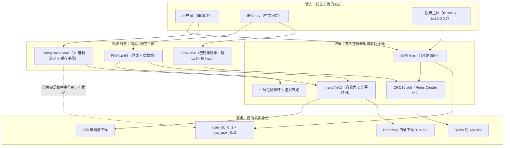
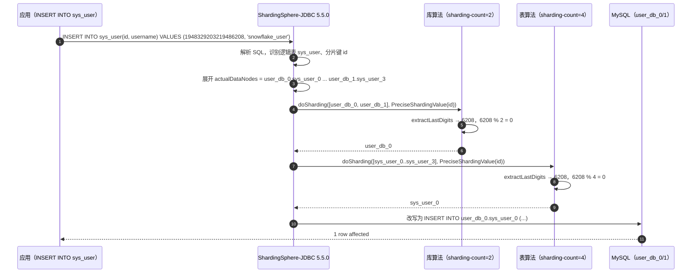

# 哈希：冲突、扰动与分片路由

> **一句话结论**：哈希不是"算个数字"，而是全库最广泛的一份**约定**——只要所有参与者用同一个函数、同一套取桶规则，同一个 key 就会永远落到同一个桶；分库分表、缓存分片、向量索引、限流主体全都靠这一条约定成立。约定一旦破（桶不均、桶不稳定、扩容改规则），数据就要搬家、流量就要误伤。
> **阅读前置**：知道 `HashMap` 是什么、SQL 的 `WHERE id = ?` 怎么写即可；分库分表、Redis Cluster、向量相似度都不需要预先了解，本文会交代到能算清一个 key 落哪的粒度。
> **证据基线**：JDK 17.0.19（Temurin，常量与字节码由 `javap` 现场读取）、Node.js v24.16.0（C 级实测）、ShardingSphere 5.5.0（`pom.xml#L48`，配置文件头部自述 5.4.1）、Spring Cloud Gateway 5.1.0（A 级源码摘录）。预计阅读 35 分钟。

---

## 0. 先看现象

**症状一：8 张物理表，一半永远没数据。**
用户表按"2 库 × 4 表"切成 8 个物理节点（`ai-cs-user/src/main/resources/sharding-user.yaml#L67`：`actualDataNodes: user_db_${0..1}.sys_user_${0..3}`），库号由"后四位 % 2"算、表号由"后四位 % 4"算，两个算法是同一个类（`sharding-user.yaml#L77-L88`）。把 0~9999 这 10000 种后四位全部枚举一遍，实际落点是：

```text
user_db_0.sys_user_0      2500 25.00%
user_db_0.sys_user_1         0 0.00%
user_db_0.sys_user_2      2500 25.00%
user_db_0.sys_user_3         0 0.00%
user_db_1.sys_user_0         0 0.00%
user_db_1.sys_user_1      2500 25.00%
user_db_1.sys_user_2         0 0.00%
user_db_1.sys_user_3      2500 25.00%
物理节点总数=8 有数据=4 永远空=4
```

**症状二：`sharding-count` 从 4 改成 8，一半用户要搬家。**
分片数变一次，取模的除数就变了，取模结果与原来不同的比例即"要迁走的行数比例"。200000 个雪花式 ID 实测：

```text
   2 ->  4 分片：搬家 50.00%
   4 ->  8 分片：搬家 50.00%
   4 ->  5 分片：搬家 80.00%
   2 ->  3 分片：搬家 66.66%
```

**症状三：未登录请求全部挤进同一个限流键。**
网关的限流键由 `userKeyResolver` 决定（`ai-cs-gateway/src/main/java/com/aics/gateway/config/RouteConfig.java#L155-L167`）：优先用可信的 `X-User-Id`，取不到就退化成「`ip:` + 客户端 IP」。办公网/机房 NAT 后面几百人共用一个出口 IP，于是几百个不同的人共用**一个**桶；本项目 09 篇已实测该场景的后果——桶参数对齐网关（capacity=10、rate=5/s）时 12000 个请求只放行 3009 个，拒绝率 **74.92%**，改成按人分桶后拒绝率 0.00%（见 `learning-docs/09-安全与设计模式/02-接口安全与限流策略.md` 的 §0 症状二，本篇不重复实测）。

这些现象指向同一件事：**哈希只承诺"同一个 key 永远去同一个桶"，不承诺"桶均匀"、不承诺"桶稳定"、更不承诺"桶的名字取得对"**。三个不承诺，就是三类线上事故。

---

## 1. 整体地图



> **读图说明**：主线是 `K1 → M1 → O2`——用户 id 只经过"取后四位再取模"就决定了物理表，中间的哈希函数是**退化**的（数字直接参与取模，没有 `hashCode` 参与），这正是症状一、二的根源。第二条主线是 `H1 → M2 → O1`，即 `HashMap`：先 `hashCode()`，再扰动，再 `& (cap-1)`。**最容易看错的两个箭头**：① 以为 `H1 → O2` 直接相连（以为换掉 `hashCode` 就能改分片），实际分片完全绕过了 `hashCode`；② 以为 `K2 → H3 → M3` 是"缓存键也参与分片"，实际 SHA-256 只用来生成 Redis 里的 key 名字，Redis Cluster 拿到这个**字符串名字以后再做一次 CRC16** 才决定 slot，是两次不同的哈希。

组件、责任与参与方：

| 组件 | 位置 | 责任 | 参与方 |
| --- | --- | --- | --- |
| 分片算法 | `ai-cs-user/src/main/java/com/aics/user/sharding/UserIdLast4ModShardingAlgorithm.java` | 把一个 id 算成库下标和表下标 | ShardingSphere 5.5.0 调用、MySQL 8.0 承接落库 |
| 分片规则 | `ai-cs-user/src/main/resources/sharding-user.yaml` | 声明 8 个实际节点、分片键 `id`、两个 `sharding-count` | 应用启动时装配 `DataSource` |
| 语义缓存键 | `ai-cs-chat/src/main/java/com/aics/chat/cache/SemanticCacheService.java` | 用 `aics:semcache:*` 前缀 + 知识库名做桶 | Redis 7.x |
| 向量缓存键 | `ai-cs-chat/src/main/java/com/aics/chat/cache/VectorCacheStore.java` | SHA-256 把任意长问句压成定长 key | 进程内 LRU + Redis |
| 向量化 | `ai-cs-common/src/main/java/com/aics/common/ai/embedding/HashEmbeddingModel.java` | token 双哈希落到 768 维 | 语义缓存、向量缓存、RAG 检索 |
| 限流主体键 | `ai-cs-gateway/src/main/java/com/aics/gateway/config/RouteConfig.java` | 决定"谁的桶" | Spring Cloud Gateway 5.1.0 的 `KeyResolver` |
| 限流状态键 | `learning-docs/24-源码分析/assets/source/RedisRateLimiter.java.md` | 把主体键包成带 `{}` 的 Redis key | Redis Cluster 的 CRC16 slot 计算 |

---

## 2. 关键概念与关键类

先固定 5 个术语，后文反复用：

- **哈希函数**：把任意长度的输入映射成固定长度的整数；同一个输入每次必须得到同一个输出。
- **桶（bucket）**：整数被压缩后的目标格子，数量有限。桶的数量叫**桶数**（`HashMap` 里是 `capacity`，分片里是 `sharding-count`）。
- **装载因子（load factor）**：已存元素数 / 桶数。`HashMap` 默认 0.75，超过就扩容。
- **扰动（perturbation）**：取桶前对哈希值再做一次廉价变换，把高位信息混进低位。
- **分片键（sharding key）**：分库分表里参与路由的那一列，本项目是 `id`。

| 名称 | 位置 | 角色 | 关键方法 |
| --- | --- | --- | --- |
| `String.hashCode` | JDK 17 `java.lang.String` | 把字符序列映射成 `int`，`h = 31h + c`；`hash` 字段把结果缓存起来，第二次调用 O(1) | `hashCode()` |
| `HashMap` 常量与扰动 | JDK 17 `java.util.HashMap` | 定桶数、装载因子、树化阈值、把高位混入低位 | `static final int hash(Object)`、`putVal`、`resize`、`treeifyBin` |
| `ConcurrentHashMap` | JDK 17 `java.util.concurrent` | 网关本地令牌桶的"每人一个桶"容器 | `computeIfAbsent` |
| `UserIdLast4ModShardingAlgorithm` | `ai-cs-user/src/main/java/com/aics/user/sharding/UserIdLast4ModShardingAlgorithm.java` | 取 id 末尾最多 4 位数字，对 `sharding-count` 取模，再从候选节点名里挑出后缀匹配的那个 | `init`、`doSharding`、`extractLastDigits`、`targetIndexOf` |
| `HashEmbeddingModel` | `ai-cs-common/src/main/java/com/aics/common/ai/embedding/HashEmbeddingModel.java` | 特征哈希：把 token 打到 768 维的两个位置再 L2 归一化 | `embed(String)`、`extractTokens`、`fnv1a`、`normalize` |
| `VectorCacheStore` | `ai-cs-chat/src/main/java/com/aics/chat/cache/VectorCacheStore.java` | 用 `模型名:sha256(问句)` 当缓存键，L1 是 LRU `LinkedHashMap`、L2 是 Redis | `cacheKey`、`sha256Hex`、`get`、`put` |
| `SemanticCacheService` | `ai-cs-chat/src/main/java/com/aics/chat/cache/SemanticCacheService.java` | 语义缓存的"模糊桶"：同一知识库的条目放在一个 Redis Hash 里线性扫描 | `lookup`、`put` |
| `RedisRateLimiter#getKeys` | `learning-docs/24-源码分析/assets/source/RedisRateLimiter.java.md` L160-L171 | 用 `{}` 把"路由 + 主体"包成 Redis hash tag，保证两个 key 同 slot | `getKeys`、`isAllowed` |
| `userKeyResolver` | `ai-cs-gateway/src/main/java/com/aics/gateway/config/RouteConfig.java#L155-L167` | 生成限流主体键（`u:xxx` 或 `ip:xxx`） | `resolve` 由 `updateKeyResolver` 回调 |

---

## 3. 原理与证据逐段精读

### 3.1 哈希函数的三条要求：均匀、稳定、快

**在干什么。** 哈希函数把 key 变成一个整数，三条要求分别对应三种失效：**不均匀**→桶长得不齐，最长的桶决定查询耗时；**不稳定**→同一个 key 在不同进程/不同时刻落到不同桶，数据"找不到"；**太慢**→哈希本身成了瓶颈，尤其在 Redis、网关这类每请求都要算一次的位置。

**为什么这么设计。** 均匀是概率意义上的：好哈希让每个 key 落哪个桶近似独立等概率，于是桶长的分布趋近**泊松分布**（3.2 节会用这个分布解释 8 这个数字）。稳定是工程意义上的：Java 规范只要求"同一进程内、同一对象未修改时 `equals` 相同则 `hashCode` 相同"，**并不保证跨进程一致**，所以任何跨进程共享的 key（分片键、Redis key、限流主体）都不能依赖默认的 `Object.hashCode()`。

**换写法会怎样。** 用"均匀但慢"的 SHA-256 做分片键：能算、能均匀，但每行数据路由都要过一次密码学摘要，常数因子大一个量级；用"快但不均匀"的弱哈希（例如只取 `key.length()`）做分片键：所有等长 key 挤进一个桶，等于没分片。

**常见坑。** 把"哈希稳定"和"哈希均匀"混为一谈。实际工程里最常见的错误是：**用稳定但完全不均匀的规则做分片**——本项目取"id 后四位"，对雪花 ID 很均匀（见下），对"1000 的倍数"这类 id 就退化成单桶（3.5 节实测 100.0% 落一片）。

C 级证据：三种哈希函数在同一进程内的耗时量级（数据构造：把 `aics:semcache:entry:kb{i%5}:订单什么时候发货#{i}` 这种真实形态的 key 造 200000 条，平均长度 38.4 字符，每个函数跑 5 轮取中位数）：

```javascript
// 复现命令：把本块存为 hash-speed.mjs，然后 node hash-speed.mjs（Node.js 24）
import { createHash } from 'node:crypto';
const KEYS = [];
for (let i = 0; i < 200000; i++) KEYS.push('aics:semcache:entry:kb' + (i % 5) + ':订单什么时候发货#' + i);
const javaHash = (s) => { let h = 0; for (let i = 0; i < s.length; i++) h = (Math.imul(h, 31) + s.charCodeAt(i)) | 0; return h; };
const fnv1a = (s) => { let h = 0xcbf29ce484222325n;
  for (let i = 0; i < s.length; i++) { h ^= BigInt(s.charCodeAt(i)); h = BigInt.asUintN(64, h * 0x100000001b3n); }
  return h; };
const sha256 = (s) => createHash('sha256').update(s).digest('hex');

for (const [label, fn] of [['String.hashCode', javaHash], ['FNV-1a 64', fnv1a], ['SHA-256', sha256]]) {
  const runs = [];
  for (let r = 0; r < 5; r++) {
    const t0 = process.hrtime.bigint();
    let sink = 0;
    for (const k of KEYS) sink ^= typeof fn(k) === 'bigint' ? Number(fn(k) & 0xffffffffn) : 1;
    if (sink === -1) console.log('never');   // 防止 JIT 把整段优化掉：结果必须被使用
    runs.push(Number(process.hrtime.bigint() - t0) / 1e6);
  }
  runs.sort((a, b) => a - b);
  console.log(`${label.padEnd(16)} 5 轮中位数 ${runs[2].toFixed(1)} ms（${(runs[2] * 1000 / KEYS.length).toFixed(2)} µs/key）`);
}
```

```text
样本 = 200000 个 key，key 平均长度 38.4 字符；node v24.16.0
String.hashCode  5 轮中位数 28.7 ms / 200000 个 key（0.14 µs/key），最快 21.1 ms，最慢 67.2 ms
FNV-1a 64        5 轮中位数 114.0 ms / 200000 个 key（0.57 µs/key），最快 109.1 ms，最慢 140.4 ms
SHA-256          5 轮中位数 302.9 ms / 200000 个 key（1.51 µs/key），最快 291.7 ms，最慢 365.4 ms
```

**怎么读这个输出。** 三者都是 O(len)，差别全在**常数因子**：这里 SHA-256 约是 `String.hashCode` 的 10 倍。**这个数不能横向搬**——脚本里的 FNV-1a 用 BigInt 实现（JS 没有 64 位无符号整数原生运算），常数被 BigInt 放大了，Java 用 `long` 写的 FNV-1a 不会这么慢；所以只能读作"同语言同进程内，密码学哈希比滚动哈希贵一个量级"。**适用边界**：结论是"选型时按调用频次选常数"，不是"某个函数每秒能算多少次"。

### 3.2 冲突处理：链地址、开放寻址、红黑树化

**在干什么。** 桶数有限、key 无限，冲突必然发生。三种处理方式：**链地址法**把同桶元素串成链表（`HashMap`）；**开放寻址法**冲突了就按固定探测序列找下一个空槽（`ThreadLocalMap` 用线性探测）；**树化**是链地址的补丁——链长超过阈值就把链表换成红黑树，把桶内查找从 O(链长) 降到 O(log 链长)。

**为什么这么设计。** 树节点比链表节点大（要存 parent/left/right/red），少量冲突时树化纯属浪费；所以阈值必须选在"链表几乎不会到这个长度，除非有人在攻击或哈希极差"的位置。`HashMap` 的答案写在常量里（`javap -p -constants java.util.HashMap` 现场读出，OpenJDK 17.0.19）：

```text
  static final int DEFAULT_INITIAL_CAPACITY = 16;
  static final int MAXIMUM_CAPACITY = 1073741824;
  static final float DEFAULT_LOAD_FACTOR = 0.75f;
  static final int TREEIFY_THRESHOLD = 8;
  static final int UNTREEIFY_THRESHOLD = 6;
  static final int MIN_TREEIFY_CAPACITY = 64;
```

泊松分布解释了这个 8：装载因子 α 下"某条桶链长度达到 k"的概率近似 `P(X≥k) = Σ_{i≥k} e^{-α}α^i/i!`。C 级实测（`pmf` 精确求和，不是正态近似）：

```text
k    α=0.75      α=0.5       α=1.0
 4   7.29e-3  1.75e-3  1.90e-2
 6   1.31e-4  1.42e-5  5.94e-4
 7   1.38e-5  1.00e-6  8.32e-5
 8   1.28e-6  6.22e-8  1.02e-5
 9   1.06e-7  3.44e-9  1.13e-6
10   7.86e-9  1.71e-10  1.11e-7
容量      16 桶、α=0.75：链长≥8 的桶期望个数 = 0.0000（触发一次树化要等 782185 个桶）
容量    1024 桶、α=0.75：链长≥8 的桶期望个数 = 0.0013（触发一次树化要等 782185 个桶）
容量 1048576 桶、α=0.75：链长≥8 的桶期望个数 = 1.3406（触发一次树化要等 782185 个桶）
```

**怎么读这个输出。** `P(链长≥8 | α=0.75) = 1.28e-6`，即平均每 78 万个桶才出现一次；取 8 意味着"正常哈希下几乎永不树化"。如果阈值取 4，概率是 7.29e-3（每 137 个桶就一次），小表会被频繁树化，白吃内存。最后三行是同一个概率乘上桶数：16 桶时几乎不可能（0.0000），一百万个桶时就有约 1.3 个桶会树化——所以"树化在生产上真的会发生，但只发生在很大的表里"。**适用边界**：泊松假设"key 均匀落桶"，一旦哈希被攻击或实现极差，这个分布不成立（3.8 节会给出 9 个 key 挤满 1 个桶的实测）。

**换写法会怎样。** 用开放寻址：省掉指针、缓存友好，但**删除**必须留墓碑（否则探测链断），装载因子一旦接近 1 性能断崖，所以 `ThreadLocalMap` 才要每步清理并靠 `cleanSomeSlots` 主动回收；`HashMap` 选链地址正是因为它允许 `remove` 直接摘链、允许链变长后再树化。

**常见坑。** 只记住"树化阈值 8"却忘了 `MIN_TREEIFY_CAPACITY = 64`：容量还小的时候 `putVal` 走的是**先扩容**而不是树化，因为扩容本身就能把长链拆开。若在只有 16 桶的表里观察到某桶链长 9，别以为马上变树——先扩到 64 桶再说。

### 3.3 扰动函数：为什么是 `h ^ (h >>> 16)`，且只需要一次

**在干什么。** `HashMap` 取桶用的是 `(n - 1) & hash`（n 是 2 的幂，等价于取低 log₂n 位）。桶数最多 2³⁰，而哈希值是 32 位——**高位永远不参与取桶**，于是"低位重复、高位不同"的 key 会全部挤进同一个桶。扰动函数把高 16 位折进低 16 位来救场：

```text
命令：javap -p -c java.util.HashMap | Select-String "static final int hash" -Context 0,12
关键指令：ifnonnull / iconst_0 / invokevirtual java/lang/Object.hashCode:()I / dup / istore_1
         / iload_1 / bipush 16 / iushr / ixor
```

读成源码就是 `h = key.hashCode(); return h ^ (h >>> 16);`——**一次无符号右移 + 一次异或**，没有乘法、没有多轮混淆。JDK 8 之前有人担心"一次不够"，但 3.1 的实测表明这已足够把雪花 ID 的分布拉回均匀。

**为什么这么设计。** 取桶发生在每一次 `get`/`put` 上，扰动必须廉价到"可以忽略"；而 JDK 7 的做法（`h ^= (h>>>20) ^ (h>>>12); return h ^ (h>>>7) ^ (h>>>4)`，四次移位四次异或）是为"用取模而非掩码"的旧实现兜底的，改成掩码后一次就够。

**换写法会怎样。** C 级实测对三种真实 key 家族分别用"直接取低位"和"扰动后取低位"，看最大桶占比与 χ²（卡方，越小越均匀；自由度 df=n-1 时 α=0.05 的临界值：df=7 → 14.067，df=15 → 24.996）。key 的造法：雪花式 ID 用 `(ts<<22)|(1<<17)|(1<<12)|seq` 每毫秒发 200 个；中文问句用 `aics:semcache:entry:kb{i%5}:{10 个固定问句之一}#{i%97}`（只有 970 个不同值）；UUID 用 32 位 hex。统计口径是**不同 key**，不含重复访问：

```javascript
// 复现命令：存为 hash-uniform.mjs，node hash-uniform.mjs
const javaHash = (s) => { let h = 0; for (let i = 0; i < s.length; i++) h = (Math.imul(h, 31) + s.charCodeAt(i)) | 0; return h; };
const fnv1a = (s) => { let h = 0xcbf29ce484222325n;
  for (let i = 0; i < s.length; i++) { h ^= BigInt(s.charCodeAt(i)); h = BigInt.asUintN(64, h * 0x100000001b3n); }
  return h; };
const stats = (counts) => {          // 变异系数 + 卡方
  const total = counts.reduce((a, b) => a + b, 0), avg = total / counts.length;
  const dev = Math.sqrt(counts.reduce((a, c) => a + (c - avg) ** 2, 0) / counts.length);
  return { max: Math.max(...counts) / total, cv: dev / avg,
           chi2: counts.reduce((a, c) => a + (c - avg) ** 2 / avg, 0) };
};
for (const n of [16, 64]) {           // 取桶方式一：直接掩码；方式二：扰动后掩码
  const raw = new Array(n).fill(0), pert = new Array(n).fill(0);
  for (let i = 0; i < 100000; i++) {
    const h = i * 65536;              // 构造：低 16 位恒为 0
    raw[h & (n - 1)]++;
    pert[(h ^ (h >>> 16)) & (n - 1)]++;
  }
  console.log(`n=${n} 不扰动 max=${(stats(raw).max * 100).toFixed(2)}% 占用桶=${raw.filter(Boolean).length}`);
  console.log(`n=${n} 扰动后 max=${(stats(pert).max * 100).toFixed(2)}% 占用桶=${pert.filter(Boolean).length} χ²=${stats(pert).chi2.toFixed(1)}`);
}
```

```text
---- 真实 key 上扰动前后（n=16，只统计不同 key）----
雪花ID：不扰动 max=6.53% χ²=111.3 ；扰动后 max=6.35% χ²=14.2
中文问句：不扰动 max=6.60% χ²=0.9 ；扰动后 max=6.91% χ²=3.6
UUID：不扰动 max=6.38% χ²=10.9 ；扰动后 max=6.35% χ²=8.0

---- 构造 h = i × 65536（低 16 位恒为 0），看两种取桶方式 ----
n=16 不扰动：占用桶数=1 最大桶=100.00%
n=16 扰动后：占用桶数=16 最大桶=6.25% χ²=0.0
n=64 不扰动：占用桶数=1 最大桶=100.00%
n=64 扰动后：占用桶数=64 最大桶=1.56% χ²=0.0
```

**怎么读这个输出。** ① 极端构造 `h = i × 65536` 低 16 位全 0：不扰动时 **100% 落一个桶**，扰动后 16 个桶全用上、χ²=0.0——这就是扰动的必要性的直接证据；② 真实雪花 ID 在 16 桶下不扰动 χ²=111.3，**远超** df=15 的临界值 24.996（显著不均），扰动后降到 14.2，**低于**临界值——扰动真的救了一次；③ 中文问句不扰动已经 χ²=0.9，扰动后变 3.6（仍在临界值内）——**扰动只搬高位信息，不是随机化**，对已经均匀的 key 无收益、甚至略微变差。**适用边界**：这里度量的是"不同 key 落桶是否均匀"，不含 key 的访问频次；若访问频次极偏，桶均匀也救不了长尾。

**常见坑。** 以为"加了扰动就一定更均匀"——中文问句这一行就是反例。另一个更常见的坑：**自己实现哈希表时把 `& (n-1)` 用在了非 2 的幂的 n 上**，例如 `& 15` 却以为桶数是 100，此时高位被永久丢弃，扰动也救不回来（这也是 `HashMap.tableSizeFor` 非要把容量上取整到 2 的幂的原因）。

### 3.4 扩容与 rehash：为什么均摊是 O(1)，常数是多少

**在干什么。** 元素数超过 `capacity × loadFactor` 时，`HashMap` 把桶数翻倍并重新分布所有元素（rehash）。单次扩容是 O(n)，但每插入一个元素带来的累计扩容工作量是有上界的。

**为什么这么设计。** 装载因子 0.75 是"空间/时间"的折中：取 1.0 会把链表拉长（3.2 表里 α=1.0 时 P(链长≥8)=1.02e-5，是 0.75 的 8 倍），取 0.5 又浪费一半桶。桶数翻倍（而不是 +固定值）保证摊还分析成立：总搬迁量是等比数列之和，与插入次数同阶。

**换写法会怎样。** C 级实测（1000000 次 `put`，2 倍扩容，节点二选一：留在原位 或 原位 + oldCap）：

```text
不预分配（默认 16）：最终容量=2097152 扩容次数=17 累计搬迁=1572852 搬迁/插入=1.57
预分配 1_400_000：最终容量=1400000 扩容次数=0 累计搬迁=0 搬迁/插入=0.00
单次扩容中真正换桶的元素比例 = 50.04%（另一半留在原位）
```

**怎么读这个输出。** ① 100 万次插入累计搬了 157 万个节点，即**每个元素平均被搬 1.57 次**——这就是"均摊 O(1)、常数约 1.5"的量级感；② 预分配后扩容 0 次、搬迁 0 次——所以已知规模时用 `new HashMap<>(expectedSize)`（配合 `tableSizeFor` 会取到 2 的幂）能直接省掉这部分；③ "只有 50.04% 换桶"是 JDK 8 的优化：扩容时每个元素的新下标只有两种可能（`hash & oldCap` 为 0 就留在原位，否则移到原位 + oldCap），所以**不用重算哈希**，把链表一拆二即可。**适用边界**：50% 这个比例对"容量翻倍"成立，对"容量 ×1.5"或"取模分片改成 n→n+1"都不成立（见 3.5）。

**常见坑。** 把 `HashMap` 的扩容结论套到分库分表上：`HashMap` 扩容只涉及一个进程内的内存搬移，而分片的"扩容"是**跨机器的数据迁移**，代价高五六个数量级，不能都叫"rehash"。

### 3.5 取模分片：为什么扩容一定要搬数据

**在干什么。** 分片路由最朴素的写法：`片号 = hash(key) % 片数`。本项目更进一步，先取 id 末尾最多 4 位数字，再对 `sharding-count` 取模：

```java
// ai-cs-user/src/main/java/com/aics/user/sharding/UserIdLast4ModShardingAlgorithm.java#L37-L46
@Override
public String doSharding(Collection<String> availableTargetNames,
                         PreciseShardingValue<Comparable<?>> shardingValue) {
    long lastDigits = extractLastDigits(shardingValue.getValue());
    long targetIndex = lastDigits % shardingCount;

    return availableTargetNames.stream()
            .filter(name -> targetIndexOf(name) == targetIndex)
            .findFirst()
            .orElseThrow(() -> new IllegalStateException(
                    "取模结果 " + targetIndex + " 在目标集合中无可落分片: " + availableTargetNames));
}
```

`sharding-count` 从配置读入（同文件 `#L26-L35`），库用 2、表用 4（`sharding-user.yaml#L76-L88`）。

**为什么这么设计。** 取模的优点是**精准路由**：给一个 id 就能算出唯一一个节点，不需要任何元数据服务、不需要维护路由表，`WHERE id = ?` 直接单表命中（`ai-cs-user/src/test/java/com/aics/user/sharding/UserShardingRouteTest.java#L94-L107` 就是在断言这件事）。代价写在除法的性质里：`(x % m)` 与 `(x % n)` 对同一个 x 几乎总是不相等，所以**改除数 = 改几乎所有元素的家**。

**换写法会怎样。** C 级实测（200000 个雪花式 ID，末四位取模，等价本项目算法；"搬家比例"= 新旧片号不同的 key 占全部 key 的比例）：

```javascript
// 复现命令：存为 hash-migrate.mjs，node hash-migrate.mjs
const IDS = [];
let ts = 1795724318894n, seq = 0n;
for (let i = 0; i < 200000; i++) {                    // 造雪花式 ID：每毫秒 200 个序列号
  IDS.push((ts << 22n) | (1n << 17n) | (1n << 12n) | seq);
  if (++seq === 200n) { seq = 0n; ts++; }
}
const shardOf = (id, count) => Number((id % 10000n) % BigInt(count));   // 末四位取模
const moved = (from, to) => IDS.filter((id) => shardOf(id, from) !== shardOf(id, to)).length / IDS.length;
for (const [from, to] of [[2, 4], [4, 8], [8, 16], [8, 4], [4, 5], [2, 3]]) {
  console.log(`${String(from).padStart(2)} -> ${String(to).padStart(2)} 分片：搬家 ${(moved(from, to) * 100).toFixed(2)}%`);
}
```

```text
样本 = 200000 个雪花式 ID（末四位取模，等价 UserIdLast4ModShardingAlgorithm）
---- 取模分片：改变 sharding-count ----
   2 ->  4 分片：搬家 50.00%
   4 ->  8 分片：搬家 50.00%
   8 -> 16 分片：搬家 48.00%
   8 ->  4 分片：搬家 50.00%
   4 ->  5 分片：搬家 80.00%
   2 ->  3 分片：搬家 66.66%
---- 一致性哈希：4 节点 -> 5 节点（虚拟节点数 200）----
  搬家 19.72%
```

**怎么读这个输出。** ① `n → 2n` 时搬家恒为 50%：新片号是 `x % 2n`，它要么等于 `x % n`（留下），要么等于 `x % n + n`（搬走），两种情况各占一半——**这就是"扩容一半数据要搬家"的严格原因**；② `n → n+1` 时搬家比例是 `n/(n+1)`：4→5 实测 80.00%、2→3 实测 66.66%，与公式一致；③ 8→16 实测 48.00% 而不是 50%，是因为每毫秒只发 200 个序列号，末四位在 16 个余数上并非严格均匀（余数 0~7 各出现 13 次、8~15 各 12 次），属于**样本位模式**造成的偏差，理论值仍是 50%；④ 一致性哈希 4→5 只搬 19.72%（理论 5 分之一 = 20%），是本节最重要的对比数。**适用边界**：结论建立在"键的末四位近似均匀"上；对一个无法保证末四位分布的系统（例如自增主键），搬家的**比例**不变，但"哪个片有数据"这件事会退化（见 3.6）。上面那段脚本只复现前 6 行；一致性哈希那一行来自另一段实现（FNV-1a 撒 200 个虚拟节点到 `[0, 2^64)` 环上 + 二分查找顺时针第一个节点），末四位判据那一组只是把 `id % n` 与 `(id % 10000) % n` 逐条比对计数。

**常见坑：把"末四位取模"当成"全 ID 取模"。** 两者只有在 `sharding-count` 整除 10000 时才等价（因为 `id % n = (id - id/10000*10000) % n`，只有当 `10000 % n == 0` 时末四位才携带全部信息）：

```javascript
// 判据：同一批 ID 上比较 (id % n) 与 ((id % 10000) % n)，统计不一致比例
for (const n of [2, 4, 8, 16, 5, 3]) {
  const bad = IDS.filter((id) => (id % BigInt(n)) !== ((id % 10000n) % BigInt(n))).length;
  console.log(`sharding-count=${String(n).padStart(2)}：不一致比例 ${(bad / IDS.length * 100).toFixed(2)}%  10000%${n} = ${10000 % n}`);
}
```

```text
  sharding-count= 2：不一致比例 0.00%  10000%2 = 0
  sharding-count= 4：不一致比例 0.00%  10000%4 = 0
  sharding-count=16：不一致比例 0.00%  10000%16 = 0
  sharding-count= 5：不一致比例 0.00%  10000%5 = 0
  sharding-count= 3：不一致比例 66.42%  10000%3 = 1
```

所以本项目选 2 和 4 是"安全的"（都是 10000 的因数），但一旦有人把 `sharding-count` 改成 3 或 7，路由结果会与"按全 ID 取模"严重不一致——同一份数据按旧规则迁移、按新规则查询就会大面积查不到。

### 3.6 两级取模的隐藏耦合：8 张表为什么只用得上 4 张

**在干什么。** `sharding-user.yaml` 声明 8 个物理节点，但库算法和表算法是**同一个类、同一份输入**，只是 `sharding-count` 不同：

```yaml
# ai-cs-user/src/main/resources/sharding-user.yaml#L64-L88
  - !SHARDING
    tables:
      sys_user:
        actualDataNodes: user_db_${0..1}.sys_user_${0..3}
        databaseStrategy:
          standard:
            shardingColumn: id
            shardingAlgorithmName: user-id-last4-db
        tableStrategy:
          standard:
            shardingColumn: id
            shardingAlgorithmName: user-id-last4-table
    shardingAlgorithms:
      user-id-last4-db:
        type: CLASS_BASED
        props:
          strategy: STANDARD
          algorithmClassName: com.aics.user.sharding.UserIdLast4ModShardingAlgorithm
          sharding-count: 2
      user-id-last4-table:
        type: CLASS_BASED
        props:
          strategy: STANDARD
          algorithmClassName: com.aics.user.sharding.UserIdLast4ModShardingAlgorithm
          sharding-count: 4
```

**为什么这么设计。** 用同一列做库和表的分片键是标准做法（保证"一个用户的全部行在同一个库、同一张表"，单库事务就能覆盖）；两级都用后四位是为了让两次路由**成本一致**、不用扫两遍 id。

**换写法会怎样。** 数学上：库号 = `d % 2`、表号 = `d % 4`，而 `d % 4` 的奇偶性唯一决定 `d % 2`（因为 `d % 2 = (d % 4) % 2`）。于是"库号与表号奇偶不匹配"的 4 个节点**永远收不到数据**：`user_db_0.sys_user_1`、`user_db_0.sys_user_3`、`user_db_1.sys_user_0`、`user_db_1.sys_user_2`。0~9999 全枚举的 C 级证据就是 §0 症状一那张表（每片 25.00%，4 片 0.00%）。

**怎么读这个输出。** 数据没丢、查询没错，**损失的是并行度与容量**：本以为是 2 库 × 4 表 = 8 份算力，实际是 4 份各 25%。**适用边界**：只要"库数整除表数且两者都从同一列取模"就必然出现这个耦合；如果库号用 `(d / 4) % 2`（即把表号当作低位、库号取高位），8 个节点就能全部用上。

**常见坑。** 只在配置文件里数节点个数，不验证"数据是否真散到每个节点"。可复现的验证手法见 §6 的手法二。

### 3.7 一致性哈希与虚拟节点：只搬该搬的那一份

**在干什么。** 把"桶号 = 取模"换成"桶号 = 在哈希环上顺时针找到的第一个节点"。增删一个节点只影响环上相邻的一段，其余 key 的归属不变。虚拟节点是把每个物理节点在环上撒成多个点，让每一段的弧长更均匀。

**为什么这么设计。** 取模的问题是"除数一变，全体重排"（3.5 的 50%/80%）；一致性哈希把"位置"的语义从**除法的余数**换成**环上的相对次序**，于是局部变化只产生局部影响。虚拟节点解决另一个问题：N 个节点撒在环上时弧长服从指数分布，节点少时倾斜严重（4 个节点最不均的那段期望占 1/4 以上），撒几百个点后每段期望趋近 1/N。

**换写法会怎样。** C 级实测（FNV-1a 撒 200 个虚拟节点，二分查找顺时针第一个点，同一批 200000 个 key）：4 节点 → 5 节点只搬 **19.72%**，而取模 4 → 5 搬 **80.00%**。理论值 1/(N+1) = 20%，实测 19.72% 的差来自虚拟节点数有限（200 个点 ≠ 无穷多）。

**常见坑。** ① 虚拟节点数取太少（例如每节点 1 个点，4 → 5 的搬家比例实测会明显偏离 20%，且各节点负载差异可达数倍）；② 一致性哈希只能解决"节点增减"，解决不了"热点 key"——一个爆款商品 id 仍然压在一个节点上，需要的是再哈希或热点探测；③ 本项目**未落地**一致性哈希：分片全部是取模（`sharding-user.yaml#L76-L88`），一致性哈希只出现在这份文档的对比实验里。

### 3.8 哈希碰撞攻击：`String.hashCode` 是可预测的

**在干什么。** `String.hashCode` 是公开的多项式 `h = 31h + c`，没有随机种子。攻击者可以**批量构造哈希值相同的 key**，让它们全部落进同一个桶，把 O(1) 的平均查找退化成 O(k) 的链扫描——这就是哈希洪泛（hash flooding）。

**为什么这么设计。** 哈希表默认假设"key 是良性的"，构造在攻击者手里的场景（HTTP 参数、JSON 字段名、缓存 key）才需要防护。防护手段有两个方向：**加盐**（每个进程随机种子，破坏可预测性）或**树化**（把最坏情况从 O(k) 压到 O(log k)）。

**换写法会怎样。** C 级实测：长度 2 时 `hash = 31·c1 + c2`，固定 `31·c1 + c2 = 2112`，c1 每加 1、c2 就减 31，哈希不变——可打印字符里得到 `Aa`、`BB`、`C#` 三个；把它们两两拼接成长度 4 的串，得到 9 个不同的 key、只有 1 个哈希值：

```text
可打印的 2 字符同哈希串：3 个 -> Aa BB C#
校验 hashCode：2112 2112 2112
长度 4 的同哈希串：9 个不同 key，不同 hashCode 只有 1 个（2031744）
放进 16 桶 HashMap：占用桶数 = 1，最大桶承载 9 / 9 = 100.00%
放进 64 桶 HashMap：占用桶数 = 1，最大桶承载 9 / 9 = 100.00%
链长 9 > TREEIFY_THRESHOLD(8)，但容量 16 < MIN_TREEIFY_CAPACITY(64)：先扩容不树化；扩到 64 桶后同哈希仍全落一桶，这时才树化
```

**怎么读这个输出。** 9 个 key 挤进 1 个桶、占满 100%——这就是攻击的效果。而**树化在这里救不了多少**：哈希值完全相同，红黑树的比较退化成 `tieBreakOrder`（先比类名、再比 `System.identityHashCode`）的兜底排序，仍是 O(log k) 但不是"哈希意义下的 O(1)"。真实攻击里 9 个远不够，量级是上万，但构造方式一模一样。**适用边界**：这里演示的是"可预测的哈希 + 攻击者可控 key"；本项目里 `HashMap` 的 key 都是内部数据（用户 id、配置项名），不存在外部可控的批量构造点，所以这是**原理性风险，不是当前已落地缺陷**。

**常见坑。** 把 `String.hashCode` 的结果直接当主键/缓存 key 的"唯一标识"——`Aa` 与 `BB` 同哈希会让两个不同 key 撞进同一个业务槽位；缓存键要么用足够长的摘要（3.9 的 SHA-256），要么在冲突时回比原 key。

### 3.9 本项目三处真实落点：缓存键、限流键、向量维度

**在干什么。** 哈希在本项目里有三种完全不同的用法，混起来看就乱，分开看各有各的必要性：

| 落点 | 哈希函数 | 取桶方式 | 为什么必须这样做 |
| --- | --- | --- | --- |
| 向量缓存键 `VectorCacheStore#cacheKey` | SHA-256 → 64 位 hex | 不取桶，直接当 Redis key 名字 | 问句可长可短，必须**定长**且**低碰撞**；3.8 证明 `String.hashCode` 会撞 |
| 限流主体键 `RedisRateLimiter#getKeys` | 字符串拼接 + `{}` | CRC16 slot（Redis Cluster 内部） | 同一主体的两个 key 必须落同一 slot，Lua 才能原子读写 |
| 向量化 `HashEmbeddingModel#embed` | `String.hashCode` + FNV-1a 64 | `Math.floorMod(..., 768)` | 768 维要**稀疏可叠加**，两个位置比一个位置少丢能量 |

**为什么这么设计（逐条）。**

*缓存键*：`VectorCacheStore.java#L101-L103` 是 `return modelKey + ":" + sha256Hex(text);`——把"哪个模型"和"什么内容"拼成一个 key，SHA-256 保证定长且几乎不可能碰撞（`#L105-L118` 里还有 `MessageDigest` 不可用时的 `"fallback" + text.hashCode()` 兜底分支，这条兜底路径**会**退化成 3.8 的风险，只在 JCE 异常时触发）。用轮询长度或 `hashCode` 做 key 会让两个不同问句共享同一份向量，语义缓存返回错误答案。

*限流键*：A 级源码说明得很直白（`(src: RedisRateLimiter.java.md#L160-L171)`，锚点 [[源码:RedisRateLimiter.java.md#L160-L171]]）：

```java
	static List<String> getKeys(String id, String routeId) {
		// use `{}` around keys to use Redis Key hash tags
		// this allows for using redis cluster

		// Make a unique key per user and route.
		String prefix = "request_rate_limiter.{" + routeId + "." + id + "}.";

		// You need two Redis keys for Token Bucket.
		String tokenKey = prefix + "tokens";
		String timestampKey = prefix + "timestamp";
		return Arrays.asList(tokenKey, timestampKey);
	}
```

Lua 脚本一次执行里要读两个 key、写两个 key（`(src: request_rate_limiter.lua.md#L14-L24)`，锚点 [[源码:request_rate_limiter.lua.md#L14-L24]]）：

```text
   14 | local last_tokens = tonumber(redis.call("get", tokens_key)) or capacity
   15 | local last_refreshed = tonumber(redis.call("get", timestamp_key)) or 0
   16 |
   17 | local delta = math.max(0, now-last_refreshed)
   18 | local filled_tokens = math.min(capacity, last_tokens+(delta*rate))
   19 | local allowed = filled_tokens >= requested
   20 | local new_tokens = allowed and filled_tokens - requested or filled_tokens
   21 |
   22 | if ttl > 0 then
   23 |   redis.call("setex", tokens_key, ttl, new_tokens)
   24 |   redis.call("setex", timestamp_key, ttl, now)
```

Redis Cluster 只对 `{}` **内部**的字符串算 CRC16 slot，所以 `{routeId.id}` 相同就保证 `…tokens` 与 `…timestamp` 同 slot；跨 slot 的 Lua 脚本会直接报 `CROSSSLOT Keys in request don't hash to the same slot`。这就是"限流键为什么要长成这样"的唯一原因——不是可读性，是原子性。

*向量化*：`HashEmbeddingModel.java#L39-L50` 每个 token 打两个位置：

```java
// ai-cs-common/src/main/java/com/aics/common/ai/embedding/HashEmbeddingModel.java#L39-L50
public float[] embed(String text) {
    float[] vector = new float[DIMENSIONS];          // 固定维度向量（L2 归一化后做余弦相似度）
    for (String token : extractTokens(text)) {       // 提取英文单词/中文二元字符组等特征 token
        int h1 = Math.floorMod(token.hashCode(), DIMENSIONS);
        int h2 = Math.floorMod(fnv1a(token), DIMENSIONS);
        vector[h1] += 1.0f;                          // 特征哈希累加（词袋式）
        vector[h2] += 1.0f;
    }
    normalize(vector);                               // L2 归一化，使相似度计算有可比性
    return vector;
}
```

**换写法会怎样。** C 级实测（180 个中文问句、1218 次 token 出现、116 个不同 token，复现 `extractTokens` 的"英文词 + 中文相邻二元组"规则）：

```text
样本 = 180 个中文问句，token 出现次数 1218，不同 token 116 个
单哈希：占用维度 109 / 768，碰撞 7 次，碰撞率 6.03%
双哈希：占用维度 202 / 768，碰撞 30 次，碰撞率 12.93%
单条问句的向量稀疏度（双哈希，7 个 token × 2 位置 / 768）= 1.82%
```

**怎么读这个输出。** 直觉上"两个哈希应该更不容易碰"，实测**碰撞次数反而接近翻倍**——因为位置数也翻倍了（232 个位置对 116 个位置）。收益不在"少碰撞"，而在**同样 token 数散布到约 1.85 倍的维度**（202 对 109）：单哈希时 116 个 token 只用到 109 个维度（7 次强制重叠），双哈希用到 202 个，每个维度上的权重更接近 1，余弦相似度的区分度更好。**适用边界**：这是"开发/测试兜底"的本地哈希向量（类注释如此声明），不是语义 Embedding——它只保留字面重合度，同义改写（"怎么退款" vs "如何退钱"）几乎不相似。生产要换真模型。

**常见坑。** ① 用 `hashCode()` 而不是 `Math.floorMod(hashCode(), DIMENSIONS)`——`hashCode` 可以是负数，直接当下标会 `ArrayIndexOutOfBoundsException`；`floorMod` 保证落在 `[0, 768)`。② 忘了归一化：不归一化时"长问句"的向量模长天然更大，点积会被长度主导而不是语义。③ 空文本 `extractTokens` 返回空列表，`normalize` 里 `sum == 0` 直接返回（`#L107-L119`），得到一个全零向量——它与任何向量的余弦相似度都是 0，语义缓存会静默把它当"完全不像"，不会报错。

---

## 4. 一次完整执行时序

以"插入一条用户记录"为例，看一个 id 怎么变成物理表名：



> **读图说明**：关键箭头是第 4~11 步的**两次独立路由**——库和表各调一次同一个实现类，只是 `sharding-count` 不同；这就是 3.6 那个"8 张表只用 4 张"的耦合点。**看错哪个箭头会得出错误结论**：如果以为第 5 步的结果会被第 9 步复用（"一次算完两级"），就会以为 8 个节点都可用；实际上两次调用互不知情。另外注意第 7 步返回的是**库名**，第 11 步返回的是**表名**，两者拼接才是物理节点。

哪一步失败报什么错（全部来自 `UserIdLast4ModShardingAlgorithm.java` 的真实抛出语句）：

| 失败点 | 触发条件 | 异常与消息 |
| --- | --- | --- |
| 第 2 步：拿不到分片键 | `id` 为 null（例如 `INSERT` 里漏了 id） | `IllegalArgumentException("分片键（用户ID）不能为空")`（`#L54-L56`） |
| 第 5/9 步：末四位提不出来 | id 以非数字结尾，如 `USER-abc` | `IllegalArgumentException("分片键（用户ID）末尾不含数字: " + text)`（`#L62-L65`） |
| 第 1 步：算法初始化 | 配置里漏了 `sharding-count` | `IllegalArgumentException("分片算法缺少 sharding-count 配置")`（`#L28-L31`） |
| 第 1 步：算法初始化 | `sharding-count: 0` 或负数 | `IllegalArgumentException("sharding-count 必须为正整数: " + count)`（`#L32-L34`） |
| 第 11 步：拼节点名 | 候选节点名没有数字后缀（如 `sys_user_a`） | `IllegalStateException("分片目标名称缺少数字后缀: " + targetName)`（`#L72-L78`） |
| 第 11 步：找不到节点 | 余数在候选集合里没有匹配（如 `sharding-count: 8` 但只声明了 4 张表） | `IllegalStateException("取模结果 4 在目标集合中无可落分片: [...]")`（`#L44-L46`） |

真实可跑的验证在 `ai-cs-user/src/test/java/com/aics/user/sharding/UserShardingRouteTest.java#L76-L92`，注释里把三个 id 的推算过程写全了：`id=1 → 1%2=1 库、1%4=1 表`、`id=12345678 → 5678 → 0 库、2 表`、`id=1948329203219486208 → 6208 → 0 库、0 表`，随后断言 3 个目标表各 1 行、另外两个表 0 行。

---

## 5. 设计取舍

| 取舍 | 本项目选择 | 得到什么 | 失去什么 | 什么时候该换 |
| --- | --- | --- | --- | --- |
| 取模 vs 一致性哈希 | 取模（`sharding-count` 2 / 4） | 精准路由、零元数据、单表命中 | 扩缩容要全量迁移（4→8 实测搬 50%） | 节点频繁弹性伸缩、且能接受一层路由中间件时 |
| 取后四位 vs 全 ID 取模 | 取后四位（最多 4 位） | 雪花 ID 末四位天然散、实现简单、无须处理负数和超长 | `sharding-count` 必须是 10000 的因数，否则与全 ID 取模不等价（3 时不一致 66.42%） | 分片数需要非 2 的幂时，改成全 ID 取模或位运算 |
| 两级同一列取模 | 库 `% 2`、表 `% 4` | 一个用户的行全在一个库，单库事务可覆盖 | 8 节点只有 4 个有数据（实测每片 25%） | 节点利用率成为瓶颈时，库号改用高位段 |
| 链地址 vs 开放寻址 | 用 JDK `HashMap`（链地址 + 树化） | `remove` 简单、最坏 O(log n) | 指针开销、缓存不友好 | 极致内存敏感的场景（如 `ThreadLocalMap` 那样自己写） |
| `String.hashCode` vs SHA-256 做缓存键 | SHA-256（`VectorCacheStore#cacheKey`） | 定长 64 hex、抗碰撞 | 常数大（3.1 实测约 10 倍） | 不适用于每请求哈希上亿 key 的热路径 |
| 单哈希 vs 双哈希做向量 | 双哈希（`HashEmbeddingModel`） | 同 token 数散布到约 1.85 倍维度 | 碰撞次数约翻倍（实测 6.03% → 12.93%） | 换真 Embedding 模型后整段作废 |
| 缓冲桶 vs 拒绝 | 网关用 Redis 令牌桶（`replenish-rate: 5`、`burst-capacity: 10`） | 允许突发、跨实例一致 | 依赖 Redis 可用性 | Redis 故障时把 `rate-limit.enabled` 改回 true 用本地兜底 |

可扩展点清单（明确标注落地状态）：

| 可扩展点 | 现状 | 若要做，落点在哪 |
| --- | --- | --- |
| 一致性哈希分片 | **未落地**（全仓只有取模实现） | 新增一个 `StandardShardingAlgorithm` 实现类，与 `UserIdLast4ModShardingAlgorithm` 并列挂在 `shardingAlgorithms` 下 |
| 范围分片（Range） | **未落地**，当前 Range 查询直接广播（`UserIdLast4ModShardingAlgorithm#L48-L52` 原文注释"取模路由无法按范围收敛"） | 给 `doSharding` 的 Range 重载加区间收敛逻辑，或改用 `BETWEEN` 友好的分片键 |
| 布隆过滤器防穿透 | **未落地** | 放在 `VectorCacheStore#get` 之前，或网关鉴权后 |
| 哈希加盐（抗洪泛） | **未落地** | 缓存 key 已用 SHA-256，无需加盐；若引入用户可控 key 的 `HashMap`，改用 `ConcurrentHashMap` + 摘要键 |
| 限流键下沉到"设备 + 用户"双维度 | **未落地** | 改 `RouteConfig#userKeyResolver` 的返回值，键层面加维度即可，不动令牌桶 |

---

## 6. 踩坑与调试手法

**坑一：8 张表只有 4 张有数据（3.6）。** 现象是"扩容了但单表行数没降"。排查动作：不要数 `actualDataNodes` 里的节点个数，而是算一遍"库号与表号的奇偶关系"。**手法（可复现）**：把 0~9999 全枚举，按算法算节点名并计数——

```javascript
// 复现 sharding-user.yaml 的两级取模：库 = 后四位 % 2，表 = 后四位 % 4
const DB_COUNT = 2, TABLE_COUNT = 4, N = 10000;
const hit = new Map();
for (let d = 0; d < N; d++) {
  const node = 'user_db_' + (d % DB_COUNT) + '.sys_user_' + (d % TABLE_COUNT);
  hit.set(node, (hit.get(node) || 0) + 1);
}
const all = [];
for (let b = 0; b < DB_COUNT; b++) for (let t = 0; t < TABLE_COUNT; t++) all.push('user_db_' + b + '.sys_user_' + t);
let empty = 0;
for (const node of all) {
  const c = hit.get(node) || 0;
  if (c === 0) empty++;
  console.log(node.padEnd(24), String(c).padStart(5), (c / N * 100).toFixed(2) + '%');
}
console.log(`物理节点总数=${all.length} 有数据=${all.length - empty} 永远空=${empty}`);
```

输出即 §0 症状一：`物理节点总数=8 有数据=4 永远空=4`。**这种方法比"往库里插几万条看分布"快得多**，因为它测的是**算法**而不是数据。

**坑二：把 `sharding-count` 从 4 改成 8 以为只是"多切几片"。** 实际是 50% 的行要换节点（3.5 实测），而 `sys_user` 的分片键是 `id`，迁移意味着按 id 范围导出再按新规则导入。**手法**：改配置前先算搬家比例——`n → 2n` 恒为 50%，`n → n+1` 为 `n/(n+1)`；拿这个数去和 DBA 沟通"这次停服要多久"。

**坑三：把非数字 id 塞进 `sys_user`。** 一旦有代码写入形如 `USER-abc` 的 id，路由第一步就抛 `IllegalArgumentException("分片键（用户ID）末尾不含数字: USER-abc")`，而且**这条异常发生在 SQL 执行之前**，日志里看不到 SQL，容易误判成"分片配置坏了"。排查顺序应该是：先看异常类名（`IllegalArgumentException` 来自算法而非 MyBatis），再看消息里的分片键值。

**坑四：用 `hashCode()` 当下标导致数组越界或负数桶。** `String.hashCode` 返回 `int`，可以是负数。正确写法是 `Math.floorMod(h, n)`（`HashEmbeddingModel#L43-L44` 用的就是它）。**手法**：单测里直接喂一个已知负哈希的字符串（例如 `"polygenelubricants"`，JDK 文档点名过的 hashCode 为 `Integer.MIN_VALUE` 的字符串），断言下标落在 `[0, n)`。

**坑五：调试"这个 key 到底落哪"时靠猜。** 正解是把路由算法**单独跑一遍**：`UserIdLast4ModShardingAlgorithm` 没有 Spring 依赖，`init` 只吃一个 `Properties`，可以在 JShell 里三行跑完：

```java
// jshell --class-path target/classes
var a = new com.aics.user.sharding.UserIdLast4ModShardingAlgorithm();
var p = new java.util.Properties(); p.setProperty("sharding-count", "4");
a.init(p);
System.out.println(a.doSharding(java.util.List.of("sys_user_0","sys_user_1","sys_user_2","sys_user_3"),
    new org.apache.shardingsphere.sharding.api.sharding.standard.PreciseShardingValue<>("sys_user", "id", 1948329203219486208L)));
```

**坑六：确认 `HashMap` 的真实阈值靠背而不是读。** 网上文章的阈值经常和当前 JDK 不一致。**手法**：`javap -p -constants java.util.HashMap` 直接读常量、`javap -p -c java.util.HashMap` 读 `hash` 方法的字节码（3.2、3.3 的证据就是这么来的）。这种手法适用于所有"标准库常量到底是多少"的争论，比查博客可靠。

**坑七：限流误伤被当成"用户量涨了"。** 未认证流量一律退化成 `ip:` 键（`RouteConfig#L155-L167`），NAT 后 200 人共用一个桶，拒绝率能到 74.92%（09 篇实测）。排查动作：在网关日志里 grep `请求触发限流: key=ip:` 的条数占比（`RateLimitFilter.java#L60` 打印该日志），占比高就说明限流粒度错了，不是流量错了。

---

## 7. 版本差异

| 维度 | 旧写法 | 当前基线 | 变化点 | 迁移动作 |
| --- | --- | --- | --- | --- |
| `HashMap` 冲突处理 | JDK 7：纯链表，头插法 | JDK 8+：链表 + 红黑树（`TREEIFY_THRESHOLD=8`、`MIN_TREEIFY_CAPACITY=64`） | 最坏查找 O(n) → O(log n)；扩容改尾插，避免并发扩容成环 | 无需改代码；但"并发下 `HashMap` 会死循环"的老结论在 JDK 8 后变成"数据丢失/覆盖"，不能用它当"必须换 `ConcurrentHashMap`"的唯一理由 |
| 扰动函数 | JDK 7：`h ^= (h>>>20)^(h>>>12); return h^(h>>>7)^(h>>>4)` | JDK 17：`h ^ (h >>> 16)`（`javap` 实测一条 `iushr` + `ixor`） | 取桶从"`% length`"改成"`& (length-1)`"，高位信息只需折一次 | 无需改代码；但自定义哈希表若仍用取模，别照抄"一次移位就够"的结论 |
| 容量 | JDK 7：扩容后仍允许接近 2 的幂 | JDK 17：`tableSizeFor` 强制上取整到 2 的幂，`MAXIMUM_CAPACITY=1073741824` | 保证 `& (n-1)` 等价于取模 | 手写"桶数 100"的哈希结构要自己实现取模，别用掩码 |
| 分片框架版本 | `sharding-user.yaml` 头部注释写 "ShardingSphere-JDBC 5.4.1"（`#L2`） | `pom.xml#L48` 是 5.5.0，且 `#L12-L13` 注释已在讲 5.5.0 的 `$${ENV::默认值}` 行为 | 5.5.0 起 artifact 改名 `shardingsphere-jdbc`（`pom.xml#L143-L147` 注释），适配 snakeyaml 2.x | 版本号以 `pom.xml` 为准；升级时先验证 `actualDataNodes` 与 `$${}` 占位符写法（配置文件顶部注释已记录两次踩坑） |
| 分片路由策略 | 只有取模（`STANDARD`） | 仍是取模（`UserIdLast4ModShardingAlgorithm`，库 2 / 表 4） | 未引入 `COMPLEX`/`HINT`/范围分片；Range 查询仍全广播 | 若要"按时间范围路由"，需要新增算法实现并把 Range 重载的返回值从 `availableTargetNames` 改成收敛子集 |
| 限流实现 | 本地内存 `RateLimitFilter`（滑动窗口 / 令牌桶，`algorithm: sliding-window`、`requests: 60`） | Redis + Lua 分布式令牌桶（每路由 `RequestRateLimiter`），本地实现 `aics.gateway.rate-limit.enabled: false`（`application.yml#L37-L43`） | 从"每实例一份计数"变成"全集群一份计数"；键策略保持 `u:` / `ip:` 不变 | 两套代码并存但只有一套生效；Redis 故障时把 `enabled` 改回 true 兜底 |
| Redis 集群键设计 | 普通 key 名 | 需要 hash tag：`request_rate_limiter.{routeId.id}.tokens`（A 级 L160-L171） | 集群模式下跨 slot 的 Lua 会报 `CROSSSLOT` | 自定义的多 key 原子脚本，必须把相关 key 用同一对 `{}` 包住 |

---

## 8. 面试高频问与答

1. 哈希函数的三条要求分别对应什么线上事故？
2. 为什么 `HashMap` 的容量必须是 2 的幂？`tableSizeFor` 做了什么？
3. `h ^ (h >>> 16)` 到底修的是什么问题？为什么 JDK 7 的四次移位到 JDK 8 变成一次？
4. 装载因子 0.75 是拍脑袋定的吗？取 1.0 或 0.5 分别会发生什么？
5. `TREEIFY_THRESHOLD` 为什么是 8 而不是 4？`MIN_TREEIFY_CAPACITY = 64` 又拦住了什么？
6. 链地址法和开放寻址法的删除语义差别在哪？`ThreadLocalMap` 为什么要"探测式清理"？
7. `HashMap` 扩容时为什么不用重算哈希？"只有一半元素换桶"是怎么推出来的？
8. 取模分片为什么扩容要搬一半数据？换成加节点（n→n+1）要搬多少？
9. 一致性哈希为什么能只搬 1/(N+1)？虚拟节点解决的是哪个具体问题？
10. 取"id 后四位"取模和"全 id"取模在什么条件下等价？不等价会出什么事故？
11. 为什么 `String.hashCode` 会导致哈希洪泛攻击？加盐和树化分别防住了什么、没防住什么？
12. 同一个分片键既做库分片又做表分片，会出现什么隐藏耦合？怎么算才能把节点用满？
13. Redis Cluster 里为什么限流脚本的 key 要写成 `{routeId.id}.tokens`？不这么写报什么错？
14. 用 `hashCode` 当缓存 key 和用 SHA-256 当缓存 key，除了性能还差在哪？
15. 特征哈希（feature hashing）为什么常用两个哈希位置而不是一个？代价是什么？

---

## 9. 动手练习

1. **把 `sharding-count` 从 4 改成 8，先算再改。**
   用 §3.5 的脚本口径（后四位取模）算出"搬家比例"，再写出迁移方案（按 id 区间导出 + 按新规则导入，还是一个事务里双写过渡）。
   *验收标准*：能报出搬家比例的**准确数值**（4→8 应为 50.00%），并说明为什么不是"每片分担 1/8 所以只搬 7/8 的一部分"。

2. **证明 8 张物理表只用得上 4 张，并给出修法。**
   枚举 0~9999 数出每个 `user_db_x.sys_user_y` 的行数；再把库算法改成 `(d / 4) % 2` 重算一遍。
   *验收标准*：改之前 4 个节点各 25.00%、4 个节点 0.00%；改成高位取库后 8 个节点各 12.50%。

3. **用 `javap` 读常量，回答"树化阈值到底是多少"。**
   在本机执行 `javap -p -constants java.util.HashMap` 与 `javap -p -c java.util.HashMap`，把 `TREEIFY_THRESHOLD`、`MIN_TREEIFY_CAPACITY` 和 `hash` 方法的指令序列抄下来。
   *验收标准*：输出里有 `TREEIFY_THRESHOLD = 8`、`MIN_TREEIFY_CAPACITY = 64`，且能从字节码指出只有一次 `iushr` 和一次 `ixor`。

4. **制造 9 个同哈希字符串，验证它们挤进一个桶。**
   用 `31·c1 + c2` 恒定构造 2 字符串，再两两拼接；把它们放进 16 桶、64 桶的 `HashMap` 各一次，打印每个桶的链长。
   *验收标准*：9 个 key 的 `hashCode` 完全相同、占用桶数 = 1，且能解释为什么 16 桶时先扩容不树化。

5. **给 `HashEmbeddingModel` 加一维"三哈希"，测碰撞率变化。**
   复制 `embed` 的实现，把两个位置改成三个（第三个用 `murmur` 风格的 `h ^ (h >>> 16)`），在同一批语料上比较占用维度与碰撞率。
   *验收标准*：给出三个数（占用维度、碰撞次数、碰撞率），并说明"位置数翻倍 → 碰撞率也近似翻倍"是否仍然成立。

6. **手写一个 200 虚拟节点的一致性哈希，比较 4→5 节点的搬家比例。**
   与取模分片跑同一批 key，两个比例都要报。
   *验收标准*：一致性哈希落在 20% 附近（实测 19.72%），取模为 80.00%，并能解释虚拟节点数取 20 时偏差会明显变大。

7. **在网关日志里量化限流粒度问题。**
   统计一段时间内 `请求触发限流: key=ip:*` 与 `key=u:*` 的条数比例。
   *验收标准*：给出两个比例的具体数字，并说明"要不要把未登录流量单独分桶"的判断依据。

---

## 小结

- **哈希只承诺一件事**：同一个 key（用同一个函数、同一套取桶规则）永远落同一个桶。所有事故都来自对它额外承诺的期待——均匀、稳定、跨版本不变。
- **均匀要靠统计验证，不靠直觉**：雪花 ID 在 16 桶下不扰动 χ²=111.3（临界 24.996，显著不均），扰动后 14.2；中文问句不扰动 0.9、扰动后 3.6（两者都合格）——扰动只搬高位，不是随机化。
- **`HashMap` 的三个魔法数字都有统计学出处**：0.75 是空间/时间折中，8 对应 `P(链长≥8)=1.28e-6`（每 78 万桶一次），64 是"小表先扩容再谈树化"的门槛；容量必须是 2 的幂，才能用 `& (n-1)` 等价取模。
- **扩容的均摊结论要带常数**：100 万次 `put` 累计搬 157 万个节点（1.57 次/元素），单次扩容只有 50.04% 的元素换桶——这就是"均摊 O(1)、常数约 1.5"。
- **取模分片的搬运量是除法的直接后果**：`n→2n` 恒搬 50%（4→8 实测 50.00%），`n→n+1` 搬 `n/(n+1)`（4→5 实测 80.00%）；一致性哈希 4→5 只搬 19.72%，这就是它的全部价值。
- **两级同列取模会浪费一半节点**：库 `% 2` + 表 `% 4` 让 8 个物理节点只有 4 个有数据（各 25.00%），因为表号的奇偶唯一决定了库号。
- **`String.hashCode` 可预测 = 可被构造攻击**：`Aa`、`BB`、`C#` 同哈希（2112），拼成 9 个不同 key 只有 1 个哈希值，16/64 桶都只占 1 个桶；防护靠加盐或树化，而当哈希值完全相同时树化只退到 `tieBreakOrder` 兜底。
- **可操作归纳**：设计任何"哈希落点"前先回答三问——① 桶数变了，谁搬家、搬多少（算 `n→2n` 或 `n→n+1` 的比例）？② 这个 key 在攻击者手里吗（可预测哈希就不要用）？③ 多个 key 要不要落同一 slot（要就上 Redis hash tag）？三问答完，方案基本只剩一个。

---

## 自测题

1. 为什么 `HashMap` 取桶用 `(n-1) & hash` 而不是 `hash % n`？这个等价性依赖什么前提？

<details><summary>参考答案</summary>因为桶数 n 恒为 2 的幂（`tableSizeFor` 上取整保证），此时 `h & (n-1)` 与 `h % n` 对非负 h 结果相同，而位与比除法快。前提是 n 必须是 2 的幂；n 不是 2 的幂时掩码会丢掉某些桶（例如 n=100 会漏掉 28 个桶），必须改用取模。</details>

2. 装载因子取 0.75 的统计学依据是什么？

<details><summary>参考答案</summary>好哈希下桶长近似泊松分布，α=0.75 时 `P(链长≥8)=1.28e-6`，几乎永不树化；α=1.0 时升到 1.02e-5（约 8 倍），α=0.5 则白白浪费一半桶。0.75 是"冲突概率足够低 + 空间足够省"的折中点。</details>

3. `MIN_TREEIFY_CAPACITY = 64` 和 `TREEIFY_THRESHOLD = 8` 分别在什么条件下生效？

<details><summary>参考答案</summary>判断顺序是：桶链长度达到 8 时先看总容量，容量 < 64 就只做 `resize()`（扩容本身能把长链拆开），容量 ≥ 64 才真正 `treeifyBin`。所以小表里看到链长 9 不代表马上变树。</details>

4. 解释 `h ^ (h >>> 16)` 修的是什么问题，并给一个它救不了的场景。

<details><summary>参考答案</summary>取桶只看低 log₂n 位，而哈希值高 16 位被完全丢弃；右移异或把高位折进低位，让"低位相同、高位不同"的 key 分开。救不了的场景：哈希值本身完全相同（如 `Aa`/`BB` 都为 2112），任何扰动都无济于事；另外若 key 已经很均匀（如随机 UUID），扰动无收益甚至轻微变差（实测 χ² 10.9 → 8.0 属噪声级，中文问句 0.9 → 3.6 变差）。</details>

5. `HashMap` 扩容时为什么不用重新计算 `hashCode`？"只有一半换桶"怎么来的？

<details><summary>参考答案</summary>容量翻倍后新旧下标只差一位：新下标是 `h & (2n-1)`，而旧下标是 `h & (n-1)`，两者要么相同、要么差 n，判据就是 `(h & oldCap) == 0`。所以把每条链拆成"原位链"和"原位+oldCap 链"两段即可，不用重算哈希。随机分布下该位为 0/1 各半，实测 50.04% 换桶。</details>

6. 100 万次 `put` 进默认 `HashMap`，累计搬迁量大概多少？预分配能省掉什么？

<details><summary>参考答案</summary>实测累计搬 1,572,852 个节点（约 1.57 次/元素）、扩容 17 次，最终容量 2097152；预分配 1_400_000 后扩容 0 次、搬迁 0 次。省掉的是 O(n) 的重复搬移，代价是要事先知道规模、且可能浪费空间。</details>

7. 为什么取模分片 `n→2n` 恰好搬一半，`n→n+1` 搬 `n/(n+1)`？

<details><summary>参考答案</summary>`x % 2n` 的结果要么是 `x % n`（留在原片），要么是 `x % n + n`（搬到新片），两种情况各占一半。对 `n→n+1`，只有当 `x % (n+1) < n` 时才留下，占 n/(n+1)，所以 4→5 是 80%（实测 80.00%）、2→3 是 66.66%。</details>

8. 取"id 后四位"取模什么时候与"全 id"取模等价？

<details><summary>参考答案</summary>当且仅当 `sharding-count` 整除 10000 时（2、4、5、8、16 都行）。否则末四位丢掉了高位信息，路由结果不同——实测 `sharding-count=3` 时不一致比例 66.42%。这也是本项目用 2 和 4 的安全前提。</details>

9. 为什么 2 库 × 4 表只会有 4 张表有数据？如何把 8 个节点都用上？

<details><summary>参考答案</summary>库号 = `d % 2`、表号 = `d % 4`，而 `d % 2 = (d % 4) % 2`，表号的奇偶唯一决定库号，于是"奇偶不匹配"的 4 个节点永远收不到数据（实测有数据的 4 片各 25.00%）。把库号改成高位段（`(d / 4) % 2`）后 8 片各 12.50%。</details>

10. Redis Cluster 中限流脚本的两把 key 为什么必须带 `{}`？

<details><summary>参考答案</summary>Cluster 只对 `{}` 内的子串算 CRC16 slot，`request_rate_limiter.{routeId.id}.tokens` 与 `…timestamp` 因此同 slot；跨 slot 的 Lua 会直接报 `CROSSSLOT Keys in request don't hash to the same slot`。同一主体两次落到不同 slot 就无法在一次脚本执行里原子读写。</details>

11. `String.hashCode` 为什么能被攻击？树化能完全挡住吗？

<details><summary>参考答案</summary>它是公开的 `h = 31h + c`、无随机种子，可批量构造同哈希 key（实测 9 个不同 key 只有 1 个哈希值 2031744，16/64 桶都只占 1 桶）。树化把最坏查找从 O(k) 降到 O(log k)，但当哈希值完全相同时比较退化成 `tieBreakOrder` 兜底，仍不是"哈希意义下的 O(1)"；彻底防护要加盐（每进程随机种子）或换更强的哈希。</details>

12. `HashEmbeddingModel` 为什么用两个哈希位置？实测碰撞率反而翻倍怎么解释？

<details><summary>参考答案</summary>双哈希让同样的 token 散布到约 1.85 倍维度（实测 116 个 token 占 202 维 vs 单哈希 109 维），每维权重更接近 1、向量更有区分度；代价是位置数翻倍，碰撞次数从 7 升到 30（6.03% → 12.93%）。收益不在"少碰撞"，在"能量更分散"。</details>

13. 为什么下标要用 `Math.floorMod(hashCode(), 768)` 而不是 `hashCode() % 768`？

<details><summary>参考答案</summary>`hashCode()` 可以是负数（如 `Integer.MIN_VALUE`），`%` 在 Java 里结果符号跟随被除数，负数会当数组下标抛 `ArrayIndexOutOfBoundsException`；`floorMod` 保证结果恒在 `[0, 768)`。</details>

14. 一致性哈希 4→5 节点实测搬 19.72%，为什么不是恰好 20%？虚拟节点取少了会怎样？

<details><summary>参考答案</summary>200 个虚拟节点只是环上的有限个采样点，每段弧长不是严格 1/5，所以偏离理论值 20%。虚拟节点越少，弧长越服从指数分布的尾部，负载倾斜可达数倍，搬家比例也会明显偏离 1/(N+1)。</details>

15. 特征哈希 + 双哈希得到的向量，能替代真正的语义 Embedding 吗？

<details><summary>参考答案</summary>不能。`HashEmbeddingModel` 是零依赖的本地兜底（类注释即如此声明），只保留字面重合度：中文按相邻二元组、英文按词，同义改写（"怎么退款" vs "如何退钱"）几乎不相似。它的价值是让开发/测试在无外部模型时能跑通缓存与检索链路，生产要换 Ollama/MiniMax/OpenAI 之类的真模型。</details>
