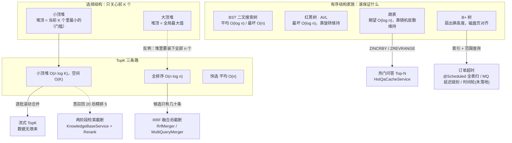
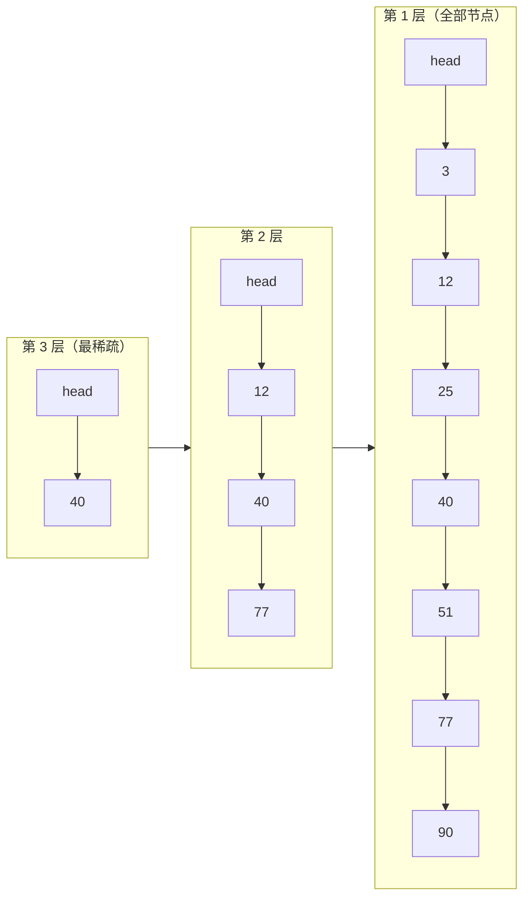
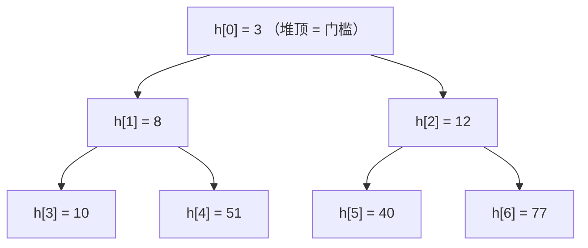
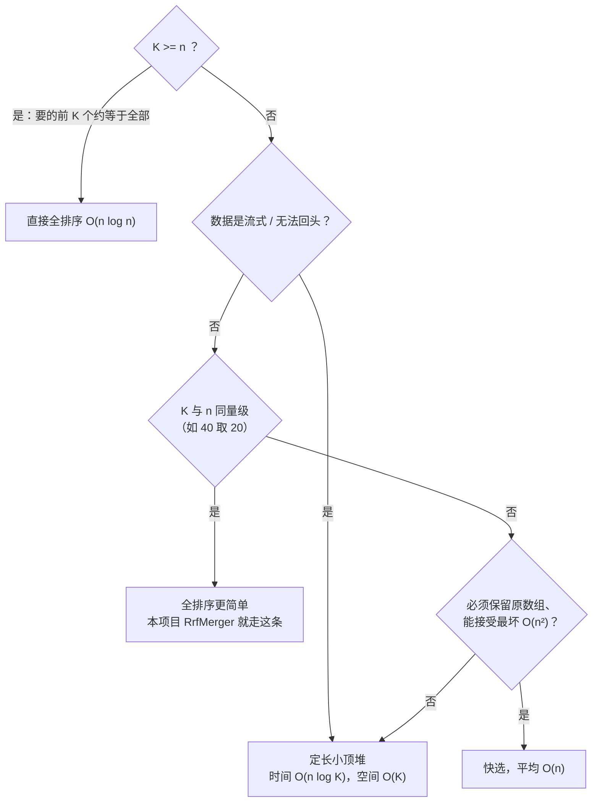
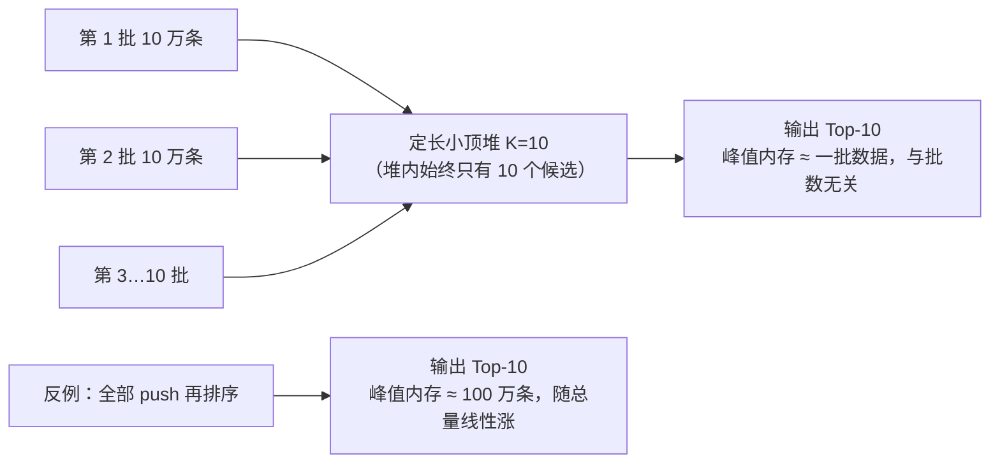
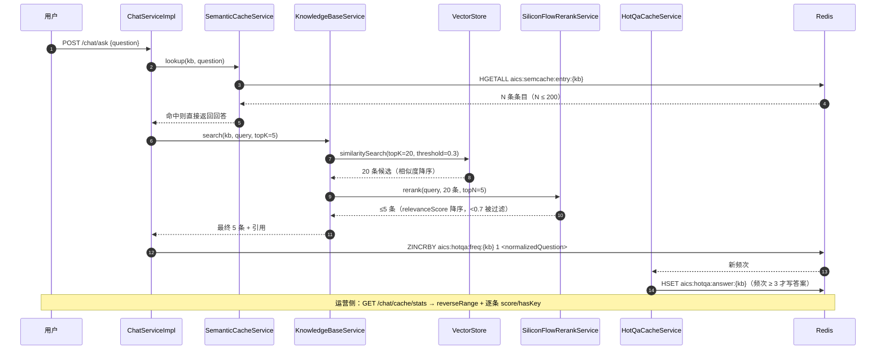

# 树、堆与 TopK：不排序也能知道前 K 个

> **一句话结论**：TopK 的价值不是"排序更快"，而是"根本不需要排序"——小顶堆把 O(n log n) 降到 O(n log K)，内存从 O(n) 降到 O(K)；选错结构时你付的是全排序的账单（本机实测 n=1e6、K=10 差 137 倍），选对结构时你只付一次扫描。
> **阅读前置**：会用 Java 集合（`PriorityQueue`、`TreeMap`）、知道二分查找和快排分区怎么走；Redis 只需要认识 `ZADD` / `ZRANGEBYSCORE` 这类命令名。没写过堆代码不影响，3.4 节从下标公式开始。
> **证据基线**：A 级 = `learning-docs/24-源码分析/assets/source` 里的框架源码摘录；B 级 = 本仓库真实 Java 代码 + 已核对行号；C 级 = 本机 Node 24.16 实跑输出（脚本随文给出，可原样复现）。预计阅读 40 分钟。

---

## 0. 先看现象

### 现象一：一个"查 Top 10"的接口，打了 21 次 Redis 往返

热门问答的运营看板接口 `GET /chat/cache/stats?knowledgeBase=knowledge&topN=10` 最终落到这个方法：

```java
// ai-cs-chat/src/main/java/com/aics/chat/cache/HotQaCacheService.java:129-145
public java.util.List<Map<String, Object>> topQuestions(String knowledgeBase, int topN) {
    Set<String> members = redisTemplate.opsForZSet().reverseRange(FREQ_KEY + knowledgeBase, 0, Math.max(0, topN - 1));
    java.util.List<Map<String, Object>> result = new java.util.ArrayList<>();
    if (members == null) {
        return result;
    }
    for (String member : members) {
        Double count = redisTemplate.opsForZSet().score(FREQ_KEY + knowledgeBase, member);
        Map<String, Object> item = new LinkedHashMap<>();
        item.put("question", member);
        item.put("count", count == null ? 0 : count.intValue());
        item.put("cached", Boolean.TRUE.equals(
                redisTemplate.opsForHash().hasKey(ANSWER_KEY + knowledgeBase, member)));
        result.add(item);
    }
    return result;
}
```

读代码数命令条数：`reverseRange` 1 次拿到 10 个 member，然后**每个 member 再发 2 次**（`score` 查分数 + `hasKey` 查是否已缓存），合计 `1 + 2×10 = 21` 次往返；`topN=50` 就是 101 次。分页大小直接把网络往返数乘上去。

### 现象二：定时任务日志说"扫描超时未支付订单"，但它是全表扫

```java
// ai-cs-order/src/main/java/com/aics/order/task/OrderTimeoutScheduler.java:29-41
@Scheduled(fixedDelay = 300000, initialDelay = 60000)
public void scanExpiredOrders() {
    log.info("定时任务：扫描超时未支付订单...");
    List<Order> expired = orderMapper.selectList(
            new LambdaQueryWrapper<Order>()
                    .eq(Order::getStatus, OrderStatus.PENDING_PAY.getCode())
                    .lt(Order::getExpireTime, LocalDateTime.now()));
```

产出 SQL 形状是 `SELECT ... FROM orders WHERE status = ? AND expire_time < ?`，每 5 分钟跑一次，把命中的订单**全部装进一个 List** 再逐条 `cancelExpiredOrder`。数据量小时看不出问题，订单表上千万行时这条查询的代价与"命中几条"无关。

### 现象三：一次 TopK=10，全排序 466.7ms，小顶堆 3.4ms

同样的输入（100 万个 `int32` 随机数）、同样的输出（前 10 个最大的数），只换"谁来选"：

```text
n=1000000 K=   10 | 全排序    466.7ms | 小顶堆     3.4ms | 快选    53.6ms | 三解一致=true | 堆/排序=0.01x 快选/堆=15.7x
n=1000000 K= 1000 | 全排序    461.5ms | 小顶堆     4.6ms | 快选    45.2ms | 三解一致=true | 堆/排序=0.01x 快选/堆=9.8x
n=1000000 K=10000 | 全排序    451.4ms | 小顶堆    16.8ms | 快选    54.2ms | 堆/排序=0.04x 快选/堆=3.2x
```

> 这些现象指向同一件事：**TopK 的代价不在"数据有多少"，而在"你让谁来做选择"**。全排序会为一个你根本不需要的全序付 O(n log n)；逐条回查会为"排好序但没带分数"付 1+2N 次往返；全表扫描会为"只关心最早到期的那几条"付整表 I/O。换成语义正确的结构（堆、zset、到期时间索引），代价立刻从"跟 n 走"变成"跟 K 走"。

---

## 1. 整体地图



> **读图说明**：上排是"有序结构"，它们的共同目标是**任意位置都能 O(log n) 找到**，代价是要维护序；下排是"选择结构"，目标是**只维护前 K 个的偏序**，代价是丢掉全局有序——这正是 TopK 便宜的根源。虚线是"反例/降级路径"：用大顶堆做 TopK 会把 n 个元素全塞进堆（跟全排序同量级空间），用两阶段检索时堆反而不赚（候选只有 20~60 条）。最右一列是本仓库的真实落点，全部可在第 3 节按行号核对。

| 组件 / 结构 | 责任 | 参与方（本仓库） | 证据 |
| --- | --- | --- | --- |
| Redis ZSET（跳表 + 字典） | 按分数排序、按排名取 Top-N、按分数范围取到期任务 | `HotQaCacheService`、`SemanticCacheService` | B：`ai-cs-chat/src/main/java/com/aics/chat/cache/HotQaCacheService.java:97,130` |
| 小顶堆（定长） | 流式维护"当前最大 K 个"，空间只跟 K 走 | 本仓库未使用（教科书实现见 3.5/3.6） | C：本机实测输出（0 节现象三、3.6 节） |
| 全排序 + limit | 候选集与 K 同量级时的最简实现 | `RrfMerger`、`MultiQueryMerger` | B：`ai-cs-search/src/main/java/com/aics/search/hybrid/RrfMerger.java:43-46` |
| 两阶段截断（宽召回 → 精排） | 粗排 20 条、交叉编码器只跑 5 条 | `KnowledgeBaseService`、`SiliconFlowRerankService` | B：`ai-cs-chat/src/main/java/com/aics/chat/service/KnowledgeBaseService.java:230,239` |
| 定时全表扫描 | 兜底关单（精度 5 分钟） | `OrderTimeoutScheduler`、`OrderTimeoutScanJob` | B：`ai-cs-order/src/main/java/com/aics/order/task/OrderTimeoutScheduler.java:29-41` |
| MQ 延迟级别 | 主路径延迟触发（18 个固定档位） | `OrderCreateTxService`、`RocketMqMessagePublisher` | B：`ai-cs-common/src/main/java/com/aics/common/mq/rocketmq/RocketMqMessagePublisher.java:25-30,83-94` |
| 时间轮 | O(1) 插入/取消的定时器 | **本仓库未落地**（只有注释提及） | 未落地，见 3.7 取舍表 |

---

## 2. 关键概念与关键类

先统一术语（后文全部按这套词用）：

- **树**：节点 + 父子关系的无环结构；**根**没有父、**叶子**没有子。
- **BST（二叉搜索树）**：任意节点满足 `左 < 自己 < 右`，于是查找能"每步砍一半"。**它不保证高度**，顺序插入 1..n 会退化成链表。
- **平衡树（AVL / 红黑树）**：在 BST 上追加"高度不失控"的不变量。AVL 要求左右子树高度差 ≤ 1（最严，旋转最勤）；红黑树只要求"最长路径 ≤ 2 × 最短路径"，用少量旋转换更多写吞吐。
- **堆（heap）**：**完全二叉树** + **堆序**（小顶堆：每个父 ≤ 子）。它只维护"根最小"，不维护左右谁大——这是它 O(log n) 就能插入的原因，也是它**不能**做有序遍历的原因。
- **堆化（sift up / sift down）**：把一个违反堆序的节点沿路径换到合法位置，代价 O(log n)。
- **快选（quickselect）**：借快排分区，只递归"包含第 n-K 名"的那一侧，平均 O(n)、最坏 O(n²)，且会打乱原数组。
- **跳表（skip list）**：多层链表，每层是下层的抽样"快速通道"，用抛硬币代替旋转来维持平衡，期望 O(log n)。
- **ZSET**：Redis 的有序集合，`member → score` 映射 + 按 score 排序的跳表索引，`ZINCRBY` / `ZREVRANGE` / `ZRANGEBYSCORE` 都是 O(log N) 起。
- **延迟队列 / 时间轮**：前者是"到期时间到了再投递"的消息机制；后者是把时间切成格子、任务挂在格子上的环形数组（Netty `HashedWheelTimer`、Kafka 分层时间轮）。

| 名称 | 位置 | 角色 | 关键方法 / 参数 |
| --- | --- | --- | --- |
| `HotQaCacheService` | `ai-cs-chat/src/main/java/com/aics/chat/cache/HotQaCacheService.java` | 用 ZSET 做"问题热度榜"：写侧 `ZINCRBY`，读侧 `ZREVRANGE` | `record()` L87、`topQuestions()` L129 |
| `SemanticCacheService` | `ai-cs-chat/src/main/java/com/aics/chat/cache/SemanticCacheService.java` | 用 ZSET 的 score 存"最近命中时间戳"做 LRU 淘汰依据 | `lookup()` L63、`evictOverflow()` L143 |
| `RrfMerger` | `ai-cs-search/src/main/java/com/aics/search/hybrid/RrfMerger.java` | 两路结果 RRF 融合后截断 Top-K（全排序 + limit） | `merge()` L35-47、`addScores()` L58 |
| `MultiQueryMerger` | `ai-cs-chat/src/main/java/com/aics/chat/rag/retrieve/MultiQueryMerger.java` | 多路（子查询 + HyDE）结果 RRF 融合后截断 | `merge(List<List<Document>>, topK, rrfK)` L37 |
| `HybridSearchServiceImpl` | `ai-cs-search/src/main/java/com/aics/search/hybrid/HybridSearchServiceImpl.java` | 单路召回 20 条 + RRF 常数 60 | `RETRIEVE_TOP_K` L41、`RRF_K` L44 |
| `KnowledgeBaseService` | `ai-cs-chat/src/main/java/com/aics/chat/service/KnowledgeBaseService.java` | 宽召回 20 → Rerank 5 的两阶段截断 | `recallTopK` L94-95、`search()` L228 |
| `RerankProperties` | `ai-cs-chat/src/main/java/com/aics/chat/rag/rerank/RerankProperties.java` | 精排条数与阈值 | `topN=5` L34、`minScore=0.7` L37、`timeoutMs=5000` L40 |
| `OrderTimeoutScheduler` | `ai-cs-order/src/main/java/com/aics/order/task/OrderTimeoutScheduler.java` | 定时全表扫描兜底关单 | `@Scheduled(fixedDelay=300000)` L29 |
| `SearchRequest`（Spring AI 2.1.0） | `24-源码分析/assets/source/SearchRequest.java.md` | 向量检索的 `topK` 载体，默认值 4 | `DEFAULT_TOP_K = 4` [[源码:SearchRequest.java.md#L49]]、`Builder.topK()` 断言非负 [[源码:SearchRequest.java.md#L158-L160]] |

---

## 3. 原理与证据逐段精读

### 3.1 二叉树 → BST → 平衡树：三个层次、三种保证

**在干什么。** 二叉树只规定"每个节点最多两个子节点"；BST 追加"左小右大"，让查找能二分；平衡树再多一条"高度受控"，让二分**始终**有效。三者是逐层加约束的关系，不是并列关系。

| 结构 | 不变量 | 查找 | 插入/删除 | 什么时候退化 |
| --- | --- | --- | --- | --- |
| 普通二叉树 | 无 | O(n) | O(1) 挂上去 | 永远没有"有序"可用 |
| BST | 左 < 父 < 右 | 平均 O(log n)，**最坏 O(n)** | 平均 O(log n) | 有序数据插入 → 退化成链表 |
| AVL | 左右子树高差 ≤ 1 | 最坏 O(log n) | O(log n)，旋转最频繁 | 写多读少时旋转开销压不住 |
| 红黑树 | 最长路径 ≤ 2×最短路径 | 最坏 O(log n) | O(log n)，旋转少 | 需要"按区间取一批"时仍要 O(log n + m) 逐格走 |
| B+ 树 | 一个节点装一页（几百个 key） | O(log_扇出 n)，千万行 3~4 层 | 页分裂/合并 | 内存场景用不上（页太大、缓存不友好） |

**为什么这么设计。** 保证越强，维护成本越高。工程上真正的问题永远是"我需要多强的保证"：只查不写 → AVL；读写混合且要最坏保证 → 红黑树（`TreeMap`、`HashMap` 的树化桶都是它）；要按排名/区间取一段 → 跳表；数据在磁盘 → B+ 树。

**换写法会怎样。** 用无序 `HashMap` 求 TopK，必须先全量捞出再排序；用 `TreeMap` 维护分数，插入是 O(log n) 但你仍然只能"从头往后 pop K 次"——如果 n 远大于 K，你用一棵完整的有序树去回答一个只需要偏序的问题。`Redis` 的 ZSET 之所以能"既要排名又要区间"，是因为它把"字典（member→score）"和"跳表（按 score 有序）"叠在一起。

**常见坑。** ① 用 `TreeMap` 当 TopK 容器：`firstEntry()` 拿的是最小值，想取最大 K 个得 `descendingMap()` 再遍历，代码绕且没省代价；② `Comparator` 与 `equals` 不一致（比如只按某个字段比较）会让 `TreeMap.containsKey` 出现"明明有却找不到"；③ 面试里说"BST 查找 O(log n)"会被追问"平均还是最坏"。

### 3.2 红黑树：用"颜色"换常数

**在干什么。** 红黑树给节点染色并规定 5 条性质（根黑、红节点子必黑、任一路径黑高相同等），由此推出"最长路径不超过最短路径两倍"，于是高度 ≤ 2log(n+1)。插入/删除靠变色 + 至多 3 次旋转恢复性质。

**为什么这么设计。** AVL 追求"高度最小"，代价是每次写都可能一路旋转到根；红黑树故意放宽平衡度，换来**写操作旋转次数有常数上界**。真实系统里读多写少但写必须快（内核 `rbtree`、Java 的 `TreeMap`、`ConcurrentHashMap` 的树化桶）都选红黑树。

**换写法会怎样。** 换成 AVL：查询路径平均短一点，写入慢一截，实测差异通常在小常数范围内——这类"平衡树之间的选择"很少有量级差。真正有量级差的是"平衡树 vs 跳表"（实现复杂度、区间查询、并发）和"平衡树 vs 堆"（是否需要全局有序）。

**常见坑。** ① 自己手写红黑树做 TopK——做题可以，工程里请用 `PriorityQueue`；② 误以为红黑树"不是严格平衡所以慢"，它依然是 O(log n) 最坏；③ 把 `ConcurrentSkipListMap`（跳表）和 `TreeMap` 的复杂度混着背。

### 3.3 跳表：为什么 Redis 用跳表而不是红黑树

**在干什么。** 跳表在有序链表上叠多层"快速通道"：每个节点以概率 P（Redis 用 1/4）升到上一层，查找从最高层开始向右走、走不动就下降一层。



> **读图说明**：查 51 时，从第 3 层走到 40，下降；第 2 层 40→77 越过目标，下降；第 1 层 40→51 命中。层数越高节点越少，等价于"二分查找的链表版"。Redis 的 `zskiplist` 就是这样一层层带着 `span`（跨度）字段，才能在 O(log N) 内算出排名，支撑 `ZRANGE` / `ZREVRANK`。

**为什么这么设计。** 三个理由，都不是"理论更优"：① **实现短**——跳表插入删除约 50 行，红黑树要处理一堆对称情形；② **区间查询天然便宜**——定位到起点后顺着第 1 层走 m 步即可，配合 `span` 还能边查排名边取范围；③ **并发/持久化友好**——跳表改的是局部指针，容易做 lock-free 变体（`ConcurrentSkipListMap`），也容易序列化。Redis 是单线程但主从复制/持久化都在复制数据，简单结构更省心。

**换写法会怎样。** 本机实测跳表 vs "有序数组 + 二分插入"（都是 O(log n) 查找，区别只在插入要搬移）：

```js
// 跳表核心（完整脚本见文末练习；P=1/4 与 Redis 同分布，MAX_LEVEL=16）
class SkipList {
  constructor() { this.head = { key: -Infinity, next: new Array(16).fill(null) }; this.level = 1; }
  insert(key) {
    const update = new Array(16).fill(this.head);
    let x = this.head;
    for (let i = this.level - 1; i >= 0; i--) {
      while (x.next[i] && x.next[i].key < key) x = x.next[i];
      update[i] = x;                                  // 记下每层的前驱
    }
    let lvl = 1;
    while (lvl < 16 && Math.random() < 0.25) lvl++;    // 抛硬币：Redis 用幂次定律得到同样分布
    if (lvl > this.level) { for (let i = this.level; i < lvl; i++) update[i] = this.head; this.level = lvl; }
    const node = { key, next: new Array(lvl).fill(null) };
    for (let i = 0; i < lvl; i++) { node.next[i] = update[i].next[i]; update[i].next[i] = node; }
  }
  range(lo, hi) {                                     // 范围查询：定位 + 逐格走
    let x = this.head;
    for (let i = this.level - 1; i >= 0; i--) while (x.next[i] && x.next[i].key < lo) x = x.next[i];
    const out = []; let cur = x.next[0];
    while (cur && cur.key < hi) { out.push(cur.key); cur = cur.next[0]; }
    return out;
  }
}
```

```text
插入 200000 条随机 key：有序数组(二分+splice) 2594.4ms | 跳表 892.8ms | 比值 2.9x
范围查询 [500000000, 500100000)：有序数组 0.073ms 命中16条 | 跳表 0.294ms 命中16条 逐格跳36次
数组占用≈1.5MB(仅数字) 跳表节点≈266000个(平均层数 1/(1-P))
```

**怎么读这个结果。** ① 插入差 2.9 倍，来自 `splice` 的 O(n) 搬移——**这正是 ZSET 不能用有序数组的理由**：`ZINCRBY` 每秒上万次，每次搬移几十万个元素不可接受；② 范围查询跳表反而慢 4 倍（0.294ms vs 0.073ms）——数组是连续内存、命中 CPU 缓存，跳表是指针追逐（每次跳都是随机访存）。所以跳表赢的是**写**，不是**读区间**；③ 内存上跳表多付约 1/(1-P)=1.33 倍指针空间。**边界**：这些数字只说明常数因子，不能当复杂度证明；换个 P、换台机器、换成 Java 对象，比例都会变，但"插入搬移 vs 指针改链"这个结构性差别不会变。

**常见坑。** ① 以为跳表"比红黑树快"——单点查找它通常略慢；② 忘记 `MAX_LEVEL` 与 P 的取舍（层太多浪费内存、太少退化成链表）；③ 在 Redis 里用 `ZRANGE key 0 -1` 拉整个榜单再在应用里排序——把 O(log N + K) 变成 O(N)。

### 3.4 堆：结构性质与两个堆化操作

**在干什么。** 堆 = **完全二叉树**（除最后一层都填满、最后一层靠左连续）+ **堆序**（小顶堆：`parent ≤ child`）。完全二叉树可以用数组存，0 基下标公式：

| 关系 | 公式 | 备注 |
| --- | --- | --- |
| 父节点 | `(i-1) >> 1` | `i=0` 时为 0（根的自环，循环前要判） |
| 左孩子 | `2i + 1` | 越界即无孩子 |
| 右孩子 | `2i + 2` | 越界即无孩子 |
| 最后一个非叶子 | `(n >> 1) - 1` | 建堆从这里往前扫 |

堆能干什么、不能干什么，一张表说完（`java.util.PriorityQueue` 同构）：

| 操作 | 复杂度 | 说明 |
| --- | --- | --- |
| `peek()` 取堆顶 | O(1) | TopK 的"门槛"就是它 |
| `offer()` / `add()` 插入 | O(log n) | 沿一条路径 sift up |
| `poll()` 弹出堆顶 | O(log n) | 末尾元素换到根再 sift down |
| 批量建堆（Floyd） | **O(n)** | 不是 n × log n |
| `remove(Object)` / `contains` | **O(n)** | 线性查找 + 堆化；`PriorityQueue` 没有 `decrease-key` |
| 遍历全部元素 | O(n) | 就是数组顺序，**不是**有序输出 |



> **读图说明**：这棵树按层序填进数组就是 `[3, 8, 12, 10, 51, 40, 77]`；反过来用公式验证：`h[6]=77` 的父亲是 `(6-1)>>1 = 2`，正好是 `h[2]=12`。注意 `h[3]=10 > h[4]=51` 完全合法——**堆只保证父子有序，不保证兄弟有序**。这条"少维护一半关系"的取舍，就是堆比平衡树省空间的根本原因，也是它无法有序遍历的代价。

两个基本操作：**sift up**（新元素往上顶，用于插入）和 **sift down**（堆顶违规元素往下沉，用于弹出/替换堆顶）。两者都是"沿一条根到叶的路径换位"，代价 O(log n)。

```java
// sift down：把 i 位置的元素沉到合法位置（小顶堆；数组 h，有效长度 n）
static void siftDown(int[] h, int i, int n) {
    int v = h[i];
    while (true) {
        int c = 2 * i + 1;              // 左孩子
        if (c >= n) break;              // 没有孩子 → 到底了
        if (c + 1 < n && h[c + 1] < h[c]) c++;   // 取较小的孩子
        if (h[c] >= v) break;           // 孩子都不比自己小 → 位置正确
        h[i] = h[c];                    // 孩子上移
        i = c;
    }
    h[i] = v;                           // 最后落位（省掉一路上反复交换）
}
```

**为什么这么设计。** 堆只维护"根是最小值"这一条**偏序**，不维护左右子树之间的大小关系，所以插入只需跟一条路径比较、不需要旋转、不需要额外指针（数组下标算出来）。这就是为什么它比平衡树省：`PriorityQueue` 每个元素只占一个引用位，没有 left/right/color。

**换写法会怎样。** 建堆如果用"逐个 sift up"是 O(n log n)；用 Floyd 方法（从 `(n>>1)-1` 往前逐个 sift down）是 **O(n)**——直觉是：n/2 个叶子不动，n/4 个最多沉 1 层，n/8 个最多沉 2 层……总代价 `Σ (n/2^(h+1))·h` 收敛到 O(n)。换成平衡树建堆则必然是 O(n log n)，且常数更大。

**常见坑。** ① 用"逐个插入"建堆却以为是 O(n)；② `siftDown` 里忘记"取较小的孩子"——大顶堆取较小孩子、小顶堆取较大孩子，写反了堆序就悄悄坏掉（不报错，只是结果错）；③ 数组 0 基下标写成 1 基公式（`2i` / `2i+1`），根的孩子直接错位；④ 以为 `PriorityQueue.remove(Object)` 是 O(log n)——它是 `indexOf` 线性找 + 删除，**O(n)**，`contains` 同理。

### 3.5 TopK 的三种解法：为什么"求最大 K 用最小堆"

**在干什么。** 求"最大的 K 个"有三种经典做法，代价完全不同：

| 解法 | 时间复杂度 | 空间 | 是否需要全序 | 适用规模 |
| --- | --- | --- | --- | --- |
| 全排序后取前 K | O(n log n) | O(n) | 需要 | n 很小，或 K ≈ n |
| 定长**小顶堆** | O(n log K) | O(K) | 不需要 | K ≪ n；**流式**唯一选择 |
| 快选（quickselect） | 平均 O(n)，最坏 O(n²) | O(n)（要打乱副本） | 不需要 | 一次性、数据可随机访问 |

小顶堆做 TopK 的关键直觉：**堆里装的永远是"目前见过的最大的 K 个"，因此堆顶是这 K 个里最小的那个——它是"进入前 K 名的门槛"**。新元素只跟堆顶比：比门槛小直接丢（O(1)），比门槛大就替换堆顶并 sift down。因为绝大多数元素都会被 O(1) 丢掉，整体只付 O(n log K)。

```js
// 定长小顶堆做 TopK（求最大 K 个）：h 是长度 K 的堆数组，size 是已填数量
function heapTopK(a, K) {
  const h = new Float64Array(K);
  let size = 0;
  for (let i = 0; i < a.length; i++) {
    const v = a[i];
    if (size < K) {
      h[size++] = v;                                  // 先填满 K 个
      if (size === K) for (let j = (K >> 1) - 1; j >= 0; j--) siftDown(h, j, K);  // 填满时一次建堆 O(K)
    } else if (v > h[0]) {                            // 和门槛（堆顶）比
      h[0] = v; siftDown(h, 0, K);                    // 过了门槛才进堆
    }
  }
  return Array.from(h.subarray(0, size)).sort((x, y) => y - x);
}
```

真正落到代码时，选哪条路靠四个判断：



> **读图说明**：第一个判断就把"堆"排除了——K ≈ n 时堆等于全排序还多了常数。第二个判断是堆真正不可替代的地方：数据无限来，你根本没法"最后统一排"。第三个判断解释了为什么本仓库的 RRF 融合不用堆（候选 40、取 20，同量级）。第四个判断才轮到快选，且它对数据形态有要求（可随机访问、可修改、一次性）。

**为什么这么设计。** 因为"第 K 名"是一个**只跟 K 有关**的边界。全排序会算出所有人的名次（你不需要），快选会算出"第 K 名是谁"但会毁掉原数组，而堆只维护"当前 K 个候选 + 它们的下限"——这正是流式场景唯一可行的形态（数据无限来，你没法回头排序）。

**换写法会怎样。** 换成**大**顶堆：堆顶是当前最大值，新元素跟最大值比永远是"更小"，进不了堆；要想用它求最大 K 个，得把 n 个元素全塞进堆再 pop K 次——空间 O(n)、时间 O(n log n)，等于自己实现了个更慢的排序。

**本机实测（Node 24.16，同一份数据、三种解法交叉校验）**：

```text
n= 100000 K=   10 | 全排序     39.6ms | 小顶堆     1.6ms | 快选     8.4ms | 三解一致=true | 堆/排序=0.04x 快选/堆=5.4x
n= 100000 K= 1000 | 全排序     37.3ms | 小顶堆     1.4ms | 快选     5.6ms | 三解一致=true | 堆/排序=0.04x 快选/堆=4.0x
n= 100000 K=10000 | 全排序     37.0ms | 小顶堆     7.9ms | 快选     8.4ms | 三解一致=true | 堆/排序=0.21x 快选/堆=1.1x
n=1000000 K=   10 | 全排序    466.7ms | 小顶堆     3.4ms | 快选    53.6ms | 三解一致=true | 堆/排序=0.01x 快选/堆=15.7x
n=1000000 K= 1000 | 全排序    461.5ms | 小顶堆     4.6ms | 快选    45.2ms | 三解一致=true | 堆/排序=0.01x 快选/堆=9.8x
n=1000000 K=10000 | 全排序    451.4ms | 小顶堆    16.8ms | 快选    54.2ms | 三解一致=true | 堆/排序=0.04x 快选/堆=3.2x
```

**怎么读这个结果。** ① **n 翻 10 倍，全排序的时间翻 10 倍多**（37ms → 451ms，与 n log n 同向），而**小顶堆只翻 2 倍**（K=10 时 1.6ms → 3.4ms）——这是 O(n) 与 O(n log n) 的结构差别；② **K 从 10 涨到 10000，堆从 3.4ms 涨到 16.8ms**（约 5 倍），而 log₂10000/log₂10 ≈ 3.3，量级一致，说明"K 主要影响 log K 因子"；③ **快选比堆慢 3~16 倍**——不是复杂度输了（平均 O(n) 理论上更快），而是它必须先把 `Int32Array` 装箱复制成 `Array<number>`（1e6 个数实测 +12.19MB，见下），再做多轮分区，每次分区都是随机访存。**这条最能说明问题：复杂度更优 ≠ 更快，常数因子和内存局部性可以反超对数因子**；④ `三解一致=true` 是正确性闸门——三种实现必须给出完全相同的 Top-10 序列，否则是堆写错了。

```text
n=1000000 输入 Int32Array 3.81MB；Array.from 复制实测 +12.19MB；小顶堆堆数组 K=10 → 0.08KB，K=10000 → 78KB（K×8 字节）
```

**内存怎么读**：全排序/快选都要先复制一份可排序的数组（实测 +12.19MB），堆只要 K×8 字节（K=10 时 80 字节）。**这条是 TopK 用堆最硬的理由**：内存占用与 n 无关。

**常见坑。** ① K ≥ n 时堆退化为全排序，不如直接排（判断 `K >= n` 走全排序分支）；② K=1 时根本不用堆，一次扫描求 max 就是 O(n)；③ 堆里存的是"值"还是"对象 + 比较器"决定常数因子：实测中 `Float64Array` 版本比 `Array<对象>` 快数倍（少了指针追逐）；④ 相等值的稳定性——TopK 常常要"分数相同按 id 决胜"，比较器必须补第二关键字，否则结果不可复现。

### 3.6 流式 TopK：数据无限来时，堆是唯一解

**在干什么。** 数据一批批到达（日志逐行、请求逐个、分区消息逐条），总量不可知也放不下。此时"最后统一排序"不可行，只能**边读边裁**：始终维护一个长度 K 的小顶堆，每批数据进来就跟门槛比。

**为什么这么设计。** 因为 TopK 有**可结合性**：`topK(A ∪ B) = topK(topK(A) ∪ topK(B))`。于是可以分批求、再合并，峰值内存只跟"批大小 + K"有关，与总量无关。



> **读图说明**：左边是"边读边裁"：每批数据进堆时只保留可能进 Top-10 的元素，批处理完即回收，所以 10 批和 100 批的峰值内存几乎一样。下面那条是反例：所有元素都留在内存里，只在最后排一次——正确但内存随总量线性增长，这就是 3.6 节实测里 21.0MB vs 2.0MB 的来源。

```text
A 累积全排序: 保留 1000000 条, 峰值增量 21.0MB, 耗时 414ms, top1=99999987
B 定长小顶堆: 保留 10 条, 峰值增量 2.0MB, 耗时 18ms, top1=99999987 top10=99998849
B 堆内顺序正确=true
```

**怎么读这个结果。** 10 批 × 10 万条：方案 A 把 100 万条都保留在内存里（峰值 +21MB），方案 B 只留 10 条（峰值 +2MB，主要是那一批 10 万条 `Int32Array` 本身，批处理完就可回收）。耗时 414ms vs 18ms（23 倍）。**关键不是倍数，而是斜率**：把批次从 10 加到 100，A 的峰值内存线性涨到 +210MB，B 仍然是那 2MB。这决定了"能不能吃完这条流"。

**换写法会怎样。** 换成"每批各自排序后存下来、最后归并"——正确但峰值内存 O(n)；换成"维护全量有序结构（`TreeMap`）"——每次插入 O(log n)，总量 O(n) 空间，等于没裁。

**常见坑。** ① **初始化遗漏建堆**：前 K 个元素直接塞进数组就当成堆用，堆顶不是门槛，后续替换逻辑全错——这是最常见的 0 分 bug，用"三解交叉校验"能一次抓出；② `K=0` 或 `K` 大于实际元素数时的边界返回（应返回空/全部，不是空指针）；③ 流式场景不能"回头改"：如果上游允许"删除/更新"，堆无法处理撤销，得换 zset 之类支持删除的结构；④ 分布式下每分片求 TopK 再归并（多路归并 O(N log 分片数)），归并能省带宽但要多一轮 shuffle。

### 3.7 延迟队列与时间轮：定时任务的两种实现

订单超时是"到点做一件事"的典型。本仓库有两条真实路径 + 一种未落地方案：

**路径一：定时全表扫描（兜底，已落地）**。`OrderTimeoutScheduler` 每 5 分钟 `selectList(status=PENDING_PAY and expire_time < now)` 再逐条取消（`ai-cs-order/src/main/java/com/aics/order/task/OrderTimeoutScheduler.java:29-53`），类注释 L18 明确写着"主路径为 RocketMQ 延迟消息，此处兜底防止消息丢失"。代价：扫描次数 × 表大小（与命中条数无关），且关单精度最多差 5 分钟。

**路径二：MQ 延迟消息（主路径，已落地）**。下单事务里发一条延迟消息：

```java
// ai-cs-order/src/main/java/com/aics/order/service/impl/OrderCreateTxService.java:143-146
// 7. 发送延迟消息（超时取消）
rocketMQTemplate.syncSend("order-timeout-topic",
        MessageBuilder.withPayload(orderNo).build(),
        5000, 16); // delayLevel 16 ≈ 30min
```

注意 RocketMQ **不支持任意毫秒**：只有 18 个固定档位（`ai-cs-common/src/main/java/com/aics/common/mq/rocketmq/RocketMqMessagePublisher.java:25-30`：1s 5s 10s 30s 1m 2m 3m 4m 5m 6m 7m 8m 9m 10m 20m 30m 1h 2h），`resolveDelayLevel()`（同文件 L83-94）的处理是"取第一个不早于期望值的档位，超过 2 小时直接抛异常，而不是静默改小"。

**方案三：时间轮（本仓库未落地）**。时间轮是固定长度的环形数组 + 每格的链表/集合，插入与取消都是 O(1)（取消只需从链表摘除），适合**海量且频繁取消**的定时任务（连接空闲检测、心跳超时）。Netty 的 `HashedWheelTimer`、Kafka 的分层时间轮是标准实现；本仓库只有一处注释提到"需要可靠延迟应改用：定时任务扫描 + 时间轮"（`ai-cs-common/src/main/java/com/aics/common/mq/kafka/KafkaMessagePublisher.java:27`），**没有实现**。

| 方案 | 触发精度 | 单次代价 | 取消代价 | 适合规模 | 本仓库状态 |
| --- | --- | --- | --- | --- | --- |
| 定时全表扫描 | 扫描周期（5 分钟） | O(扫描行数) + 逐条更新 | O(1)（改状态即可） | 中小表 / 兜底 | **已落地**（`OrderTimeoutScheduler`） |
| MQ 延迟消息 | 固定档位（30min → level 16） | O(1) 发一条消息，服务端负责定时 | 需发取消消息/状态幂等 | 大流量，档位够用 | **已落地**（主路径） |
| XXL-Job 集中调度 | 调度中心配置 | 同定时任务 | 同定时任务 | 多实例不重复触发 | **已落地但默认关闭**：`ai-cs-order/src/main/java/com/aics/order/task/XxlJobConfig.java:23` 用 `@ConditionalOnProperty(aics.xxl-job.enabled)` 控制，`ai-cs-order/src/main/resources/application.yml:54` 默认 `false` |
| 时间轮 | 毫秒级 | 插入 O(1) | 摘链 O(1) | 十万级以上定时器、频繁取消 | **未落地**（仅注释提及） |
| Redis ZSET 延迟队列 | 轮询间隔 | `ZADD` O(log N)、`ZRANGEBYSCORE` O(log N + m) | `ZREM` O(log N) | 中期规模、想复用 Redis | **未落地**（本仓库 ZSET 只用于热度榜/语义缓存索引） |

> 三条已落地路径的分工是"精度 vs 成本"：MQ 延迟消息负责**及时**（几乎准点），定时扫描负责**不漏**（消息丢了也能兜住），XXL-Job 负责**多实例不重复**（集中调度 + 状态机幂等）。时间轮解决的是另一个维度的问题——"定时器数量上百万、还要频繁取消"，那才是它不可替代的场景。

### 3.8 项目落点一：热门问答用 ZSET，因为要的是"按频次排名"

**在干什么。** 每个问题回答完记一次分，运营端按分数倒序取 Top-N：

```java
// ai-cs-chat/src/main/java/com/aics/chat/cache/HotQaCacheService.java:92-102（写侧）
String normalized = EmbeddingMath.normalizeQuestion(question);
if (normalized.isEmpty()) {
    return;
}
Double count = redisTemplate.opsForZSet().incrementScore(FREQ_KEY + knowledgeBase, normalized, 1);
redisTemplate.expire(FREQ_KEY + knowledgeBase,
        Duration.ofHours(Math.max(1, properties.getHotQa().getTtlHours())));
if (count != null && count >= properties.getHotQa().getPromoteThreshold()) {
    save(knowledgeBase, normalized, answer);   // 频次达标才把答案写进 Hash
}
```

**为什么这里用 ZSET 而不是堆。** 三个硬约束：① **写侧要能更新已有元素的分数**（同一个问题再来一次要 +1），堆不支持"改中间元素的分数"（要 decrease-key，Java 的 `PriorityQueue` 根本没有）；② **数据长期存在、要去重**，堆是内存中的临时结构；③ **要按排名范围取**（Top-10 / 翻页），ZSET 的 `ZREVRANGE` 是 O(log N + K)，而"堆"在服务重启后就没了。ZSET 内部正是"字典 + 跳表"：字典负责 member→score 的 O(1) 更新，跳表负责按 score 排序 + 排名。

**换写法会怎样。** 用 Redis Hash 存 `问题 → 次数`，取 Top-N 时 `HGETALL` 全量拉回应用再排序：O(N) 网络 + O(N log N) 排序，N=10 万问题时就是 10 万条数据过网。这正是**旧稿写错的地方**——它在讲解里假设了 `reverseRangeWithScores`（一次往返拿 member + score），但真实代码是 `reverseRange` + 逐个 `score()`（见 0 节现象一）。改法很简单：

```java
// 现状：1 + 2N 次往返（HotQaCacheService.java:130-141）
Set<String> members = redisTemplate.opsForZSet().reverseRange(FREQ_KEY + kb, 0, topN - 1);
for (String m : members) { Double c = redisTemplate.opsForZSet().score(FREQ_KEY + kb, m); /* + hasKey */ }

// 改成 2 次往返：一次带分数取榜，一次批量判断是否已缓存
Set<ZSetOperations.TypedTuple<String>> top =
        redisTemplate.opsForZSet().reverseRangeWithScores(FREQ_KEY + kb, 0, topN - 1);
// 再对这批 member 用 opsForHash().multiGet(ANSWER_KEY + kb, members) 一次拿回是否缓存/答案
```

**常见坑。** ① 用原始问题当 member：换行、全角空格、首尾空白都会变成不同的 member，热度被稀释——代码用 `EmbeddingMath.normalizeQuestion` 归一化（L93）；② 归一化太激进会把"退款"和"如何退款"合并，榜单失去区分度；③ `ZINCRBY` 写在 `try/catch` 里且只 `log.warn`（L103-105）——热度榜是**旁路**，Redis 挂了不能影响回答；④ 忘记 `expire`：榜单会无限长，且 `ZINCRBY` 的 O(log N) 会随 N 变慢。

### 3.9 项目落点二：RRF 融合之后，为什么"全排序 + limit"才是对的

**在干什么。** 混合检索拿到两路候选（各 20 条），用 RRF 累加排名分再取前 `topK`：

```java
// ai-cs-search/src/main/java/com/aics/search/hybrid/RrfMerger.java:35-47
public static List<RankedItem> merge(List<RankedItem> list1, List<RankedItem> list2, int topK, int k) {
    Map<String, Double> scores = new HashMap<>();
    Map<String, RankedItem> items = new HashMap<>();
    addScores(scores, items, list1, k, true);
    addScores(scores, items, list2, k, false);
    items.values().forEach(item -> item.setScore(scores.getOrDefault(item.getId(), 0.0)));
    return items.values().stream()
            .sorted((a, b) -> Double.compare(b.getScore(), a.getScore()))   // 全排序
            .limit(topK)                                                     // 再截断
            .collect(Collectors.toList());
}
```

对话侧的多路版本（子查询 + HyDE，路数不定）是同样的思路：`MultiQueryMerger.merge(List<List<Document>> results, int topK, int rrfK)`（`ai-cs-chat/src/main/java/com/aics/chat/rag/retrieve/MultiQueryMerger.java:37`），累加 `1/(k+rank)`（L58）后 `sortedIds.sort(...)` 全排序（L66）再 `break` 截断（L69-72）。

**为什么这里**不**建堆。** 因为候选集和 K 是**同一量级**：`RETRIEVE_TOP_K=20`、`RRF_K=60`（`ai-cs-search/src/main/java/com/aics/search/hybrid/HybridSearchServiceImpl.java:41,44`），两路合并后最多 40 条，取前 5~20 条。堆的收益来自 `log K ≪ log N`，这里 `log₂20 ≈ 4.3`、`log₂40 ≈ 5.3`，差 1 个数量级都没有——省下的比较次数（几十次）远小于"多写一个堆 + 丢失全局有序中间结果"的成本。而且 RRF 常常要**把融合分写回元数据供调试**（`MultiQueryMerger.java:74` 写 `metadata.rrfScore`），全排序顺手就有全部顺序。

**换写法会怎样。** 换成堆：代码从 5 行变 20 行，性能提升落在噪声里，还引入了新的错法。反过来，如果候选集变成 40 万（比如把 ES 的 `size` 从 20 调到 2000 去"宽召回"），堆立刻变成必需——**判断阈值是 `K ≪ N`，不是"TopK 就该用堆"**。

**常见坑。** ① 以为"用了 RRF 就得用堆"（本仓库的真实反例）；② `k` 参数（平滑常数）取太小会放大单路偶然排名，取 60 是业界默认；③ 分数字典用 `HashMap` 则遍历顺序不稳定，用 `LinkedHashMap`（`MultiQueryMerger` 就是这么做的）能保证同分时结果可复现；④ 以为 RRF 只能两路——`RrfMerger` 是两路签名，`MultiQueryMerger` 已经是 `List<List<Document>>` 多路。

### 3.10 项目落点三：宽召回 20 + 精排 5，两阶段截断的经典用法

**在干什么。** 向量检索先用低阈值多召回，再用交叉编码器精排，最终只留 5 条进 Prompt：

```java
// ai-cs-chat/src/main/java/com/aics/chat/service/KnowledgeBaseService.java:228-257（节选）
public List<Document> search(String knowledgeBase, String query, int topK, double threshold) {
    // 阶段一：宽召回
    List<Document> recallDocs = searchRaw(knowledgeBase, query, recallTopK, recallThreshold);
    if (recallDocs.isEmpty()) {
        return recallDocs;
    }
    // 阶段二：Rerank 精排（可选，bean 不存在或调用失败时退化）
    RerankService rerankService = rerankServiceProvider.getIfAvailable();
    if (rerankService != null) {
        try {
            List<RerankResultItem> reranked = rerankService.rerank(query, recallDocs, topK).block();
            ...
        } catch (Exception e) { log.warn("...Rerank调用异常，降级为相似度排序: {}", ...); }
    }
    // 退化路径：向量检索结果已按相似度降序，直接取 Top-N
    List<Document> fallback = recallDocs.size() <= topK ? recallDocs : recallDocs.subList(0, topK);
    return fallback;
}
```

参数落点：`recallTopK` 默认 20、`recallThreshold` 默认 0.3（`KnowledgeBaseService.java:94-99`，可被 `aics.rag.recall-top-k` / `aics.rag.recall-threshold` 覆盖）；精排 `topN=5`、`minScore=0.7`、`timeoutMs=5000`（`ai-cs-chat/src/main/java/com/aics/chat/rag/rerank/RerankProperties.java:34,37,40`）。而 Spring AI 自己的默认只取 4 条：`DEFAULT_TOP_K = 4`（[[源码:SearchRequest.java.md#L49]]），且 `Builder.topK()` 断言非负（[[源码:SearchRequest.java.md#L158-L160]]）——项目显式覆盖成 20/5 是刻意的两阶段设计。

**为什么这么设计。** 因为**两阶段的"每单位代价"完全不同**：粗排（向量余弦 + HNSW 近似索引）算一次距离很便宜，可以扫大候选；精排（Cross-Encoder，把 query 和 doc 拼起来过一遍 transformer）每条都要一次模型前向，代价高 1~2 个数量级。于是"粗排宽、精排窄"：K 从 20 收到 5，精排成本降 4 倍，而召回率由 20 条宽召回兜住。这也解释了为什么 `setTopN(Math.min(topN, documents.size()))`（`ai-cs-chat/src/main/java/com/aics/chat/rag/rerank/SiliconFlowRerankService.java:180`）要做 `min`——避免让模型算比候选还多的条数。

**换写法会怎样。** 取消两阶段、直接向量检索 topK=5：省一次网络调用，但向量相似度是"粗排"，语义近似不等于相关，答案质量掉得明显。反过来把精排 topN 拉到 20：成本翻 4 倍，Context 里塞满弱相关片段，反而稀释 Prompt。

**常见坑。** ① **`search()` 的 `threshold` 形参没被使用**——L230 传的是成员变量 `recallThreshold`，所以调用方传 `0.0` 想让"全部召回"是不生效的（这是真实的、可核对的接线 bug，验证方法见 6 节）；② 宽召回阈值太低（0.3）会让 OCR 噪声、页码碎片进候选，靠 `minScore=0.7` 兜住，但精排 API 挂了就全漏进来；③ Rerank 超时后 `block()` 得到 `null`，必须走 fallback（L257），否则返回空导致"有知识库却答不出来"；④ 精排返回的 `index` 要映射回原 `recallDocs` 下标，越界要跳过（L244 有判空保护）。

---

## 4. 一次完整执行时序



> **读图说明**：这张图把本篇的四个落点串成一条链。第 2~4 步是"线性扫描找最相似"（语义缓存，上限 200 条，n 有界所以 O(n) 可接受）；第 6~7 步是**两阶段截断**（20 → 5，宽召回 + 精排）；第 12~13 步是**ZSET 计数**（写侧 O(log N)，读侧按排名取 K）；第 14 步是**读侧 TopN**（也就是 0 节那个 1+2N 往返）。注意"排序"只发生在 8 步（精排模型内部）和 14 步（Redis 跳表内部），应用层没有任何一次全排序——这是这套设计的关键。

各步失败时的表现（都是代码里可核对的降级/抛错分支）：

| 步骤 | 失败原因 | 实际表现 | 证据 |
| --- | --- | --- | --- |
| 3 语义缓存读 | Redis 超时/连不上 | `catch` 后 `Optional.empty()`，主链路继续 | `SemanticCacheService.java:102-105` |
| 7 向量检索 | 向量库异常 | `searchRaw()` 内无 `try/catch`，异常抛给调用方；走 `HybridRetriever` 时被兜住并降级纯向量 | `KnowledgeBaseService.java:265-279`、`ai-cs-chat/src/main/java/com/aics/chat/rag/retrieve/HybridRetriever.java:302-305` |
| 9 精排调用 | 无 API Key / 5s 超时 / 网络错误 | `onErrorResume` 返回 `Mono.empty()` → `block()` 得 `null` → 走 `subList(0, topK)` | `SiliconFlowRerankService.java:129-133,155-159`、`KnowledgeBaseService.java:257` |
| 12 热度计数 | Redis 异常 | `log.warn` 后忽略，回答照常返回 | `HotQaCacheService.java:103-105` |
| 14 榜单查询 | member 已过期被删 | `score()` 返回 `null` → `count` 记 0，不抛异常 | `HotQaCacheService.java:136-139` |

---

## 5. 设计取舍

| 决策点 | 选了什么 | 放弃了什么 | 什么时候该反过来 |
| --- | --- | --- | --- |
| 热度榜载体 | Redis ZSET（字典 + 跳表） | 不支持"任意自定义二级排序"；榜单在 Redis 里，内存有限（本仓 Redis 单节点 256MB `allkeys-lru`） | 需要多维排序/聚合统计 → 落库（MySQL/ClickHouse）离线算 |
| 热度榜读侧 | `reverseRange` + 逐条回查（1+2N 往返） | 少一次 API 调用（`reverseRangeWithScores` 就够） | topN 超过 20 或该接口被高频调用时，必须改成一次取带分数 |
| 融合截断 | 全排序 + limit | 大规模候选时的理论最优 | 候选数 ≫ K（如 2000 取 10）→ 换小顶堆 |
| 召回结构 | 两阶段（20 → 5） | 一次检索的简单性；多一次网络调用 + 5s 超时预算 | 延迟极敏感、且文档集很小 → 单阶段 topK=5 |
| 超时关单 | MQ 延迟消息（主）+ 5 分钟全表扫（兜底） | 精确到秒的能力；扫描对 DB 的压力 | 定时器量级到十万+、需要频繁取消 → 时间轮 |
| 调度入口 | `@Scheduled` + `@XxlJob` 双通道，默认只开 `@Scheduled` | XXL-Job 默认不装配（`aics.xxl-job.enabled=false`） | 多实例部署必须开 XXL-Job，否则每个实例都会扫一遍（虽有状态机幂等，但白跑 DB） |
| TopK 实现落地 | 应用层**没有**手写堆 | 放弃"教学上最漂亮"的实现 | 出现"流式、超大候选、K 远小于 n"的真实需求时再引入 |

**可扩展点清单**：

1. `topQuestions()` 换 `reverseRangeWithScores` + `multiGet`，把 1+2N 次往返压到 2 次（改动只在这一个方法内，返回值结构不变）。
2. 抽一个通用 `TopKCollector<T>`（定长小顶堆 + 自定义比较器 + 合并方法），给"日志热点 TopK""接口耗时 TopK"这类流式统计复用。
3. RRF 融合与截断解耦：`merge()` 返回全量有序列表，由调用方决定 `limit` 还是喂给堆——现在截断写在 `merge()` 里。
4. 语义缓存的线性扫描（上限 200，`SemanticCacheService.java:76-87`）可换成"先用 ZSET 按最近命中时间取 K 个最近条目再算相似度"，把 O(n) 降到 O(K)。
5. 订单超时若要做到分钟级精度，可加 Redis ZSET 延迟队列（`score = 到期时间戳`，`ZRANGEBYSCORE 0 now` 捞到期任务），与热度榜共用同一套 ZSET 心智，不必引入新组件。
6. 时间轮：只有在"定时器数量 × 取消频率"真的成为瓶颈时才引入（Netty `HashedWheelTimer` 或 Kafka 分层时间轮思路），否则属于过度设计。

---

## 6. 踩坑与调试手法

| # | 现象 | 根因 | 验证手法 | 解法 |
| --- | --- | --- | --- | --- |
| 1 | 一次榜单请求的 Redis 命令数 = `1+2×topN`（topN=10 即 21 条），往返延迟随 `topN` 线性叠加 | `topQuestions` 逐 member 回查分数与缓存标记 | **真调试手法**：`redis-cli MONITOR` 观察一次请求的命令流，数出 `zrevrange` 之后跟了多少条 `zscore` / `hexists` | 换 `reverseRangeWithScores` + `multiGet`，2 次往返 |
| 2 | 传 `threshold=0.0` 想"全量召回"，实际只返回命中少数几条 | `search()` 的 `threshold` 形参未被使用，L230 用的是成员变量 `recallThreshold`（默认 0.3） | **真调试手法**：打开 `searchRaw()` 里的日志"宽召回完成: 命中 N 条"（L277），对比"向量库里该 kb 的文档数"，条数明显偏少即阈值在生效 | 让 `search()` 用传入的 `threshold`（或删掉该形参，避免误导） |
| 3 | TopK 结果漏掉明显更大的元素 | 堆初始化没建堆：前 K 个元素直接塞进数组就拿来比堆顶，堆顶不是门槛 | **真调试手法**：交叉校验——同一数据用"全排序取前 K"和"堆"各跑一次，比对序列（本篇脚本里的 `三解一致` 就是这道闸门） | 填满 K 个后立即 Floyd 建堆 `for (j = K/2-1; j >= 0; j--) siftDown(h, j, K)` |
| 4 | 求"最大 K 个"却用了大顶堆，内存随数据量涨 | 大顶堆堆顶是全局最大值，新元素永远进不去；想用它就得把 n 个元素全塞进去 | 打印堆的 `size()`：应该恒等于 K，若等于 n 就是选错堆型 | 求最大用**小**顶堆（堆顶=门槛），求最小用大顶堆 |
| 5 | 加了 `@XxlJob` 却从不触发 | 执行器默认不装配（`aics.xxl-job.enabled=false`，`application.yml:54`） | **真调试手法**：看启动日志有没有"XXL-Job 执行器已启用: admin=..., port=..."（`XxlJobConfig.java:44` 真实字符串），没有就是没装配 | 显式设 `XXL_JOB_ENABLED=true` 并配好 admin 地址 |
| 6 | 热度榜上同一个问题被拆成好几条 | member 用了原始问题文本，空格/换行/全半角差异造成重复 | 手动对比 `EmbeddingMath.normalizeQuestion` 前后字符串 | 统一走 `normalizeQuestion`；但别归一化过度（会合并掉语义差异） |
| 7 | 5 分钟扫描在订单高峰期把 DB 打满 | `selectList` 一次捞出全部命中订单装进 `List`，再逐条 `cancelExpiredOrder`（L38-53）；代价与表大小/命中数成正比 | **真调试手法**：对生成的 SQL 跑 `EXPLAIN`，确认 `(status, expire_time)` 有联合索引；再看慢日志中该 SQL 的 `rows_examined` | 加联合索引 + 分页批量处理（`LIMIT` 循环）+ 批量更新 |
| 8 | 服务重启后"TopK 榜"清空 | 堆是内存结构，进程一挂就没了 | 无需验证，结构性事实 | 需要跨重启保留的榜单必须用 ZSET/DB，堆只用于"单次计算/流式计算中" |

---

## 7. 版本差异

| 项 | 旧写法 / 旧认知 | 当前基线 | 变化点 | 迁移动作 |
| --- | --- | --- | --- | --- |
| 求第 K 大 | 手写"快排后取下标" | 优先小顶堆（流式）/ 快选（一次性） | 认识从"排序能解决一切"转向"选择结构" | 把 `subList`/`sorted().limit()` 的调用点逐个检查候选规模 |
| Java 堆实现 | `PriorityQueue` 当万能容器 | `PriorityQueue` 无 `decrease-key`、`remove(Object)` 是 O(n)、无按值删除 | JDK 至今没有 `IndexedHeap`；用它做"可更新优先队列"会踩 O(n) | 需要更新权重 → 用 ZSET / `TreeMap` + 惰性删除 |
| JDK 8 → 17 → 21 | `Arrays.sort` 双轴快排（JDK 7 起） | 基线 JDK 17（本地 21），`Arrays.sort(Object[])` 仍是 TimSort，最坏 O(n log n) 且稳定 | 稳定排序的常数比快排大，做 TopK 用它更亏 | 大数据量 TopK 别走 `Arrays.sort` 全排序 |
| 跳表在 JDK 里 | 以为只有 Redis 有 | `ConcurrentSkipListMap/Set`（JDK 6+）就是跳表实现，支持并发 | 需要"有序 + 并发"时它是标准答案，不必自己写 | 并发有序映射优先 `ConcurrentSkipListMap` 而非 `Collections.synchronizedMap(TreeMap)` |
| Redis ZSET 读法 | 旧稿写 `reverseRangeWithScores` | 真实代码 `reverseRange` + 逐条 `score()`（本项目） | 项目实现比文档描述更"原始" | 见 6 节坑 1 |
| Redis 6.2+ ZSET 能力 | 只认识 `ZADD`/`ZRANGE` | 6.2 起有 `ZRANGESTORE`/`ZDIFF`/`ZUNION`/`ZINTER` 系列，本仓库代码未使用 | 榜单合并/差集可下推到 Redis | 需要"两个榜单做差/并"时改用这些命令，避免把全量拉回应用 |
| Spring AI `topK` | 以为默认值很大 | `DEFAULT_TOP_K = 4`（[[源码:SearchRequest.java.md#L49]]），构造器断言 `topK >= 0`（[[源码:SearchRequest.java.md#L158-L160]]） | 2.1.0 的默认值就是 4，不显式设置会只有 4 条 | 显式 `.topK(...)`，别依赖默认 |
| RRF 融合路数 | 旧稿写"只支持两路" | `RrfMerger` 两路、`MultiQueryMerger` 多路（`List<List<Document>>`） | 对话侧已支持子查询 + HyDE 多路融合 | 新增检索路只需往 list 里加一路 |

---

## 8. 面试高频问与答

> 只列问题（答案自己先讲一遍，再对照自测题）。

1. 求最大 K 个为什么用小顶堆而不是大顶堆？堆顶元素代表什么？
2. 小顶堆 TopK 的时间复杂度和空间复杂度分别是多少？为什么不是 O(n log n)？
3. 快选（quickselect）平均 O(n)，为什么工程里还常用堆？举一个它不可用的场景。
4. `PriorityQueue` 的 `remove(Object)` 和 `contains` 是什么复杂度？为什么？
5. 建堆为什么能 O(n)？Floyd 建堆的代价是怎么收敛的？
6. BST、AVL、红黑树三者的"保证"分别是什么？红黑树为什么比 AVL 更适合写多的场景？
7. Redis 的 ZSET 为什么用跳表而不是红黑树？跳表的范围查询为什么便宜？
8. 跳表的期望复杂度怎么来的？层数分布 P 取大取小各有什么影响？
9. ZSET 的 `ZINCRBY`、`ZREVRANGE`、`ZRANGEBYSCORE` 复杂度分别是多少？怎么用它实现延迟队列？
10. 数据无限来的流式 TopK 怎么写？为什么说 TopK 具有可结合性？
11. 分布式场景下 TopK 怎么聚合？为什么不能各分片取 TopK 直接拼？
12. 定时任务有哪几种实现？时间轮解决了什么问题，什么时候不该用它？
13. 两阶段检索为什么"宽召回 + 窄精排"？把精排 topN 调大有什么后果？
14. 一个"按排名取前 K"的接口打了 1+2K 次 Redis 往返，你怎么排查和优化？

---

## 9. 动手练习

1. **复现本篇的 TopK 三解对比**。把 3.5 节的 `heapTopK`、0 节的全排序、快选三种实现补齐，跑 n ∈ {1e5, 1e6} × K ∈ {10, 1000, 10000}。**验收标准**：三种实现输出序列完全一致（`三解一致=true`），且能解释"为什么快选反而更慢"。
2. **写一个流式 TopK**。用 `for await` 逐行读一个大文件（或按批生成数据），只保留 K=10 且内存恒定。**验收标准**：在两批之间打点 `process.memoryUsage().heapUsed`，峰值与总条数无关（只与批大小有关），且结果与"全读入再排序"一致。
3. **验证堆的 O(log K) 而非 O(K)**。固定 n=1e6，令 K 从 10 倍增到 100000，记录耗时曲线。**验收标准**：画出/列出曲线并能指出"K 接近 n 时堆退化为全排序"的拐点。
4. **给 `topQuestions` 出优化补丁**。改成 `reverseRangeWithScores` + `multiGet` 两次往返。**验收标准**：用 `redis-cli MONITOR` 对比改动前后同一次请求的命令条数（21 → 2），且返回结构不变（`question/count/cached` 三字段一致）。
5. **用 ZSET 实现一个延迟队列**（离线环境即可）。`ZADD key <到期时间戳> <任务id>`，消费端循环 `ZRANGEBYSCORE key 0 now LIMIT 0 20` + 处理成功再 `ZREM`。**验收标准**：能说明"为什么先 `ZREM` 再处理会丢任务"、"为什么必须带 `LIMIT`"，并写出重复投递时的幂等判断依据。
6. **解释并修复 6 节坑 2**。让 `KnowledgeBaseService.search()` 真正使用调用方传入的 `threshold`。**验收标准**：写一个单测证明传 `0.0` 与传 `0.9` 时返回条数不同；改完不影响 Rerank 降级路径。
7. **压力思考题（不写代码）**。若把 `HybridSearchServiceImpl` 的 `RETRIEVE_TOP_K` 从 20 调到 2000，`RrfMerger` 的"全排序 + limit"还合理吗？**验收标准**：给出候选数与截断方式的选择阈值（用 `K ≪ N` 定量说明），并说明换成堆后需要付出什么代码复杂度。

---

## 小结

- **TopK 的价值是"不排序也能知道前 K 个"**：小顶堆把 O(n log n) 降到 O(n log K)、内存从 O(n) 降到 O(K)；本机实测 n=1e6、K=10 时全排序 466.7ms / 小顶堆 3.4ms。
- **求最大 K 个用最小堆**，因为堆顶必须是"进入前 K 的门槛"；用大顶堆则堆顶是全局最大，新元素永远进不来，只能把全部数据塞进堆。
- **堆只维护偏序，平衡树维护全序**：要"任意位置 O(log n) 查"选红黑树/跳表，要"按 score 排名取 K"选 ZSET，要"只要前 K 个"才用堆。
- **跳表赢在写和区间**（插入 200000 条实测比有序数组快 2.9 倍），读区间反而略慢（指针追逐 vs 连续内存）；Redis 选它还因为实现短、易并发、易持久化。
- **"TopK 就该用堆"是错的**：本项目 RRF 融合的候选只有 20~40 条，`RrfMerger`/`MultiQueryMerger` 用"全排序 + limit"是对的；判据是 `K ≪ N`。
- **两阶段截断（宽召回 20 → 精排 5）是 TopK 思想在检索里的典型形态**：粗排便宜可以宽，精排昂贵必须窄。
- **同一份"按排名取"的语义，用错接口就变成 1+2N 次往返**（`HotQaCacheService.topQuestions`），这类问题用 `MONITOR` 数命令最快定位。
- **可操作归纳**：下次写 TopK 前先问三句——候选有多少（决定要不要堆）、K 与 N 是不是同量级（决定要不要全排序）、数据是不是流式/能否回头（决定能不能只留 K 个）。

---

## 自测题

**Q1. 求"最大的 10 个数"为什么用小顶堆？堆顶元素是什么？**

<details>
<summary>参考答案</summary>

堆里始终维护"目前见过的最大 10 个"，所以这 10 个里最小的那个就在堆顶——它就是"进入前 10 名的门槛"。新元素只跟堆顶比：比门槛小直接丢（O(1)），比门槛大就替换堆顶并 sift down（O(log K)）。用大顶堆则堆顶是当前全局最大值，新来的元素永远比它小、进不了堆，想用它求最大 K 个必须先把 n 个元素全塞进堆再 pop K 次（空间 O(n)、时间 O(n log n)）。
</details>

**Q2. 小顶堆做 TopK 的时间/空间复杂度？为什么不退化成 O(n log n)？**

<details>
<summary>参考答案</summary>

时间 O(n log K)、空间 O(K)。每个元素最多被"替换进堆"一次，而进堆需要 O(log K)；绝大多数元素只跟堆顶比一次就被丢弃，付的是 O(1)。所以总代价是 `O(n) + O(命中次数 × log K)`，上界 O(n log K)。空间只有长度 K 的数组，与 n 无关。
</details>

**Q3. 快选平均 O(n)，为什么实测比堆慢？什么时候反而该用快选？**

<details>
<summary>参考答案</summary>

实测慢是常数因子问题：快选要先把数据复制成可随机访问、可修改的副本（本机 1e6 个 int32 装箱成 `Array<number>` 实测 +12.19MB），再做多轮分区、每次分区都是随机访存；堆是顺序扫一遍 + 长度 K 的连续数组。当"一次性处理、数据已在可随机访问的数组里、且不允许额外内存"时快选有优势（例如原地求第 K 名）。流式数据无法用快选（不能回头、不能改）。
</details>

**Q4. `PriorityQueue.remove(Object)` 的复杂度是多少？为什么？工程上想要"可更新优先队列"该怎么办？**

<details>
<summary>参考答案</summary>

O(n)：它先用线性 `indexOf` 找到元素位置，删除后再堆化 O(log n)。`contains` 也是 O(n)。`PriorityQueue` 没有 `decrease-key`/`increase-key`。工程上可更新权重的场景用 ZSET（字典 O(1) 改分 + 跳表维护顺序）或 `TreeMap` + 惰性删除（元素留在堆里，取出时判断是否过期/被替代）。
</details>

**Q5. 建堆为什么是 O(n)？Floyd 建堆和"逐个插入"差在哪？**

<details>
<summary>参考答案</summary>

Floyd 建堆从最后一个非叶子 `(n>>1)-1` 往前逐个 sift down：n/2 个叶子不动，n/4 个最多沉 1 层，n/8 最多沉 2 层……总代价 `Σ (n/2^(h+1))·h` 收敛到 O(n)。逐个插入则是 n 次 sift up，每次最坏 O(log n)，总 O(n log n)。差别在于"大部分节点在底部、几乎不动"。
</details>

**Q6. BST、AVL、红黑树各自的保证是什么？**

<details>
<summary>参考答案</summary>

BST 只保证"左 < 父 < 右"，查找平均 O(log n)、**最坏 O(n)**（有序插入退化成链表）。AVL 追加"左右子树高度差 ≤ 1"，最坏 O(log n)，但写操作可能一路旋转到根。红黑树追加颜色性质，推出"最长路径 ≤ 2 × 最短路径"，仍是 O(log n) 最坏，但写操作旋转次数有常数上界（插入至多 2 次旋转、删除至多 3 次），所以写多的场景它更优。
</details>

**Q7. Redis 的 ZSET 为什么用跳表而不是红黑树？**

<details>
<summary>参考答案</summary>

① 实现短：跳表插入/删除约 50 行，红黑树要处理大量对称情形；② 区间查询便宜：定位起点后顺第 1 层走 m 步，配合每层 `span` 字段还能同时算排名，支撑 `ZRANGE`/`ZREVRANK`；③ 局部指针修改、易于并发变体与序列化。理论复杂度上两者同级，选跳表是工程取舍。
</details>

**Q8. 跳表范围查询为什么便宜？层数概率 P 的取舍是什么？**

<details>
<summary>参考答案</summary>

定位到 ≥lo 的起点是 O(log n)（沿高层跳、走不动就下降），之后沿第 1 层连续前进 m 步取 m 个元素，总 O(log n + m)。P 越大层数越多、空间越多、跳得越快；P 越小空间省、层少、退化成链表的概率上升。Redis 取 P=1/4，`MAX_LEVEL=32`；本篇实测脚本用 P=0.25、`MAX_LEVEL=16`。
</details>

**Q9. `ZINCRBY`、`ZREVRANGE`、`ZRANGEBYSCORE` 的复杂度？怎么用 ZSET 做延迟队列？**

<details>
<summary>参考答案</summary>

`ZINCRBY` O(log N)；`ZREVRANGE key 0 K-1` O(log N + K)；`ZRANGEBYSCORE key 0 now LIMIT 0 20` O(log N + 20)。延迟队列：`ZADD delay <到期时间戳> <taskId>`，消费者轮询 `ZRANGEBYSCORE` 取到期任务，**先取出来、处理前/后要保证幂等**，处理成功后 `ZREM`；用 `LIMIT` 防止一次捞太多。
</details>

**Q10. 流式 TopK 怎么写？为什么说 TopK 可结合？**

<details>
<summary>参考答案</summary>

维护长度 K 的小顶堆，逐条到达时与堆顶比较并替换；前 K 个填满时要先 Floyd 建堆。可结合性：`topK(A ∪ B) = topK(topK(A) ∪ topK(B))`，所以能分批算再合并（分布式场景各分片先求 TopK，再做多路归并）。
</details>

**Q11. 分布式 TopK 聚合为什么不能"各分片取 TopK 直接拼接"？**

<details>
<summary>参考答案</summary>

可以拼接，但拼完还要再取一次 TopK（`topK(∪ 分片 TopK)`），否则结果长度是 `分片数 × K`，且无法保证全局顺序正确。正确做法是"分片求 TopK → 归并再求 TopK"，代价 O(分片数 × K × log K)。如果某个 key 只出现在一个分片，这个做法完全正确；如果同一 key 分散在多分片（比如按用户分片统计同一问题的热度），需要按 key 聚合或改用单一聚合层。
</details>

**Q12. 定时任务有哪几种实现？时间轮适合什么、不适合什么？**

<details>
<summary>参考答案</summary>

四种：定时全表扫描（简单、精度差、成本与表大小相关）、MQ 延迟消息（精度受固定档位限制，如 RocketMQ 18 档）、调度中心（XXL-Job，多实例集中调度）、时间轮（O(1) 插入/取消）。时间轮适合"定时器数量巨大 + 频繁取消"（连接空闲检测、心跳超时），不适合"任务少、精度要求不高"的场景——杀鸡用牛刀，还引入自研调度的复杂度。本项目超时关单用"MQ 延迟消息（主）+ 5 分钟全表扫（兜底）"，时间轮未落地。
</details>

**Q13. 两阶段检索为什么要"宽召回 + 窄精排"？**

<details>
<summary>参考答案</summary>

粗排（向量余弦 + 近似索引）单条代价低，可以扫大候选保证召回率；精排（Cross-Encoder 把 query 和 doc 一起编码）单条代价高 1~2 个数量级，必须只跑少量候选。本项目阶段一 topK=20、阈值 0.3，阶段二 topN=5、minScore=0.7、超时 5s。把精排 topN 调大则成本线性涨、Context 里混入弱相关片段稀释 Prompt。
</details>

**Q14. 一个榜单接口打了 1+2K 次 Redis 往返，怎么查、怎么改？**

<details>
<summary>参考答案</summary>

查：`redis-cli MONITOR`（或客户端命令统计/hook）观察一次请求的命令流，看到 `ZREVRANGE` 之后跟了 K 次 `ZSCORE` + K 次 `HEXISTS` 就是它。改：用 `reverseRangeWithScores` 一次拿到 member+score，再用 `opsForHash().multiGet` 批量判断是否已缓存，2 次往返；返回结构保持不变。
</details>

**Q15. 为什么本项目的 RRF 融合不用堆，而 TopK 教科书都推荐堆？**

<details>
<summary>参考答案</summary>

堆的收益来自 `log K ≪ log N`。本项目 `RETRIEVE_TOP_K=20`，两路融合后最多 40 条，取前 5~20 条，`log₂20` 与 `log₂40` 几乎同量级，省下的比较次数淹没在噪声里；而全排序还能顺带把融合分与完整顺序留下（`metadata.rrfScore`）。判据是候选规模：把 `size` 调到 2000 取 10 条时，才该换堆。
</details>

**Q16. 语义缓存为什么敢用 O(n) 线性扫描？什么时候必须换？**

<details>
<summary>参考答案</summary>

因为 n 有上界：`maxEntries` 默认 200（每个知识库），每次查询 ≈ 200 次点积，微秒级可接受，换来"零额外依赖"。条目数上到万级就必须换向量索引（HNSW/IVF），或者先用 ZSET 按最近命中时间取最近的 K 个再算相似度，把 O(n) 降到 O(K)。
</details>
