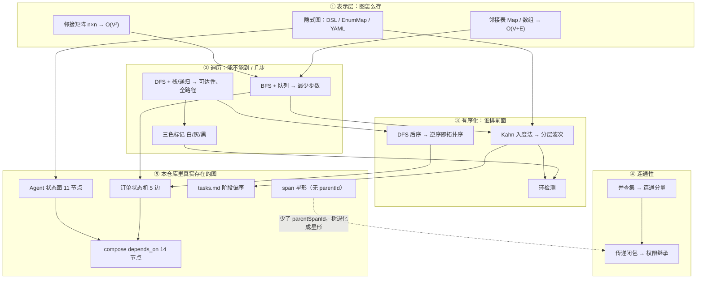
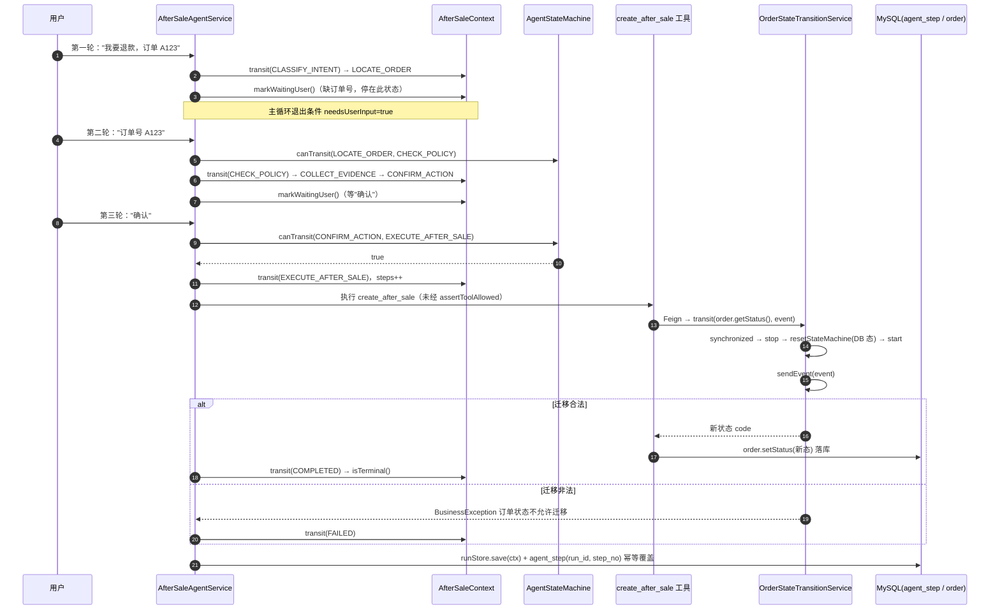

# 图论与搜索：业务里的图几乎只在问两件事——"谁排前面"和"能不能到"

> **一句话结论**：订单状态机、Agent 状态图、specs 阶段依赖、compose 启动顺序、调用链 span——它们全是图；选邻接表还是矩阵、用 BFS 还是 DFS、拓扑排序要不要报错，决定的不是玄学性能，而是**错误发生在启动时、运行时、还是排查时**。
> **阅读前置**：读过大 O 记号（[01-复杂度分析与算法思维](./01-复杂度分析与算法思维.md) 前两节）；会用 `HashMap` / `ArrayDeque`；见过 `depends_on`。最短路径（Dijkstra）不是本篇重点，只在 §7 交代一句。
> **证据基线**：**A 级** = Spring Boot 4.2.0 `AutoConfigurationSorter`、Spring Framework 7.1.0 `AbstractAutowireCapableBeanFactory` 的存档源码（`24-源码分析/assets/source/`）；**B 级** = 本仓库真实代码（`ai-cs-order`、`ai-cs-chat`、`deploy/`、`specs/`），行号均为本次核对；**C 级** = node 24 实测脚本，输出是原样粘贴的真机结果。复杂度一律用大 O 严格表述，实测只当"常数因子的量级感"。预计阅读 45 分钟。

---

## 0. 先看现象

**现象一：确认动作在状态图里指向自己。**

`ai-cs-chat/src/main/java/com/aics/chat/agent/state/AgentStateMachine.java#L40-L41`：

```java
map.put(AfterSaleState.CONFIRM_ACTION, Set.of(AfterSaleState.EXECUTE_AFTER_SALE, AfterSaleState.CANCELLED,
        AfterSaleState.CONFIRM_ACTION, AfterSaleState.FAILED));
```

`CONFIRM_ACTION` 的出边里有 `CONFIRM_ACTION` 自己（同样还有 `LOCATE_ORDER` 自环 #L34-L35、`COLLECT_EVIDENCE` 自环 #L38-L39）。后果是：某轮没拿到用户输入时，图上看这一步**完全合法**——没有一步是"错"的，只能靠两道计数器兜底：

- `ai-cs-chat/src/main/java/com/aics/chat/agent/workflow/AfterSaleAgentService.java#L326-L329` → `"超出最大步骤数（" + properties.getMaxSteps() + "），已中止"`，默认 12（`AgentProperties.java#L22`）；
- 同一文件 `#L322-L324` → `++guard > 50` 报 `AGENT_TIMEOUT` / `"状态机执行异常，已中止"`。

**现象二：非法状态迁移的报错是可以直接念出来的。**

`ai-cs-order/src/main/java/com/aics/order/statemachine/OrderStateTransitionService.java#L30-L31`：

```java
throw new BusinessException(ResultCode.BAD_REQUEST,
        "订单状态不允许迁移: " + current.getCode() + " --" + event + "--> ?");
```

所以已取消的订单再付一次款，接口返回的是 `订单状态不允许迁移: CANCELLED --PAY--> ?`，而不是一个空指针或一条被静默覆盖的脏数据。这条报错能写出来，是因为订单的状态迁移是**显式声明的 5 条边**（`OrderStateMachineConfig.java#L25-L29`）；如果写成 `if ("PENDING_PAY".equals(status)) ... else ...`，非法迁移不会报错，只会把 status 覆盖成错的值。

**现象三：文档画的是树，落库的是星形。**

`ai-cs-chat/src/main/java/com/aics/chat/observability/TraceContext.java#L11-L19` 的类注释用 ASCII 画了一棵树：

```text
requestId / userId / sessionId
   ├ intent
   ├ retrieval
   ├ rerank
   ├ llm
   ├ tools
   └ answer
```

而真正的字段只有一行（同文件 `#L45`）：

```java
private final List<TraceSpan> spans = new CopyOnWriteArrayList<>();
```

`TraceSpan.java#L13-L70` 里有 `spanType`、`durationMs`、`retries`、`fallbackFrom` 等 18 个字段，**没有 `spanId`，也没有 `parentSpanId`**。于是"这个 tool span 挂在哪个 llm span 下面"永远查不出来——只能按 `durationMs` 排序去猜。

这些现象指向同一件事：业务里的"状态""依赖""调用"本质都是图，而**图有没有被显式建出来**，决定了错误在启动时被拒、在运行时被兜底、还是在排查时无从下手。

---

## 1. 整体地图



> **读图说明**：三条主线是 `表示层 → 遍历 → 有序化`，所有业务图都挂在第 ⑤ 带里被某条主线处理；**只看 ⑤ 带那五个方框最容易得出错结论**——会以为"订单状态机、Agent 状态、compose 依赖是三种不同的东西"，实际上它们都是同一件事：`(V, E)` 加一种遍历。第二条关键箭头是 `SP -.-> TC`：调用链这里少了 `parentSpanId`，所以它只有"星形"的连通性，没有树的结构，任何想做"关键路径分析"的想法都会在这里翻车。第三条是 `UF --> TC`：并查集只回答"是否同一伙"，传递闭包才回答"能继承谁"，两者不可互换。

| 组件 | 责任 | 参与方 / 调用方 | 证据 |
|---|---|---|---|
| `OrderStatus` / `OrderEvent` | 订单图的顶点与边标签（穷举合法动作） | Spring Statemachine DSL | `ai-cs-order/src/main/java/com/aics/order/enums/OrderStatus.java#L13-L17`、`ai-cs-order/src/main/java/com/aics/order/statemachine/OrderEvent.java#L4-L6` |
| `OrderStateMachineConfig` | 邻接关系的**唯一声明处**：5 条 `withExternal()` | 容器启动时构建单例 | `ai-cs-order/src/main/java/com/aics/order/statemachine/OrderStateMachineConfig.java#L24-L29` |
| `OrderStateTransitionService` | 在图上走一步：重置到 DB 当前态 → 发事件 → 校验 | `OrderServiceImpl` 四处 | `ai-cs-order/src/main/java/com/aics/order/statemachine/OrderStateTransitionService.java#L21-L35` |
| `AfterSaleState` + `AgentStateMachine` | Agent 图的 11 个顶点、`EnumMap` 邻接表、工具白名单 | `AfterSaleAgentService` 主循环 | `ai-cs-chat/src/main/java/com/aics/chat/agent/state/AgentStateMachine.java#L30-L60` |
| `AfterSaleContext.transit` | "走一步"的**不设门禁**版本 | 9 处调用 | `ai-cs-chat/src/main/java/com/aics/chat/agent/context/AfterSaleContext.java#L124-L129` |
| `tasks.md` 阶段依赖 | 7 个阶段之间的偏序（哪些能并行） | 人读 + SDD 工作流 | `specs/005-after-sales-agent/tasks.md#L148-L160` |
| `docker-compose-all.yml` | 14 个容器、13 条真实依赖边的 DAG | docker compose | `deploy/docker-compose/docker-compose-all.yml#L69-L297` |
| `TraceContext` / `TraceSpan` | 一次请求的 span 集合（星形，不是树） | `TraceSpans` 用 Micrometer 埋点 | `ai-cs-chat/src/main/java/com/aics/chat/observability/TraceContext.java#L45` |

---

## 2. 关键概念与关键类

先把术语一次性说清（后面不再重复解释）：

- **图（graph）**：顶点集合 V 加边集合 E。业务里"状态""服务""任务""span"是顶点，"允许迁移""依赖""挂载"是边。
- **有向 / 无向**：边有方向就是有向图（依赖、迁移都有方向）；无向边等价于两条相反的有向边。
- **DAG（有向无环图）**：有向且不存在环的图。**只有在 DAG 上才谈得上拓扑序**。
- **入度（in-degree）/ 出度**：指向该顶点的边数 / 从该顶点出发的边数。
- **拓扑序（topological order）**：一个线性序列，使每条边 `u→v` 里 u 都排在 v 之前。DAG 的拓扑序**一般不唯一**。
- **偏序 / 全序**：偏序只规定"这几对谁先谁后"，没规定的可以任意并行；全序是"从头到尾排一排"。拓扑排序求的是把偏序**拉直成**全序的一种方式，别把拉直的结果当成唯一答案。
- **可达性（reachability）**：从 s 能否沿边走到 t。
- **传递闭包（transitive closure）**：把所有"能间接到达"的关系显式补成一张表，规模 O(V²)。
- **连通分量 / 强连通分量（SCC）**：无向图里"互相能到的最大点集" / 有向图里"任意两点互相可达"的最大点集。环就是一个 SCC。
- **邻接表 / 邻接矩阵**：图的两种存储；前者存"每个点的邻居"，后者存"n×n 是否有边"。
- **隐式图**：边不放在任何容器里，而是藏在 DSL、枚举、YAML 文本里——本仓库的图大多是隐式图。
- **span**：一次请求内某个环节的耗时记录（一次 LLM 调用、一次检索）；要组成树必须有 `parentSpanId`。

| 名称 | 位置 | 角色 | 关键方法 |
|---|---|---|---|
| `OrderStatus` | `ai-cs-order/src/main/java/com/aics/order/enums/OrderStatus.java#L13-L17` | 订单图 5 个顶点：`PENDING_PAY/PAID/CANCELLED/REFUNDING/REFUNDED` | `getCode()`、`getDescription()` |
| `OrderEvent` | `ai-cs-order/src/main/java/com/aics/order/statemachine/OrderEvent.java#L4-L6` | 5 条边的标签：`PAY/CANCEL/TIMEOUT/REFUND_REQUEST/REFUND_SUCCESS` | 枚举常量 |
| `OrderStateMachineConfig` | `ai-cs-order/src/main/java/com/aics/order/statemachine/OrderStateMachineConfig.java#L18-L31` | 邻接矩阵的"手工版"：`StateMachineBuilder` DSL 声明 5 条迁移，初始态 `PENDING_PAY` | `withExternal().source().target().event()` |
| `OrderStateTransitionService` | `ai-cs-order/src/main/java/com/aics/order/statemachine/OrderStateTransitionService.java#L21-L35` | 走一步的**唯一入口**，非法迁移抛 `BusinessException` | `transit(String, OrderEvent)`、`parse(String)` |
| `AfterSaleState` | `ai-cs-chat/src/main/java/com/aics/chat/agent/state/AfterSaleState.java#L26-L56` | Agent 图 11 个顶点 | `isTerminal()` #L58-L61 |
| `AgentStateMachine` | `ai-cs-chat/src/main/java/com/aics/chat/agent/state/AgentStateMachine.java#L30-L50` | `EnumMap<State, Set<State>>` 邻接表（含 3 处自环）；工具白名单 #L52-L60 | `canTransit` #L65-L71、`allowedTransitions` #L76-L78、`isToolAllowed` #L97-L100 |
| `AfterSaleContext` | `ai-cs-chat/src/main/java/com/aics/chat/agent/context/AfterSaleContext.java#L124-L129` | 图上"跳一步"，只改 state / 清等待位 / `steps++`，**不查邻接表** | `transit(AfterSaleState)`、`markWaitingUser()` |
| `AgentToolRegistry` | `ai-cs-chat/src/main/java/com/aics/chat/agent/tool/AgentToolRegistry.java#L63-L69` | 顶点上的动作门禁（"这个状态允许调哪个工具"） | `assertToolAllowed(state, toolName)` |
| `AfterSaleAgentService` | `ai-cs-chat/src/main/java/com/aics/chat/agent/workflow/AfterSaleAgentService.java#L318-L349` | 沿图跑的 `while` 主循环 + 按状态 `switch` 分发 | `runStateMachine(ctx)` |
| `TraceContext` / `TraceSpan` | `ai-cs-chat/src/main/java/com/aics/chat/observability/TraceContext.java#L45`、`ai-cs-chat/src/main/java/com/aics/chat/observability/TraceSpan.java#L13-L70` | 一次请求的 span 集合，**星形**（只有 requestId 关联） | `addSpan`、`totalDurationMs`、`markFailed` |

---

## 3. 原理与证据逐段精读

### 3.1 表示层：邻接表、邻接矩阵、以及"根本没有容器"的隐式图

**在干什么。** 决定一张图怎么存在内存里。三种选择：`List<Integer>[] adj`（邻接表）、`boolean[n][n]`（邻接矩阵）、以及"边写在 DSL / 枚举 / YAML 里、用时再解释"（隐式图）。

**为什么这么设计。** 三者的空间和时间代价完全不同：邻接表 O(V+E) 空间、遍历某点邻居 O(deg(v))；邻接矩阵固定 O(V²) 空间、判边 O(1) 但遍历邻居要扫一整行 O(V)。业务图几乎都是稀疏的（一个服务不会依赖几百个服务），所以默认选邻接表。

下面这段把两种表示放在同一张稀疏图、同一张稠密图上跑（node 24，单线程，n=3000）：

```javascript
// 06-repr.mjs —— 保存后 node 06-repr.mjs
function lcg(seed) { let s = seed >>> 0; return () => ((s = (s * 1664525 + 1013904223) >>> 0) / 4294967296); }
// 稀疏图：先造 n-1 条边的随机树保证连通，再补随机边；稠密图：完全随机取边
function edgesFor(n, m, dense, rnd) {
  const es = [];
  if (dense) { for (let i = 0; i < m; i++) es.push([Math.floor(rnd() * n), Math.floor(rnd() * n)]); }
  else {
    for (let v = 1; v < n; v++) es.push([Math.floor(rnd() * v), v]);
    for (let i = n - 1; i < m; i++) es.push([Math.floor(rnd() * n), Math.floor(rnd() * n)]);
  }
  return es;
}
function buildList(n, es) { const h = Array.from({ length: n }, () => []); for (const [u, v] of es) h[u].push(v); return h; }
function buildMatrix(n, es) { const m = new Uint8Array(n * n); for (const [u, v] of es) m[u * n + v] = 1; return m; }
function bfsList(h, s) { const seen = new Uint8Array(h.length), q = [s]; seen[s] = 1; let c = 0;
  for (let i = 0; i < q.length; i++) { const u = q[i]; c++; for (const w of h[u]) if (!seen[w]) { seen[w] = 1; q.push(w); } } return c; }
function bfsMatrix(mat, n, s) { const seen = new Uint8Array(n), q = [s]; seen[s] = 1; let c = 0;
  for (let i = 0; i < q.length; i++) { const u = q[i]; c++; for (let w = 0; w < n; w++) if (mat[u * n + w] && !seen[w]) { seen[w] = 1; q.push(w); } } return c; }
for (const [label, m, dense] of [['稀疏 m=1.5n', 4500, false], ['稠密 m=n^2/6', 3000 * 3000 / 6, true]]) {
  const n = 3000, list = buildList(n, edgesFor(n, m, dense, lcg(42))), mat = buildMatrix(n, edgesFor(n, m, dense, lcg(42)));
  const t = (f) => { const t0 = process.hrtime.bigint(); const r = f(); return [Number(process.hrtime.bigint() - t0) / 1e6, r]; };
  const [, v1] = t(() => bfsList(list, 0)); const [, v2] = t(() => bfsMatrix(mat, n, 0));
  console.log(label, 'BFS 可达点数', v1, v2);
}
```

实测输出（同一台机器、node 24；跑多遍会有 ±20% 抖动，只看量级）：

```text
稀疏 m=1.5n: 建表 list=1.64ms matrix=5.16ms | 一次 BFS list=1.762ms matrix=21.570ms | 可达点数 list=3000 matrix=3000
  空间: 矩阵固定 n^2 字节 = 8.58 MiB；邻接表约 m 个 int + n 个数组头 ≈ 0.03 MiB + 头开销
稠密 m=n^2/6: 建表 list=97.94ms matrix=47.89ms | 一次 BFS list=19.174ms matrix=43.696ms | 可达点数 list=3000 matrix=3000
  空间: 矩阵固定 n^2 字节 = 8.58 MiB；邻接表约 m 个 int + n 个数组头 ≈ 11.44 MiB + 头开销
```

**怎么读这张表。** ①稀疏图上矩阵的 BFS 比邻接表慢约 12 倍（21.6ms vs 1.8ms）——虽然每点只判 O(1) 次"有没有边"，但矩阵版每点要扫 3000 个格子，总计 O(V²)；②稠密图上两者第一次接近（43.7ms vs 19.2ms），但建表反而矩阵更快（47.9ms vs 97.9ms），因为稠密图里邻接表的数组扩容更贵；③空间列是**算术推出来的**，不是量出来的：`n² 字节` 是按 `Uint8Array` 一格一字节计，Java 里 `boolean[][]` 也大致一格一字节，换成 `int[][]` 直接 ×4 变 34 MiB。结论的适用边界：n 到万级、E 远小于 V² 时，邻接表在时间和空间上双赢；只有在 E 接近 V² 且需要频繁 O(1) 判边（比如 Floyd 传递闭包）时才考虑矩阵。

**换写法会怎样。** 业务里更常见的"第三种表示"是隐式图：本仓库订单状态机的边写在 DSL 里（`OrderStateMachineConfig.java#L24-L29`），Agent 的边写在 `EnumMap`（`AgentStateMachine.java#L31-L48`），服务的边写在 YAML（`deploy/docker-compose/docker-compose-all.yml#L69-L297`）。隐式图的好处是零额外内存、和业务写在同一个地方；代价是**没有统一的 API**——想跑一次拓扑排序，得先把图抠出来（§3.4 就是干这个）。

**常见坑。** ①Java 里 `List<Integer>[] adj = new ArrayList[n];` 是泛型数组，编译期 `unchecked` 警告，不要试图 `new List<Integer>[n]`；②无向图要双向加边，只加一次会在 BFS 里造成"半连通"的假象；③用 `Map<Long, List<Long>>` 建图时，边指向的节点若从没作为 key 出现过，取出来是 `null` 而不是空表（本仓库的拓扑脚本用 `Map` 建图时必须先给所有节点塞空数组，否则 `adj.get(x).push` 直接抛）。

### 3.2 BFS：它回答"最少几步"，不回答"有几条路"

**在干什么。** 从起点一层层向外扩，队列里永远是"距离 d 的点"，出队时把距离 d+1 的点入队。因为按距离单调入队，**点第一次被访问时距离就已经最短**。

**为什么这么设计。** 队列的 FIFO 顺序天然等价于"按层推进"，所以无权图上 BFS 等价于最短路。这是 BFS 唯一不可被 DFS 替代的性质。

同一张图上 BFS 与 DFS 找"0 到 5 的路"，差得很直观（该图有边 `0→1→2→3→4→5` 的长链，以及一条直达边 `0→5`）：

```text
=== B. 同一张图，BFS 与 DFS 给出的路径长度 ===
邻接表: 0→[1,2,5] 1→[2] 2→[3] 3→[4] 4→[5]
BFS 路径: 0→5  长度(边数)=1
DFS 路径: 0→1→2→3→4→5  长度(边数)=5  ← 合法但不是最短
```

**怎么读这段。** DFS 给出的路径**完全合法**——每一跳都有边——但它不是最短。这就是"能到达"和"最少几步"的区别：`订单从 PENDING_PAY 能不能到 REFUNDED` 是可达性问题（DFS/Kahn 都行），`用户要几步才能申请售后成功` 是最少步数问题（只能用 BFS）。这条边界被跨过去的典型错误是：用 DFS 的第一次到达当作"最短"上报给用户做进度条，长链场景下步数会虚高。

**换写法会怎样。** 如果目标是"枚举所有可行路径"（比如售后策略的所有审批分支），BFS 无论怎么改都做不到——必须 DFS + 回溯（做选择 → 递归 → 撤销选择），复杂度从 O(V+E) 涨到路径条数量级，通常是指数级，必须靠剪枝。

**常见坑。** ①**在出队时标记 visited**：同一个点会被多个前驱重复入队，队列规模能膨胀到 O(E)，应改为入队时立即标记；②`dist` 忘了初始化为 -1，导致不可达点显示距离 0；③把 `if (cur == end) return dist[cur]` 写在"取出后、扩邻居前"，看起来对，但如果 end 是起点会漏掉；④在有环图上不加 visited 直接 BFS → 死循环（Agent 状态图就有自环，见 §3.8）。

### 3.3 DFS 与三色标记：可达性问题，以及"环在哪里"的定位能力

**在干什么。** 一条路走到底，走不动就退回来。给它加上三种颜色——白（没访问过）、灰（正在这条递归链上）、黑（整棵子树处理完）——就同时得到了两个能力：可达性判定，和"遇到灰点即成环"的定位。

**为什么这么设计。** 灰集合就是**当前递归栈**。一条边 `current → after` 若指向灰点，说明 after 是 current 的祖先，这条边必然闭合出一个环；而如果指向黑点，只是"从另一条路又来了一次"，无环。Spring Boot 自动配置排序就是这套实现：

```java (src: AutoConfigurationSorter.java.md#L85-L101)
	private void doSortByAfterAnnotation(AutoConfigurationClasses classes, Map<String, Integer> sortOrder,
			Set<String> sorted, Set<String> processing, String current) {
		if (sorted.contains(current)) {
			return;
		}
		processing.add(current);
		Set<String> afters = new TreeSet<>(Comparator.comparingInt((String name) -> sortOrder.getOrDefault(name, -1)));
		afters.addAll(classes.getClassesRequestedAfter(current));
		for (String after : afters) {
			checkForCycles(processing, current, after);
			if (sortOrder.containsKey(after)) {
				doSortByAfterAnnotation(classes, sortOrder, sorted, processing, after);
			}
		}
		processing.remove(current);
		sorted.add(current);
	}
```

`processing` 就是灰集合，`sorted` 就是黑集合，`checkForCycles` 只有三行（同文件 `#L103-L106`），报错文案是 `"AutoConfigure cycle detected between " + current + " and " + after`。

**怎么读这段代码。** ①`sorted.contains(current)` 的提前返回不是优化、是**正确性必需**：少了它，一个被 k 条边指向的点会被重复展开 k 次，最坏情况下退化成路径枚举；②`checkForCycles` 放在递归**之前**，所以成环的**那一条边**能被精确点名（`A and B`），而不是像 Kahn 那样只能告诉你"有环"；③`processing.remove(current)` 与 `sorted.add(current)` 成对出现——这正是 DFS 后序，`sorted` 里沉淀下来的顺序**就是**拓扑序（原因见 §3.6）。

**换写法会怎样。** 用 Kahn 判环（§3.4）只需 O(V+E) 且无递归，但要定位到具体哪条边成环，还得再跑一次 SCC 或 DFS。反过来，用 Spring 这套 DFS 三色可以立刻 fail-fast，代价是**必须有递归栈**——自动配置类数量上千，深度几十层，够用；如果拿它去遍历用户数据（比如商品分类树），深度由脏数据决定，就会 `StackOverflowError`。

**常见坑。** ①`processing.remove(current)` 忘了写，整个图会被误判成有环（灰点永不释放），而且报错点会指向完全不相关的一条边；②把"黑点"当成"应该跳过"会导致拓扑序倒序（正确做法是黑点直接 return，且**在递归之后**才把自己加入黑集合）；③用 `boolean[] visited` 单色实现，永远无法判环——环检测必须有第三态。

### 3.4 Kahn 入度法：在真实的 compose 依赖图上跑一遍

**在干什么。** 统计每个点的入度，把入度为 0 的点（"没有任何前置依赖"）成批取出，取出后把它的后继入度减 1，减到 0 的进入下一批。取完为止。这样得到的不是一条顺序，而是**一组波次**：同一波里的点互不依赖，可以并行。

**为什么这么设计。** 业务问题往往不是"给我一个顺序"，而是"哪些能一起干"。Kahn 的批处理语义正好对应后者。先看这张图的边从哪来——全部来自 `deploy/docker-compose/docker-compose-all.yml` 的 `depends_on`（行号为该文件真实行号）：

| 依赖边（前置 → 依赖它的服务） | 行号 |
|---|---|
| `mysql → nacos` | #L69-L71 |
| `rocketmq-namesrv → rocketmq-broker` | #L137-L139 |
| `nacos → api-gateway` | #L176-L178 |
| `mysql → user-service`、`nacos → user-service` | #L194-L198 |
| `mysql → knowledge-service`、`nacos → knowledge-service` | #L215-L219 |
| `nacos → ai-chat-service` | #L237-L239 |
| `nacos → search-service`、`elasticsearch → search-service` | #L255-L259 |
| `mysql → message-service`、`rocketmq-namesrv → message-service` | #L276-L280 |
| `nacos → notify-service` | #L295-L297 |

`redis` 和 `minio` 没有 `depends_on`，是孤立点。合计 **14 个顶点、13 条边**——注意这个数字，旧稿写的"12 个服务、20 条边"是错的（§7 有对照）。

```javascript
// 07-kahn.mjs —— 核心 30 行
function build(nodes, edges) {
  const adj = new Map(nodes.map((n) => [n, []])); const indeg = new Map(nodes.map((n) => [n, 0]));
  for (const [f, t] of edges) { adj.get(f).push(t); indeg.set(t, indeg.get(t) + 1); }
  return { adj, indeg };
}
function kahnLayered(nodes, edges, pick = (xs) => xs) {
  const { adj, indeg } = build(nodes, edges); const deg = new Map(indeg);
  let rest = nodes.filter((n) => deg.get(n) === 0).sort();
  const waves = [], order = [];
  while (rest.length) {
    const wave = pick(rest); waves.push(wave); order.push(...wave);
    const next = [];
    for (const n of wave) for (const m of adj.get(n)) { deg.set(m, deg.get(m) - 1); if (deg.get(m) === 0) next.push(m); }
    rest = next.sort();
  }
  const blocked = nodes.filter((n) => !order.includes(n)).sort();
  return { order, waves, blocked };
}
```

实测输出：

```text
=== A. 真实 compose 依赖图（14 节点 / 13 边）===
节点数=14 边数=13
第 1 波（可并行）: elasticsearch, minio, mysql, redis, rocketmq-namesrv
第 2 波（可并行）: message-service, nacos, rocketmq-broker
第 3 波（可并行）: ai-chat-service, api-gateway, knowledge-service, notify-service, search-service, user-service
拓扑序长度=14 被卡住节点=无
最长依赖链（层数）= 3，即最快也要 3 轮才能全部启动
出度最大的节点 = nacos（6 个服务依赖它）
```

**怎么读这段。** ①3 波 = 启动的最短轮数，也就是"关键路径"只有 3 条边长——再怎么优化 Dockerfile 也压不到 2 轮；②第 3 波里 `api-gateway` 和 `user-service` **同层**，说明"网关必须在业务服务之前起"是错觉：它们只共享同一个前置 `nacos`；③`nacos` 出度 6 不是"最重要的服务"，而是"最大单点"——它不 healthy，第 2、3 波全部不动。这就是为什么 `depends_on` 里写的是 `condition: service_healthy` 而不是默认的 `service_started`（#L70-L71 等都带 healthcheck 条件）。适用边界：这张图是**启动依赖**，不是**调用依赖**——网关在运行时调用所有业务服务，但 compose 里只依赖 nacos，因为启动时刻它对业务服务没有要求。

**换写法会怎样。** 换一种出队顺序，得到的拓扑序完全不同，但**同样合法**：

```text
=== B. 同一个 DAG，换一种出队顺序，拓扑序不同（偏序不是全序）===
字典序队列 : elasticsearch → minio → mysql → redis → rocketmq-namesrv → message-service
逆序队列   : rocketmq-namesrv → redis → mysql → minio → elasticsearch → rocketmq-broker
前 6 位是否相同: false
```

所以"拓扑排序的结果"从来不能当成唯一答案写进文档或契约里。想复现稳定顺序，必须自己定一个 tie-break（示例里用字典序）。

**常见坑。** ①边方向搞反（写成"我看谁"而不是"谁看我"），输出会整体反序，而 BFS 式 Kahn 依然"跑得通"，不报错；②同一对 `(u,v)` 出现两次（YAML 里重复 `depends_on`）会让入度多加 1，该点永远等不到 0 ——所以建图时应先对边去重；③自环直接让该点入度恒 ≥1（§3.5 的真实输出里，`CONFIRM_ACTION` 自环导致三个点全被卡住）；④把 `blocked` 当成"环上的点"上报（下一节专门讲为什么错）。

### 3.5 环：Kahn 的"被卡住集合"不等于"环上节点"

**在干什么。** Kahn 跑完，`order.length < V` 就说明有环。但**哪些点有环**，Kahn 说不清：环上的点入度降不到 0，环**下游**的点也降不到 0，两者混在同一个"剩下"集合里。

**为什么这么设计。** 因为入度是局部信息，环的传播是全局的。要区分"病灶"和"受害者"，必须用强连通分量（SCC）：Tarjan 一趟 DFS 就能把每个 SCC 找出来，长度 > 1 的 SCC（或带自环的单点）才是真环。

用一个真实业务场景的实例——售后单里三个审批任务互相等待，另外两个下游任务只是被拖住：

```text
=== C. 带环的依赖列表：售后审批任务的互相等待 ===
边: T-退款审批→T-库存回滚  T-库存回滚→T-财务对账  T-财务对账→T-退款审批  T-库存回滚→T-通知客户  T-通知客户→T-归档
Kahn 输出拓扑序: []
Kahn 报"被卡住"的节点集合: [T-库存回滚, T-归档, T-财务对账, T-退款审批, T-通知客户]
Tarjan 给出的真环（SCC）: [T-财务对账, T-库存回滚, T-退款审批]
其中真正在环上的: [T-财务对账, T-库存回滚, T-退款审批]
只是被环波及的: [T-归档, T-通知客户]
```

**怎么读这段。** ①Kahn 报 5 个点被卡住，真病灶只有 3 个，`T-通知客户`、`T-归档` 是纯受害者——如果按 Kahn 的集合去通知"这 5 个任务互相依赖"，运维会去检查两个根本没问题的任务；②`T-退款审批 → T-库存回滚 → T-财务对账 → T-退款审批` 这条链三跳成环，任何"重试一次"都不能解决，只能人工打破其中一条边；③判据可以写成一句话：`真环 ⊆ 被卡住`，用 SCC 取交集才是环，取差集是受害者。

自环是环的最短形式，也是最容易被漏掉的：

```text
=== D. 自环（对应 Agent 状态机 CONFIRM_ACTION→CONFIRM_ACTION）===
自环节点: [CONFIRM_ACTION]
拓扑序: []  被卡住: [COMPLETED, CONFIRM_ACTION, EXECUTE_AFTER_SALE]
```

**换写法会怎样。** 只做 `if (order.length < V) throw new IllegalStateException("有环")` 也算"检测到了"，但排查时你手里只有一个布尔值，没有定位信息。反过来，Spring Boot 那套 DFS 三色（§3.3）连 SCC 都不用跑，成环的那条边当场被点名——代价是它只能报**第一条**环，多环要修一次跑一次。

**常见坑。** ①忘了自环：`u==v` 的边在 `adj.get(u).push(v)` 时不会报错，只会在拓扑排序里静默卡死；②Tarjan 的递归版在超长链上爆栈（生产图建议用迭代版或 Kosaraju + 显式栈）；③把 SCC 的"缩点图"当成最终结果——缩点后还要再跑一次拓扑排序才能得到任务顺序。

### 3.6 DFS 后序：逆后序为什么就是拓扑序，以及递归深度的边界

**在干什么。** 对每个未访问点做 DFS，把它**在所有后继都处理完之后**才放进结果表；全部跑完后，这个结果表（保序集合）就是拓扑序。

**为什么这么设计。** 一条边 `u→v`，DFS 从 u 出发必然先递归 v，所以 v 先被加入结果表、u 后加入——即"后继先入、前驱后入"。若用栈显式压入再整体弹出，得到的顺序同理。这是 O(V+E) 且**不需要统计入度**的方案，也不需要额外的入度数组。

**换写法会怎样。** 与 Kahn 相比：DFS 后序**拿不到分层**（只有一条顺序，没有"第几波"），但它能在遍历同一次里顺带判环（§3.3）；Kahn 能给出波次和"被卡住集合"，但判环定位弱。工程上选型取决于你要不要"并行波次"——要，就 Kahn（§3.4 的 compose 输出就是波次）；只要一条合法顺序，DFS 后序更省事。

**常见坑。** ①递归版对外部数据（分类树、权限树、用户上传的 DAG）一律危险：深度不受控，超过线程栈就 `StackOverflowError`，而**深度上限由 `-Xss` 和单帧大小共同决定，不是固定值**，别背具体数字；②改成显式栈时，"入栈即标记"与"出栈才标记"语义不同，后者会重复展开（同 BFS 的坑）；③迭代版要产出真正的后序，需要给每个节点记"还剩几个孩子没处理"或用一个"待输出"栈，直接照搬 BFS 模板会得到前序而不是后序。

### 3.7 订单状态机：5 个顶点、5 条边的 DAG，和"重置后重放"的代价

**在干什么。** 把"订单能怎么流转"从一堆 `if/else` 里抽出来，声明成 5 条有向边。`OrderStatus` 5 个枚举值是顶点（`ai-cs-order/src/main/java/com/aics/order/enums/OrderStatus.java#L13-L17`），`OrderEvent` 5 个枚举值是边标签（`ai-cs-order/src/main/java/com/aics/order/statemachine/OrderEvent.java#L4-L6`），边本身写在 DSL 里：

边清单（`OrderStateMachineConfig.java#L25-L29`）：`PENDING_PAY --PAY--> PAID`、`PENDING_PAY --CANCEL--> CANCELLED`、`PENDING_PAY --TIMEOUT--> CANCELLED`、`PAID --REFUND_REQUEST--> REFUNDING`、`REFUNDING --REFUND_SUCCESS--> REFUNDED`。

**为什么这么设计。** 这个图很小（5 顶点 5 边、单入口 `PENDING_PAY`、两个汇点 `CANCELLED`/`REFUNDED`），但它带来两件事：①**非法动作可枚举**，所以能生成可读报错（§0 现象二）；②**图可被穷举检查**——从 `PENDING_PAY` 做一次 BFS，任何未被访问到的状态就是"永远进不去的死状态"，这是加新状态时最便宜的回归检查。

**换写法会怎样。** 注意 `OrderStateTransitionService.java#L21-L35` 的实现：每次业务调用都要 `stop()` → `resetStateMachine(DB 当前态)` → `start()` → `sendEvent()`，最后读 `getState().getId()`。也就是**把图的一个顶点当无状态函数来求值**，状态机实例本身是单例 Bean，所以外面必须 `synchronized (orderStateMachine)`（#L23）串行化。代价很直接：所有订单状态变更在这把锁上排队。这个取舍是刻意的——类注释写明"不使用内存 persister，多实例部署下内存状态不可靠，DB status 是唯一事实来源"。反过来，如果用内存 persister 保留状态机实例，就得到 O(1) 的 `sendEvent`，但多实例下同一订单被两个节点处理时状态会分叉。

**常见坑。** ①往图里加状态却不加边 → 新状态不可达，业务永远进不去（用 BFS 可检测）；②`CANCELLED` 是汇点，忘了给"已取消 → 退库存"建边就写代码 → 运行时直接 `订单状态不允许迁移: CANCELLED --XXX--> ?`；③把 `TIMEOUT` 和 `CANCEL` 两条边都指向 `CANCELLED`，事后想区分"用户取消"和"超时取消"就无法从状态反推，必须靠别的事件记录。

### 3.8 Agent 状态图：11 个顶点、手写邻接表、三处自环、以及没接线的门禁

**在干什么。** 售后 Agent 用一个手写状态机驱动多轮对话：11 个状态（`ai-cs-chat/src/main/java/com/aics/chat/agent/state/AfterSaleState.java#L26-L56`），邻接表存在 `EnumMap<State, Set<State>>`（`AgentStateMachine.java#L31-L48`），另有"这个状态允许调哪个工具"的白名单（#L52-L60）。主循环在 `AfterSaleAgentService.java#L321-L344`：`while (!ctx.isTerminal() && !ctx.isNeedsUserInput())` + 按 `ctx.getState()` 分发。

**为什么这么设计。** 因为它必须支持"等用户输入"。注意 `needsUserInput` 是**标志位而不是状态**（`AfterSaleContext.java#L131-L133` 的 `markWaitingUser`），所以真正的状态是二元组 `(state, needsUserInput)`；这解释了为什么图上需要自环：`LOCATE_ORDER → LOCATE_ORDER`（#L34-L35）表示"同一状态再问一次订单号"，`COLLECT_EVIDENCE → COLLECT_EVIDENCE`（#L38-L39）、`CONFIRM_ACTION → CONFIRM_ACTION`（#L40-L41）同理。**自环在"状态 × 输入"的乘积图里是正常边，在纯状态图里就是环**——这是两套语义混用的直接后果。

**换写法会怎样。** 两个方向都被验证过代价：①用 Spring Statemachine 替代手写，能免费得到 guard/action/persister，但每次"多轮对话恢复"都要像 §3.7 那样 reset（因为上下文存在 DB/Redis 里），开销与订单侧同级；②继续手写但**真的校验迁移表**——把 `AfterSaleContext.transit`（#L124-L129，目前只做 `state=next; needsUserInput=false; steps++`）改成先调 `stateMachine.canTransit(...)`。现在这一步没做，生产代码里 `canTransit` **只有一处调用**（`AfterSaleAgentService.java#L556`，判断能否转 `HANDOFF`），工具门禁 `AgentToolRegistry.assertToolAllowed`（#L63-L69）更是**定义了但主代码零调用**——用一条命令就能确认：

```powershell
Get-ChildItem -Path "ai-cs-chat\src\main\java" -Recurse -Filter *.java |
  Select-String -Pattern "assertToolAllowed|canTransit" |
  ForEach-Object { "$($_.Path.Replace('D:\Projects\Persion\ai-customer-service\','')):$($_.LineNumber)" }
```

```text
ai-cs-chat\src\main\java\com\aics\chat\agent\state\AgentStateMachine.java:65
ai-cs-chat\src\main\java\com\aics\chat\agent\tool\AgentToolRegistry.java:63
ai-cs-chat\src\main\java\com\aics\chat\agent\workflow\AfterSaleAgentService.java:556
```

**怎么读这段输出。** 三行里两行是**定义**（`AgentStateMachine:65` 定义 `canTransit`、`AgentToolRegistry:63` 定义 `assertToolAllowed`），只有 `AfterSaleAgentService:556` 是**调用**。也就是说：迁移表和工具白名单目前是"文档级约束"，真正兜底的是 `maxSteps = 12`（`AgentProperties.java#L22`）与 `guard > 50`（`AfterSaleAgentService.java#L322`）两道计数器。这不是"没实现"，而是**已实现未接线**——写文档时不能算作"状态门禁已生效"。

**常见坑。** ①自环 + 不校验迁移表 = 只能靠步数兜底，用户会看到"超出最大步骤数（12），已中止"而不是"当前状态不能做这个动作"；②`isTerminal()` 判定（`AfterSaleState.java#L58-L61`）包含 `HANDOFF`，意味着转人工后本轮直接结束，不会再有边——如果将来想"人工处理完回来继续"，就要把 `HANDOFF` 从终态里拿掉并加回边；③`EnumMap` 的 key 少写一个状态（比如新增状态忘了加 `map.put`），`getOrDefault(from, Set.of())` 会让它静默变成"无出边"的准终态，`canTransit` 永远返回 false。

### 3.9 specs 的阶段依赖：偏序不是全序，"能并行"才是关键信息

**在干什么。** `specs/005-after-sales-agent/tasks.md#L148-L160` 用文字描述了一组阶段依赖：基础层（阶段 1）无依赖、阶段 2/4 依赖 T001 的错误码、阶段 6 依赖阶段 2/3/4/5 的 Feign **契约**、阶段 7 依赖全部实现；并行机会一节明确写了"阶段 2、3、4、5 可并行"。

**为什么这么设计。** 54 个任务编号 T001–T054 看起来是线性的，但真实约束只有几条边。把偏序写成"线性清单"会导致两种浪费：硬等待（其实可以并行）和假依赖（把"文件顺序"当"依赖"）。按图读，它的拓扑分层是：`{T001,T002} → {阶段2,3,4,5} → {阶段6} → {阶段7}`，与脚本在 compose 图上算出的"波次"是同一种结构。

**换写法会怎样。** 如果真把 54 个任务按 1..54 顺序执行，工期是 54 个串行步；按偏序执行，关键路径只有 4 层，其余全是可并行的扇出——这就是为什么"图"在这类文档里比"清单"信息量大一个量级。反过来说，如果依赖是用代码（而非文字）表达的，就能让工具算出波次、并在有人写出环形依赖时直接报错；用文字表达时，成环只能靠人读出来。

**常见坑。** ①把"契约先行"当成"实现先行"：阶段 6 依赖的是**接口契约**（`contracts/rest-api.md` 里已定义），所以可以和阶段 2-5 的**实现**并行——依赖边要按"我真正需要什么"建，不是按"哪个模块的代码"建；②在任务清单里写"阶段 5 必须在阶段 4 之后"，但代码里两个模块没有任何边 → 这条边是人造的，应该在图上删掉而不是在执行时阻塞；③只有一个"检查点"作为汇合点（每阶段末尾），意味着跨阶段问题最早要在检查点才暴露。

### 3.10 调用链 span：落库的是星形，不是树

**在干什么。** 一次请求记一组 span（`TraceContext.java#L45` 的 `List<TraceSpan>`），通过 Micrometer 埋点（`TraceSpans.java#L35-L65` 用 `Observation.createNotStarted(...)` + `lowCardinalityKeyValue("span.type", spanType)`），最后序列化成 `spans_json` 落库。

**为什么这么设计。** 现状是"一次请求 = 一个 requestId + 一串平铺的 span"，从图论的角度看这是一个**二分图**（request 到 span 的星形），而不是树。树需要每个节点记 `parentSpanId`（等价于入度恰为 1 且无环），`TraceSpan.java#L13-L70` 里没有这个字段——所以 `spans_json` 无论怎么解析都还原不出层级。

**换写法会怎样。** 如果目标是"调用链树"（这正是分布式追踪里 span 树的标准形态），最小改动是给 `TraceSpan` 加 `spanId` + `parentSpanId`，埋点时把当前 span 的 id 传下去；Micrometer 的 `Observation` 本身支持父子关系，但本仓库没有把它落到 `TraceSpan` 上。在补上之前，任何"关键路径分析"的说法都不成立：`totalDurationMs` 只能把 span 求和，而**串行 span 之和 ≠ 关键路径**（关键路径要在树上取"从根到叶的最长路"，需要结构）。

**常见坑。** ①拿 `durationMs` 排序取最大那个当"耗时最长的环节"——这只在兄弟节点之间成立，跨层比较会把父节点的耗时当成子节点问题；②并发 span（并行工具调用）在平铺列表里完全看不出先后，重试（`retries`、`attempt`、`fallbackFrom` 字段）也会变成 n 条独立记录；③把 Javadoc 里画的树当接口契约——文档画树、代码存星形，这种落差在排查时最坑，§6 第 1 条给了一条十几秒就能验证的命令。

### 3.11 并查集与传递闭包：连通分量、账号合并、权限继承

**在干什么。** 并查集（Union-Find）回答"这两个元素是不是同一伙的"并支持合并，复杂度在按大小合并 + 路径压缩下是 O(α(n))——α 是反阿克曼函数，增长极慢，工程上按 O(1) 对待（不是"O(1)"，是"近似常数"）。传递闭包回答的是另一个问题："A 能继承 B 吗"，也就是可达性，标准做法是从每个点做一次 BFS/DFS，总代价 O(V(V+E))。

**为什么这么设计。** 两个问题常被混为一谈。账号合并（同一人两个手机号 → 合并成一个账号池）是**无向连通性**：`A~B`、`B~C` 推出 `A~C`，并查集最优；权限继承是**有向可达性**：`运营 ⊂ 管理员` 不代表 `管理员 ⊂ 运营`，方向不能反，必须用可达性。实测把三种写法放在 10 万账号、10 万次合并 + 10 万次查询上：

```text
=== C. 并查集三种写法在同一批操作下的 find 跳数 ===
naive     find 总跳数=777574374  合并后最大链深=10167  用时≈10728ms
rank      find 总跳数=361039  合并后最大链深=7  用时≈31ms
compress  find 总跳数=188541  合并后最大链深=4  用时≈22ms
（N=100000 个账号，100000 次合并 + 100000 次查询）
```

**怎么读这段。** ①`naive`（直接挂父）链深 10167，find 总跳数 7.7 亿次，用时 10.7 秒；②只加"按大小合并"（脚本里 `rank` 分支用的其实是 size）就把链深压到 7、跳数降到 36 万；③再加路径压缩（`parent[x] = parent[parent[x]]`，路径减半）降到 18.8 万跳、链深 4。**结论的适用边界**：这些是"跳数"和单机 node 的墙钟时间，跳数只取决于合并顺序（与机器无关、可复现），时间只作量级感；换 Java 会快一个数量级，但 4 个数量级的差距不会变。

**换写法会怎样。** 用"数组存集合编号"（`群主[i]`）而不是树，合并两个集合要遍历所有元素改编号，O(n) 每次；并查集合并只改一个父指针。反过来，如果业务真正要问的是"能继承哪些权限"，并查集会给出**错误答案**：它把有向关系当无向关系，会把"只能管理员看"错判成"运营也能看"。

**常见坑。** ①合并时不判同根——**这不是无效操作，是有害操作**：本次实测中漏掉 `if (ra === rb) return;` 会让 size 虚增，按大小合并直接退化，N=10000 时最大链深从 6 涨到 841；②路径压缩写成 `parent[x] = find(find(x))` 之类的手滑，语义会变成"跳两层"而不是"挂根"；③拿并查集做"环检测"：无向图里"两点已连通还要加边"确实是成环判据（Kruskal 用它），但有向图不适用。

---

## 4. 一次完整执行时序：Agent 状态图走到"执行售后"，跨进订单状态图



> **读图说明**：注意第 5、10 行两次 `markWaitingUser()`——**多轮对话是同一张图被切成多段跑**，每段从 DB 恢复 `(state, needsUserInput)` 再继续，所以"状态图上的边"落到系统里是"两次 HTTP 请求之间的一条边"。关键分支是 `alt 迁移合法 / else 迁移非法`：只有订单侧这张图有真正的门禁并会抛错（`OrderStateTransitionService.java#L30-L31`），Agent 侧对应位置（`AfterSaleContext.transit`）不校验，所以"非法动作"在 Agent 图里不会报错、只会多绕几圈直到计数上限。看错的地方在于把两个 `transit` 当同一件事：订单侧那个会 `throw`，Agent 侧那个只改字段。

| 步骤 | 失败时的现象 / 报错原文 | 归属 |
|---|---|---|
| 3 / 12 状态跳转未经校验 | **不报错**（静默放行），由 12 步上限兜底 | `AfterSaleContext.java#L124-L129` 不查 `TRANSITIONS` |
| 12 步预算耗尽 | `超出最大步骤数（12），已中止`（`AGENT_MAX_STEPS_EXCEEDED`） | `AfterSaleAgentService.java#L326-L329` + `AgentProperties.java#L22` |
| 循环保护计数越界 | `状态机执行异常，已中止`（`AGENT_TIMEOUT`） | `AfterSaleAgentService.java#L322-L324`（`++guard > 50`） |
| 14 工具不在白名单 | **不报错**（门禁未接线）；若接线则是 `状态 X 不允许调用工具 Y` | `AgentToolRegistry.java#L63-L69`，主代码零调用（§3.8） |
| 16 订单非法迁移 | `订单状态不允许迁移: CANCELLED --PAY--> ?`（`BAD_REQUEST`） | `OrderStateTransitionService.java#L30-L31` |
| 16 status 字符串不认识 | `未知订单状态: xxx` | 同文件 `parse()` |
| 对照：自动配置成环（启动期） | `AutoConfigure cycle detected between A and B` | `[[源码:AutoConfigurationSorter.java.md#L103-L106]]` |

---

## 5. 设计取舍与可扩展点

| 决策点 | 选项 A | 选项 B | 本仓库的选择与理由 |
|---|---|---|---|
| 图的存储 | 邻接表 O(V+E) | 邻接矩阵 O(V²) | 业务图全部稀疏（compose 14 顶点 13 边），一律邻接表；矩阵只在 Floyd/闭包这类需要 O(1) 判边的场景 |
| 图的载体 | 显式 `Map<V, List<V>>` | 隐式（DSL / EnumMap / YAML） | 用隐式：和业务写在同一个文件里、零同步成本；代价是要跑图算法得先抠出来（§3.4 脚本） |
| 求"最少几步" | BFS | DFS | BFS。DFS 给的路径合法但不是最短（§3.2 实测 5 vs 1） |
| 求"能不能到 / 有没有环" | DFS 三色 | Kahn 剩余集 | 只要布尔值用 Kahn（省一次遍历）；要定位成环的那条边用 DFS 三色（§3.3 A 级证据） |
| 要"并行波次" | Kahn 分层 | DFS 后序 | Kahn。后序只给一条顺序，给不出"哪几个可以同时起" |
| 环的处理策略 | 拒绝（fail-fast） | 打破环 / 运行时兜底 | 三种都在本仓库出现：自动配置成环 → 启动直接抛（`AutoConfigure cycle detected`）；Spring Bean 循环依赖 → `earlySingletonExposure` 提前暴露引用**打破**环（`[[源码:AbstractAutowireCapableBeanFactory.java.md#L585-L595]]`）；Agent 自环 → `maxSteps`/`guard` **运行时兜底** |
| 连通性 | 并查集 | 从每点 BFS | 无向合并（账号）用并查集；有向继承（权限）必须可达性，并查集会给出错误答案（§3.11） |

**可扩展点清单。**

- 给 `TraceSpan` 补 `spanId` / `parentSpanId`，`spans_json` 就能从星形升级成树，届时"关键路径"才有意义（§3.10）。
- 把 `AgentToolRegistry.assertToolAllowed` 在 `create_after_sale`、`policy_check` 等写操作前接上，让"状态 × 工具"的门禁真正生效（§3.8）。
- 把 `AfterSaleContext.transit` 改为先调 `canTransit`，让非法跳转在 Agent 侧也抛业务异常而不是靠 `maxSteps` 兜底。
- 把 `tasks.md` 的依赖从文字改成数据（每阶段一张 `depends_on` 表），用 §3.4 的脚本算出波次，顺带获得"环形依赖当场报错"。
- 新增订单状态时，跑一次从 `PENDING_PAY` 出发的 BFS，未访问到的状态即"死状态"（§3.7）。

---

## 6. 踩坑与调试手法

1. **把文档里画的树当成数据结构用。** 现象：想按 span 层级算"关键路径"，发现 `spans_json` 里全是平铺记录。根因：`TraceSpan` 无 `parentSpanId`（`ai-cs-chat/src/main/java/com/aics/chat/observability/TraceSpan.java#L13-L70`）。**【真调试手法①】**一条命令就能定性，不用启动服务：

   ```powershell
   Select-String -Path "ai-cs-chat\src\main\java\com\aics\chat\observability\TraceSpan.java" -Pattern "parent|spanId"
   ```

   输出为空 → 确认没有父子字段，任何层级分析都不要写进报告。

2. **Kahn 报"有环"，然后去修错了任务。** 现象：5 个任务被报"互相依赖"。根因：`blocked` 集合包含环的下游受害者（§3.5 实测 5 个里只有 3 个在环上）。**【真调试手法②】**跑 SCC 取交集：

   ```text
   Kahn 报"被卡住"的节点集合: [T-库存回滚, T-归档, T-财务对账, T-退款审批, T-通知客户]
   其中真正在环上的: [T-财务对账, T-库存回滚, T-退款审批]
   只是被环波及的: [T-归档, T-通知客户]
   ```

   判据：`真环 ⊆ 被卡住`。先修 3 个真环，剩下 2 个会自己解开。

3. **以为状态门禁生效了。** 现象：代码里有 `assertToolAllowed` 的漂亮实现，但线上从没见它抛过。根因：主代码零调用。**【真调试手法③】**`Get-ChildItem -Recurse | Select-String "assertToolAllowed|canTransit"`（命令与真实输出见 §3.8）：3 个命中里 2 个是定义、1 个是调用。凡是"定义了但没人调"的校验，都不该写进"已实现能力"。

4. **合并集合时漏判同根，按大小合并直接退化。** 现象：并查集实测最大链深 9052（N=10 万），与理论 O(log n) 完全不符。根因：`ra === rb` 时仍然 `size[ra] += size[rb]`，size 被虚增，比较失效。修法加一行 `if (ra === rb) return;` 后：N=10000 的最大链深从 841 回到 6；N=100000 从 9052 回到 7（§3.11 真实输出）。**索引结构一旦退化，先数"跳数/链深"，不要先改代码猜。**

5. **自环被当成"重试"。** 现象：用户在同一句话上被反复追问，日志里 `CONFIRM_ACTION` 连续出现十几次，最后 `超出最大步骤数（12），已中止`。根因：`CONFIRM_ACTION → CONFIRM_ACTION`（`ai-cs-chat/src/main/java/com/aics/chat/agent/state/AgentStateMachine.java#L40-L41`）在纯状态图上就是环，而 `transit` 不校验（`AfterSaleContext.java#L124-L129`）。修法：把"重试"表达成 `(state, retryCount)` 而不是自环，并把重试次数上限写进状态而非靠全局 `maxSteps`。

6. **把 `depends_on` 当成就绪保证。** 现象：`docker compose up` 后业务服务偶发连不上 MySQL。根因：`depends_on` 默认只等"容器起来了"（`service_started`），不等"服务能连了"。修法：本仓库的写法是配 healthcheck + `condition: service_healthy`（如 `deploy/docker-compose/docker-compose-all.yml#L69-L71`），这也是拓扑排序"顺序对"但"状态没就绪"的经典坑——顺序不等于可用性。

7. **把拓扑序当唯一答案写进契约。** 现象：两次跑同一脚本，前 6 位完全不同（§3.4 B 段）。根因：DAG 的拓扑序一般不唯一，Kahn 的结果取决于出队顺序。修法：需要一个稳定顺序就显式定 tie-break（字典序/优先级），否则不要把顺序当接口契约。

---

## 7. 版本差异

| 旧写法（旧稿 / 常见误记） | 当前基线 | 变化点 | 迁移动作 |
|---|---|---|---|
| "本项目的微服务调用关系：12 个服务，调用边约 20 条，矩阵要 144 格存 20 条边" | `deploy/docker-compose/docker-compose-all.yml` 实为 **14 个容器、13 条 `depends_on` 边**（§3.4 实测） | 数字错了，且混淆了"启动依赖"与"调用依赖" | 引用前先数：`Select-String -Path deploy\docker-compose\docker-compose-all.yml -Pattern "depends_on"`，再用脚本算层数 |
| "`deploy` 根目录下那个 compose 文件的 depends_on（简化）：… gateway → frontend" | 文件其实在 `deploy/docker-compose/` 目录下，且有 `-all` / `-master-slave` / `-host1..3` / `-observability` 多个变体；`frontend` 不是容器，`api-gateway` 只依赖 `nacos` | 图里那条 `gateway → frontend` 边根本不存在 | 引图必写真实文件 + 行号，别画"想象的简化图" |
| 商品分类树 `buildTree(List<Category>)` 两趟哈希 O(n)、"1000 条 100 万次→2000 次，快 500 倍" | 全仓只有 `ProductCategory.java#L20` 的 `private Long parentId;` 和 `ProductServiceImpl.java#L245-L248` 的 `createCategory`，**没有** `buildTree`/`children` 递归 | 旧稿贴着一段项目里不存在的代码，且"快 500 倍"没有实测支撑 | 树形组装可以讲，但必须标注"本仓库未落地，示例代码自建" |
| "Java 默认栈深度约 1000–10000" | 深度取决于 `-Xss` 与单帧大小，不是固定区间 | 结论方向对（递归有深度上限），量级不能当常量背 | 改成"深度不受控，对外部数据必须用显式栈 + 深度上限" |
| 面试问答 7 题，**带答案** | 本轮改为"只列问题"（§8）+ 自测题折叠答案 | 复习时先自答再展开，避免"读一遍就以为会了" | 面试前只扫 §8 题面，卡住再回 §3 对应小节 |
| 订单状态机"用 Spring Statemachine"（无版本） | `pom.xml#L82` → `spring-statemachine.version = 4.0.0`，`ai-cs-order/pom.xml` 引入 starter；**刻意不用内存 persister**（类注释：DB status 是唯一事实来源） | 版本与持久化策略都是新增的约束 | 加状态前先读 `OrderStateMachineConfig.java#L18-L31`，改边必须同步改 §3.7 的表 |
| "Dijkstra 是最短路主线" | 本篇主线是依赖排序与可达性；Dijkstra 在本仓库**无落地**（订单超时用 RocketMQ 延迟消息 + 定时扫描，不是最短路） | 题材重心从"最短路算法族"移到"业务图" | 需要最短路时按需查 `06-排序与二分查找.md` 之外的标准资料，别在本篇找 |
| JDK 17 基线（本地 21）下 `Deque` 的首尾 API | JDK 21 起 `Deque` 实现 `SequencedCollection`，多了 `getFirst/getLast/addFirst/addLast` 等统一命名 | 只是 API 统一，**算法复杂度不变** | 代码基线仍是 17，模板不要直接用 21 才有的方法 |

---

## 8. 面试高频问与答（只列问题）

1. 给你一张依赖表，如何判断它能不能排出执行顺序？排不出来时你怎么定位到具体哪几个节点？
2. BFS 求最短步数为什么成立？换成 DFS 会错在哪一步？
3. 为什么 visited 必须在**入队时**标记，而不是出队时？
4. Kahn 与 DFS 后序两种拓扑排序，分别适合什么诉求？各自缺什么？
5. 环检测的三色标记里，灰集合代表什么？为什么必须有第三态？
6. 订单状态机为什么值得单独建图，而不是 `if/else` 判断？非法迁移的报错怎么设计？
7. 一个手写状态机在什么情况下需要"自环"？自环和死循环的边界在哪里？
8. 同一张图，如果只在多轮对话之间"分段"执行，状态怎么持久化？内存 persister 为什么不可靠？
9. 并查集和传递闭包分别回答什么问题？用并查集实现权限继承会出什么错？
10. 一个 trace 的 span 列表要变成"调用链树"，最少需要补什么字段？为什么串行 span 之和不是关键路径？
11. 邻接矩阵在什么场景下反而是更优选择？给出一个本仓库里真实适用它的场景。
12. `depends_on` 保证了什么、没保证什么？拓扑序正确但服务仍连不上，你会先查哪里？
13. 一个 14 顶点 13 边的服务依赖图，最长依赖链只有 3 层，这对扩容和发布顺序意味着什么？
14. 图表显示"被卡住 5 个任务"，你怎么在 1 分钟内判断哪几个是真病灶？

---

## 9. 动手练习

1. **复算 compose 启动波次。** 按 §3.4 的脚本建图（14 顶点 13 边），跑出三波。再加一条 `redis → api-gateway` 的假依赖，观察波次是否变化。
   *验收标准*：输出中第 1/2/3 波的成员与 §3.4 完全一致；加边后 `api-gateway` 必须从第 3 波退到第 4 波，且你能解释为什么。
2. **造一个环并区分病灶与受害者。** 在练习 1 的图上加 `user-service → mysql`（反向边），跑 Kahn 与 SCC。
   *验收标准*：打印出"被卡住集合"与"真环集合"，两者不相等，且你能说出哪个服务只是受害者。
3. **自己实现 Tarjan（迭代版）。** 把 §3.5 的递归思路改成显式栈。
   *验收标准*：在 10 万个节点的长链（`0→1→…→99999`）上不爆栈，输出 SCC 数量 = 10 万（每个单点自成一 SCC）。
4. **给 Agent 状态图加一道真门禁。** 把 `AfterSaleContext.transit` 改成先调 `AgentStateMachine.canTransit`，非法跳转抛 `BusinessException`。
   *验收标准*：`mvn -pl ai-cs-chat test` 全绿；用一条单测证明 `START → EXECUTE_AFTER_SALE` 会抛异常；并确认 `AgentStateMachine.java#L34-L41` 的三个自环仍被允许（否则会打断"同状态重问"）。
5. **节点可达性检查订单状态机。** 以 `PENDING_PAY` 为起点 BFS（顶点 = `OrderStatus`，边 = §3.7 的 5 条），列出所有可达状态与不可达状态。
   *验收标准*：可达 5 个、不可达 0 个；若删掉 `PAID → REFUNDING` 这条边，`REFUNDING`/`REFUNDED` 必须被判为不可达，且你能指出这会导致哪条业务路径断裂。
6. **并查集退化复现。** 去掉 §3.11 代码里的 `if (ra === rb) return;`，在 N=10000 上跑一遍记录最大链深，再加回来跑一遍。
   *验收标准*：两次结果量级不同（本次实测 841 vs 6），你能用一句话说明 size 虚增如何破坏"按大小合并"的不变式。
7. **把一颗星形还原成树。** 给 `TraceSpan` 加 `spanId` / `parentSpanId` 字段，写一个把 `List<TraceSpan>` 转成树的纯函数，并检测"孤儿 span"（父不存在）与"多父 span"。
   *验收标准*：给定 6 条 span（含 1 个孤儿、1 个多父）能正确报出两类异常；树的深度计算不依赖 `durationMs`。

---

## 小结

- 业务里的图 90% 不是求最短路，而是求**依赖顺序**（谁能在谁前面）与**可达性**（能不能到）；最短路只在"最少几步"这类问题上需要，而这类问题只能用 BFS。
- 图第一件事是"存哪"：稀疏图一律邻接表（实测稀疏图上矩阵版 BFS 慢约 12 倍、空间多两个数量级），矩阵只在需要 O(1) 判边的稠密场景划算。
- 遍历只有两条主线：BFS 给"最少步数"，DFS + 三色给"可达性 + 环定位"。同一张图上 BFS 给 1 条边、DFS 给 5 条边的路径都是合法的，**合法 ≠ 最优**。
- 拓扑排序两种实现各有独占能力：Kahn 能给出"可并行波次"和"被卡住集合"，DFS 后序能当场点名成环的那条边（Spring Boot 自动配置排序就是这么做的，报错文案 `AutoConfigure cycle detected between A and B`）。
- 环的三种处理策略在本仓库同时存在：**拒绝**（启动 fail-fast）、**打破**（Spring 单例提前暴露引用）、**运行时兜底**（Agent 的 `maxSteps=12` / `guard>50`）。选哪种决定了用户看到的是"动作被拒"还是"步骤超限"。
- 并查集管无向合并（连通分量），传递闭包管有向继承（权限）；两者不可互换，用并查集做权限继承会静默放大权限。
- 本仓库最值得记住的三个真实落点：订单状态机 5 条显式边（`OrderStateMachineConfig.java#L25-L29`，非法迁移有可读报错）、Agent 11 状态手写邻接表（迁移表与工具门禁**已实现未接线**，全靠 `maxSteps` 兜底）、compose 14 顶点 13 边（3 波启动、`nacos` 出度 6 是最大单点）。
- 可操作的归纳：**下次看到"顺序""依赖""状态""链路"四个词中的任何一个，先把顶点和边写出来跑一遍分层**——一次 `node` 脚本 3 秒能给出"最快几轮、谁被卡住、哪几个能并行"，比争论"应该谁先启动"便宜得多。

---

## 自测题

**Q1. 为什么稀疏图几乎总是选邻接表？**
<details><summary>参考答案</summary>空间 O(V+E) vs 矩阵固定 O(V²)，遍历某点邻居 O(deg(v)) vs 扫满一行 O(V)。本仓库实测 n=3000、m=4500 的稀疏图上，矩阵版 BFS 21.6ms、邻接表 1.8ms；空间上矩阵固定 8.58 MiB，邻接表约 0.03 MiB。只有 E 接近 V² 且需要 O(1) 判边时才考虑矩阵。</details>

**Q2. BFS 为什么能保证"最少步数"，DFS 为什么不能？**
<details><summary>参考答案</summary>BFS 用 FIFO 队列，按距离单调入队，点第一次被访问时距离即最短；DFS 一条路走到底，先到达的路径可能绕远。实测同一张图上 BFS 得 1 条边、DFS 得 5 条边，两条路径都合法。</details>

**Q3. `visited` 应该在入队时还是出队时标记？为什么？**
<details><summary>参考答案</summary>入队时。出队才标记会让同一节点被多个前驱重复入队，队列规模膨胀到 O(E) 量级（并在有环图上反复入队）。DFS 显式栈同理：入栈即标记。</details>

**Q4. Kahn 跑完 `order.length < V`，你能直接说"环上的点是剩下的那些"吗？**
<details><summary>参考答案</summary>不能。剩下的集合包含环上的点**以及环的所有下游被波及点**。实测一个 5 节点用例里 Kahn 报 5 个被卡住，Tarjan 只有 3 个在真环上。判据：真环 ⊆ 被卡住，用 SCC 取交集。</details>

**Q5. DFS 三色标记里，灰集合代表什么？Spring Boot 在哪里用它？**
<details><summary>参考答案</summary>灰 = 当前递归栈上的节点（"正在处理中"），边指向灰点即成环。Spring Boot 4.2.0 的 `AutoConfigurationSorter.doSortByAfterAnnotation` 用 `processing` 集合当灰、`sorted` 当黑，`checkForCycles` 抛 `AutoConfigure cycle detected between " + current + " and " + after`（[[源码:AutoConfigurationSorter.java.md#L103-L106]]）。</details>

**Q6. 拓扑序是唯一的吗？工程上要注意什么？**
<details><summary>参考答案</summary>不唯一。DAG 的拓扑序是一族合法序列，Kahn 的输出取决于出队顺序（实测字典序与逆序两种出队，前 6 位完全不同）。需要稳定顺序就必须显式定 tie-break，且不要把顺序当接口契约。</details>

**Q7. 订单状态机为什么不用 `if/else` 判状态？**
<details><summary>参考答案</summary>显式建图后非法动作可枚举、可生成可读报错（`订单状态不允许迁移: CANCELLED --PAY--> ?`，`OrderStateTransitionService.java#L30-L31`），还能用 BFS 检查"有没有不可达状态"。`if/else` 版本会把非法迁移静默写成脏数据。</details>

**Q8. `OrderStateTransitionService.transit` 为什么每次都 reset 状态机？代价是什么？**
<details><summary>参考答案</summary>因为它不用内存 persister，DB 里的 status 才是唯一事实来源（类注释明说多实例下内存状态不可靠）。所以每次 `stop() → resetStateMachine(DB 态) → start() → sendEvent()`（#L24-L28）。代价是状态机是单例 Bean，必须 `synchronized`（#L23）串行化，所有订单状态变更在这把锁上排队。</details>

**Q9. Agent 状态图里为什么会有自环？它和死循环的边界在哪？**
<details><summary>参考答案</summary>因为"等用户输入"是标志位不是状态，真正状态是 `(state, needsUserInput)`，自环表示"同一状态再来一次"（`AgentStateMachine.java#L34-L41` 三处）。边界靠步数上限：`maxSteps = 12`（`AgentProperties.java#L22`）与 `guard > 50`（`AfterSaleAgentService.java#L322`）。没有这两个计数器，自环就是死循环。</details>

**Q10. 并查集和传递闭包的区别，各举一个本仓库相关场景。**
<details><summary>参考答案</summary>并查集答"是否同一伙"（无向），适合账号合并/同人识别；传递闭包答"能到达谁"（有向），适合权限继承。本仓库权限是扁平的（`User.java#L65` 的 `role` 是单值字符串，`HeaderAuthenticationFilter.java#L36-L41` 直接 split 成 authorities），**没有**继承关系，所以传递闭包在本仓库属于"未落地"，不能写成已实现。</details>

**Q11. 一个 trace 要能还原成调用链树，最少缺什么？**
<details><summary>参考答案</summary>缺 `spanId` 与 `parentSpanId`。`TraceSpan.java#L13-L70` 两者都没有，`TraceContext.java#L45` 只是平铺的 `CopyOnWriteArrayList`，所以落库的 `spans_json` 只能还原星形；补上这两个字段并在埋点时传父 id 才能成树，届时"关键路径"才是可算的（串行 span 之和不是关键路径）。</details>

**Q12. 14 顶点 13 边的 compose 依赖图，最长链 3 层、`nacos` 出度 6，说明什么？**
<details><summary>参考答案</summary>启动最快 3 波，分布式部署无法把启动压到 3 轮以内；第 3 波里 `api-gateway` 与业务服务同层，说明"网关必须先于业务服务启动"是错觉；`nacos` 出度 6 是最大单点，它不 healthy 会让第 2、3 波全部停摆——这也是本仓库给 `depends_on` 配 `condition: service_healthy` 的原因。</details>

**Q13. 为什么"合并时漏判同根"会让按大小合并退化？**
<details><summary>参考答案</summary>`ra === rb` 说明两点已同集合，此时仍执行 `size[ra] += size[rb]` 会让 size 虚增，之后用 size 比较选根时就不再反映真实树大小，大树可能被挂到小树下。实测 N=10000 时最大链深 841（正确实现为 6），N=100000 时 9052（正确为 7）。</details>

**Q14. 排查"依赖顺序对了但服务起不来"，你的第一反应是什么？**
<details><summary>参考答案</summary>先分清"启动依赖"与"就绪依赖"：`depends_on` 默认只等容器 `service_started`，不等服务可用；本仓库的写法是 healthcheck + `condition: service_healthy`（`deploy/docker-compose/docker-compose-all.yml#L69-L71`）。顺序正确但连不上，先看依赖方的 healthcheck 是否存在及 `condition` 是否写成了 `service_healthy`。</details>

---

> 上一篇：[04-树·堆与 TopK](./04-树堆与TopK.md) ｜ 下一篇：[06-排序与二分查找](./06-排序与二分查找.md) ｜ 返回：[本模块 README](./README.md)
