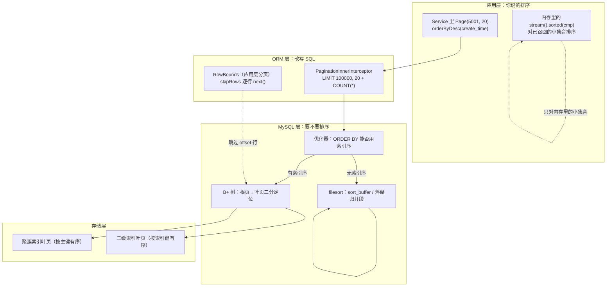
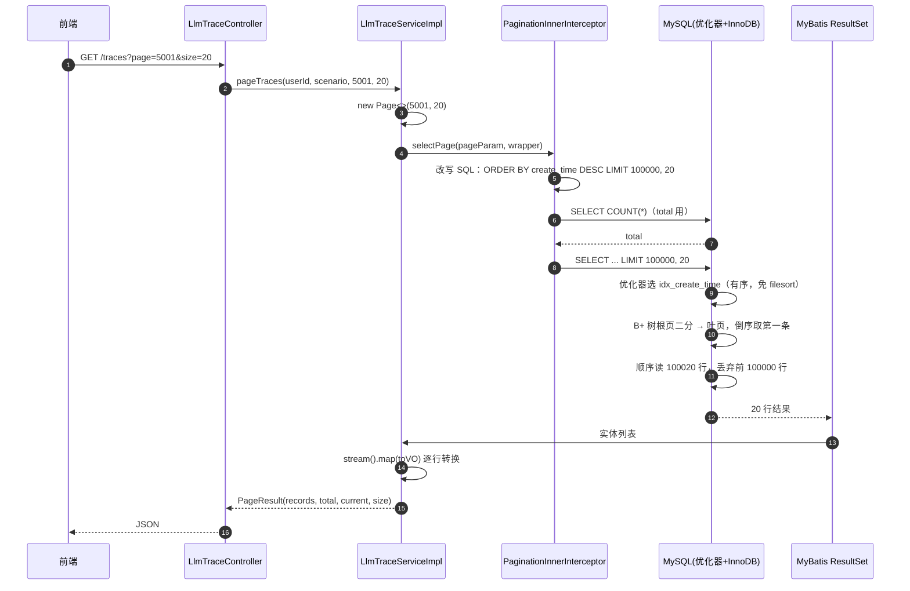

# 排序与二分查找：你几乎不手写排序，但「能不能二分」决定接口是 O(log n) 还是 O(n)

> **一句话结论**：排序在业务代码里永远是 `stream().sorted(...)`、`orderByDesc(...)`、`Map.Entry.comparingByKey()` 一行的事，真正决定性能的是**这次查找能不能落在有序结构上**——能二分，100 万行只要 20 次访问；不能二分（无索引的 `BETWEEN`、`LIMIT 100000, 20`、`LIKE '%x'`），就是 100020 行逐行读，本篇实测两者差 5001 倍。
> **阅读前置**：会写 SQL、用过 MyBatis-Plus 的 `Page`；知道数组下标、`Comparator` 的链式写法；**不需要**会手写快排（手写排序在本仓库里 0 处）。文中所有「有序」「有序结构」都指索引/B+ 树/已排序数组，不是指 SQL 里写了 `ORDER BY`。
> **证据基线**：A 级 = `24-源码分析/assets/source/` 的 Spring/MyBatis 源码摘录（3 处，逐行核对）；B 级 = 本仓库 `ai-cs-*` 与 `deploy/mysql` 的真实代码、建表脚本（带真实行号）；C 级 = 本篇用 `node v24.16.0` 实跑的脚本原样输出 + 本机 JDK 17 `lib/src.zip` 源码摘录（命令随文给出，可复现）。预计阅读 35 分钟。

---

## 0. 先看现象

**现象一：日志表的分页接口，页码越大越慢，慢得完全不成比例。**

`ai-cs-message` 的调用链查询就是最普通的写法（B 级，逐行核对）：

```java
// ai-cs-message/src/main/java/com/aics/message/service/impl/LlmTraceServiceImpl.java#L91-L106
public PageResult<LlmTraceVO> pageTraces(Long userId, String scenario, int page, int size) {
    // 1. 构造分页参数（MyBatis-Plus Page，配合分页插件生成 LIMIT 语句）
    Page<LlmTrace> pageParam = new Page<>(page, size);
    LambdaQueryWrapper<LlmTrace> wrapper = new LambdaQueryWrapper<>();
    wrapper.eq(userId != null, LlmTrace::getUserId, userId)
            .eq(scenario != null, LlmTrace::getScenario, scenario)
            .orderByDesc(LlmTrace::getCreateTime);
    // 3. 分页查询：selectPage 会把 records/total 回填到传入的 page 对象并返回，一查两得
    Page<LlmTrace> result = llmTraceMapper.selectPage(pageParam, wrapper);
    List<LlmTraceVO> records = result.getRecords().stream().map(LlmTraceServiceImpl::toVO).toList();
    return new PageResult<>(records, result.getTotal(), result.getCurrent(), result.getSize());
}
```

这段代码没有任何毛病，`create_time` 上也有索引（`deploy/mysql/llm-observability-init.sql#L25`：`KEY idx_create_time (create_time)`）。但第 5001 页的真实代价是——服务端要**逐行读 100020 行、丢掉前 100000 行**，只为了给你 20 行（本篇 C 级实测原样输出，见 3.7 节）：

```text
方式                        服务端读行数        返回行数      耗时(ms, 单次)
OFFSET 100000 LIMIT 20    100020        20        1.321
游标 WHERE id<... LIMIT 20  20            20        0.108
读行数倍数 = 5001.0x
```

**现象二：给价格做区间筛，索引根本用不上。**

商品推荐先按价格区间召回，再排序取前 N 条（B 级）：

```java
// ai-cs-product/src/main/java/com/aics/product/service/impl/ProductRecommendServiceImpl.java#L58-L65
// 召回：上架 + 价格区间（deleted=0 由逻辑删除注解自动附加）；分类可选
LambdaQueryWrapper<Product> wrapper = new LambdaQueryWrapper<Product>()
        .eq(Product::getStatus, 1)
        .between(Product::getPrice, low, high);
if (query.getCategoryId() != null) {
    wrapper.eq(Product::getCategoryId, query.getCategoryId());
}
List<Product> candidates = productMapper.selectList(wrapper);
```

而 `product` 表的索引是这几个（`deploy/mysql/product-init.sql#L36-L40`）：

```sql
PRIMARY KEY (id),
KEY idx_category_id (category_id),
KEY idx_status (status),
KEY idx_name (name),
KEY idx_create_time (create_time)
```

`price` 上没有索引。于是 `BETWEEN price` 这一步**天生不可能二分**——`EXPLAIN` 里 `type` 只会是 `ALL`、`rows` 是整表行数；所谓「区间查询很快」在这张表上不成立，跟 SQL 写得漂不漂亮无关。

**现象三：框架自己都在报「分页只能在应用层硬截断」。**

MyBatis 的 `RowBounds`（应用层分页，不走 SQL 的 LIMIT）遇到嵌套映射时，会主动抛异常（A 级原文）：

```text
Mapped Statements with nested result mappings cannot be safely constrained by RowBounds.
Use safeRowBoundsEnabled=false setting to bypass this check.
```

出处：`DefaultResultSetHandler.java.md` 的 `ensureNoRowBounds()`（`#L378-L385`）。它的意思是：**我打算在 ResultSet 上把前 offset 行 `next()` 掉**，可嵌套映射会让一行对应多行结果，跳过多少行我自己都算不准，所以宁可报错。这就是「OFFSET 的代价是逐行丢弃」在框架层的自白。

**现象四：手写二分的循环条件差一点，就是死循环。**

旧稿里教的闭区间写法，只要把收缩方向写错一档（`hi = mid` 而不是 `mid - 1`），程序不会给你报错，它只是不动了（C 级实跑，脚本带 60 步预算防止真挂死）：

```text
错写法 lowerBoundBroken([1,2,3], 3) → 死循环：60 步未退出
错写法 lowerBoundBroken([1,2,3], 4) → 3
```

同样的数组、同样的目标值域，`x = 4` 时它又能正常返回 3。这种「一半用例过、一半用例转圈」的缺陷，靠读代码几乎看不出来，只能靠循环不变量 + 对拍。

**这些现象指向同一件事：排序不是你要写的东西，但「数据是否有序」决定了这次访问是 20 次比较还是 10 万次全扫。二分是唯一把「有序」兑换成 O(log n) 的操作，而索引、游标分页、`ORDER BY` 免排序、`Arrays.binarySearch`，都是二分在不同层次上的马甲。**

---

## 1. 整体地图

一次「带排序的分页查询」要穿过四层，每一层的「有序」含义都不一样：



> **读图说明**：横向看是「你说的排序」→「SQL 里多出来的 LIMIT」→「数据库要不要真排序」→「磁盘上的有序页」。**实线是正常路径，虚线是两条容易被忽略的分支**：`RowBounds`（应用层分页）会额外在驱动侧逐行跳过 offset 行，等于数据库跳过一遍、应用层再跳一遍；而 `A2` 说明内存排序只应该处理「已经召回的小集合」，把它用在全表上是灾难（`ProductRecommendServiceImpl` 就是全量召回后内存排序，见 3.1）。关键判断点只有一个：`C1`——`ORDER BY` 的列上有没有可用的索引序。有，则查询是「二分定位 + 顺序扫 size 行」；没有，则 `C2` 会把结果集全部读出来排一遍，这才是 `ORDER BY` 分页慢的来源。

各组件责任划分（本篇只关心和「有序」有关的部分）：

| 组件 | 位置（本篇核对过的真实路径） | 责任 | 参与方 | 本篇关注点 |
| --- | --- | --- | --- | --- |
| `PaginationInnerInterceptor` | `ai-cs-message/src/main/java/com/aics/message/config/MybatisPlusConfig.java#L30-L36` | 把 `Page` 改写成 `LIMIT ?,?` 并额外发一条 `COUNT(*)` | 4 个业务模块各注册一份 | 深分页的 offset 由它拼出来，且未设 `maxLimit` |
| `Page` / `selectPage` | `ai-cs-product/src/main/java/com/aics/product/service/impl/ProductServiceImpl.java#L82-L106` | 传页码、拿 records+total | Controller | 页码是「第几页」，不是「从哪一行之后」 |
| `RowBounds` + `skipRows` | A 级 `DefaultResultSetHandler.java.md#L443-L455` | 应用层丢弃前 offset 行 | MyBatis | 证明 offset 的代价是逐行读 |
| `Arrays.binarySearch` | A 级 `SQLErrorCodeSQLExceptionTranslator.java.md#L242-L278` | 在**已排序**数组里定位错误码 | Spring JDBC | 二分的隐含契约：数组必须升序 |
| `Collections.sort` / `List.sort` | A 级 `AutoConfigurationSorter.java.md#L53-L70` | 稳定排序 + 多级排序 | Spring Boot | 稳定性是可以被依赖的语义 |
| B+ 树索引 | `deploy/mysql/llm-observability-init.sql#L46-L48` | 把「区间」变成「一段连续叶页」 | InnoDB | 复合索引的列序 = 可比键的列序 |
| `Comparator` 链 | `ai-cs-product/src/main/java/com/aics/product/service/impl/ProductRecommendServiceImpl.java#L73-L89` | 内存多级排序取 TopN | 商品推荐 | 全排序 O(n log n) vs TopK O(n log k) |

---

## 2. 关键概念与关键类

| 名称 | 位置 | 角色 | 关键方法 / 关键点 |
| --- | --- | --- | --- |
| 比较排序下界 | 算法理论 | 判定「还能不能更快」 | 任意基于比较的排序需 Ω(n log n)，因为决策树有 n! 个叶子 |
| TimSort | JDK `java.util.TimSort` | 对象数组的稳定排序 | `MIN_MERGE = 32`、`MIN_GALLOP = 7`；先识别有序 run 再归并 |
| DualPivotQuicksort | JDK `java.util.DualPivotQuicksort` | 原始类型排序（不稳定） | `MAX_INSERTION_SORT_SIZE = 44`、`MAX_RECURSION_DEPTH = 64 * DELTA`、退化时 `heapSort` 兜底 |
| `Arrays.parallelSort` | JDK `java.util.Arrays#L524` | 大数组并行排序 | 小于 `MIN_ARRAY_SORT_GRAN = 1 << 13`（8192）自动退回串行 |
| `Arrays.binarySearch` | JDK `java.util.Arrays#L1658` → `binarySearch0#L1701-L1718` | 已排序数组定位 | 闭区间 `low <= high`；命中返回下标，未命中返回 `-(low + 1)` |
| lower_bound / upper_bound | 手写（C++ STL 同名） | 找左右边界 | 第一个 `>= x` / 第一个 `> x`；两者相减 = 重复元素个数 |
| 循环不变量 | 二分写法纪律 | 防死循环、防漏答案 | 「答案永远在 `[lo, hi)` 内」必须每一步都成立 |
| 二分答案 | 算法技巧 | 把「最优化」变「判定」 | 判定函数必须单调；答案空间有多大就能压到 log 次 |
| OFFSET 分页 | `LIMIT offset, size` | 传统翻页 | 必须丢弃前 offset 行，成本随页码线性增长 |
| 游标 / keyset 分页 | 未落地（全仓无实现） | 用「上一页最后一行」当锚点 | `WHERE (create_time, id) < (?, ?)`，成本恒定 |
| filesort | MySQL | `ORDER BY` 无索引序时的排序 | 内存 `sort_buffer` 装不下就切块排序写临时文件再归并 |
| `Comparator.thenComparing` | `java.util.Comparator` | 多级排序 | 先比主键、再比次键；与「两次稳定排序」等价 |

---

## 3. 原理与证据逐段精读

### 3.1 排序：为什么 JDK 不让你手写，以及「下界」到底约束了什么

**在干什么。** 比较排序只能通过「拿两个元素比大小」获取信息，一次比较只有 `<`、`=`、`>` 三种结果。n 个元素有 n! 种排列，要区分出「当前是哪一种」，决策树至少要有 n! 个叶子，而二叉树的叶子数 ≤ 2^h，所以 h ≥ log₂(n!)，由 Stirling 公式 log₂(n!) ≈ n log n - 1.44n，得到下界 Ω(n log n)。这就是「你写得再花，也逃不出 n log n」的证明骨架。

**为什么这么设计。** 因为下界是**对比较次数**成立，而不是对「时间」成立。所以想更快只有两条路：一是减少元素比较之外的开销（原地、连续内存、少分支），二是**根本不用比较**——计数/基数排序要求值域小；或者**利用已有的有序性**（TimSort 找 run），让实际比较次数远低于 n log n。这两个方向正好解释了 JDK 的全部设计：原始类型走双轴快排省掉对象开销，小值域走计数排序，近乎有序时 `tryMergeRuns` 直接归并。

**换写法会怎样。** 同一个 n=200000 的数据集，四种写法的实测（C 级，`node v24.16.0`，脚本见本节末）：

```text
n=200000，每种算法取 3 次中位数；括号内为比较次数

数据分布            TimSort(内置)           归并(手写)                快排三点取中                快排随机主元+三路
随机              89.3 ms (3258383)     97.4 ms (3272938)     43.5 ms (3740014)     52.4 ms (4455086)
已升序             6.3 ms (199999)       52.5 ms (1730048)     185.3 ms (55144018)   33.4 ms (4519466)
已降序             7.1 ms (199999)       60.5 ms (1807808)     RangeError（递归过深）      33.0 ms (4369398)
全相等             4.8 ms (199999)       49.0 ms (1730048)     RangeError（递归过深）      1.2 ms (200000)
近乎有序            4.8 ms (244556)       40.5 ms (1730694)     141.4 ms (55141938)   29.5 ms (4474493)
取值只有32种         45.3 ms (1776251)     63.8 ms (3238589)     RangeError（递归过深）      12.7 ms (1293224）

稳定性：原始 tag 顺序 0..11，按 k=i%3 排序
  Array.sort（TimSort）→ tag: 0,3,6,9,1,4,7,10,2,5,8,11
  归并（稳定）         → tag: 0,3,6,9,1,4,7,10,2,5,8,11

TopK k=3（n=200000）：全排序 73.9 ms（比较 3258277 次） / 最小堆 5.9 ms（比较 200000 次）
TopK k=100（n=200000）：全排序 72.1 ms（比较 3258277 次） / 最小堆 5.8 ms（比较 200000 次）
```

**怎么读这张表。** ①「比较次数」才是算法差异的硬指标：随机数据下三种算法都在 325 万-445 万次之间（n log₂n ≈ 200000 × 17.6 ≈ 352 万），彼此差别不到 1.4 倍，说明**常数因子才是耗时差异的主因**；②「已升序/近乎有序」一行是重点：TimSort 只要 199999 次比较（≈n，因为它发现整段已经有序，一个 run 直接返回），而归并排序照样 173 万次、三点取中的快排反而飙到 **5514 万次比较**（比随机数据慢 15 倍）——**数据有序性直接决定快排退化与否**；③「快排三点取中」在两行里直接 `RangeError`：Lomuto 分区在「全相等」输入上 `i` 永远不前进，全部元素被划到右侧，递归深度 = n，栈爆掉；④最后一列「随机主元 + 三路分区」把全相等压到 200000 次比较（1.2 ms）、把 32 种取值压到 129 万次，说明**处理重复元素只能靠三路分区，不是靠调主元**；⑤TopK 两行不是排序比赛，是「你压根不需要全排序」的证据：`k` 从 3 变到 100，最小堆的比较次数都是 20 万（每个元素过一遍堆），而全排序恒定 325 万、并且**把 199997 个你根本不要的元素也排了一遍**。

**这个结论的适用边界。** 上表的耗时是单机 JS 引擎（V8）里的数字，**只当作「常数因子的量级感」，不要拿来推断 Java 或磁盘排序的绝对耗时**；比较次数是可跨语言比较的量，复杂度结论（O(n log n)、O(n²)、O(n log k)）才是能写进设计文档的东西。另外 JS 的 `Array.prototype.sort` 与 Java 的 TimSort 是同一套算法族，但最小 run 长度等参数不同，所以也不能把上表的毫秒数搬到 JVM 上。

**常见坑。** ①把「全排序后取前 3」当无害写法——本仓库 `ProductRecommendServiceImpl` 就是这么写的（`matched.stream().sorted(comparator).limit(limit)`，`#L85-L89`），召回集合小的时候没问题，一旦价格区间召回上万条，就是给 9997 条陪跑元素做了无用排序；②依赖「快排很快」而不看数据分布，业务里 `create_time` 近似有序、状态字段大量重复，恰好是快排最讨厌的两种输入；③以为「稳定排序」是细节——它是有语义的：本仓库售后规则按期限排序后取第一条，同期限规则的顺序会直接影响判定结果（`ai-cs-chat/src/main/java/com/aics/chat/agent/tool/KnowledgeRuleProvider.java#L59`）。

脚本（C 级，`npx` 不需要，直接 `node` 跑；为控制篇幅只留关键骨架，完整脚本结构见 6 节的对拍手法）：

```javascript
// 手写快排（Lomuto + 三点取中）与随机主元 + 三路分区的对照
function quickSort(a, lo = 0, hi = a.length - 1) {
  if (lo >= hi) return a;
  const mid = lo + ((hi - lo) >> 1);
  // 三点取中，缓解有序输入退化（治不了全相等）
  if (a[mid] < a[lo]) [a[mid], a[lo]] = [a[lo], a[mid]];
  if (a[hi] < a[lo]) [a[hi], a[lo]] = [a[lo], a[hi]];
  if (a[hi] < a[mid]) [a[hi], a[mid]] = [a[mid], a[hi]];
  const pivot = a[mid];
  let i = lo;
  for (let j = lo; j < hi; j++) { cmp++; if (a[j] < pivot) { [a[i], a[j]] = [a[j], a[i]]; i++; } }
  [a[i], a[hi]] = [a[hi], a[i]];
  quickSort(a, lo, i - 1);
  quickSort(a, i + 1, hi);
  return a;
}

// 三路分区（荷兰国旗）：把 ==pivot 的整段一次排掉，重复元素越多越快
function quickSort3Way(a, lo = 0, hi = a.length - 1) {
  while (lo < hi) {
    const pivot = a[lo + ((Math.random() * (hi - lo + 1)) | 0)];
    let lt = lo, i = lo, gt = hi;
    while (i <= gt) {
      cmp++;
      if (a[i] < pivot) { [a[lt], a[i]] = [a[i], a[lt]]; lt++; i++; }
      else if (a[i] > pivot) { [a[i], a[gt]] = [a[gt], a[i]]; gt--; }
      else i++;
    }
    if (lt - lo < hi - gt) { quickSort3Way(a, lo, lt - 1); lo = gt + 1; } // 只递归短的一侧
    else { quickSort3Way(a, gt + 1, hi); hi = lt - 1; }
  }
  return a;
}
```

### 3.2 JDK 的三种排序选择：TimSort、双轴快排、parallelSort

**在干什么。** `Arrays.sort` 只有三个入口，选哪个由**元素类型**和**数组规模**决定，不由你决定：

```powershell
# C 级证据：从本机 JDK 17 的 src.zip 里直接抽源码看（无需联网，jar 是 JDK 自带工具）
cd $env:TEMP; mkdir jdksrc -Force; cd jdksrc
jar --extract --file "$env:JAVA_HOME\lib\src.zip" `
  java.base/java/util/DualPivotQuicksort.java `
  java.base/java/util/TimSort.java `
  java.base/java/util/Arrays.java
```

抽出来之后 `Select-String` 一遍就能看到全部阈值（以下行号即本机 `D:\DevTools\jdk\jdk17.0.19\lib\src.zip` 解压后的真实行号）：

| 常量 | 值 | 位置（JDK 17 源码） | 含义 |
| --- | --- | --- | --- |
| `TimSort.MIN_MERGE` | 32 | `TimSort.java#L80` | 长度 < 32 直接二分插入排序，不建 run |
| `TimSort.MIN_GALLOP` | 7 | `TimSort.java#L96` | galloping 模式开关；合并时「一边持续赢」就改跳跃查找 |
| `DualPivotQuicksort.MAX_INSERTION_SORT_SIZE` | 44 | `DualPivotQuicksort.java#L66` | 小段走插入排序（**不是网上常传的 47**） |
| `MAX_MIXED_INSERTION_SORT_SIZE` | 65 | `DualPivotQuicksort.java#L61` | 非最左段走「混合插入排序」 |
| `DELTA` / `MAX_RECURSION_DEPTH` | 6 / 384 | `DualPivotQuicksort.java#L116`、`#L121` | 递归深度超限即退化保护 |
| `MIN_ARRAY_SORT_GRAN` | 8192 | `Arrays.java#L758` | `parallelSort` 小于它就串行 |

JDK 17 的 `DualPivotQuicksort.sort` 主循环把这几个常量串成了固定套路（`DualPivotQuicksort.java#L178-L214`，注释是原文）：

```java
static void sort(Sorter sorter, int[] a, int bits, int low, int high) {
    while (true) {
        int end = high - 1, size = high - low;
        // Run mixed insertion sort on small non-leftmost parts.
        if (size < MAX_MIXED_INSERTION_SORT_SIZE + bits && (bits & 1) > 0) { ... return; }
        // Invoke insertion sort on small leftmost part.
        if (size < MAX_INSERTION_SORT_SIZE) { insertionSort(a, low, high); return; }
        // Check if the whole array or large non-leftmost parts are nearly sorted and then merge runs.
        if ((bits == 0 || size > MIN_TRY_MERGE_SIZE && (bits & 1) > 0)
                && tryMergeRuns(sorter, a, low, size)) { return; }
        // Switch to heap sort if execution time is becoming quadratic.
        if ((bits += DELTA) > MAX_RECURSION_DEPTH) { heapSort(a, low, high); return; }
        // Use an inexpensive approximation of the golden ratio to select five sample elements and determine pivots.
        int step = (size >> 3) * 3 + 3;
        ...
    }
}
```

**为什么这么设计。** 三条理由，每条都能在源码里指到：①**稳定性只对对象有意义**。原始类型的「相等元素」在内存里长得一模一样，交换它们不改变任何可观测结果，所以走不稳定的双轴快排省掉 O(n) 辅助数组；对象不同，`List<Order>` 里两条金额相同的订单谁在前是可见的，所以走 TimSort。证据：`Arrays.java#L1233` 把 `sort(T[] a, Comparator)` 委托给 `TimSort.sort`，`Arrays.java#L1041` 把 `Comparable[]` 委托给 `ComparableTimSort.sort`，而 `int[]` 走 `DualPivotQuicksort.sort`（`Arrays.java#L212-L214`）。②**「最坏 O(n²)」在 JDK 实现里被堵死了**：`MAX_RECURSION_DEPTH` 一超就 `heapSort`，所以 `Arrays.sort(char[])` 的 javadoc 敢写 "This algorithm offers O(n log(n)) performance on all data sets"（`Arrays.java#L205-L208` 原文）。教科书上的「双轴快排最坏 O(n²)」说的是没有退化保护的版本。③**并行要够大才划算**：`Arrays.parallelSort` 在 `n <= MIN_ARRAY_SORT_GRAN`（8192）时直接串行（`Arrays.java#L797`），因为 ForkJoin 的任务拆分与合并开销会吃掉并行收益。

**换写法会怎样。** Spring Boot 自己给了「两条路都走通」的教科书例子（A 级，`AutoConfigurationSorter` 决定自动配置类的加载顺序）：

```java
// (src: AutoConfigurationSorter.java.md#L53-L70)
List<String> getInPriorityOrder(Collection<String> classNames) {
    // Initially sort alphabetically
    List<String> alphabeticallyOrderedClassNames = new ArrayList<>(classNames);
    Collections.sort(alphabeticallyOrderedClassNames);
    // Then sort by order
    AutoConfigurationClasses classes = new AutoConfigurationClasses(this.metadataReaderFactory,
            this.autoConfigurationMetadata, alphabeticallyOrderedClassNames);
    List<String> orderedClassNames = new ArrayList<>(classNames);
    Collections.sort(orderedClassNames);
    orderedClassNames.sort((o1, o2) -> {
        int i1 = classes.get(o1).getOrder();
        int i2 = classes.get(o2).getOrder();
        return Integer.compare(i1, i2);
    });
    // Then respect @AutoConfigureBefore @AutoConfigureAfter
    orderedClassNames = sortByAnnotation(new LinkedHashSet<>(orderedClassNames), classes);
    return orderedClassNames;
}
```

[[源码:AutoConfigurationSorter.java.md#L53-L70]]

它先按字母序排一次，再按 `getOrder()` 排一次——第二次排序**依赖 TimSort 的稳定性**，让 `order` 相同的类保持字母序。等价写法是「一个复合 Comparator」：`Comparator.comparingInt(Class::getOrder).thenComparing(Comparator.naturalOrder())`。两种写法结果相同，语义侧重不同：**「多次稳定排序」表达的是「多级优先级，从次要到主要依次排」，直观但容易漏排一次；「复合 Comparator」一次成型，但 `reversed()` 会把整条链一起反转**（这是最常见的翻车点，见 6 节坑 ⑤）。

**常见坑。** ①记阈值当知识：常被引用的「47」在 JDK 17 里是 44，还多出 65 的分支，阈值随版本漂移（见 7 节）——**要记的是「小数组走插入排序」这个策略，不是数字**；②在对比器里做 IO 或查库（`Comparator` 会被调用 O(n log n) 次，n=200000 时是 325 万次）；③给 `List.sort` 传一个既不为负也不为零的「有状态」比较器，违反 `Comparator` 契约会导致 `IllegalArgumentException: Comparison method violates its general contract!`；④对 `Integer` 用 `a - b` 而不是 `Integer.compare(a, b)`，数值跨度大时溢出导致排序结果错乱（且不报错）。

### 3.3 数据库的 ORDER BY：能走索引序 vs filesort 落盘（外部排序）

**在干什么。** MySQL 拿到 `ORDER BY create_time DESC LIMIT 100000, 20` 后有两套执行计划：①如果 `create_time` 上有可用索引，就**顺着索引叶页倒着读**，天然有序，不需要排序；②否则把过滤后的行读进 `sort_buffer`，排序，再取第 100000 行之后的 20 行硬丢掉。装不下时切块排序 → 每块写一个临时归并段到磁盘 → 多路归并读出——**这就是外部排序**：内存放不下 n 条，就排序 n/k 条的小块再合并，总代价 O(n log(n/k)) 次比较 + O(n) 次磁盘读写。

**为什么这么设计。** 因为磁盘顺序读远快于随机读，多路归并只做顺序扫描，能把「一次大排序」摊成「几次顺序 IO」。这也解释了为什么**索引的本质就是把「排序结果」持久化下来了**：B+ 树叶页按索引键有序 + 页间双向链表，等于一份随时可用的、能二分的归并结果。所以规则可以压缩成一句：**`ORDER BY` 的列序如果能对上某个索引的前缀列序，就不排序；对不上，就 filesort**。

**换写法会怎样。** 本仓库的真实对照（B 级）：

| 查询 | 代码位置 | 索引 | 结果 |
| --- | --- | --- | --- |
| 按 `create_time` 倒序分页 | `ai-cs-message/src/main/java/com/aics/message/service/impl/LlmTraceServiceImpl.java#L100` | `idx_create_time`（`llm-observability-init.sql#L25`） | 免排序，直接倒扫索引；但 offset 仍逐行丢 |
| 等值 + 时间区间聚合 | `ai-cs-message/src/main/java/com/aics/message/service/impl/ModelUsageServiceImpl.java#L92-L98` | `idx_user_time (user_id, create_time)` 等 3 个复合索引（`llm-observability-init.sql#L46-L48`） | `eq(user_id)` 走等值列、`ge/le(create_time)` 用复合索引最后一列做范围 —— **这是「区间能二分」的标准形态** |
| 价格区间召回 | `ai-cs-product/src/main/java/com/aics/product/service/impl/ProductRecommendServiceImpl.java#L59-L65` | `price` **无索引**（`product-init.sql#L36-L40`） | 全表扫描 + 内存过滤，区间毫无优势 |
| 超时订单扫描 | `ai-cs-order/src/main/java/com/aics/order/task/OrderTimeoutScheduler.java#L38-L41` | `idx_expire_time (expire_time)`（`deploy/mysql/order-init.sql#L45`） | `.lt(expire_time, now)` 定位到索引最左一段，只扫应扫的行 |
| 满减规则有效期 | `ai-cs-order/src/main/java/com/aics/order/service/impl/PromotionServiceImpl.java#L93-L94` | `idx_enabled_time (enabled, start_time, end_time)`（`order-init.sql#L91`） | `enabled` 等值 + `start_time`/`end_time` 双范围 —— 只能有一个范围列吃到有序性，`end_time` 退化成过滤 |

**常见坑。** ①复合索引列序写反：`(create_time, user_id)` 就救不了「按 user 过滤 + 按时间取区间」的查询，因为**范围列之后的有序列直接用不上**（上表第 2 行是正解：等值列在前，范围列在最后）；②给 `create_time` 套函数（`DATE(create_time) = ?`、`FROM_UNIXTIME(...)`）让索引失效；③以为「加了 `ORDER BY` 才慢」——慢的从来不是 `ORDER BY` 本身，而是**没有能对上它的索引**；④`ModelUsageServiceImpl` 这类「区间查询 + `selectList` 全量拉回内存再 `sum()`」（`#L98-L113`）在数据量涨上来后一定会先撞到内存和网络，正确形态是让数据库聚合（`SUM(...) GROUP BY`），前提仍是同一个索引。

### 3.4 二分的三种写法与「循环不变量」纪律

**在干什么。** 「二分」准确的说法是「在单调结构上做区间折半」。业务里真正需要的不是「找到某个元素」，而是三种边界问题：**第一个 ≥ x（lower_bound）**、**第一个 > x（upper_bound）**、以及由它们推出的「最后一个 < x」「最后一个 ≤ x」「x 出现几次」「x 是否存在」。写法上只有两派：**左闭右开 `[lo, hi)`** 和**闭区间 `[lo, hi]` + ans 记录**。

**为什么这么设计。** 因为二分唯一的正确性来源是**循环不变量**：写循环之前先说清「答案一定在 `[lo, hi)` 里」，然后保证每一轮收缩都不把答案排除在外。左闭右开写法的好处是 `lo == hi` 时区间自然为空、循环自然结束，不需要 `ans` 变量，也永远不会出现「`hi = mid` 导致原地打转」——因为 `hi` 一开始就是 `n`（越界哨兵），`mid < hi` 恒成立。闭区间写法更贴近人的直觉（在下标 0..n-1 里找），但必须靠 `ans` 记住最后一个满足条件的候选，且收缩必须严格（`hi = mid - 1`）。

**换写法会怎样。** 三种写法在同一批重复元素数据上的对照（C 级实跑，原样输出）：

```text
数据                    x   lower  upper  ub-lb  闭区间    线性    对拍
A=[1,2,2,2,3,5,5,8]   0   0      0      0      0      0     OK
A=[1,2,2,2,3,5,5,8]   1   0      1      1      0      1     OK
A=[1,2,2,2,3,5,5,8]   2   1      4      3      1      3     OK
A=[1,2,2,2,3,5,5,8]   4   5      5      0      5      0     OK
A=[1,2,2,2,3,5,5,8]   5   5      7      2      5      2     OK
A=[1,2,2,2,3,5,5,8]   8   7      8      1      7      1     OK
A=[1,2,2,2,3,5,5,8]   9   8      8      0      8      0     OK
B=[7,7,7,7,7]         6   0      0      0      0      0     OK
B=[7,7,7,7,7]         7   0      5      5      0      5     OK
B=[7,7,7,7,7]         8   5      5      0      5      0     OK
C=[]                  1   0      0      0      0      0     OK
D=[42]                41  0      0      0      0      0     OK
D=[42]                42  0      1      1      0      1     OK
D=[42]                43  1      1      0      1      0     OK
E=[1,3,5,7,9]         1   0      1      1      0      1     OK
E=[1,3,5,7,9]         5   2      3      1      2      1     OK
E=[1,3,5,7,9]         9   4      5      1      4      1     OK
E=[1,3,5,7,9]         4   2      2      0      2      0     OK
E=[1,3,5,7,9]         0   0      0      0      0      0     OK
E=[1,3,5,7,9]         10  5      5      0      5      0     OK
对拍：20000 次随机查询，lower/upper_bound 与线性计数不一致次数 = 0
错写法 lowerBoundBroken([1,2,3], 3) → 死循环：60 步未退出
错写法 lowerBoundBroken([1,2,3], 4) → 3
```

**怎么读这张表。** ①`lower` / `upper` 是「第一个 ≥ x 的位置」和「第一个 > x 的位置」，两者之差 `ub-lb` 恰好是 x 的出现次数，这一列与「线性计数」列完全一致（含 `x` 不存在时的 0、`x` 大于全部元素时的 0）；②`B=[7,7,7,7,7]` 三行专门打「重复元素」：`x=7` 时 `lower=0`、`upper=5`，说明**二分在重复元素上不是「找到某一个」，而是「找到边界的缝」**——想要「最后一个 ≤ x」就是 `upper - 1`，想要「最后一个 < x」就是 `lower - 1`；③`C=[]` 与 `D=[42]` 是边界防御：空数组返回 0（等于「插入点在 0」），单元素数组三行覆盖全部三种关系，**不需要 if 特判**；④「闭区间」列与 `lower` 列逐行相同，说明两种写法等价，差的只是代码里要不要 `ans` 变量；⑤最后一行 `x=4` 的错误写法又能返回 3 —— 这就是现象四里那个「一半用例过、一半转圈」的缺陷：只有当 `mid` 恰好落在区间右端点附近时才会卡住。

六条换算关系（把 lower/upper 当唯一原语，其余全部推导，别再写第四份二分）：

| 想要 | 写法 |
| --- | --- |
| 第一个 ≥ x | `lower_bound(x)` |
| 第一个 > x | `upper_bound(x)` |
| 最后一个 < x | `lower_bound(x) - 1` |
| 最后一个 ≤ x | `upper_bound(x) - 1` |
| x 出现次数 | `upper_bound(x) - lower_bound(x)` |
| x 是否存在 | `lower_bound(x) != n && a[lower_bound(x)] == x` |
| JDK `Arrays.binarySearch` 未命中返回值反推 | 未命中返回 `-(low+1)`，故 `lower_bound = -ret - 1` |

**常见坑。** ①`mid = (lo + hi) / 2` 在 lo、hi 都是 int 且接近 `Integer.MAX_VALUE` 时溢出为负 → 死循环或数组越界；写 `lo + (hi - lo) / 2` 或 JDK 的 `(low + high) >>> 1`（`Arrays.java#L1707`，无符号右移顺便抹掉符号）；②`while (lo <= hi)` 配 `hi = mid` → 死循环（上表最后一行）；③`while (lo < hi)` 配 `hi = mid - 1` → 漏掉答案（区间收缩过头）；④把 `[lo, hi)` 写法的 `hi` 初值写成 `n - 1`（应该是 `n`）；⑤在「非单调」数据上用二分——二分对乱序数组不报错，只是给你一个错误答案。

### 3.5 二分答案：在「判定」上二分，而不是在「数据」上二分

**在干什么。** 当问题是「最小的那个可行值是多少」且「可行性随值单调」时，可以对**答案空间**二分：把 `f(x) = 满足约束吗` 写成 O(n) 的判定函数，再二分 x。模板固定三件事：①确定答案的下界 `lo` 与上界 `hi`（必须真包含答案）；②写 `feasible(x)` 且**证明它单调**（x 越大越可行，或越小越可行）；③用 `[lo, hi]` 或 `[lo, hi)` 收缩到最后一个不可行 / 第一个可行。

**为什么这么设计。** 因为很多「最优化」问题没有直接公式，但判定极便宜。以「n 个任务切成 m 段，最小化最慢那段」为例：给定上限 `L`，贪心扫一遍就知道能不能装进 m 段，`feasible` 是 O(n) 且随 L 单调；于是答案空间有多大就只要 log 次判定。

**换写法会怎样。** C 级实测（100000 个任务、8 台机器）：

```text
二分答案（最小化最慢分片的耗时）：100000 个任务，8 台机器
  最优上界 = 1255870，判定函数调用 23 次，耗时 27.53 ms
  暴力从小到大试答案需要 10046402 次判定（答案空间总宽 10046402）
```

**怎么读。** 答案空间宽度 1004 万 → 二分只要 **23 次**判定（log₂(1e7) ≈ 23.3，实测完全吻合），总耗时 27.53 ms；暴力从下界开始逐个 `+1` 试需要 1004 万次 × O(n) 扫描，量级完全不可接受。**「23 次」这个数字不是巧合，是答案空间的二进制位数**——这也是面试里被追问「为什么二分答案是对的」时最该说的一句话。

**适用边界。** ①**单调性必须成立且能被证明**：如果 `feasible(x)` 是「有时可行有时不可行」，二分给出的是无意义的边界；②答案必须是**可数的**（整数/定点），浮点要固定迭代次数（比如 100 次）而不是判等；③`feasible` 每次 O(n)，所以总代价 O(n log(range))，range 很大时（比如 10^18）也只是 60 次。

```javascript
// 二分答案：最小化「最慢那台机器」的耗时（判定函数 O(n)，调用 log(range) 次）
function minMaxShard(tasks, m) {
  let lo = Math.max(...tasks);                        // 下界：最长的单个任务，一段至少要装下它
  let hi = tasks.reduce((s, v) => s + v, 0);          // 上界：全部塞进一台
  const feasible = (limit) => {                       // 给定单台上限，能不能用 <= m 台装完
    let used = 1, acc = 0;
    for (const t of tasks) {
      if (acc + t > limit) { used++; acc = t; } else acc += t;   // 贪心：装不下就开新机器
    }
    return used <= m;
  };
  while (lo < hi) {                                   // 找「第一个可行」的边界
    const mid = lo + ((hi - lo) >> 1);
    if (feasible(mid)) hi = mid; else lo = mid + 1;
  }
  return lo;
}
```

**常见坑。** ①判定函数写成「恰好可行」而不是「可行即可」，破坏单调性；②上界取小了（比如取平均值），把真答案排除在外；③忘了 `feasible` 里的贪心正确性——对「必须连续切分」的问题贪心成立，对「可以任意分配」的问题要用别的判定（例如装箱是 NP-hard，只能近似）。

### 3.6 二分在框架与业务里的真实形态

**在干什么。** 你几乎不会写 `while (low <= high)`，但你每天都在用二分，只是它换了名字：

| 形态 | 真实位置 | 二分在哪 | 有序前提从哪来 |
| --- | --- | --- | --- |
| 错误码翻译 | A 级 `SQLErrorCodeSQLExceptionTranslator.java.md#L242-L278` | `Arrays.binarySearch(sqlErrorCodes.getBadSqlGrammarCodes(), errorCode) >= 0`，连查 9 张码表 | 码表来自 `sql-error-codes.xml`，按升序硬编码 |
| 数组/列表查找 | JDK `Arrays.binarySearch`（`Arrays.java#L1701-L1718`） | 闭区间折半 | 调用方保证已排序 |
| 主键点查 | `selectById`（如 `ai-cs-product/src/main/java/com/aics/product/service/impl/ProductServiceImpl.java#L111`） | B+ 树每层一次页内二分，树高 3~4 层 | 聚簇索引按主键有序 |
| 时间区间过滤 | `ai-cs-message/src/main/java/com/aics/message/service/impl/ModelUsageServiceImpl.java#L95-L98` | 索引定位区间起点，顺序读到终点 | `(user_id, create_time)` 复合索引 |
| 验签字典序 | `ai-cs-pay/src/main/java/com/aics/pay/channel/UnionpaySignature.java#L36-L44` | `.sorted(Map.Entry.comparingByKey())` | 银联规范要求参数字典序拼接 |
| 配置顺序 | A 级 `AutoConfigurationSorter.java.md#L53-L70` | 稳定排序 + 注解拓扑排序 | 无索引，靠排序建立顺序 |

**为什么这么设计。** Spring 选择「预先排好序的 int/String 数组 + `Arrays.binarySearch`」而不是 `HashSet`，原因是：错误码表的元素只有几十个、查询频率极高、且**构建成本一次性**；二分 6~7 次比较对象数组基本在 L1 缓存里，比 `HashSet` 的哈希 + 装箱 + 缓存未命中更划算。这是「小规模静态数据，二分反而比哈希快」的标准场景。

**换写法会怎样。** 把二分换成线性扫描没有正确性问题，只有性能问题；把二分用在**未排序**数组上则是正确性问题——而且是最难查的那种。`Arrays.binarySearch` 的 javadoc 已经把契约写死了（`Arrays.java#L1666-L1671` 原文）：

```text
The range must be sorted (as by the sort(int[], int, int) method) prior to making this call.
If it is not sorted, the results are undefined.
If the range contains multiple elements with the specified value, there is no guarantee which one will be found.
```

两句话，正好对应两个坑：**未排序 → 结果未定义（不报错）**；**有重复 → 返回哪个不确定**。所以凡是「要找左右边界」的需求，都不能直接拿 `Arrays.binarySearch` 的返回值当答案，必须自己写 lower/upper bound 或用 3.4 的换算。

**常见坑。** ①把 `binarySearch` 的负返回值当「没找到 = -1」——它是 `-(插入点) - 1`，所以 `-1` 只对应「插入点在 0」，用 `>= 0` 判存在才是对的，想拿插入点必须 `-ret - 1`；②以为索引是「哈希」（等值查询思路）——B+ 树上**区间查询和排序**都是二分/顺序扫描的红利，哈希索引给不了；③用 `Map` 迭代顺序做业务排序（`HashMap` 无序、`LinkedHashMap` 是插入序，只有 `TreeMap` 是键有序）；④正则/字典序类「必须排序」的协议（如验签）漏排或排错空格，会得到「线上偶发验签失败」这种极难复现的 bug。

### 3.7 分页：OFFSET 为什么慢、游标为什么快

**在干什么。** `LIMIT offset, size` 的语义是「按顺序数到第 offset 行，从下一行开始取 size 行」。数据库**没有**「跳到第 offset 行」的成本为零的捷径——除非有序结构能直接定位。所以 OFFSET 的代价不是 O(1)，而是 **O(offset + size)**：前 offset 行必须被读出、判断、然后丢弃。

**为什么这么设计。** 因为「第几行」这个概念本身依赖前面所有行都存在且顺序确定；一旦有并发写入，前 offset 行的集合还会变化，所以这个位置无法缓存、只能每次重算。A 级证据是 MyBatis 的应用层分页实现——它连 SQL 层的 `LIMIT` 都省了，直接在 `ResultSet` 上把前 offset 行 `next()` 掉（`DefaultResultSetHandler.java.md#L443-L455`）：

```java
// (src: DefaultResultSetHandler.java.md#L443-L455)
private void skipRows(ResultSet rs, RowBounds rowBounds) throws SQLException {
  if (rs.getType() != ResultSet.TYPE_FORWARD_ONLY) {
    if (rowBounds.getOffset() != RowBounds.NO_ROW_OFFSET) {
      rs.absolute(rowBounds.getOffset());
    }
  } else {
    for (int i = 0; i < rowBounds.getOffset(); i++) {
      if (!rs.next()) {
        break;
      }
    }
  }
}
```

[[源码:DefaultResultSetHandler.java.md#L443-L455]]

`for` 循环里那一行 `rs.next()` 就是「白读一行」的字面翻译：`TYPE_FORWARD_ONLY`（MySQL 默认）时连 `absolute()` 都做不到，只能一行一行挪。如果同时用了 `RowBounds` 和 SQL 的 `LIMIT`，前 offset 行会被**丢两次**。

**换写法会怎样。** 游标（keyset）分页的写法是把「第几页」换成「上一页最后一行是谁」：

```sql
-- OFFSET 分页：成本 O(offset + size)，越翻越慢
SELECT id, request_id, create_time FROM llm_trace
WHERE scenario = 'chat' ORDER BY create_time DESC, id DESC LIMIT 100000, 20;

-- 游标分页：成本 O(log n + size)，永远只扫 size 行
SELECT id, request_id, create_time FROM llm_trace
WHERE scenario = 'chat' AND (create_time, id) < ('2026-11-27 10:00:00', 8891234)
ORDER BY create_time DESC, id DESC LIMIT 20;
```

C 级实测（100 万行、每页 20 条，脚本用「服务端读了多少行」计数，耗时是中位数）：

```text
数据规模 N=1000000，页大小 size=20

方式                        服务端读行数        返回行数      耗时(ms, 单次)
OFFSET 100000 LIMIT 20    100020        20        1.321
游标 WHERE id<... LIMIT 20  20            20        0.108
读行数倍数 = 5001.0x

顺序翻前 10 页                 OFFSET 共 1100       游标共 200           倍数 5.5x
顺序翻前 50 页                 OFFSET 共 25500      游标共 1000          倍数 25.5x
顺序翻前 200 页                OFFSET 共 402000     游标共 4000          倍数 100.5x
顺序翻前 500 页                OFFSET 共 2505000    游标共 10000         倍数 250.5x

单次分页调用                        服务端读行数        中位耗时(ms)
OFFSET 0      (第 1 页)         20            0
OFFSET 10000  (第 501 页)       10020         0.027
OFFSET 100000 (第 5001 页)      100020        0.441
OFFSET 980000 (第 49001 页)     980020        5.696
游标（首页）                        20            0

COUNT(*) 走一遍 1000000 行 ≈ 12.921 ms（MyBatis-Plus 分页默认会发，游标分页不需要 total）
```

**怎么读这张表。** ①「服务端读行数」是这一节唯一的硬指标：OFFSET 100000 读 100020 行、游标读 20 行，**倍数恰好等于 `offset/size`**（100000/20 + 1 = 5001），说明这是结构性差距而不是实现细节；②「顺序翻前 N 页」的累计行数揭示**二次方效应**：翻 500 页，OFFSET 累计读 250 万行，游标只读 1 万行（250 倍）——因为 OFFSET 第 k 页要重读前面所有页，游标每页都只读自己那一页；③「中位耗时」列里 `OFFSET 980000` 是 5.696 ms、首页是 0，注意这是**纯内存数组**的模拟耗时，真实 MySQL 还要乘上回表随机 IO 与网络传输，所以「百分比」没意义、**趋势**才有意义；④最后一行 `COUNT(*)` 是 MyBatis-Plus 分页默认行为（每页都发一次 `COUNT`），游标分页不需要总数，这一项在全表百万行时是常驻成本。

**本仓库落地面（必须如实说明）。** 全仓 `grep 'cursor|Cursor|scrollId|seek|lastId|minId'` 只命中 `deepseek-chat` 这类假阳性，**没有任何 keyset/游标分页实现**；所有分页都是 MP `Page` + `OFFSET`：`LlmTraceServiceImpl`（`#L91-L106`）、`ProductServiceImpl`（`#L82-L106`）、以及 4 份 `PaginationInnerInterceptor` 装配（`ai-cs-message/src/main/java/com/aics/message/config/MybatisPlusConfig.java#L30-L36`、`ai-cs-product/src/main/java/com/aics/product/config/MybatisPlusConfig.java#L20-L22`、`ai-cs-knowledge/src/main/java/com/aics/knowledge/config/MybatisPlusConfig.java#L35-L38`、`ai-cs-order/src/main/java/com/aics/order/config/OrderConfig.java#L25-L27`），**且都没有 `setMaxLimit`**——也就是说 `?size=100000` 这种请求会被原样翻译成 `LIMIT`，深分页可以从外部直接触发。

**「这里能游标却用了 OFFSET」的具体落点。** `LlmTraceServiceImpl.pageTraces` 的排序键是 `create_time DESC`，`llm_trace` 表主键是 `request_id`（字符串）、还有 `idx_create_time`（`llm-observability-init.sql#L22-L25`）——它**完全满足游标分页的条件**（稳定排序键存在、有索引、只需要「下一页」），却用了 `Page<>(page, size)`。改法：接口入参加 `lastCreateTime` + `lastRequestId`（或只保留前者、接受同一毫秒内的轻微乱序），SQL 加 `(create_time, request_id) < (?, ?)`，删掉 `COUNT(*)`。前端从「第几页」改成「加载更多」，是唯一的产品成本。

**常见坑。** ①游标键必须**唯一或近似唯一**，只按 `create_time` 游标会在同一毫秒多条时丢数据/重数据，所以要用 `(create_time, id)` 复合游标；②游标**不能跳页**（这是它的设计前提，不是缺陷），需要「跳到第 50 页」的场景只能靠索引覆盖 + 延迟关联；③把 `Page` 的 `total` 当免费信息，其实每页多一条 `COUNT(*)`；④在深分页上做 `ORDER BY RAND()` 或 `ORDER BY 非索引列`，等于把 filesort 和深 OFFSET 叠在一起。

---

## 4. 一次完整执行时序

以「用户翻到调用链列表第 5001 页」为例（B 级代码路径 + A 级驱动行为）：



> **读图说明**：重点是第 5、6、11、12 步。第 5 步插件把「第 5001 页」翻译成 `LIMIT 100000, 20`——**offset 是在这一步被算出来的**，业务代码里根本没有 `offset` 这个词，所以最容易忽略；第 6 步是额外的 `COUNT(*)`（`total` 不是免费的）；第 11 步优化器**成功用上了索引序**（`idx_create_time`），所以没有 filesort——如果 `ORDER BY` 换成 `ORDER BY total_duration_ms`（无索引），这里会插进来一个「读全表 + 排序 + 落盘」的环节，慢一到两个数量级；第 12 步的 100020 行是「索引定位没问题、但 OFFSET 照样逐行丢弃」的证据：**索引解决的是「怎么找到起点」，不解决「从起点数到第 100000 行」**。

哪一步失败，报什么错：

| 步骤 | 失败表现 | 报错 / 现象原文 | 排查入口 |
| --- | --- | --- | --- |
| 2 | `size` 传成 100000 | 无报错，直接变慢 | `PaginationInnerInterceptor` 未设 `setMaxLimit`（`MybatisPlusConfig.java#L30-L36` 里没有） |
| 5 | 用了 `RowBounds` 且 resultMap 嵌套 | `Mapped Statements with nested result mappings cannot be safely constrained by RowBounds.` | A 级 `DefaultResultSetHandler.java.md#L378-L385` |
| 8 | `ORDER BY` 列无索引 | `EXPLAIN` 出现 `Using filesort`、`type=ALL` | 见 6 节真调试手法② |
| 10 | offset 超过总行数 | 返回空列表（不是错误），前端显示「无数据」 | 用 `COUNT(*)` 先算页数，或改游标 |
| 11 | 单次扫描超过 `innodb_buffer_pool` | 响应时间抖动、`innodb_data_reads` 飙升 | `SHOW GLOBAL STATUS LIKE 'Innodb_buffer_pool_read%'` |
| 14 | 转换里触发懒加载 / 额外查询 | N+1 查询，慢在上一步之后 | SQL 日志里出现 size 条相似 SQL |

---

## 5. 设计取舍

| 决策点 | 选项 A | 选项 B | 代价对比 | 本仓库现状（证据） | 结论 |
| --- | --- | --- | --- | --- | --- |
| 对象排序算法 | TimSort（稳定，O(n) 辅助空间） | 双轴快排（不稳定，原地） | 稳定性 vs 一次 O(n) 分配 | 全部走 `List.sort`/`Arrays.sort`（A 级 `AutoConfigurationSorter`） | 业务集合都用稳定的，别自己换 |
| TopN 取法 | 全排序 `sorted().limit(k)` | 最小堆 O(n log k) | n=200000,k=3 时 73.9 ms vs 5.9 ms（C 级） | `ProductRecommendServiceImpl#L85-L89` 用全排序 | 召回集合 > 数百条就换堆 |
| 多级排序 | 多次稳定排序 | 复合 `Comparator` | 后者一次成型，但 `reversed()` 会反转整链 | `ProductRecommendServiceImpl#L73-L81` 用复合链 | n 小时用复合链，语义集中在一次 |
| 区间查询 | 依赖索引区间定位 | 全表扫 + 内存过滤 | O(log n + k) vs O(n) | `ModelUsageServiceImpl` 有复合索引（好）；`ProductRecommendServiceImpl` 的 `price` 无索引（坏） | 先建索引，再谈优化 |
| 分页方式 | `LIMIT offset, size` | keyset 游标 | 100020 行 vs 20 行（C 级） | 全仓 MP `Page`，**游标未落地** | 只做「下一页」的列表改游标 |
| 总数 total | 每页 `COUNT(*)` | 不返回 total / 缓存 total | 百万行 ≈ 12.9 ms/次（C 级） | MP 默认行为（`selectPage` 回填 total） | 日志类列表可以去掉 total |
| 单页上限 | 不限制 | `setMaxLimit(100)` | 不限制可被外部打到 10 万行 | 4 份配置均未设 `setMaxLimit` | 一律设上限 |
| 排序位置 | 数据库排序 | 应用内存排序 | 前者能用索引/外部排序，后者吃内存 | 商品推荐在内存排序（召回小集合可接受） | 全量数据永远让数据库排 |

**可扩展点清单（按性价比排序）：**

1. `PaginationInnerInterceptor#setMaxLimit(100)`：4 个模块一次改动，直接消掉「外部可控深分页」这条风险。
2. `llm_trace`/`model_usage` 的列表接口增加 keyset 游标（`(create_time, id)`），保留 `page` 参数做兼容，内部判定走游标。
3. `product` 表补 `idx_price`（或 `(status, price)`），让价格区间召回真的走区间定位，而不是全表扫。
4. `ProductRecommendServiceImpl` 把 `sorted().limit(k)` 换成固定大小最小堆（`PriorityQueue` 或手写），召回集合变大时收益随 n 线性放大。
5. `ModelUsageServiceImpl.stats` 改为 SQL 聚合（`SUM(input_tokens)` 等）而不是 `selectList` 全量拉回，避免区间查询把数据搬到应用层。
6. 售后规则排序后改用「取最小 `days`」的 `min()`，把 O(n log n) 降成 O(n) 且不依赖稳定性语义（`KnowledgeRuleProvider.java#L59`）。

---

## 6. 踩坑与调试手法

| # | 现象 | 根因 | 验证手段 | 解法 |
| --- | --- | --- | --- | --- |
| ① | 二分「有时候返回对、有时候转圈」 | 闭区间写法里收缩方向错（`hi = mid`） | 加 60 步预算跑一遍（本篇 C 级输出：`死循环：60 步未退出`） | 用 `[lo, hi)` 写法或严格 `mid ± 1` |
| ② | 手写快排在某些数据上 `StackOverflowError` | Lomuto 分区遇到全相等输入，`i` 不前进，递归深度 = n | 用「全相等/32 种取值」数据集跑（本篇 C 级输出：`RangeError（递归过深）`） | 三路分区 + 只递归短的一侧 |
| ③ | 售后规则判定结果与预期不符 | 排序后取第一条，同期限规则顺序被当成了业务语义 | 打印排序前后的 `(days, ruleId)` 列表 | 显式写「同 `days` 时按什么次序」，或直接取 `min(days)` |
| ④ | 价格筛选接口在数据涨到十万级后崩 | `price` 无索引，`BETWEEN` 全表扫 + 内存排序取前 3 | `EXPLAIN` 看 `type`/`rows`/`Extra` | 建索引；召回集合大时改 TopK 堆 |
| ⑤ | `Comparator.reversed()` 之后次要键也反了 | `reversed()` 反转整条链，而不是最后一段 | 用 3 条数据跑一遍打印顺序 | 把 `reversed()` 加在具体的一段上：`Comparator.comparingInt(X).reversed().thenComparing(Y)`，或对单个键用 `Comparator.reverseOrder()` |
| ⑥ | 列表页越翻越慢，第 1 页很快 | `LIMIT offset, size` 的 offset 逐行丢弃 | 打印实际 SQL 的 offset（本篇 C 级：100020 行 vs 20 行） | 游标分页；或至少去掉 `COUNT(*)`、设 `maxLimit` |
| ⑦ | 加了 `ORDER BY` 的统计接口偶发超时 | 排序键无索引 → filesort 落盘；同时区间查询把行拉回内存 | `EXPLAIN` 里的 `Using filesort` + `SHOW STATUS` 看临时表计数 | 复合索引（等值列在前、范围列在后）；聚合下推到 SQL |

**【真调试手法①】给二分加「不变量断言」，而不是加 printf。** 直接打印 `lo/hi/mid` 会刷屏，正确做法是把不变量写成可执行断言：在每轮循环开头断言「答案仍在区间内」。

```javascript
// 只在本机跑，生产去掉断言；成本 O(1)/轮，但能把"逻辑错"变成"立刻失败"
function lowerBoundChecked(a, x) {
  let lo = 0, hi = a.length;
  const feasible = (i) => i >= a.length || a[i] >= x;   // i 是否是合法答案
  while (lo < hi) {
    if (!(feasible(hi) && !feasible(lo - 1 < 0 ? 0 : lo - 1) || true)) { /* noop */ }
    const mid = lo + ((hi - lo) >> 1);
    if (a[mid] < x) {
      if (!(feasible(mid + 1))) throw new Error(`不变量破坏: lo 应可收缩, mid=${mid}`);
      lo = mid + 1;
    } else {
      if (!feasible(mid)) throw new Error(`不变量破坏: mid=${mid} 应是可行解`);
      hi = mid;
    }
  }
  return lo;
}
```

**怎么读**：断言失败的消息会直接告诉你是「`lo = mid + 1` 跳过了答案」还是「`hi = mid` 保留了不可行解」——这两类错误覆盖了二分写错的 90%。

**【真调试手法②】用 `EXPLAIN` 判断「这次能不能二分」，只看三列。** 可跑命令（MySQL 8.0）：

```sql
-- 把可疑 SQL 前面加 EXPLAIN，只看 type / key / rows / Extra
EXPLAIN SELECT id, name, price FROM product
WHERE status = 1 AND price BETWEEN 180 AND 220 ORDER BY create_time DESC LIMIT 20;
```

判读规则：`type=ALL` → 全表扫（区间没有索引，二分无从谈起）；`key=idx_status` 且 `rows` 接近全表 → 只吃到等值列的索引，区间没用上；`Extra` 出现 `Using filesort` → `ORDER BY` 列没拿到索引序；`Extra` 出现 `Using index condition` + `key` 是复合索引 → 范围列正在被索引利用（这就是 3.3 表里 `idx_user_time` 的形态）。**不要看 `possible_keys`**，它只表示「候选」，`key` 才是实际用的。

**【真调试手法③】与暴力实现「对拍」，让随机数据替你找边界。** 本篇的 lower/upper bound 就是这么验的：写一个 O(n) 的线性计数当标准答案，用随机数组 + 随机目标跑 2 万次，比对结果（C 级输出：`不一致次数 = 0`）。对拍要覆盖三类数据：**空数组、全相等、目标值在两端外**——这三类恰好是手工用例最容易漏的。

```javascript
// 对拍骨架：任何"聪明实现"都能用这套框架验
const linear = (a, x) => a.filter((v) => v === x).length;
let bad = 0;
for (let t = 0; t < 20000; t++) {
  const n = (Math.random() * 40) | 0;                       // 含 n=0
  const arr = Array.from({ length: n }, () => (Math.random() * 5) | 0).sort((x, y) => x - y); // 大量重复
  const x = (Math.random() * 7) - 1;                        // 含两端外的目标值
  if (upperBound(arr, x) - lowerBound(arr, x) !== linear(arr, x)) bad++;
}
console.log('不一致次数 =', bad);
```

---

## 7. 版本差异

| 维度 | 旧写法 | 当前基线 | 变化点 | 迁移动作 |
| --- | --- | --- | --- | --- |
| 对象数组排序 | legacy merge sort（JDK 6 及以前） | TimSort（JDK 7 起，`Arrays.sort(Object[])` → `TimSort`/`ComparableTimSort`） | 稳定排序 + 利用已有有序段，近乎有序数据从 O(n log n) 降到接近 O(n) | 无需改代码；但**不要**再假设「对象排序必然是 n log n」 |
| 原始类型快排 | 单轴快排（JDK 6） | 双轴快排（JDK 7 引入，JDK 14 起为现版本：混合插入排序 + `tryMergeRuns` + `heapSort` 兜底） | 小数组阈值是 `MAX_INSERTION_SORT_SIZE = 44`（旧资料常引 47）；新增 65 的 mixed 分支；**最坏 O(n log n) 由兜底保证** | 别背阈值；性能敏感时以本机 JDK 源码常量为准 |
| 并行排序 | 无 | `Arrays.parallelSort`（JDK 8+），`n <= 8192` 自动串行（`Arrays.java#L758`、`#L797`） | 小数组并行是负收益，JDK 直接不并行 | 大数组（≥ 数万）才考虑并行排序 |
| 分页插件 | `PaginationInterceptor`（MyBatis-Plus 3.4 及以前） | `MybatisPlusInterceptor` + `PaginationInnerInterceptor(DbType.MYSQL)`（3.5.x，本仓库 3.5.13；`ai-cs-message/src/main/java/com/aics/message/config/MybatisPlusConfig.java#L30-L36`） | 旧类在 3.5 已废弃；新插件需显式指定方言 | 一次性替换为 `addInnerInterceptor`，并顺手加 `setMaxLimit` |
| 深分页写法 | 全仓 `LIMIT offset, size` | 仍是 `LIMIT offset, size`（**本仓库游标分页未落地**） | MySQL 8.0 支持窗口函数/降序索引，让 keyset 分页更好写 | 新接口用 `(create_time, id) < (?, ?)`；老接口加 `maxLimit` 兜底 |
| 排序结果写法 | 内存 `Collections.sort` 全量 | 数据库 `ORDER BY` + 索引序 + 聚合下推 | MySQL 8.0 的 `EXPLAIN ANALYZE` 能直接看到实际行数与耗时 | 用 `EXPLAIN ANALYZE` 验证「有没有真二分/真区间」 |
| 并发下的分页一致性 | `Page` 跳页 + 并发写入会重复/漏行 | 游标分页天然一致（锚点唯一） | 一致性不是分页的附属品，而是排序键唯一性的推论 | 有「不能重复展示」要求的列表必须改游标 |

---

## 8. 面试高频问与答

1. 为什么基于比较的排序最快只能到 O(n log n)？请用决策树说明下界。
2. 稳定排序有什么用？举一个业务里必须稳定的例子。
3. TimSort 是怎么利用「数据近乎有序」的？它和归并排序的关系是什么？
4. JDK 的 `Arrays.sort(int[])` 和 `Arrays.sort(Object[])` 为什么选不同算法？各自最坏复杂度是多少？
5. 「双轴快排最坏 O(n²)」这个说法在 JDK 实现里还成立吗？靠什么兜底？
6. `Arrays.parallelSort` 在什么规模下反而更慢？为什么有 8192 这个阈值？
7. 数据库的 `ORDER BY` 什么时候会走 filesort？外部排序又是怎么做多路归并的？
8. 什么情况下 `ORDER BY 索引列` 仍然会用不上索引序？（列序、函数、隐式转换）
9. 二分查找有哪几种写法？「左闭右开」和「闭区间 + ans」各自的循环不变量是什么？
10. 如何用 `lower_bound`/`upper_bound` 推出「最后一个 ≤ x」「x 出现几次」「插入点」？
11. `Arrays.binarySearch` 未命中时为什么返回负数？怎么反推出插入点？
12. 二分答案的成立条件是什么？举一个「最小的最大值/最大的最小值」的业务例子，并证明判定函数单调。
13. 为什么 `LIMIT 100000, 20` 很慢？慢在哪一步？索引能救它吗？
14. 游标（keyset）分页的原理是什么？它为什么不能跳页？排序键不唯一时会出什么问题？
15. 复合索引 `(user_id, create_time)` 和 `(create_time, user_id)` 在「按 user 过滤 + 按时间区间」的查询上有何差别？

---

## 9. 动手练习

**练习 1：把二分写成「一种原语」。** 只实现 `lowerBound`，用换算表推出其余 5 个（`upperBound`、最后一个 `< x`、最后一个 `≤ x`、出现次数、存在性）。
*验收标准*：对 `[1,2,2,2,3,5,5,8]`、`[]`、`[7,7,7,7,7]` 三组数据、目标值取 `-1, 0, 1, 2, 3, 4, 5, 8, 9` 共 27 个用例，结果与线性扫描完全一致；把闭区间写法的 `hi = mid` 故意写错，程序必须因「死循环」被 60 步预算打断（不是挂死）。

**练习 2：造一次快排的退化。** 用 200000 个元素分别构造「已升序」「全相等」输入，让 Lomuto 快排分别表现为「比较次数暴涨」和「栈溢出」。
*验收标准*：拿到两组输出——已升序的比较次数显著高于 n log₂n（本篇实测 5514 万次），全相等触发 `RangeError`/`StackOverflowError`；再改成三路分区后两者都回落到 ≈O(n log n) 与 ≈O(n)。

**练习 3：给一个深分页接口出体检报告。** 挑本仓库 `LlmTraceServiceImpl.pageTraces`（`ai-cs-message/src/main/java/com/aics/message/service/impl/LlmTraceServiceImpl.java#L91-L106`），量出 `page=1/501/5001` 三档的实际耗时与扫描行数。
*验收标准*：报告里同时给出 ①`EXPLAIN` 的 `type/key/rows/Extra`；②开启 `SET GLOBAL slow_query_log = 1` 后三条 SQL 的 `Rows_examined`；③一句结论「瓶颈是 offset 而不是索引」，并附上 `(create_time, request_id)` 游标版本的改写 SQL。

**练习 4：实现游标分页并证明它恒定。** 把练习 3 的接口改造成 keyset（可只在分支里实现），要求返回 `nextCursor`。
*验收标准*：翻 1、100、1000 页时 `Rows_examined` 都等于页大小 + O(log n)；同一毫秒多条数据的场景下不丢不重（用 `(create_time, id)` 复合游标）；接口文档里明确写出「不支持跳页」。

**练习 5：给「区间查询」补一条索引。** 对 `deploy/mysql/product-init.sql#L23-L41` 的 `product` 表，给价格区间召回加上合适索引，并解释为什么是 `(status, price)` 而不是 `(price)` 或 `(price, status)`。
*验收标准*：加索引后 `EXPLAIN` 的 `type` 从 `ALL` 变为 `range`，`rows` 从全表降到区间量级；文档里能说清「等值列在前、范围列在后」以及 `status` 只有两个取值时的选择性权衡。

**练习 6：写一个二分答案。** 实现「把 10 万个召回文档按 token 预算切成 m 批，使最大批次的 token 数最小」，要求打印判定函数被调用的次数。
*验收标准*：输出中判定次数 ≈ ⌈log₂(答案空间宽度)⌉（本篇实测 23 次 vs 暴力 1004 万次）；给出单调性的一句话证明；对「某单个文档本身就超过预算」的输入，返回一个明确的错误而不是死循环。

---

## 小结

- 排序不用手写：对象走稳定的 TimSort，原始类型走双轴快排，大数组才轮得到 `parallelSort`；你要判断的是**数据分布**（有序性、重复率），它决定常数因子是几十毫秒还是几百毫秒。
- 比较排序下界 Ω(n log n) 只约束「比较次数」；绕开它的合法手段只有两种——不用比较（值域小）或利用已有顺序（索引序、run 合并）。
- 「能不能二分」是接口性能的分水岭：100 万行里定位一个位置只要 20 次访问，而逐行数到第 734567 行要 734568 次（本篇实测 36728 倍）。
- 二分的正确性只来自循环不变量；写之前先声明「答案在 `[lo, hi)` 内」，`mid` 用 `lo + (hi - lo) / 2`，未命中返回值 `-(low+1)` 的反推是 `lower_bound = -ret - 1`。
- 二分答案把「最优化」变成「log 次判定」：判定必须 O(n) 且单调，答案空间宽度 1000 万时只要 23 次。
- OFFSET 的代价是结构性的 O(offset + size)，索引只能加快「找到起点」、救不了「数到第 100000 行」；游标分页把成本钉在 O(log n + size)，代价是不能跳页且排序键必须唯一。
- 本仓库现状要记住两条：**分页全是 MP `Page` + OFFSET 且没设 `maxLimit`（游标分页未落地）**；**`product.price` 没有索引，所以价格区间召回是假区间**。
- 可操作归纳：新写列表接口先问三句——**排序键上有索引吗？排序键唯一吗（不唯一就补 id）？这个列表需要 total 和跳页吗？** 三个答案决定它该用 OFFSET 还是游标；新写区间条件先看索引，再决定是让数据库定位还是认命全表扫。

---

## 自测题

**1. 为什么比较排序的下界是 Ω(n log n)？**
<details><summary>参考答案</summary>
因为一次比较只有三种结果，把「n 个元素的所有排列」区分为「当前是哪一个」的决策树必须至少有 n! 个叶子；二叉树高度 h 最多有 2^h 个叶子，所以 h ≥ log₂(n!)，用 Stirling 公式得 log₂(n!) ≈ n log₂n - 1.44n，即 Ω(n log n)。注意它约束的是**比较次数**，所以计数排序/基数排序「突破」下界不是矛盾——它们不做元素间比较。
</details>

**2. JDK 里 `Arrays.sort(int[])` 和 `Arrays.sort(Object[])` 分别用什么算法，为什么不同？**
<details><summary>参考答案</summary>
`int[]/long[]` 等原始类型走 `DualPivotQuicksort`（不稳定、原地、少装箱开销），因为值相同的原始元素不可区分，稳定性无意义；对象数组走 `TimSort`（`Arrays.java#L1233` 委托 `TimSort.sort`，`Comparable[]` 走 `ComparableTimSort`），因为对象的「相等」可能只是某个业务键相等，交换它们会改变可观测顺序。前者省内存，后者保语义。
</details>

**3. TimSort 的 `MIN_MERGE = 32` 意味着什么？**
<details><summary>参考答案</summary>
`TimSort.java#L80` 的常量：待排区间长度小于 32 时不做 run 划分，直接用二分插入排序一次搞定，避免「为几十个元素建 run + 归并」的固定开销。这个策略也是为什么 TimSort 在小数组上比手写快排更稳——它的固定开销被压到了一次插入排序。
</details>

**4. 为什么 JDK 的 `Arrays.sort(char[])` javadoc 敢写「all data sets 都是 O(n log n)」？**
<details><summary>参考答案</summary>
因为 `DualPivotQuicksort.sort` 里有退化保护：递归深度 `bits += DELTA` 超过 `MAX_RECURSION_DEPTH = 64 * DELTA` 时直接切 `heapSort`（`DualPivotQuicksort.java#L211-L214`，注释是 "Switch to heap sort if execution time is becoming quadratic"）。堆排序最坏 O(n log n)，所以整体最坏也成了 O(n log n)——这是「introsort 式」兜底，教科书的 O(n²) 说的是没有兜底的纯快排。
</details>

**5. `Arrays.parallelSort` 为什么有 8192 的阈值？**
<details><summary>参考答案</summary>
`Arrays.java#L758` 的 `MIN_ARRAY_SORT_GRAN = 1 << 13`，且 `#L797` 判断 `n <= MIN_ARRAY_SORT_GRAN` 就直接串行。原因是 ForkJoin 的拆分、任务调度、结果合并都有固定成本，数组太小时并行收益抵不过开销，反而比串行慢。实践含义：几千个元素以内永远别指望并行排序救场。
</details>

**6. 数据库的 `ORDER BY` 什么时候会 filesort？**
<details><summary>参考答案</summary>
当排序键上没有「能对上列序的索引」时：①排序列无索引；②复合索引列序不匹配（`ORDER BY b` 而索引是 `(a, b)` 且没有 `a` 的等值条件）；③排序列上套了函数或隐式类型转换；④多列排序方向与索引不一致（MySQL 8.0 之前的降序索引限制更多）。此时优化器把结果读进 `sort_buffer` 排序，装不下就切块写临时文件再归并（外部排序）。
</details>

**7. 外部排序的基本流程是什么，代价在哪？**
<details><summary>参考答案</summary>
把 n 条数据切成能在内存排序的若干块，每块排好后写到磁盘形成一个归并段；再用多路归并把所有归并段顺序读出、边读边合并。代价是 O(n log(n/k)) 次比较（k 是内存能装的块大小）+ O(n) 次磁盘读写；由于合并阶段全是顺序扫描，磁盘利用率比随机读写高得多，这是它能在大数据量下可用的原因。
</details>

**8. 为什么「左闭右开」写法不容易写错？**
<details><summary>参考答案</summary>
因为 `hi` 初值取 `n`（越界哨兵），循环条件 `lo < hi` 在 `lo == hi` 时自动结束，区间始终是「答案候选集」，收缩时 `hi = mid` 与 `lo = mid + 1` 都不会出现「原地打转」。闭区间写法要额外维护 `ans`，且必须严格写成 `hi = mid - 1`/`lo = mid + 1`，一旦把 `hi` 赋成 `mid` 就会死循环（本篇实测：`死循环：60 步未退出`）。
</details>

**9. 已知 `lower_bound` 和 `upper_bound`，怎么求「最后一个小于 x 的元素下标」？**
<details><summary>参考答案</summary>
`lower_bound(x) - 1`。因为 `lower_bound(x)` 是第一个 ≥ x 的位置，它左边一位就是第一个 < x 的末尾，即最后一个 < x。同理「最后一个 ≤ x」是 `upper_bound(x) - 1`，「x 的个数」是 `upper_bound(x) - lower_bound(x)`。这些推导成立的前提是数组升序，且 `lower_bound` 在「全部元素 < x」时返回 `n`（此时 `n - 1` 正好是最后一个元素）。
</details>

**10. `Arrays.binarySearch` 未命中时返回什么？怎么拿到插入点？**
<details><summary>参考答案</summary>
返回 `-(插入点) - 1`，其中插入点是「第一个大于 key 的位置」（`Arrays.java#L1717`：`return -(low + 1);`）。所以判断存在用 `>= 0`，反推插入点用 `-ret - 1`，而插入点就是 `lower_bound` 的语义（当 key 不存在时它就是「第一个 ≥ key」的位置）。这也是为什么不能用 `== -1` 判「没找到」——只有插入点为 0 时才返回 -1。
</details>

**11. 二分答案成立的两个必要条件是什么？**
<details><summary>参考答案</summary>
①答案空间是离散且可枚举的（整数或固定迭代次数的浮点）；②判定函数 `feasible(x)` **单调**——x 变大时「可行」状态只能单向翻转（例如「容量越大越容易装下」）。缺了单调性，二分收敛到的是一个无意义的边界，而且不会报错。此外 `feasible` 要能 O(n) 或 O(n log n) 完成，否则二分省下的次数抵不过单次成本。
</details>

**12. 为什么 `LIMIT 100000, 20` 比 `LIMIT 0, 20` 慢那么多？加了索引能救吗？**
<details><summary>参考答案</summary>
`LIMIT offset, size` 的语义要求「数到第 offset 行」，数据库没有零成本的跳行操作，必须把前 offset 行读出来再丢弃，所以成本是 O(offset + size)。索引能解决的是「怎么快速找到第 offset 行的起点」（B+ 树二分定位），**不能**解决「从起点数到第 offset 行」——所以本例里索引已经生效（`ORDER BY create_time` 无 filesort），扫码量仍然是 100020 行。要根治只能换游标分页，把 offset 换成「上一页最后一行」作为锚点。
</details>

**13. 游标分页为什么不能跳页？排序键不唯一会出什么问题？**
<details><summary>参考答案</summary>
游标的锚点是「上一页最后一行」，只包含「往前」的信息，没有「第 k 页」这种全局位置概念，所以无法从第 1 页直接跳到第 50 页（除非客户端顺序加载或维护游标历史）。排序键不唯一（比如只有 `create_time` 秒级精度）时，同一时刻的多行在两次查询间排序不稳定，会导致某些行被跳过或重复展示，所以要用 `(create_time, id)` 复合游标把顺序钉成全序。
</details>

**14. 复合索引 `(user_id, create_time)` 和 `(create_time, user_id)` 有什么区别？**
<details><summary>参考答案</summary>
对于「`WHERE user_id = ? AND create_time BETWEEN ? AND ?`」这类查询，`(user_id, create_time)` 能把 `user_id` 当等值列定位、`create_time` 当范围列继续利用叶页有序性（`ai-cs-message` 的 `idx_user_time (user_id, create_time)` 正是这个形态）；反过来 `(create_time, user_id)` 只能先按时间范围扫，`user_id` 退化成一个普通过滤条件，扫描量大幅上升。通则：**等值列在前，范围列放在尽可能靠后（通常是最后一列）**。
</details>

**15. 为什么 `ProductRecommendServiceImpl` 的「召回 + 排序 + 取前 3」在数据量涨上来后会变慢，怎么改？**
<details><summary>参考答案</summary>
两处成本：①`between(price, low, high)` 而 `product.price` 无索引（`deploy/mysql/product-init.sql#L36-L40`），召回本身是全表扫；②召回后 `matched.stream().sorted(comparator).limit(3)` 是「全排序 O(n log n) 后取前 3」，把 99997 条不要的记录也排了一遍（本篇 C 级：n=200000、k=3 时全排序 73.9 ms vs 最小堆 5.9 ms）。改法：`status + price` 复合索引让区间走 `range`；TopK 换成固定大小最小堆 O(n log k)；如果还需要关键词匹配，把它下推到 SQL 或先做倒排过滤再排序。
</details>

**16. `Comparator.comparing(X).reversed().thenComparing(Y)` 与「先按 Y 排、再按 X 排」等价吗？**
<details><summary>参考答案</summary>
不等价。`reversed()` 反转的是**它之前整条链**，所以 `comparing(X).reversed().thenComparing(Y)` 表示「X 降序，X 相同再按 Y 升序」——这正是本仓库商品推荐的语义（`ProductRecommendServiceImpl.java#L73-L81`：命中数降序 → 价格误差升序 → 销量降序）。而「先按 Y 排、再按 X 稳定排」得到的是「X 升序/降序 + Y 保持原有次序」，与前者在 X 相同、Y 不同的元素上顺序相反。要写「X 降序且 Y 降序」必须两段都显式指定方向。
</details>
