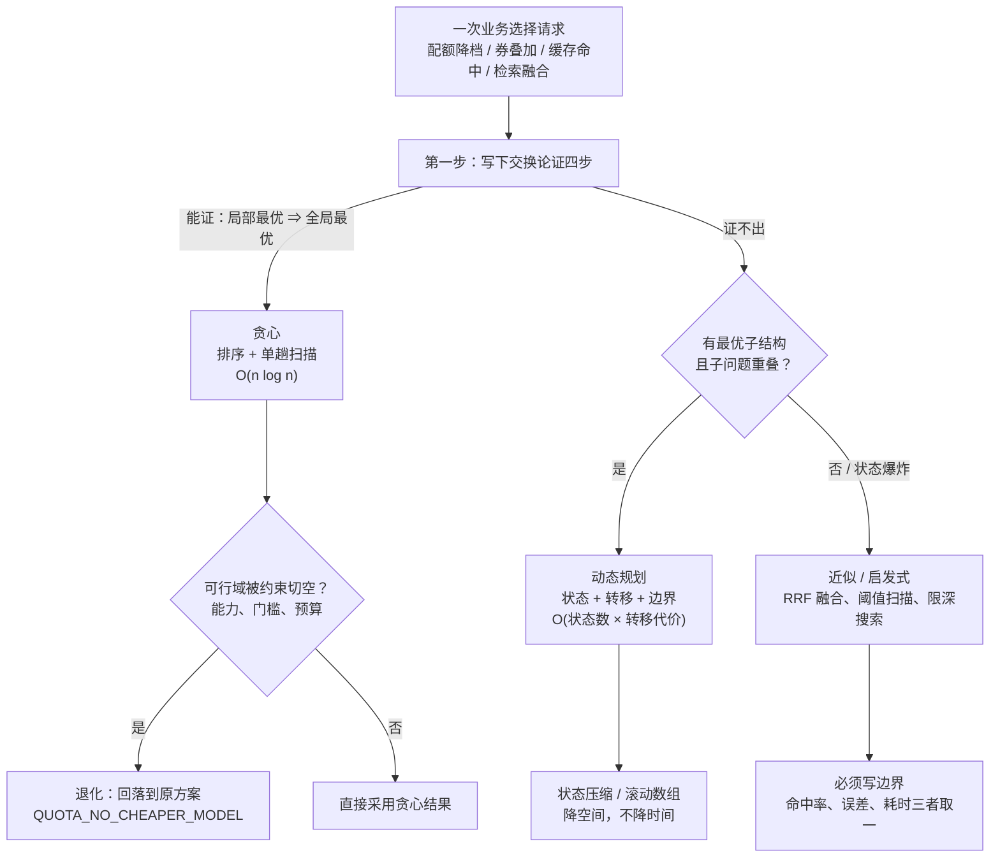
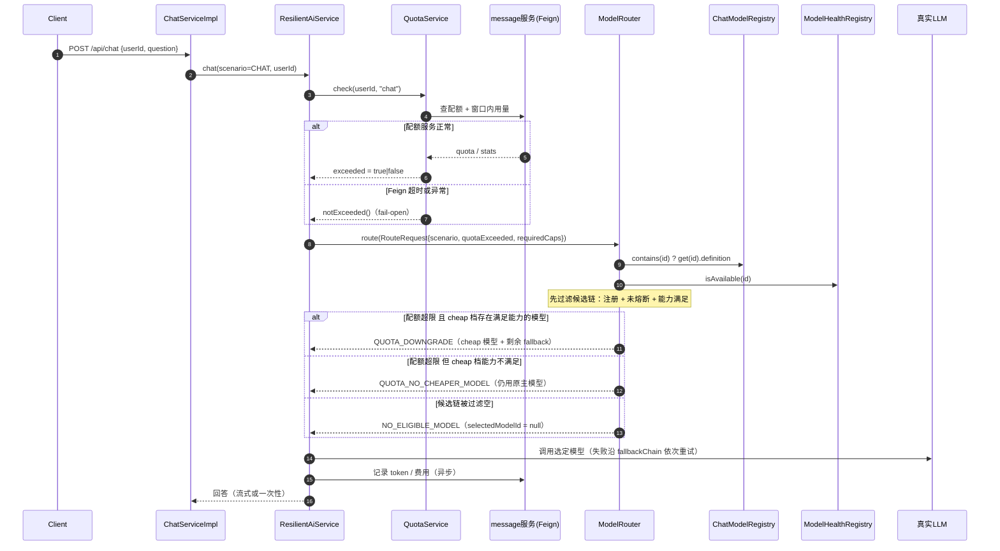

# 动态规划与贪心：能不能证明"局部最优推出全局最优"，决定你该写哪种代码

> **一句话结论**：DP 与贪心不是"难/易"两种解法，而是同一个选择问题的两种**证明义务**——能用交换论证（exchange argument）证明"每一步取局部最优不会破坏全局最优"，就写贪心（O(n log n)，常常还能压到 O(n)）；证不出来，就必须把子问题的**所有可能状态**完整记下来，也就是 DP；两者都撑不住（状态爆炸 / 有 SLA 时限）时，才退到近似与启发式，并且必须写清"我放弃了多少最优性"。
> **阅读前置**：会写递归与双层循环；认得 O(·) 记号；读过本目录 [09-缓存淘汰-LRU-LFU与两级缓存](./09-缓存淘汰-LRU-LFU与两级缓存.md) 与 [10-限流算法-四大算法与网关实现](./10-限流算法-四大算法与网关实现.md) 更好，那两篇讲的"贪心淘汰"和"阈值判定"是本篇的邻居。
> **证据基线**：B 级 8 个真实落点（`ModelRouter` / `ResilientAiService` / `QuotaService` / `ModelRouterTest` / `PromotionServiceImpl` / `SemanticCacheService` / `HybridSearchServiceImpl` / `HashEmbeddingModel`，均为当次 read 核对过的路径+行号），C 级 9 组本机实测（node v24.16.0，Windows，2026-11-27，单线程、无其它负载；临时脚本跑完即删，正文给出最小可复现代码与造数方式）；A 级 0 —— JDK 的 `PriorityQueue`/`Arrays` 等算法类没有入库摘录，本篇不硬凑锚点。预计阅读 50~65 分钟。

---

## 0. 先看现象

**症状 1：同一份代码，两个测试用例对"配额超限后该选哪个模型"给出了互相矛盾的期望。**

`ai-cs-chat/src/test/java/com/aics/chat/modelrouter/ModelRouterTest.java#L70-L117` 里两个相邻用例：

```java
@Test
void route_quotaDowngradesToCheapTier() {                 // 期待"降档成功"
    props.getQuota().setEnabled(true);
    RouteDecision decision = router.route(RouteRequest.builder()
            .scenario(ModelScenario.CHAT)
            .quotaExceeded(true)
            .requiredCapabilities(Set.of())                // ← 注意：能力要求为空
            .build());
    assertEquals("siliconflow-qwen3-8b", decision.getSelectedModelId());
    assertEquals(RouteReason.QUOTA_DOWNGRADE, decision.getReason());
}

@Test
void route_returnsQuotaNoCheaperModelWhenNoCheapEligible() { // 期待"降档失败"
    props.getQuota().setEnabled(true);
    RouteDecision decision = router.route(RouteRequest.builder()
            .scenario(ModelScenario.CHAT)
            .quotaExceeded(true)
            .requiredCapabilities(Set.of(ModelCapability.TOOL_CALLING)) // ← 唯一差别
            .build());
    assertEquals("deepseek-chat", decision.getSelectedModelId());
    assertEquals(RouteReason.QUOTA_NO_CHEAPER_MODEL, decision.getReason());
}
```

两个用例都"对"，差别只有一行 `requiredCapabilities`。也就是说：**配额超限了要不要省钱，取决于这个场景要不要模型会调工具**——不是取决于花了多少钱。这是团队里最容易吵起来的那种 bug。

**症状 2：券列表说"可用"，下单试算却一分没减。**

`ai-cs-order/src/main/java/com/aics/order/service/impl/PromotionServiceImpl.java#L75-L79` 用**订单原价**判断门槛：

```java
if (orderAmount.compareTo(coupon.getMinOrderAmount()) >= 0) {
    ca.setUsable(true);
} else {
    ca.setUsable(false);
    ca.setReason("未满" + coupon.getMinOrderAmount() + "元");   // 用户看到的原文
}
```

而同一个类的 `applyCoupon`（`PromotionServiceImpl.java#L122-L125`）用的是**满减之后**的金额：

```java
boolean valid = coupon.getUserId().equals(userId)
        && CouponStatus.UNUSED.getCode().equals(coupon.getStatus())
        && coupon.getExpireTime().isAfter(LocalDateTime.now())
        && amountAfterReduction.compareTo(coupon.getMinOrderAmount()) >= 0;
```

于是 100 元订单 + "满 100 减 10" + 一张"满 100 减 20"的券：券列表显示**可用**，试算时券**不生效**，`payAmount` 停在 90。这是"贪心的顺序"问题，不是金额计算问题——先减了再说，减完的门槛就不是原来的门槛了。

**症状 3：我按真实配置把路由逻辑复刻成可执行代码，跑出来只有 5/9 个场景真能降档。**

```text
== 1) 9 个场景 × 配额状态 → 选中模型 / 原因 ==
│ 场景     │ 需要能力       │ 正常            │ 配额超限后            │ 原因                     │ 真降档了吗 │
│ 'chat'   │ 'tool-calling' │ 'deepseek-chat' │ 'deepseek-chat'       │ 'QUOTA_NO_CHEAPER_MODEL' │ '否'      │
│ 'rag'    │ 'tool-calling' │ 'deepseek-chat' │ 'deepseek-chat'       │ 'QUOTA_NO_CHEAPER_MODEL' │ '否'      │
│ 'agent'  │ 'tool-calling' │ 'deepseek-chat' │ 'deepseek-chat'       │ 'QUOTA_NO_CHEAPER_MODEL' │ '否'      │
│ 'nl2sql' │ 'tool-calling' │ 'deepseek-chat' │ 'deepseek-chat'       │ 'QUOTA_NO_CHEAPER_MODEL' │ '否'      │
│ 'judge'  │ '(无)'         │ 'deepseek-chat' │ 'siliconflow-qwen3-8b'│ 'QUOTA_DOWNGRADE'        │ '是'      │
│ 'summary'│ '(无)'         │ 'siliconflow-qwen3-8b'│ 'siliconflow-qwen3-8b'│ 'QUOTA_DOWNGRADE'     │ '是'      │
│ 'intent' │ '(无)'         │ 'siliconflow-qwen3-8b'│ 'siliconflow-qwen3-8b'│ 'QUOTA_DOWNGRADE'     │ '是'      │
│ 'rewrite'│ '(无)'         │ 'siliconflow-qwen3-8b'│ 'siliconflow-qwen3-8b'│ 'QUOTA_DOWNGRADE'     │ '是'      │
│ 'chart'  │ '(无)'         │ 'siliconflow-qwen3-8b'│ 'siliconflow-qwen3-8b'│ 'QUOTA_DOWNGRADE'     │ '是'      │
降档成功 5/9 个场景，失败 4/9（失败场景仍按原价调用 standard 档）
```

（这张表的每一行都是脚本原始输出，未改动数值，仅裁掉了 `console.table` 的竖线边框；脚本怎么写的、为什么只有 5/9 能降档，见 §3.8。）

**这些现象指向同一件事：我们都在"每一步取最好的那个"和"把所有可能都算一遍"之间凭直觉选，而没有人去检查约束结构本身。** 症状 1 的约束是"模型必须会调工具"，症状 2 的约束是"门槛要在正确的金额上判定"，症状 3 是同一个约束把贪心的可行域切成了空集——三者都不是"算法没写对"，而是"有没有先回答那句证明"。

---

## 1. 整体地图



| 落点 | 它其实是个什么问题 | 本仓库的做法 | 算法归属 | 证据 |
|---|---|---|---|---|
| `ModelRouter#cheapestEligible` | 带约束的单步选择：在 `tier=cheap` 的候选里挑一个 | 过滤（注册/健康/能力）→ 按 priority 倒序取首个 | 带约束的贪心 | B |
| `PromotionServiceImpl#applyFullReduction` | 子集选择，但池子里**最多选 1 条** | `max(Comparator.comparing(减免额))` | 贪心（退化成"取最大"，可证最优） | B |
| `PromotionServiceImpl#applyCoupon` | 单物品 + 门槛判定，无选择 | `if` 四连校验 | 无选择，纯判定 | B |
| `QuotaService#check` | Token 与费用双阈值判定 | `tokenExceeded \|\| costExceeded` | 阈值判定 | B |
| `SemanticCacheService#lookup` | 近似最近邻 + 阈值决策 | 线性扫描全量求余弦 argmax | 暴力近似（无索引） | B + C |
| `HybridSearchServiceImpl#hybridSearch` | 两路不同量纲的排序结果融合 | RRF 倒数排名相加 | 启发式（无最优性保证） | B |
| 优惠券组合最优（本篇实测） | 0/1 背包（预算约束下的子集和） | **未落地**，仅本篇构造对照 | DP | C |
| 编辑距离 / LIS（本篇实测） | 序列 DP | **未落地**，仅本篇构造对照 | DP | C |

> **读图说明**：①最粗的那条箭头是 `REQ → PROOF`——所有分支的分歧点只有"证明写不写得出"，写不出才轮到考虑状态数；②`GREEDY → FEAS` 这条常被漏看的箭头是关键：贪心"选得对"和"有得选"是两件事，可行域被约束切空时贪心不会报错，它会安静地退化成原方案（症状 1/3 就是这条箭头）；③如果把 `STRUCT` 那一步看错成"状态数小就能 DP"，就会得出"n 小就写 DP"的错误结论——真正的判据是**最优子结构**（子问题最优解能拼出原问题最优解），状态数只决定可行性，不决定正确性。

---

## 2. 关键概念与关键类

先统一术语（本篇所有术语首现在这里解释一次）：

- **状态（state）**：把"做过的决策"压缩成的一小份信息，足以决定"接下来还能怎么选"。背包里的"剩余容量"、编辑距离里的"前 i 个字符对前 j 个字符"都是状态。
- **转移（transition）**：从一个状态到另一个状态的**枚举式**规则。DP 的本质就是"对每个状态枚举所有出边"，所以 DP 的复杂度永远是 `状态数 × 单状态转移代价`。
- **边界（base case）**：不需要转移就能直接读出答案的状态。**它是 DP 里最常错的部分**，因为写错了不会崩，只会静默给出偏小的答案（§6 有我踩到的真实样例）。
- **最优子结构**：原问题的最优解由子问题的最优解拼成。它是 DP 的**入场券**，也是贪心的入场券——区别在于贪心只需要"一步之后剩下的还是同类问题"，DP 需要"所有子问题都被保存"。
- **无后效性**：状态一旦确定，后面的决策不关心你是怎么到达这个状态的。没有它，状态定义就是漏的。
- **交换论证（exchange argument）**：证明贪心正确性的标准手法——假设存在一个最优解不含贪心的第一步选择，把它换成贪心的选择后仍然最优且不更差，于是"贪心第一步在某个最优解里"，再递归。
- **伪多项式（pseudo-polynomial）**：复杂度是 O(n·W)，其中 W 是**数值大小**而不是输入位数。所以背包是"看着像多项式、实际在 W 很大时不可算"。
- **近似比（approximation ratio）**：近似解 / 最优解的下界，例如 FPTAS 保证 `≥ (1-ε)·OPT`。工程里更常见的不是比值而是"我们接受少赚 5%"这种明文约定。

| 名称 | 位置 | 角色 | 关键方法 |
|---|---|---|---|
| `ModelRouter` | `ai-cs-chat/src/main/java/com/aics/chat/modelrouter/ModelRouter.java` | 按场景链 + 配额 + 能力做一次性选择，返回主模型与 fallback 链 | `route(RouteRequest)`、`cheapestEligible(Set)`、`hasCapabilities(String, Set)` |
| `RouteRequest` | 同包 `RouteRequest.java` | 不可变路由入参：场景、是否超配额、所需能力 | Lombok `@Builder` |
| `ModelHealthRegistry` | 同包 `ModelHealthRegistry.java` | 每模型一个熔断器，`isAvailable` 只看是否 OPEN | `isAvailable(String)`、`breaker(String)` |
| `QuotaService` | `ai-cs-chat/src/main/java/com/aics/chat/observability/QuotaService.java` | 经 Feign 查 message 服务的用量，判 Token/费用双阈值，异常 fail-open | `check(Long, String)` |
| `PromotionServiceImpl` | `ai-cs-order/src/main/java/com/aics/order/service/impl/PromotionServiceImpl.java` | 试算：满减取最大一条 → 单张券 → 汇总 | `calculatePrice`、`applyFullReduction`、`applyCoupon` |
| `SemanticCacheService` | `ai-cs-chat/src/main/java/com/aics/chat/cache/SemanticCacheService.java` | 问题向量化后与缓存条目逐一余弦，最高分过阈值即命中 | `lookup`、`put`、`evictOverflow` |
| `HybridSearchServiceImpl` | `ai-cs-search/src/main/java/com/aics/search/hybrid/HybridSearchServiceImpl.java` | ES 关键词 + 向量检索双路，RRF 融合 | `hybridSearch` |
| `HashEmbeddingModel` | `ai-cs-common/src/main/java/com/aics/common/ai/embedding/HashEmbeddingModel.java` | 零依赖兜底 Embedding：`DIMENSIONS = 768`，双哈希（`hashCode` + FNV-1a）投影 | `embed(String)` |

**一句话把两个概念对齐到代码**：`ModelRouter#cheapestEligible` 是"贪心的骨架 + 约束过滤"；`SemanticCacheService#lookup` 是"用暴力扫描代替索引的近似最近邻"；`PromotionServiceImpl#applyFullReduction` 是"因为池子最多选一个，所以贪心和 DP 必然同解"——三行代码，正好覆盖本篇的三条主线。

---

## 3. 原理与证据逐段精读

### 3.1 三要素与边界：先写边界，再写转移

**在干什么**：把一个"有重复子问题"的递归，改写成"每张表格只算一次"的填表过程。三要素缺一不可：状态定义（表的维度与含义）、转移方程（格子之间的关系）、边界（不用递归就能填的格子）。

**为什么这么设计**：因为朴素递归会把同一个子问题算指数次。以斐波那契为例，`f(35)` 的暴力递归要展开约 `2^35/√5` 次调用；而它只有 35 个**不同**子问题。DP 的全部收益都来自"把'不同子问题个数'变成计算量的上界"。

**换写法会怎样**：把 DP 写成"带全局缓存数组的递归"，就是记忆化（§3.2）；把边界写进循环初始值而不单独处理，就是滚动数组（§3.6）。两种改写都不改变复杂度上界，只改变常数与代码形态。

**常见坑（我真踩到的）**：用 `Int32Array` 存"无穷大"当哨兵。`Int32Array.fill(Infinity)` 不会报错，它静默变成 `0`：

```text
Int32Array.fill(Infinity) = Int32Array(3) [ 0, 0, 0 ]
Array.fill(Infinity) = [ Infinity, Infinity, Infinity ]
ToInt32(Infinity) = 0
```

后果是我写的找零 DP 全部返回 `0`，而对照的贪心返回 `3`——一个"最优解比贪心还差"的结果，恰恰是这条哨兵坑的指纹。修法只有两种：换 `Float64Array`/普通数组，或显式用大常量 `1e9` 并在取值时判越界。**只要是"求最小值的 DP"，先检查你的 INF 是不是真的 INF。**

### 3.2 自顶向下 vs 自底向上：同一递推的两种记账方式

**在干什么**：自顶向下（记忆化）从原问题出发，遇到没算过的子问题就递归算完记下来；自底向上（填表）从边界出发，按依赖顺序把所有格子填满。

**为什么这么设计**：取舍点是**"需不需要算全部子问题"**。如果状态空间里只有一小部分可达（比如带剪枝的搜索、稀疏依赖），记忆化只付可达部分的代价；填表则不管用不用得上，一律付满。

**换写法会怎样**：同一递推换记账方向，**渐进复杂度不变**，但常数差一到两个数量级，因为一个吃递归调用与哈希查找，一个吃顺序内存访问。实测（`n` 相同、结果经断言一致）：

```text
== C3) 斐波那契四种写法（同一 n 下的耗时）==
│ n  │ 暴力递归(ms) │ 记忆化(ms) │ 自底向上(ms) │ 滚动变量(ms) │ 结果一致 │
│ 20 │ '0.504'      │ '0.0682'   │ '0.0360'     │ '0.0194'     │ '一致'   │
│ 25 │ '0.942'      │ '0.0097'   │ '0.0044'     │ '0.0014'     │ '一致'   │
│ 30 │ '9.813'      │ '0.0176'   │ '0.0114'     │ '0.0022'     │ '一致'   │
│ 35 │ '118.762'    │ '0.0323'   │ '0.0081'     │ '0.0024'     │ '一致'   │
```

**怎么读这张表**：暴力递归那一列从 n=25 到 n=35 涨了约 126 倍（约等于 1.618¹⁰，黄金比，就是 O(φⁿ) 的指纹）；记忆化到自底向上差约 2~4 倍（哈希/递归开销）；自底向上到滚动变量再差约 2~4 倍（数组 vs 两个变量）。**边界**：这些毫秒数只说明"常数因子的量级感"，不能当复杂度结论——复杂度结论是 `O(φⁿ) → O(n) → O(1)` 空间，与机器无关。

**常见坑**：①记忆化用 `Map` 时把 `0` 当成"未计算"（`if (memo.get(n) != null)` 与 `if (memo.get(n) != 0)` 差一个致命 bug）；②递归深度。n 到十万级时，记忆化会先撞栈溢出而不是内存，这时必须改成显式栈或填表。

### 3.3 0/1 背包：一维倒序为什么必须倒序

**在干什么**：`f[b]` = 预算 `b` 下能拿到的最大优惠。对每个物品，用 `f[b] = max(f[b], f[b-c] + v)` 更新。一维数组能成立的前提是**倒序遍历容量**。

**为什么这么设计**：一维数组复用了"上一轮"的数据。倒序（`b` 从大到小）时，`f[b-c]` 一定还没被本轮改过，读到的是"只用前 i-1 个物品"的旧值；正序时 `f[b-c]` 可能已经被本轮更新过，等于允许同一个物品被拿多次——那正是**完全背包**的写法。两种遍历方向编码了两个不同的问题，不是"优化技巧"。

**换写法会怎样**：写成二维 `f[i][b]` 就永远不会错，代价是 O(n·W) 空间；改成滚动数组必须保序。这就是"状态压缩 / 滚动数组"的全部纪律（§3.6 编辑距离同理）。

**规模实测**（伪多项式的真实手感，同一台机器、单线程）：

```text
== 4) DP 耗时随 n*B 增长（同一台机器、单线程）==
│ n    │ B      │ n*B       │ DP耗时(ms) │ 最优值 │
│ 50   │ 1000   │ 50000     │ '0.09'     │ 1848   │
│ 100  │ 5000   │ 500000    │ '0.88'     │ 7510   │
│ 200  │ 20000  │ 4000000   │ '6.60'     │ 20389  │
│ 500  │ 50000  │ 25000000  │ '45.37'    │ 50647  │
│ 1000 │ 200000 │ 200000000 │ '373.56'   │ 101513 │
```

**怎么读**：`n*B` 涨 4000 倍，耗时涨约 4150 倍——近线性于格数，**每格约 1.9ns**（≈ 5~6 条指令）。这个"1.9ns/格"就是常数因子的量级感：写业务代码时可以用它粗估"十万级预算 × 一千张券 ≈ 2 亿格 ≈ 0.4 秒"。**边界**：预算 `B` 是金额的**分值整数**，若用元做单位带小数会直接错；`B=200000` 在这里代表 200 万分的金额，换成 1 亿元预算（10¹⁰ 分）就不可能用 DP 了——这就是"伪多项式"在业务里的真面目。

**常见坑**：物品的价值/成本用 `double` 导致状态维度无法离散化（金额一定用整数分或 `BigDecimal`）；以及把"预算上限"当成"恰好用完"（`f[B]` vs `f[B]` 必须能从任意 `b ≤ B` 取最大）。

### 3.4 优惠券组合：`|S| ≤ 1` 时贪心可证最优，放宽后最多 81% 次优

**在干什么**：真实业务问的是"给我最优的那组券"。本仓库的答案是——**根本没有组合**：满减规则取减免最大的一条（不可叠加），券只用一张，且由用户指定 ID。

**为什么这么设计**（B 级证据，`PromotionServiceImpl.java#L96-L103`）：

```java
// 筛选满足门槛的规则，取减免金额最大的一条
rules.stream()
        .filter(rule -> totalAmount.compareTo(rule.getThresholdAmount()) >= 0)
        .max(Comparator.comparing(FullReductionRule::getReductionAmount))
        .ifPresent(bestRule -> {
            bo.setFullReductionAmount(bestRule.getReductionAmount());
            bo.setFullReductionRuleName(bestRule.getRuleName());
        });
```

这段 `max` 之所以安全，是因为约束是 `|S| ≤ 1`：候选集里最多选一个，而"最大值"必然是任意单元素子集里最大的那个。**交换论证在这里退化成了"排序取首"**——不需要证明，因为它同义反复。这也是"能不能证"这句话最朴素的一面：约束越强，贪心越容易是对的。

**换写法会怎样**：一旦业务想做"多券叠加 + 平台补贴预算"，约束就变成 `Σc ≤ B` 的 0/1 背包，贪心立刻不再最优。核心逻辑只有三个函数，`node coupon.mjs` 直接跑（造数用固定 seed 的 LCG，见 §6 手法③；完整驱动见 §9 练习 1）：

```js
// 券 = { v: 面额, c: 平台补贴成本 }；预算 B；目标：Σc ≤ B 下最大化 Σv
function dpOptimal(items, B) {          // 0/1 背包：dp[b] = 预算 b 能拿到的最大面额
  const dp = new Int32Array(B + 1);
  for (const { v, c } of items) {       // 每张券最多用一次 → 内层必须倒序
    for (let b = B; b >= c; b--) {
      const take = dp[b - c] + v;
      if (take > dp[b]) dp[b] = take;
    }
  }
  return dp[B];
}
function greedy(items, B, key) {        // key: 排序键；取"能装就装"的第一批
  let budget = B, gain = 0;
  for (const { v, c } of items.slice().sort(key)) {
    if (c <= budget) { budget -= c; gain += v; }
  }
  return gain;
}
const byDensity = (a, b) => b.v / b.c - a.v / a.c;   // 性价比贪心
const byValue   = (a, b) => b.v - a.v;               // 面额贪心
```

同一批数据（12 张券，面额 5~200、成本与面额不成比例，预算 500）喂进去：

```text
== 2) 单样本对照: n=12, B=500 ==
券列表 {面额v, 成本c, 性价比 v/c}:
  #3 v=75 c=30 v/c=2.500     #5 v=195 c=167 v/c=1.168
  #8 v=157 c=117 v/c=1.342   #6 v=93 c=81 v/c=1.148
  ...（共 12 张）
DP 最优 = 633 | 贪心(性价比) = 633 | 贪心(面额) = 553
贪心(性价比) 少赚 = 0 元, 相当于最优的 0.00%
贪心(面额)   少赚 = 80 元, 相当于最优的 12.64%
```

（券列表原文是每张券一行共 12 行，这里压成每行两张并省略其余 8 张，面额/成本/性价比的**数值未改**；其余行是原始输出，未改动。）

单样本还看不出来，把样本量拉到 200 组 / 配置（每组数据用固定 seed 的 LCG 生成，可复现）：

```text
== 3) 200 组/配置 的次优率与平均差距 ==
│ n  │ B    │ 贪心次优率(性价比) │ 平均差距(性价比) │ 贪心次优率(面额) │ 平均差距(面额) │ 平均最优值 │
│ 10 │ 300  │ '51.0%'            │ '14.37元'        │ '87.5%'          │ '78.13元'      │ '476.3'    │
│ 10 │ 1000 │ '14.5%'            │ '10.48元'        │ '6.5%'           │ '2.62元'       │ '1000.0'   │
│ 10 │ 3000 │ '0.0%'             │ '0.00元'         │ '0.0%'           │ '0.00元'       │ '993.0'    │
│ 30 │ 300  │ '61.5%'            │ '9.29元'         │ '99.5%'          │ '198.87元'     │ '641.2'    │
│ 30 │ 1000 │ '70.0%'            │ '11.73元'        │ '100.0%'         │ '364.83元'     │ '1635.9'   │
│ 30 │ 3000 │ '7.5%'             │ '5.91元'         │ '5.5%'           │ '2.08元'       │ '3065.1'   │
│ 60 │ 300  │ '71.0%'            │ '7.89元'         │ '100.0%'         │ '264.87元'     │ '718.3'    │
│ 60 │ 1000 │ '65.0%'            │ '6.11元'         │ '100.0%'         │ '673.75元'     │ '1956.3'   │
│ 60 │ 3000 │ '81.0%'            │ '10.33元'        │ '100.0%'         │ '672.68元'     │ '4353.0'   │
```

**贪心为什么会错**：因为它做了"不可撤销的承诺"。按性价比降序取第一张后，剩下的预算可能刚好装不下任何高价值组合；而最优解可能放弃那张"性价比最高但不合尺寸"的券，换两张"性价比略低但填满预算"的券。**0/1 约束（不可分割）是贪心失效的根因**——如果券可以拆分使用（分数背包），按性价比贪心就是严格最优的。这条界线值得记死：**可分割 → 贪心对；不可分割 → 必须 DP（或证明特殊结构）**。

**怎么读这张表**：①性价比贪心的次优率不是"偶发错误"，在 `n ≥ 30` 且预算与券总成本同量级的配置下达到 65%~81%（全表区间 0%~81%，唯一 0% 的一行见③）；②"平均差距 6~14 元"才是业务意义——一单少赚 10 元，十万单就是一百万；③`n=10,B=3000` 全部 0.0%，因为预算宽到"全拿"，贪心自然也对——**预算宽松时贪心退化为"全选"，这不是贪心变强了，是约束消失了**。**边界**：这是一组**构造数据**（面额与成本独立随机），不是真实券库；对照结论（"不可分割时贪心不可靠"）与数据无关，但具体百分比只对这批构造数据成立。

### 3.5 最长递增子序列：`tails` 数组不是答案

**在干什么**：LIS 求"最长的递增子序列长度"。两种写法：`f[i]` 表示以 `i` 结尾的最长长度（O(n²)）；或维护 `tails[k] = 长度为 k+1 的递增子序列的最小结尾`，对每个元素二分查找插入位置（O(n log n)）。

**为什么这么设计**：`tails` 用的是**贪心 + 二分**：对固定长度，结尾越小越"有前途"。这个贪心选择是可证的（结尾更小的子序列能被任何原序列续上，反之不然），所以它不需要 DP 的全部状态，只需要每个长度一个代表。

**换写法会怎样**：`tails` 的长度等于 LIS 长度，但 **`tails` 的内容不是任何一条 LIS**。想还原具体序列必须额外记录前驱（parent 数组）或回放原数组。这是 LIS 最经典的"结果对、值不对"陷阱。

**实测交叉点**：

```text
== C2) LIS: O(n^2) vs O(n log n) ==
│ n    │ O(n^2) 耗时(ms) │ O(n log n) 耗时(ms) │ 倍数     │ 结果一致    │
│ 200  │ '1.22'          │ '0.55'              │ '2.2x'   │ '一致(21)'  │
│ 400  │ '0.63'          │ '0.21'              │ '3.0x'   │ '一致(34)'  │
│ 800  │ '2.52'          │ '0.13'              │ '19.1x'  │ '一致(52)'  │
│ 1600 │ '6.03'          │ '0.10'              │ '61.8x'  │ '一致(80)'  │
│ 3200 │ '24.52'         │ '0.25'              │ '99.9x'  │ '一致(109)' │
│ 6400 │ '103.11'        │ '0.40'              │ '260.8x' │ '一致(153)' │
```

**怎么读**：①n 翻倍时 O(n²) 列约涨 4 倍（24.5→103 是 4.2 倍），O(n log n) 列只涨 1.6 倍左右；②交叉点其实在**更小的 n**：n=200 时两者只差 2.2 倍，n=400 时绝对差只有 0.4ms——**在 n < 1000 的量级上，"更优的复杂度"完全被常数吃掉**，此时选可读性更好的 O(n²) 才是对的工程决策；③"结果一致"列是每轮都断言的，它把"我换了个更快的实现"变成"可验证的等价变换"。**边界**：这些数字依赖 JIT 预热与机器负载，n=200/400 的两行甚至出现"O(n²) 更快"的抖动；能上升为结论的只有"n 越大差距越大，且差距增长快于线性"。

**常见坑**：把 `tails` 当答案输出（见上）；把 `<` 写成 `<=` 导致"严格递增"变"非递减"；对字符串/自定义对象做 LIS 时忘了传比较器。

### 3.6 编辑距离与滚动数组：把 O(mn) 空间压到 O(n)

**在干什么**：`dp[i][j]` = `a` 前 i 个字符变成 `b` 前 j 个字符的最少操作数（插入/删除/替换各 1）。转移取三种前驱的最小值再加 1（字符相同则直接继承左上）。

**为什么这么设计**：每个格子只依赖"左、上、左上"三个格子，所以整张表可以只保留**上一行**加**当前行**：`cur[j] = min(prev[j-1], prev[j], cur[j-1]) + 1`。这就是滚动数组的全部依据——**依赖范围决定能滚动几维**。

**换写法会怎样**：如果业务需要"对齐路径"（对账时要知道哪一段被改写、哪一段被删除），就必须保留整张表或至少保留决策方向，滚动数组会把回溯信息一起丢掉。这是"省空间"与"能解释"的取舍。

**实测（时间与空间账）**：

```text
== C1) 编辑距离: 全矩阵 vs 两行滚动 ==
│ 串长 m=n │ 格数 m*n │ 全矩阵(ms) │ 滚动(ms) │ 结果一致     │ 全矩阵内存估算(KB) │
│ 200      │ 40000    │ '2.7'      │ '3.8'    │ '一致(151)'  │ '158'              │
│ 500      │ 250000   │ '3.6'      │ '2.4'    │ '一致(388)'  │ '980'              │
│ 1000     │ 1000000  │ '13.1'     │ '9.3'    │ '一致(759)'  │ '3914'             │
│ 2000     │ 4000000  │ '54.8'     │ '38.5'   │ '一致(1481)' │ '15641'            │
```

**怎么读**：①"结果一致"列每轮断言，说明滚动版没写错转移顺序；②时间只快约 1.3~1.5 倍——因为**两者的格数完全相同**，滚动数组省的是空间不是时间（渐进时间都还是 O(mn)）；③空间那一列才是重点：串长 2000 时全矩阵要 15.6MB，滚动版只要两行 ≈ 8KB，**差 2000 倍**。业务含义：对账差异最小化（把 `a` 改成 `b` 的最小编辑）时，一条 2000 字的工单文本全矩阵就要 15MB×并发数，必须滚动。**边界**：内存估算是按 `Int32Array` 4 字节/格算的理论值，不含 JVM 对象头与行数组开销（Java 的 `int[m+1][n+1]` 实际更贵）。

**常见坑**：滚动时忘记"每行开头 `cur[0] = i`"；交换长短串以节省空间时忘了这会影响 `dp` 的语义（`a`/`b` 对调后操作集不变，但回溯方向变）；把编辑距离当"相似度"直接用（需要 `1 - d/max(m,n)` 归一化，否则长短文本不可比）。

### 3.7 贪心何时成立：交换论证四步，和两个经典错法

**在干什么**：把"每步取局部最优"升格为"全局最优"，需要一份**不超过半页纸的证明**。标准四步：①定义"局部最优"的排序键；②假设存在最优解 `O` 不含贪心的第一选择 `g`；③构造 `O' = O - x + g` 并证明 `O'` 仍可行、且不变差；④递归到剩余子问题（子问题同型）。

**为什么这么设计**：因为反例比证明便宜得多。工程上正确的做法是**先试图构造反例**：只要能在两分钟内想出一个反例，贪心就不能上；想不出反例 ≠ 已证明，但至少值得写单测把边界钉住。

**换写法会怎样**：跳过证明直接贪心，就得到下面两个经典错法的量化代价。找零问题（币值 `[1,3,4]`，金额 6）：

```text
== A1) 教科书反例: 币值 [1,3,4], 金额 6 ==
贪心枚数 = 3  DP 最优 = 2 (贪心拿 4+1+1, 最优是 3+3)

== A2) 随机币值系统下贪心的失败率 ==
│ 币值类型        │ 统计金额数 │ 贪心≠最优的金额占比 │ 最大超出枚数 │
│ '1..k 连续面额' │ 10000      │ '0.00%'             │ 0            │
│ '随机稀疏面额'  │ 10000      │ '38.60%'            │ 30           │
```

区间调度（n=12 个区间，200 组随机数据，最优值用 2¹² 穷举得到）：

```text
== B1) 三种贪心 vs 穷举最优 (n=12 区间, 200 组) ==
│ 贪心策略               │ 样本数 │ 次优次数 │ 次优率  │ 平均少选个数 │
│ '按结束时间最早(正确)' │ 200    │ 0        │ '0.0%'  │ '0.00'       │
│ '按开始时间最早(错法)' │ 200    │ 82       │ '41.0%' │ '0.51'       │
│ '按时长最短(错法)'     │ 200    │ 12       │ '6.0%'  │ '0.06'       │

== B2) 一个"按开始时间最早"失败的实例 ==
区间 = [[7,10],[7,10],[5,9],[6,8],[8,11],[5,6]]
按开始时间最早只能选 1 个, 最优 = 3 个
```

**怎么读**：①"1..k 连续面额"（如 1,2,3,4,5）贪心**永远最优**，因为这种币值系统是**规范系统（canonical system）**，贪心正确性可证——这就是"人民币币值能贪心找零"的原因；②"随机稀疏面额"（如 1,3,7,11,19）失败率 38.6%，最大超出 **30 枚**，说明错的不是一点点；③区间调度里"按结束时间最早"次优率 **0%**（200/200），而"按开始时间最早"次优率 41%——**同一个问题，换个排序键就从可证最优变成 41% 出错**，这正是"排序键就是证明的核心"；④反例 `[[7,10]...]` 里最早开始的那个区间跨越了 3 个互不冲突的短区间。**边界**：区间数 12 时穷举是 4096 个子集，所以"最优"是真的最优；n 变大后仍成立（该贪心的正确性有证明），但**穷举验证法本身**在 n>20 后不可用。

**常见坑**：把"没想出反例"当证明；排序键在浮点上比较（应比较整数或 `BigDecimal.compareTo`）；以及**贪心失败时程序不会报错**——它只是安静地给出次优解，只有对照 oracle（穷举/DP）才能发现。

### 3.8 带约束的贪心：ModelRouter 的配额降档，和"可行域被切空"

**在干什么**：`ModelRouter.route()` 做一次两段式选择：先按"场景链 + 注册 + 未熔断 + 能力满足"过滤出候选集，再决定是否降档。

**为什么这么设计**（`ModelRouter.java#L37-L54`）：

```java
// 设计要点：先按“已注册 + 未熔断 + 能力满足”过滤，再取链上第一个可用模型——fallback 永远不会选到不存在或不可用的模型
candidates.removeIf(id -> !registry.contains(id)
        || !healthRegistry.isAvailable(id)
        || !hasCapabilities(id, required));

if (candidates.isEmpty()) {
    return noEligible();
}

// 设计要点：配额降级是全局扫描 cheap 档，普通路由仍严格走场景链——成本治理可以跳出场景约束，默认行为必须保持可预测
if (request.isQuotaExceeded() && properties.getQuota().isEnabled()) {
    String cheap = cheapestEligible(required);
    if (cheap != null) {
        return decision(cheap, rest(candidates, cheap), RouteReason.QUOTA_DOWNGRADE);
    }
    return decision(candidates.get(0), rest(candidates, candidates.get(0)),
            RouteReason.QUOTA_NO_CHEAPER_MODEL);
}
```

降档用的 `cheapestEligible`（`ModelRouter.java#L66-L78`）是标准贪心：`filter`（注册 + 健康 + 指定档位 + 能力）→ `sorted(priority 倒序)` → `findFirst()`。**注意它按 priority 而不是按价格排序**，"最便宜"由"档位"这个概念承担（`tier=cheap` 的模型就是便宜的），档内再按 priority 取质量最高的。这是一个很聪明的抽象：把"成本"离散化成档位，于是选择逻辑不需要读价格表。

**换写法会怎样**：如果改成"按单价升序取最便宜的"，那么 `aics.usage.pricing` 里的价格表（`tools/nacos-config/ai-cs-chat.yml#L118-L128`，单位：每百万 token）就必须进入每次路由的热路径，还会引入"两个模型价格随时变动导致路由结果抖动"的新问题。

**这里的关键结论**：贪心"选得对"和"有得选"是两件事。真实配置里 cheap 档只有 `siliconflow-qwen3-8b`，而它的 `capabilities: []`；`ai-cs-chat/src/main/java/com/aics/chat/service/impl/ResilientAiService.java#L433-L440` 的 `requiredCapabilities` 又规定 CHAT/RAG/AGENT/NL2SQL 需要 `TOOL_CALLING`（`ResilientAiService.java#L433-L440`）。两个事实相乘，得到：

```java
private Set<ModelCapability> requiredCapabilities(ModelScenario scenario) {
    return switch (scenario) {
        // 需要工具调用能力的场景：CHAT 可能触发搜索、RAG 触发检索、AGENT 触发函数调用、NL2SQL 触发 SQL 执行
        case CHAT, RAG, AGENT, NL2SQL -> EnumSet.of(ModelCapability.TOOL_CALLING);
        // 纯文本场景不需要任何特殊能力，任意模型都能处理
        default -> EnumSet.noneOf(ModelCapability.class);
    };
}
```

把这段逻辑按真实配置复刻后跑 9 个场景（脚本把 `ModelRouter` 的选择逻辑同构翻译成 JS，忽略熔断——假设全部 CLOSED），结果就是 §0 症状 3 那张表：**5/9 能降档，4/9 只能回落到原模型**。代价差多少？

```text
== 2) 单位成本对比（输入 1M + 输出 0.5M token 的一次批量任务）==
│ 模型                   │ 档位       │ 能力           │ 输入$/M │ 输出$/M │ 1M入+0.5M出 成本 │ 相对 deepseek-chat │
│ 'deepseek-chat'        │ 'standard' │ 'tool-calling' │ 2       │ 8       │ '6.00'           │ '100.0%'           │
│ 'siliconflow-qwen3-32b'│ 'standard' │ 'tool-calling' │ 1       │ 2       │ '2.00'           │ '33.3%'            │
│ 'siliconflow-qwen3-8b' │ 'cheap'    │ '(无)'         │ 0.2     │ 0.6     │ '0.50'           │ '8.3%'             │
standard(deepseek-chat) = 6.00 vs cheap(qwen3-8b) = 0.50 → 差 12.0 倍
但 chat/rag/agent/nl2sql 需求 tool-calling, cheap 档能力为空 → 这 4 个场景省不到钱
```

**怎么读**：①`QUOTA_NO_CHEAPER_MODEL` 是**正确行为**，不是 bug——能力不满足时宁可多花钱也不能让工具调用失败（这点与 `QuotaService` 的 fail-open 是同一种价值排序）；②但要意识到"成本治理的开关只覆盖了 5 个非工具场景"，而 chat 恰恰是流量最大的那个；③想真正降 chat 的成本，最省事的改法不是写更聪明的算法，而是**给 cheap 档补一个支持 tool-calling 的模型，或给 CHAT 拆出"无工具"的子场景**——这是"用调整约束代替优化算法"。**边界**：这是**逻辑复刻 + 真实配置**的推演，不是线上流量实测；`pricing` 数字取自仓库里的 Nacos 配置副本，供应商调价后需同步。

**常见坑**：①过滤顺序——先按能力过滤再按档位挑，和先挑最便宜再检查能力，结果完全不同（后者会在运行时才发现"选中的模型不会调工具"）；②`capabilities: []` 容易被读成"啥都不支持"，实际语义是"没有特殊要求时可用"（`containsAll(∅)` 恒真），这是 `hasCapabilities` 的正确但反直觉之处；③降档决定**每次请求只做一次**（`ResilientAiService.java#L408-L416` 注释），重试不重新路由，否则配额抖动会让同一次对话跳到不可预期的模型。

### 3.9 近似与启发式：语义缓存的"近似最近邻 + 阈值"

**在干什么**：`SemanticCacheService#lookup` 把问题向量化，然后遍历 Redis Hash 里的**全部**条目算余弦，取最大分，超过阈值（默认 0.92）即命中。

**为什么这么设计**（`SemanticCacheService.java#L37-L38` 的原话）："线性扫描 O(n) 的取舍：n 上限 200 时每次查询 ≈ 200 次点积，微秒级可接受；规模上万应换成向量库 HNSW 索引，本实现刻意保持零额外依赖。" 这是典型的**用规模约束换取实现简洁**。

**换写法会怎样**：我实测了这条"微秒级"路径的三段成本（768 维，与 `HashEmbeddingModel.DIMENSIONS = 768` 对齐；条目 JSON 用 768 个浮点 + 问题 + 答案构造）：

```text
== 单条目体积 ==
一条 JSON = 7428 字节 ≈ 7.3 KB
200 条 = 约 1.42 MB (每次 lookup 都要传一遍)
5000 条 = 约 35.42 MB (每次 lookup 都要传一遍)

== 拆解 200 条时的三段耗时 ==
反序列化 200 条 : 8906.6 µs
余弦扫描 200 条 : 360.5 µs
两者合计        : 9267.1 µs （不含 Redis 网络往返）
结论: 反序列化占比 96%，真正的"点积"不是瓶颈
```

而 `lookup` 的代码正是"一次性把整个 Hash 拉下来"（`SemanticCacheService.java#L69-L87`）：

```java
float[] queryVector = embeddingModel.embed(question);
Map<Object, Object> entries = redisTemplate.opsForHash().entries(ENTRY_KEY + knowledgeBase);
if (entries.isEmpty()) {
    return Optional.empty();
}
double bestScore = -1;
CachedEntry best = null;
String bestId = null;
for (Map.Entry<Object, Object> e : entries.entrySet()) {
    CachedEntry entry = objectMapper.readValue(String.valueOf(e.getValue()), CachedEntry.class);
    if (entry == null || entry.getVector() == null || entry.getAnswer() == null) {
        continue;
    }
    double score = EmbeddingMath.cosine(queryVector, entry.getVector());
    if (score > bestScore) { bestScore = score; best = entry; bestId = String.valueOf(e.getKey()); }
}
```

**怎么读**：①`HGETALL` 拉的是 7.3KB×n，n=200 时约 1.42MB/次查询——"O(n) 次点积"只是三个 O(n) 里最便宜的那个；②反序列化占 96%，说明**要优化的是数据布局，不是余弦计算的算术**（正确改法：把向量单独存成二进制/Hash 的 `hgetall` 换成 pipeline + 只取向量字段，或者干脆像 `VectorCacheStore` 那样走 L1 进程内缓存）；③这条实测同时是"近似算法"的价值观：线性扫描在 n≤200 时**结果精确**，代价是每次全扫；HNSW 在 n 上万时结果近精确，代价是索引维护与召回率损失。**边界**：node 的 `JSON.parse` 与 Java 的 Jackson 速度不同，绝对微秒数不可移植；但"反序列化 > 点积一个数量级以上"的结论对两种实现都成立，因为点积只有 768 次乘加（约 0.4µs），而反序列化要处理 7.3KB 文本。

**阈值这件事也是"近似"**：0.92 是"宁可 miss 不可错答"的旋钮。我构造了 200 条条目 + 400 次查询（一半是某个条目的加噪近亲，一半是完全无关的新问题），看不同阈值下的取舍：

```text
│ 阈值 │ 近亲命中(200) │ 近亲命中率 │ 无关问题误命中(200) │ 误命中率 │
│ 0.8  │ 22            │ '11.0%'    │ 0                   │ '0.0%'   │
│ 0.85 │ 14            │ '7.0%'     │ 0                   │ '0.0%'   │
│ 0.9  │ 7             │ '3.5%'     │ 0                   │ '0.0%'   │
│ 0.92 │ 3             │ '1.5%'     │ 0                   │ '0.0%'   │
│ 0.95 │ 0             │ '0.0%'     │ 0                   │ '0.0%'   │
本批数据里 最高相似度 = 0.9424  近亲组平均相似度 = 0.4769
```

**怎么读**：在**随机生成的高维向量**里加一点点噪声，余弦相似度就掉到 0.48 附近——768 维空间里"相近"的机会远比直觉小，所以 0.92 是很高的门槛。**这批数据只能说明"阈值灵敏度"和"线性扫描耗时"，不能推断线上命中率**：真实 Embedding（bge-m3 等）在近义句上天然有 0.9+ 的相似度，而 `HashEmbeddingModel` 的哈希向量几乎没有语义泛化（`ai-cs-common/src/main/java/com/aics/common/ai/embedding/HashEmbeddingModel.java#L19-L27` 自己写明了"仅兜底"）。**换 embedding 模型 = 换一个相似度空间，阈值必须重标定**——这是工程上最常被忽略的一条。

**常见坑**：拿 A 模型标定的阈值套 B 模型；把"近似"当"精确"（命中一条语义相近但答案不同的缓存，用户会收到答非所问的回复）；以及忘了缓存条目的向量维度变更会导致新旧条目混存。

---

## 4. 一次完整执行时序

以"一次 chat 请求遇上配额超限"为主线，把 §3.8 的选择过程摊开：



> **读图说明**：①第 11~13 步的 `alt` 是整张图的分水岭——**配额检查失败时走的是 fail-open，即"当作没超限"**，所以"省钱"这条支路在配额服务抖动时会被整段跳过，这不是漏写；②第 17~18 步 `MR->>HR` 那两条查询是"能力/健康过滤"与"降档选择"共用的，看漏它会以为降档跳过了健康检查；③把第 20 步那个 `QUOTA_NO_CHEAPER_MODEL` 分支当成"异常分支"是常见误读——它是**正常返回**，`reason` 只是遥测标签，链路不会因此 5xx。

**哪一步失败报什么错**：

| 失败点 | 归因 | 代码兜底 | 用户/运维看到什么 |
|---|---|---|---|
| 配额查询 Feign 异常 | message 服务抖动 | `QuotaService` catch 后返回 `notExceeded()`（fail-open） | 正常回答，可能多花钱；日志 `warn 配额检查失败，按未超限降级` |
| 场景没配 `primary` | Nacos 配置缺失 | `noEligible()` 返回 `selectedModelId=null` | 流式链路 `[ERROR]AI 助手暂时繁忙，请稍后重试。`（`ResilientAiService.java#L261`） |
| 候选模型全部熔断 | 供应商故障 | 同上，`NO_ELIGIBLE_MODEL` | 同上；非流式走 `fallbackText(scenario)`（`ResilientAiService.java#L451-L455`） |
| cheap 档能力不满足 | 约束冲突（本篇重点） | 保留原主模型 `QUOTA_NO_CHEAPER_MODEL` | 正常回答，**成本不降**，只有遥测标签变化 |
| 所有模型调用均失败 | 供应商全线故障 | 沿 `fallbackChain` 重试完 → `fallbackText` | SUMMARY 场景返回空串（避免污染后续上下文），其它场景返回提示语 |

---

## 5. 设计取舍

| 维度 | 贪心 | DP | 近似/启发式 |
|---|---|---|---|
| 前置条件 | 能写出交换论证（局部最优 ⇒ 全局最优） | 最优子结构 + 重叠子问题 + 状态可枚举 | 无最优性要求，但要能接受误差 |
| 典型复杂度 | O(n log n)（排序主导） | O(状态数 × 转移代价)，背包是 O(n·W) 伪多项式 | O(n) 扫描 / O(log n) 索引查询 |
| 代码量 | 最小，通常 10~20 行 | 中，边界与空间优化占一半 | 中，参数标定占大头 |
| 出错表现 | **静默次优**，不报错（实测 41%~100% 次优率） | 静默偏小/偏大（边界写错） | 命中率不达预期 |
| 可解释性 | 最好（能说清"为什么选它"） | 中（能回溯决策路径） | 最差（阈值/权重是经验值） |
| 本仓库落点 | `ModelRouter#cheapestEligible`、`applyFullReduction` 的 `max` | 无（本篇实测为构造数据） | `SemanticCacheService#lookup`、`RrfMerger.merge` |
| 什么时候别用 | 约束含"不可分割/预算上限/互斥" | W 是天文数字（伪多项式爆炸）、或只需可行解 | 要求严格最优、或误差不可承受 |

**可扩展点清单**（按"改约束 vs 改算法"分类，前者往往更划算）：

1. **补 cheap 档能力**：给 cheap tier 增加一个支持 `tool-calling` 的模型，`QUOTA_NO_CHEAPER_MODEL` 的 4 个场景立刻可降档（改配置，不改代码）。
2. **场景细分**：把 CHAT 拆成 `CHAT_TOOL` / `CHAT_PLAIN`，让不需要工具的对话走 cheap 档——本质是缩小 `requiredCapabilities`。
3. **多目标降档**：`cheapestEligible` 现在是"档位内按 priority"，若引入价格权重就变成带约束的最优化，需要 DP 或线性规划（N=3 时直接枚举更简单）。
4. **多券叠加**：一旦业务允许多券 + 补贴预算，`applyFullReduction` 的 `max` 必须换成 0/1 背包 DP（§3.4），并配 §9 练习 1 的 oracle 单测。
5. **券门槛统一**：`getAvailableCoupons` 与 `applyCoupon` 必须用同一个"门槛判定金额"，否则券列表与试算不一致（症状 2）。
6. **语义缓存向量布局**：把向量从 JSON 里拆出来（二进制/独立字段），或加 L1 进程内缓存，直接干掉 §3.9 那 96% 的反序列化。
7. **降级遥测**：`RouteReason` 已经是标签，建议对 `QUOTA_NO_CHEAPER_MODEL` 单独打点——它是"省不到钱"的直接信号，比事后看账单早一周。

---

## 6. 踩坑与调试手法

1. **`Int32Array.fill(Infinity)` 静默变 0**——求最小值的 DP 全部返回 0。一条命令证实：`node -e "console.log(new Int32Array(3).fill(Infinity))"` → `Int32Array(3) [ 0, 0, 0 ]`。**教训：INF 必须是显式常量，且取值时判越界。**
2. **一维背包写成正序**——变成完全背包（同一物品可重复取）。症状是答案"偏大得离谱"，因为预算被同一个物品反复消耗。
3. **把 `tails` 数组当 LIS 输出**——长度对、内容错，测试若只断言长度就永远发现不了（§3.5）。
4. **贪心排序键选错**——区间调度里"按开始时间最早"次优率实测 41%，且**不报错**；只有和穷举 oracle 对比才暴露。
5. **过滤顺序错**——先挑最便宜再检查能力，会把"不会调工具"的模型派给工具场景；正确顺序是先过滤能力（§3.8）。
6. **满减把金额压到券门槛之下**——`applyCoupon` 用 `amountAfterReduction` 判门槛（`PromotionServiceImpl.java#L125`），而 `getAvailableCoupons` 用原价（`#L75`），两处不一致（症状 2）。
7. **阈值跨 embedding 空间复用**——0.92 只对同一模型的向量空间有意义（§3.9）。
8. **记忆化把 0 当"未计算"**——`Map.get()` 返回 `0` 时被当成没算过，重复递归；用 `containsKey`。
9. **递归深度**——记忆化在 n 十万级先撞栈溢出，而不是内存。

**【真调试手法①】写一个"穷举 oracle"给 DP/贪心当裁判。** 小规模问题（n ≤ 20）用 2ⁿ 子集暴力枚举求真正最优，再和你的实现在同一批数据上比：

```js
// 最小骨架：自己新建 tools/tmp/oracle.mjs（临时脚本，跑完就删）—— 2^n 穷举，只用于 n <= 20 的正确性校验
function bruteForce(items, budget) {
  let best = 0;
  for (let mask = 0; mask < (1 << items.length); mask++) {
    let cv = 0, cc = 0;
    for (let i = 0; i < items.length; i++) {
      if (mask & (1 << i)) { cv += items[i].v; cc += items[i].c; }
    }
    if (cc <= budget && cv > best) best = cv;
  }
  return best;
}
console.log('DP =', dpOptimal(items, B), ' 穷举 =', bruteForce(items, B));
```

```text
== 1) n=14, B=400: DP vs 穷举 ==
DP = 742  穷举 = 742
```

两个数相等才说明转移和边界都对。**我最初写的那版输出是 `DP = 0`，穷举是 742**——正是它把我引向了第 1 条坑。

**【真调试手法②】把"一次请求"按阶段切开分别计时，别猜瓶颈。** 语义缓存那条 O(n) 路径我按"反序列化 / 余弦"两段计时，得到的结论和直觉相反：

```text
反序列化 200 条 : 8906.6 µs
余弦扫描 200 条 : 360.5 µs
两者合计        : 9267.1 µs （不含 Redis 网络往返）
结论: 反序列化占比 96%，真正的"点积"不是瓶颈
```

如果没有这两行，优化方向 100% 会跑到"换更快的相似度算法"上，而真正的病根是"每次把 1.42MB JSON 搬进来又解析一遍"。

**【真调试手法③】用固定 seed 的伪随机造数，别用 `Math.random()`。** 本篇所有"次优率最高 81% 的那批结论"的结论都来自 `lcg(seed)`（线性同余发生器）：同一个 seed 在任何机器上都得到同一批数据，所以这段数字可以贴进文档、可以写进 case study、也可以在 CI 里当回归基线。用 `Math.random()` 的话，同一个结论每次跑都不一样，等于没法验证。

**【真调试手法④】给"优化"配一条等价性断言。** 滚动数组 vs 全矩阵、`tails` 二分 vs O(n²) DP、贪心 vs 穷举——每组实测都输出一列"结果一致"。这不是装饰：它把"我换了个更快的实现"从信仰变成约束，一旦某次重构改坏了转移顺序，这一列立刻变成"不一致!"。

---

## 7. 版本差异

| 旧写法 | 当前基线（本仓库） | 变化点 | 迁移动作 |
|---|---|---|---|
| `Map` 手写记忆化 + `if (map.get(n) != null)` | JDK 8+ 的 `computeIfAbsent` | 语义更清晰，但 `null` 与"未计算"仍需区分 | 用 `containsKey` 或包装成 `Optional` |
| `switch` 语句 + `break` | JDK 14+ `switch` 表达式（`ResilientAiService.java#L433-L440`、`QuotaService.java#L86-L90`） | 表达式化后漏写分支会编译期报错，行为更安全 | 新增枚举值时必须补 `default`，否则编译器兜不住语义 |
| 匿名 `Comparator` | `Comparator.comparingInt(...).reversed()`（`ModelRouter.java#L75`） | 可读性 + 空指针语义更明确 | 排序键用 `Integer` 而非 `int` 时注意自动拆箱 |
| `Arrays.fill(dp, Integer.MAX_VALUE)` 后直接 `+1` | 显式 `INF = 1e9`（或 `1 << 30`） | 大常量相加会溢出成负数 | 加之前判断 `dp[x] != INF` |
| 手写 LRU 用 `LinkedHashMap` 重写 `removeEldestEntry` | 本项目 `VectorCacheStore` 手写 L1 LRU + L2 Redis（见 [09-缓存淘汰-LRU-LFU与两级缓存](./09-缓存淘汰-LRU-LFU与两级缓存.md)） | 贪心淘汰（在线）与 Belady 最优（离线）的差距来自"未来信息不可得" | 换淘汰策略前先量命中率，不要凭 LRU 的直觉 |
| Caffeine 本地缓存（曾被规划） | **全仓 0 命中：未落地** | 文档里出现过但代码里没有依赖 | 本篇不把它算作"已实现能力" |
| 阈值 `0.92` 写死在代码里 | `application.yml#L170-L193` 的 `aics.cache.semantic.threshold` | 配置化，可灰度 | 换 embedding 模型必须重标定阈值（§3.9） |

**判断来源**：`ai-cs-chat` 的 `modelrouter` / `observability` / `cache` 三处在当前分支上都是同一套写法，`switch` 表达式与 `record` 风格一致，说明基线是 JDK 17 + Spring Boot 4.2（`CLAUDE.md` 记录的技术栈）；本篇的算法结论（贪心正确性判据、0/1 背包倒序、滚动数组依赖范围）与 JDK 版本**无关**，从 JDK 8 到 21 都成立。

---

## 8. 面试高频问与答

（只列问题，答案自己做；每题后面标注它对应本篇哪一节。）

1. 怎么判断一个问题该用贪心还是 DP？说出你的判断顺序。（§1）
2. 交换论证的四步具体怎么写？拿"活动选择按结束时间排序"完整讲一遍。（§3.7）
3. 0/1 背包的一维数组为什么必须倒序遍历？如果正序会发生什么？（§3.3）
4. 完全背包、多重背包和 0/1 背包的转移方程差在哪一行？（§3.3）
5. 背包问题是多项式时间算法吗？为什么叫"伪多项式"？（§3.3）
6. 找零问题在什么条件下贪心是对的？"规范币值系统"是什么？（§3.7）
7. 活动选择问题里，按"最早开始""最短时长""最少冲突"排序分别会怎样？为什么只有"最早结束"可证？（§3.7）
8. LIS 的 O(n log n) 解法里 `tails` 数组代表什么？能不能用它还原 LIS？（§3.5）
9. 编辑距离如何把空间从 O(mn) 降到 O(n)？什么时候**不能**这么降？（§3.6）
10. 状态压缩 DP 的适用条件是什么？TSP 的状态压缩复杂度是多少、为什么？（§3.6、§5）
11. 记忆化和自底向上在什么场景下前者更优？举一个子问题稀疏的例子。（§3.2）
12. 如果一个问题 NP 难，工程上你会怎么做？近似比和启发式有什么区别？（§3.9、§5）
13. 一个"带约束的贪心"在约束把可行域切空时会怎样？结合配额降档说说你会怎么加监控。（§3.8）
14. 语义缓存用线性扫描还是 HNSW，你会怎么决策？阈值怎么定？（§3.9）

---

## 9. 动手练习

**练习 1：给优惠券组合写一个 DP + 穷举 oracle。**
构造 `n=12` 张券（面额 5~200、成本不与面额成比例），预算 500，写 `dpOptimal` 与 `bruteForce`，断言两者相等；再实现"按性价比贪心"和"按面额贪心"，输出各自的缺口。
*验收标准*：`n=14` 时 DP 与穷举输出**完全相同的数字**（本篇是 742）；贪心缺口的百分比能被打印出来；换 3 个不同 seed 结论方向不变。

**练习 2：证明并验证"找零贪心只在规范系统下最优"。**
对 `[1,3,4]`、`[1,2,5,10]`、`[1,3,7,11,19]` 三组币值，金额 1~100 逐一对比贪心与 DP。
*验收标准*：`[1,3,4]` 在金额 6 处贪心 3 枚 / 最优 2 枚；`[1,2,5,10]` 失败率 0%；能写出一句话解释"为什么 1..k 连续面额永不出错"。

**练习 3：把三种区间调度贪心都跑一遍，找出反例。**
随机生成 12 个区间，用 2¹² 穷举求最优，分别用"最早结束/最早开始/最短时长"三种排序跑贪心。
*验收标准*：输出三行次优率，"最早结束"必须是 **0%**；能贴出一个"最早开始"失败的具体区间集合（本篇是 `[[7,10],[7,10],[5,9],[6,8],[8,11],[5,6]]`，贪心 1 个 vs 最优 3 个）。

**练习 4：把编辑距离从全矩阵改成滚动数组，并证明等价。**
长度 200/500/1000/2000 各跑一次，输出耗时、内存估算、以及两版结果的相等断言。
*验收标准*：四组结果全部一致；串长 2000 时能报出"全矩阵约 15.6MB vs 滚动约 8KB"；能说明"为什么滚动版只快 1.3 倍而空间快 2000 倍"。

**练习 5：给 `cheapestEligible` 补一个单测，钉住"能力不满足就不降档"。**
在 `ModelRouterTest` 的 fixture 上新增：`requiredCapabilities=TOOL_CALLING` + `quotaExceeded=true` → 断言 `QUOTA_NO_CHEAPER_MODEL`；再用空能力断言 `QUOTA_DOWNGRADE`。
*验收标准*：`mvn -pl ai-cs-chat test -Dtest=ModelRouterTest` 全绿；两个用例的差异只有 `requiredCapabilities` 一行（与 `ModelRouterTest.java#L70-L117` 现有两例同构）；能在 review 里说清"这不是 bug 而是约束"。

**练习 6：拆解语义缓存 `lookup` 的成本。**
构造 200 条 768 维条目（JSON 含问题+向量+答案），分别计时"反序列化"与"余弦扫描"两段。
*验收标准*：能报出两段的微秒数与占比（本篇是 8906.6µs / 360.5µs，反序列化 96%）；能提出至少两种"不改召回率就能降成本"的改法（向量单独存二进制、加 L1 进程内缓存、只取向量字段）。

---

## 小结

- DP 与贪心的分界不是难度，而是**证明义务**：能写出交换论证就贪心，写不出就必须完整记录子问题状态。
- DP 的三要素里**边界最容易错且最不报错**；求最小值的 DP 第一件事是检查 INF 是不是真的 INF。
- **可分割 → 贪心对；不可分割 → 必须 DP**。0/1 背包的倒序遍历不是技巧，它就是"每个物品只用一次"这条语义。
- 贪心失效是**静默**的：实测区间调度错 41%、随机币值找零错 38.6%、券组合最多错 81%（n=60/B=3000 那格），全都不报错，只有对照穷举/DP 才看得见。
- 约束会把贪心的**可行域切空**：本仓库配额降档在 9 个场景里只有 5 个能真正生效，`QUOTA_NO_CHEAPER_MODEL` 是正确行为而不是故障。
- 近似与启发式必须写明**放弃了什么**：语义缓存的线性扫描在 n≤200 时结果精确，代价是每次搬 1.42MB JSON，真正的瓶颈是反序列化（96%）而不是点积。
- 复杂度优化要先看**交叉点**：LIS 的 O(n log n) 在 n=200 时只快 2.2 倍，n 上到 6400 才快 260 倍；规模不够时，可读性更好的 O(n²) 往往是正确的工程选择。
- 下一步动作：打开 `ai-cs-chat/src/main/java/com/aics/chat/modelrouter/ModelRouter.java`，把 `cheapestEligible` 的 `filter` 链按"注册 → 健康 → 档位 → 能力"逐条读一遍，再对照 `tools/nacos-config/ai-cs-chat.yml#L47-L128` 回答一个问题——**要给 cheap 档补什么能力，才能让 chat 场景也降档？**

---

## 自测题

**Q1. 一句话说出 DP 和贪心的分野。**

<details><summary>参考答案</summary>

贪心要求证明"每一步的局部最优选择一定能被扩展成全局最优"（交换论证）；证不出来时，就必须把子问题的所有可能状态都保存下来枚举转移，也就是 DP。分野是**证明义务**，不是难度。

</details>

**Q2. DP 的三要素分别是什么？哪一个最容易错？**

<details><summary>参考答案</summary>

状态定义、转移方程、边界（base case）。边界最容易错，因为写错不会崩，只会静默给出偏差答案（例如 `Int32Array.fill(Infinity)` 变成 0，最小值 DP 全返回 0）。

</details>

**Q3. 0/1 背包一维数组必须倒序遍历容量，为什么？**

<details><summary>参考答案</summary>

一维数组复用了上一轮的结果。倒序时 `f[b-c]` 还没被本轮更新，代表"只用前 i-1 个物品"；正序时 `f[b-c]` 可能已被本轮更新，等价于允许同一物品重复使用，那就是完全背包。

</details>

**Q4. 为什么背包叫"伪多项式"？业务上什么情况下不能用它？**

<details><summary>参考答案</summary>

复杂度 O(n·W) 里的 W 是**数值大小**，不是输入位数，所以 W 用二进制表示时是指数级。业务上预算量级（以"分"为单位的整数）过大时不可算：实测 2 亿格约 0.37 秒（约 1.9ns/格），到千亿级就彻底不可行，此时应改用贪心 + 精度容忍、或按预算分桶近似。

</details>

**Q5. 什么条件下"找零用贪心"是对的？**

<details><summary>参考答案</summary>

币值是**规范系统（canonical system）**时。实测 `1..k` 连续面额在金额 1~100、100 组随机系统上失败率 0.00%，而随机稀疏面额（如 1,3,7,11,19）失败率 38.60%、最大超出 30 枚。`[1,3,4]` 金额 6 是最小反例：贪心 3 枚，最优 2 枚。

</details>

**Q6. 区间调度为什么"按结束时间最早"可证最优，而"按开始时间最早"不行？**

<details><summary>参考答案</summary>

结束最早的区间留下最多的剩余时间，任何最优解的第一个区间都可以被它替换而不减少后续可选数量（交换论证成立）。按开始时间最早则不成立——实测 200 组里 41% 次优，反例 `[[7,10],[7,10],[5,9],[6,8],[8,11],[5,6]]`：贪心只选 1 个，最优 3 个。

</details>

**Q7. LIS 的 `tails` 数组是什么？能直接输出 LIS 吗？**

<details><summary>参考答案</summary>

`tails[k]` 是"长度为 k+1 的递增子序列的最小结尾值"。它的**长度**等于 LIS 长度，但内容不是任何一条 LIS，要还原序列必须额外记录前驱（parent）或回放原数组。

</details>

**Q8. 编辑距离怎么把空间从 O(mn) 降到 O(n)？代价是什么？**

<details><summary>参考答案</summary>

每格只依赖左、上、左上，所以只需保留上一行 + 当前行（滚动数组）。代价是丢掉回溯信息——需要输出"对齐路径"（对账要知道哪段被删/被改）时必须保留整表或额外记录决策方向。实测串长 2000 时空间从约 15.6MB 降到约 8KB，但时间只快 1.3~1.5 倍，因为格数不变。

</details>

**Q9. 状态压缩 DP 的适用前提是什么？**

<details><summary>参考答案</summary>

状态集合必须**可枚举且维度很小**，通常用一个整数的二进制位表示"哪些元素已被使用"。TSP 的 `dp[mask][i]` 是 O(2ⁿ·n²)，n=20 时约 4 亿格，n=25 就基本不可行——这是"状态爆炸"的典型。

</details>

**Q10. 本仓库的配额降档为什么在 chat 场景失效？这是 bug 吗？**

<details><summary>参考答案</summary>

cheap 档唯一模型 `siliconflow-qwen3-8b` 的 `capabilities: []`，而 CHAT/RAG/AGENT/NL2SQL 要求 `TOOL_CALLING`，`cheapestEligible` 的能力过滤把候选切空 → 返回 `QUOTA_NO_CHEAPER_MODEL` 并保留原主模型。这不是 bug：能力不满足时宁可多花钱也不能让工具调用失败。实测 9 个场景 5 个能降档；standard 与 cheap 的单成本差 12 倍，被卡住的恰恰是流量最大的场景。

</details>

**Q11. `QUOTA_NO_CHEAPER_MODEL` 和 `NO_ELIGIBLE_MODEL` 有什么本质区别？**

<details><summary>参考答案</summary>

前者是"正常返回，只是没省钱"——主模型可用，链路继续，`reason` 只是遥测标签；后者是"没有可用模型"，`selectedModelId = null`，上层要么走 `fallbackText` 要么回 `[ERROR]AI 助手暂时繁忙，请稍后重试。`。把前者当异常处理会导致误告警。

</details>

**Q12. 语义缓存的线性扫描在 n=200 时"微秒级可接受"吗？**

<details><summary>参考答案</summary>

要分开看：余弦扫描本身约 360µs（200×768 维），但 `HGETALL` 拉回 200 条、每条 7.3KB（合计约 1.42MB）并逐条反序列化，实测占 96% 的时间（8906.6µs）。所以"点积不是瓶颈，数据布局才是"——优化方向应是二进制向量字段 / L1 进程内缓存 / HNSW，而不是更快的相似度公式。

</details>

**Q13. 为什么说"贪心出错时不会报错"？工程上怎么防？**

<details><summary>参考答案</summary>

贪心总是返回一个可行解，只是可能次优（区间调度 41%、找零 38.6%、券组合最高 81%），既不抛异常也没有日志异常。防法：①小规模用 2ⁿ 穷举当 oracle 做单测；②关键路径上对照 DP 离线批算做抽检；③把"贪心选择"的排序键写进注释与测试名，让 review 能看出证明义务。

</details>

**Q14. 近似算法、启发式、精确算法该怎么选？**

<details><summary>参考答案</summary>

按顺序问三句：①能证明贪心最优吗（→ 贪心）；②有最优子结构且状态规模可控吗（→ DP）；③两个都不行，就接受近似，并明确写下"放弃了多少"——近似比（如 FPTAS 的 `(1-ε)·OPT`）或业务口径（"命中率 ≥90%、误差 ≤5%"）。本仓库的 RRF 融合是启发式（无最优性保证，靠"多路证据"提升鲁棒性），语义缓存线性扫描是"规模受限下的精确解"，两者都不能称作近似比有界。
</details>
