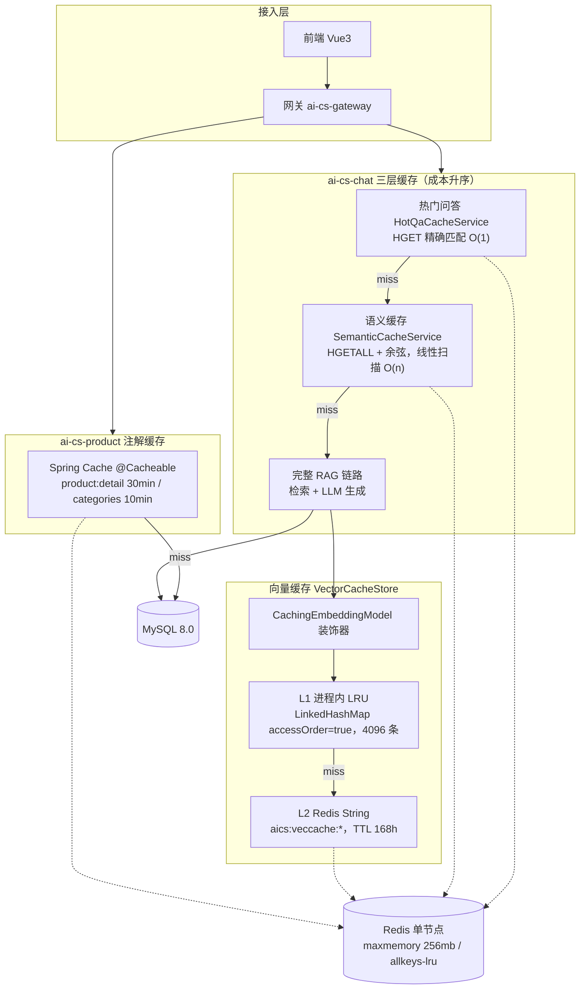
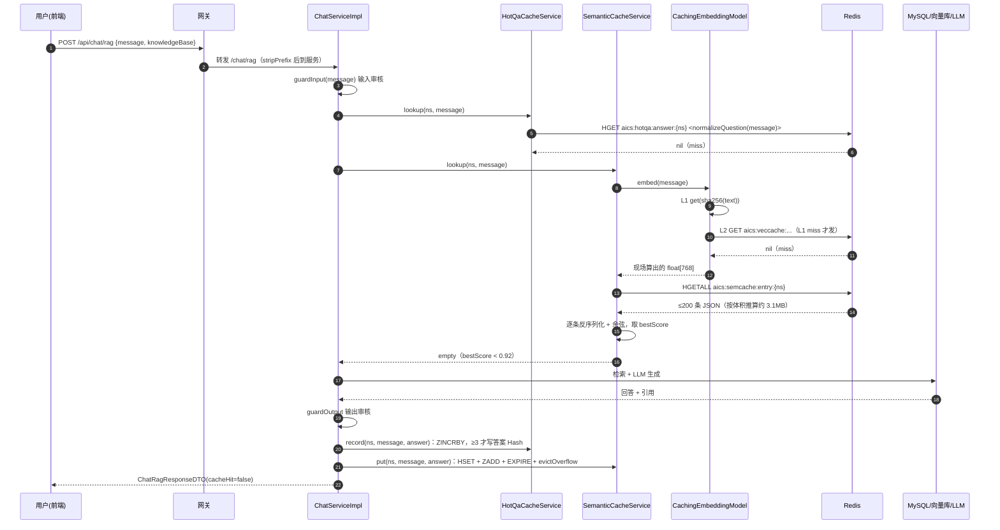

# 缓存淘汰策略：淘汰算法本质是在猜下一个请求会命谁，猜错的代价直接落在数据库上

> **一句话结论**：LRU/LFU/FIFO/CLOCK 的差别只在「谁先被踢出去」，真正决定命中率的是负载形状（扫描型还是热点型）与容量是否盖得住工作集；本项目用 `LinkedHashMap(128, 0.75f, true)` + `removeEldestEntry` 手写 L1、用 Redis `allkeys-lru` 当 L2、用 ZSET 的 score 当语义缓存的 LRU，而 Caffeine/TinyLFU/布隆过滤器/击穿互斥重建全仓 0 处、均未落地。
> **阅读前置**：读得懂 `HashMap` 与双向链表、知道 Redis 的 `HGET`/`ZADD`/`EXPIRE`、跟过一遍 RAG 对话链路（`ai-cs-chat` 的 `ChatServiceImpl`）。不要求读过 Caffeine 源码。
> **证据基线**：JDK 17 / Spring Boot 4.2.0 / MyBatis 3.6.0 / Redis 7.x。A 级 = `24-源码分析/assets/source/` 里的 MyBatis 源码摘录；B 级 = 本仓库真实代码（行号可核对）；C 级 = `node v24.16.0` 跑的模拟脚本，随机种子固定、可复现。预计阅读 35 分钟。

## 0. 先看现象

### 现象一：同一个问题换个用户问，语义缓存 100% 落空

`ai-cs-chat/src/main/java/com/aics/chat/service/impl/ChatServiceImpl.java#L175-L178` 里，缓存的 namespace 是「知识库 + 用户」拼出来的：

ai-cs-chat/src/main/java/com/aics/chat/service/impl/ChatServiceImpl.java#L175-L178

```java
private String cacheNamespace(String knowledgeBase) {
    Long userId = ChatUserContext.getUserId();
    return knowledgeBase + ":user:" + (userId == null ? "anonymous" : userId);
}
```

于是 Redis 里真实存在的 key 形态是 `aics:semcache:entry:knowledge:user:1024`，而 `ai-cs-chat/src/main/java/com/aics/chat/cache/SemanticCacheService.java#L49` 的前缀是 `aics:semcache:entry:`。10 个用户问同一句「怎么退款」，会在 Redis 里落 10 份条目，每份都要各自从 0 攒到 `maxEntries=200`（`ai-cs-chat/src/main/java/com/aics/chat/cache/CacheProperties.java#L26-L36`）。

### 现象二：一个不存在的商品 ID，被刷一万次就打库一万次

商品详情缓存的配置与实现分别写在两处，合起来看才看得出问题：

```text
ai-cs-product/src/main/java/com/aics/product/config/ProductCacheConfig.java#L30-L37
  RedisCacheConfiguration.defaultCacheConfig()
      .disableCachingNullValues()          // <- 空值不缓存
      .serializeValuesWith(...GenericJackson2JsonRedisSerializer...)
      .entryTtl(Duration.ofMinutes(20))    // <- 默认 20 分钟

ai-cs-product/src/main/java/com/aics/product/service/impl/ProductServiceImpl.java#L109-L114
  @Cacheable(cacheNames = ProductCacheConfig.PRODUCT_DETAIL, key = "#id", sync = true)
  public ProductVO getProductDetail(Long id) {
      Product product = productMapper.selectById(id);
      if (product == null) { throw new BusinessException(ResultCode.PRODUCT_NOT_FOUND, "商品不存在"); }
```

`disableCachingNullValues()` 让「这个 id 不存在」这个事实无法进缓存，而方法又用抛异常代替返回 `null`——两条路都堵死，`product:detail` 对不存在的 id 命中率恒为 0，缓存退化成纯装饰。

### 现象三：同一访问序列，换一种淘汰策略，热点命中率差 15 个百分点

这是 `node` 跑出来的真实输出（脚本见 §3.5，种子固定）：

```text
容量=32 请求数=48000 热点键=16(Zipf α=1) 每轮=100热点+60扫描
策略    总体命中率      热点命中率
LRU     52.97%          84.75%
LFU     62.46%          99.93%
```

两者的差距不在「谁更先进」，而在第 100~160 个请求这一小段扫描流量是否把 16 个热点键挤出去——LRU 挤掉了，LFU 没挤掉。

**这些现象指向同一件事：缓存不生效从来不是「没加缓存」，而是三件事里的一件做错了。** 现象一指命名空间粒度选错（key 的维度决定了复用率），现象二指淘汰策略之外的准入与空值策略缺位（连"该不该进缓存"都没定义），现象三指淘汰算法与负载形状不匹配（用 LRU 接扫描流量必然污染）。三个环节任意一个让一步，最后的症状都是同一个：请求穿透到下游。

## 1. 整体地图



> **读图说明**：
> - 最关键的一条箭头是 `HQA -->|miss| SEM -->|miss| RAG`：三层缓存是**串联的、按单次成本升序**排的（HGET 一次 O(1) → 200 条向量比对 → 完整 RAG）。看错成"三个并列的可选缓存"，就会以为随便开一层都能省成本，实际上只有排在前面的层才有意义。
> - 第二条关键箭头是 `M1 -->|miss| M2`：L1 与 L2 是**同一份数据的两个副本**，L2 命中后要回填 L1（`VectorCacheStore#L73-L76`），所以"L2 命中率高"不等于"L1 没白干"——L1 省的是网络往返，不是命中率。
> - 最容易看错的是 `SC -.-> RDS`：商品缓存与 chat 三层缓存**共用同一个 Redis 实例**，而这个实例是 256MB + `allkeys-lru`（`deploy/redis/redis.conf#L24-L25`）。也就是说四个业务方的 key 在同一个池子里互相淘汰。

| 组件 | 责任 | 调用方 | 证据 |
| --- | --- | --- | --- |
| `HotQaCacheService` | 归一化后的精确问答缓存，按出现次数准入 | `ChatServiceImpl#L186` | B 级 `ai-cs-chat/src/main/java/com/aics/chat/cache/HotQaCacheService.java#L58-L106` |
| `SemanticCacheService` | 向量相似度问答缓存，命中刷新 ZSET score 当 LRU | `ChatServiceImpl#L190` | B 级 `ai-cs-chat/src/main/java/com/aics/chat/cache/SemanticCacheService.java#L63-L157` |
| `VectorCacheStore` | 文本 → 向量的两级缓存（L1 本地 LRU + L2 Redis） | `CachingEmbeddingModel#L43-L74` | B 级 `ai-cs-chat/src/main/java/com/aics/chat/cache/VectorCacheStore.java#L48-L96` |
| `CachingEmbeddingModel` | `EmbeddingModel` 装饰器，只把未命中的子集发出去 | `SpringAiConfig#L203` | B 级 `ai-cs-chat/src/main/java/com/aics/chat/config/SpringAiConfig.java#L193-L203` |
| `ProductCacheConfig` | 商品缓存的 TTL 与序列化策略 | Spring Cache 自动配置 | B 级 `ai-cs-product/src/main/java/com/aics/product/config/ProductCacheConfig.java#L30-L45` |
| Redis 单节点 | 承载 L2 与语义/热门问答缓存 | 全部服务 | B 级 `deploy/redis/redis.conf#L24-L25` |

## 2. 关键概念与关键类

先把这一篇会用到的词一次说清，后面不再解释：

- **命中率（hit rate）**：`hit / (hit + miss)`。单看它没意义，要乘上"每次 miss 的成本"才是省下的东西。
- **缓存污染（cache pollution）**：一次性的、不再复用的数据把真正热的数据挤出去。LRU 的天敌。
- **扫描型负载 vs 热点型负载**：前者每个 key 只访问一次（全量导出、翻页爬取），后者的访问集中在少数 key 上（Zipf 分布）。LRU 适合后者、被前者打穿。
- **LRU / LFU / FIFO / CLOCK**：按"最近是否用过 / 用的次数 / 进来时间 / 引用位+时钟指针"决定淘汰谁。
- **TinyLFU / W-TinyLFU**：把"频次是否够格"放在"进入主缓存"之前判一次（准入），并用 Count-Min Sketch 把频次压缩到几 bit，解决 LFU 内存与陈旧问题。Caffeine 的默认策略。
- **穿透 / 击穿 / 雪崩**：查不存在的 key 永远 miss / 热点 key 过期瞬间并发打库 / 大批 key 同时失效或 Redis 挂掉。三者解法完全不同，别混着说。
- **两级缓存（L1/L2）**：L1 在进程内，延迟低但每个实例一份、互不可见；L2 集中，多实例共享但每次多一次网络往返。
- **一致性策略**：先删后写、延迟双删、binlog 驱动。本项目缓存侧用注解驱逐，binlog（Canal）只通往 Elasticsearch，不通往 Redis。

| 名称 | 位置 | 角色 | 关键方法 / 关键取值 |
| --- | --- | --- | --- |
| `VectorCacheStore` | `ai-cs-chat/src/main/java/com/aics/chat/cache/VectorCacheStore.java` | 向量两级缓存 | `get` L1→L2 回填、`put` 双写、`cacheKey = modelKey + ":" + sha256Hex(text)` |
| `LinkedHashMap`（匿名子类） | `VectorCacheStore#L48-L54` | L1 的 LRU 容器 | `new LinkedHashMap<>(128, 0.75f, true)` + `removeEldestEntry` |
| `CacheProperties.Vector` | `ai-cs-chat/src/main/java/com/aics/chat/cache/CacheProperties.java#L48-L56` | L1 容量与 TTL | `l1MaxEntries=4096`、`ttlHours=168` |
| `HotQaCacheService` | `ai-cs-chat/src/main/java/com/aics/chat/cache/HotQaCacheService.java` | 精确问答缓存 + 频次准入 | `lookup`(HGET)、`record`(ZINCRBY)、`promoteThreshold=3` |
| `SemanticCacheService` | `ai-cs-chat/src/main/java/com/aics/chat/cache/SemanticCacheService.java` | 相似问答缓存 | `lookup`(HGETALL+余弦)、`evictOverflow`(ZRANGE 删最旧) |
| `EmbeddingMath` | `ai-cs-chat/src/main/java/com/aics/chat/cache/EmbeddingMath.java` | 相似度与归一化 | `cosine`、`normalizeQuestion` |
| `CacheProperties.Semantic` | `CacheProperties.java#L26-L36` | 语义缓存参数 | `threshold=0.92`、`maxEntries=200`、`ttlHours=168` |
| `ProductCacheConfig` | `ai-cs-product/src/main/java/com/aics/product/config/ProductCacheConfig.java` | Spring Cache 的 TTL/序列化 | `disableCachingNullValues()`、默认 20 分钟、detail 30 分钟、categories 10 分钟 |
| `TransactionalCache`（MyBatis） | `24-源码分析/assets/source/TransactionalCache.java.md` | 「写完库才刷缓存」的教科书实现 | `putObject` 只暂存、`commit` 才 flush、miss 的 key 写 `null` |
| `LruCache`（MyBatis） | `24-源码分析/assets/source/LruCache.java.md` | 用旁挂 `keyMap` 记录顺序的 LRU | `keyMap.get(key)` 仅 touch、`cycleKeyList` 反删 delegate |

## 3. 原理与证据逐段精读

### 3.1 命中率只有乘上「单次 miss 的成本」才有意义

**在干什么。** 缓存做的是一件事：把「贵操作」的结果存在「便宜存储」里，下次直接取。命中率算的是有多少比例走到了便宜那条路。但三层缓存的成本差着好几个数量级：L1 是一次本地 `HashMap` 查找（纳秒到微秒量级），L2 是 Redis 一次网络往返（毫秒量级），miss 是 embedding API 调用或整条 RAG（百毫秒到秒量级）。所以：

```text
省下的时间 ≈ Σ(每层命中次数 × 该层 miss 时的成本)
命中率         hit / (hit + miss)      ← 只是上式的输入之一
```

**为什么这么设计。** 因为"没省"和"省了但省在便宜的地方"是两种完全不同的病。L1 命中率 90% 而 L2 从未被写满，说明省的都是纳秒；反过来语义缓存命中率只有 5%，但每次命中都跳过了整个 RAG，那 5% 可能比 90% 的 L1 命中更值钱。

**换写法会怎样。** 只盯命中率，最典型的错误动作是「把 TTL 从 30 分钟拉到 24 小时」——命中率确实涨了，但陈旧数据的时间窗也涨了 48 倍；而如果热点 key 本来就只有几十个，容量翻倍对命中率毫无帮助。

**常见坑。** 一是把 RAG 检索评估里的 `HitRate`（`ai-cs-chat/src/main/java/com/aics/chat/rag/eval/RetrievalMetrics.java#L69`，含义是"至少命中一条期望文档"）当成缓存命中率——两个词一样，含义毫不相干。二是根本不去量：本仓库全仓 grep `setCacheHit|cacheSource|hitRate`，缓存侧只有 `log.info` 文案，没有任何计数器（§6 手法① 有完整输出）。

### 3.2 L1 的 LRU：`LinkedHashMap` 的两行捷径

**在干什么。** `VectorCacheStore` 的 L1 是进程内缓存，容量由 `CacheProperties.Vector.l1MaxEntries` 控制：

ai-cs-chat/src/main/java/com/aics/chat/cache/VectorCacheStore.java#L48-L54

```java
private final Map<String, float[]> l1Cache = Collections.synchronizedMap(
        new LinkedHashMap<>(128, 0.75f, true) {
            @Override
            protected boolean removeEldestEntry(Map.Entry<String, float[]> eldest) {
                return size() > Math.max(1, properties.getVector().getL1MaxEntries());
            }
        });
```

`LinkedHashMap` 的第三个构造参数 `accessOrder = true` 让它每次 `get`/`put` 都把该 entry 挪到链表尾部；`removeEldestEntry` 在每次 `put` 之后被回调，返回 `true` 就删掉链表头（最久未使用）。于是「哈希表 O(1) 定位 + 双向链表 O(1) 调整顺序」这套 LRU 标准解，被 JDK 折成了两行。

**为什么这么设计。** 手写 LRU 要维护 `HashMap<key, Node>` 加双向链表加两个哨兵，四个容易写错的地方（淘汰时只删链表忘了删 map、用单链表导致 `get` 变 O(n)、`put` 已存在的 key 没更新位置、边界写成 `size() >= capacity` 少存一个）。`LinkedHashMap` 把这些都封在 `afterNodeAccess` / `afterNodeInsertion` 钩子里，`removeEldestEntry` 就是官方留的淘汰钩子。

**换写法会怎样。** 换 Caffeine 能拿到 W-TinyLFU 准入、异步刷新、命中率统计；代价是多一个依赖——本项目选择了零依赖（全仓 `Caffeine` 0 命中，见 §7）。换 `ConcurrentHashMap` + 手写链表则能摆脱全局锁，但要自己处理并发下的链表指针。

**常见坑。** ①`128` 是**初始容量**不是上限，上限是 `l1MaxEntries=4096`（`ai-cs-chat/src/main/resources/application.yml#L166-L169`）；旧稿曾把 128 当成 L1 上限，见 §7。②`new LinkedHashMap<>(128, 0.75f, false)`（漏写 `true`）不报错，只是悄悄退化成 FIFO——这类 bug 只能靠命中率曲线发现。③外套的 `Collections.synchronizedMap` 是**整表一把锁**：向量缓存是读多写少，但 `get` 也会因为 `accessOrder=true` 修改链表而被算作写操作，所以并发读也会互相阻塞。④`removeEldestEntry` 里的 `size()` 读到的是 `LinkedHashMap` 自己的 size，每次 `put` 都从 `properties` 读一次配置，属于热路径上的取字段，虽便宜但没必要。

### 3.3 A 级对照：MyBatis 为什么要在外面再挂一张 `keyMap`

MyBatis 的 `LruCache` 是一个装饰器：真正的存储在 `delegate` 里，顺序信息放在旁边一张 `keyMap` 里。[[源码:LruCache.java.md#L49-L94]]

```java (src: LruCache.java.md#L49-L94)
  public void setSize(final int size) {
    keyMap = new LinkedHashMap<Object, Object>(size, .75F, true) {
      private static final long serialVersionUID = 4267176411845948333L;

      @Override
      protected boolean removeEldestEntry(Map.Entry<Object, Object> eldest) {
        boolean tooBig = size() > size;
        if (tooBig) {
          eldestKey = eldest.getKey();
        }
        return tooBig;
      }
    };
  }

  @Override
  public void putObject(Object key, Object value) {
    delegate.putObject(key, value);
    cycleKeyList(key);
  }

  @Override
  public Object getObject(Object key) {
    keyMap.get(key); // touch
    return delegate.getObject(key);
  }

  @Override
  public Object removeObject(Object key) {
    keyMap.remove(key);
    return delegate.removeObject(key);
  }

  @Override
  public void clear() {
    delegate.clear();
    keyMap.clear();
  }

  private void cycleKeyList(Object key) {
    keyMap.put(key, key);
    if (eldestKey != null) {
      delegate.removeObject(eldestKey);
      eldestKey = null;
    }
  }
```

**在干什么。** 它把 LRU 的两个动作拆开了：**记录顺序**在 `keyMap`（`getObject` 里那句 `keyMap.get(key)` 唯一作用就是 touch，返回值直接丢掉），**真正释放内存**在 `delegate`。`removeEldestEntry` 被回调时只把要淘汰的 key 记到 `eldestKey` 字段，回到 `cycleKeyList` 里再执行 `delegate.removeObject(eldestKey)`。

**为什么这么设计。** 因为 `delegate` 可能是 `PerpetualCache`、`FifoCache`，甚至是分布式缓存的适配器——它们的存储结构不受 `LinkedHashMap` 钩子控制，你没法让它们"顺手消失"。所以只能反着来：顺序自己记，淘汰时按 key 主动通知对方删。这也是**所有"缓存旁挂索引"方案**的共同形状，本项目的语义缓存用 ZSET 存"最近命中时间"就是同一个套路（§3.6）。

**换写法会怎样。** 如果直接在 `getObject` 里 `keyMap.get(key)` 之外再做别的事（比如顺便回源），一次 miss 就会被放大成两次存储访问。如果省掉 `keyMap`，`LruCache` 就退化成 `FifoCache`——两者代码几乎一样，差别只在 `getObject` 有没有 touch。

**常见坑。** ①`setSize` 里的 `size() > size` 是字段/形参同名，`size()` 是 `LinkedHashMap` 的方法、`size` 是入参，能编译但极易误读，抄代码时别抄这段命名。②`removeObject` 返回的是 `delegate` 的返回值，`keyMap` 的删除没有返回值可看，所以「key 不在缓存里」和「key 在但删失败」在调用方看来一样。③`keyMap.put(key, key)` 是 key 映射到自己——这里 value 没用，纯粹借 `LinkedHashMap` 的链表；换成 `ConcurrentHashMap` 就没有这个免费顺序了。

### 3.4 L2：一次 Redis 往返换来的共享，以及 256MB 的容量算术

**在干什么。** L1 未命中时读 Redis；Redis 命中后回填 L1；写路径两边都写：

ai-cs-chat/src/main/java/com/aics/chat/cache/VectorCacheStore.java#L59-L78

```java
public float[] get(String modelKey, String text) {
    if (!properties.getVector().isEnabled()) {
        return null;
    }
    String key = cacheKey(modelKey, text);
    float[] cached = l1Cache.get(key);
    if (cached != null) {
        return cached;
    }
    try {
        String json = redisTemplate.opsForValue().get(KEY_PREFIX + key);
        if (json != null) {
            float[] vector = objectMapper.readValue(json, float[].class);
            l1Cache.put(key, vector);
            return vector;
        }
    } catch (Exception e) {
        log.warn("向量缓存 L2 读取失败，降级 L1-only: err={}", e.getMessage());
    }
    return null;
}
```

**为什么这么设计。** L1 只解决"同一实例重复算"，多实例场景下命中率约为 `1 - (1/N)` 的折扣（N 个实例各持一份），跨实例复用只能靠 L2。同时 L2 是不可用也不能阻断业务的旁路：`catch` 里只 `log.warn` 然后返回 `null`，让上层当作 miss 继续算向量——**缓存故障降级成"慢"而不是"坏"**，这是旁路缓存（cache-aside）该有的姿态。

**换写法会怎样。** 若把异常继续往外抛，Redis 抖动会直接让 RAG 对话 500；若在 `catch` 里重试，一次慢 Redis 会拖成全链路超时放大。若把 L2 换成"先从 Redis 抢分布式锁再算"，就变成击穿防护，但项目没这么做（§3.9）。

**常见坑。** ①`objectMapper.readValue(json, float[].class)` 与写入时的 `writeValueAsString(vector)` 必须同构；一旦模型维度变了（比如从 768 换成别的模型）而缓存没清，反序列化仍会成功但长度不同，`EmbeddingMath.cosine` 直接返回 0（`EmbeddingMath#L19-L21` 的长度校验），表现为"缓存命中了但相似度恒为 0"。项目用 `modelKey` 做命名空间前缀（`SpringAiConfig#L202-L203` 的注释写明了这个理由）来防这一手。②L2 没有条数上限，只有 TTL 168 小时，而每个条目的体积是可算的：768 维 `float[]` 序列化成 JSON 实测 **15806 字节**（§3.7 实测同款数据）。Redis 配置 `maxmemory 256mb` + `maxmemory-policy allkeys-lru`（`deploy/redis/redis.conf#L24-L25`），按这个体积粗略推算，**整个实例约能装 1.7 万条向量条目**，而这 256MB 还要和语义缓存、热门问答、商品缓存、限流 key 分。③`allkeys-lru` 是在**所有 key**里挑 LRU 淘汰，不区分业务；也就是说商品详情缓存可能被向量缓存挤掉，反之亦然。

### 3.5 四种淘汰策略 + 两组实测：LRU 的命门是扫描流量

**在干什么。** 四个策略的差异只有一行：「候选淘汰者怎么选」。FIFO 看进队时间，LRU 看最近访问时间，CLOCK 用一个引用位加一个环形指针近似 LRU（省掉链表调整），LFU 看历史访问次数。

下面这段脚本就是当时跑的原文（复制成 `cache-sim-a.mjs` 用 `node` 跑即可复现；随机种子固定为 `20261127`）：

```js
// 单文件复现：同一访问序列下 LRU/LFU/FIFO/CLOCK 的命中率（种子固定，可复现）
const HOT = 16, ALPHA = 1.0, ROUNDS = 300, HOT_REQ = 100, SCAN_REQ = 60;
const mulberry32 = (a) => () => { a |= 0; a = a + 0x6D2B79F5 | 0;
  let t = Math.imul(a ^ a >>> 15, 1 | a);
  t = t + Math.imul(t ^ t >>> 7, 61 | t) ^ t;
  return ((t ^ t >>> 14) >>> 0) / 4294967296; };
const rnd = mulberry32(20261127);
const w = Array.from({ length: HOT }, (_, i) => 1 / Math.pow(i + 1, ALPHA));
const cum = w.reduce((acc, x) => (acc.push((acc.at(-1) ?? 0) + x), acc), []);
const hotKey = () => { const r = rnd() * cum.at(-1); let lo = 0, hi = HOT - 1;
  while (lo < hi) { const mid = (lo + hi) >> 1; if (cum[mid] < r) lo = mid + 1; else hi = mid; }
  return 'hot:' + lo; };
// 序列 = 300 轮「100 次热点请求(Zipf) + 60 个从未访问过的顺序新键（扫描型流量）」
let scan = 0; const seq = [];
for (let r = 0; r < ROUNDS; r++) {
  for (let i = 0; i < HOT_REQ; i++) seq.push([hotKey(), true]);
  for (let i = 0; i < SCAN_REQ; i++) seq.push(['scan:' + scan++, false]);
}
const LRU = (cap) => { const m = new Map(); return {
  get: (k) => (m.has(k) ? (m.delete(k), m.set(k, 1), true) : false),
  put: (k) => { if (!m.has(k)) { if (m.size >= cap) m.delete(m.keys().next().value); m.set(k, 1); } } }; };
const FIFO = (cap) => { const m = new Map(); return {
  get: (k) => m.has(k),
  put: (k) => { if (!m.has(k)) { if (m.size >= cap) m.delete(m.keys().next().value); m.set(k, 1); } } }; };
const LFU = (cap) => { const m = new Map(); let t = 0; return {
  get: (k) => { const e = m.get(k); if (!e) return false; e.n++; e.t = ++t; return true; },
  put: (k) => { if (m.has(k)) return;
    if (m.size >= cap) { let v = null, bn = Infinity, bt = Infinity;
      for (const [kk, e] of m) if (e.n < bn || (e.n === bn && e.t < bt)) { v = kk; bn = e.n; bt = e.t; }
      m.delete(v); }
    m.set(k, { n: 1, t: ++t }); } }; };
const CLOCK = (cap) => { const f = [], idx = new Map(); let hand = 0; return {
  get: (k) => { const i = idx.get(k); if (i === undefined) return false; f[i].ref = 1; return true; },
  put: (k) => { if (idx.has(k)) return;
    if (f.length < cap) { idx.set(k, f.length); f.push({ k, ref: 1 }); return; }
    while (f[hand].ref === 1) { f[hand].ref = 0; hand = (hand + 1) % cap; }
    idx.delete(f[hand].k); f[hand] = { k, ref: 1 }; idx.set(k, hand); hand = (hand + 1) % cap; } }; };
for (const cap of [32, 10]) {
  console.log(`容量=${cap} 请求数=${seq.length} 热点键=${HOT}(Zipf α=${ALPHA}) 每轮=${HOT_REQ}热点+${SCAN_REQ}扫描`);
  console.log('策略\t总体命中率\t热点命中率');
  for (const [name, mk] of [['LRU', LRU], ['LFU', LFU], ['FIFO', FIFO], ['CLOCK', CLOCK]]) {
    const c = mk(cap); let hit = 0, hh = 0, hr = 0;
    for (const [k, hot] of seq) { const h = c.get(k); if (h) hit++; if (hot) { hr++; if (h) hh++; } c.put(k); }
    console.log(`${name}\t${(hit / seq.length * 100).toFixed(2)}%\t${(hh / hr * 100).toFixed(2)}%`);
  }
  console.log('');
}
```

真实输出（`node v24.16.0`，单次运行，数字与种子绑定）：

```text
容量=32 请求数=48000 热点键=16(Zipf α=1) 每轮=100热点+60扫描
策略	总体命中率	热点命中率
LRU	52.97%	84.75%
LFU	62.46%	99.93%
FIFO	52.97%	84.75%
CLOCK	52.97%	84.75%

容量=10 请求数=48000 热点键=16(Zipf α=1) 每轮=100热点+60扫描
策略	总体命中率	热点命中率
LRU	46.88%	75.01%
LFU	53.07%	84.92%
FIFO	44.76%	71.62%
CLOCK	46.18%	73.88%
```

**怎么读这两张表。** ①容量 32 时 LRU/FIFO/CLOCK 三行数字**完全相同**，这不是脚本写错：热点工作集只有 16 个键，装进 32 个格子后热点段内部从不发生淘汰，一切差异只在扫描段——三种策略在"把 16 个热点键全部踢光"这件事上结论一致。②容量降到 10 后三者分开了（46.88% / 44.76% / 46.18%），因为工作集装不下了，顺序信息才开始有区分度。③LFU 在两档容量下热点命中率都接近上限（99.93% / 84.92%），因为扫描键出现次数都是 1，永远选不上淘汰位——**这既是它的优点，也是下一段那个陷阱的来源**。

**适用边界。** 这是 `node` 里的纯内存模拟，没有网络、序列化、GC 成本，绝对毫秒数不可外推到 Java；LFU 的淘汰在脚本里是 O(capacity) 线性扫描，真实实现会用频次桶或小顶堆做到 O(1)/O(log n)。能带走的只有**相对关系**：容量紧不紧、扫描段多长，决定了 LRU 与 LFU 谁赢，与具体语言无关。

### 3.6 LFU 的计数陷阱，以及「准入」这味药

**在干什么。** 把上表的负载改一下：前 20000 次请求全部打在热点集合 A（16 个键）上，后 20000 次全部打在全新的热点集合 B 上——模拟"业务热点换人"（活动结束、新品上线、知识库更新）。

```js
// 负载迁移实验：热点集体换人后，各策略要多久才重新命中（种子固定，可复现）
const CAP = 16, HOT = 16, PHASE = 20000, ALPHA = 1.0;
const mulberry32 = (a) => () => { a |= 0; a = a + 0x6D2B79F5 | 0;
  let t = Math.imul(a ^ a >>> 15, 1 | a);
  t = t + Math.imul(t ^ t >>> 7, 61 | t) ^ t;
  return ((t ^ t >>> 14) >>> 0) / 4294967296; };
const mkHot = (seed, tag) => { const rnd = mulberry32(seed);
  const cum = Array.from({ length: HOT }, (_, i) => 1 / Math.pow(i + 1, ALPHA))
    .reduce((acc, x) => (acc.push((acc.at(-1) ?? 0) + x), acc), []);
  return () => { const r = rnd() * cum.at(-1); let lo = 0, hi = HOT - 1;
    while (lo < hi) { const mid = (lo + hi) >> 1; if (cum[mid] < r) lo = mid + 1; else hi = mid; }
    return tag + lo; }; };
const a = mkHot(1, 'A'), b = mkHot(2, 'B');
const seq = [];
for (let i = 0; i < PHASE; i++) seq.push([a(), 0]);
for (let i = 0; i < PHASE; i++) seq.push([b(), 1]);

const LRU = (cap) => { const m = new Map(); return {
  get: (k) => (m.has(k) ? (m.delete(k), m.set(k, 1), true) : false),
  put: (k) => { if (!m.has(k)) { if (m.size >= cap) m.delete(m.keys().next().value); m.set(k, 1); } } }; };
const LFU = (cap, halfEvery) => { const m = new Map(); let t = 0, tick = 0; return {
  get: (k) => { const e = m.get(k); if (!e) return false; e.n++; e.t = ++t; return true; },
  put: (k) => { if (m.has(k)) return;
    if (halfEvery && ++tick % halfEvery === 0) for (const e of m.values()) e.n = Math.max(1, e.n >> 1);
    if (m.size >= cap) { let v = null, bn = Infinity, bt = Infinity;
      for (const [kk, e] of m) if (e.n < bn || (e.n === bn && e.t < bt)) { v = kk; bn = e.n; bt = e.t; }
      m.delete(v); }
    m.set(k, { n: 1, t: ++t }); } }; };
const WTLFU = (cap) => { const W = Math.max(2, Math.round(cap * 0.2)), mainCap = cap - W;
  const win = new Map(), main = new Map(); const rows = 4, width = cap * 8;
  const cms = Array.from({ length: rows }, () => new Uint8Array(width)); let sample = 0;
  const h = (k, i) => { let x = 2166136261 ^ i; for (const ch of k) x = Math.imul(x ^ ch.charCodeAt(0), 16777619); return (x >>> 0) % width; };
  const bump = (k) => { if (++sample >= 10 * cap) { sample = 0; for (const r of cms) for (let i = 0; i < width; i++) r[i] >>= 1; }
    for (let i = 0; i < rows; i++) { const j = h(k, i); if (cms[i][j] < 15) cms[i][j]++; } };
  const est = (k) => { let s = 255; for (let i = 0; i < rows; i++) s = Math.min(s, cms[i][h(k, i)]); return s; };
  const admit = (cand) => {
    if (main.size < mainCap) { main.set(cand, 1); return; }
    const victim = main.keys().next().value;
    if (est(cand) > est(victim)) { main.delete(victim); main.set(cand, 1); }
  };
  return {
    get: (k) => { if (win.has(k)) { win.delete(k); win.set(k, 1); bump(k); return true; }
      if (main.has(k)) { main.delete(k); main.set(k, 1); bump(k); return true; } return false; },
    put: (k) => { if (win.has(k) || main.has(k)) return; bump(k);
      if (win.size >= W) { const cand = win.keys().next().value; win.delete(cand); admit(cand); }
      win.set(k, 1); } }; };
for (const [name, mk] of [['LRU', LRU], ['LFU(不衰减)', (c) => LFU(c, 0)],
  ['LFU(每 2000 次访问计数减半)', (c) => LFU(c, 2000)], ['W-TinyLFU(窗口 20%+CMS 准入)', WTLFU]]) {
  const c = mk(CAP); const hit = [0, 0], tot = [0, 0], firstHit = [-1, -1];
  for (const [k, ph] of seq) { const ok = c.get(k); if (ok) { hit[ph]++; if (firstHit[ph] < 0) firstHit[ph] = tot[ph]; } tot[ph]++; c.put(k); }
  console.log(`${name}\t阶段1=${(hit[0] / tot[0] * 100).toFixed(2)}%\t阶段2=${(hit[1] / tot[1] * 100).toFixed(2)}%\t阶段2首次命中在第 ${firstHit[1]} 次请求`);
}
```

真实输出：

```text
LRU	阶段1=99.92%	阶段2=99.92%	阶段2首次命中在第 6 次请求
LFU(不衰减)	阶段1=99.92%	阶段2=13.98%	阶段2首次命中在第 22 次请求
LFU(每 2000 次访问计数减半)	阶段1=99.92%	阶段2=22.87%	阶段2首次命中在第 22 次请求
W-TinyLFU(窗口 20%+CMS 准入)	阶段1=99.92%	阶段2=99.61%	阶段2首次命中在第 6 次请求
```

**为什么这么设计（以及这张表说明了什么）。** LFU 的淘汰依据是"历史次数"，而历史次数的信息量随年龄递减——A 组键攒了两万次计数，B 组键刚进来只有 1 次，于是 B 组永远选不上淘汰位，缓存被旧热点永久占住。表里 LFU 阶段 2 只有 **13.98%**，而 LRU 是 **99.92%**——同一个算法在前一个实验里赢了 15 个百分点，换个负载就输掉 86 个百分点。给计数器加衰减（每 2000 次访问全员减半）能缓过来一点（22.87%），因为衰减是全局的、没有区分"旧键该更快被忘掉"。

W-TinyLFU 换了个思路：**不让每个新键都直接进主缓存，先过一道准入**。新键先进一个很小的窗口 LRU（这里取容量 20%），从窗口被挤出来时，用 Count-Min Sketch 估算它和主缓存里"待淘汰者"的频次，谁高频谁留下。CMS 是 4 行 × `8×容量` 列的 4-bit 计数器，采样量到 `10×容量` 时全表右移一位（相当于全局衰减）。表里 W-TinyLFU 阶段 2 恢复到 **99.61%**，阶段 2 的首次命中也被提前到第 6 次请求。

**换写法会怎样。** 不带准入、只给 LFU 加衰减，就得接受"衰减速度"这个新超参：衰减太快退化成 LRU（丢掉了频次信息），太慢则旧热点赖着不走。W-TinyLFU 把"新鲜度"（窗口）和"频次"（CMS）分开管，超参从 1 个变成 2 个，但每个的物理含义更清楚。Caffeine 用的就是后者，**本项目 0 处使用**（§7）。

**常见坑。** ①把"LFU"实现成"每个 key 一个 `Long` 计数器"，内存立刻爆——CMS 的意义就在于把频次压到 4 bit。②忘记衰减：Redis 的 LFU 有 `lfu-decay-time` 和 `lfu-log-factor` 两个旋钮，`allkeys-lfu` 策略下计数才生效，而本项目用的是 `allkeys-lru`，所以**项目里的 Redis 根本没有频次信息可用**。③把窗口设得过大（比如 50%）会让主缓存失去意义，窗口里全是新键、主缓存里挤不进热点。

### 3.7 语义缓存：用 ZSET 的 score 当 LRU，用线性扫描当索引

**在干什么。** 语义缓存有条目上限 `maxEntries=200`，超了就淘汰。淘汰依据存在一个 ZSET 里：member 是条目 id，score 是"最近一次被命中的时间戳"。

ai-cs-chat/src/main/java/com/aics/chat/cache/SemanticCacheService.java#L63-L90

```java
public Optional<ChatRagResponseDTO> lookup(String knowledgeBase, String question) {
    if (!properties.getSemantic().isEnabled()) {
        return Optional.empty();
    }
    try {
        float[] queryVector = embeddingModel.embed(question);
        Map<Object, Object> entries = redisTemplate.opsForHash().entries(ENTRY_KEY + knowledgeBase);
        if (entries.isEmpty()) {
            return Optional.empty();
        }
        double bestScore = -1;
        CachedEntry best = null;
        String bestId = null;
        for (Map.Entry<Object, Object> e : entries.entrySet()) {
            CachedEntry entry = objectMapper.readValue(String.valueOf(e.getValue()), CachedEntry.class);
            if (entry == null || entry.getVector() == null || entry.getAnswer() == null) {
                continue;
            }
            double score = EmbeddingMath.cosine(queryVector, entry.getVector());
            if (score > bestScore) {
                bestScore = score;
                best = entry;
                bestId = String.valueOf(e.getKey());
            }
        }
```

命中后它做两件事：刷新 score（`opsForZSet().add(INDEX_KEY + knowledgeBase, bestId, System.currentTimeMillis())`，`#L92-L96`，失败静默忽略），并给回答打上 `cacheSource="semantic"`（`#L97-L98`）。写入时用 `UUID` 作条目 id，写 Hash + ZADD + 两个 key 各自 `expire(ttl)`，最后调 `evictOverflow`（`#L143-L157`）：`zCard` 超过 200 就用 `ZRANGE 0, size-maxEntries-1` 取 score 最小（最久未命中）的一批，ZSET 和 Hash 两边一起删。

**为什么这么设计。** 因为"按相似度找"本身是个全表比对问题，200 条以内没有索引的必要；而"淘汰谁"只需要一个排序，ZSET 正好按 score 排序，复杂度 O(log n)。用 ZSET 而不是自己维护链表，等于白拿一份持久化的、多实例共享的 LRU 顺序——和 §3.3 MyBatis 旁挂 `keyMap` 是同一个思路。

**换写法会怎样。** 条目数上到万级就必须换近似最近邻（HNSW 之类），`SemanticCacheService#L31-L41` 的注释也写明了这个边界。另一个方向是把 `HGETALL` 换成"先按关键词粗筛再精算"，但那等于自己造一个倒排索引。

**常见坑。** ①`HGETALL` 是一次性把全部条目拉到本地，网络负载 = 200 × 单条体积。按 768 维向量实测 15441 字节/条（下段实测同款结构）推算，200 条约 **3.1MB** 一次传输——这个数字是「实测体积 × 条目数」的算术推算，不是抓包结果。②线扫的成本大头不是余弦而是反序列化，见下面的实测。③`catch` 只 `log.warn` 就返回 empty，Redis 挂掉时表现为"缓存命中率归零"，而不是报错，排查时容易误判为"阈值太严"。

下面这段脚本量的是同一个算式：n 条条目、每条 768 维向量，逐条 `JSON.parse` + 余弦，取 25 次运行的中位数。

```js
// 语义缓存线性扫描的成本：n 条条目 × (JSON 反序列化 + 768 维余弦) 的单次 lookup 耗时
import { performance } from 'node:perf_hooks';
const DIM = 768, RUNS = 25;
const mulberry32 = (a) => () => { a |= 0; a = a + 0x6D2B79F5 | 0;
  let t = Math.imul(a ^ a >>> 15, 1 | a);
  t = t + Math.imul(t ^ t >>> 7, 61 | t) ^ t;
  return ((t ^ t >>> 14) >>> 0) / 4294967296; };
const rnd = mulberry32(7);
const vec = () => Array.from({ length: DIM }, () => rnd() * 2 - 1);
const cosine = (a, b) => { let dot = 0, na = 0, nb = 0;
  for (let i = 0; i < DIM; i++) { dot += a[i] * b[i]; na += a[i] * a[i]; nb += b[i] * b[i]; }
  return dot / (Math.sqrt(na) * Math.sqrt(nb)); };
const median = (xs) => { const s = [...xs].sort((p, q) => p - q); return s[s.length >> 1]; };
const query = vec();
console.log('每条目 = {question,vector(768),answer} 序列化后约 ' + JSON.stringify({ q: 'x'.repeat(20), v: vec(), a: 'y'.repeat(200) }).length + ' 字节');
console.log('n\t单次lookup中位耗时\t每条目耗时\t反序列化占比');
for (const n of [50, 100, 200, 400, 800]) {
  const raw = Array.from({ length: n }, () => JSON.stringify({ q: '如何退款' + rnd(), v: vec(), a: '答'.repeat(200) }));
  const times = [], parseTimes = [];
  for (let r = 0; r < RUNS; r++) {
    const t0 = performance.now();
    let best = -1, bestIdx = -1, parseMs = 0;
    for (let i = 0; i < n; i++) {
      const p0 = performance.now();
      const e = JSON.parse(raw[i]);
      parseMs += performance.now() - p0;
      const s = cosine(query, e.v);
      if (s > best) { best = s; bestIdx = i; }
    }
    const total = performance.now() - t0;
    times.push(total); parseTimes.push(parseMs);
    if (bestIdx < 0) throw new Error('unreachable');
  }
  const m = median(times), mp = median(parseTimes);
  console.log(`${n}\t${m.toFixed(3)} ms\t${(m * 1000 / n).toFixed(1)} µs\t${(mp / m * 100).toFixed(1)}%`);
}
```

真实输出：

```text
每条目 = {question,vector(768),answer} 序列化后约 15441 字节
n	单次lookup中位耗时	每条目耗时	反序列化占比
50	2.660 ms	53.2 µs	97.7%
100	5.189 ms	51.9 µs	98.0%
200	12.795 ms	64.0 µs	97.9%
400	25.026 ms	62.6 µs	97.3%
800	45.638 ms	57.0 µs	97.1%
```

**怎么读这张表。** ①耗时对 n 是**线性**的（n 翻倍，毫秒数大致翻倍），符合 O(n)；单条目成本基本恒定在 50~64 µs，说明没有隐藏的二次项。②**97% 以上的时间花在 `JSON.parse`，不在余弦**——`SemanticCacheService#L31-L41` 的注释说"n≤200 时约 200 次点积微秒级可接受"，点积部分确实便宜，但整条 lookup 真正贵的是把 200 条 15KB 的 JSON 变成对象。所以优化方向是"少反序列化"或"换二进制编码"，而不是"优化余弦"。③n=200 时约 **12.8 ms**，而一次 RAG 通常在百毫秒量级——它还不至于毁掉体验，但它是**每个请求都要付的固定税**，且发生在用户命名空间（§0 现象一）里，命中率被稀释后这笔税就更不划算。

**适用边界。** 这是 `node v24.16.0` 的 `JSON.parse` 与 V8 的性能，Java 17 + Jackson 的常数不同（Jackson 处理 `float[]` 通常更快），但**结构不变**：O(n) 线性、成本大头在反序列化。别把 12.8 ms 当成线上 Java 的数字用。

### 3.8 热门问答缓存：用「出现次数」做准入，是 LFU 的正确用法

**在干什么。** 热门问答缓存是三层里最便宜的一层：一次 `HGET`，O(1)。它只缓存"已经出现过 3 次以上"的问题。

ai-cs-chat/src/main/java/com/aics/chat/cache/HotQaCacheService.java#L87-L106

```java
public void record(String knowledgeBase, String question, ChatRagResponseDTO answer) {
    if (!properties.getHotQa().isEnabled() || question == null || answer == null) {
        return;
    }
    String normalized = EmbeddingMath.normalizeQuestion(question);
    if (normalized.isEmpty()) {
        return;
    }
    try {
        Long count = redisTemplate.opsForZSet().incrementScore(FREQ_KEY + knowledgeBase, normalized, 1);
        redisTemplate.expire(FREQ_KEY + knowledgeBase, Duration.ofHours(
                Math.max(1, properties.getHotQa().getTtlHours())));
        if (count != null && count >= properties.getHotQa().getPromoteThreshold()) {
            save(knowledgeBase, normalized, answer);
        }
    } catch (Exception e) {
        log.warn("热门问答频次记录失败（不影响业务）: kb={}, err={}", knowledgeBase, e.getMessage());
    }
}
```

**为什么这么设计。** 每一次 RAG 都很贵，如果把"只问过一次"的问题也缓存，就等于用存储换不来任何复用——这正是 §3.6 里 LFU 想解决又解决不好的「准入」问题。这里的做法更粗暴也更可靠：**频次没到 3 就不进缓存**（`promoteThreshold=3`），进缓存之后就不再淘汰、只等 TTL（24 小时）自然过期。用 ZINCRBY 的返回值顺手拿到计数，省掉一次读。

**换写法会怎样。** 直接 `HSET` 每次回答，Redis 写入量翻倍，且缓存被大量一次性问题填满，真正的热门问题反而要跟它们抢 LRU。改成"频次达阈值后按最小堆维护 TopN"，则会引入一个需要定期重建的结构体。

**常见坑。** ①`FREQ_KEY` 每次 `record` 都 `expire` 重置 24 小时，意味着**只要还有人不间断地问同一批问题，频次计数器永远不过期**，而计数只增不减——这与 §3.6 的"历史热点永不淘汰"是同一个病，只是这里靠 TTL 兜底而不是靠淘汰。②`normalizeQuestion` 会删掉所有空白和标点（`EmbeddingMath#L41-L47`），所以「如何退款？」「如何 退款」「如何退款」归一化后同 key——这是刻意设计，但也意味着**标点承载语义的问句会撞车**。③`save` 里必须深拷贝一份再写（`#L111-L122` 的注释写明"不能直接清空调用方 answer 的 cacheHit/cacheSource"），否则调用方手里的对象会被改脏。④频次与答案都按知识库分 key，但都**没有按用户分**——与语义缓存的 namespace 口径不一致，这也是为什么热门问答缓存能复用、语义缓存复用不了。

### 3.9 一致性：A 级「写完库才刷缓存」vs 本项目的注解驱逐

**在干什么。** MyBatis 二级缓存用 `TransactionalCache` 把"什么时候把数据放进缓存"这件事绑到了事务提交上。[[源码:TransactionalCache.java.md#L79-L121]]

```java (src: TransactionalCache.java.md#L79-L121)
  @Override
  public void putObject(Object key, Object object) {
    entriesToAddOnCommit.put(key, object);
  }

  @Override
  public Object removeObject(Object key) {
    return null;
  }

  @Override
  public void clear() {
    clearOnCommit = true;
    entriesToAddOnCommit.clear();
  }

  public void commit() {
    if (clearOnCommit) {
      delegate.clear();
    }
    flushPendingEntries();
    reset();
  }

  public void rollback() {
    unlockMissedEntries();
    reset();
  }

  private void reset() {
    clearOnCommit = false;
    entriesToAddOnCommit.clear();
    entriesMissedInCache.clear();
  }

  private void flushPendingEntries() {
    for (Map.Entry<Object, Object> entry : entriesToAddOnCommit.entrySet()) {
      delegate.putObject(entry.getKey(), entry.getValue());
    }
    for (Object entry : entriesMissedInCache) {
      if (!entriesToAddOnCommit.containsKey(entry)) {
        delegate.putObject(entry, null);
      }
    }
  }

  private void unlockMissedEntries() {
    for (Object entry : entriesMissedInCache) {
      try {
        delegate.removeObject(entry);
      } catch (Exception e) {
        log.warn("Unexpected exception while notifying a rollback to the cache adapter. "
            + "Consider upgrading your cache adapter to the latest version. Cause: " + e);
      }
    }
  }
```

**在干什么（第二个动作）。** 这里有三处值得抄的设计：①`putObject` **不写缓存**，只塞进 `entriesToAddOnCommit`；`clear()` 也**不真清**，只置 `clearOnCommit = true`。真正生效都在 `commit()`。②`rollback()` 直接丢弃暂存，被回滚的数据永远不会进缓存——这是"先写库、后写缓存"的强制版。③`flushPendingEntries` 末尾那段：**本次查询中 miss 过的 key，如果最后也没有数据，就往缓存里写 `null` 占位**。这就是空值防穿透的教科书实现。

**为什么这么设计。** 因为缓存的写时机必须晚于（或等于）数据库的提交时机，否则并发读会把"未提交的中间值"写进缓存，回滚之后缓存里就留下一份数据库里不存在的脏数据。把写入推迟到 commit，代价是事务期间同一会话读到的是自己的暂存（`getObject` 里 `clearOnCommit` 时直接返回 `null`，`#L71-L74`）。

**换写法会怎样。** 本项目的商品缓存走的是 Spring Cache 注解：`@Cacheable(..., sync = true)`（`ai-cs-product/src/main/java/com/aics/product/service/impl/ProductServiceImpl.java#L109`）+ 五处 `@CacheEvict`（`#L119`、`#L159`、`#L191`、`#L217`、`#L244`）。`@CacheEvict` 默认在方法**正常返回之后**执行，而 `#L191`、`#L217` 这两个方法还带 `@Transactional`（`#L190`、`#L216`）——缓存拦截器与事务拦截器的执行顺序并不由代码里的书写顺序决定，若删缓存发生在事务提交之前，中间窗里被并发读到的旧值会被重新写回缓存，脏数据活到下一个 TTL。稳妥做法是 `@TransactionalEventListener(AFTER_COMMIT)` 里删缓存，或者干脆用 binlog 驱动。

**常见坑。** ①`@CacheEvict` 写在有事务的方法上却不校验拦截器顺序。②`removeObject` 在这里返回 `null` 且什么都不做——站在缓存抽象的角度看，"删"是由 `clear()` + `commit` 表达的，误以为 `removeObject` 会立刻生效的调用方会写出很奇怪的 bug。③binlog 驱动在本项目里**存在但不通往缓存**：`ai-cs-search/src/main/java/com/aics/search/cdc/ProductCdcConsumer.java#L14-L24` 把 Canal 事件同步到 Elasticsearch，且默认 `aics.cdc.product.enabled:false`（`#L29-L30`）——所以"缓存一致性靠 binlog"这句在本仓库是不成立的。

### 3.10 商品缓存三件套：`disableCachingNullValues` + 默认 20 分钟 + `sync = true`

**在干什么。** 商品服务是**全仓唯一**使用 Spring Cache 抽象的地方：详情缓存 30 分钟、分类列表 10 分钟、默认配置 20 分钟且禁止缓存 null。

ai-cs-product/src/main/java/com/aics/product/config/ProductCacheConfig.java#L30-L45

```java
@Bean
public RedisCacheConfiguration productDefaultCacheConfiguration() {
    return RedisCacheConfiguration.defaultCacheConfig()
            .disableCachingNullValues()
            .serializeValuesWith(RedisSerializationContext.SerializationPair
                    .fromSerializer(new GenericJackson2JsonRedisSerializer()))
            .entryTtl(Duration.ofMinutes(20));
}

@Bean
public RedisCacheManagerBuilderCustomizer productCacheManagerCustomizer() {
    return builder -> builder
            .withCacheConfiguration(PRODUCT_DETAIL, productDefaultCacheConfiguration().entryTtl(Duration.ofMinutes(30)))
            .withCacheConfiguration(PRODUCT_CATEGORIES, productDefaultCacheConfiguration().entryTtl(Duration.ofMinutes(10)));
}
```

**为什么这么设计。** `disableCachingNullValues()` 是 Spring 的默认安全阀：把 `null` 写进缓存会掩盖"数据不存在"和"数据还没写"的区别，且需要序列化器支持 null。20 分钟默认 TTL 是给"将来新加的 cacheName"留的兜底。`sync = true` 让同一实例内并发 miss 只放一个线程去查库（`ProductServiceImpl#L109`），这是**单机版的击穿防护**。

**换写法会怎样。** 若允许缓存 null，就必须同时把详情的 TTL 压到分钟级（空值占位会长期占用内存且数据"可能后来才被创建"）；若不要 `sync = true`，热点 key 过期瞬间所有并发线程一起去打库。反过来，能不能不缓存空值但防住穿透？可以——用布隆过滤器在入口拦一次，或者把"id 是否合法"做成白名单；本项目两者都没有（全仓 `BloomFilter` 0 命中）。

**这个配置在什么负载下会出问题。** ①**恶意/爬虫扫号**：`getProductDetail(id)` 对不存在的 id 每次都 `selectById` + 抛 `BusinessException`，`disableCachingNullValues` 让这个结果无法落缓存，等于给数据库开了一个"每条请求必定穿透"的口子。②**多实例**：`sync = true` 的锁是进程内的，N 个实例同时过期就有 N 条打库；TTL 又是**固定 30 分钟、没有抖动**，批量写入的商品会在同一分钟集中过期。③**写后读**：五个 `@CacheEvict` 的位置与事务顺序问题见 §3.9。④**共用 Redis**：`allkeys-lru` 下商品 key 会被向量缓存的 15KB 大对象挤掉（§3.4），表现为"明明设了 30 分钟 TTL，热度不高的商品却总是 miss"。

## 4. 一次完整执行时序



> **读图说明**：
> - 数一下读路径：第 4~16 步一共 4 次缓存访问（HGET → L1 → L2 → HGETALL），任一次命中都会跳过第 17~18 步的检索与生成。第 4 步与第 8 步是**串联**而不是二选一，这就是"成本升序"的落地方式。
> - 第 16 步 `HGETALL` 是整条路径上最重的一次——它把 200 条条目全拉到本地（§3.7 实测 n=200 单次约 12.8 ms 在 node 侧），且**无论后面会不会命中都要付**。看错这一步的代价，就会以为语义缓存"只要不命中就不花钱"。
> - 第 20~21 步是写路径，注意它发生在 `guardOutput` 之后（`ChatServiceImpl#L475`）：被安全策略拦截的回答不会进缓存。第 21 步末尾的 `evictOverflow` 是唯一会主动删缓存的地方，它按 ZSET score 从旧到新删。

| 失败步骤 | 现象 / 报错原文 | 归属 |
| --- | --- | --- |
| 5 `HGET` 之后 | `热门问答频次记录失败（不影响业务）: kb=..., err=...` | `HotQaCacheService#L98-L99` 的 catch，业务继续 |
| 8~9 向量化 | 上游 embedding 超时，异常上抛到 `SemanticCacheService#L102-L104` 后返回 empty | 表现为"语义缓存从不命中"，日志 `语义缓存读取失败（不影响业务）: kb=..., err=...` |
| 11 L2 读失败 | `向量缓存 L2 读取失败，降级 L1-only: err=...` | `VectorCacheStore#L74-L76`，返回 `null` 当作未命中，重新算向量 |
| 14 反序列化 | 维度或格式不匹配 → `cosine` 返回 0（不是报错） | `EmbeddingMath#L19-L21`，症状是"命中数为 0 但没有异常" |
| 16 `HGETALL` | Redis 内存被打满后 `allkeys-lru` 淘汰掉索引 key，`entries()` 返回空 | 表现为命中率突然归零，`deploy/redis/redis.conf#L24-L25` |
| 21 `evictOverflow` | `ZRANGE` 与 `HDEL` 之间无事务，并发写可能删多删少 | 只影响条目数略偏离 200，不影响正确性 |

## 5. 设计取舍

| 方案 | 延迟量级 | 多实例共享 | 命中率上限 | 一致性 | 运维成本 | 本项目现状 |
| --- | --- | --- | --- | --- | --- | --- |
| L1 进程内 LRU（`LinkedHashMap`） | 与哈希表查找同量级 | 否（每实例一份） | 受实例数与容量限制 | 最差（要等 TTL） | 0 | **已落地**：`VectorCacheStore#L48-L54`，4096 条 |
| L2 Redis String | 一次网络往返 | 是 | 高 | 中（TTL 168h） | 1 个实例 | **已落地**：`aics:veccache:*` |
| 语义缓存（HGETALL + 余弦 + ZSET 淘汰） | 线性，n=200 时 node 侧约 12.8ms | 是 | 中（受阈值 0.92 与命名空间限制） | TTL 168h | 低 | **已落地**：`SemanticCacheService`，上限 200 |
| 热门问答（HGET + 频次准入） | O(1) | 是 | 高（对重复问题） | TTL 24h | 低 | **已落地**：`HotQaCacheService`，阈值 3 |
| Spring Cache 注解（`@Cacheable`/`@CacheEvict`） | 一次网络往返 | 是 | 中 | 中（主动驱逐） | 低 | **已落地**：仅 `ai-cs-product` |
| W-TinyLFU / Caffeine | 与 L1 同量级 | 否 | 高（抗扫描） | 同 L1 | 多一个依赖 | **0 处，未落地** |
| 布隆过滤器（防穿透） | O(k) 次哈希 | 是 | — | 需随数据重建 | 中 | **0 处，未落地** |
| 击穿互斥重建（`setNx`） | 阻塞等待 | 是 | — | — | 低 | **0 处，未落地**（`setIfAbsent` 只用于 `IdempotentAspect#L61` 的支付幂等） |

**可扩展点清单**（想改什么 → 动哪里）：

- 想给 L1 加抗扫描能力 → 把 `VectorCacheStore#L48-L54` 的 `LinkedHashMap` 换成 Caffeine 的 `maximumSize + expireAfterWrite`，顺手拿到 `recordStats()` 的命中率。
- 想量命中率 → 在 `VectorCacheStore.get` 的 L1/L2 两个分支各加一个计数器，或在 `CachingEmbeddingModel#L43-L74` 统计 `hit/miss` 子集大小；目前只有 `ChatServiceImpl#L427` 的一行 `log.info`。
- 想放宽语义缓存复用 → 改 `ChatServiceImpl#L175-L178` 的 `cacheNamespace`，把 userId 从 key 里摘出去（前提：回答内容不因人而异）。
- 想压掉反序列化开销 → 把 `CachedEntry` 的 `float[]` 换成 `byte[]`（定长二进制），或把 `HGETALL` 换成只取"候选 id 列表 + 二次精算"。
- 想防穿透 → 要么允许缓存 null（去掉 `disableCachingNullValues()`，并把 detail TTL 压到 1~2 分钟），要么在 `getProductDetail` 前加布隆过滤器。
- 想防击穿 → 把 `ProductServiceImpl#L109` 的 `sync = true` 补一层 Redis `setIfAbsent` 互斥，或改成逻辑过期（缓存永不过期 + 异步刷新）。
- 想让缓存与库的一致性可控 → 把 `@CacheEvict` 从方法注解换成 `TransactionSynchronization#afterCommit` 里显式删，或接 Canal 事件（参考 `ai-cs-search/src/main/java/com/aics/search/cdc/ProductCdcConsumer.java`，但它目前只同步 ES）。

## 6. 踩坑与调试手法

| # | 现象 | 根因 | 验证手段 | 解法 |
| --- | --- | --- | --- | --- |
| 1 | L1 命中率长期只有个位数 | 多实例各持一份，`1/N` 折扣；或 `l1MaxEntries` 远小于工作集 | 单实例压测对比总请求量 | 提高 L2 命中率、或让 key 更集中（缩小命名空间维度） |
| 2 | 缓存"设了 TTL 却总 miss" | 共用 Redis 被 `allkeys-lru` 淘汰（大对象挤压） | `INFO stats` 的 `evicted_keys` 是否在涨 | 拆实例 / 给缓存 key 单独的 policy / 压对象体积 |
| 3 | 语义缓存从不命中，日志无异常 | 向量维度变更导致 `cosine` 恒 0；或 `catch` 吞掉了 Redis 错误 | 打印 `bestScore` 分布（目前没有）、手工算一次余弦 | 缓存键带 `modelKey`；把 `catch` 里的 warn 加上 key |
| 4 | 同一问题不同用户都不命中 | `cacheNamespace` 带 userId | 看 Redis key 形态 `...:user:1024` | 按"回答是否因人而异"决定是否摘掉 userId |
| 5 | 不存在的 id 持续打库 | `disableCachingNullValues()` + 抛异常，空值无处落 | 慢查询日志里 `selectById` 的重复率 | 布隆过滤器 / 允许短 TTL 空值 / 入口参数校验 |
| 6 | 热点 key 过期瞬间数据库尖刺 | 固定 TTL 无抖动；`sync=true` 只在本实例生效 | 对照 `evicted_keys`/慢查询的时间戳是否整分对齐 | TTL 加随机抖动 + 分布式互斥重建 |
| 7 | 旧热点"永远不淘汰" | LFU 计数只增不减（§3.6 实测 13.98%） | 观察命中率在业务切换后是否长期不恢复 | 计数衰减 / 窗口准入 |

**【真调试手法①】怀疑"缓存没生效"时，先确认有没有度量，而不是先改配置。** 一条 `Select-String` 就能看清"命中率"这个词在本仓库只属于 RAG 检索评估：

```powershell
PS> Get-ChildItem -Recurse -Filter *.java -Path ai-cs-chat,ai-cs-product |
      Select-String -Pattern "setCacheHit|cacheSource|hitRate"
```

真实输出（节选，共 50+ 行，这里只留缓存相关与 hitRate 定义处）：

```text
ai-cs-chat\src\main\java\com\aics\chat\cache\HotQaCacheService.java:72: answer.setCacheHit(true).setCacheSource("hot-qa");
ai-cs-chat\src\main\java\com\aics\chat\cache\SemanticCacheService.java:98: answer.setCacheHit(true).setCacheSource("semantic");
ai-cs-chat\src\main\java\com\aics\chat\dto\ChatRagResponseDTO.java:31: private String cacheSource;
ai-cs-chat\src\main\java\com\aics\chat\rag\eval\RetrievalMetrics.java:69: m.hitRate = hitCount > 0 ? 1.0 : 0.0;   // 至少命中一条 = 1
ai-cs-chat\src\main\java\com\aics\chat\service\impl\ChatServiceImpl.java:427: log.info("RAG对话命中缓存: sessionId={}, kb={}, source={}", sessionId, knowledgeBase, hit.getCacheSource());
```

**怎么读。** 三件事同时成立：①`setCacheHit` 只在两个 catch 保护的 lookup 里出现，没有任何地方累计；②`hitRate` 的唯一赋值在 `RetrievalMetrics`，那是"检索命中率"，与缓存无关；③唯一能观测缓存的是第 427 行那条 `log.info`，它带 `source` 字段。结论：**本项目没有缓存命中率指标**，任何"命中率低"的判断都必须先自己造一个（按 `source=hot-qa|semantic|null` 统计日志，或加计数器）。这一步不做，后面所有调参都是猜。

**【真调试手法②】把线上/压测的 key 序列抠出来，用脚本回放，比在集群里改配置快一个数量级。** §3.5、§3.6 的两张表就是这么来的：脚本是纯内存、`Map` 实现，跑 4.8 万请求在 node 上是瞬时的事，可以一次跑十个容量、十种种子，而线上改一次 `l1MaxEntries` 要等灰度、等 TTL 生效、还要承担脏数据风险。**怎么读**：回放脚本只能回答"换个策略命中率会怎样"，回答不了"换成 Caffeine 后延迟会怎样"——前者是算法问题，后者是工程问题，别拿模拟结果当性能证明。

## 7. 版本差异

| 旧写法 / 旧稿说法 | 当前基线（本仓库实测） | 变化点 | 迁移动作 |
| --- | --- | --- | --- |
| 「L1 容量很小，只有 128 条」 | `l1MaxEntries = 4096`（`CacheProperties.java#L48-L56`、`application.yml#L166-L169`），128 只是 `LinkedHashMap` 的**初始容量**参数 | 混淆了构造参数与容量上限 | 调容量改 `aics.cache.vector.l1-max-entries`，不要改那个 `128` |
| 「用 Caffeine 做本地缓存」 | 全仓 `Caffeine` **0 命中**，L1 是手写 `LinkedHashMap`；TinyLFU 思想只在实测里对比过 | 能力未落地 | 想用先加依赖，并同步加上 `recordStats` 埋点（§6 手法①） |
| 「语义缓存淘汰时取 score 最小的条目」 | 方向正确，缺关键参数：`maxEntries=200`、`threshold=0.92`、`TTL 168h`（`CacheProperties.java#L26-L36`），且**按用户命名空间计数** | 旧稿漏了参数与粒度 | 调参改 `aics.cache.semantic.*`；复用率问题要先动 `cacheNamespace` |
| 「Redis 用 LRU 淘汰最久未用的 key」 | `deploy/redis/redis.conf#L24-L25` 是 `maxmemory 256mb` + `allkeys-lru`，**全库所有 key 一视同仁**，且没有开启 LFU（因此无频次信息） | 旧稿只讲算法不讲策略作用域 | 想让某类 key 不被淘汰，只能拆实例或换 policy |
| 「用布隆过滤器防穿透」「用 setNx 互斥重建防击穿」 | 两者全仓 **0 处**；`setIfAbsent` 只出现在 `IdempotentAspect#L61` 的支付幂等 | 方案未落地 | 按 §5 可扩展点清单接入；注意 `disableCachingNullValues()` 现状 |
| 「缓存一致性可用 binlog 驱动」 | Canal 链路存在，但目标是 **Elasticsearch**（`ProductCdcConsumer`），且默认 `enabled:false`；缓存侧一致性靠 `@CacheEvict` | 方向对、对象不同 | 真要 binlog 刷缓存需新消费者，别复用 ES 那条 |

## 8. 面试高频问与答

只列问题，答案自己先答一遍，再对照 §3 的实测与 §9 的练习检验。

1. LRU 为什么能做到 O(1)？哈希表和双向链表各自负责什么，缺一个会怎样？
2. `LinkedHashMap` 的 `accessOrder` 参数不加会退化成什么策略？为什么这种 bug 很难被发现？
3. LRU 的缓存污染是什么？举一个真实业务里的扫描型流量，并说明它为什么能一次性清空热点。
4. LFU 的"历史热点永不淘汰"如何产生？有哪三种修法，各自的代价是什么？
5. TinyLFU 的窗口（window）和主缓存分别解决什么问题？为什么准入判断要用 Count-Min Sketch 而不是精确计数？
6. CLOCK 为什么能用更少的内存近似 LRU？它和 LRU 在什么负载下差异最大？
7. 两级缓存的 L1 一致性为什么天然差？在没有主动失效的情况下，L1 的平均陈旧时间是多少？
8. 缓存穿透、击穿、雪崩的触发条件与解法分别是什么？哪些解法会引入新的可用性问题？
9. 为什么 `disableCachingNullValues()` 会关掉空值防穿透？在 Spring Cache 里要缓存 null 需要满足什么条件？
10. 先删后写、延迟双删、binlog 驱动三种一致性策略，各能挡住哪一类并发异常，各留下什么窗口？
11. 命中率为什么不能单独作为缓存效果指标？给出一个"命中率高但没省钱"的具体场景。
12. `allkeys-lru` 与 `volatile-lru` 的区别是什么？一个实例里混放多种业务 key 会带来什么问题？
13. 语义缓存用线性扫描到 200 条就不能再涨了吗？真正先撑爆的是余弦计算还是别的？
14. 如果让你给本项目的 chat 三层缓存加一个命中率看板，埋点打在哪几行、指标怎么定义？

## 9. 动手练习

1. **把 §3.5 的脚本扩成"容量扫描"**：容量从 8 到 256 取 8 个点，画出 LRU 与 LFU 的热点命中率曲线，找出两条线的交叉点。
   *验收标准*：能说出交叉点大致位置，并解释容量大于工作集之后为什么两条线会收敛。
2. **复现 LFU 的历史包袱**：把 §3.6 的 `PHASE` 改成 40000，看 LFU 阶段 2 的命中率是否进一步下降。
   *验收标准*：能证明"计数只增不减时，越长的旧阶段让新热点越难进来"。
3. **给 `VectorCacheStore` 加命中率计数器**（只改这一个文件）：L1 命中、L2 命中、全 miss 各一个 `LongAdder`，在 `CacheStatsController` 暴露出来。
   *验收标准*：`curl /chat/cache/stats` 能看到三个计数字段，且 L1+L2+miss 等于总调用次数。
4. **读 `SemanticCacheService#L143-L157`，设计一个更省网络的反序列化方案**：要求 lookup 时不再一次性取全部 200 条 JSON。
   *验收标准*：写出一段改造思路（例如 ZSET 存 id + 命中分、Hash 按 id 分批取），并指出它新增的 Redis 往返次数。
5. **给商品详情缓存做一次穿透压测设计**（不用真跑）：构造 `id` 全部不存在的请求流，估算在 `disableCachingNullValues()` 下每分钟会打多少次库。
   *验收标准*：给出算式与结论，并指出改造后（允许缓存 null 且 TTL 1 分钟）打库次数的量级变化。
6. **验证 `@CacheEvict` 与 `@Transactional` 的顺序**：给 `ProductServiceImpl#L216-L217` 那个方法加一行 `Thread.sleep`，用两个线程（一个写一个读）观察是否能把旧值写回缓存。
   *验收标准*：能观察到脏缓存，或能证明在当前的拦截器顺序下观察不到（两种结论都接受，但必须给出证据）。

## 小结

- 淘汰算法只回答一个问题：**下一个请求最可能命中谁**。LRU 赌"最近用过"，LFU 赌"用得最多"，CLOCK 用一位引用位近似前者，TinyLFU 先用频次做准入再赌。
- 算法好坏**取决于负载形状**：实测同一序列里 LFU 领先 15 个百分点，负载迁移后 LFU 掉到 13.98% 而 LRU 仍是 99.92%——没有"更先进的淘汰策略"，只有"更匹配的假设"。
- LRU 的实现捷径是 `LinkedHashMap(initialCapacity, 0.75f, true)` + `removeEldestEntry`（`VectorCacheStore#L48-L54`）；MyBatis 的 `LruCache` 则示范了另一种形状：顺序旁挂一张 `keyMap`，淘汰时按 key 反删真正的存储。
- 两级缓存的职责划分是 **L1 换延迟、L2 换共享**；L1 的一致性只能靠 TTL 或主动失效，`1/N` 的实例折扣是它的固有成本。
- 缓存"不生效"的三个真实原因在本仓库都能找到：命名空间粒度错了（`cacheNamespace` 带 userId）、准入策略缺位（`disableCachingNullValues`）、算法与负载不匹配（LRU 接扫描流量）。
- 一致性上，MyBatis 的 `TransactionalCache` 给了标准答案：写入推迟到 commit、回滚丢弃、miss 的 key 写 `null` 占位；而本项目的 `@CacheEvict` 依赖拦截器顺序，存在提交前删缓存的窗口。
- 命中率必须乘上"单次 miss 的成本"才有意义；而本仓库**目前连缓存命中率都没有埋点**，只有一个 `log.info` 的 `source` 字段。
- **可操作的归纳**：新增一处缓存时按顺序问四句——①这个 key 的维度决定了复用率吗（要不要带 userId）；②负载是热点型还是扫描型（选 LRU 还是带准入的策略）；③存在性为负的查询怎么处理（空值占位还是布隆）；④失效与事务谁先谁后（注解够不够，要不要 afterCommit）。四问答完，淘汰策略、TTL、防穿透方案就都定下来了。

## 自测题

1. LRU 为什么能 O(1) 完成"定位 + 调整顺序 + 淘汰"三个动作？
<details><summary>参考答案</summary>定位靠 `HashMap<key, node>`，调整顺序靠双向链表（摘下再挂到尾部，因为有前驱指针所以是 O(1)，单链表就退化成 O(n)），淘汰直接取链表头。三者都是常数操作，所以整体 O(1)。</details>

2. `VectorCacheStore#L48-L54` 里 `128` 和 `l1MaxEntries` 分别是什么？搞混会导致什么误判？
<details><summary>参考答案</summary>`128` 是 `LinkedHashMap` 的初始容量（只影响扩容时机），真正的上限是 `removeEldestEntry` 里比较的 `properties.getVector().getL1MaxEntries()`，默认 4096。搞混会让运维以为 L1 只能存 128 条，从而误判"命中率低是因为容量太小"。</details>

3. §3.5 实测里容量 32 时 LRU/FIFO/CLOCK 三行数字完全相同，为什么不是脚本 bug？
<details><summary>参考答案</summary>热点工作集只有 16 个键，小于容量 32，热点段内部从不发生淘汰，三者唯一的差异只会出现在扫描段——而扫描段把 16 个热点键全部挤出去这件事上三者结论一致，所以累计命中数相同。容量降到 10 后工作集装不下，三者才分开（46.88% / 44.76% / 46.18%）。</details>

4. LFU 为什么会"历史热点永不淘汰"？§3.6 实测中它的阶段 2 命中率是多少，LRU 是多少？
<details><summary>参考答案</summary>LFU 按累计访问次数选淘汰位，旧热点攒了两万次计数，新键只有 1 次，永远选不上被淘汰的位置，缓存被占死。实测阶段 2：LFU 13.98%，LRU 99.92%；加"每 2000 次访问计数减半"后回升到 22.87%，W-TinyLFU 恢复到 99.61%。</details>

5. TinyLFU 的窗口与主缓存分别承担什么职责？准入为什么要用 Count-Min Sketch？
<details><summary>参考答案</summary>窗口（本项目实测取容量 20%）给新键一个立刻可命中的机会并积累频次；主缓存存放已证明高频的键。窗口挤出的候选要与主缓存的待淘汰者比频次，频次用 CMS（4 行 × 8×容量 列的 4-bit 计数器，采样到 10×容量 时全表右移一位）估算，这样频次信息的内存开销是常数级，否则"每个 key 一个计数器"在百万 key 下直接爆内存。</details>

6. L1/L2 两级缓存中，为什么"L2 命中率高"不等于"L1 白干了"？
<details><summary>参考答案</summary>两者省的不是同一样东西。L1 省的是本地查找 vs 一次网络往返；L2 省的是网络往返 + 重算（向量化/查库）。L2 命中后还要回填 L1（`VectorCacheStore#L73-L76`），且多实例下 L1 的命中率天然有 `1/N` 折扣。</details>

7. 本项目的语义缓存为什么换个用户就复用不了？要改哪一行？
<details><summary>参考答案</summary>`ChatServiceImpl#L175-L178` 的 `cacheNamespace` 把 userId 拼进了 namespace（`knowledgeBase + ":user:" + userId`），而 `SemanticCacheService#L49` 的 key 前缀拼在它外面，所以两个用户是两个独立的 Hash 与 ZSET，`maxEntries=200` 也是各自计数。要复用就得把 userId 从 namespace 里摘出去，前提是回答内容不因人而异。</details>

8. `disableCachingNullValues()` 为什么等于关掉了空值防穿透？MyBatis 是怎么做的？
<details><summary>参考答案</summary>它明确告诉 Spring Cache 不要把 `null` 写进缓存，于是"这个 id 不存在"这个结论无法被记住，每个请求都要重新查库；再叠加 `getProductDetail` 用抛 `BusinessException` 代替返回 null，连缓存 null 的机会都没有。MyBatis 的 `TransactionalCache#L113-L121` 正相反：本次会话里 miss 过的 key，如果最终没有数据，就在 commit 时 `delegate.putObject(entry, null)` 写一个 null 占位。</details>

9. `@Cacheable(sync = true)` 能防住缓存击穿吗？
<details><summary>参考答案</summary>只能防住单实例内的并发重建——锁是进程内的 `synchronized`/本地锁，N 个实例同时发现 key 过期就会有 N 次回源。跨实例需要 Redis 互斥（`setIfAbsent`）或逻辑过期方案；本项目这两者都未落地。</details>

10. 为什么 Redis 的 `allkeys-lru` 在本项目里是个隐患？
<details><summary>参考答案</summary>它是在**全部 key** 里挑最近最少使用的淘汰，不区分业务；而本项目 chat 三层缓存、商品缓存、限流 key 全在同一个 256MB 实例里（`deploy/redis/redis.conf#L24-L25`）。单个 768 维向量条目序列化后实测约 15441 字节，粗略推算整个实例约能装 1.7 万条，向量缓存的大对象会把商品缓存和语义缓存索引挤出去。</details>

11. 语义缓存 n=200 时一次 lookup 约 12.8ms，主要花在哪？优化方向是什么？
<details><summary>参考答案</summary>node 实测 97% 以上花在 `JSON.parse`（每条 15441 字节 × 200 条的逐条反序列化），余弦计算只占很小一部分。所以优化方向是减少反序列化（改二进制编码、或只取候选 id 再精算），而不是优化余弦公式。注意这是 node 的数字，Java + Jackson 常数不同但结构一致。</details>

12. MyBatis 的 `TransactionalCache` 为什么把 `clear()` 也推迟到 commit？回滚时做了什么？
<details><summary>参考答案</summary>`clear()` 只置 `clearOnCommit = true` 并清空暂存表，真正 `delegate.clear()` 在 `commit()` 里执行；`rollback()` 调用 `unlockMissedEntries()` 把本次 miss 过的 key 从 delegate 删掉（释放 BlockingCache 的锁），然后 `reset()` 丢弃所有暂存。这样就保证"库里没提交的，缓存里一定没有"。</details>

13. 命中率 90% 的缓存一定比命中率 30% 的更省钱吗？
<details><summary>参考答案</summary>不一定。要乘上单次 miss 的成本：L1 命中 90% 省下的可能只是纳秒级哈希查找，而语义缓存命中 30% 每次都跳过整条 RAG（百毫秒到秒级）。正确口径是 `Σ(每层命中次数 × 该层的回源成本)`，命中率只是它的输入之一。</details>

14. 如果现在要判断"chat 三层缓存到底有没有用"，你会先做哪一步？
<details><summary>参考答案</summary>先造度量：本仓库目前没有缓存命中率埋点（全仓 grep 只有 `ChatServiceImpl#L427` 的一条 `log.info("RAG对话命中缓存: sessionId={}, kb={}, source={}")`），所以第一步是在 `HotQaCacheService#L58-L80`、`SemanticCacheService#L63-L106` 的命中/未命中两个分支加计数器（或在 `CacheStatsController` 暴露），再按 `source` 维度统计分布；没有这一步，任何调参都只是猜。</details>
