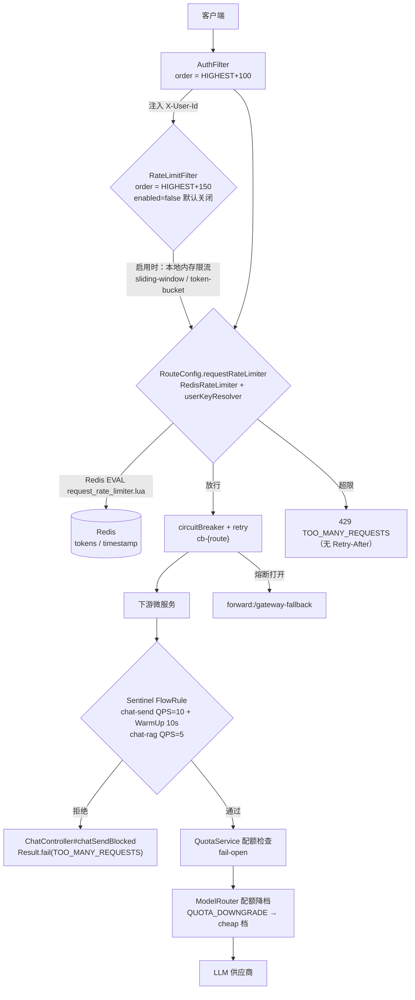
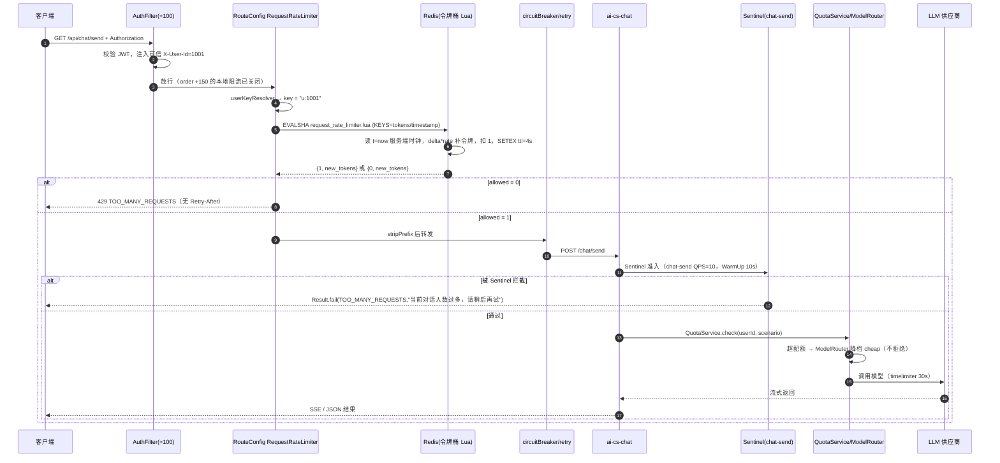

# 限流算法：四大算法与网关实现

> **一句话结论**：四种限流算法的真正差别只有一个——**允不允许突发**。固定窗口按"对齐的秒"计数所以边界会双倍放行；滑动日志把窗口精确化但每个请求都要存一个时间戳；滑动计数用"格子"换内存、用精度换成本；漏桶把突发摊平成一队；令牌桶把突发"卖"给你（桶容量即突发额度）。而生产事故里更常见的不是"限多少"，是"限谁"——键选错，阈值再准也是误伤。
> **阅读前置**：知道 Spring Cloud Gateway 的 `GlobalFilter` / `RouteLocator` / `KeyResolver` 是干什么的；知道 Redis 单线程执行命令、`EVAL` 期间不会被别的命令插队；Redis 里的 `EVAL`、`TTL`、key hash tag 三个概念没听过的话先花十分钟补一下。
> **证据基线**：B 级＝本仓库 `ai-cs-gateway`、`ai-cs-chat` 的真实源码（行号逐个核对过）；A 级＝`assets/source` 里入库的 Spring Cloud Gateway 5.1.0 `request_rate_limiter.lua` 与 `RedisRateLimiter` 摘录；C 级＝node 24 实测脚本（60 秒 900 次到达、8 组算法参数）真实输出。预计阅读 45 分钟。

## 0. 先看现象

三个真实症状，都不像"限流"，但根子都在限流。

### 症状一：把限流阈值改小，接口照样被打穿

运维把 `aics.gateway.rate-limit.qps` 从 5 改成 1，重启网关，压测 30 QPS —— 没有任何请求被拦。

```text
PS> Select-String -Path ai-cs-gateway\src\main\resources\application.yml -Pattern 'enabled|algorithm|replenish-rate|burst-capacity'
L40: enabled: false
L43: algorithm: sliding-window
L48: replenish-rate: 5
L49: burst-capacity: 10
```

`enabled: false` 是本地内存限流的总开关，`RateLimitFilter` 在 `#L55-L57` 里看到 false 就直接 `return chain.filter(exchange)`，`qps`、`requests` 这些字段一行都没读到。真正在拦人的是另一套：`RouteConfig` 给 16 条路由每条都挂了 `requestRateLimiter(...)`（`ai-cs-gateway/src/main/java/com/aics/gateway/config/RouteConfig.java#L169-L187`），它用的是 `replenish-rate` / `burst-capacity` 和 Redis。**两套限流并存，你改的是关着的那套。**

### 症状二：一个人正常用，整间办公室一起被限

同一间办公室 200 个人走一个 NAT 出口，有人写了个循环脚本，结果全公司一起 429。

```text
实验C: 200 人共享出口 IP，每人每 10 秒 1 次（0~9s 均匀抖动），共 600 秒 = 12000 次，cap=10 rate=5/s
ip-shared      12000     3003     8997    74.98%
per-user       12000    12000        0     0.00%
```

200 个人，每人每 10 秒只发 1 次（人均 0.1 QPS，远远谈不上滥用），却被拒了 **74.98%**。原因在键：`RateLimitFilter#resolveKey`（`#L80-L89`）和 `RouteConfig#userKeyResolver`（`#L151-L167`）都是"拿不到 `X-User-Id` 就用 `ip:` 前缀"，而未登录请求、白名单路径（`AuthFilter` 在 `#L112-L121` 会先 `remove` 掉客户端伪造的身份头再放行）全都拿不到 `X-User-Id`。**阈值没问题，是 200 个人共用了一个桶。**

### 症状三：429 之后客户端打得更凶

```text
PS> (Get-ChildItem -Recurse -Include *.java,*.yml .\ai-cs-gateway\src\main | Select-String -Pattern 'Retry-After|retryAfter').Count
0
```

网关返回的 429 只有一句中文（`RateLimitFilter#L94-L100` 手写响应体 `{"code":429,"message":"请求过于频繁，请稍后再试",...}`），既没有 `Retry-After` 也没有 `X-RateLimit-Remaining`。客户端 SDK 只能"1 秒后原样重试"，等于把被拒的请求原封不动塞回来 —— 限流器把过载从服务端搬到了客户端重试队列里。

这些现象指向同一件事：**限流的难点不在"限多少"**，而在三处容易被跳过的细节——**"限谁"（键与维度）、"允不允许突发"（算法选型）、"拒绝之后怎么办"（429 协议）**。本仓库恰好把这三件事分放在 `KeyResolver`、`TokenBucketRateLimiter`/`SlidingWindowRateLimiter`、`RateLimitFilter#tooManyRequests` 里，下面按这三条线索逐一拆。

## 1. 整体地图



> **读图说明**：
> - 一条请求会依次穿过**三处不同的限流器**：网关本地内存（默认关）、网关路由级 Redis 令牌桶（默认开）、微服务内部 Sentinel（只有 chat 的两个资源有规则）。排查"为什么我被限了"时，必须按这个顺序逐个排除，而不是一上来改阈值。
> - 图中两个分支点（`R` 和 `SN`）分别对应"分布式限流"和"单机入口限流"：前者跨实例共享配额、代价是一次 Redis RTT；后者零网络开销、代价是配额只在单实例内有效。
> - `熔断/降级/配额降档` 在图的右侧，是**保护出口**的机制；`限流` 在图的入口，是**拒绝入口**的机制。二者不是替代关系，混用会得出"限流没生效"的错误结论。
> - 429 与 fallback 是两条不同的失败路径：429 是"你太快了"（客户端问题，可退避重试），fallback 是"我这边下游坏了"（服务端问题，重试大概率还坏）。

| 组件 | 位置（可核对） | 责任 | 参与的键/配额 |
|---|---|---|---|
| `AuthFilter` | `ai-cs-gateway/src/main/java/com/aics/gateway/filter/AuthFilter.java#L112-L121` | 校验 JWT/API Key，注入可信 `X-User-Id`；白名单先清身份头 | 决定后面能不能拿到 `u:` 键 |
| `RateLimitFilter` | `ai-cs-gateway/src/main/java/com/aics/gateway/filter/RateLimitFilter.java#L50-L64` | 本地内存限流（全局单桶），默认关闭 | `u:{userId}` 或 `ip:{ip}` |
| `SlidingWindowRateLimiter` | `ai-cs-gateway/src/main/java/com/aics/gateway/filter/SlidingWindowRateLimiter.java#L33-L46` | 滑动日志算法（存时间戳） | 与键一一对应一个 `Deque<Long>` |
| `TokenBucketRateLimiter` | `ai-cs-gateway/src/main/java/com/aics/gateway/filter/TokenBucketRateLimiter.java#L35-L53` | 连续令牌桶（double 令牌、惰性补充） | 与键一一对应一个 `Bucket` |
| `RouteConfig` | `ai-cs-gateway/src/main/java/com/aics/gateway/config/RouteConfig.java#L169-L187` | 给 16 条路由统一挂 retry + circuitBreaker + requestRateLimiter | 每路由一份 Redis 配额 |
| `RedisRateLimiter`（SCG） | A 级摘录 `RedisRateLimiter.java.md#L243-L298` | 分布式令牌桶，EVAL Lua 原子扣减 | `request_rate_limiter.{routeId.id}.tokens` |
| `SentinelFlowConfig` | `ai-cs-chat/src/main/java/com/aics/chat/config/SentinelFlowConfig.java#L29-L41` | 注册 chat-send / chat-rag 两条 QPS 规则 | 资源维度，无用户维度 |
| `ModelRouter` | `ai-cs-chat/src/main/java/com/aics/chat/modelrouter/ModelRouter.java#L46-L54` | 配额超限后降档到 cheap 档（不是拒绝） | 用户 + 场景维度 |

## 2. 关键概念与关键类

先把术语钉死，后面不再解释：

- **阈值（threshold）**：单位时间允许通过的量。可以是 QPS（每秒请求数），也可以是"窗口内总次数"。两者在突发场景下不等价。
- **突发（burst）**：短时间内到达速率远高于平均速率。限流器对突发的态度，是四种算法唯一实质性的分水岭。
- **键（key）**：限流计数的挂载点。键 = 维度选择（全局/接口/用户/IP/租户）的落地形式。
- **对齐窗口（fixed window）**：把时间切成 `[0,1s) [1s,2s)` 这种绝对区间。边界由时钟取整决定，不由流量决定。
- **滑动窗口（sliding window）**：窗口跟着"现在"走，`[now-1s, now]`。精确版要存每个请求时间戳（滑动日志），近似版只存格子计数（滑动计数）。
- **令牌（token）/ 漏桶水位（water）**：令牌桶里令牌是"预支的额度"，漏桶里水位是"排队的请求"。前者攒起来可以一次性花掉，后者只能按固定速率流出。
- **fail-open / fail-close**：限流器自身故障（Redis 挂了）时选择放行还是拒绝。本仓库三处限流器全部 fail-open。
- **429 / `Retry-After`**：HTTP 语义里"你被限了"与"多久之后再来"。缺后者，客户端只能盲目重试。
- **预热（WarmUp）**：阈值不直接给满，而是从 `阈值/coldFactor` 缓慢爬升到阈值，避免冷启动实例一上线就被打满。

| 名称 | 位置 | 角色 | 关键方法 / 字段 |
|---|---|---|---|
| `RateLimitFilter` | `ai-cs-gateway/src/main/java/com/aics/gateway/filter/RateLimitFilter.java` | 本地限流入口，按算法配置分发 | `filter`、`tryAcquire`、`resolveKey`、`tooManyRequests` |
| `SlidingWindowRateLimiter` | 同目录 `SlidingWindowRateLimiter.java` | 滑动日志实现 | `tryAcquire(key, maxRequests, windowSeconds)` |
| `TokenBucketRateLimiter` | 同目录 `TokenBucketRateLimiter.java` | 连续令牌桶实现 | `tryAcquire(key, qps, burst)`、内部类 `Bucket` |
| `RateLimitProperties` | `ai-cs-gateway/src/main/java/com/aics/gateway/config/RateLimitProperties.java` | `aics.gateway.rate-limit.*` 绑定 | `enabled`、`algorithm`、`requests`、`qps`、`replenishRate`、`burstCapacity` |
| `RouteConfig` | `ai-cs-gateway/src/main/java/com/aics/gateway/config/RouteConfig.java` | 路由装配 + 覆盖 SCG 默认限流 Bean | `redisRateLimiter()`、`userKeyResolver()`、`addResilience()` |
| `RedisRateLimiter` | A 级摘录 `RedisRateLimiter.java.md` | SCG 官方分布式令牌桶 | `isAllowed`、`getKeys`、`getHeaders` |
| `request_rate_limiter.lua` | A 级摘录 `request_rate_limiter.lua.md` | 原子扣减脚本（27 行） | `KEYS[1]=tokens`、`KEYS[2]=timestamp` |
| `SentinelFlowConfig` | `ai-cs-chat/src/main/java/com/aics/chat/config/SentinelFlowConfig.java` | 代码注册流控规则 | `initFlowRules`、`FlowRuleManager.loadRules` |
| `SentinelRules` | `ai-cs-chat/src/main/java/com/aics/chat/config/SentinelRules.java` | 资源名与阈值常量 | `CHAT_SEND_QPS_THRESHOLD=10`、`WARM_UP_PERIOD_SEC=10` |
| `QuotaService` | `ai-cs-chat/src/main/java/com/aics/chat/observability/QuotaService.java` | 用量配额检查（Token/费用双维度） | `check`、`windowStart` |
| `ModelRouter` | `ai-cs-chat/src/main/java/com/aics/chat/modelrouter/ModelRouter.java` | 配额超限降档路由 | `cheapestEligible`、`RouteReason.QUOTA_DOWNGRADE` |

## 3. 原理与证据逐段精读

### 3.1 固定窗口：为什么"对齐的秒"会双倍放行

**在干什么。** 最朴素的实现：`key = 接口:秒级时间戳`，`INCR key`，第一次 `INCR` 后 `EXPIRE 1s`，返回值 > 阈值就拒绝。O(1) 时间、O(键数) 内存、一条 Redis 命令搞定，是很多项目"先上线再说"的第一版。

**为什么这么设计。** 因为它把"计数"这件复杂事交给了 Redis 的原子 `INCR`，不需要读-改-写，天然并发安全。代价是窗口边界由**时钟取整**决定：`[00:59:59.000, 00:59:59.999]` 一窗、`[01:00:00.000, 01:00:00.999]` 一窗，两个相邻窗口各自可以放满阈值。

**换写法会怎样。** 把阈值从 20 降到 10 并不能修复边界，只让"跨边界那 100ms 内通过 2×阈值"变成"通过 2×10"。要修只有两条路：滑动日志（精确，见 3.2）或把窗口切成格子做加权折算（见 3.3）。C 级实测把这个漏洞量化了——阈值 20/s，20 个请求落在 `[950,999]ms`、另 20 个落在 `[1000,1049]ms`，跨边界 100ms 内共 40 个到达：

```text
实验A2: 20 个请求落在 [950,999]ms，另 20 个落在 [1000,1049]ms（跨对齐边界 100ms 内共 40 个）
algorithm                       allowed  max in 200ms
fixed-window(1s,20)                  40            40
sliding-log(1s,20)                   20            20
sliding-counter(2 slots,20)          20            20
token-bucket(rate20,cap40)           40            40
leaky-bucket(rate20,queue20)         21            21
```

*数据怎么造的*：按毫秒时间戳顺序喂同一批到达事件，每个算法一个独立实例，`allowed` 是放行数，`max in 200ms` 用双指针在放行时刻序列上滑动统计任意 200ms 内的最大放行数。

*怎么读*：固定窗口放行 40，即**瞬间放行了 2 倍阈值**——这不是 bug，是算法定义。滑动日志只给 20，它看到了 `[now-1s, now]` 这个真实窗口。令牌桶同样给 40，但那是**合法的**（桶里确实攒着 40 个令牌，见 3.4）——同一个数字，一个是漏，一个是设计。

*适用边界*：固定窗口在"阈值低 + 流量有周期性对齐"时最危险（定时任务整点触发、监控每 10 秒一轮）；在流量平滑且阈值远高于突发的场景里，它的误放行概率极低，而实现成本最低，所以"支付类接口一律别用、日志上报类尽管用"。

**常见坑。** `INCR` 与 `EXPIRE` 不是原子的（除非用 Lua / `SET NX EX` 组合），进程在两条命令之间崩溃会留下永不过期的计数器 —— 这个 key 之后就永久拒绝该维度所有请求，是本篇见过最狠的自伤型故障。

### 3.2 滑动日志：精确，代价是内存与一次 O(n)

**在干什么。** 每个键维护一个"窗口内所有放行请求的时间戳"双向队列，每次请求先从头弹掉窗口外的过期时间戳，再看队列长度是否达到阈值。本仓库的落点是 `SlidingWindowRateLimiter#tryAcquire`

```java
// ai-cs-gateway/src/main/java/com/aics/gateway/filter/SlidingWindowRateLimiter.java#L33-L46
long now = System.currentTimeMillis();
long windowStart = now - windowSeconds * 1000L;
Deque<Long> timestamps = windows.computeIfAbsent(key, k -> new ConcurrentLinkedDeque<>());
synchronized (timestamps) {
    while (!timestamps.isEmpty() && timestamps.peekFirst() < windowStart) {
        timestamps.removeFirst();
    }
    if (timestamps.size() >= maxRequests) {
        return false;
    }
    timestamps.addLast(now);
    return true;
}
```

**为什么这么设计。** 三个选择都值得看：① `computeIfAbsent` 保证"同键只有一个队列"，把并发争用从"全局锁"缩小到"单键锁"；② 过期清理是**惰性**的——只在有请求进来时顺手弹队头，没有定时任务，也没有后台线程，空闲键不耗 CPU；③ 只从队头 `peekFirst` 判断是否过期，因为队列天然按时间递增，一旦队头没过期就可以立刻停止——这是典型的"利用数据结构不变式把循环提前终止"。类注释（`#L28-L32`）还专门写明了它替代固定窗口的理由："固定窗口（如 Redis INCR+EXPIRE）在窗口边界存在'双倍放行'漏洞（00:59:59 与 01:00:00 各能放满一窗）"。

**换写法会怎样。** 若把 `synchronized (timestamps)` 换成无锁 `ConcurrentLinkedDeque` 全靠 CAS：`size()` 与 `addLast` 之间会有竞态窗口，两个请求可能都读到 `size == maxRequests-1` 然后同时放行，实际通过数超过阈值——限流器"偶尔多放 1 个"听起来无害，但在阈值 = 容量硬上限的场景（比如保护一个只有 10 条连接的池）就是压垮它的最后一根稻草。锁在这个粒度上（单键、微秒级）是可以接受的。

**常见坑。** ① `Deque.size()` 在 `ConcurrentLinkedDeque` 上是 **O(n) 遍历计数**，不是常数——`maxRequests` 配成 60 时每次请求要数 60 个节点，配成 6000 就是个可观测的 CPU 热点；② 这个 `Map` 只增不减，`clear()` 只在关闭时被调用，键维度一旦含 IP（见 3.9），攻击者换 IP 就能让内存单调上涨；③ 它**没有接口/路由维度**——`RateLimitFilter` 对整个网关只有一个键空间，`/api/chat` 和 `/api/user/profile` 抢同一个桶。

### 3.3 滑动计数：用格子数换精度，精度损失可以量化

**在干什么。** 不存时间戳，只存格子计数：把 1 秒切成 N 个 slot，当前窗口的估计值 = 当前 slot 计数 + 前 N-1 个 slot 计数 × (剩余比例)。内存 O(N)、时间 O(1)，Redis 里也能用 `INCR` + `GET` 批量读实现。Sentinel 的滑动窗口就是这种（秒级默认 2 个格子，可配）。

**为什么这么设计。** 它在"精确但要存 O(阈值) 个时间戳"和"O(1) 但会双倍放行"之间插了一档可调旋钮：N 越大越精确、越贵；N=1 退化成固定窗口。这是典型的"用一个参数把两种极端算法连成一条连续谱"。

**换写法会怎样。** 实测同一批 60 秒负载（每 10 秒一次 50 个突发、阈值 20/s），格子数从 2 提到 10，`maxIn1s` 从 23 掉到 20：

```text
algorithm                       allowed rejected  rejRate  maxIn1s  burstSecOK  steadyOK
fixed-window(1s,20)                 660      240   26.67%       23         120       540
sliding-log(1s,20)                  660      240   26.67%       20         120       540
sliding-counter(2 slots,20)         660      240   26.67%       23         120       540
sliding-counter(10 slots,20)        660      240   26.67%       20         120       540
```

*怎么读*：`maxIn1s` 是"任意 1 秒内实际放行数"，理想值应 ≤ 阈值 20。固定窗口 23（边界漏放 3 个）、2 格滑动计数也是 23 —— 格子太粗时它跟固定窗口几乎一样差；10 格时 20，与精确算法持平。**注意 allowed 列四者完全相同（660）**：格子数只影响"什么时候放"，不影响"总共放多少"。

*适用边界*：N 的选取和"服务能容忍的瞬时越界比例"挂钩。经验上 N=5~10（100~200ms 粒度）在绝大多数业务里够用；但如果下游是极敏感的资源（数据库连接、第三方计费接口），不要用格子折算，直接上滑动日志或令牌桶。

**常见坑。** 教科书算法里"前一格加权"要求知道当前处在格子的哪个位置，而很多实现直接用"权重 = 1 - 已过时间/窗口"，同时把当前格的计数**整份**计入 —— 就等于把当前格的未来也算进去了，实测 `maxIn1s = 23` 的那 3 个就是这么来的。

### 3.4 令牌桶：允许突发，桶容量就是你的突发额度

**在干什么。** 桶里按固定速率攒令牌，上限是桶容量；请求来一个取一个令牌，取不到就拒绝。本仓库的连续版实现：

```java
// ai-cs-gateway/src/main/java/com/aics/gateway/filter/TokenBucketRateLimiter.java#L35-L53
int capacity = Math.max(1, burst);
long now = System.nanoTime();
Bucket bucket = buckets.computeIfAbsent(key, k -> new Bucket(capacity, now));
synchronized (bucket) {
    long elapsedNano = now - bucket.lastRefillNano;
    if (elapsedNano > 0) {
        double refill = elapsedNano / 1_000_000_000.0 * Math.max(1, qps);
        bucket.tokens = Math.min(capacity, bucket.tokens + refill);
        bucket.lastRefillNano = now;
    }
    if (bucket.tokens >= 1.0) {
        bucket.tokens -= 1.0;
        return true;
    }
    return false;
}
```

**为什么这么设计。** 三个细节全是踩过坑才有的：① **惰性补充**——用"距上次补充的时间差 × 速率"一次算完，不需要每秒跑定时任务，也不会有定时器的精度抖动与线程开销（类注释 `#L14-L20` 明确对比了这两种做法）；② **令牌用 `double`**——若用整数截断，低速率（如 0.5 QPS）在请求间隔不足 2 秒时永远凑不齐 1 个令牌，表现为"限流器把服务饿死"，注释里直接写了"饿死"这个词；③ **`System.nanoTime()`** 而不是 `currentTimeMillis()`——墙钟会被 NTP 校正回退，时间倒流会让 `elapsedNano` 变负数，令牌白送或永远不补。

**换写法会怎样。** 桶容量怎么设决定了它是"允许突发"还是"capped 平滑"：

```text
逐秒放行曲线（第 0 秒 = 突发秒，共 60 个到达；第 1~4 秒各 10 个到达）
algorithm                         s0    s1    s2    s3    s4   s10   s11
token-bucket(rate20,cap40)        54    10    10    10    10    54    10
token-bucket(rate20,cap20)        34     9    10    10    10    34     9
```

`rate=20 cap=40` 时突发秒吃下 54（40 存量 + 该秒内补充的 20×0.7≈14）；`cap=20` 时只吃 34，并且下一秒只剩 9（因为突发秒末桶被抽干，紧接着的半秒里补不回来）。**同一个算法、同一个速率，突发额度只由 cap 决定。**

**常见坑。** 本项目 `RateLimitFilter#L70-L75` 调令牌桶时把 `qps` 同时传给了速率和桶容量：

```java
return tokenBucketLimiter.tryAcquire(key, Math.max(1, properties.getQps()), Math.max(1, properties.getQps()));
```

即"容量 = 速率"，突发额度只有 1 秒的量，令牌桶退化成"带小缓冲的匀速放行"——你以为配了令牌桶就有突发能力，其实只买到 5 个令牌的保险。要真正允许突发，得把 `burstCapacity` 传进第二个参数（配置项已经存在：`RateLimitProperties#burstCapacity`，默认 10）。

### 3.5 漏桶：把突发摊平，或者排队

**在干什么。** 请求倒进桶里，桶以固定速率漏水（=`rate` 个/秒），桶满就拒绝。与令牌桶镜像对称：令牌桶攒"许可"，漏桶攒"待处理"。若桶后接工作线程按固定速率取走，就是**排队**；若不接、桶容量配成 0 附近，就是**快速失败**。

**为什么这么设计。** 它保护的不是"入口 QPS"，而是"下游处理速率的抖动"：下游是单线程消费、或是个只能匀速跑的硬件/批处理通道时，漏桶的均匀流出比"允许突发"更有价值。

**换写法会怎样。** 实测对照很反直觉：`leaky-bucket(rate20,queue20)` 的总放行数与 `token-bucket(rate20,cap20)` 完全相同（738），但 A2 里两者差得很远——漏桶只放 21，令牌桶放 40：

```text
algorithm                       allowed  max in 200ms
token-bucket(rate20,cap40)           40            40
leaky-bucket(rate20,queue20)         21            21
```

*怎么读*：漏桶的放行数被"流出速率 × 时间"卡死（100ms 内最多流出 2 个 + 队列 20 ≈ 21），而令牌桶可以一次性花掉攒下的 40 个令牌。**总吞吐一样、形状完全不同**：一个是平滑的水流，一个是可以爆的脉冲。

*适用边界*：漏桶适合"下游只能匀速"（消息消费、打款通道、按次计费的外部 API）；令牌桶适合"下游能扛瞬时脉冲但扛不住持续高压"（Web 服务、有连接池有余量的服务）。选择前先问一句：**我的下游是"被脉冲打死"还是"被平均值打死"？**

**常见坑。** 实现漏桶时容易漏掉"队列容量"这个参数，退化为无限队列 —— 请求全变成排队，表现为"接口不报错但 P99 从 200ms 涨到 8s"，比 429 难查十倍，因为监控上看不到任何错误率。

### 3.6 四算法一张表：同一负载下的通过数曲线（C 级实测）

**在干什么（口径：数据怎么造的）。** 单文件 node 24 脚本，伪随机用固定种子的 LCG（可复现）。负载 60 秒共 900 次到达：每秒 10 个（每 100ms 一个），且每 10 秒有一秒额外插入 50 个（500ms 后每 10ms 一个），形成"平稳 10qps + 秒级突发 60"。所有算法统一阈值 **20/s**，各自独立实例、按时间戳顺序喂同一批事件。

```text
algorithm                       allowed rejected  rejRate  maxIn1s  burstSecOK  steadyOK
fixed-window(1s,20)                 660      240   26.67%       23         120       540
sliding-log(1s,20)                  660      240   26.67%       20         120       540
sliding-counter(2 slots,20)         660      240   26.67%       23         120       540
sliding-counter(10 slots,20)        660      240   26.67%       20         120       540
token-bucket(rate20,cap40)          864       36    4.00%       54         324       540
token-bucket(rate20,cap20)          738      162   18.00%       34         204       534
token-bucket-lua(rate20,cap40)      780      120   13.33%       41         240       540
leaky-bucket(rate20,queue20)        738      162   18.00%       34         204       534
```

**怎么读。** ① `allowed` 从 660 到 864，**同一阈值下差 30%**——差异全部来自"突发秒吃多少"这一列：精确算法只给阈值那么多，令牌桶按 `cap` 多给，漏桶按"队列 + 流出"给。② `maxIn1s` 是正确性指标：> 阈值就是越界，固定窗口 23、2 格滑动计数 23、`cap=40` 的令牌桶 54（这是设计意图，不算 bug）。③ `steadyOK` 是"平稳秒有没有被误伤"：令牌桶 `cap=20` 时掉到 534，说明桶被突发抽干后**连平稳流量都开始误伤**——这正是调小 burst 的隐性代价。

**为什么这么测（而不是直接压测）。** 想回答的是"同一份流量在不同算法语义下会被怎么切"——这是一个**纯函数问题**（到达序列 → 放行/拒绝序列），与网络、Redis、GC 都无关。用离散事件模拟可以把"算法语义"这个变量单独隔离出来：把 8 个实现喂完全相同的 900 个时间戳，任何差异就只能来自算法本身。真实压测做不到这一点——你没法让两次压测的到达序列完全一致，也分不清抖动来自算法还是来自机器。

**换写法会怎样。** 改三个东西就能看到完全不同的结论：① 把负载换成"纯平稳 10qps 无突发"，8 个算法会全部给出 `allowed=600`、毫无差别——**差异只在有突发时才显现**；② 把阈值从 20/s 提到 60/s，突发秒不再触发拒绝，所有算法又变成全放行；③ 把 `burst` 从 40 降到 12，令牌桶立刻退化成比滑动日志更严的算法（桶一抽干就拒）。所以"哪个算法更好"这个问题没有答案，只有"在什么负载 + 什么参数下更好"。

**常见坑。** 最危险的是把这张表当成容量结论：`token-bucket(rate20,cap40)` 通过 864 不代表网关能扛 864 QPS。这张表里没有任何真实中间件参与，耗时数据也一个都没测——本篇全文只用大 O 描述复杂度（固定窗口 O(1) 时间/O(键) 空间；滑动日志 O(n) 空间、`size()` O(n)；滑动计数 O(N) 空间/O(1) 时间；令牌桶与漏桶 O(键) 空间/O(1) 时间），实测数字只用来给常数因子一个量级感。第二个坑是忘记 `burstSecOK` 与 `steadyOK` 两列相加才等于 `allowed`：只看总数会漏掉"突发吃得更多、平稳被误伤"这种内部置换。

**适用边界。** 模拟结果不含网络 RTT、Redis 单线程排队、网关 GC 抖动；它回答的是"算法语义在给定负载下的形状"，不是"Redis 能扛多少 QPS"。要做容量规划，请看 §3.10 的反推方法并用自己压测出的并发拐点。

**复现脚本（正文内嵌，整段存成 `limit-algo-sim.mjs` 直接 `node` 运行即可，无依赖）。** 输出与上表逐字一致，可自行改 `buildWorkload()` 的负载形状或阈值做二次实验：

```js
// 负载：60 秒，每秒 10 个（每 100ms 一个）；每 10 秒插一个"秒级突发 50"（该秒共 60 个）
function buildWorkload() {
  const ts = [];
  for (let s = 0; s < 60; s++) {
    for (let k = 0; k < 10; k++) ts.push(s * 1000 + k * 100);
    if (s % 10 === 0) for (let k = 0; k < 50; k++) ts.push(s * 1000 + 500 + k * 10);
  }
  return ts.sort((a, b) => a - b);
}
// ① 固定窗口：对齐秒格子，每格 limit 个
function fixedWindow(limit, winMs) {
  const cnt = new Map();
  return (t) => {
    const b = Math.floor(t / winMs), c = cnt.get(b) || 0;
    if (c >= limit) return false;
    cnt.set(b, c + 1);
    return true;
  };
}
// ② 滑动日志：精确维护窗口内时间戳（本项目 SlidingWindowRateLimiter 的形状）
function slidingLog(limit, winMs) {
  const q = [];
  return (t) => {
    while (q.length && q[0] <= t - winMs) q.shift();
    if (q.length >= limit) return false;
    q.push(t);
    return true;
  };
}
// ③ 滑动计数：slots 个格子，交叠格子按比例折算
function slidingCounter(limit, winMs, slots) {
  const slotMs = winMs / slots, counts = new Map();
  return (t) => {
    const cur = Math.floor(t / slotMs);
    let est = 0;
    for (let i = 0; i < slots; i++) {
      const s = cur - i, c = counts.get(s) || 0;
      if (!c) continue;
      const start = s * slotMs, end = start + slotMs;
      if (end <= t - winMs) continue;
      est += start >= t - winMs ? c : c * (end - (t - winMs)) / slotMs;
    }
    if (est >= limit) return false;
    counts.set(cur, (counts.get(cur) || 0) + 1);
    return true;
  };
}
// ④ 令牌桶（连续补充，本项目 TokenBucketRateLimiter 的形状）
function tokenBucket(rate, cap) {
  let tokens = cap, last = null;
  return (t) => {
    if (last === null) last = t;
    tokens = Math.min(cap, tokens + (t - last) / 1000 * rate);
    last = t;
    if (tokens >= 1) { tokens -= 1; return true; }
    return false;
  };
}
// ⑤ 令牌桶（Redis+Lua 语义）：now 取整秒 → delta 为整数秒，秒级离散补充
function tokenBucketLua(rate, cap) {
  let tokens = cap, lastSec = 0;
  return (t) => {
    const now = Math.floor(t / 1000);
    tokens = Math.min(cap, tokens + Math.max(0, now - lastSec) * rate);
    lastSec = now;
    if (tokens >= 1) { tokens -= 1; return true; }
    return false;
  };
}
// ⑥ 漏桶：恒定速率流出，队列满则拒绝
function leakyBucket(rate, cap) {
  let queue = 0, last = null;
  return (t) => {
    if (last === null) last = t;
    queue = Math.max(0, queue - (t - last) / 1000 * rate);
    last = t;
    if (queue + 1 > cap) return false;
    queue += 1;
    return true;
  };
}
// 统计：逐秒放行数 + 任意 1 秒内最大放行数（双指针）
function run(fn, ts) {
  const perSec = new Array(60).fill(0), okTs = [];
  for (const t of ts) if (fn(t)) { perSec[Math.floor(t / 1000)]++; okTs.push(t); }
  let maxIn1s = 0;
  for (let i = 0, j = 0; i < okTs.length; i++) {
    while (okTs[i] - okTs[j] >= 1000) j++;
    maxIn1s = Math.max(maxIn1s, i - j + 1);
  }
  return { allowed: okTs.length, perSec, maxIn1s };
}
// 驱动：8 组参数各跑一遍，打印通过数曲线
const ts = buildWorkload();
const errRate = (a, b) => (a / b * 100).toFixed(2) + '%';
const algos = [
  ['fixed-window(1s,20)', fixedWindow(20, 1000)],
  ['sliding-log(1s,20)', slidingLog(20, 1000)],
  ['sliding-counter(2 slots,20)', slidingCounter(20, 1000, 2)],
  ['sliding-counter(10 slots,20)', slidingCounter(20, 1000, 10)],
  ['token-bucket(rate20,cap40)', tokenBucket(20, 40)],
  ['token-bucket(rate20,cap20)', tokenBucket(20, 20)],
  ['token-bucket-lua(rate20,cap40)', tokenBucketLua(20, 40)],
  ['leaky-bucket(rate20,queue20)', leakyBucket(20, 20)],
];
console.log(`${'algorithm'.padEnd(30)}${'allowed'.padStart(9)}${'rejected'.padStart(9)}`
  + `${'rejRate'.padStart(9)}${'maxIn1s'.padStart(9)}${'burstSecOK'.padStart(12)}${'steadyOK'.padStart(10)}`);
for (const [name, fn] of algos) {
  const r = run(fn, ts);
  const burst = r.perSec.filter((_, i) => i % 10 === 0).reduce((a, b) => a + b, 0);
  console.log(`${name.padEnd(30)}${String(r.allowed).padStart(9)}`
    + `${String(ts.length - r.allowed).padStart(9)}${errRate(ts.length - r.allowed, ts.length).padStart(9)}`
    + `${String(r.maxIn1s).padStart(9)}${String(burst).padStart(12)}${String(r.allowed - burst).padStart(10)}`);
}
```

| 算法 | 是否允许突发 | 单键内存 | 关键参数 | 边界问题 | 本仓库落点 |
|---|---|---|---|---|---|
| 固定窗口 | 否（但会漏放 2 倍） | O(1) | 阈值/窗口 | 跨边界双倍放行 | 无（仅注释里作为反例） |
| 滑动日志 | 否 | O(阈值) 个时间戳 | 阈值/窗口 | `size()` O(n)、Map 只增不减 | `SlidingWindowRateLimiter`（`RateLimitFilter` 默认算法） |
| 滑动计数 | 否（近似） | O(格子数) | 阈值/窗口/格子数 | 格子粗则漏放 | Sentinel 内部实现 |
| 令牌桶 | **是**（= cap） | O(1) | rate/cap | cap 传成 rate 就没有突发 | `TokenBucketRateLimiter`、`RedisRateLimiter` |
| 漏桶 | 否（排队或拒） | O(队列) | rate/队列容量 | 无限队列→雪崩式延迟 | 无（未落地） |

### 3.7 Redis + Lua：这段脚本为什么在并发下不会超发

**在干什么。** 网关真正的分布式限流是 SCG 的 `RedisRateLimiter`，它把"读令牌 → 算补充 → 扣减 → 写回"四步压进一段 27 行的 Lua，由 Redis 单线程原子执行。入库的 A 级摘录原文 [[源码:request_rate_limiter.lua.md#L1-L27]]：

```lua
redis.replicate_commands()
local tokens_key = KEYS[1]
local timestamp_key = KEYS[2]
local rate = tonumber(ARGV[1])
local capacity = tonumber(ARGV[2])
local now = tonumber(ARGV[3]) or redis.call('TIME')[1]
local requested = tonumber(ARGV[4])
local fill_time = capacity / rate
local ttl = math.floor(fill_time * 2)
local last_tokens = tonumber(redis.call("get", tokens_key)) or capacity
local last_refreshed = tonumber(redis.call("get", timestamp_key)) or 0
local delta = math.max(0, now-last_refreshed)
local filled_tokens = math.min(capacity, last_tokens+(delta*rate))
local allowed = filled_tokens >= requested
local new_tokens = allowed and filled_tokens - requested or filled_tokens
if ttl > 0 then
  redis.call("setex", tokens_key, ttl, new_tokens)
  redis.call("setex", timestamp_key, ttl, now)
end
return { allowed and 1 or 0, new_tokens }
```

**为什么这么设计（逐点）。**

1. **不超发靠的是"没人能插队"，不是锁**。Redis 执行 Lua 期间会阻塞其它命令；`GET tokens`、算、`SETEX tokens` 三步之间不可能有第二个请求读到同一个 `last_tokens`。这就是用"单线程 + 脚本"换掉分布式锁的经典手法——代价是所有限流请求在 Redis 上串行，所以限流 Redis 必须与业务缓存隔离（本仓库 Redis 是单节点 256MB `allkeys-lru`，属于已知风险点）。
2. **`now` 由 Redis 服务端给**（`ARGV[3]` 传空串时走 `redis.call('TIME')[1]`）。A 级摘录 [[源码:RedisRateLimiter.java.md#L265]] 里 `scriptArgs` 的第三个参数正是 `""`。若改用应用服务器时间，多实例时钟漂移几秒就会让"该补的令牌"翻倍或归零——分布式限流里最隐蔽的一类 bug。
3. **`delta * rate` 依赖秒级时间戳**，所以它是"每秒补一次"的**离散**令牌桶，不是 3.4 那种连续补充。这个差别用微负载能测出来（实验 B，`cap=10 rate=5`）：

```text
实验B: cap=10 rate=5/s 的两组微负载
case                                allowed  maxIn1s
  continuous B1 10 个/秒 × 10 秒            59       10
  lua-second-granularity B1 10 个/秒 × 10 秒       55       10
  continuous B2 秒边界两批 6+6                11       11
  lua-second-granularity B2 秒边界两批 6+6       12       12
```

*怎么读*：B1 稳定 10/s 但速率只有 5/s，10 秒内连续版放 59、Lua 版放 55——秒内到达的请求吃不到"半秒的补充"，**同一时刻进入的流量在整秒内都拿不到零头**。B2 反过来：两批请求跨整秒边界，Lua 版因为"新的一秒到了"而多补一批，放行 12 > 11。方向性结论：**秒级离散让限流更"看时钟"**，公平性略差、实现略省；业务上这点偏差通常在可接受范围，但做"精确计费型限流"时要意识到它存在。

4. **`ttl = floor(capacity/rate*2)`**：本项目 `replenish-rate=5`、`burst-capacity=10` → `ttl = 4` 秒。空闲键 4 秒后自动消失，不需要清理任务；同时"键过期 → 下次 `GET` 返回 nil → 视为满桶 `capacity`"，语义正好是"长时间没请求，桶是满的"。**坑在这里**：如果 Redis 内存吃紧被 `allkeys-lru` 淘汰，限流键也可能被淘汰，效果等价于"重置为满桶"——限流会瞬间失效而不报任何错。
5. **key 用 hash tag**（A 级摘录 [[源码:RedisRateLimiter.java.md#L160-L171]]）：`request_rate_limiter.{routeId.id}.tokens` / `.timestamp`，花括号让两个键落在同一个 Redis Cluster slot 里，否则 `EVAL` 跨 slot 直接报 `CROSSSLOT`。前缀里带 `routeId` 意味着**每条路由一份独立配额**。

**换写法会怎样。** 用 `GET` + 应用侧计算 + `SET` 三步（没有 Lua）：两个并发请求读到同一个 `last_tokens`，各自扣减后写回，实际放行数可能到 2× 预期；并发越高越离谱。用 `INCR` 做固定窗口（3.1）：换回边界双倍放行。用 `WATCH/MULTI` 乐观锁：高并发下重试风暴，Redis CPU 飙升。

**常见坑。** ① SCG 在 Lua 抛异常时**fail-open**——`RedisRateLimiter#L271-L273` 的 `onErrorResume` 返回 `[1L, -1L]`，`#L289-L297` 的 catch 直接构造 `new Response(true, ...)`（注释还引用了 Stripe 的 failure rate 0.01% 做论证）。也就是说 Redis 抖动期间限流是"敞开的"，监控必须盯 `Error calling rate limiter lua` 这条日志，否则你会以为限流在工作。② `burstCapacity` 有上限断言 `<= 9007199254740991`（`#L350-L357`），因为 Lua 的 number 只有 53 位精度，配一个大数会静默丢精度。

### 3.8 分布式限流的三种落地：原子脚本、预取、本地配额

**在干什么。** "分布式限流"不是一种算法，是三种容量分配策略：

| 落地方式 | 机制 | 精度 | 每次请求开销 | 适用 | 本仓库状态 |
|---|---|---|---|---|---|
| ① Redis + Lua 原子脚本 | 每次请求一次 `EVALSHA`，Redis 里是唯一权威计数 | 精确（全局共享） | 1 次 Redis RTT（本机 0.1~0.5ms 量级） | 强一致配额，QPS 不极端 | **已落地**：`RouteConfig#L169-L187` + SCG `RedisRateLimiter` |
| ② 令牌桶预取（批量租约） | 实例每次向 Redis 领 `N` 个令牌放本地，本地花完再领 | 近似（各实例有 `N-1` 个令牌的"在途"余量） | 摊薄为 1/N 次 RTT | 高 QPS、可容忍少量超额 | **未落地** |
| ③ 网关本地配额（固定分片） | 总配额 / 实例数，各实例只认自己的份额 | 粗（实例增减即失真） | 0 | 实例数稳定、精度要求低 | **部分落地**：`RateLimitFilter` 本地内存限流就是这种，且默认关闭（`enabled: false`，理由见 `RateLimitProperties#L23-L28` 注释："配额不跨实例共享，多实例部署形同虚设"） |

**为什么这么设计。** 三者是"精度 ↔ 开销"上的三个点。①把权威放在中心，简单但每请求一次网络往返；②用"预取批次"摊销往返，代价是配额在实例间短暂不均（实例 A 领了 100 个还没花完就挂掉，这 100 个就蒸发了）；③零开销但配额与部署拓扑强耦合，扩容时忘记改配置就会整体超额。**这也是本仓库保留本地限流做兜底的原因**：Redis 不可用时 ①整体失效，把 `enabled` 改成 `true` 至少还能单机保命（`ai-cs-gateway/src/main/resources/application.yml#L10-L16` 的注释写明了这个应急动作）。

**换写法会怎样。** 想要"多实例精确 + 低开销"，只有两条路：把限流下沉到"天然共享状态"的地方（如 Redis 集群的代理层 / Service Mesh 的 sidecar），或接受近似（②）。想在 ② 上追求精确，就得让实例"返还"未用完的令牌（如按秒回写剩余量），复杂度立刻上一个量级，通常不值得。

**常见坑。** ②最常见的事故是"预取批次 > 单实例配额需求"：比如总配额 1000/s、10 实例、每实例预取 200 —— 一启动就超发 2 倍。批次大小必须满足 `批次数 × 实例数 ≤ 总配额 / 预取周期内的期望流量`。

### 3.9 限流维度与键设计：ip 前缀是怎么误伤 74.98% 的

**在干什么。** 维度选择决定"谁和谁共享一个桶"。本仓库的键构造出现在两处，逻辑一致（`RouteConfig#L151-L167` 注释还专门写着"与旧 RateLimitFilter 的键策略一致，保证迁移前后限流粒度不变"）：

```java
// ai-cs-gateway/src/main/java/com/aics/gateway/filter/RateLimitFilter.java#L80-L89
String userId = request.getHeaders().getFirst(USER_ID_HEADER);
if (userId != null && !userId.isBlank()) {
    return "u:" + userId;
}
// 未认证请求退化为客户端 IP
String ip = request.getRemoteAddress() == null ? "unknown" : request.getRemoteAddress().getAddress().getHostAddress();
return "ip:" + ip;
```

**为什么这么设计。** 用"可信用户 ID 优先、IP 兜底"是为了让登录用户拿到独立配额，同时未登录流量仍有兜底。问题在于兜底键**把 NAT 后的一整栋楼塞进同一个桶**，而且本仓库没有任何真实 IP 提取逻辑：

```text
PS> (Get-ChildItem -Recurse -Include *.java .\ai-cs-gateway\src\main | Select-String -Pattern 'X-Forwarded-For').Count
0
```

`getRemoteAddress()` 在网关前面还有 nginx/SLB 时拿到的是**负载均衡器的地址**——如果部署成那样，所有未登录请求（甚至所有请求）会共用一两个桶，直接全局限流。这是"本地开发能跑、线上一上线就 429"的典型成因。

**换写法会怎样。** 实测把同一批 200 人、每人每 10 秒 1 次的流量分别按两种键喂给同一个令牌桶（`cap=10 rate=5/s`，与网关配置一致）：

```text
实验C: 200 人共享出口 IP，每人每 10 秒 1 次（0~9s 均匀抖动），共 600 秒 = 12000 次，cap=10 rate=5/s
ip-shared      12000     3003     8997    74.98%
per-user       12000    12000        0     0.00%
```

*数据怎么造的*：200 个用户维度，每个用户每 10 秒产生 1 次到达，起跳相位在 0~9 秒内均匀抖动（模拟真人不同步），共 600 秒、12000 次到达；`ip-shared` 把所有到达塞进同一个键，`per-user` 每个用户一个键，桶参数完全相同。

*怎么读*：同一份流量、同一个桶，**只换键**，拒绝率从 74.98% 掉到 0%。人均 0.1 QPS 被拒掉四分之三——这不可能靠调阈值解决：把 `replenish-rate` 从 5 提到 50 确实能救，但那时单用户暴力刷接口也拦不住了。**问题不在阈值，在键。**

*适用边界*：这是事件模拟，不含网络与 Redis 开销；结论（"共享 NAT 出口时 ip 键 = 灾难"）与具体实现无关，只与"多少人共享一个出口"有关。参考对照：另一篇同题材文档 `learning-docs\09-安全与设计模式\02-接口安全与限流策略.md` 用 200 人 / 12000 次 / 同参数的脚本实测得到 `allowed=3009 / rejectRate=74.92%`，本篇这次独立复跑得到 3003 / 74.98%，差 0.06pp 来自抖动种子不同 —— 两次互相印证。

**各维度的取舍：**

| 维度 | 键形态 | 保护的是 | 风险 |
|---|---|---|---|
| 全局 | 常量键 | 整机资源（连接池、线程池） | 一个坏客户端拖死所有人 |
| 接口/路由 | `{routeId}.{path}` | 热点接口 | 长尾接口拿不到配额（共享桶时） |
| 用户 | `u:{userId}` | 单用户体验与公平性 | 需要可信身份（必须先过 AuthFilter） |
| IP | `ip:{ip}` | 未登录流量 | NAT/CGNAT 误伤；代理解析缺失会退化成全局限流 |
| 租户 | `t:{tenantId}` | 多租户隔离/SLA 分级 | 需要租户字段贯穿全链路 |
| 用户 + 接口 | `u:{userId}:{routeId}` | 防单用户打爆单接口 | 键数量 = 用户数 × 接口数，注意内存与 Redis key 数 |

**常见坑。** ① 键里直接拼**未校验**的头（如把客户端传来的 `X-User-Id` 当键）——攻击者每次换个值就是无限配额；本仓库为此把限流过滤器放在认证之后（`RateLimitFilter` order `HIGHEST_PRECEDENCE + 150` > `AuthFilter` 的 `+100`，`#L50-L64` 注释写明"认证前客户端可伪造 X-User-Id 刷不同的限流桶"）。② 白名单路径必然退化 ip 键：`AuthFilter#L112-L121` 会先 `remove` 客户端带来的身份头再放行，所以 `/user/login`、`/user/captcha` 这类最需要防刷的接口恰好全在 IP 维度上。③ 用 IP 做键时**必须**配置可信代理解析（`X-Forwarded-For` 白名单），否则前面挂一层 LB 就退化成单桶。

### 3.10 限流阈值怎么定：从并发上限与 SLO 反推

**在干什么。** 阈值不是"凭感觉配个 100"，而是从下游能吃多少倒推。Little 定律给出最实用的一版：`QPS ≈ 并发数 / 平均响应时间`。反推过程是三步：① 测出下游的**并发上限**（连接池大小、压测出的拐点、第三方 API 的配额）；② 量出该接口在当前负载下的**平均响应时间 W**；③ 阈值 = `并发上限 / W`，再按 SLO 留 20%~30% 余量。

```text
实验D: 阈值 = 并发上限 / 平均响应时间；并发上限是假设参数，不是实测容量
conc\W            0.2s        0.8s          2s
50                 250          63          25
200               1000         250         100
500               2500         625         250
```

*怎么读*：同一个 200 并发上限，接口变慢（W 从 0.2s 涨到 2s）时安全阈值从 1000 QPS 掉到 100 QPS——**阈值是 W 的函数，不是常数**。所以"上线时压测定死一个数、之后再不调整"必然出问题：一旦下游变慢（DB 慢查询、LLM 首 token 变慢），同一个阈值就从"保护"变成"过载"。

*适用边界*：这张表是算术，不是压测结果，`conc` 一列是假设参数。真实配置请以自己压测出的拐点为准；表的价值在于说明"阈值必须随 W 变化而被重新审视"，以及"不同接口的阈值可以差一个数量级"。

**为什么这么设计。** 把阈值绑到 SLO 上还有一个好处：它能自动解释 429。若 SLO 是 P99 < 2s、下游并发 200、W=0.8s，那阈值 250 就不是"拍"出来的，而是"H 超过 250 QPS 时 P99 必然破线"的换算结果。这时 429 的含义是"我在保护 SLO"，而不是"我懒得处理你"。

**换写法会怎样。** 按"平均 QPS × 3"拍一个阈值：流量有突发时会持续放行到下游过载保护线（因为阈值本就高于下游能力），表现为"限流器一直不触发、下游一直超时"；拍得太低则误伤正常用户（3.9 的现象）。

**常见坑。** ① 忘了网关是**多实例**：`replenish-rate: 5` 在单实例语义下是 5 QPS，在 Redis 版语义下是"全路由共享 5 QPS"（键里是 `routeId` 而非实例），扩缩容不改变配额，但本地限流版会按实例数成倍放大。② 把"配额"和"限流"混为一谈：`QuotaService` 的日/周/月窗口（`#L84-L91`）是**成本治理**，不是防突发的 QPS 限流，两者阈值量级完全不同。

### 3.11 Sentinel WarmUp 与按模型配额降档：两种"不那么硬"的限流

**在干什么。** 两处业务侧的柔性手段，都在 `ai-cs-chat`：

```java
// ai-cs-chat/src/main/java/com/aics/chat/config/SentinelFlowConfig.java#L29-L41
FlowRule sendRule = new FlowRule();
sendRule.setResource(SentinelRules.RESOURCE_CHAT_SEND);
sendRule.setGrade(RuleConstant.FLOW_GRADE_QPS);
sendRule.setCount(SentinelRules.CHAT_SEND_QPS_THRESHOLD);
sendRule.setControlBehavior(SentinelRules.CONTROL_BEHAVIOR_WARM_UP);
sendRule.setWarmUpPeriodSec(SentinelRules.WARM_UP_PERIOD_SEC);
FlowRule ragRule = new FlowRule();
ragRule.setResource(SentinelRules.RESOURCE_CHAT_RAG);
ragRule.setGrade(RuleConstant.FLOW_GRADE_QPS);
ragRule.setCount(SentinelRules.CHAT_RAG_QPS_THRESHOLD);
FlowRuleManager.loadRules(List.of(sendRule, ragRule));
```

**为什么这么设计。** `chat-send` 走 LLM，冷启动时连接池、模型客户端缓存、JIT 都是冷的，直接按满阈值放量会把首屏延迟打到几秒；WarmUp（`CONTROL_BEHAVIOR_WARM_UP`，`SentinelRules` 注释："0-直接拒绝，1-预热，2-匀速排队"）让阈值从 `10 / coldFactor`（Sentinel 默认 `coldFactor=3` ≈ 3.3 QPS）在 10 秒内爬升到 10 QPS，代价是冷启动期间会误拒一部分请求。`chat-rag` 阈值只有 5 且不开 WarmUp —— 它的下行是对 Elasticsearch + 向量库的检索，慢但可并发，压垮的风险低于 LLM。

命中限流后的兜底在 `ChatController#L100-L104`：`blockHandler = "chatSendBlocked"` 返回 `Result.fail(ResultCode.TOO_MANY_REQUESTS, "当前对话人数过多，请稍后再试")`，而不是把异常抛到上游。类注释解释了这么做的动机：**"QPS 超限后走 blockHandler 友好降级，而不是让请求堆到上游被供应商 429（触发 Resilience4j 熔断雪崩）"** —— 即限流必须发生在熔断之前，否则限流形同虚设。

第二处是配额降档（`ModelRouter#L46-L54`）：用户当日 Token/费用超配额时不拒绝请求，而是把模型路由降到 `cheap` 档：

```java
if (request.isQuotaExceeded() && properties.getQuota().isEnabled()) {
    String cheap = cheapestEligible(required);
    if (cheap != null) {
        return decision(cheap, rest(candidates, cheap), RouteReason.QUOTA_DOWNGRADE);
    }
    return decision(candidates.get(0), rest(candidates, candidates.get(0)), RouteReason.QUOTA_NO_CHEAPER_MODEL);
}
```

**换写法会怎样。** 配额超限直接 429：用户当月最后一天完全不能用产品，投诉量比省下的成本更贵。反之不降档也不限：单用户能烧掉整月预算。降档是"降级而非拒绝"的典型——**限流管速率、配额管总量、降级管体验**，三者阈值与动作都不同，混着配就会出现"用户没超速却被拒"或"超了配额还在烧钱"。

**常见坑。** ① `QuotaService` 是 fail-open（`#L72-L80`：`catch` 后 `log.warn("配额检查失败，按未超限降级...")`）——Feign 抖动时配额形同不存在，这是有意的取舍（注释："配额检查是成本治理而非安全门禁"），但要有预算告警兜底。② WarmUp 与熔断叠加：冷启动 + 下游抖动时，"预热只给 3.3 QPS"+"熔断打开 30 秒"会放大成"服务看起来挂了"，排查时要先看 `Sentinel` 的 block 日志再看熔断状态。

### 3.12 限流与熔断：拒绝入口 vs 保护出口

**在干什么。** 两者经常被写成一张表，但它们的触发条件、作用对象、失败语义完全不同：

| 维度 | 限流（Rate Limiting） | 熔断（Circuit Breaking） | 降级（Fallback/Downgrade） |
|---|---|---|---|
| 触发依据 | **我方设定的速率/配额** | **下游实际失败率/慢调用比例** | 前两者触发后的动作 |
| 保护对象 | 我方下游（防止被打爆） | 我方自身（不再等一个坏下游） | 用户体验 |
| 决策时机 | 请求**进入**时 | 调用**返回**后统计 | 拒绝/失败之后 |
| 本仓库落点 | `RateLimitFilter`、`RouteConfig#requestRateLimiter`、`SentinelFlowConfig` | `ai-cs-chat/src/main/resources/application.yml#L114-L125`（COUNT_BASED、10 次窗口、失败率 50%、打开 30s） | `ChatController#chatSendBlocked`、`forward:/gateway-fallback`、`ModelRouter` 降档 |
| 失败响应 | 429 | 503/fallback | 降级内容 |
| 关键前提 | 阈值必须**小于**下游容量 | 阈值统计窗口必须够长 | 必须准备好兜底内容 |

**为什么这么设计。** 限流在入口把"超过我承受能力"的请求原地退回，成本最低；熔断在出口观察"下游已经不健康了"然后快速失败，避免线程/连接被拖死。二者顺序也重要：`RouteConfig#addResilience` 里 retry、circuitBreaker、requestRateLimiter 是同一个 filter 链上的不同环节，而 `Sentinel` 在服务内部（更靠后），所以一条请求可能"过了网关限流、被 Sentinel 限流"——**多层限流叠加时，最紧的那层决定实际通过量**。

**换写法会怎样。** 只有熔断没有限流：熔断打开前的 30 秒里请求照旧打进已经过载的下游，等于"等到打死了才停手"。只有限流没有熔断：限流阈值按"下游健康时"的容量定，下游变慢后同一个阈值反而成了持续施压（见 3.10）。

**限流后的用户体验：** 本仓库返回 429 但**没有 `Retry-After`**（§0 症状三的检索结果 0 行），客户端只能猜。工程上应补齐三样：`Retry-After`（建议 `ceil(1/rate)` 秒，Redis 版可直接由 `new_tokens` 与 `replenishRate` 算出）、`X-RateLimit-Remaining`（SCG 的 `RedisRateLimiter#L314-L323` 其实已经写好了 4 个 `X-RateLimit-*` 头，本地过滤器却没写）、明确的错误码语义（`429` 可退避重试 / `503` 不必重试）。另外"排队 vs 快速失败"要按接口定：登录、下单这类用户会重试的接口宁可可排队 200ms 也不要 429；批量导出、LLM 长文生成这类长任务应当**快速失败 + 排队令牌**（先返回任务 id）。

**常见坑。** ① 把限流当熔断的替代品：阈值按"下游健康时的容量"配，下游一变慢，限流就成了持续施压。② 在入口返回 429 却不带 `Retry-After`，客户端立即重试，等于把过载搬到客户端（本仓库现状，见 §0 症状三）。③ 多层限流各自为政：网关配 5 QPS、Sentinel 配 10 QPS、配额配 100 万 Token，三套数字之间没有任何换算关系，出问题只能靠猜——至少要写清"哪一层保护哪个下游"。

## 4. 一次完整执行时序



> **读图说明**：
> - **步骤 2 是整个链路的前提**：只有 `AuthFilter` 注入了可信 `X-User-Id`，步骤 4 才能拿到 `u:1001` 这种用户维度键；否则退化成 `ip:` 键，直接落到 §3.9 的误伤场景。
> - **步骤 5~7 是唯一"跨进程原子"的一段**：令牌的读、算、写全在 Redis 内部完成，应用侧只负责传 4 个参数（rate、capacity、空串、requested）与解析两个返回值。
> - **步骤 8 与 11 是两条独立的拒绝路径**：网关 429（无业务语义、无 `Retry-After`）与业务 429（带中文提示）。排查时必须看响应体形态才能判断是哪一层拒的。
> - **步骤 13 不是拒绝**：配额超限走降档到 `cheap` 模型，客户端看到的是"回答质量下降"，不是 429 —— 这是有意的产品取舍。
> - 熔断（`cb-{route}`）与 timelimiter 在图里是旁路：它们不改变"是否进入"，只改变"卡住之后怎么办"。

**每一步失败会报什么：**

| 步骤 | 失败点 | 现象 / 报错原文 | 排查入口 |
|---|---|---|---|
| 2 | JWT 过期/缺失 | 401，`AuthFilterTest#未携带Token_返回401` 覆盖 | `AuthFilter` 日志 |
| 4 | 无 `X-User-Id` | 不报错，但键退化为 `ip:…`（**静默**） | 限流日志里 `key=ip:` 的比例 |
| 5 | Redis 不可达 | 客户端无感（fail-open），限流失效；网关日志 `Error calling rate limiter lua` | `RedisRateLimiter#L271-L273` |
| 5 | Redis Cluster 跨 slot | `CROSSSLOT Keys in request don't hash to the same slot`（用 hash tag 才不踩） | key 里必须有 `{...}` |
| 6 | `burstCapacity`/`replenishRate` 配错（如 0） | `AssertionError`/除零，路由启动失败 | `RedisRateLimiter#L350-L357` |
| 8 | 网关拒绝 | 429 + `{"code":429,"message":"请求过于频繁，请稍后再试"}` | `RateLimitFilter#L94-L100` |
| 11 | Sentinel 拦截 | 429 + `当前对话人数过多，请稍后再试`，日志 `对话接口触发Sentinel流控: resource=chat-send` | `ChatController#L100-L104` |
| 13 | 模型超时 | `TimeoutException`（30s），3 次重试后熔断计数 | `application.yml#L73-L87`、`#L114-L125` |
| 14 | 供应商 429 | 熔断打开 30 秒，后续请求走 `forward:/gateway-fallback` | Resilience4j 指标 |

## 5. 设计取舍

| 决策点 | 本仓库的选择 | 代价 | 若换一种 |
|---|---|---|---|
| 分布式限流落地方式 | Redis + Lua 原子脚本（`RouteConfig#L169-L187`） | 每请求 1 次 Redis RTT；Redis 抖动即全局限流失效 | 预取批量化可摊薄开销，但配额在实例间不均 |
| 权威时钟 | Redis 服务端 `TIME`（`scriptArgs` 第三个参数传 `""`） | 依赖 Redis 时钟准确 | 用应用时钟会让漂移放大成配额误差 |
| 本地内存限流 | 保留但默认关闭（`enabled: false`） | 两套配置并存，易误改错那套 | 删掉可减少困惑，但失去 Redis 故障时的兜底 |
| 本地算法默认值 | `algorithm: sliding-window`（`requests=60`, `window-seconds=60`） | 每键 O(阈值) 内存 + `size()` O(n) | 换令牌桶省内存，但要重新调 `qps`/`burst` 语义 |
| 令牌桶容量传参 | `RateLimitFilter` 把 `qps` 同时当速率与容量 | 突发额度只有 1 秒量，令牌桶"名不副实" | 传 `burstCapacity` 才有真正的突发额度 |
| 限流键 | 用户优先、`ip:` 兜底 | NAT 出口误伤（实测 74.98%） | 引入租户/设备指纹/可信代理解析可缓解 |
| 拒绝响应 | 429 + 中文提示，无 `Retry-After`/`X-RateLimit-*` | 客户端盲目重试，过载转移到客户端 | 补齐标准头即可，SCG 版已内建 |
| 故障策略 | 三处限流器全部 fail-open | 故障期间等于没限流 | fail-close 会因限流器故障导致全站不可用 |
| 业务侧限流位置 | Sentinel 在服务内部、熔断之前（`SentinelFlowConfig`） | 网关限流之外多一层，阈值需协调 | 全放网关会失去"按资源/按 blockHandler 定制响应"的能力 |
| 配额超限动作 | 降档到 `cheap` 而非拒绝（`ModelRouter#L46-L54`） | 回答质量下降，用量仍增长 | 直接拒绝更省钱但伤害体验 |

**可扩展点清单（都能在本仓库现有结构上接）：**

1. `KeyResolver` 换成"用户 + 路由"组合键（`u:{id}:{routeId}`），只需在 `RouteConfig#L151-L167` 的 `userKeyResolver` 里改拼接。
2. 新增租户维度：`AuthFilter` 注入 `X-Tenant-Id` 后，复用同一 `KeyResolver` 分支（注意与 `RateLimitFilter#resolveKey` 保持同步，否则两套粒度不一致）。
3. 可信代理解析：读 `X-Forwarded-For` 白名单（当前全仓 0 处），修好 `ip:` 键的语义。
4. `Retry-After` / `X-RateLimit-*`：本地过滤器补齐 `RateLimitFilter#tooManyRequests`；Redis 版直接抄 `RedisRateLimiter#getHeaders` 的 4 个头。
5. 预取批量化：把 `RedisRateLimiter` 的"每请求一次 EVAL"换成"实例级租约 + 本地扣减"，需要新增一个 `LeaseRateLimiter` 并在 `RouteConfig` 里替换 Bean。
6. 固定窗口的资源清理：若引入 Redis 固定窗口，务必用 Lua 把 `INCR`+`EXPIRE` 合并成原子操作（见 §3.1 的坑）。
7. Sentinel 规则外置：接 `sentinel-datasource-nacos`，把当前硬编码的 `chat-send=10` / `chat-rag=5` 挪到配置中心（`SentinelFlowConfig` 类注释已列出这条路径）。
8. 限流可观测性：给 `RateLimitFilter` 的拒绝日志加 `key` 前缀分布统计（`u:` vs `ip:` 占比），这是发现 3.9 类问题的最快手段。

## 6. 踩坑与调试手法

**坑 1｜改的是关着的那套限流。** `enabled: false` + 两套并存（本地 + 路由级 Redis），改 `qps`/`requests` 没反应是必然的。**怎么快速判定**：看一眼生效的是哪套 —— 网关日志里有没有 `请求触发限流: key=...`（本地过滤器）或 `Error calling rate limiter lua`（Redis 版）。

**坑 2｜`ip:` 键把整栋楼送进同一个桶。** 未认证、白名单路径必然退化 `ip:`，而 `getRemoteAddress()` 在 LB 后面拿的是 LB 地址。**真调试手法①：本地对拍复现，不用压测环境。** 写一个单文件脚本，把"同 IP 200 人"和"每人一键"两种键喂给同一个桶，30 行就够，30 秒出结论：

```bash
# 临时脚本放 learning-docs/tools/tmp/（校验器跳过该目录），跑完即删
node tools\tmp\limit-algo-sim.mjs
# 输出片段
# ip-shared      12000     3003     8997    74.98%
# per-user       12000    12000        0     0.00%
```

*怎么读*：两行的桶参数完全相同，唯一变量是键；拒绝率差 74.98pp 说明问题在键不在阈值。这比在测试环境里造 200 个客户端快两个数量级。

**坑 3｜令牌桶容量被传成了速率。** `RateLimitFilter#L70-L75` 把 `qps` 同时传进 `rate` 和 `burst`，突发额度 = 1 秒的量。表现是"配了令牌桶还是有平滑到发指"：突发秒只多放 14 个，而不是 `burstCapacity=10` 之外再多 40 个。

**坑 4｜Lua 版是"秒级离散补充"，与连续版行为不同。** 见 §3.7 实验 B：稳流时少放 4 个（59 vs 55）、跨秒边界多放 1 个（12 vs 11）。做"别人家 QPS 50、我这边看见 55"的对账时，先排除这个粒度差。

**坑 5｜限流器自身故障时全放行（fail-open）。** 三处都是 fail-open：`RedisRateLimiter#L271-L273`（Lua 异常返回 `[1,-1]`）、`#L289-L297`（catch 后构造 `Response(true)`）、`QuotaService#L72-L80`（异常 → `notExceeded`）。**真调试手法②：用"故障注入日志"验证限流真的在跑。** 停掉 Redis 观察网关日志与 429 计数：

```powershell
Select-String -Path .\logs\gateway.log -Pattern 'Error calling rate limiter lua' |
  Measure-Object | Select-Object -ExpandProperty Count
```

*怎么读*：Redis 停掉后这个计数应该开始上涨、同时 429 计数归零 —— 说明"限流失效但链路没断"，是设计如此，不是 bug；若 429 仍在涨，说明你看到的 429 来自别的层（Sentinel 或 fallback），别改错地方。

**坑 6｜内存只增不减。** `TokenBucketRateLimiter#L25` 的 `buckets` 与 `SlidingWindowRateLimiter#L17` 的 `windows` 都是 `ConcurrentHashMap`，只有 `clear()`（关闭时）会清。键含 IP 时，攻击者换 IP 就能把网关内存推到 OOM。修法：给 Map 加容量上限 + LRU（Caffeine 在本仓库尚未落地，别假设它有），或把限流状态外移到 Redis。

**坑 7｜`Deque.size()` 是 O(n)。** 滑动日志每次请求都数一遍队列，`requests=60` 时是 60 次遍历；一旦有人把它配到几千，网关 CPU 会莫名其妙上去，且不体现在任何业务指标里。

**坑 8｜键里带 `routeId`，配额按路由分。** `RedisRateLimiter#getKeys` 的前缀是 `request_rate_limiter.{routeId.id}.`，所以配 5 QPS 是"每条路由 5 QPS"，16 条路由合计可以到 80 QPS —— 想限制"整机总入口"时这个语义是错的，得用常量键。

**坑 9｜`INCR` 与 `EXPIRE` 不原子。** 若真要上固定窗口，两条命令之间进程崩溃会留下永久 key，该维度从此全拒。**真调试手法③：批量列出没有 TTL 的限流 key**，Redis 里 `SCAN` 后对每个 key 执行 `TTL`，返回 `-1` 的就是漏了 `EXPIRE` 的那种（这里只描述手法，本篇未在本机 Redis 上执行）。

**坑 10｜WarmUp 与熔断叠加放大冷启动故障。** 冷启动 10 秒内阈值只有 ~3.3 QPS，此时若下游也抖动，熔断（10 次窗口、失败率 50%、打开 30 秒）会被快速触发，表现为"新实例上线就是 429 + fallback"。排查顺序：先 `Sentinel` block 日志，再 Resilience4j 状态，最后才怀疑限流阈值。

## 7. 版本差异

| 旧写法 | 当前基线 | 变化点 | 迁移动作 |
|---|---|---|---|
| 限流 = 单机内存实现 | 路由级 `RedisRateLimiter`（`RouteConfig#L169-L187`）+ 本地过滤器默认关闭 | 配额跨实例共享；本地版降级为 Redis 故障兜底 | 调阈值改 `replenish-rate`/`burst-capacity`，不是 `qps`/`requests` |
| Lua 限流用伪代码讲解 | A 级入库的 SCG 5.1.0 真实脚本（`request_rate_limiter.lua.md#L1-L27`） | 有 `ARGV[3] or TIME`、`ttl=fill_time*2`、hash tag 这些真实细节 | 直接对照摘录读，别凭记忆写 |
| 只说"超限返回 429" | 429 无 `Retry-After`、本地版无 `X-RateLimit-*`（检索 0 处） | 客户端退避策略缺输入 | 补 `Retry-After`，Redis 版复用 `getHeaders` |
| 限流维度只讲"按用户/按 IP" | 实际退化为 `ip:` 且未解析 `X-Forwarded-For`（0 处） | 办公网误伤可量化（74.98%） | 加可信代理解析 + 组合键 |
| 关键词"令牌桶允许突发" | 本地版 `burst` 传的是 `qps` | 突发额度只有 1 秒量 | 改传 `burstCapacity` |
| Sentinel 只写"QPS 直接拒绝" | `chat-send` 用 `WARM_UP`（`controlBehavior=1`, `warmUpPeriodSec=10`），`chat-rag` 用直接拒绝 | 冷启动保护 | 调整 `SentinelRules` 常量或接 Nacos 数据源 |
| 无配额概念 | `QuotaService`（日/周/月窗口、Token+费用双维度、fail-open）+ `ModelRouter` 降档 `cheap` | 成本治理与限流分离 | 配额超限表现为"回答变差"，不是 429 |
| 未提缓存是否落地 | Caffeine 全仓 0 命中（未落地），限流状态在 `ConcurrentHashMap`/Redis | 内存清理能力有限 | 别把限流状态设计依赖 Caffeine |
| Redis 是"缓存" | 单节点 256MB `allkeys-lru`，同时承载缓存 + 限流 key | 限流键可能被 LRU 淘汰 → 等价重置为满桶 | 限流用独立实例/库，或至少设 `maxmemory-policy` 区分 |

## 8. 面试高频问与答

（只列问题，答题要点见本篇正文对应小节与自测题。）

1. 固定窗口和滑动窗口的本质区别是什么？为什么固定窗口会在窗口边界放行两倍流量？
2. 滑动日志、滑动计数分别用什么数据结构？各自的复杂度是多少？
3. 令牌桶和漏桶都能"限速"，它们在突发场景下的行为差在哪里？为什么说"令牌桶允许突发"？
4. 令牌桶的令牌为什么用 `double` 存？用整数会出什么问题？
5. 为什么令牌补充要用 `nanoTime()` 而不是 `currentTimeMillis()`？
6. 一段 Redis Lua 为什么能在多实例、高并发下保证不超发？如果不用 Lua 会怎样？
7. `request_rate_limiter.lua` 里 `local now = tonumber(ARGV[3]) or redis.call('TIME')[1]` 这句的设计意图是什么？
8. Lua 里的 `ttl = floor(capacity / rate * 2)` 为什么这么算？键过期会导致什么语义？
9. Redis Cluster 下限流为什么必须用 hash tag（`{...}`）？
10. 分布式限流的"预取/批量租约"方案精度损失在哪里？什么场景可以接受？
11. 限流器在 Redis 故障时应该 fail-open 还是 fail-close？本仓库怎么选的，为什么？
12. 限流键用 IP 会有什么问题？NAT、CGNAT、反向代理分别怎么影响它？
13. 限流和熔断的区别是什么？为什么说一个是"拒绝入口"、一个是"保护出口"？
14. 返回 429 时为什么必须带 `Retry-After`？不带会发生什么？
15. 限流阈值应该怎么定？"并发上限 / 平均响应时间"这个式子怎么推出来的，前提是什么？
16. Sentinel 的 WarmUp 是怎么工作的？`coldFactor` 起什么作用？它和限流阈值是什么关系？

## 9. 动手练习

1. **补 `Retry-After`。** 改 `RateLimitFilter#tooManyRequests`，让它按当前算法算出建议等待秒数（令牌桶：`ceil((1-tokens)/rate)`；滑动窗口：最早时间戳 + 窗口长度 - now）并写入响应头。
   *验收标准*：`RateLimitFilterTest` 新增断言"429 响应含 `Retry-After`"；令牌桶模式下返回值随桶内余量变化，而不是固定 1。

2. **把突发额度修对。** 让 `RateLimitFilter#tryAcquire` 的令牌桶分支传 `properties.getBurstCapacity()` 而不是 `qps`。
   *验收标准*：新增测试"burst 大于 qps 时，连续突发可通过次数 > qps"；现有 `令牌桶模式_突发耗尽后429` 仍绿。

3. **给 `ip:` 键加可信代理解析。** 在 `RateLimitFilter#resolveKey` 与 `RouteConfig#userKeyResolver` 里按白名单读 `X-Forwarded-For`，两处行为保持一致。
   *验收标准*：新增测试"带可信 XFF 的两个请求产生不同键"、"不可信来源的 XFF 被忽略"；两处的键生成逻辑抽成公共方法（否则下次必然不同步）。

4. **给限流状态加容量上限。** 为 `buckets` / `windows` 两个 Map 增加最大条目数，超限时按 LRU 淘汰（自己写或引入依赖）。
   *验收标准*：造 10 万个不同 key 后，Map 大小不超过上限；淘汰后同键再次请求行为等于"新桶"（限流放宽，不是崩溃），并有单元测试覆盖。

5. **用脚本量出你所在接口的阈值。** 按 §3.10 的三步：压测出并发上限 → 量平均响应时间 W → 算阈值并留 20%~30% 余量，把结果写进配置注释。
   *验收标准*：提交一份"并发上限 / W / 计算阈值 / 配置值"的四列记录，能复现；压测时 P99 不超过 SLO。

6. **补一个滑动计数实现并与滑动日志对拍。** 用 `sampleCount` 个格子实现近似版，喂 §3.6 的同一批 900 个到达事件。
   *验收标准*：`sampleCount=1` 时结果与固定窗口一致、`sampleCount` 增大后 `maxIn1s` 单调收敛到阈值、内存占用不随阈值增长（三者都有脚本输出为证）。

7. **让 Sentinel 规则可热更新。** 接 `sentinel-datasource-nacos`，把 `chat-send`/`chat-rag` 的阈值从 `SentinelRules` 常量迁到配置中心。
   *验收标准*：改配置中心阈值后 5 秒内生效、无需重启；本地代码注册作为兜底仍保留；有测试或操作记录证明冷启动时规则已加载。

## 小结

- 四种算法的分水岭只有一个：**允不允许突发**。固定窗口（会双倍放行）→ 滑动日志（精确、吃内存）→ 滑动计数（格数折中）→ 令牌桶（把突发卖给你）→ 漏桶（把突发摊平）；同一阈值 20/s、同一负载下实测通过数从 660 到 864，差的 30% 全在"突发秒吃多少"。
- **限流真正的战场是键，不是阈值**。同一份流量只把 `ip:` 换成 `u:`，拒绝率从 74.98% 掉到 0；本仓库的 `ip:` 兜底 + 未解析 `X-Forwarded-For`（0 处）+ 白名单清身份头，三者叠加就是办公网误伤。
- **Redis + Lua 的不超发来自"没有插队"**：单线程 + 脚本原子 + 服务端时钟 + hash tag 同 slot；代价是每请求一次 RTT，且 `rate` 是秒级离散补充（稳流少放 4 个、跨秒多放 1 个，实测）。
- **三处限流串联，最紧的那层决定实际通过量**：网关本地（默认关）→ 网关路由级 Redis 令牌桶 → 服务内 Sentinel（chat-send 10 QPS + WarmUp 10s）→ 配额降档（不拒绝）。
- **限流管速率、熔断管健康、配额管成本、降级管体验**，四件事的触发条件与动作都不同；混着配就会出现"用户没超速却被拒"或"超了配额还在烧钱"。
- **阈值必须从下游容量与 SLO 反推**（`QPS ≈ 并发上限 / W`），且随 W 变化重新审视：同一个 200 并发上限，W 从 0.2s 涨到 2s，安全阈值从 1000 掉到 100。
- **限流器自己也会坏**：三处实现全部 fail-open，Redis 抖动时限流等于不存在；`Error calling rate limiter lua` 这条日志必须进监控。
- 可操作的归纳：**先去网关日志里数 `key=ip:` 的占比**（`u:` 越少说明误伤面越大），再核对实际生效的是哪套阈值（`enabled: false` + `replenish-rate`），最后才谈调数值。

## 自测题

1. 固定窗口在阈值 20/s 时，为什么 100ms 内可能通过 40 个请求？
<details><summary>参考答案</summary>因为窗口边界按绝对时钟对齐（`[00:59:59, 00:59:59.999]` 与 `[01:00:00, ...]` 是两个独立计数）。若 20 个请求落在前一窗口末尾 100ms、20 个落在后一窗口开头 100ms，两个 INCR 计数各自都没超阈值，但跨边界的 100ms 内共通过 40 个。本篇实测 A2 组 `fixed-window(1s,20)` 的 `allowed=40`、`max in 200ms=40` 就是这个现象。</details>

2. `SlidingWindowRateLimiter` 靠什么保证同键并发下不会多放行？代价是什么？
<details><summary>参考答案</summary>靠 `synchronized (timestamps)`（对单个键的 `Deque` 加锁）+ `ConcurrentHashMap.computeIfAbsent` 保证同键只有一个队列实例。代价是单键上串行、并且每次请求都调 `Deque.size()`（`ConcurrentLinkedDeque` 上是 O(n) 遍历计数），阈值配大时会成为 CPU 热点。</details>

3. 为什么 `TokenBucketRateLimiter` 用 `double` 存令牌，用 `int` 会怎样？
<details><summary>参考答案</summary>低速率下（例如 0.5 QPS）两次请求间隔不足 2 秒时整数截断会永远补不出 1 个令牌，表现为限流器把服务"饿死"（类注释 `#L14-L20` 明确写了这一点）。`double` 保留小数部分，多次小额补充可以累加成 1 个令牌。</details>

4. 令牌桶的"突发额度"由哪个参数决定？本项目 `RateLimitFilter` 有什么问题？
<details><summary>参考答案</summary>由桶容量 `burst` 决定（实测 `rate=20 cap=40` 突发秒通过 54，`cap=20` 只通过 34）。本项目 `RateLimitFilter#L70-L75` 把 `qps` 同时传给速率和容量两个参数，所以容量 == 速率，突发额度只有 1 秒的量，令牌桶退化成带小缓冲的匀速放行；配置里其实已有 `burstCapacity`（默认 10），应当传它。</details>

5. Redis Lua 版令牌桶为什么不超发？三个前提条件分别是什么？
<details><summary>参考答案</summary>因为 Redis 单线程执行 Lua 期间不会被其它命令插入，"读 tokens → 补令牌 → 扣减 → SETEX"是一个原子单元。三个前提是：①所有实例共用同一个键（键含 routeId 与 id）；②时间取 Redis 服务端 `TIME`（`ARGV[3]` 传空串，见 `RedisRateLimiter.java.md#L265`），否则多实例时钟漂移会放大成配额误差；③两个键用 hash tag `{routeId.id}` 保证同 slot，否则 Cluster 下 `EVAL` 报 `CROSSSLOT`。</details>

6. `request_rate_limiter.lua` 里 `ttl = floor(capacity/rate*2)` 的含义是什么？本项目配出来是多少？
<details><summary>参考答案</summary>空闲多久后该键可以自然消失：`fill_time = capacity/rate` 是"装满一桶所需秒数"，乘 2 留一倍余量。本项目 `replenish-rate=5`、`burst-capacity=10` → `fill_time=2`、`ttl=4` 秒。键过期后再次 `GET` 返回 nil，脚本按"满桶 `capacity`"处理，语义正好是"长时间没请求，桶是满的"；副作用是若被 `allkeys-lru` 淘汰，等价于把桶重置为满，限流失效且不报错。</details>

7. 滑动计数（格子法）的精度损失从哪来？本篇实测哪个数字体现了它？
<details><summary>参考答案</summary>格子太粗时当前格的计数被整份计入，等于把格子"后半段的未来"也算进了当前窗口，因此在边界附近会漏放。实测 `sliding-counter(2 slots,20)` 的 `maxIn1s=23`（阈值 20），而 `sliding-counter(10 slots,20)` 是 `maxIn1s=20`；格子越细越接近滑动日志的精确值 `20`。</details>

8. 限流键退化成 `ip:` 会带来什么后果？怎么量化？
<details><summary>参考答案</summary>NAT/CGNAT 后的一整批用户共享一个桶，人均流量极低也会被大规模拒绝；本仓库还因为没有解析 `X-Forwarded-For`（检索 0 处），网关前挂 LB 时会退化成事实上的全局限流。量化方法是把同一批到达事件分别喂给"单键"与"每用户一键"的两个同参数桶：实测 `ip-shared` 拒绝 74.98%（3003/12000），`per-user` 拒绝 0.00%。</details>

9. 限流和熔断的本质区别是什么（用"入口/出口"来表述）？
<details><summary>参考答案</summary>限流是**拒绝入口**：依据我方设定的速率/配额，在请求进入时就地退回，保护下游不被打爆；熔断是**保护出口**：在下游调用失败后按失败率统计快速失败，保护我方线程/连接不再等一个坏下游。本仓库前者在 `RateLimitFilter`/`RouteConfig#requestRateLimiter`/`SentinelFlowConfig`，后者在 `ai-cs-chat/src/main/resources/application.yml#L114-L125`（COUNT_BASED、10 次窗口、失败率 50%、打开 30 秒）。</details>

10. 为什么 429 必须带 `Retry-After`？本项目现状如何？
<details><summary>参考答案</summary>没有它客户端只能盲目重试，把被拒请求原样塞回，等于把过载从服务端搬到客户端重试队列。本项目网关 main 目录检索 `Retry-After` 命中 0 处，`RateLimitFilter#L94-L100` 手写的 429 响应体只有 `code/message/data/timestamp`；SCG 的 Redis 版则已经写了 4 个 `X-RateLimit-*` 头（`RedisRateLimiter.java.md#L314-L323`），本地版可照抄。</details>

11. 限流阈值怎么从并发与 SLO 反推？为什么不能定死一个数？
<details><summary>参考答案</summary>用 `QPS ≈ 并发上限 / 平均响应时间 W`，再按 SLO 留 20%~30% 余量；并发上限来自连接池大小或压测拐点，W 是当前实测平均响应时间。不能定死是因为阈值是 W 的函数：同一个 200 并发上限，W 从 0.2s 涨到 2s 时安全阈值从 1000 QPS 掉到 100（实验 D），下游一变慢，旧阈值就从"保护"变成"持续施压"。</details>

12. 三处限流器的故障策略是什么？为什么这么选？
<details><summary>参考答案</summary>全部 fail-open：`RedisRateLimiter#L271-L273`（Lua 异常返回 `[1,-1]`）与 `#L289-L297`（catch 后直接返回 `allowed=true`），`QuotaService#L72-L80`（异常时 `notExceeded`，注释说明"配额检查是成本治理而非安全门禁"）。理由是把限流器当成"尽力而为"的辅助组件——它挂掉不该导致全站不可用；代价是故障期间等于没有限流，必须用 `Error calling rate limiter lua` 这类日志做告警。</details>

13. Sentinel 的 WarmUp 在 `chat-send` 上起什么作用？为什么 `chat-rag` 不开？
<details><summary>参考答案</summary>WarmUp 让阈值从 `count/coldFactor`（Sentinel 默认 `coldFactor=3`，即 10/3 ≈ 3.3 QPS）在 `warmUpPeriodSec=10` 秒内爬升到 10 QPS，避免冷启动实例（连接池、模型客户端、JIT 全冷）一上线就被打满。`chat-rag` 阈值 5 且不开预热，因为它的下行是可并发的检索（ES/向量库），冷启动压力小于 LLM 长连接调用；两处差异见 `ai-cs-chat/src/main/java/com/aics/chat/config/SentinelFlowConfig.java#L29-L41`。</details>

14. 配额超限时本项目做了什么？为什么不直接 429？
<details><summary>参考答案</summary>`ModelRouter#L46-L54` 在 `isQuotaExceeded()` 且降级开关打开时，用 `cheapestEligible()` 全局扫 `cheap` 档（`QuotaRouteProperties#overLimitFallbackTier` 默认 `"cheap"`）并返回 `RouteReason.QUOTA_DOWNGRADE`，找不到便宜档才返回 `QUOTA_NO_CHEAPER_MODEL` 走原首选模型。这样用户看到的是"回答质量下降"而不是被拒；限流管速率、配额管总量、降档管体验，三者动作不同。</details>

15. 分布式限流的"预取/批量租约"为什么精度会下降？什么场景可以接受？
<details><summary>参考答案</summary>各实例先从 Redis 领 `N` 个令牌放本地花，本地扣减不再访问 Redis；于是任意时刻最多有 `实例数 × (N-1)` 个已领取未使用的令牌在途，实际放行可能超过全局配额（实例崩溃时领走的令牌还会蒸发）。若批次满足 `批次数 × 实例数 ≤ 总配额 / 预取周期内期望流量`，误差可控制在几个百分点内，适合高 QPS、可容忍少量超额的场景；计费/风控类强一致配额不适合。本项目只落地了 ①Redis+Lua 原子脚本，②③未落地。</details>
