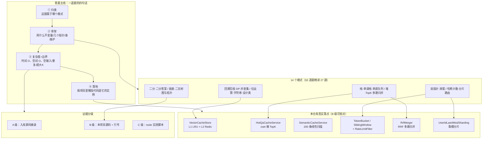
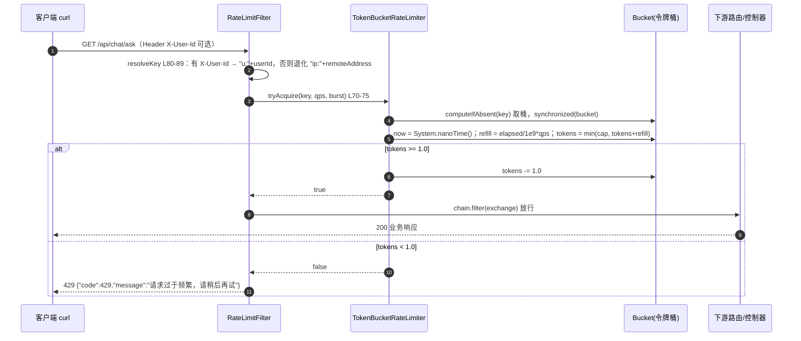

# 高频面试题清单：把"会不会写"换成"说不说得清"

> **一句话结论**：算法面试的区分度不在能不能把代码敲出来，而在开口 30 秒内能不能把「思路骨架 → 复杂度量级 → 边界条件」讲成三句话，讲完还能指出它在你项目里哪段真实代码上成立、哪个场景里不成立。
> **阅读前置**：先读本目录 [01](./01-复杂度分析与算法思维.md)（复杂度与算法思维）、[04](./04-树堆与TopK.md)（树堆与 TopK）、[06](./06-排序与二分查找.md)（排序与二分）、[09](./09-缓存淘汰-LRU-LFU与两级缓存.md)（缓存淘汰）、[10](./10-限流算法-四大算法与网关实现.md)（限流算法）；会读 Java / JavaScript 基本语法，知道大 O 记号的含意。
> **证据基线**：A 级 1 处（Spring Cloud Gateway 官方 Redis 令牌桶 Lua 脚本，`24-源码分析/assets/source/` 入库摘录）；B 级 13 处本项目源码，行号均为本次逐行核对；C 级 3 段 node 24 实测脚本 + 原样输出。预计阅读 60~80 分钟，§9 动手练习另计 90 分钟。

---

## 0. 先看现象

### 现象一：能背出"TopK 用小顶堆"，但说不出"值不值"

面试里最常见的答法是"维护一个大小为 k 的小顶堆，时间复杂度 O(n log k)"——这句话本身没错，但接一句"那 n=100 万、k=10 的时候，它比直接全排序快多少？"就答不上来了。下面是本文 C 级脚本的真实输出（脚本与复现方式见 §3.9）：

```text
n        k     全排序ms   小顶堆ms   快选ms   集合一致
10000    10         2.8        0.9       1.7     true
100000   10        26.7        2.0       3.4     true
1000000  10       331.0        2.3       2.8     true
1000000  1000     335.5        3.6       2.8     true
```

这四行的读法不是"堆快 100 倍所以堆最好"，而是：全排序的耗时随 n 线性增长（331 / 26.7 ≈ 12 倍，与 n 的 10 倍同量级），而堆和快选几乎不随 n 增长——因为它们的代价主要在 O(n) 的**顺序扫描**上，那一步的常数因子极小。说不清"增长的那一项是什么"，就说不清该选谁。

### 现象二：白板代码写对了，边界全崩

同一道 LRU，三个实现跑同一份 1000 容量、20 万次操作的数据：

```text
LruList  空查=-1 覆盖写后 get(1)=-1 get(2)=c keys=[2]
LruMap   空查=-1 覆盖写后 get(1)=-1 get(2)=c keys=[2]
LruArr   空查=-1 覆盖写后 get(1)=-1 get(2)=c keys=[2]

capacity=1000 ops=200000 三实现最终内容一致=true
实现     耗时ms   命中率    最终keys长度
LruList     39.5   19.76%     1000
LruMap      42.9   19.76%     1000
LruArr     386.3   19.76%     1000
```

`覆盖写后 get(1)=-1` 这一行是关键：容量 1 时先 `put(1,a)` 再 `put(1,b)`，旧值 `a` 必须立刻消失，`get(1)` 只能是 `b`。候选人常在这里写错——把「更新已存在的 key」误写成「追加后淘汰」，于是 keys 变成 `[1,1]` 或把刚写入的值丢掉。三行输出完全一致，说明**边界题不是实现差异题，而是题意理解题**；面试官就靠这一行分辨你有没有真的跑过。

### 现象三：嘴上的技术选型和仓库里的代码对不上

很多人张口就是"网关限流用 Redis + Lua 令牌桶，分布式无锁"。在本仓库里敲两条命令：

```text
PS> (Get-ChildItem -Recurse -Filter "*.lua" -ErrorAction SilentlyContinue | Measure-Object).Count
0
PS> Select-String -Path "ai-cs-gateway\src\main\java\com\aics\gateway\filter\*.java" -Pattern "DefaultRedisScript|RedisScript|StringRedisTemplate"
(无输出)
```

第一条：全仓 0 个 `.lua` 文件；第二条：网关 filter 包里 0 处 Redis 脚本调用。也就是说本仓库的限流是**纯 JVM 内存的两套实现**（令牌桶 + 滑动窗口），分布式限流并未落地。"背答案"和"能落地"的差距就在这两条命令里：面试官追问"多实例部署时你的桶怎么共享"，不会的人继续编，会的人会说"当前是单机内存，多实例要么切到 Redis 原子脚本、要么在网关层共享，本仓库没做"。

这些现象指向同一件事：**面试考的不是代码产出，而是"你对自己给出的每一个数据结构选择，能不能说出它的增长项、它的失效边界、它的落地位置"**。本文按这个口径把 27 道高频题重排成"五段式"（题目 → 30 秒骨架 → 代码要点 → 复杂度与边界 → 追问），并尽量把每道题挂到本仓库的真实代码上。

---

## 1. 整体地图



**读图说明。**

1. 上方 `Q` 带是**回答顺序**，不是易难顺序：先归类再讲骨架，是因为归错类会把 O(n) 的题写成 O(n log n)。中间 `P` 带是本文 §3 的组织方式，14 个模式挂 27 道题。
2. 下方 `R` 带是本文和其他题库最大的区别：`VectorCacheStore` 是 LRU 的真实实现，`HotQaCacheService` 是 TopK 的真实实现，`RrfMerger` 是多路归并的真实实现。**看错 `P2 → R2` 这条边会得出错误结论**——热门问答的 TopK 是 Redis zset 的 `reverseRange` 给的，不是堆；堆在本题库里只存在于"如果自己实现"的假设中。
3. `E` 带连到 `A3`：复杂度的**表述**用大 O（严格），复杂度的**量级感**才用实测输出，两者不能互换。把实测毫秒当复杂度写（"这个算法是 2.3ms 的"）是本文明确禁止的写法。

| 组件 | 在本文里的责任 | 参与方 / 调用方 | 证据级别 |
| --- | --- | --- | --- |
| `VectorCacheStore` | LRU（LinkedHashMap accessOrder）+ read-through 到 Redis | chat 缓存层、`CachingEmbeddingModel` | B |
| `HotQaCacheService` | zset 计分 + `reverseRange` 取 TopN | chat 热门问答召回 | B |
| `SemanticCacheService` | Hash 整库拉回 + 逐条余弦（O(n)，n≤200） | 语义缓存命中判定 | B |
| `TokenBucketRateLimiter` | 内存令牌桶，惰性补充 | `RateLimitFilter.tryAcquire` | B |
| `SlidingWindowRateLimiter` | 内存滑动窗口（Deque 时间戳） | `RateLimitFilter.tryAcquire` | B |
| `RateLimitFilter` | 取键（`u:`/`ip:`）、选算法、超限 429 | gateway 过滤器链 | B |
| `RrfMerger` | RRF 融合两路召回，k=60 | `HybridSearchServiceImpl` | B |
| `UserIdLast4ModShardingAlgorithm` | 分片键后 4 位取模 | ShardingSphere-JDBC | B |
| `request_rate_limiter.lua` | 分布式令牌桶的官方参考实现 | Spring Cloud Gateway（**本仓库未使用**） | A |

---

## 2. 关键概念与关键类

**概念表**（术语第一次出现时在这里解释，后文直接用）。

| 概念 | 一句话解释 | 本文哪里会用到 |
| --- | --- | --- |
| 不变量（invariant） | 循环每一轮结束时都必须为真的一句话，例如"窗口内无重复字符" | 滑窗、双指针、二分 |
| 增长项 | 复杂度里真正决定规模敏感度的那一项，例如 O(n log k) 里的 `n log k` | 所有"选哪个算法"的回答 |
| 边界条件 | 空输入、单元素、全相同、k 超界、溢出 | §3 每题的第四段 |
| 摊还代价 | 单次操作可能很贵，但总代价除以次数后很小（如并查集 α(n)） | 并查集、单调栈 |
| read-through | 缓存未命中时由缓存组件自己去下层取并回填 | `VectorCacheStore.get` |
| 惰性求值/惰性补充 | 不在定时任务里推进状态，而是在被访问时按时间差一次补齐 | 令牌桶 `refill` |
| RRF（Reciprocal Rank Fusion） | 多路召回按 `1/(k+rank)` 累加分数融合排名，只看名次不看原始分值 | `RrfMerger`、合并 K 路有序表 |
| 分片路由键 | 决定一行数据落到哪个库/表的字段，必须高基数且分布均匀 | 取模分片题 |

**关键类表**（本文引用到的真实代码，行号已在本次核对）。

| 名称 | 位置 | 角色 | 关键方法 / 字段 |
| --- | --- | --- | --- |
| `VectorCacheStore` | `ai-cs-chat/src/main/java/com/aics/chat/cache/VectorCacheStore.java` | L1 LRU + L2 Redis 的向量缓存 | `get()` L59-78、`put()` L83-96、`cacheKey()` L101-103（`modelKey + ":" + sha256Hex(text)`） |
| `HotQaCacheService` | `ai-cs-chat/src/main/java/com/aics/chat/cache/HotQaCacheService.java` | 热门问答计数与 TopN | `record()` L87-106（`incrementScore`）、`topQuestions()` L129-145（`reverseRange`） |
| `SemanticCacheService` | `ai-cs-chat/src/main/java/com/aics/chat/cache/SemanticCacheService.java` | 语义缓存：整库拉回后逐条算余弦 | `lookup()` L63-106、`put()` L111-138、`evictOverflow()` L143-157 |
| `CacheProperties` | `ai-cs-chat/src/main/java/com/aics/chat/cache/CacheProperties.java` | 三套缓存的阈值与容量 | `Semantic.threshold=0.92 / maxEntries=200`（L29-35）、`Vector.l1MaxEntries=4096`（L52-55） |
| `TokenBucketRateLimiter` | `ai-cs-gateway/src/main/java/com/aics/gateway/filter/TokenBucketRateLimiter.java` | 单机令牌桶 | `tryAcquire(key,qps,burst)` L35-53，`synchronized (bucket)` + `System.nanoTime()` |
| `SlidingWindowRateLimiter` | `ai-cs-gateway/src/main/java/com/aics/gateway/filter/SlidingWindowRateLimiter.java` | 单机滑动窗口 | `tryAcquire(key,max,windowSeconds)` L27-47，`Deque<Long>` 时间戳 |
| `RateLimitFilter` | `ai-cs-gateway/src/main/java/com/aics/gateway/filter/RateLimitFilter.java` | 取键 + 选算法 + 429 | `resolveKey()` L80-89、`tryAcquire()` L70-75 |
| `RrfMerger` | `ai-cs-search/src/main/java/com/aics/search/hybrid/RrfMerger.java` | 两路召回融合 | `merge(list1,list2,topK,k)` L35-47，`1.0/(k+rank)` L65-66 |
| `UserIdLast4ModShardingAlgorithm` | `ai-cs-user/src/main/java/com/aics/user/sharding/UserIdLast4ModShardingAlgorithm.java` | 按 id 末 4 位取模路由 | `doSharding()` L37-46、`extractLastDigits()` L54-69 |
| `HashEmbeddingModel` | `ai-cs-common/src/main/java/com/aics/common/ai/embedding/HashEmbeddingModel.java` | 768 维双哈希向量化 | `embed()` L39-50、`extractTokens()` L77-96 |
| `PiiMasker` | `ai-cs-chat/src/main/java/com/aics/chat/util/PiiMasker.java` | 正则脱敏 + Luhn 校验 | `mask()` L78-93、`luhnValid()` L115-136 |
| `RocketMqMessagePublisher` | `ai-cs-common/src/main/java/com/aics/common/mq/rocketmq/RocketMqMessagePublisher.java` | 18 档延迟级别映射 | `resolveDelayLevel()` L83-94（线性扫 18 档） |

---

## 3. 原理与证据逐段精讲（逐题）

每题固定五段：**题目** / **30 秒思路骨架**（面试口头版，越短越好）/ **关键代码要点**（只写非显然的那几行）/ **复杂度与边界** / **追问**。看这一节时建议用手挡住"关键代码要点"，先自己说骨架，再对照。这五段就是"四层精读"落到面试场景的形态：**题目 + 骨架**＝这题在干什么；**代码要点**＝为什么这么设计（每个非显然写法都给出取舍理由）；**复杂度与边界**＝换写法会怎样（换成另一种实现，增长项与失效边界怎么变）；**追问**＝常见坑与真实落点。

### 3.1 模式：双指针与滑动窗口 —— 无重复字符的最长子串

**题目。** 给字符串 s，返回不含重复字符的最长子串长度。

**30 秒思路骨架。** 右指针逐个吃字符，维护 `[left, right]` 内字符的出现次数；一旦某字符计数变 2，就挪左指针并减计数，直到它回到 1。答案在每轮取 `right-left+1` 的最大值。窗口内不变量：**窗口里每个字符恰好出现 1 次**。

**关键代码要点。**

```java
int left = 0, best = 0;
int[] cnt = new int[128];              // 假设 ASCII；unicode 换成 Map<Character,Integer>
for (int right = 0; right < s.length(); right++) {
    cnt[s.charAt(right)]++;
    while (cnt[s.charAt(right)] > 1) {  // 只可能刚进来的那个字符超标
        cnt[s.charAt(left)]--;
        left++;
    }
    best = Math.max(best, right - left + 1);
}
```

`while` 而不是 `if` 是这里唯一的坑：窗口内可能"一进来就超标"，也可能左边连挪几个字符才收敛。用 `int[128]` 而不是 `HashMap` 是把哈希开销换成 O(1) 的数组下标，前提是字符集有界。**每轮只动一个指针，总移动次数 ≤ 2n**，所以整体 O(n) 而不是 O(n²)。

**复杂度与边界。** 时间 O(n)（左右指针各自单向最多走 n 步），空间 O(min(字符集大小, n))。边界：空串返回 0；单字符返回 1；全相同（`"bbbb"`）返回 1；含中文/emoji 时 `charAt` 会劈开代理对，必须换 code point 或 Map。

**追问。** 若问"最多允许 k 个重复字符"，把 `> 1` 改成 `> k`，骨架不变——面试官真正想看的是你会不会描述"不变量"。再追问"数据是流式的一亿字符"，答：窗口内只要计数数组 + 两个指针，空间与总长度无关，可以流式处理。

### 3.2 模式：双指针与滑动窗口 —— 三数之和

**题目。** 数组 nums，找出所有和为 0 的不重复三元组。

**30 秒思路骨架。** 先排序（O(n log n)），固定第一个数 i，剩下用左右对撞双指针找 `nums[j]+nums[k] = -nums[i]`；三处去重：i 跳过与前一位置相同的值、j 命中后跳过重复、k 命中后跳过重复。

**关键代码要点。** 骨架里最容易被扣分的不是双指针，而是**去重的三个位置**。j/k 去重必须在"命中之后"跳，而不是每轮无条件跳——无条件跳会漏掉 `[-1,0,1]` 这类合法解。另外 `nums[i] > 0` 可直接 break：排序后若首数已正，三数之和不可能为 0。

**复杂度与边界。** 时间 O(n²)（外层 n，内层双指针合起来 n；排序的 O(n log n) 被吸收），空间 O(log n)~O(n)（排序栈，看实现）。边界：不足 3 个元素返回空；`[0,0,0]` 只能输出一组；全 0 与全正数两种极端都要在口头说明里点到。

**追问。** "四数之和？"——加一层循环变 O(n³)，或两两求和 + 哈希变 O(n²)。"为什么不用哈希一次遍历？"——能解，但去重比排序+双指针难写，且无法保证输出有序。落地面：本仓库没有三数之和类算法，但它演示的"先排序把乱序问题变成有序问题"和 `HotQaCacheService` 让 Redis 的 zset 维护有序性（而不是每次自己排序）是同一个思路。

### 3.3 模式：单调队列 —— 滑动窗口最大值

**题目。** 数组 nums 与窗口大小 k，返回每个窗口内的最大值。

**30 秒思路骨架。** 维护一个**下标单调递减的双端队列**：新元素入队前，把队尾所有比它小的下标弹出（它们永远不可能再成为最大值）；队首下标若滑出窗口就弹出；队首就是当前窗口最大值。不变量：**队列里的下标对应的值从队首到队尾严格递减，且都在窗口内**。

**关键代码要点。**

```java
Deque<Integer> dq = new ArrayDeque<>();   // 存下标，不存值
for (int i = 0; i < nums.length; i++) {
    while (!dq.isEmpty() && nums[dq.peekLast()] <= nums[i]) dq.pollLast();
    dq.offerLast(i);
    if (dq.peekFirst() <= i - k) dq.pollFirst();
    if (i >= k - 1) res.add(nums[dq.peekFirst()]);
}
```

三个顺序都不能换：先弹队尾（保证单调）、再入队、最后弹队首（保证窗口）。先弹队首会把当前元素误删。每个下标最多入队一次、出队一次，所以是**摊还 O(n)** 而不是 O(nk)。

**复杂度与边界。** 时间 O(n)（摊还），空间 O(k)。边界：`k=1` 退化为原数组；`k > n` 通常要求返回全数组最大值一次或空，题面必须确认；数组含重复值时用 `<=` 还是 `<` 只影响队列长度，不影响正确性。

**追问。** "为什么不用堆？"——堆是 O(n log k)，且需要惰性删除过期元素；单调队列是 O(n)。落地面：本仓库 `SlidingWindowRateLimiter` 用 `Deque<Long>` 存时间戳，但它做的是"队首过期就弹"，不是单调队列——判断 `size() >= maxRequests` 是 O(1) 而非 O(n)，这点常在面试里被问倒。

### 3.4 模式：哈希计数 —— 两数之和

**题目。** 数组 nums 与目标 target，返回和为目标的两个下标。

**30 秒思路骨架。** 一遍遍历，把"还差多少"记进哈希表：对每个 `nums[i]`，先查 `target - nums[i]` 是否已出现过，命中直接返回；否则把 `nums[i] → i` 存表。不变量：**哈希表里全是"已扫描过的元素"**。

**关键代码要点。** 先查后存，才能保证不用同一个元素两次（`[3,3] target=6` 这种要能过）。返回下标还是返回值、是否需要全部解、是否存在多解，这三句必须在动手前问清——面试官经常故意留这个口子。

**复杂度与边界。** 时间 O(n)，空间 O(n)。边界：空数组/单元素返回空；有重复值（`[3,3]`）合法；整数溢出（`target - nums[i]` 在 Java 里对 int 极值会溢出，需用 long 比较）。

**追问。** "如果数组有序？"——双指针 O(1) 空间。"如果数据是 10 亿条放不进内存？"——外部排序后双指针，或分桶后按桶配对。落地面：`VectorCacheStore.cacheKey()`（L101-103）用 `sha256Hex(text)` 把任意长度文本映射成定长键，这是"用哈希把查找从 O(n) 降到 O(1)"的工程版；而 `SemanticCacheService.lookup()`（L63-106）因为要算相似度不能哈希，只能 O(n) 线性扫描——同一个仓库里两种代价并存，正好说明**选择题决定代价**。

### 3.5 模式：哈希计数 —— 字母异位词分组

**题目。** 把互为字母异位词的字符串分到一组。

**30 秒思路骨架。** 为每个串算一个"无关顺序"的键：要么 `char[26]` 计数数组转字符串，要么排序后的串；用 `Map<键, List<串>>` 归组。不变量：**同组元素的键必然相等**。

**关键代码要点。** 排序键是 O(L log L)/串，计数键是 O(L)/串——后者更快但要注意分隔符，`[1,12]` 和 `[11,2]` 拼成串会撞键。面试时把这两个键的选择讲出来，比写出代码更值分。

**复杂度与边界。** 时间 O(n·L)（计数键）或 O(n·L log L)（排序键），空间 O(n·L)。边界：空串（键为全 0 数组）要与"没有元素"区分；大小写/空格是否归一化必须问；Unicode 用 code point 而非 char。

**追问。** "如果只要求找出一对异位词？"——不需要全分组，找出第一个重复键即可，空间可以退化成"只存键的哈希集合"。落地面：`HashEmbeddingModel.extractTokens()`（L77-96）把文本切成 `w:` 前缀的英文词与 `c:` 前缀的中文二元组，本质也是"构造一个与顺序弱相关的键"，只不过它保留了一部分顺序信息（二元组）。

### 3.6 模式：哈希应用 —— 取模分片与均匀性

**题目。** N 个分片、id 为整数，设计路由函数并说明分布性质。

**30 秒思路骨架。** `shard = hash(key) % N`；整数 id 直接取末几位再取模。要讲清三件事：为什么取末位（自增 id 的高位变化慢，低位变化快）、为什么 N 变化时几乎全量迁移（`% N` 与 `% (N+1)` 无关）、一致性哈希怎么缓解（只有相邻区间迁移）。

**关键代码要点。** 本仓库的真实实现是末 4 位取模：

```java
// ai-cs-user 的 UserIdLast4ModShardingAlgorithm 逻辑（L37-46、L54-69 的等价简化）
int lastDigits = extractLastDigits(id);   // 末尾最多 4 位数字
return lastDigits % shardingCount;
```

为什么是 4 位？因为 `sharding-count` 是 2（库）和 4（表）：只要末位数的取值空间是分片数的整数倍以上，取模就均匀。见 `ai-cs-user/src/main/resources/sharding-user.yaml` L82（库 `sharding-count: 2`）与 L88（表 `sharding-count: 4`），实际数据节点是 `user_db_${0..1}.sys_user_${0..3}`（L67）。

**复杂度与边界。** 路由时间 O(1)。边界：id 无数字时 `extractLastDigits` 直接抛异常（L54-69）；Range 查询无法定位分片，实现里 `return availableTargetNames` 广播到全部分片（L48-52）——这是"等值查询快、范围查询慢"的代价，面试常追问"分页查询怎么办"。

**追问。** "为什么不用 `hashCode()`？"——`String.hashCode` 稳定但分布依赖输入，且 Java 里 `hashCode` 可能为负，取模前必须 `Math.floorMod`。"扩容到 8 个表怎么办？"——`% 8` 会让大部分行换库，需要双写迁移或一致性哈希。落地面：本仓库**未实现**一致性哈希，`Caffeine`/本地缓存也未落地（全仓 0 命中），相关能力只能作为"知道但没做"回答。

### 3.7 模式：栈 —— 有效括号

**题目。** 判断只含 `()[]{}` 的字符串是否合法。

**30 秒思路骨架。** 左括号入栈，右括号必须与栈顶配对；结束后栈必须为空。不变量：**栈里永远是"还没被匹配的左括号，从底到顶按出现顺序排列"**。

**关键代码要点。** 右括号来时若栈空，立即返回 false（`"]"` 这种前缀非法）；用 `Map<Character,Character>` 存配对关系，别写四层 `if`。字符串长度为奇数可直接返回 false——这是最容易被忽略的 O(1) 剪枝。

**复杂度与边界。** 时间 O(n)，空间 O(n)。边界：空串算合法（要问清题面）；`"([)]"` 这种交叉必须判 false；只含左括号时栈不清空。

**追问。** "最长有效括号子串？"——从栈题升级成 DP/栈+下标，复杂度 O(n)。落地面：本仓库无括号类解析，但 `PiiMasker` 的正则里 `(?<!\d)(?!\d)` 起的作用类似"配对校验"：它保证匹配不落在长数字串内部，等价于"括号必须成对出现"的思路。

### 3.8 模式：单调栈 —— 每日温度

**题目。** 给温度数组，返回每天"要等几天才会更暖"。

**30 秒思路骨架。** 维护**下标单调递减**的栈；遍历到 `T[i]` 时，把栈里所有"温度比它低"的下标弹出，并给它们写下答案 `i - j`。不变量：**栈内温度从底到顶递减，还没找到答案**。

**关键代码要点。**

```java
Deque<Integer> st = new ArrayDeque<>();
int[] ans = new int[T.length];
for (int i = 0; i < T.length; i++) {
    while (!st.isEmpty() && T[st.peek()] < T[i]) {
        int j = st.pop();
        ans[j] = i - j;
    }
    st.push(i);
}
```

值与下标必须同时用到：栈存下标才能算天数；如果用 `<=` 而不是 `<`，相同温度会被误判为"更暖"。每个下标入栈出栈各一次，摊还 O(n)。

**复杂度与边界。** 时间 O(n)（摊还），空间 O(n)。边界：单调递减数组答案全 0；全相同时答案全 0；空数组返回空。

**追问。** "接雨水？""柱状图最大矩形？"——同一模板换"弹出时机"和"计算式"。落地面：本仓库**没有**单调栈实现（全仓 `单调栈` 0 命中），这题只能作为纯算法题回答，不要硬编项目里的对应物。

### 3.9 模式：堆与 TopK —— 数组中第 K 个最大元素

**题目。** 找出数组中第 k 大的元素（不要求有序）。

**30 秒思路骨架。** 三种答法按代价排序：全排序 O(n log n)；维护大小为 k 的小顶堆 O(n log k)，堆顶就是答案；快速选择（quickselect）平均 O(n)、最坏 O(n²)。**先说三种，再说选哪个**，这句话本身就是区分度。

**关键代码要点。** 小顶堆版本的关键是"堆满 k 个之后再比"：

```javascript
// 小顶堆的"手写版"核心：JS 没有内置堆，用数组模拟（完整脚本见本节末尾）
function pushHeap(h, v, k) {
  if (h.length < k) { h.push(v); up(h, h.length - 1); return; }
  if (v <= h[0]) return;        // 比堆顶还小，直接丢
  h[0] = v; down(h, 0, k);      // 替换堆顶后下沉
}
```

`v <= h[0]` 这一行容易被写成 `<`，导致重复元素时多做一次无用的替换（不影响正确性但影响"你懂不懂堆顶含义"的印象分）。quickselect 的坑在划分：三路划分（`<pivot / ==pivot / >pivot`）能避免"全相同元素"退化成 O(n²)。

**复杂度与边界。** 小顶堆：时间 O(n log k)、空间 O(k)；quickselect：平均 O(n)、最坏 O(n²)、空间 O(1)（迭代版）。边界：`k=0` 或 `k>n` 要按题面返回空/抛异常；全相同元素；含重复值时"第 k 大"是指第 k 个位置还是第 k 个不同值，必须问。

下面是本文的 C 级实测：同一份随机数据（`mulberry32(42)` 生成 `[0, 1e6)` 整数），三种实现对比，node 24 原样输出：

```text
n        k     全排序ms   小顶堆ms   快选ms   集合一致  快选输出有序
10000    10         2.8        0.9       1.7     true     false
10000    100        1.9        1.4       0.3     true     false
10000    1000       2.0        2.7       0.7     true     false
100000   10        26.7        2.0       3.4     true     false
100000   100       28.4        2.4       2.9     true     false
100000   1000      29.3        1.5       1.6     true     false
1000000  10       331.0        2.3       2.8     true     false
1000000  100      330.1        2.0       3.0     true     false
1000000  1000     335.5        3.6       2.8     true     false
```

**怎么读这张表。** ①`全排序ms` 从 2.8 涨到 331.0（约 118 倍），对应 n 涨 100 倍——这是 O(n log n) 里 n 那一项的线性增长在说话；②`小顶堆ms` 和 `快选ms` 在 1e6 规模仍是个位数毫秒，因为两者都是"一次 O(n) 扫描 + 小规模维护"，k 只有 10~1000；③`快选输出有序=false` 是关键提醒：quickselect 只保证"第 k 位就位"，**它不是排序**，要前 k 个有序还得再排 k log k；④三个实现集合一致（`集合一致=true`），说明结果正确性没被速度牺牲。**适用边界**：表里的毫秒只说明"常数因子的量级感"，不能当作复杂度；换机器、换语言、换 GC 都会变（同一脚本第二次运行，LruMap 从 42.9ms 变 51.1ms，见 §3.24）。

同一次运行的边界验证（这是面试官最爱追问的部分）：

```text
空数组   全排序=[] 堆=[] 快选=[] 三者一致=true
k=0     全排序=[] 堆=[] 快选=[] 三者一致=true
k>n     全排序=[3,2,1] 堆=[3,2,1] 快选=[3,2,1] 三者一致=true
全相同    全排序=[5,5,5] 堆=[5,5,5] 快选=[5,5,5] 三者一致=true
```

**怎么读这个输出。** 四种边界下三种实现结果完全一致，说明"边界处理"可以统一成一句约定：`k<=0` 返回空、`k>=n` 退化为全排序、重复值按位置计数。这四行就是 §9 练习的验收标准雏形。

**追问。** "如果数据是 10 亿条、内存放不下？"——分块求 TopK 再归并，或直接用外部排序。"流式数据求实时 TopK？"——小顶堆天然支持流式（每来一个 O(log k)）。落地面：本仓库的热门问答 TopK **不是堆**，而是 Redis zset 的 `reverseRange`（`HotQaCacheService.topQuestions()` L129-145）——zset 内部是跳表 + 哈希，`ZREVRANGE 0 N-1` 直接给有序前 N 个；堆适合"我只剩内存"，zset 适合"数据已在 Redis 且要持久化"。

### 3.10 模式：多路归并与堆 —— 合并 K 个有序链表 / RRF 融合

**题目。** 合并 K 个升序链表为一个升序链表；或：把两路召回的排名融合成一个排名。

**30 秒思路骨架。** 两路就是双指针归并 O(n+m)；K 路用小顶堆存"每路的当前头"，每次取最小 O(log K)，总体 O(N log K)，N 是元素总数。若只要名次不要分值，用 RRF：每个结果得分 `1/(k + rank)` 求和后重排。

**关键代码要点。** RRF 的真实实现只有几行，胜在"对不同分数量纲免疫"：

```java
// ai-cs-search 的 RrfMerger.merge 核心（L65-66）
int rank = i + 1;
scores.merge(item.getId(), 1.0 / (k + rank), Double::sum);
```

`k` 默认 60（`HybridSearchServiceImpl.RRF_K`，L44）：`k` 越大，第 1 名和第 100 名的权重差越小，融合越"民主"；`k` 越小越偏向单路冠军。融合后必须 `sorted(...).limit(topK)` 截断（L65-66 之后），否则等于没融合。

**复杂度与边界。** 合并 K 路：时间 O(N log K)、空间 O(K)。RRF：设两路各 n 条，时间 O(n log n)（排序主导）、空间 O(n)。边界：某一路为空（RRF 要能只靠一路出结果）；同一 id 在两路重复（必须按 id 合并而不是按位置）；id 为空要跳过（`RrfMerger` L62-64 就是干这个的）。

**追问。** "为什么不用分数直接加权平均？"——两路分数量纲不同（ES 的 BM25 分数与向量余弦根本不可比），归一化又会引入超参；RRF 只看名次，最稳。"K 取 60 有依据吗？"——来自原论文的经验值，本仓库照搬（`RRF_K = 60`，L44）。落地面：`HybridSearchServiceImpl` L71 调 `RrfMerger.merge(esItems, vectorItems, topK, RRF_K)`，召回上限 `RETRIEVE_TOP_K = 20`（L41）。

### 3.11 模式：二分 —— 标准模板与 `lower_bound`

**题目。** 有序数组中找目标值的下标；变形：找第一个 `≥ target` 的位置。

**30 秒思路骨架。** 先背一个**只有一种写法**的模板：`lo, hi` 用左闭右开 `[lo, hi)`，循环条件 `while (lo < hi)`，中点 `mid = lo + (hi - lo) / 2`，移动时只改一侧且必须缩小范围。找"第一个满足条件的位置"时用 `if (cond(mid)) hi = mid; else lo = mid + 1;` 返回 `lo`。

**关键代码要点。**

```java
// lower_bound：第一个 >= target 的下标，找不到返回 n
int lo = 0, hi = a.length;              // 左闭右开
while (lo < hi) {
    int mid = lo + (hi - lo) / 2;       // 不用 (lo+hi)/2，防溢出
    if (a[mid] >= target) hi = mid;     // mid 可能就是答案，保留
    else lo = mid + 1;                  // mid 一定不是答案，排除
}
return lo;
```

三个细节：`hi = mid` 而不是 `mid - 1`（因为 mid 可能就是答案）；`lo = mid + 1` 而不是 `mid`（否则死循环）；循环结束时 `lo == hi` 就是答案。`while (lo <= hi)` + `hi = mid` 的组合是死循环的头号来源。

**复杂度与边界。** 时间 O(log n)，空间 O(1)。边界：空数组返回 0（等于 n）；target 比所有元素都大返回 n；重复元素要明确"第一个"还是"任意一个"；`lo + hi` 溢出（用 `lo + (hi-lo)/2`）。

**追问。** "为什么本仓库里 18 档延迟级别用线性扫描而不是二分？"——`RocketMqMessagePublisher.resolveDelayLevel()`（L83-94）只有 18 个档位，线性扫最多 18 次比较，比二分更好读；**这是"log n 优势只有 n 很大时才显现"的真实对照**。它同时展示了边界的正确写法：`delayMillis <= 0` 直接抛 `IllegalArgumentException`，超过 2 小时抛"RocketMQ 最大延迟级别为 2 小时…请改用定时任务或延迟队列"。

### 3.12 模式：二分答案 —— 把最优化变成判定

**题目。** 例：把 n 个包裹按容量装船，要求 days 天运完，求最小船容量。

**30 秒思路骨架。** 识别三个信号：答案在一个**有序区间**里（容量越大越容易满足）、存在 `check(x)` 单调（x 可行则 x+1 必然可行）、求"最小的可行值"。于是对答案二分：下界 `max(weights)`、上界 `sum(weights)`，`check` 用贪心 O(n)，总 O(n log(sum))。

**关键代码要点。** 模板和 3.11 完全一样，区别只在 `cond(mid)` 是一次 O(n) 的模拟，而不是数组取值。`check` 里的贪心必须一次遍历累加、超容量就换船，不能回溯——一旦写成回溯，整体复杂度就崩了。

**复杂度与边界。** 时间 O(n log S)（S 为答案值域），空间 O(1)。边界：单元素；`days=1` 时答案就是总和；`days >= n` 时答案是最大值；`check` 里用 long 防累加溢出。

**追问。** "为什么不能直接贪心一次算出来？"——因为"最小容量"不是局部量，只能判定"给定容量行不行"。落地面：本仓库**没有二分答案的实际使用**（日志检索按时间范围二分、限流按窗口二分都未落地），回答时必须说"这是我知道的模式，项目里没用到"，不要硬编。

### 3.13 模式：链表 —— 反转链表

**题目。** 反转单链表，返回新头。

**30 秒思路骨架。** 三个指针 `prev=null, cur=head`，每轮先存 `next`，再 `cur.next = prev`，最后整体右移。不变量：**`prev` 及之前已反转，`cur` 及之后未处理**。

**关键代码要点。** 必须**先存 next 再改指针**，顺序反了就断链。返回 `prev` 这个细节是考察点：循环结束时 `cur` 是 null，`prev` 才是新头。

**复杂度与边界。** 时间 O(n)，空间 O(1)（迭代）。边界：空链表返回 null；单节点返回自己；反转后原头变成尾，`next` 必须是 null（上面代码天然满足，但递归版容易漏）。

**追问。** "反转前 k 个？""反转 m 到 n 之间？"——先走到第 m-1 个，把 `[m,n]` 段局部反转再接回，哑节点（dummy）能省掉"m=1"的特判。落地面：本仓库链表类实现都在 Redis / JDK 内部（zset 的跳表、LRU 的 LinkedHashMap），业务代码里没有手写链表。

### 3.14 模式：链表 —— 环形链表

**题目。** 判断链表是否有环；有环则返回入环点。

**30 秒思路骨架。** 快慢指针，慢走 1 步、快走 2 步，若相遇则有环。找入口：相遇后把一个指针放回头部，两指针同步每次 1 步，再次相遇处即入口（设头到入口 a、入口到相遇点 b、环长 L，则 `a = kL - b`）。

**关键代码要点。** 循环条件必须同时判 `fast != null && fast.next != null`，只判 `fast` 会在奇偶长度时 NPE。自环（`node.next = node`）要能返回该节点——用 `do/while` 或先走一步再判。

**复杂度与边界。** 时间 O(n)，空间 O(1)。边界：空链表、单节点无环；单节点自环；环在头部。

**追问。** "为什么哈希法也是 O(n)，还要快慢指针？"——空间 O(n) vs O(1)，而且快慢指针不需要额外分配。"工程里哪里会遇到环？"——链表环对应"引用成环导致 GC 无法回收"，`VectorCacheStore` 用 `LinkedHashMap` 的 `removeEldestEntry` 限制长度（L48-54），本质也是防无界增长。本仓库**没有**手写快慢指针代码。

### 3.15 模式：二叉树遍历 —— 层序遍历

**题目。** 按层输出二叉树节点。

**30 秒思路骨架。** 队列 BFS；每轮先取 `size = queue.size()`，循环 `size` 次把这一层全部出队并压入子节点——`size` 必须在循环前取出，否则会把下一层混进当前层。

**关键代码要点。** 用 `ArrayDeque` 而不是 `LinkedList`（后者每个节点一个对象头，缓存不友好）；`null` 子节点不入队，或在入队时判空，二选一，别混用。

**复杂度与边界。** 时间 O(n)，空间 O(w)（w 为最大层宽，完全二叉树最后一层约 n/2）。边界：空树返回空列表；只有根；退化成链表时层数 n、每层 1 个。

**追问。** "之字形层序？""每层求平均/最大值？"——都是同一骨架加一条"按层号决定方向/聚合"的规则。落地面：本仓库无手写树遍历，但 `HotQaCacheService.topQuestions()`（L129-145）的"取前 N 再逐条查详情"结构和层序遍历的"按层取批"是同一种批量迭代思路。

### 3.16 模式：图搜索 —— 岛屿数量

**题目。** 01 矩阵中 1 连成岛屿（四连通），求岛屿数量。

**30 秒思路骨架。** 遍历每个格子，遇到 `1` 就计数 +1，并从它开始 BFS/DFS 把整块 `1` 淹成 `0`。不变量：**每淹一块，岛屿数就 +1，且不会重复计数**。

**关键代码要点。** 淹没（原地改 `grid`）比重建 `visited` 数组省空间，但要确认"输入可否修改"。BFS 用队列时，入队即标记（而不是出队才标记），否则同一格会被重复入队，规模大时会爆内存。

**复杂度与边界。** 时间 O(m·n)（每格最多进出一次），空间 O(min(m,n))~O(m·n)（队列或递归栈）。边界：全 0 返回 0；全 1 返回 1；单行/单列；八连通与四连通的题面差异。

**追问。** "如果是流式不断加入 1？"——并查集（见 §3.21）比 BFS 更合适。"如果是超大规模矩阵放不下内存？"——分块 + 边界合并。落地面：本仓库无图搜索业务实现，`RrfMerger` 的"两路融合"可以类比"两路 BFS 结果去重合并"。

### 3.17 模式：图 —— 拓扑排序（课程表）

**题目。** 给定先修关系，判断能否修完所有课程（有无环）。

**30 秒思路骨架。** Kahn 算法：统计入度，入度为 0 的入队，逐一出队并把它指向的节点入度减 1，减到 0 再入队；最后统计出队数量，等于节点数则无环。DFS 版本用"三色标记"（白/灰/黑）判回边。

**关键代码要点。** 入度表 + 邻接表是标准配置；出队计数用 `count` 变量，不要反复 `queue.size()`。DFS 版本必须区分"正在访问（灰）"和"已完成（黑）"——只用一个 visited 布尔会漏判环。

**复杂度与边界。** 时间 O(V+E)，空间 O(V+E)。边界：空图；有自环（`[0,0]`）；重复边；多个连通分量。

**追问。** "要输出任意一个合法顺序？"——Kahn 的出队顺序就是。"要输出字典序最小的顺序？"——把队列换成小顶堆，O((V+E) log V)。落地面：本仓库的启动依赖（Nacos → 各服务）本身是有向无环图，但**没有**代码化拓扑排序；`RocketMqMessagePublisher` 的 18 档延迟让"消息先后"退化成按级别排队，不需要拓扑。

### 3.18 模式：回溯与剪枝 —— 组合总和 / 全排列去重

**题目。** 数组元素可重复选取、求和为 target 的所有组合；或含重复元素的全排列去重。

**30 秒思路骨架。** 回溯三要素：路径（当前已选）、选择列表（下一层能选什么）、结束条件。组合题靠"起点下标 `start`"避免倒序重复，全排列题靠 `used[]` + "排序后 `nums[i]==nums[i-1] && !used[i-1]` 就跳过"去重。

**关键代码要点。** 剪枝是拿分点：排序后 `if (sum > target) break;`（不是 continue，有序后后面只会更大）；组合题的 `start` 传 `i` 表示可重复用、传 `i+1` 表示不可重复——这一个字符决定题解，面试官常在这里追问。

**复杂度与边界。** 时间 O(2ⁿ)~O(n!)（按题），剪枝只削常数不改变量级；空间 O(n)（递归深度）。边界：target 为 0；元素含 0（可无限递归，必须靠"只增不减"或跳过 0）；空数组。

**追问。** "怎么估算规模？"——先算叶子数（如 40 个数选子集是 2⁴⁰，必须剪枝或换 DP）。落地面：本仓库的 PII 脱敏顺序（`PiiMasker.mask()` L78-93：身份证→银行卡→手机→邮箱→地址）本质是"带剪枝的搜索顺序"：先脱敏长模式（身份证/银行卡），再处理短模式，避免短模式把长模式的数字切碎后长模式再也匹配不上。

### 3.19 模式：DP —— 0-1 背包与完全背包

**题目。** 物品有重量和价值，背包容 W，求最大价值；每个物品只能取一次（0-1）或无限次（完全）。

**30 秒思路骨架。** 定义 `dp[j]` = 容量 j 的最大价值；0-1 背包**逆序**遍历 j（保证每件只用一次），完全背包**正序**遍历 j（允许重复用）。这一句"逆序 vs 正序"就是两种背包的分水岭。

**关键代码要点。**

```java
int[] dp = new int[W + 1];
for (int i = 0; i < n; i++)
    for (int j = W; j >= w[i]; j--)        // 0-1：逆序，j 从大到小
        dp[j] = Math.max(dp[j], dp[j - w[i]] + v[i]);
// 完全背包改成正序：for (int j = w[i]; j <= W; j++)
```

逆序的原因：`dp[j]` 依赖的是"上一行"的 `dp[j-w[i]]`，逆序保证它还没被本轮覆盖；正序时会读到本轮刚更新的值，等于允许同一物品用多次——这正是完全背包要的。

**复杂度与边界。** 时间 O(nW)，空间 O(W)（滚动数组）。边界：W 为 0；物品重量为 0（完全背包会死循环，需特判）；重量超过 W 的物品直接跳过；价值为负按题面决定是否选。

**追问。** "为什么这题不能用贪心？"——反例：容量 10，物品 (6,10)、(5,9)、(5,9)，价值密度贪心选 6 得 10，最优是两个 5 得 18。"如果 W 达到 1e9？"——O(nW) 不可行，要么换 meet-in-the-middle，要么这题本身就变成了 NP-hard，要说出来。落地面：本仓库无背包场景，最接近的是 `SemanticCacheService` 的"容量上限 200 条 + 超量淘汰最旧"，那是贪心（按时间），不是背包。

### 3.20 模式：DP —— 最长递增子序列（LIS）

**题目。** 求最长严格递增子序列的长度。

**30 秒思路骨架。** 两档答案：朴素 `dp[i]` = 以 i 结尾的 LIS 长度，转移 `dp[i] = max(dp[j]) + 1 (j<i, a[j]<a[i])`，O(n²)；进阶维护 `tails` 数组（`tails[k]` = 长度 k+1 的递增子序列的最小结尾），对每个 `a[i]` 二分找第一个 `>= a[i]` 的位置替换，O(n log n)。

**关键代码要点。**

```java
int[] tails = new int[n];
int len = 0;
for (int x : a) {
    int lo = 0, hi = len;                  // 在 tails[0..len) 里 lower_bound
    while (lo < hi) {
        int mid = (lo + hi) >>> 1;
        if (tails[mid] < x) lo = mid + 1;   // 严格递增用 <
        else hi = mid;
    }
    tails[lo] = x;
    if (lo == len) len++;
}
return len;
```

`tails` **不是** LIS 本身，只是它的"最小结尾"——要输出具体序列还得额外记录前驱。严格递增用 `<`，非严格递增改成 `<=`，这一个符号就是面试官区分"背过"和"懂了"的地方。

**复杂度与边界。** 朴素 O(n²)/O(n)；二分 O(n log n)/O(n)。边界：空数组返回 0；全相同返回 1（严格）或 n（非严格）；完全降序返回 1。

**追问。** "为什么 `tails` 一定单调？"——因为长度更长的子序列，其最小结尾不可能更小（否则能从更短的那个延长）。落地面：`UserIdLast4ModShardingAlgorithm` 与 `RocketMqMessagePublisher.resolveDelayLevel()` 都用"有序区间里定位"的思路，只是数据量小（4 档/18 档）所以线性扫；`VectorCacheStore` 的 L1 是 `LinkedHashMap`，不需要 LIS 这类结构。

### 3.21 模式：并查集 —— 账户合并 / 朋友圈

**题目。** n 个元素和若干"属于同一集合"的关系，求集合个数或合并所有关联项。

**30 秒思路骨架。** `parent[]` + 路径压缩 + 按秩（或按大小）合并，`find` 摊还 O(α(n))≈O(1)。答题时要说清"三个优化各解决什么问题"：路径压缩压平树高、按秩合并防退化、两者合用才接近常数。

**关键代码要点。** `find` 的迭代写法比递归安全（深链时不会爆栈）；合并前必须 `if (rx == ry) return;`，否则会把根指向自己导致死循环。统计集合个数时，对每个 i 判 `find(i) == i`。

**复杂度与边界。** 时间 O(n + m·α(n))，空间 O(n)。边界：n=0；重复关系；自环 `(i,i)`。

**追问。** "为什么不用 DFS 染色？"——并查集支持**动态加边**，DFS 每加一条边要重跑。落地面：本仓库**没有**并查集实现（全仓 `UnionFind`/`并查集` 均 0 命中），这题必须明确标"知道但项目未用"；最接近的"连通性"思路是 `RrfMerger` 按 id 合并两路结果（同一个 id 当成同一实体）。

### 3.22 模式：位运算 —— 只出现一次的数字

**题目。** 除一个元素外其余都出现两次，找出只出现一次的那个（要求 O(1) 空间）。

**30 秒思路骨架。** 全部异或：`a^a=0`、`a^0=a`，成对的自动消掉。进阶：出现三次用"按位取模 3"；找两个只出现一次的数用"异或后取最低位的 1 分组"。

**关键代码要点。** `x & (-x)` 取最低位的 1（Java 里 `x & -x`，注意负数补码）；`x >>> 1` 无符号右移，避免负数死循环；求"只出现一次的两个数"时分两组再各异或一次。

**复杂度与边界。** 时间 O(n)，空间 O(1)。边界：数组长度 1；负数（异或对负数同样成立）；有符号右移与无符号右移的区别必须讲清。

**追问。** "位图（bitmap）能解决什么问题？"——大规模去重/存在性判断，1 亿个 int 用位图只要 12.5MB。落地面：本仓库**没有**位图/布隆过滤器（`BitSet`/`bitmap` 全仓 0 命中），也没有权限位掩码类代码，回答时不要编。

### 3.23 模式：字符串匹配 —— KMP 与 Trie

**题目。** 在文本中找模式串的首次出现位置；或实现前缀树（插入/查询/前缀匹配）。

**30 秒思路骨架。** KMP 的核心是 `next`（失配数组）= 模式串自身的"最长相等前后缀长度"，失配时模式指针回退到 `next[j-1]` 而不是回到 0，文本指针永不回退，所以 O(n+m)。Trie 的核心是"用路径表示前缀"，每个节点一个 `Map<char, Node>` 或 `Node[26]`，查询代价 O(L)。

**关键代码要点。** `next` 的构造本身是"自己匹配自己"的双指针；`j = next[j-1]` 要用 `while` 而不是 `if`（可能要连续回退）。Trie 用 `Node[26]` 更省时间但浪费空间（每节点 26 个引用），用 `HashMap` 更省空间但多一次哈希——这属于典型的"用空间换常数"选择，能讲出取舍即可。

**复杂度与边界。** KMP：时间 O(n+m)、空间 O(m)。Trie：插入/查询 O(L)、空间 O(总字符数 × 分支因子)。边界：模式串为空；模式比文本长；大小写敏感；Unicode 需按 code point。

**追问。** "为什么不用 `indexOf`？"——JDK 的 `String.indexOf` 在短模式上是朴素/Boyer-Moore 变体，实践中够快；KMP 的价值在"最坏情况可证 O(n+m)"。落地面：本仓库**没有** KMP 也没有 Trie（`Trie` 全仓 200 命中全是 `Retrieve` 子串），字符串匹配全靠正则：`PiiMasker` 用 `(?<!\d)(1[3-9]\d)\d{4}(\d{4})(?!\d)`（L33）这类带断言的模式，配合 `luhnValid()`（L115-136）二次校验。类注释记录过真实事故：20 位订单号 `20260814000000123456` 曾被身份证/手机号正则在长数字串**内部**滑动命中，加上 `(?<!\d)` 与 `(?!\d)` 后才不再误伤。

### 3.24 模式：设计类 —— LRU 缓存

**题目。** 实现 `get`/`put` 均为 O(1) 的 LRU 缓存。

**30 秒思路骨架。** 哈希表（O(1) 定位）+ 双向链表（O(1) 移动/删除），约定"表头最新、表尾最旧"；`get` 命中后把节点移到表头，`put` 超容量时删表尾。不变量：**链表顺序就是访问时间序**。

**关键代码要点。**

```javascript
class Node { constructor(k, v) { this.k = k; this.v = v; this.prev = this.next = null; } }
class LruList {
  constructor(cap) {
    this.cap = cap; this.map = new Map();
    this.head = new Node(0, 0); this.tail = new Node(0, 0);
    this.head.next = this.tail; this.tail.prev = this.head;
  }
  _unlink(n) { n.prev.next = n.next; n.next.prev = n.prev; }
  _pushFront(n) { n.next = this.head.next; n.prev = this.head; this.head.next.prev = n; this.head.next = n; }
  get(k) { const n = this.map.get(k); if (!n) return -1; this._unlink(n); this._pushFront(n); return n.v; }
  put(k, v) {
    const n = this.map.get(k);
    if (n) { n.v = v; this._unlink(n); this._pushFront(n); return; }          // 覆盖写：先摘链再插头
    if (this.map.size >= this.cap) {                                          // 淘汰最旧
      const last = this.tail.prev; this._unlink(last); this.map.delete(last.k);
    }
    const m = new Node(k, v); this.map.set(k, m); this._pushFront(m);
  }
}
```

`put` 里"已存在则先摘链再插头"这一步就是 §0 现象二里 `覆盖写后 get(1)` 的答案：漏掉它，链表里会出现同一 key 两个节点。

**复杂度与边界。** `get`/`put` 均 O(1)（哈希 + 常数次指针操作），空间 O(capacity)。边界：容量 1 的覆盖写；`get` 不存在返回 -1（哨兵值与真实值可能冲突，题面要确认）；`put` 已存在且值相同是否算"访问"（LRU 里算）。

下面是本文 C 级实测（200000 次操作、容量 1000、`mulberry32(20260814)` 造 key∈[0,5000)、get/put 各半）：

```text
实现     耗时ms   命中率    最终keys长度
LruList     39.5   19.76%     1000
LruMap      42.9   19.76%     1000
LruArr     386.3   19.76%     1000
```

**怎么读这张表。** ①`LruList`（双向链表+Map）与 `LruMap`（直接利用 JS Map 的插入顺序，`delete` 后 `set` 即"移到最新"）耗时同档（39.5 / 42.9ms），说明在这个规模下**哈希开销主导**，链表指针操作不是瓶颈；②`LruArr` 386.3ms 是前两者的约 10 倍，因为每次 `get` 都要 `findIndex`（O(n)，n=1000）——这正是"复杂度差一个 n 会在实测里变成 10 倍"的量级感；③三者命中率完全相同（19.76%）、最终 keys 都是 1000，说明**淘汰策略一致**，速度差异纯粹来自数据结构；④**适用边界**：只在容量 1000 时成立，容量 10 时数组版可能反超（常数小）；同一脚本第二次运行时 `LruMap` 是 51.1ms 而不是 42.9ms——**毫秒差不能当结论**，只能当量级感。

**追问。** "为什么本仓库不用手写 LRU？"——`VectorCacheStore` 直接用 JDK 的 `Collections.synchronizedMap(new LinkedHashMap<>(128, 0.75f, true) { ... })`（L48-54）：`accessOrder=true` 让 `get` 自动把条目移到末尾，`removeEldestEntry` 返回 `size() > l1MaxEntries` 自动淘汰最旧，两个参数就实现了完整 LRU。"为什么键要用 SHA-256 而不是 `hashCode`？"——`cacheKey()`（L101-103）是 `modelKey + ":" + sha256Hex(text)`，因为 `String.hashCode` 只有 32 位、跨模型易撞，且缓存键要落 Redis 长期存在（`KEY_PREFIX = "aics:veccache:"`，L38）。"并发怎么保证？"——L1 用 `synchronizedMap` 包住，是**粗粒度锁**；高并发下应换 Caffeine（本仓库**未落地**，全仓 0 命中）。

### 3.25 模式：设计类 —— LFU 缓存

**题目。** 实现按访问频率淘汰的缓存，同频率时按 LRU。

**30 秒思路骨架。** 两层结构：`Map<freq, DoublyLinkedList>` 记录同一频率的链表，`Map<key, Node>` 定位；`minFreq` 指针指向当前最低频，淘汰时从 `minFreq` 链表尾部取。`get`/`put` 时节点频率 +1，从旧链表摘出插入新链表；旧链表空了且等于 `minFreq` 则 `minFreq++`。

**关键代码要点。** `minFreq` 的维护是最容易错的地方：插入新 key 时 `minFreq = 1`；提升频率后若旧频率链表为空**且** `minFreq == 旧频率`，才 `minFreq++`。频率为 0 的新节点和频率为 1 的节点要分开处理。

**复杂度与边界。** `get`/`put` 均 O(1)，空间 O(capacity)。边界：容量为 0；同频率时的 LRU 顺序；`put` 更新已有 key 是否算一次访问（LFU 里通常算）。

**追问。** "LFU 的工程问题是什么？"——**历史频率会"锁死"新热点**（老 key 频率高就再也不淘汰），常见解法是"频率衰减"或"LFU + 定期折半"。落地面：本仓库**没有 LFU 实现**（只有 LRU 的 `VectorCacheStore`），面试被问到时要说"LFU 我知道结构但项目未用，项目里是 LRU + TTL 两级"。

### 3.26 模式：设计类 —— 限流器（令牌桶 / 滑动窗口）

**题目。** 实现限流：每秒最多 N 个请求，允许一定突发。

**30 秒思路骨架。** 四种算法的差别只有一句：固定窗口（按时间片计数，边界会双倍放行）、滑动窗口（存时间戳，精确但 O(窗口内请求数) 空间）、漏桶（恒定速率，不允许突发）、令牌桶（恒定补充 + 允许积攒到 burst，最常用）。答题时先说"允不允许突发"，再选算法。

**关键代码要点。** 本仓库两套实现都是单机内存版，核心只有十几行：

```java
// TokenBucketRateLimiter.tryAcquire 的骨架（L35-53）
int capacity = Math.max(1, burst);
long now = System.nanoTime();
synchronized (bucket) {
    double refill = (now - bucket.lastNano) / 1_000_000_000.0 * Math.max(1, qps);
    bucket.tokens = Math.min(capacity, bucket.tokens + refill);   // 惰性补充，封顶
    bucket.lastNano = now;
    if (bucket.tokens >= 1.0) { bucket.tokens -= 1.0; return true; }
    return false;
}
```

三个设计点：**惰性补充**（不用定时任务，被访问时按时间差一次补齐）、**`double` 存令牌**（低 QPS 下整数会永远补不满 1 个而饿死）、**`synchronized (bucket)` 锁单桶**（不同 key 不互斥，同 key 串行）。滑动窗口版则用 `Deque<Long>` 存时间戳：`while (!timestamps.isEmpty() && timestamps.peekFirst() < windowStart) timestamps.removeFirst();` 再判 `size() >= maxRequests`（`SlidingWindowRateLimiter` L27-47）。

下面是本文 C 级实测：qps=10、burst=10、limit=10/1000ms，用虚拟时钟喂四批请求（时间单位 ms）：

```text
时刻ms  本批请求  固定窗口  滑动窗口  令牌桶
   990        10        10        10       10
  1010        10        10         0        0
  1210        10         0         0        2
  2100        10        10        10        9
合计通过 30 / 20 / 21（上限 40）
```

**怎么读这张表。** ①第 2 行（t=1010）固定窗口放行 10 个，而它在 t=990 已放行 10 个——**20ms 内通过 20 个，正是"跨窗口双倍放行"漏洞**；滑动窗口和令牌桶都只放 0 个；②第 3 行（t=1210）令牌桶放行 2 个，因为惰性补充只攒了 0.2 秒 × 10 = 2 个令牌，说明**令牌桶允许"攒够了就来一个"**，而不是像滑动窗口那样硬顶；③第 4 行（t=2100）三者都放行 9~10 个，因为间隔足够长，桶已补满、窗口已空；④合计 30 / 20 / 21，三种算法在**同一批流量下行为完全不同**——所以"限流器"是不能只说名字的题。

稳态流量对照（每 50ms 一个请求、共 3 秒，按 1 秒窗口统计）：

```text
固定窗口   第1秒=10 第2秒=10 第3秒=10 合计=30
滑动窗口   第1秒=10 第2秒=10 第3秒=10 合计=30
令牌桶    第1秒=19 第2秒=10 第3秒=10 合计=39
```

**怎么读这个输出。** 稳态下三种算法都不超 10/秒，但令牌桶第一秒放 19 个——因为启动时桶是满的（burst=10），加上这一秒补充的 10 个，正好 19/20。这就是 burst 参数的真正含义：**它不改变长期速率，只改变首秒的上限**。适用边界：以上都是单机内存实现，多实例部署时每个实例各自计数，实际总限额是 N × 实例数。

**追问。** "分布式怎么做？"——把桶状态放 Redis 并用 Lua 保证"读-算-写"原子。Spring Cloud Gateway 的官方脚本就是这个思路，本目录 A 级摘录里能看到核心几行：

```lua
local last_tokens = tonumber(redis.call("get", tokens_key)) or capacity
local delta = math.max(0, now-last_refreshed)
local filled_tokens = math.min(capacity, last_tokens+(delta*rate))
local allowed = filled_tokens >= requested
local new_tokens = allowed and filled_tokens - requested or filled_tokens
```

(src: request_rate_limiter.lua.md#L14-L20) [[源码:request_rate_limiter.lua.md#L14-L20]]

和本仓库 Java 版对比：同样是"取上次令牌数 → 按时间差补 → 与请求数比较 → 写回"，区别是 Redis 里必须用 `SETEX` 带上 TTL（脚本里 `fill_time = capacity / rate`、`ttl = math.floor(fill_time * 2)`），否则冷 key 会永久占内存。**但本仓库并没有用这份脚本**：§0 现象三已用两条命令证明全仓 0 个 `.lua`、网关 filter 包 0 处 Redis 脚本调用——所以正确回答是"本仓库是单机内存实现，分布式版本我知道怎么做但没落地"。

### 3.27 模式：设计类 —— 时间轮与延迟任务

**题目。** 实现延迟任务调度：N 秒后执行某动作，任务量大、精度要求不高。

**30 秒思路骨架。** 时间轮 = 环形数组 + 每格一个任务链表 + 一个指针按 tick 推进；插入任务 O(1)（算 `(now + delay) % wheelSize`），推进时把当前格的链表整体执行。多层时间轮（秒/分/时）解决"轮子太大"的问题，Netty 的 `HashedWheelTimer` 是典型实现。

**关键代码要点。** 环形数组的容量必须 ≥ 最大延迟/tick，否则要"圈数"字段（`rounds`）来区分第几圈；任务取消需要能从链表摘除（双向链表或惰性标记）。`DelayQueue` 是另一种做法：二叉堆 + 条件等待，O(log n) 插入但天然按到期时间排序。

**复杂度与边界。** 时间轮：插入 O(1)、推进摊还 O(1)/tick，空间 O(轮子大小 + 任务数)；`DelayQueue`：插入/取出 O(log n)。边界：任务延迟超过一圈；同一格大量任务（退化成链表）；时钟回拨。

**追问。** "为什么 RocketMQ 用 18 个固定延迟级别而不是任意延迟？"——固定级别让"延迟"退化成"topic 级别"，服务端只需 18 个定时队列、O(1) 定位，代价是延迟不精确。本仓库 `RocketMqMessagePublisher`（L25-30）就是这个设计：18 档 `{1s,5s,10s,30s,1m,…,2h}`，`resolveDelayLevel()`（L83-94）线性扫出第一个 ≥ 目标值的档位；超过 2 小时直接抛异常并提示"改用定时任务或延迟队列"——**这就是"为什么业务需要的时间轮没落地"的真实答案**。

## 4. 一次完整执行时序

用 §3.26 的限流器做样本，走一遍**从请求进网关到 429 返回**的真实链路（B 级代码，行号已核对）。这也是面试里"你项目里限流怎么做的"这句追问的最短完整回答。



**读图说明。**

1. 第 2 步是**取键**：先 `X-User-Id`，拿不到才退化 `ip:`。看错这一步会得出"本仓库就是按 IP 限流"的错误结论——按 IP 只是兜底路径；反过来，如果你的客户端不传 `X-User-Id`，实际上一直在走兜底路径，这就是"同一办公网出口 IP 被一起限流"的根因。
2. 第 4~6 步是**补充与判定**，全部在 `synchronized (bucket)` 内，锁的是单个桶，所以不同 key 之间不互斥；同 key 高并发时会串行——这是"内存限流器在单 key 热点下退化成队列"的原因。
3. 第 7~11 步是**两条互斥分支**：放行走 `chain.filter(exchange)` 继续过滤器链；不放行直接 `tooManyRequests` 写 429 并终止链路（`RateLimitFilter` L94-100），下游完全不会被调用。

| 失败点 | 触发条件 | 报错 / 现象 | 排查方向 |
| --- | --- | --- | --- |
| 桶内令牌不足 | 同 key 超过 qps | 429 + `{"code":429,"message":"请求过于频繁，请稍后再试"}` | 看 key 是 `u:` 还是 `ip:`；调 qps/burst |
| 取键退化为 `ip:` | 客户端没带 `X-User-Id` | 同一出口 IP 的所有用户一起 429 | 抓请求头；确认网关是否在上游已注入用户身份 |
| 算法名写错 | `aics.gateway.rate-limit.algorithm` 不是 `token-bucket` | 静默走滑动窗口（不报错，行为不符预期） | 打印实际生效的配置项，别只信注释 |
| 过滤器顺序被抢 | 排到鉴权之前 | 取不到 `X-User-Id`，全部退化 `ip:` | 看 `getOrder()` 返回值（L106-108，`HIGHEST_PRECEDENCE + 150`） |

---

## 5. 设计取舍

面试里"你选了什么"只是一半，另一半是"你放弃了什么"。

| 场景 | 本仓库的选择 | 放弃了什么 | 什么条件下该换 |
| --- | --- | --- | --- |
| LRU | `LinkedHashMap(accessOrder=true)` + `removeEldestEntry`（L48-54） | 细粒度并发（用了 `synchronizedMap` 粗锁） | QPS 高、读多写少 → Caffeine（**未落地**） |
| TopK（热门问答） | Redis zset `reverseRange`（L129-145） | 本地无副本，依赖 Redis 可用性 | 无 Redis 或要求内存计算 → 小顶堆 |
| 多路召回融合 | RRF，只看名次（`RrfMerger` L65-66） | 分值信息（不同量纲确实不可比） | 两路分值已归一化 → 加权求和 |
| 缓存键 | `modelKey + ":" + sha256Hex(text)`（L101-103） | CPU（每次全量哈希） | 短文本高频 → 先比长度再哈希 |
| 语义缓存检索 | 整库 `entries()` 拉回 + 逐条余弦（L69、L76-87），上限 200 | 网络与反序列化 O(n) | n 上千 → 向量库 HNSW（类注释 L37 已写明） |
| 分片路由 | 末 4 位取模（L37-46） | 扩容时大面积迁移；范围查询要广播（L48-52） | 需要弹性扩容 → 一致性哈希（**未落地**） |
| 限流 | 单机内存令牌桶/滑动窗口 | 跨实例不共享，总量 = 单机 × 实例数 | 多实例严格限额 → Redis + Lua |

**可扩展点清单**（面试时能顺口说出的"下一步"，全部标注落地状态）：

- [ ] 限流从单机内存迁到 Redis + Lua（A 级脚本 `request_rate_limiter.lua.md` 就是参考实现）——**未落地**。
- [ ] L1 缓存从 `synchronizedMap` 换 Caffeine（`maximumSize` + `expireAfterAccess`）——**未落地**。
- [ ] 语义缓存从 O(n) 线性扫描换向量索引（HNSW/IVF）——**未落地**，注释里已记录动机。
- [x] 热门问答 TopK 已用 zset 落地（`HotQaCacheService`）。
- [x] 多路召回融合已用 RRF 落地（`RrfMerger` + `HybridSearchServiceImpl` L71）。

---

## 6. 踩坑与调试手法

**坑 1：只背模板不背边界。** 二分写 `while (lo <= hi)` 却用 `hi = mid`，死循环；背包逆序写成正序，静默变成完全背包（结果可能更大，看起来"更优"反而错）。边界的记忆方式不是背结论，而是每次写循环都问一句"这一轮范围有没有缩小"。

**坑 2：复杂度张口就错。** "字符串拼接在循环里是 O(n)"是错的（Java 里 `+=` 每次复制，整体 O(n²)）；"哈希表查找 O(1)"也要加"期望"二字（最坏 O(n)，取决于扰动与冲突）。面试官问"确定吗"的时候，通常就是这里有坑。同理，术语要按语境理解：「滑动窗口」在限流里是时间窗口、在数组题里是下标窗口；「栈」在括号题是显式 `Deque`、在递归题是调用栈。

**坑 3：把"用了某结构"说成"实现了某结构"。** 典型：说"LRU 用双向链表实现"，实际项目里是 `LinkedHashMap`；说"TopK 用堆"，实际是 Redis zset。这两句都不是谎话的边界，说清"JDK/中间件替我做了哪一层"才是加分项。

**坑 4：并发下忽略"检查-更新"不是原子的。** 令牌桶的 `if (tokens >= 1) tokens -= 1` 若不在锁内，高并发会超发。本仓库用 `synchronized (bucket)` 保住了单桶原子性，但**桶的创建**靠 `computeIfAbsent`——这两件事分别是"线程安全"和"原子创建"，别混为一谈。

**坑 5【真调试手法①】：用分段计时定位热点，而不是猜。** 数组版 LRU 比链表版慢 10 倍，第一反应常是"数组扩容太慢"。于是把 get 与 put 的累计耗时分别打出来（脚本 `algo_probe.mjs`，与本目录 C 级脚本同一套数据生成器）：

```text
数组版 cap=1000 20 万次操作：get 累计 403.9ms，put 累计 402.6ms
结论：两者都在做 findIndex(O(n))，谁都不会快；热点在「线性查找」这个动作本身，而不是 get 或 put
```

**怎么读这个输出。** 两段耗时几乎相等（403.9 vs 402.6），所以瓶颈不是某个具体操作，而是两者共有的 `findIndex`。如果热点真在 put（比如每次写都扩容），两者会明显不等。**这就是"先测量再优化"的最小实践**：一次分段计时，能省掉一轮错误重构。

**坑 6【真调试手法②】：用 `Select-String` 核对"文档说的"与"代码做的"。** 面试前/写文档时最容易犯的错是照抄旧文档。两条命令就能证伪：

```text
PS> (Get-ChildItem -Recurse -Filter "*.lua" -ErrorAction SilentlyContinue | Measure-Object).Count
0
PS> Select-String -Path "ai-cs-gateway\src\main\java\com\aics\gateway\filter\*.java" -Pattern "DefaultRedisScript|RedisScript|StringRedisTemplate"
(无输出)
```

**怎么读这个输出。** 第一条 `0` 说明仓库里根本没有 Lua 脚本文件；第二条无输出说明网关 filter 包里连 `StringRedisTemplate` 都没引用——两条件同时成立，"网关用 Redis + Lua 限流"这句话在本仓库就是假的。注意 `Select-String` 要给 `-Path` 传通配路径，别把管道和 `-Path` 混用（本机 pwsh 下混用会报 `InvalidArgument`）。

**坑 7【真调试手法③】：`git log -S` 定位某段逻辑是哪次提交引入的。** 被追问"这行为什么这么写"时，历史比注释可靠：

```text
PS> git log --oneline -S "removeEldestEntry" -- ai-cs-chat/src/main/java/com/aics/chat/cache/VectorCacheStore.java
0171239 feat(chat): 增加多级AI缓存能力
```

**怎么读这个输出。** `-S` 按"字符串出现次数发生变化"过滤提交，所以它精确命中"引入/删除 `removeEldestEntry`"的那次提交。本仓库只有一次提交命中，说明 L1 LRU 是和"多级 AI 缓存"一起进来的，不是后来补的——这种"能力与代码同期落地"的判断，在评审与本仓库文档里都是硬证据。

**坑 8：给 `grep` 结果下结论太快。** `Select-String "Trie"` 全仓 200 命中，看起来"项目用了 Trie"，实际全部是 `Retrieve`/`retrieval` 的子串。判断"某能力是否落地"要同时看**命中上下文**和**关键符号**（如 `interface Trie`、`trie.insert(`），只看数量必然误判。

**坑 9：把未落地能力写成已实现（写文档/面试都致命）。** 本仓库明确**没有**的：分布式限流（Redis + Lua）、LFU、并查集、单调栈工具、Trie、位图/布隆过滤器、一致性哈希、Caffeine 本地缓存命中、二分答案的实际使用。写文档时的安全写法是"本仓库未落地 + 我知道正确做法是什么"，而不是省略这句。

---

## 7. ⚠️ 版本差异

下表逐条对照"常见说法/旧稿说法"与本仓库当前基线（均已用命令核对）。

| 旧写法 / 旧稿说法 | 当前基线（实测） | 变化点 | 迁移动作 |
| --- | --- | --- | --- |
| 网关限流 = Redis + Lua 令牌桶 | 全仓 0 个 `.lua`，filter 包 0 处 Redis 脚本调用；实为 JVM 内存两套（`TokenBucketRateLimiter` / `SlidingWindowRateLimiter`） | **这条常见说法在本仓库不成立**，必须纠正 | 文档与面试口径改为"单机内存实现 + 分布式版本未落地" |
| RRF 融合在 `MultiQueryMerger` | RRF 数学在 `RrfMerger.merge`（L35-47、L65-66），`HybridSearchServiceImpl` L71 调用，`RRF_K = 60`（L44） | 类名与职责重新划分 | 引用时指向 `RrfMerger`，别指向只做多查询合并的类 |
| TopK 用堆实现 | 热门问答用 Redis zset `reverseRange`（`HotQaCacheService` L129-145） | 实现换了载体（跳表+哈希） | 回答时区分"算法题里的堆"与"工程里的 zset" |
| 语义缓存"每次扫描 n≤200 条" | `CacheProperties.Semantic.maxEntries=200`（L29-35），`lookup()` 整库 `entries()` 拉回逐条算（L69、L76-87） | 上限是配置项，不是硬编码 | 引用时给配置键与行号，别说"写死 200" |
| 延迟任务"用时间轮" | 实际是 RocketMQ 18 档固定延迟级别（`RocketMqMessagePublisher` L25-30、L83-94） | 固定档位替代任意延迟 | 讲清"为什么不需要时间轮" |
| ShardingSphere-JDBC 5.4.1 | `sharding-user.yaml` 注释写 5.4.1，仓内 pom `shardingsphere.version = 5.5.0` | 注释滞后于依赖 | 以 pom 为准，文档注明注释未更新 |
| 分布式 ID = 雪花算法 | `OrderCreateTxService.generateOrderNo()`（L160-164）是"时间戳 + `AtomicInteger SEQUENCE % 10000`"，`SEQUENCE` 在 L51 | 单机自增，非雪花 | 提及唯一性时说明"重启回绕、多实例冲突"是已知边界 |

---

## 8. 面试高频问与答

本节只列问题（答案在 §3 对应编号里）。

5. 无重复字符最长子串里，`while` 为什么不能换成 `if`？（3.1）
6. 三数之和的去重为什么必须放在"命中之后"？（3.2）
7. 滑动窗口最大值为什么不用堆？单调队列的摊还 O(n) 是怎么算出来的？（3.3）
8. 两数之和为什么先查后存？数组有序时怎么优化到 O(1) 空间？（3.4）
9. 取模分片为什么取 id 末几位？扩容时会发生什么？（3.6）
10. 第 K 大元素的三种解法分别的复杂度、最坏情况、适用规模？（3.9）
11. quickselect 的"前 k 个"为什么还不是有序的？（3.9）
12. 合并 K 个有序链表为什么是 O(N log K) 而不是 O(NK)？（3.10）
13. RRF 为什么不用分数加权？k=60 的物理含义是什么？（3.10）
14. 二分为什么推荐左闭右开 + `hi = mid`？哪些组合会死循环？（3.11）
15. 反转链表为什么必须先存 `next`？返回的是 `cur` 还是 `prev`？（3.13）
16. 二叉树最大路径和，为什么"返回值"和"全局答案"是两个不同的量？（3.15 的追问里已涉及）
17. 拓扑排序什么时候该用 Kahn、什么时候该用 DFS 三色？（3.17）
18. 0-1 背包为什么逆序、完全背包为什么正序？（3.19）
19. 并查集的路径压缩和按秩合并各解决什么问题？（3.21）
20. KMP 的 `next` 数组本质是什么？为什么文本指针不回退？（3.23）
21. 手写 LRU 时，`put` 命中已有 key 必须做哪一步？（3.24）
22. 固定窗口"双倍放行"具体发生在什么时刻？（3.26）
23. 令牌桶的 burst 参数改变的是长期速率还是首秒上限？（3.26）
24. zset 为什么能直接给 TopK？`ZREVRANGE` 的复杂度是多少？（3.9）

---

## 9. 动手练习

每条都给验收标准，做完对照，别只看不做。

**练习 1｜三种 TopK 实现对拍。** 用 node 写全排序 / 小顶堆 / quickselect 三个函数，同一份随机数组（自己实现一个种子随机数生成器，保证可复现）各跑一遍，输出"集合是否一致"。
*验收标准*：四种边界（空数组、k=0、k>n、全相同）三者结果一致；能画出一张 n×k 耗时表并指出"哪一项随 n 线性增长"。

**练习 2｜LRU 三实现与边界。** 写链表版、`Map` 版、数组版三个 LRU，跑 20 万次混合读写；再单独构造容量 1 的覆盖写用例。
*验收标准*：`put(1,a)` 后 `put(1,b)`，`get(1)` 必须返回 `b` 且 keys 长度为 1；三实现最终内容一致；能解释数组版慢在哪个操作上（用分段计时证明，别猜）。

**练习 3｜限流三算法对拍。** 用虚拟时钟实现固定窗口、滑动窗口、令牌桶，喂同一批到达时刻，统计每批通过数。
*验收标准*：能复现"跨窗口双倍放行"（相邻两窗口边界附近 20ms 内通过 20 个）；能解释令牌桶首秒为什么是 19 而不是 20；能说出多实例部署时总量怎么算。

**练习 4｜把 27 道题讲成 30 秒。** 随机抽 5 题，每题录一段 30 秒口述，结构固定为"归类 → 骨架 → 复杂度与边界"。
*验收标准*：不出现"应该可以吧""大概是 O(n)"这类模糊表述；每题至少说出一个边界条件；被追问时能指出 §3 的具体小节号。

**练习 5｜在仓库里找落地面。** 打开 `VectorCacheStore`、`SemanticCacheService`、`HotQaCacheService`，分别回答"它用的是哪个数据结构、复杂度是多少、失效边界是什么"。
*验收标准*：三条答案都能给出文件名 + 行号；能说清"为什么这里不用另一种结构"；`SemanticCacheService` 的 O(n) 处要明确说出 n 的上限来自哪个配置。

---

## 小结

- 面试的区分度在**表达**：归类、骨架、复杂度、边界，四句话说完再动手。
- 复杂度用**大 O 严格表述**；实测毫秒只提供"常数因子的量级感"，不能互相替代。
- 同一道题至少准备**三种解法**并说清代价（全排序 / 堆 / quickselect；链表 / Map / 数组）。
- 边界不是补丁，是题意的一部分：空输入、重复元素、`k` 超界、容量为 1 的覆盖写。
- 工程里的"数据结构选择"往往由**载体**决定：`LinkedHashMap` 替你做 LRU，zset 替你做 TopK，18 档延迟级别替你做时间轮。
- 写文档/面试都要过一遍**证伪关**：`Select-String` 与 `git log -S` 比记忆可靠。
- 未落地能力必须明说（分布式限流、LFU、并查集、Trie、位图、一致性哈希、Caffeine），这比夸大更值分。
- 最后一条可操作归纳：**每答完一题，追问自己三句——增长项是哪一项？失效边界在哪？我项目里对应哪行代码（或明确说没有）？**

---

## 自测题

**1. 为什么说"堆做 TopK 是 O(n log k)"里的 `k` 才是关键变量？**
<details><summary>参考答案</summary>
因为建堆后每个元素只与堆顶比较、必要时 O(log k) 下沉，`log k` 随 k 增长而 n 只线性扫一遍。k=10 时 log k 几乎可忽略，所以实测里 1e6 规模仍是毫秒级（§3.9 表）；k 接近 n 时堆退化为全排序，不如直接排序。回答时必须同时给出 n 与 k 的角色，才叫"说清了复杂度"。
</details>

**2. `VectorCacheStore` 的 L1 为什么用 `LinkedHashMap(128, 0.75f, true)` 而不是自己写双向链表？**
<details><summary>参考答案</summary>
第三个参数 `accessOrder=true` 让每次 `get` 把条目移到链表尾部，配合 `removeEldestEntry` 返回 `size() > l1MaxEntries` 就得到完整 LRU（`VectorCacheStore.java` L48-54）。手写链表唯一的好处是细粒度并发控制，而本类用 `Collections.synchronizedMap` 已经是粗锁，没必要为此增加代码量。要指出代价：粗锁在高并发读时仍是串行。
</details>

**3. 固定窗口限流"双倍放行"到底发生在哪一刻？**
<details><summary>参考答案</summary>
发生在相邻两个窗口的边界两侧：例如 t=990 用了上一窗口的 10 个名额、t=1010 又用下一窗口的 10 个名额，20ms 内通过 20 个（§3.26 实测表第 1~2 行）。根因是"窗口"这个计数器在边界被重置，配额不跨窗共享。滑动窗口通过保存时间戳解决；令牌桶通过"按时间差补充、封顶 burst"解决。
</details>


**4. 本仓库的热门问答 TopK 用的是堆还是 zset？依据是什么？**
<details><summary>参考答案</summary>
用的是 Redis zset：`HotQaCacheService.record()` 调 `opsForZSet().incrementScore(FREQ_KEY + kb, ..., 1)`（L87-106），`topQuestions()` 用 `reverseRange(FREQ_KEY + knowledgeBase, 0, topN-1)` 取前 N（L129-145），再逐条 `score()` 与 `hasKey()` 补详情。选 zset 的理由是数据本来就在 Redis、要持久化与跨实例共享、还自带有序范围查询；堆适合"只有内存"的场景。
</details>

**5. 语义缓存为什么只能 O(n) 线性扫描？n 的上限来自哪里？**
<details><summary>参考答案</summary>
因为命中判定是"与库里每条缓存算余弦相似度再取最大"，相似度无法用哈希直接定位（`SemanticCacheService.lookup()` L76-87）。它把整个 Hash 一次拉回（L69 `opsForHash().entries(...)`）再逐条 `readValue` + `EmbeddingMath.cosine`，所以代价是 O(n) 次点积 + 一次大网络往返。n 的上限来自 `CacheProperties.Semantic.maxEntries=200`（L29-35），超量时 `evictOverflow()`（L143-157）按 zset 顺序删最旧。类注释（L37）已经写明"规模上万应换向量库 HNSW"。
</details>

**6. 手写 LRU 时 `put` 命中已有 key 必须做哪一步？漏了会怎样？**
<details><summary>参考答案</summary>
必须"先摘链、再插到表头"（或先 `delete` 再 `set`）。漏掉会导致链表里同一 key 出现两个节点：`get` 可能拿到旧值、keys 长度虚高、淘汰时删错节点。§0 现象二的用例 `put(1,a)` 后 `put(1,b)` 再 `get(1)` 必须得 `b`、keys 长度为 1，就是专门验这一步的。
</details>

**7. 二分模板里 `hi = mid` 与 `lo = mid + 1` 为什么不对称？**
<details><summary>参考答案</summary>
因为区间是左闭右开 `[lo, hi)`：`mid` 满足条件时它"可能就是答案"，所以保留在区间内（`hi = mid`）；不满足时它"一定不是答案"，必须排除（`lo = mid + 1`）。若两边都写 `mid` 会死循环，都写 `mid±1` 会漏掉答案。区间语义与移动方式必须匹配，这是二分唯一的记忆点。
</details>

**8. 0-1 背包为什么必须逆序枚举容量？**
<details><summary>参考答案</summary>
一维 `dp[j]` 复用了"上一行"的状态。逆序枚举时 `dp[j - w[i]]` 还没被本轮更新，读到的是"不含第 i 件物品"的旧值，等价于每件只能用一次；正序会读到本轮刚写入的新值，等于第 i 件可以反复用——那正是完全背包。一个循环方向就是两种模型的区别（§3.19）。
</details>

**9. `RrfMerger` 里 `k` 调大调小分别有什么后果？**
<details><summary>参考答案</summary>
得分是 `1/(k + rank)`（`RrfMerger.java` L65-66，`k` 默认 60，见 `HybridSearchServiceImpl.RRF_K` L44）。`k` 越小，靠前名次的权重越突出，融合结果越偏向某一路的冠军；`k` 越大，各名次权重差异被压平，融合更"民主"、更依赖两路共识。截断 `limit(topK)` 必须在累加之后，否则融合等于没做。
</details>

**10. §3.26 的实测里，令牌桶稳态第一秒通过 19 个，是否说明它超发了？**
<details><summary>参考答案</summary>
不算超发。qps=10、burst=10 时桶初始是满的（10 个），第一秒内又补充 10 个，共 20 个可用，实测通过 19 个（第 20 个到达时刻略早），所以首秒上限是 `burst + qps`。burst 只影响"首秒/突发"上限，不改变长期速率；第二、三秒各 10 个就是长期速率生效的证据。
</details>


