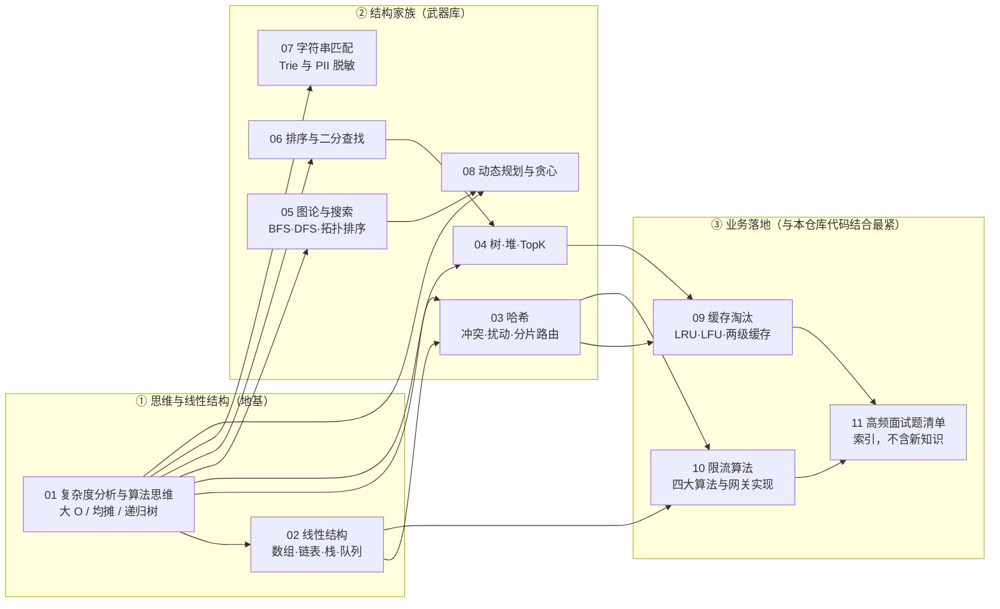

# 数据结构与算法（11 模块入口）

> **一句话结论**：这个模块不是"刷题专区"，而是把 `01`~`10` 模块里"框架替你做了决定"的那些结构选择拆开——哈希决定桶、堆决定 TopK、滑窗决定限流、LRU 决定缓存命中——并且每一个结论都能落到本仓库的一行代码或一段可复现输出上。
> **阅读前置**：能读 Java 业务代码；知道 `HashMap` / `ArrayList` / `PriorityQueue` 的常见用法；写过至少一个"数据量变大就变慢"的接口。不需要算法竞赛背景。
> **证据基线**：JDK 17（编译）/ 21（本地运行）、Spring Boot 4.2.0、Spring Cloud Gateway 5.1.0（`spring-cloud-gateway-server-webflux`）、ShardingSphere 5.5.0、本项目当前 `main`；实测环境 `node v24.16.0`。预计通读 15 分钟，按 §5 任一条路线投入 3 天~2 周。

**本模块能让你做到（可验证的行为）**：

1. 看到一段嵌套循环，能说出它是 Θ(n²) 还是 Θ(n·k)，并能指出数据量翻几倍时会出问题；
2. 看到一个缓存 / 限流 / 检索实现，能指出它"用的是什么数据结构、为什么不是另一种、代价落在哪"；
3. 面试被追问"为什么不用红黑树 / 为什么不用堆 / 为什么不用一致性哈希"时，能给出取舍而不是结论。

---

## 1. 这个模块为谁写：三种具体的"手感退化"

### 1.1 读者画像

写了两三年业务代码的人。`@Transactional` 用得比 `for` 循环熟；`HashMap` 天天用但没想过它为什么"快"；最近一次认真分析复杂度是校招面试前一周。**退化不是不会，是"没有触发场景"**——框架把结构选择都封装好了，业务代码里只剩下 get / put / stream。

本模块给的就是触发场景：**每一篇都从一个真实症状或一个真实取舍开始，而不是从定义开始。**

### 1.2 三个具体问题

| 编号 | 具体问题 | 典型表现 | 本模块怎么解决 |
| --- | --- | --- | --- |
| **P1** | **没有量级感**，只能靠"感觉慢" | 接口 200ms 觉得正常，500ms 觉得"网络问题"；不知道罪魁是 Θ(n²) 还是 Θ(n) 遇上了 n=10⁵ | `01` 建立大 O / 均摊 / 递归树三件套；`04` 用真实耗时对比 Θ(n log n) 与 Θ(n log k) 的量级差（§4.2） |
| **P2** | **说不出"为什么是这个结构"** | 知道 `VectorCacheStore` 是 LRU，但说清"为什么不是 LFU""为什么 L1 用 `LinkedHashMap` 而 L2 用 Redis"就卡住 | `09` 对照 `VectorCacheStore.java` 逐行读；`10` 对照网关两套限流器读取舍；`03` 用分片算法讲"哈希只保证同键同桶，不保证均匀" |
| **P3** | **判断无法证伪** | "用堆做 TopK 更快"是背来的；如果候选集只有 40 条，堆反而更慢——说不出这个边界 | 每篇的 §5 设计取舍都写"换成另一种写法会怎样"；本 README §4.2 给出可复现的交叉点实测 |

一句判断：**算法能力的差距不体现在"知不知道最优解"，而体现在"能不能说清不用最优解的理由"。**

---

## 2. 模块地图：三组、11 篇



> **读图说明**：三类节点是学习顺序，箭头是**概念依赖**，不是文件引用。
> - 唯一从 `D01` 扇出到全体的箭头是本图最重要的一条：**复杂度是其余 10 篇的公共语言**。没读 `01` 就去读 `09`，你会看懂 LRU 的链表操作，但看不懂"为什么 L1 只放 4096 条"这种容量决策。
> - `D03 -> D09` 与 `D03 -> D10` 是本模块与仓库代码的两个最强接点：**哈希决定"键怎么分到桶里"，缓存的分桶键（digest）与限流的 key 是同一个动作**，只是前者为了命中、后者为了配额。这两篇（09/10）是全模块唯一能同时给出 A 级框架源码 + B 级项目代码 + C 级实测的三篇。
> - `D06 -> D04` 的方向容易被读反：**先会排序，才知道什么时候不该排序**（TopK 的堆正是"避免全排序"）。
> - `D02 -> D10` 只表示"窗口要用队列记账"，不代表"限流是队列算法"——算法本质是时间窗口判定，队列只是容器（`10` §3）。
> - `D11` 是索引不是知识：它把 01~10 的问题按主题聚类，每个问题后回指"本项目现场"。**看错这一点会把它当新内容读，浪费一天。**

**推荐顺序**（严格来说只有一条硬约束：`01` 必须最先）：

| 顺序 | 篇目 | 为什么排这里 | 建议产出 |
| --- | --- | --- | --- |
| 1 | `01` 复杂度分析 | 后面 10 篇的公共语言 | 能手算 3 段代码的复杂度 |
| 2 | `02` 线性结构 | 唯一"每天都用但没细想"的一篇 | 能说清 `ArrayList` 扩容 1.5 倍的均摊账 |
| 3~4 | `03` 哈希 → `09` 缓存淘汰 | **提前跳到落地篇**，趁热看 `VectorCacheStore` | 能画出 L1/L2 读写路径 |
| 5~6 | `04` 树堆 TopK → `10` 限流算法 | 两篇合起来覆盖"分桶 + 配额" | 能手写令牌桶与滑动窗口 |
| 7~9 | `05` 图 → `06` 排序二分 → `07` 字符串 | 补齐结构家族 | 能说清状态机的拓扑校验 |
| 10 | `08` 动态规划与贪心 | 面试刚需、本项目落地最浅（见 §8） | 能手推 0-1 背包 |
| 11 | `11` 面试清单 | 收口，只做检索与自测 | 一页纸速查 |

> 想只花 3 天：`01` → `03` → `09` → `10` → `11`（见 §5.1）。

---

## 3. 每篇一句话：解决什么问题 / 对应哪段代码 / 证据类型

| 篇 | 一句话（解决什么问题） | 本项目对应代码 | 证据类型 |
| --- | --- | --- | --- |
| [01 复杂度分析与算法思维](./01-复杂度分析与算法思维.md) | 把"感觉慢"翻译成量级：大 O、均摊复杂度（扩容那笔账）、递归树与主定理 | `ai-cs-chat/src/main/java/com/aics/chat/cache/SemanticCacheService.java`（O(n) 线性扫描，n 上限 200 的取舍） | B + C |
| [02 线性结构](./02-线性结构-数组链表栈队列.md) | 数组/链表/栈/队列在 JVM 里的真实常数因子，以及"有界"怎么实现 | `ai-cs-gateway/src/main/java/com/aics/gateway/filter/SlidingWindowRateLimiter.java`（`ConcurrentLinkedDeque` 时间戳队列）、`ai-cs-chat/src/main/java/com/aics/chat/security/SecurityAuditRecorder.java`（`ArrayDeque` 有界 200） | B + C |
| [03 哈希：冲突、扰动与分片路由](./03-哈希-冲突扰动与分片路由.md) | 哈希只承诺"同键同桶"，不承诺均匀、稳定、桶名取得对 | `ai-cs-user/src/main/java/com/aics/user/sharding/UserIdLast4ModShardingAlgorithm.java`、`ai-cs-chat/src/main/java/com/aics/chat/cache/VectorCacheStore.java`（SHA-256 定长键）、`ai-cs-common/src/main/java/com/aics/common/ai/embedding/HashEmbeddingModel.java`（768 维双哈希） | B + C |
| [04 树、堆与 TopK](./04-树堆与TopK.md) | 什么时候 Θ(n log k) 真的比 Θ(n log n) 划算，什么时候不划算 | `ai-cs-search/src/main/java/com/aics/search/hybrid/RrfMerger.java`（`sorted().limit(topK)`）、`ai-cs-chat/src/main/java/com/aics/chat/cache/HotQaCacheService.java`（ZSET 频次榜） | B + C |
| [05 图论与搜索](./05-图论与搜索-BFS-DFS-拓扑排序.md) | BFS 逐层扩散、DFS 回溯、拓扑序与并查集在业务状态机里的样子 | `ai-cs-chat/src/main/java/com/aics/chat/rag/graph/GraphTripleBfs.java`、`ai-cs-chat/src/main/java/com/aics/chat/agent/state/AgentStateMachine.java`、`ai-cs-order/src/main/java/com/aics/order/statemachine/OrderStateMachineConfig.java` | B + C |
| [06 排序与二分查找](./06-排序与二分查找.md) | 稳定性、边界模板、以及"库里的排序用的是什么" | `ai-cs-search/src/main/java/com/aics/search/hybrid/RrfMerger.java`（`Comparator` + `sorted`）、`ai-cs-order/src/main/java/com/aics/order/service/impl/PromotionServiceImpl.java`（`max(Comparator)` 取最优单条） | B + C |
| [07 字符串匹配：Trie 与 PII 脱敏](./07-字符串匹配-Trie与PII脱敏.md) | 正则为什么能一次跑完、`(?<!\d)` 这类断言在防什么、敏感词 Trie 怎么省比较 | `ai-cs-chat/src/main/java/com/aics/chat/util/PiiMasker.java`（手机号/身份证/银行卡/邮箱/门牌号 5 条正则） | B + C |
| [08 动态规划与贪心](./08-动态规划与贪心.md) | 最优子结构与"贪心能用的三个前提"，以及贪心的经典反例 | `ai-cs-order/src/main/java/com/aics/order/service/impl/PromotionServiceImpl.java`（满减走贪心取最大单条，**没做背包 DP**） | B + C |
| [09 缓存淘汰：LRU·LFU 与两级缓存](./09-缓存淘汰-LRU-LFU与两级缓存.md) | 命中率是策略与访问分布的函数，不是"用了 LRU 就快" | `ai-cs-chat/src/main/java/com/aics/chat/cache/VectorCacheStore.java`、`ai-cs-chat/src/main/java/com/aics/chat/cache/SemanticCacheService.java`、`ai-cs-chat/src/main/java/com/aics/chat/cache/CacheProperties.java` | B + C |
| [10 限流算法：四大算法与网关实现](./10-限流算法-四大算法与网关实现.md) | 四种限流算法各自的漏洞与适用场景；键选错比阈值调错更致命 | `ai-cs-gateway/src/main/java/com/aics/gateway/config/RouteConfig.java`（每路由 `RedisRateLimiter`）+ **A 级** `request_rate_limiter.lua`；`ai-cs-gateway/src/main/java/com/aics/gateway/filter/RateLimitFilter.java`（本地兜底） | **A** + B + C |
| [11 高频面试题清单](./11-高频面试题清单.md) | 只做检索与自测：按知识点聚类的题库 + 答题要点 + 本项目现场 | 无独立代码，问题后回指 01~10 的落点 | 无（纯索引） |

> 证据类型说明：**A** = `24-源码分析/assets/source/` 已入库的框架源码摘录（本模块可用的有 `request_rate_limiter.lua.md`、`RedisRateLimiter.java.md`、`KeyResolver.java.md`）；**B** = 本仓库真实代码（路径与行号当次核对）；**C** = 可复现实测（脚本 + 原样输出）。**没有 A 级材料的篇目不会硬凑 A 级**——这是本模块的底线。

---

## 4. 本项目里的算法清单（哪里用了什么结构、为什么这么选）

### 4.1 主表：9 个真实落点

| 结构 / 算法 | 代码落点 | 为什么是它（取舍） | 篇 |
| --- | --- | --- | --- |
| **L1 进程内 LRU** | `ai-cs-chat/src/main/java/com/aics/chat/cache/VectorCacheStore.java#L48-L54`：`new LinkedHashMap<>(128, 0.75f, true)` + `removeEldestEntry` | `accessOrder=true` 让 `get` 也算访问，双向链表 O(1) 摘挂；容量由 `CacheProperties.l1MaxEntries`（默认 4096）兜住堆内存。**不自己写双向链表**：标准库已经把"哈希 + 链表"焊好了，自己写只在面试有意义 | 09 |
| **L2 Redis 缓存** | 同文件 `#L59-L96`：读 `L1 → L2 → 回填 L1`，写双写、L2 带 TTL，Redis 异常只 `log.warn` 后降级 L1-only | L1 解决"同一实例的热点"，L2 解决"多实例 + 跨进程"，两层解决的不是同一个问题 | 09 |
| **哈希指纹做缓存键** | 同文件 `#L101-L103`：`modelKey + ":" + sha256Hex(text)` | 原文可能是整段 prompt，直接当 key 会撑爆 Redis 的 key 内存与前缀匹配成本；SHA-256 定长 32 字节，`modelKey` 前缀防"不同模型的向量互用" | 03 |
| **语义缓存的 O(n) 线性扫描** | `ai-cs-chat/src/main/java/com/aics/chat/cache/SemanticCacheService.java#L76-L87`：逐条算余弦，取最高分，阈值 `0.92` | n 上限 200（`CacheProperties.semantic.maxEntries`），200 次点积在微秒级；换成 HNSW 要引入 Redis Stack/Chroma，**为一个 200 条的集合引入向量库是把运维成本换成 20 微秒**——这笔交易不划算 | 01 / 09 |
| **ZSET 时间戳做"分布式 LRU"** | 同文件 `#L143-L157`：`zCard` 超上限 → `range(0, size-max-1)` 取最旧 → 删 ZSET + Hash | Redis 没有"LRU 有序集合"，用 score=最近命中时间戳把"最久未用"变成"分数最小"，`range` 就是取 victim | 09 |
| **频次提升（近似 LFU）** | `ai-cs-chat/src/main/java/com/aics/chat/cache/HotQaCacheService.java`：`ZINCRBY` 记频次，达 `promoteThreshold`（默认 3）才把回答写入 Hash | 高频标准问题用"精确命中"最便宜（一次 `HGET`），不必付向量相似度的成本；两级缓存的顺序是**成本升序**：`HGET` → 余弦 → 完整 RAG | 09 |
| **RRF 倒数排名融合 + TopK 截断** | `ai-cs-search/src/main/java/com/aics/search/hybrid/HybridSearchServiceImpl.java#L44`（`RRF_K = 60`、每路 `Top-20`）→ `ai-cs-search/src/main/java/com/aics/search/hybrid/RrfMerger.java#L43-L46`（`sorted(...)` + `limit(topK)`） | BM25 分与余弦量纲不同不能相加，RRF 只用排名：`Σ 1/(k+rank)`。**这里刻意不用堆**：候选并集 ≤ 40，全排序常数更小（§4.2 实测的交叉点远在 n=10⁴ 以上） | 04 / 06 |
| **本地令牌桶（惰性补充 + double 令牌）** | `ai-cs-gateway/src/main/java/com/aics/gateway/filter/TokenBucketRateLimiter.java#L38-L52` | 不开定时线程，`tryAcquire` 时按 `elapsed × qps` 一次补足；令牌用 `double` 是为了 0.5 QPS 这类低速率不被整数截断饿死；`ConcurrentHashMap` + `synchronized(bucket)` 把锁粒度压到单个桶 | 10 |
| **本地滑动窗口（时间戳队列）** | `ai-cs-gateway/src/main/java/com/aics/gateway/filter/SlidingWindowRateLimiter.java#L35-L46` | 固定窗口在边界"双倍放行"，滑动窗口维护"最近 N 秒"的时间戳队列，边界平滑；代价是每个 key 多存 k 个 `Long`，且 `ConcurrentLinkedDeque.size()` 是 O(n) 遍历 | 02 / 10 |
| **Redis + Lua 分布式令牌桶** | `ai-cs-gateway/src/main/java/com/aics/gateway/config/RouteConfig.java#L50-L54` 构造 `RedisRateLimiter(replenishRate=5, burstCapacity=10)`，经 `#L181-L185` 挂到每条路由；脚本 [[源码:request_rate_limiter.lua.md#L14-L20]] | 本地内存限流多实例配额不共享（`application.yml#L36-L40` 已把 `rate-limit.enabled` 置 `false` 退为兜底）；Lua 在 Redis 里原子执行，把"读令牌→算补充→写回"压成一次 RTT，天然免锁 | 10 |
| **取模分片路由** | `ai-cs-user/src/main/java/com/aics/user/sharding/UserIdLast4ModShardingAlgorithm.java#L38-L46`（后四位 `% shardingCount`）+ `ai-cs-user/src/main/resources/sharding-user.yaml#L81-L88`（库 `sharding-count: 2` / 表 `sharding-count: 4`） | 取模 O(1) 且**写入前就能算出目标分片**（范围查询则退化为广播，`#L49` 的 `doSharding(RangeShardingValue)`）；一致性哈希解决的是"扩缩容迁移量"，本项目的 2×4 规模用一致性哈希只是增加环维护成本 | 03 |
| **特征哈希向量（768 维双哈希）** | `ai-cs-common/src/main/java/com/aics/common/ai/embedding/HashEmbeddingModel.java#L31`（`DIMENSIONS = 768`）、`#L43-L49`（`hashCode` 与 FNV-1a 各投一维，再 L2 归一化） | 开发/测试环境没有 Embedding API Key 时的兜底：零依赖、同文本必得同向量；**没有语义泛化能力**，生产必须换真模型——这是"能跑通链路"与"能检索对"的区别 | 03 |
| **有界队列（最近 N 条留痕）** | `ai-cs-chat/src/main/java/com/aics/chat/security/SecurityAuditRecorder.java#L46`（`ArrayDeque`）+ `#L77-L79`（`while (size > 200) removeFirst()`） | 审计只关心"最近发生了什么"，用有界环形语义把内存钉死；`ArrayDeque` 比 `LinkedList` 缓存友好，但**不允许 null** | 02 |
| **熔断的计数滑窗** | `ai-cs-chat/src/main/java/com/aics/chat/modelrouter/ModelHealthRegistry.java#L34-L40`：`COUNT_BASED`，窗口 10、最小调用 3、失败率 50%、OPEN 30s | `COUNT_BASED` 而非 `TIME_BASED`：模型调用量不大，按"最近 10 次"判定比按时间窗更稳（低流量下时间窗可能一次都没统计到） | 10 |
| **BFS 多跳展开** | `ai-cs-chat/src/main/java/com/aics/chat/rag/graph/GraphTripleBfs.java#L36-L66`：`frontier` 逐层扩散，`depth` 限深 | 图谱检索要的是"直接关系 → 再一跳"，BFS 天然按跳数分层，深度一超就停；DFS 会先钻到最深处，拿不到"最近的邻居" | 05 |
| **贪心取最优单条** | `ai-cs-order/src/main/java/com/aics/order/service/impl/PromotionServiceImpl.java#L99`：`max(Comparator.comparing(...))` | 满减规则互斥时最优解=单条最大，贪心成立；**规则可叠加时就不再成立**，那时才是 DP 的场合（见 §8） | 08 |

### 4.2 两条实测：量级感与命中率（C 级）

实测目的只有一个：**给你"常数因子有多大"的量级感**，不是给你 benchmark 结论。两次实测都在同一台开发机上，`node v24.16.0`，单进程、无并发。

**实测一：TopK 的堆与全排序，交叉点在哪。** 数据是固定种子 LCG 生成的整数分数数组，`k=20`，每个规模跑 3 次取最小值（JIT/GC 噪声会让同一规模有 ±30% 抖动）：

```javascript
// 小顶堆：堆顶是"当前第 k 名"，比它大就替换 —— Θ(n log k)
function topKByHeap(arr, k) {
  const heap = [];
  const push = (v) => { /* 上浮 */ };
  const pop = () => { /* 下沉，返回堆顶 */ };
  for (const v of arr) {
    if (heap.length < k) push(v);
    else if (v > heap[0]) { pop(); push(v); }
  }
  return heap.sort((a, b) => b - a);
}

// 全排序：Θ(n log n)，再截断
function topKBySort(arr, k) {
  return Array.from(arr).sort((a, b) => b - a).slice(0, k);
}
```

（`push`/`pop` 的上下浮实现是十行标准写法，这里省略；数据生成用固定种子线性同余 + `Float64Array`。）

```text
== TopK：k=20，整数分数数组，取 3 次最小值（ms）==
        n   heap(ms)   sort(ms)  sort/heap
    10000       0.97       3.94       4.04
   100000       1.75      67.56      38.71
  1000000       7.99     681.91      85.40
```

**怎么读**：
- 看的是最后一列的**趋势**，不是具体毫秒。n 从 10⁴ 涨到 10⁶（100 倍），全排序慢了 170 倍以上，堆只慢了 8 倍——这正是 `log n` 与 `log k` 的差别：`log k` 是常数（k=20 → 约 4.3 层）。
- 堆也不是白给：n=10⁴ 时只快 4 倍（同为毫秒级），堆的上下浮有固定开销。**在本项目里 TopK 的候选集只有 ≤ 40 条**（两路各 20），所以 `RrfMerger` 用 `sorted + limit` 是对的——把堆搬进来只会让代码更难读。
- 适用边界：单个数组在内存里、k 远小于 n、只需要"前 k 个"而不需要全序。如果 k = n/2，堆的优势消失（Θ(n log n) 与 Θ(n log n) 同阶）。

**实测二：FIFO / LRU / LFU 在 Zipf 键流下的命中率。** 键流是模拟的：2000 个"问题"，按 Zipf(α=1，近似"少数问题被反复问"）抽 20 万次访问，缓存容量 200（对齐 `CacheProperties.semantic.maxEntries` 的默认值）：

```javascript
// 命中刷新 seq 即 LRU；命中只加 freq 即 LFU；命中什么都不做即 FIFO
if (store.has(key)) {
  hit++;
  const e = store.get(key);
  if (strategy === 'LRU') { e.seq = tick; }
  else if (strategy === 'LFU') { e.freq++; e.seq = tick; }
} else {
  if (store.size >= CAPACITY) { /* 按 seq（LRU/FIFO）或 freq*1e9+seq（LFU）挑 victim */ }
  store.set(key, { freq: 1, seq: tick });
}
```

```text
== 淘汰策略命中率：Zipf(a=1) 键流，去重键=2000，容量=200，访问=200000 ==
FIFO  hitRate=56.14%
LRU   hitRate=61.41%
LFU   hitRate=68.59%
```

**怎么读**：
- 同样的容量，策略之间差 12 个百分点（56% → 69%）。**命中率是"策略 × 访问分布"的函数**，脱离分布谈"LRU 就是最优"没有意义：在完全均匀的随机访问下，三种策略几乎同分（谁都被迫抖动）。
- 但命中率不是唯一指标：LFU 每多存一个频次计数、淘汰时要找最小频次（朴素实现 O(n) 扫描），而 LRU 靠双向链表 O(1)。`VectorCacheStore` 选 LRU（标准库 `LinkedHashMap` 自带）而不是 LFU，是用几个百分点命中率换实现复杂度与可预测性。
- 适用边界：Zipf(α=1)、容量 200、去重键 2000 的参数组合。换 α（比如 α=0.8 更扁平，或 1.2 更陡）排序可能变，但"LFU 在偏斜分布下更优、LRU 更抗突发"这个方向不会变。

> 这两段脚本是临时脚本，未入库（按上面代码 5 分钟可复现）。**数字只用于量级感**；本篇任何地方都不用它推导复杂度——复杂度只用大 O 表述。

### 4.3 表格里的路径怎么自己复核

上面每一行都写了"类名 + 行号"。行号会随代码演进漂移，**复核的成本应该低于 30 秒**，否则这张表迟早变成装饰：

```powershell
# 1) 在全仓定位类文件（不要背路径，背类名）
Get-ChildItem -Recurse -Filter VectorCacheStore.java | Select-Object -ExpandProperty FullName

# 2) 直接看关键行号附近（README 里引的是 #L48-L54 与 #L59-L78）
Get-Content <上一步的路径> -Encoding UTF8 | Select-Object -Skip 44 -First 12

# 3) 一次核对多篇：把表里的类名批量找一遍
'VectorCacheStore','RrfMerger','TokenBucketRateLimiter','SlidingWindowRateLimiter',
'UserIdLast4ModShardingAlgorithm','HashEmbeddingModel','GraphTripleBfs','PiiMasker' |
  ForEach-Object { Get-ChildItem -Recurse -Filter "$_.java" | ForEach-Object { "OK  $_" } }
```

三条纪律：

1. **先找类，再读行**。类名是稳定标识，包路径与行号都是易变量；README 里写全路径只是为了让你少一次跳转，不是为了让你相信它。
2. **引用一行，就要打开看过这一行**。这一节列的所有落点都是当次 `read` 过的；如果你读到的一行和描述不符，按你的读到的算，别按文档算。
3. **`application.yml` 这类配置行尤其容易漂**（本仓库的限流配置就在 `ai-cs-gateway` 的 `src/main/resources` 下），行号对不上时按 key 名搜（如 `rate-limit`、`sharding-count`），别按行号搜。

---

## 5. 两条路线：3 天速通 vs 2 周手感

### 5.1 路线 A：面试速通（3 天，约 10 小时）

| 时间 | 内容 | 自检 |
| --- | --- | --- |
| 第 1 天上午 | `01` 全篇 + 手算 5 段代码复杂度 | 能不查资料说出 `ArrayList` 扩容为什么是均摊 O(1) |
| 第 1 天下午 | `03` §哈希性质 + `09` 全篇 | 能在白板画出 LRU（哈希+双向链表）并说出 `LinkedHashMap` 的差异 |
| 第 2 天上午 | `10` 全篇 + 手写令牌桶 | 能说清固定窗口"双倍放行"发生在哪一毫秒 |
| 第 2 天下午 | `04` TopK 四种解法 + `06` 二分边界模板 | 能默写"找第一个 ≥ target"的二分 |
| 第 3 天上午 | `05` 图 + `07` KMP/Trie + `08` 背包/LIS | 能写 KMP `next` 数组并解释 `i` 为什么不回退 |
| 第 3 天下午 | `11` 全篇 + 每篇自测题 | 自测题正确率 ≥ 80%，且能举出本项目例子 |

**这条路线刻意跳过**：`02` 的实测细节、`06` 的十大排序代码、`09` 的 LFU 手写。理由：面试考的是"能不能讲清取舍"，不是"能不能默写 10 个排序"。

### 5.2 路线 B：工程手感（2 周，每天 1~1.5 小时）

| 周 | 安排 | 交付物（可验证） |
| --- | --- | --- |
| 第 1 周 | `01` → `02` → `03` → `04`，每篇读完立刻去读对应 B 级落点源码 | 写 3 段"这个结构为什么选它"的短评（各 100 字），必须点名类与行号 |
| 第 2 周前半 | `09` + `10`：把 `VectorCacheStore`、`RateLimitFilter`、`TokenBucketRateLimiter`、`SlidingWindowRateLimiter` 四份源码各跑一遍单测 | 能预测"改容量 / 改 qps 后命中率与放行数怎么变"，并用 §4.2 的脚本验证预测 |
| 第 2 周后半 | `05`~`08` 选读（按你当前项目痛点挑两篇），`11` 收口 | 给团队讲一次 15 分钟分享，内容必须是"我们系统里某个结构的取舍" |

**验收方式**：路线 B 的每一格都能在仓库里核对（源码文件 + 单测 + 脚本输出）；路线 A 的每一格只能靠自测题自查。这也决定了两种路线的价值不同——**A 解决"能不能过"，B 解决"能不能改对"**。

---

## 6. 依赖关系：前置、相关、上游入口

### 6.1 前置（不读会卡住的）

| 前置 | 为什么必须先有 | 链接 |
| --- | --- | --- |
| 复杂度与集合框架 | `01` 讲均摊、`03` 讲哈希扰动，都要先知道 `ArrayList` 扩容与 `HashMap` 桶数组长什么样；本模块不重复讲集合 API | [01-Java基础/05-集合框架与源码](../01-Java基础/05-集合框架与源码.md) |
| Java 17 基础语法（`record`、`var`、增强 `switch`、`Stream`） | 各篇 Demo 与项目代码大量使用 | [01-Java基础/01-Java17核心特性](../01-Java基础/01-Java17核心特性.md) |

### 6.2 相关（读完本模块再去，收益最大）

| 相关模块 | 交叉点 | 链接 |
| --- | --- | --- |
| 性能工程 | `01` 的复杂度估算 + `12` 的火焰图/GC 日志，一个自上而下、一个自下而上 | [12-性能工程](../12-性能工程/README.md) |
| Redis 缓存实战 | `09` 讲淘汰策略与两级缓存，`04-中间件` 讲 Redis 自身的 `maxmemory-policy` 与持久化 | [04-中间件/01-Redis缓存实战](../04-中间件/01-Redis缓存实战.md) |
| Caffeine 与两级缓存 | `09` 讲"L1 用 `LinkedHashMap` 手写"，这里讲工业级 L1 应该长什么样 | [04-中间件/17-Caffeine本地缓存与两级缓存](../04-中间件/17-Caffeine本地缓存与两级缓存.md) |
| 接口安全与限流 | `10` 讲算法，`09-安全与设计模式` 讲策略（验证码、名单、组合键） | [09-安全与设计模式/02-接口安全与限流策略](../09-安全与设计模式/02-接口安全与限流策略.md) |
| 分库分表 / 分布式 ID | `03` 讲取模路由的性质，这两篇讲工程落地（分片键、雪花、路由前置） | [03-数据库与ORM/03-ShardingSphere用户表分库分表实战](../03-数据库与ORM/03-ShardingSphere用户表分库分表实战.md)、[03-数据库与ORM/04-分布式ID规范](../03-数据库与ORM/04-分布式ID规范.md) |

### 6.3 上游入口

- 全库导航与顺序：[00-学习路线总览/README.md](../00-学习路线总览/README.md)
- 面试向总纲：[19-求职与面试总纲](../19-求职与面试总纲/README.md)（`11` 篇是它的算法分册）

---

## 7. 检查点清单

读完任一阶段，用下面这张表自检。**每条都要求"能指出仓库里的位置"或"能跑出结果"，不接受"我知道"。**

- [ ] 能说出 `ArrayList` 尾部追加为什么是**均摊** O(1)，扩容策略是 1.5 倍而不是 2 倍会带来什么差别（`01`）
- [ ] 能解释 `LinkedHashMap(16, 0.75f, true)` 第三个参数的作用，以及 `removeEldestEntry` 在 `put` 的哪一步被回调（`09`）
- [ ] 能画出 `VectorCacheStore.get()` 的完整路径（L1 → L2 → 回填）并指出 Redis 挂掉时会发生什么（`09`，`ai-cs-chat/src/main/java/com/aics/chat/cache/VectorCacheStore.java#L59-L78`）
- [ ] 能说清"语义缓存为什么敢做 O(n) 线性扫描"，以及 n 到多少就该换索引（`01`/`09`）
- [ ] 能手写令牌桶（惰性补充 + `double` 令牌），并解释为什么不能用整数令牌（`10`）
- [ ] 能说清滑动窗口相对固定窗口修掉了哪个漏洞，并指出 `SlidingWindowRateLimiter` 里哪一行是 O(n)（`02`/`10`）
- [ ] 能解释 RRF 的 `1/(k+rank)` 为什么"跨量纲"，以及 `RRF_K=60` 调大调小的效果（`04`）
- [ ] 能说出取模分片为什么范围查询要广播，以及一致性哈希解决的是另一个问题（`03`）
- [ ] 能解释双哈希（`hashCode` + FNV-1a）投到 768 维为什么比单哈希更抗碰撞（`03`）
- [ ] 能说出 `(?<!\d)` / `(?!\d)` 在 PII 脱敏里防的是什么误伤（`07`）
- [ ] 能判断一段业务代码里"嵌套循环 + 循环内查库"的复杂度，并给出改法（`01`）
- [ ] 能对上面任意一条，说出"换成另一种写法会怎样"——这是本模块真正的验收标准（`01`~`10` 每篇 §5）

---

## 8. 诚实清单：本项目**没有**的东西、**不该**自己写的东西、**是模拟**的数据

这一节比前面任何一节都重要。算法文档最容易出的问题，是把"通用知识"包装成"本项目实现"。

### 8.1 本项目根本没用（别在面试里说"我们用了"）

| 说法 | 实际情况 | 依据 |
| --- | --- | --- |
| "我们用 Caffeine 做 L1" | **未落地。** 全仓 `*.java` 搜 `Caffeine`/`caffeine` 零命中；L1 是手写 `LinkedHashMap` LRU | `VectorCacheStore.java#L48-L54` |
| "我们用 HNSW / 向量索引做语义缓存" | **未落地。** 语义缓存是 200 条上限的线性扫描；向量检索走 ES/内存实现 | `SemanticCacheService.java#L37-L38` 的注释明说"规模上万应换成 HNSW" |
| "我们实现了漏桶" | **未落地。** 网关只有令牌桶（两种实现）与滑动窗口 | `TokenBucketRateLimiter.java`、`SlidingWindowRateLimiter.java`，无 LeakyBucket 类 |
| "我们用 Trie 做敏感词过滤" | **未落地。** 敏感词/合规靠正则与规则表；Trie 只在 `07` 篇作为原理讲解 | `ai-cs-chat/src/main/java/com/aics/chat/util/PiiMasker.java` 全是 `Pattern` |
| "优惠计算用背包 DP" | **未落地。** 满减是"取最大单条"的贪心；规则可叠加时才需要 DP，本项目没做到那一步 | `PromotionServiceImpl.java#L99` |
| "网关限流脚本是我们写的" | **不是。** `request_rate_limiter.lua` 来自 Spring Cloud Gateway 5.1.0 的 jar，仓库里没有同名文件；我们能核对的只是 A 级摘录 | `24-源码分析/assets/source/request_rate_limiter.lua.md` |
| "限流误伤 74.92% 是线上统计" | **不是。** 那是 `09-安全与设计模式` 篇用 node 做的**模拟**（200 人共享出口 IP、桶参数对齐网关 `cap=10/rate=5/s`、12000 次请求放行 3009 次） | [09-安全与设计模式/02-接口安全与限流策略](../09-安全与设计模式/02-接口安全与限流策略.md) §0 |

### 8.2 标准库已经做过的事，别自己写（除了面试）

| 别自己写 | 用什么 | 例外 |
| --- | --- | --- |
| 排序 / 二分 / 堆 | `Arrays.sort`（基本类型双轴快排、对象 TimSort）、`Collections.binarySearch`、`PriorityQueue` | 面试白板题；或需要自定义"稳定性 + 局部有序"策略时 |
| 哈希表 / LRU 容器 | `HashMap`、`LinkedHashMap(accessOrder=true)` | 需要并发写入且要求 O(1) 淘汰时（`Collections.synchronizedMap` 是全局锁，会影响吞吐） |
| 动态数组 / 队列 / 栈 | `ArrayList`、`ArrayDeque`、`ConcurrentLinkedDeque` | 需要"有界 + 丢弃最旧"时自己加一层（`SecurityAuditRecorder`） |
| 正则引擎 | `java.util.regex` | 需要线性时间保证时（正则回溯可能指数级），换 DFA/AC 自动机 |
| 分布式限流 / 分片 | `RedisRateLimiter`、ShardingSphere 标准算法 | 需要非标准路由（如后四位取模、按租户哈希）时写 `StandardShardingAlgorithm` |

一条判据：**如果标准库的实现能被一行配置解释清楚，就不要手写；如果它的取舍和你的场景不符（全局锁、无界、阻塞），才自己写，并且写清取舍。**

### 8.3 实测数据全部是"模拟 + 单机"

| 数据 | 来源 | 不能拿它证明什么 |
| --- | --- | --- |
| TopK 的 4.04× / 38.71× / 85.40× | §4.2 脚本，单机 node，LCG 生成整数数组 | 不能证明"Java 里堆快 85 倍"——语言、JIT、数据分布都不同；只能证明"随 n 增长，差距按 log 因子拉开" |
| FIFO 56.14% / LRU 61.41% / LFU 68.59% | §4.2 脚本，Zipf(α=1) 合成键流 | 不能证明"线上 LRU 命中率 61%"——真实问答分布、缓存容量、TTL 都不同 |
| 74.92% 限流误伤 | `09-安全与设计模式` 篇的 node 模拟 | 不是线上监控数据 |
| 各篇耗时对比 | 各篇自己的 C 级脚本 | 一律只作"常数因子的量级感"，复杂度结论只用大 O |

### 8.4 文档自身的边界

- `09`/`10`/`11` 三篇目前仍是**旧版组织方式**（"一、二、三"分节，没有 12 节骨架），内容准确但结构与 `01`~`08` 不一致；读的时候以内容为准，别被编号骗了。
- `01`~`08` 已按 `_templates/写作规范.md` 的 12 节骨架重写（现象 → 地图 → 精读 → 时序 → 取舍 → 踩坑 → 版本 → 面试 → 练习 → 小结 → 自测）。
- 本 README 里所有 `ai-cs-*` 路径都经过当次核对；行号会随代码演进漂移，**引用前请重新 `grep` 一次**。

---

> 返回 [学习路线总览](../00-学习路线总览/README.md) · 直接开始：[01 复杂度分析与算法思维](./01-复杂度分析与算法思维.md)
