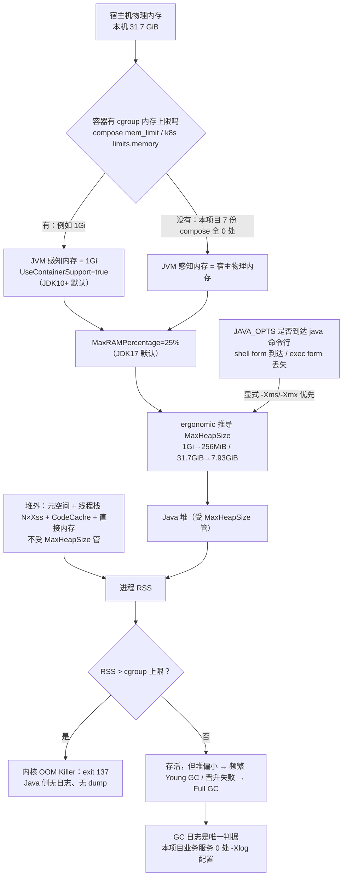
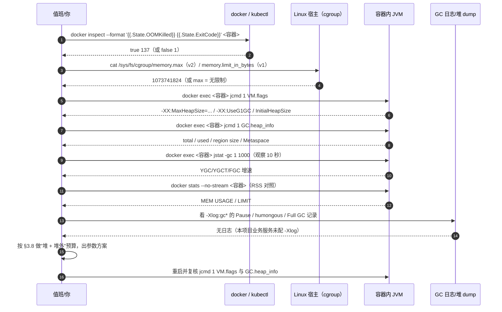

# JVM 参数与 GC 选型：容器里的堆到底该按谁的内存算

> **一句话结论**：容器里 JVM 参数配错，第一后果不是"性能差一点"，而是**堆按宿主机内存算**（JDK 17 默认 `MaxRAMPercentage=25%`）——本机实测宿主机 31.7 GiB 时默认最大堆 7.93 GiB；再加上本项目 7 份 compose 里 `mem_limit`/`cpus`/`resources` 全为 0 处、`ai-cs-order` 与 `ai-cs-product` 的 Dockerfile 用 exec form 把 `JAVA_OPTS` 整条丢掉，结局就是"堆虚大 → RSS 超卖 → 内核 OOM Kill（exit 137）或反复 Full GC"，而且 Java 侧一行日志都不会留。
> **阅读前置**：知道 JVM 内存分区（堆/元空间/栈/直接内存）大概是什么；看得懂 Dockerfile 与 compose 的差别；会读 `java -XX:+PrintFlagsFinal` 的输出格式。内存分区与 GC 基础机制见 [03-JVM内存模型与GC实战](../01-Java基础/03-JVM内存模型与GC实战.md)；容器编排侧（网络/挂载/健康检查）见 [01-Docker容器化](../07-运维部署/01-Docker容器化.md)。
> **证据基线**：JDK Temurin 17.0.19（本机实测）／项目 Spring Boot 4.2.0 + Spring Framework 7.1.0；B 级证据全部当次核对仓库当前工作区（2026-11-27），C 级证据全部在本机 pwsh 跑出。预计阅读 55~70 分钟。

**证据边界**（先讲清本篇哪些是"跑出来的"、哪些只是"读出来的"）：

| 类别 | 本仓库/本机状态 | 本篇怎么处理 |
| --- | --- | --- |
| A 级：JDK 源码摘录 | `24-源码分析/assets/source/` 共 905 份摘录，但**没有** `ThreadPoolExecutor` / `ForkJoinPool` / G1 相关类 | 本篇 **A 级 0 处**，不硬凑；容器与堆的行为全部用 B/C 级证明 |
| B 级：compose / Dockerfile / k8s manifest / yml | 7 份 compose、**9 份 Java 服务 Dockerfile**（全仓共 11 份，另 2 份是 frontend 与 py-recommend）、`deploy/k8s/` 全部真实存在 | 每条结论带文件与行号，先 read/grep 后引 |
| C 级：本机跑得出来的命令 | `java` / `jcmd` / `jps` / `jstat` / `node` 均可用，已实测 | 贴真实输出 + 怎么读 + 误判风险 |
| C 级：容器运行时行为（`docker stats`、`docker inspect`、OOMKilled、cgroup v2 实测） | 本机 **`docker` 与 `kubectl` 均 MISSING** | 一律标注"未本机实测"，只给命令与判读方法，**不编造数值** |

---

## 0. 先看现象

### 现象一：容器突然消失，Java 侧一行日志都没有

真实会看到的现场长这样（命令真实可执行，**本机无 docker，未本机实测**）：

```bash
$ docker inspect --format '{{.State.OOMKilled}} {{.State.ExitCode}}' aics-chat
true 137
$ docker logs --tail 20 aics-chat
（最后一条是几小时前的业务日志，此后什么都没有）
```

`137 = 128 + 9`，即被 SIGKILL。**关键判据是 `OOMKilled=true` 加上日志戛然而止**：这不是 Java 的 `OutOfMemoryError`——真的 Java 堆溢出会在日志里打出 `java.lang.OutOfMemoryError: Java heap space` 和堆栈；而内核 OOM Killer 杀进程时，JVM 连收尾的机会都没有。所以"日志里什么都没有"本身就是一条证据。

这一幕的土壤在本仓库里能查实：我在仓库根跑了统计（命令见下），7 份 compose **一个资源上限都没写**。

```powershell
# 统计 7 份 compose + 仓库内全部 yml 的资源限制指令命中数（真实可复跑）
$rows = @()
Get-ChildItem -Recurse -File -Filter *.yml |
  Where-Object { $_.FullName -notmatch '\\learning-docs\\|\\tools\\|\\node_modules\\' } |
  ForEach-Object {
    $t = Get-Content $_.FullName -Raw
    $rows += [pscustomobject]@{
      File      = $_.FullName.Replace((Get-Location).Path + '\', '')
      mem_limit = ([regex]::Matches($t, 'mem_limit')).Count
      cpus      = ([regex]::Matches($t, '(?m)^\s*cpus:')).Count
      resources = ([regex]::Matches($t, 'resources:')).Count
    }
  }
$rows | Format-Table -AutoSize
```

```text
File                                                  mem_limit cpus resources
docker-compose.yml                                            0    0         0
ai-cs-chat\src\main\resources\application.yml                 0    0         0
...
deploy\docker-compose\docker-compose-all.yml                  0    0         0
deploy\docker-compose\docker-compose-host1.yml                0    0         0
deploy\docker-compose\docker-compose-host2.yml                0    0         0
deploy\docker-compose\docker-compose-host3.yml                0    0         0
deploy\docker-compose\docker-compose-master-slave.yml         0    0         0
deploy\docker-compose\docker-compose-observability.yml        0    0         0
deploy\observability\prometheus.yml                           0    0         0
```

怎么读：`mem_limit`（compose v2 的单容器内存上限）**0 命中**、`cpus`（CPU 配额）**0 命中**、`resources:`（新式 `deploy.resources` 写法）也 **0 命中**。也就是说这 63 个容器在 cgroup 眼里没有内存边界，容器内 JVM 读到的"机器内存"就是宿主机的物理内存。

### 现象二：一台 31.7 GiB 的机器，Java 默认给自己 7.93 GiB 堆

这条是本机真实跑出来的（JDK 17.0.19，**未加任何参数**）：

```powershell
java -XX:+PrintFlagsFinal -version | Select-String 'MaxHeapSize|InitialHeapSize|MaxRAMPercentage|InitialRAMPercentage|UseG1GC'
```

```text
   size_t InitialHeapSize       = 532676608      {product} {ergonomic}
   size_t MaxHeapSize           = 8514437120     {product} {ergonomic}
    double InitialRAMPercentage = 1.562500       {product} {default}
    double MaxRAMPercentage     = 25.000000      {product} {default}
      bool UseG1GC              = true           {product} {ergonomic}
```

怎么读这四行：

- `MaxHeapSize = 8514437120` 字节 = **7.93 GiB**，`InitialHeapSize = 532676608` = **508 MiB**。
- `MaxRAMPercentage = 25.000000 {product} {default}`：这是**编译进 JDK 的默认值**，不是谁配的——`{default}` 标记说明命令行没动过它。7.93 GiB ≈ 31.7 GiB × 25%，宿主机的 `TotalPhysicalMemory` 是 34042929152 字节（约 31.7 GiB）。
- `{ergonomic}` 标记说明 `MaxHeapSize` 是 **JVM 自己算出来的（ergonomics，人体工学默认值）**，不是命令行给的。这一条是整篇的分水岭：凡是 `{ergonomic}` 的值，都会随"JVM 认为的内存大小"漂移。
- `UseG1GC = true {ergonomic}`：JDK 17 服务端默认就是 G1，没人显式写它。

一个被 `JAVA_OPTS: "-Xms256m -Xmx512m"` 描述的服务，如果那条参数没送到 JVM，拿到的就是这个 7.93 GiB 的默认堆——**比预期大 16 倍**。

### 现象三：明明写了 `-Xmx512m`，堆却还是"在动"

下面这两段是本机探针进程的真实输出（探针源码与命令见 §6 第 7 条）。参数给的是 `-Xms256m -Xmx512m`：

```text
$ jcmd 22872 GC.heap_info
garbage-first heap   total 414720K, used 249984K [0x00000000e0000000, 0x0000000100000000)
 region size 1024K, 2 young (2048K), 1 survivors (1024K)
```

```text
$ jcmd 22872 VM.flags
-XX:G1HeapRegionSize=1048576 -XX:InitialHeapSize=268435456 -XX:MaxHeapSize=536870912
-XX:NativeMemoryTracking=summary -XX:ReservedCodeCacheSize=251658240
```

`InitialHeapSize=268435456`（256 MiB）说明 `-Xms256m` 生效了，`MaxHeapSize=536870912`（512 MiB）说明 `-Xmx512m` 也生效了；但 `GC.heap_info` 里堆的 **total 是 414720K ≈ 405 MiB**——既不是 256 MiB 也不是 512 MiB。GC 日志里能直接看到扩容发生的那一刻：

```text
[2026-11-27T13:58:56.739+0800][0.922s] GC(0) Pause Young (Concurrent Start) (G1 Humongous Allocation) 137M->117M(256M) 5.221ms
[2026-11-27T13:58:56.791+0800][0.974s] GC(11) Pause Cleanup 243M->243M(405M) 0.390ms
```

注意括号里那三个数：`(256M)` → … → `(405M)`。这不是"堆设小了"，而是 `-Xms ≠ -Xmx` 时 JVM 的**正常行为**：起手只提交 256 MiB，用着不够就向操作系统要，直到 512 MiB 封顶。代价是堆大小、RSS、GC 时机全都变成运行时的随机变量（§3.7 展开）。

另一条更隐蔽的失效路径也在仓库里：`ai-cs-order/Dockerfile#L19` 与 `ai-cs-product/Dockerfile#L11` 用的是 exec form 的 ENTRYPOINT：

```dockerfile
ENTRYPOINT ["java", "-jar", "app.jar"]
```

exec form（把 ENTRYPOINT 写成 JSON 数组）**不经过 shell**，`${JAVA_OPTS}` 这种变量展开根本不会发生。所以 compose 里写多少内存参数都是白写——JVM 拿到的是空调料，回到现象二的默认行为（§3.6 展开）。

**这些现象指向同一件事**：容器里"堆多大"不是由你在 compose 里写的那行 `JAVA_OPTS` 决定的，而是由三件事共同决定——① 容器有没有 cgroup 内存上限；② JVM 从哪读到这个上限；③ 你写的参数有没有真正到达 java 命令行。三者任一断链，堆就按宿主机内存算，于是 OOM Kill 与无谓 Full GC 接踵而来。

---

## 1. 整体地图

### 1.1 一条内存预算从哪里来、到哪里去



> **读图说明**：三条关键箭头。第一条是 `CG` 那个判断菱形——**"没有 limit" 这条分支是本项目的现实**（7 份 compose 全 0 处），它直接把 JVM 感知内存抬到宿主机容量，这是所有"堆虚大"问题的源头。第二条是 `CMD` 指向 `ERG` 的那条边——`JAVA_OPTS` 到不了命令行时，人写的参数等于不存在（order/product 就断在这里）。第三条是 `OUT → RSS → KILL` 这一串：**只看堆会漏掉堆外**，把 `-Xmx` 设成组件上限的 100% 一定死在 OOM Killer 手上，而且死得没有日志。最容易看错的是把 `MaxHeapSize` 当成"进程占用内存"——它只是堆的上限，RSS 还要加堆外。

### 1.2 组件、责任与参与方

| 组件/配置 | 位置（真实文件） | 它负责什么 | 谁来决定它 |
| --- | --- | --- | --- |
| 容器内存上限 | compose `mem_limit` / `deploy.resources.limits.memory`；k8s `resources.limits.memory` | 给 cgroup 一个硬边界，RSS 超了内核直接杀 | 部署同学。**本项目 compose 侧 0 处**，k8s 侧 20 个 `limits:` 块齐全 |
| 容器感知开关 | JVM 内置 `-XX:+UseContainerSupport`（JDK 10+ 默认开，8u191+ 也有） | 决定 JVM 读宿主机内存还是 cgroup 上限 | JDK 版本，无人配置 |
| 堆上限 | `-Xms` / `-Xmx`，或 `-XX:MaxRAMPercentage` / `-XX:InitialRAMPercentage` | 决定 `MaxHeapSize` / `InitialHeapSize` | 本项目的 `JAVA_OPTS`（7 个 compose 服务）与 k8s env |
| 参数透传桥 | Dockerfile 的 `ENTRYPOINT` | shell form 才能展开 `${JAVA_OPTS}` | `ai-cs-chat` 等 7 份是 shell form；`ai-cs-order`、`ai-cs-product` 是 exec form |
| 堆外三件套 | `-XX:MetaspaceSize/-XX:MaxMetaspaceSize`、`-Xss`、`-XX:ReservedCodeCacheSize` | 决定 RSS − 堆 的那部分 | 全仓 **0 处显式配置**（grep 结果见 §3.3） |
| 观测面 | `-Xlog:gc*`、`-XX:+HeapDumpOnOutOfMemoryError`、NMT、`jcmd` | 出事后唯一的现场 | 业务服务 **0 处**；整仓唯一 `-Xlog:gc*` 在 `tools/nacos/bin/startup.sh#L114` |
| 外部观测 | `deploy/observability/prometheus.yml` | 抓 `/actuator/prometheus` | 只有 HTTP 指标，**无 JMX exporter ⇒ 无 JVM 堆/GC 指标** |

---

## 2. 关键概念与关键工具

### 2.1 概念（术语首现即解释）

| 名称 | 出现位置 | 作用（一句话职责） | 关键参数/取值 |
| --- | --- | --- | --- |
| 堆（Heap） | JVM 运行时数据区 | 放对象实例；**唯一受 `-Xmx` 约束**的区域 | `-Xms` 初始、`-Xmx` 上限 |
| 新生代（Young） | 堆内 | 新对象出生地，G1 里由一组 region 动态组成 | 本机探针实测 `2 young (2048K)` |
| 幸存者区（Survivor） | 新生代内 | 熬过一轮 Young GC 的对象暂存区，每次复制+年龄+1 | 实测 `1 survivors (1024K)` |
| 老年代（Old） | 堆内 | 晋升后的长寿命对象；G1 里也是 region 集合 | 晋升阈值默认 15（`-XX:MaxTenuringThreshold`） |
| 元空间（Metaspace） | 堆外（本地内存） | 存类元数据（类结构、方法字节码、常量池引用） | `-XX:MetaspaceSize`=首次 GC 阈值，`-XX:MaxMetaspaceSize`=封顶 |
| Region | G1 的堆切分单位 | 把堆切成等大小 region，按 region 收集，因此能"预测停顿" | 实测 512 MiB 堆 ⇒ `region size 1024K`；7.93 GiB 堆 ⇒ `4194304`（4 MiB） |
| Humongous 对象 | G1 特有 | 大于 region 一半的对象直接进老年代，绕过新生代 | 实测日志里 `(G1 Humongous Allocation)` 就是它 |
| CodeCache | 堆外 | JIT 编译后的机器码缓存 | 实测 `ReservedCodeCacheSize=251658240`（240 MiB，仅预留） |
| 直接内存（Direct） | 堆外 | NIO/Netty 的 off-heap buffer | `-XX:MaxDirectMemorySize`，默认 0 = 不限制（约等于堆上限） |
| RSS（常驻集） | 操作系统视角 | 真正占用的物理内存页；**cgroup 就是拿它算账** | `docker stats` 的 MEM USAGE 近似 |
| cgroup | Linux 内核 | 给进程组设资源上限的机制，容器内存限制就落在这里 | v1 `memory.limit_in_bytes`；v2 `memory.max` |
| OOM Killer | 内核 | cgroup 内存超限时的处决者，发 SIGKILL | 退出码 137 |
| G1 / ZGC / Parallel | HotSpot 收集器 | 三种回收策略（见 §3.2 对照表） | `-XX:+UseG1GC` / `+UseZGC` / `+UseParallelGC` |
| 信创 JDK | 国产发行版 | 毕昇 JDK、阿里 Dragonwell、腾讯 Kona 等，行为与 OpenJDK 有细微差异 | 见 §3.9 |

### 2.2 工具（都要能在容器里用）

| 工具/命令 | 位置 | 作用 | 关键用法与判读点 |
| --- | --- | --- | --- |
| `java -XX:+PrintFlagsFinal -version` | 任意 JDK | 打印**全部**参数及其最终值 + 来源标记 | 看第三列 `{default}`/`{ergonomic}`/`{command line}`/`{manageable}` |
| `jcmd <pid> VM.flags` | `$JAVA_HOME/bin/jcmd` | 看一个**已在运行**的 JVM 的最终参数 | 容器里通常是 `jcmd 1 VM.flags` |
| `jcmd <pid> GC.heap_info` | 同上 | 看堆用了多少、region 多大、元空间多大 | 判据：`total` 是否等于 `-Xms`（不等说明堆在伸缩） |
| `jcmd <pid> VM.native_memory summary` | 同上 | 堆外账本（需启动时加 `-XX:NativeMemoryTracking=summary`） | 看 `Java Heap` / `Class` / `Thread` / `Code` 四行 |
| `jcmd <pid> Thread.print` | 同上 | 全线程栈，用来数线程数 | 线程数 × `Xss` = 栈预留 |
| `jcmd <pid> GC.heap_dump <file>` | 同上 | 在线抓堆快照，不用重启 | 抓完用 MAT 分析 |
| `jps -l` | 同上 | 列出本机 JVM 进程与主类 | 容器内 PID 1 可能看不到，用 `jcmd -l` |
| `jstat -gc <pid> 1000` | 同上 | 每秒采样分代容量/使用量/GC 次数与耗时 | 看 `YGC/YGCT` 增长速率 |
| `node -e "..."` | 本机 Node 24.16.0 | 纯算术工具：算内存预算、模拟队列容量 | 本篇用它算"堆 + 堆外"预算表 |

---

## 3. 原理与证据逐段精读

### 3.1 堆结构与对象晋升：为什么"512m 堆"不是一个数，而是一堆 region

**在干什么**：JVM 启动时按 `-Xms` 向 OS 预留/提交一块连续虚拟地址（在 G1 里逻辑上切成等大 region），新对象在 Eden 型 region 里分配；Eden 满了触发 Young GC，把还活着的对象复制到 Survivor region 并把"年龄"加 1；年龄到阈值（默认 15）或 Survivor 装不下时晋升到 Old 型 region。

**证据（C 级，本机实测）**：探针进程 `-Xms256m -Xmx512m`，跑了 80 个 2 MiB 的 `byte[]` 之后：

```text
$ jcmd 22872 GC.heap_info
garbage-first heap   total 414720K, used 249984K [0x00000000e0000000, 0x0000000100000000)
 region size 1024K, 2 young (2048K), 1 survivors (1024K)
 Metaspace       used 9708K, committed 9984K, reserved 1114112K
  class space    used 1160K, committed 1280K, reserved 1048576K
```

怎么读：`region size 1024K` 是 G1 把堆切成的块大小；`2 young (2048K)` 表示当时只有 2 个新生代 region 在用；`1 survivors (1024K)` 是 1 个幸存者 region。**注意 young 区只有 2 MiB，而我在分配 2 MiB 一个的对象**——这就是 `(G1 Humongous Allocation)` 出现的原因：

```text
[2026-11-27T13:58:56.733+0800][0.917s] GC(0) Pause Young (Concurrent Start) (G1 Humongous Allocation)
[2026-11-27T13:58:56.739+0800][0.922s] GC(0) Pause Young (Concurrent Start) (G1 Humongous Allocation) 137M->117M(256M) 5.221ms
```

怎么读：G1 规定"对象大小 > region 一半就算 Humongous"（这里 region 1 MiB，阈值 512 KiB），2 MiB 的数组直接被当成 Humongous 放进老年代 region，不走新生代晋升。日志里的 `137M->117M(256M) 5.221ms` = 回收前 137 MiB、回收后 117 MiB、堆容量 256 MiB、这次停顿 5.221 ms。

**为什么这么设计**：region 化是为了"可预测停顿"——G1 可以先算"回收这 N 个 region 大概能腾多少、要停多久"，然后只收最划算的一批（这就是 `MaxGCPauseMillis` 的抓手）。如果堆是一整块，不带 region，就没法做这种"分批作业"，只能像 Parallel 那样全堆扫。

**换写法会怎样**：如果换成 Parallel GC（`-XX:+UseParallelGC`），堆按"连续的新生代/老年代"划分，靠 `-XX:NewRatio`、`-Xmn` 调比例，没有 region 概念，也就没有 Humongous 这个坑——但你也就失去了停顿目标控制（Parallel 只保证吞吐）。反过来，堆设得越大，G1 region 也越大（本机 7.93 GiB ⇒ 4 MiB region），此时 Humongous 阈值变成 2 MiB，**同样的对象在新机器上可能突然不算 Humongous**——所以"某接口在小机器上没事、上了大机器 GC 行为变了"是有机制的，不是玄学。

**常见坑**：
1. 把 `Metaspace` 那两行当成"堆的一部分"。`Metaspace reserved 1114112K` 是**预留虚拟地址 1 GiB**，实际 `committed 9984K`——预留不占物理内存，但很多"容器内存怎么算"的争论就栽在把 reserved 当 RSS。
2. 以为 `used 249984K` 就等于进程占用 244 MiB。真实 RSS 还要加堆外，本机同一时刻进程 `WorkingSet=255.4 MiB`、`Private=525.9 MiB`（§3.8）。
3. 只看 `-Xmx` 就断定"堆不会长"。`total` 与 `-Xms` 不等说明堆正在伸缩，伸缩本身就是一次堆扩张 + 可能的额外 GC。

### 3.2 G1 / ZGC / Parallel：三种收集器怎么选（附停顿特征对照）

**在干什么**：三种收集器解决同一个问题——"哪些对象没人用了、把它们的内存还回来"，但回收的**时机**和**并发程度**不同，因此停顿特征完全不同。

| 维度 | G1（本项目基线） | ZGC | Parallel（吞吐优先） |
| --- | --- | --- | --- |
| 成为默认 | JDK 9 起服务端默认（本机实测 `UseG1GC=true {ergonomic}`） | 从不做默认；JDK 15 转正，**JDK 21 有分代版** | JDK 8 的默认，JDK 9 起被 G1 取代 |
| 回收单位 | region（等大小切块），增量分批 | 并发标记+并发转移，几乎全程并发 | 整代扫描，全 STW |
| 停顿量级 | 十毫秒~百毫秒，目标由 `MaxGCPauseMillis`（默认 200）约束 | 亚毫秒级（分代后更低），且**与堆大小基本无关** | 随堆变大而线性变长，可达秒级 |
| 停顿可控性 | 可以"指定目标"，但只是软目标（JVM 尽力） | 停顿本身近似常数，不靠调参 | 不可控，只保证总吞吐 |
| 吞吐代价 | 小（写屏障 + RSet 维护约占堆 10~20% 额外开销） | 中（着色指针 + 读屏障，通常多几个百分点） | 最低（这正是它的卖点） |
| 堆大小适配 | 几百 MB ~ 数十 GB 都合适 | 官方口径是**堆越大越划算**（大堆才能摊薄并发开销） | 大堆批处理也能用，但停顿难看 |
| 本机可见证据 | `G1HeapRegionSize=4194304`、`ConcGCThreads=3`、`MaxGCPauseMillis=200` | 需 `-XX:+UseZGC` 才出现，本机默认 `UseZGC=false {default}` | `UseParallelGC=false {default}` |
| 本项目是否适用 | ✅ 512 MiB 堆、延迟要求百毫秒级、零配置 | ❌ 堆小 + JDK 17 无分代 ZGC，收益被稀释 | ⚠️ 仅离线导出/批处理类任务可考虑 |

**证据（C 级）**：本机三种收集器开关的默认状态直接从 `PrintFlagsFinal` 读出——只有 `UseG1GC=true {ergonomic}`，另外两个是 `false {default}`。也就是说：**这个项目（以及任何 JDK 17 服务）什么都不写，用的就是 G1**。

**为什么这么设计**：ZGC 的核心是"把对象搬运的活挪到并发阶段"（着色指针 + 读屏障），所以停顿与堆大小解耦；代价是每次读引用多一层屏障、内存占用更高。G1 走的是"把停顿切成小份"的折中路子，堆小的时候每份本来就很小，所以 ZGC 的优势显不出来，只剩开销。

**换写法会怎样**：给本项目 512 MiB 堆的服务强加 `-XX:+UseZGC`，最可能的观察结果是——启动稍慢、吞吐略降、停顿数字改善但本来就只有几毫秒，净收益为负。反过来，把一个大堆（比如 32 GiB）的离线批处理服务留在 G1 上，就会看到每次 Young GC 停顿随堆增长爬到几百毫秒，那才是该换 Parallel 或 ZGC 的场景。

**常见坑**：
1. "ZGC 停顿更低所以更好"——**没有延迟 SLA 的前提下，停顿不是指标，吞吐才是**。ZGC 的停顿优势需要与堆规模匹配。
2. 在 JDK 17 上以为 ZGC 是分代的。分代 ZGC 要 JDK 21（`-XX:+ZGenerational`，JDK 23 起转正为默认分代）。JDK 17 只有非分代 ZGC。
3. 显式写 `-XX:+UseG1GC` 却不给 `-XX:MaxGCPauseMillis`。G1 的"低延迟"是**带目标的**：目标默认 200 ms，你要 100 ms 就得写出来，否则它按 200 ms 排布回收计划。
4. 拿"停顿目标"当承诺。`MaxGCPauseMillis` 是软目标，JVM 会为了达成它少收 region，代价是堆更容易满——**目标调小可能换来更多次 GC 乃至晋升失败**。

### 3.3 关键参数族：七个真正决定生死旋钮

**在干什么**：下面这张表就是"容器里 JVM"必须想清楚的七组参数。每一组都标注了**本项目的真实取值或缺失状态**。

| 参数 | 作用 | JDK 17 默认（本机实测值） | 本项目现状 |
| --- | --- | --- | --- |
| `-Xms` / `-Xmx` | 初始堆 / 最大堆，绝对值 | `InitialHeapSize`/`MaxHeapSize` 由 ergonomics 推算 | compose 业务服务统一 `-Xms256m -Xmx512m`（`docker-compose-all.yml` 的 L175/L193/L214/L236/L254/L275/L294）；k8s 侧 `-Xms256m -Xmx256m`（chat 为 512m/512m） |
| `-XX:MaxRAMPercentage` / `-XX:InitialRAMPercentage` | 按"感知内存"的百分比算堆 | **25.0 / 1.5625** | 全仓 **0 处**（grep 见下） |
| `-XX:+UseG1GC` | 指定收集器 | 已是默认（`UseG1GC=true {ergonomic}`） | 全仓 0 处显式写 |
| `-XX:MaxGCPauseMillis` | G1 停顿目标（软目标） | **200 ms** | 全仓 0 处 |
| `-Xss` | 每个线程的栈大小 | `ThreadStackSize=0`（表示用平台默认；实测每线程预留 1024 KB） | 全仓 0 处（仅 `tools/seata/seata/bin/seata-setup.sh#L135` 有 `-Xss640k`） |
| `-XX:MetaspaceSize` / `-XX:MaxMetaspaceSize` | 元空间首次 GC 阈值 / 封顶 | **22020096 字节（21 MiB）** / `18446744073709551615`（无上限） | 业务服务 0 处；只有 `tools/` 下的中间件脚本设了 |
| `-XX:NativeMemoryTracking=summary` | 打开堆外账本（NMT） | 默认 `off` | 全仓 0 处 |

**证据（B 级，当次 grep）**：在仓库内（排除 learning-docs / tools / target）对 `*.yml`、`*.yaml`、`*.sh`、`*.ps1`、`*.properties`、`Dockerfile` 检索 `MaxRAMPercentage|UseContainerSupport|UseG1GC|Xlog|HeapDump|NativeMemoryTracking|MaxMetaspaceSize|MaxGCPauseMillis`：

```powershell
(Get-ChildItem -Recurse -File -Include *.yml,*.yaml,*.sh,*.ps1,*.properties,Dockerfile |
  Where-Object { $_.FullName -notmatch '\\learning-docs\\|\\tools\\|\\target\\|node_modules' } |
  Select-String -Pattern 'MaxRAMPercentage|UseContainerSupport|UseG1GC|Xlog|HeapDump|NativeMemoryTracking|MaxMetaspaceSize|MaxGCPauseMillis').Count
```

```text
0
```

怎么读：**0 命中**意味着这 11 个业务模块对上面七组参数里的六组"完全没表态"——它们全走默认值。唯一真实的 GC 日志配置在整个仓库里只有一处，而且属于 Nacos 自带的启动脚本：

```bash
# tools/nacos/bin/startup.sh#L114（JDK 9+ 分支；L116-L118 是 JDK 8 的 -Xloggc 老写法）
JAVA_OPT="${JAVA_OPT} -Xlog:gc*:file=${BASE_DIR}/logs/nacos_gc.log:time,tags:filecount=10,filesize=100m"
```

**为什么这么设计（为什么默认值长这样）**：`MaxRAMPercentage=25%` 是 2018 年之后 JDK 为了"容器友好"选的保守值——默认假设"Java 只是机器上一个进程"，四分之一是天真的安全比例。`MetaspaceSize=21 MiB` 则是"触发第一次元空间 GC 重校准"的阈值，不是上限；Spring Boot 应用启动时类加载量远超 21 MiB，所以**启动阶段必然发生一次元空间扩容**（这不是故障，但会让启动曲线出现一次额外 GC）。

**换写法会怎样**：
- 用 `-Xms`/`-Xmx` 绝对值 → 强确定，但换规格机器要改配置；
- 用 `MaxRAMPercentage` → 一份镜像适配多种规格，**前提是容器必须有 limit**（没 limit 就按宿主机算，等于把 25% 放大到整机）；
- 两者同时写 → `-Xmx` 优先（显式值赢），`MaxRAMPercentage` 变成死参数，容易误导后人。

**常见坑**：
1. 把 `MetaspaceSize=21 MiB` 读成"元空间上限 21 MiB"。它是**阈值**，不是上限；上限默认无（`MaxMetaspaceSize` 是 `size_t` 最大值）。
2. 以为 `ThreadStackSize=0` 表示"栈为 0"。0 表示"用平台默认"，实测每线程 1024 KB（28 线程 ⇒ NMT 里 `stack reserved=28672KB`，正好 28×1024）。
3. 认为 `-Xss` 只影响"栈溢出"。它乘上线程数就是实打实的 RSS 预算：Tomcat 默认 200 个 worker 线程（本项目全仓无 `max-threads` 配置，走默认）+ 业务线程池，200 × 1 MiB = 200 MiB 的地址预留。
4. 打开 NMT 忘了它会带来开销（约 5% 性能与额外本地内存），线上长时间开着要评估——但**排查期必须开**，否则堆外完全瞎。

### 3.4 容器感知：JVM 从哪知道"自己在容器里"

**在干什么**：JVM 启动时判断"我能用多少内存"。JDK 10（及 8u191）起默认 `-XX:+UseContainerSupport`，会去读 cgroup 的限额（v1 是 `/sys/fs/cgroup/memory/memory.limit_in_bytes`，v2 是 `/sys/fs/cgroup/memory.max`），再拿这个值做 ergonomics 的基数。

**证据（C 级，本机实测，用 `-XX:MaxRAM` 模拟 cgroup 限额）**：本机没有 docker，但 `MaxRAM` 是 JVM 内部的"我看到了多少内存"入口，可以精确模拟容器限额的效果：

```powershell
java -XX:MaxRAM=1073741824 -XX:+PrintFlagsFinal -version | Select-String 'MaxHeapSize|InitialHeapSize|G1HeapRegionSize|MaxRAM '
```

```text
   size_t G1HeapRegionSize      = 1048576     {product} {ergonomic}
   size_t InitialHeapSize       = 16777216    {product} {ergonomic}
   size_t MaxHeapSize           = 268435456   {product} {ergonomic}
 uint64_t MaxRAM                = 1073741824  {pd product} {command line}
```

怎么读：`MaxRAM=1 GiB`（命令行给的，模拟 cgroup limit=1Gi），于是 `MaxHeapSize=268435456`（**256 MiB = 1 GiB × 25%**）、`InitialHeapSize=16777216`（**16 MiB = 1 GiB × 1.5625%**）。两个数都能用心算复核：1073741824 / 4 = 268435456，1073741824 / 64 = 16777216。**注意 region 也跟着变成 1 MiB**——说明 ergonomics 是"一整串联动"的，不是只改堆上限。

把百分比换成 75 和 100，同一个 1 GiB 限额下：

```powershell
java -XX:MaxRAM=1073741824 -XX:MaxRAMPercentage=75 -XX:+PrintFlagsFinal -version | Select-String 'MaxHeapSize'
java -XX:MaxRAM=1073741824 -XX:MaxRAMPercentage=100 -XX:+PrintFlagsFinal -version | Select-String 'MaxHeapSize'
```

```text
   size_t MaxHeapSize           = 805306368   {product} {ergonomic}    # 768 MiB
   size_t MaxHeapSize           = 1073741824  {product} {ergonomic}    # 1024 MiB
```

怎么读：这就是"改一个百分比，堆跟着线性变"的直接证据。也说明为什么 `MaxRAMPercentage=100` 是危险值：堆就把限额吃满了，堆外一点余地都没留（§3.8 给出堆外的实测体积）。

**为什么这么设计**：容器里 JVM 最怕两件事——按宿主机算导致超卖，或按 25% 算导致堆过小频繁 GC。`UseContainerSupport` + `MaxRAMPercentage` 这一对是折中：默认给 25%（安全但不激进），让你按需调高。

**换写法会怎样**：如果关掉容器感知（`-XX:-UseContainerSupport`），JVM 一定按宿主机内存算——在 31.7 GiB 的机器上就是 7.93 GiB 默认堆，这正是"容器不设 limit 时自动发生的事"，不需要谁去关开关。

**常见坑**：
1. **容器有 limit，但 `requests` 与 `limits` 混着算**。k8s 里只有 `limits.memory` 会被 cgroup 兑现；`requests` 只影响调度。本项目 k8s 侧成对写了 requests/limits（例如 `ai-chat-service.yaml#L96` 512Mi / `#L99` 1Gi），调度按 512Mi，被杀按 1Gi——两个数不一样，预算要按小的那个做。
2. **cgroup v2 + 老 JDK**。JDK 8 早期版本、JDK 10 之前读不到 v2 的 `memory.max`，会"看不见 limit"。本项目用 JDK 17，没有问题；但**信创环境里混着 JDK 8 的 Java 服务就一定会踩**（§3.9）。
3. 用 `-XX:ActiveProcessorCount` 之外的方式调 CPU。本机 `ActiveProcessorCount=-1 {default}`（不限制），而 cgroup 的 CPU 限额会影响 `ParallelGCThreads`（本机 13）、`ConcGCThreads`（3）——CPU 配额变小，GC 线程也跟着少，停顿会变长，这也是容器化后"GC 变慢了"的一个常见原因。
4. 以为"Windows 上跑 `java` 看到 7.93 GiB"就能代表容器里的值。宿主机 Java 与镜像里的 Java 是两次独立 ergonomics 计算，**必须进容器测**（§6 第 4 条）。

### 3.5 不设 limit 会发生什么：本项目 63 个容器没有一个内存边界

**在干什么**：compose 的 `mem_limit` / `deploy.resources.limits.memory` 是把"容器"翻译成 cgroup 内存上限的唯一入口。不写，cgroup 就没有 `memory.max`（除非宿主上做了别的手脚），容器内一切"我看到多少内存"的推断都退化为宿主机物理内存。

**证据（B 级 + C 级统计）**：
- compose 侧：7 份文件 `mem_limit` 0 处、`cpus` 0 处、`resources:` 0 处（§0 现象一的真实统计输出）。
- k8s 侧（对照组，说明"同一批服务在 k8s 里是配了的"）：`deploy/k8s/` 下 20 个 `limits:` 块、40 个 `memory:` 条目（requests + limits 成对）。我跑出的合计：

```text
limits 合计 = 20 / memory 条目合计 = 40
```

- 具体到业务服务（真实行号）：`deploy/k8s/services/ai-chat-service.yaml#L96` `memory: "512Mi"`（requests）/ `#L99` `memory: "1Gi"`（limits），并在 `#L91-L92` 配了 `JAVA_OPTS: "-Xms512m -Xmx512m"`；其余 6 个服务同样是 256Mi/512Mi + `JAVA_OPTS: "-Xms256m -Xmx256m"`。**`deploy/k8s/services/product-service.yaml#L63/L66` 有 memory 却没有 `JAVA_OPTS`**（该文件搜索 `JAVA_OPTS` 0 命中），而 `deploy/k8s/services/` 目录里**根本没有 order-service.yaml**。

**堆 / 限额比例对照（这是本篇最该背下来的一张表）**：

| 环境 | 容器内存上限 | JVM 堆参数 | 堆占限额比例 | 判读 |
| --- | --- | --- | --- | --- |
| compose（单机 63 容器） | **无**（0 处） | `-Xms256m -Xmx512m` | 分母不存在 | 7 个服务靠 `JAVA_OPTS` 硬约束；order/product 连约束也没有 → 默认按宿主机算 |
| k8s chat | 1Gi | `-Xms512m -Xmx512m` | 50% | 合理，留出堆外 |
| k8s 其余 6 服务 | 512Mi | `-Xms256m -Xmx256m` | 50% | 比例合理，但**绝对量偏紧**：512 MiB 里堆占 256 MiB，堆外只剩 256 MiB（§3.8 的实测堆外账要留出元空间+栈+CodeCache） |
| k8s product | 512Mi | **无 JAVA_OPTS** | — | 即使镜像改成 shell form，也没人给参数 |

**为什么这么设计（编排演进的真实原因）**：compose 单机部署是"先把 63 个容器跑起来"的阶段产物，资源上限被留到最后补；k8s manifest 是后来按"生产就绪"要求写的，所以有了 limits。这不是设计，而是**时序**——也正因如此，缺口是成片的、可预测的（谁先写谁有）。

**换写法会怎样**：给 7 份 compose 补上 `mem_limit` 之后，**默认行为会突然改变**：order/product 这两个没有 `JAVA_OPTS` 透传的服务，堆会从"宿主机 25%（7.93 GiB）"缩到"限额 25%"（例如 1Gi ⇒ 256 MiB）。也就是说**加 limit 会让它们从"堆虚大、可能被 OOM Killer 杀"切换成"堆变小、可能频繁 GC"**——两种故障模式，必须同时把参数补齐，否则等于把一个坑换成另一个坑。

**常见坑**：
1. 只加 `mem_limit` 不加堆参数（见上）。
2. 把 `deploy.resources.limits` 当 compose v2 的生效字段。compose v2 的 `docker compose` 从 v2 起才支持 `deploy.resources.limits.memory`，老版本只认 `mem_limit`；写错位置会被静默忽略——**验证方法只能是 `docker inspect` 看 `HostConfig.Memory`，不是看 yml**。
3. 以为"没写 limit 就没有 cgroup 限制"。宿主机若开了 swap 限制或 systemd 侧限制，表现又不一样；判据永远是 `cat /sys/fs/cgroup/memory.max`（v2）而不是配置文件。
4. 忽略基础设施容器：`deploy/redis/redis.conf#L24` 写的是 `maxmemory 256mb`、`#L25` `maxmemory-policy allkeys-lru`——这是 **Redis 自己**的上限，**不等于容器上限**；`deploy/k8s/redis.yaml#L128` 的注释说得对："limits.memory 要大于 maxmemory+开销"。同理 `deploy/k8s/elasticsearch.yaml#L75` 注释也提醒"容器内存需大于 JVM 堆+堆外内存"。

### 3.6 JAVA_OPTS 到 JVM 的最后一百米：shell form 与 exec form

**在干什么**：环境变量 `JAVA_OPTS` 不是 JVM 认识的参数，它只是"容器启动命令里被展开的一段字符串"。谁来展开？**shell**。所以 Dockerfile 的 ENTRYPOINT 写法直接决定参数生死。

**证据（B 级，两份真实 Dockerfile 逐行对比）**：

```dockerfile
# ai-cs-chat/Dockerfile（gateway/user/knowledge/message/notify/search 同款，共 7 份，19 行）
# L3 : FROM maven:3.9-eclipse-temurin-17 AS builder
# L15: FROM eclipse-temurin:17-jre-jammy
# L19:
ENTRYPOINT ["sh", "-c", "java ${JAVA_OPTS:-} -jar app.jar"]
```

```dockerfile
# ai-cs-order/Dockerfile#L19（exec form，不经过 shell）
ENTRYPOINT ["java", "-jar", "app.jar"]

# ai-cs-product/Dockerfile#L11（同样 exec form；注意 L1 是 eclipse-temurin:21-jre-alpine）
ENTRYPOINT ["java", "-jar", "app.jar"]
```

怎么读：`["sh", "-c", "java ${JAVA_OPTS:-} -jar app.jar"]` 里真正执行的是 `sh`，由它展开 `${JAVA_OPTS:-}`（`:-` 表示"没设就取空串"）后 exec java。而 `["java", "-jar", "app.jar"]` 是 exec form——Docker 直接 exec `java`，**没有任何 shell 参与，`${...}` 永远只是字面量**。所以 order/product 即使在 compose/k8s 里配了 `JAVA_OPTS`，那串参数也进不了 JVM。

**为什么这么设计**：shell form 的代价是"多一个 shell 进程"（PID 1 是 sh，信号转发要小心，`docker stop` 时 SIGTERM 未必干净地送到 java）；exec form 是官方推荐写法，PID 1 就是 java，信号直达——它换来的是**更好的进程管理**，代价是**变量不再展开**（要做参数注入得显式写进 args，或用 `JAVA_TOOL_OPTIONS` 这类 JVM 自己识别、不需要 shell 展开的环境变量）。

**换写法会怎样**：
- `ENTRYPOINT ["java", "-jar", "app.jar"]` + 环境变量注入 ⇒ 参数静默丢失（current 状态）。
- `ENTRYPOINT ["sh", "-c", "java ${JAVA_OPTS:-} -jar app.jar"]` ⇒ 参数生效，但要接受 shell 当 PID 1（或是用 `exec java` 让 java 接管：`sh -c "exec java ${JAVA_OPTS:-} -jar app.jar"`）。
- 更稳的第三条路：exec form + `JAVA_TOOL_OPTIONS`（JVM 自动读取并打印 "Picked up JAVA_TOOL_OPTIONS"）。**但注意**：`JAVA_TOOL_OPTIONS` 不能设 `-Xmx`？可以，它接受 JVM 选项（`-Xss`、`-XX:` 都行），只是不能设 `-jar`/`-cp` 这类启动器参数。这条**本项目未落地**，属于可扩展点。

**常见坑**：
1. 旧稿把行号写成 `ai-cs-chat/Dockerfile:21`，**实际是 L19**（7 份统一 19 行）；`ai-cs-order/Dockerfile` 也是 L19，不是 L21。行号错了会让人以为"上面还有别的 ENTRYPOINT"。
2. 只验证"compose 里有 JAVA_OPTS"就算验收。真正的判据是 `jcmd 1 VM.flags` 里的 `-XX:MaxHeapSize`（§6 第 1 条）。
3. `docs/05-部署上线.md#L50-L54` 里有一份"漂亮"的 ENTRYPOINT 示例（带 `-XX:+UseG1GC`、`-XX:+HeapDumpOnOutOfMemoryError`、`-XX:HeapDumpPath=/app/logs/`），但那是**文档示例，9 份 Java 服务 Dockerfile 一份都没采用**——把文档当现状是这类文档最爱犯的错。
4. 以为 k8s 里就没事了：k8s 只负责把 env 塞进容器，**展开仍靠镜像里的 ENTRYPOINT**。所以 `deploy/k8s/services/*.yaml` 里那些 `JAVA_OPTS`，对 order/product 镜像同样无效。

### 3.7 为什么 `-Xms` 要等于 `-Xmx`

**在干什么**：`-Xms` 决定启动时向 OS 提交（commit）多少堆内存，`-Xmx` 决定上限。两者不等时，堆的**容量**是一个随负载变化的量：不够就扩，闲着也不还（G1 在 `-Xms < -Xmx` 时会按需扩张到 `-Xmx`，缩回去要看 `-XX:MinHeapFreeRatio`/`-XX:MaxHeapFreeRatio` 与 `SoftMaxHeapSize`）。

**证据（C 级，本机探针实测，直接看到扩容发生）**：探针 `-Xms256m -Xmx512m`，GC 日志里容量从 256M 走到 405M：

```text
[2026-11-27T13:58:56.739+0800][0.922s] GC(0)  Pause Young (Concurrent Start) (G1 Humongous Allocation) 137M->117M(256M) 5.221ms
[2026-11-27T13:58:56.754+0800][0.937s] GC(4)  Pause Young (Concurrent Start) (G1 Humongous Allocation) 144M->144M(256M) 0.924ms
[2026-11-27T13:58:56.791+0800][0.974s] GC(11) Pause Cleanup 243M->243M(405M) 0.390ms
```

同一时刻 `jcmd 22872 VM.flags` 给出 `-XX:InitialHeapSize=268435456 -XX:MaxHeapSize=536870912`，而 `GC.heap_info` 报 `total 414720K`。三个数字对上了：初始 256 MiB（`-Xms`）、上限 512 MiB（`-Xmx`）、当前 405 MiB（扩容后的实际值）。

**为什么这么设计**：`-Xms < -Xmx` 是给"开发机/笔记本"留的余地——不开机就吃满内存不好看。但服务器场景里这笔账反过来：
1. 扩容是**同步的**：堆不够时要向 OS 要内存、构造 region，这段时间是额外开销，还常常伴随一次 GC；
2. 扩容让**基线漂移**：同一个服务，跑到第 1 分钟和第 10 分钟堆容量不同，`jstat`/`GC.heap_info`/RSS 曲线全都不可比，容量规划失去依据；
3. 在容器里扩到 `-Xmx` 时，**RSS 曲线是阶梯上升的**，多容器同宿主时互相踩踏的时机不可预测。

**换写法会怎样**：`-Xms512m -Xmx512m` ⇒ 启动时一次性提交 512 MiB（这是"预留 committed"，不是立刻全用物理页），后续不再扩容，`GC.heap_info` 的 `total` 恒定，RSS 曲线平稳，容量规划可做减法。代价是"启动瞬间对内存更贪"——在 63 容器同宿主的单机 compose 场景里，这个代价必须算进预算（否则一开机就互相挤）。

**常见坑**：
1. 认为 `-Xms=Xmx` 会"多占内存"。它多占的是**committed 虚拟内存**，物理页仍是按需 fault-in；Windows 上实测探针 `WorkingSet` 255 MiB < 堆 committed 405 MiB 就是证据（零填充页未全部驻留）。
2. 只改 `-Xmx` 不改 `-Xms`（本项目现状正是 `-Xms256m -Xmx512m`，全仓库 14 处 JAVA_OPTS 全是这一组值），于是每个服务都保留了一次扩容的抖动。
3. 用 `MaxRAMPercentage` 却不设 `InitialRAMPercentage`，等价于 25% / 1.5625% 这种"起手 1/64"的组合，扩容抖动依旧存在——**百分比方案下要让两者相等**（如都设 50）。

### 3.8 堆外的账：RSS 里除了堆还有什么（NMT 实测拆解）

**在干什么**：容器被杀看的是 RSS，而 RSS = 堆 + 元空间 + 线程栈 + CodeCache + 直接内存 + JVM 自身结构。NMT（Native Memory Tracking）就是把这笔账按类别打印出来。

**证据（C 级，本机实测，探针 `-XX:NativeMemoryTracking=summary`）**：

```text
$ jcmd 22872 VM.native_memory summary
Total: reserved=2017521KB, committed=527897KB
       malloc: 33769KB #74341
       mmap:   reserved=1983752KB, committed=494128KB
-                 Java Heap (reserved=524288KB, committed=414720KB)
-                     Class (reserved=1048823KB, committed=1527KB)
                            (classes #2710)
                            (  Metadata:    reserved=65536KB, committed=8704KB, used=8547K)
                            (  Class space: reserved=1048576KB, committed=1280KB, used=1161K, waste=9.30%)
-                    Thread (reserved=28737KB, committed=1093KB)
                            (thread #28)
                            (stack: reserved=28672KB, committed=1028KB)
```

再同一时刻，从操作系统视角看这个进程（`Get-Process`，本机 pwsh 实测）：

```text
Id             : 22872
WorkingSet_MiB : 255.4     # RSS：cgroup/内存上限算账用的就是这一类
PeakWS_MiB     : 262.1
Private_MiB    : 525.9     # 私有提交量，与 NMT committed=527897KB（515.5 MiB）几乎一致
Virtual_MiB    : 6340.5    # 虚拟地址空间，包含所有"预留未提交"
```

怎么读这张账（**逐一对应**）：
- `Java Heap reserved=524288KB` 正好 512 MiB = `-Xmx`；`committed=414720KB` 与 `GC.heap_info` 的 `total` 完全一致（405 MiB）。**堆的账要认 `committed`，不是 `reserved`。**
- `Class reserved=1048823KB` ≈ 1 GiB！这是**元空间 + 类空间（class space）的虚拟预留**，`committed` 只有 1527KB、其中 Metadata 提交 8704 KB、类空间 1280 KB。所以"元空间预留 1 GiB"不等于"吃掉 1 GiB 内存"，但它解释了为什么 `Virtual_MiB` 高达 6340。
- `Thread reserved=28737KB`：28 个线程 × 1 MiB = 28 MiB，与 `-Xss` 平台默认（实测 1 MiB）严格对上。**线程数是这里唯一的乘数**——Tomcat 200 worker + 业务线程池（`ai-cs-chat` 的 `usageExecutor` max 4、`evalExecutor` max 2，见 `ai-cs-chat/src/main/java/com/aics/chat/config/ObservabilityExecutorConfig.java#L27-L59`）都要算进去。
- `CodeCache`：`VM.flags` 里 `ReservedCodeCacheSize=251658240`（240 MiB），默认只预留；真正吃 RSS 的是编译后代码，Spring 应用常见几十 MB 量级。**它是"上限"，不要直接当预算，但必须留出余量。**
- `WorkingSet 255.4 MiB < 堆 committed 405 MiB` 这条最反直觉：我分配的 160 MiB `byte[]` 全是零填充，Windows 可以不把零页驻留——所以**空闲堆不等于占用 RSS**。反过来，堆真正写满、GC 压力大时，RSS 会逼近 `堆 committed + 堆外 committed`。

**为什么这么设计**：HotSpot 把"预留（reserve）"和"提交（commit）"分开，才能做到"地址空间一次谈好、物理内存按需给"。这在裸机上只是优雅，在容器里是**必须理解的区别**：cgroup 计的是驻留物理页，`-Xmx` 说的是 committed 上限，`reserved` 只是虚拟地址——三者混用就会得出互相矛盾的结论。

**换写法会怎样**：如果给 `-XX:MaxMetaspaceSize=256m`，元空间的 `reserved` 会降到 ~256 MiB 量级、且溢出变成显式的 `OutOfMemoryError: Metaspace`（可 dump、可定位）；不设上限（现状）则元空间可能一路吃到把 RSS 顶穿 cgroup，**症状是容器被杀而不是 Java 报错**——这就是 §0 现象一那种"日志里什么都没有"的来源之一。

**常见坑**：
1. 把 `reserved` 当 RSS。本机 `Total reserved=2017521KB`（1.92 GiB）远大于 `WorkingSet 255 MiB`。
2. 忘了 NMT 需要启动参数。**没有 `-XX:NativeMemoryTracking=summary` 时 `jcmd VM.native_memory` 会直接报错**，无法事后补开（只能重启；或用 `jcmd <pid> VM.native_memory baseline` 的前提也是已经开着）。
3. 只盯堆做预算。以本机实测比例为参照：512 MiB 堆的 JVM，`committed` 总量 515 MiB 时其中堆占 405 MiB、堆外占 110 MiB；等 Spring Boot 起来（类加载 1 万+、Tomcat 200 线程、CodeCache 上千个编译方法）堆外会显著变大——**这就是为什么 k8s 那 512Mi limit 配 256m 堆只是"看起来对"**（§5 会算一遍，并明确标注未在 k8s 实测）。

### 3.9 信创 / 银行 / GitLab 环境里的 JVM 差异

**在干什么**：前面所有结论都基于 OpenJDK（Temurin）。但同一套参数搬到信创环境（国产 CPU + 国产 JDK + 国产中间件）常常"行为不一样"。这里列出**机制层面的差异点**，每条都给出验证命令——本机没有这些环境，**本节全部标注未实测**。

| 差异点 | 具体表现 | 为什么会这样 | 验证命令 |
| --- | --- | --- | --- |
| JDK 发行版不同 | 毕昇 JDK（鲲鹏优化）、阿里 Dragonwell、腾讯 Kona、华为/中创的 OpenJDK 8 分支 | 各家把默认收集器、ergonomics 比例、容器感知 backport 打散在不同小版本 | `java -XX:+PrintFlagsFinal -version \| grep -E 'MaxRAMPercentage\|UseG1GC'` |
| JDK 8 vs 17 的容器感知 | JDK 8u191 之前**完全看不见 cgroup 限额**，一律按宿主机算 | `UseContainerSupport` 是后加的；老 8 版本需手动 `-Xmx` | 对比 `cat /sys/fs/cgroup/memory.max` 与 `jcmd 1 VM.flags` 的 `MaxHeapSize` |
| 老 8 的收集器默认值 | JDK 8 默认 Parallel，`-Xmn`/`NewRatio` 才是主旋钮；照抄 G1 参数会报 "Unrecognized VM option" | G1 在 8 里是 `-XX:+UseG1GC` 可选，且行为与 17 的 G1 有差异 | `java -XX:+PrintFlagsFinal -version \| grep UseG1GC` |
| 统一日志参数 | JDK 8 用 `-Xloggc:...`、`-XX:+PrintGCDetails`；JDK 9+ 用 `-Xlog:gc*`。**混用直接启动失败** | JEP 158 统一日志（JDK 9）。仓库里 `tools/nacos/bin/startup.sh` 就是用 `JAVA_MAJOR_VERSION` 分支区分两套写法（L114 是 ≥9，L116-L118 是 8） | `java -Xloggc:x.log -version` 在 17 上报错即可确认 |
| 中间件自带 JVM 参数与业务争夺内存 | 银行常见"一台机器上跑 TongWeb/东方通 + 应用"，中间件自己的 `-Xmx` 不受你控制 | 国产中间件启动脚本通常硬编码堆参数 | grep 启动脚本里的 `-Xmx`，本仓库对应物是 `tools/rocketmq/bin/runbroker.sh#L103` 的 `-server -Xms8g -Xmx8g` |
| 诊断工具缺失 | `jcmd`/`jmap` 在部分裁剪镜像或受限账号下不可用（attach 需要同用户 + `/tmp/.java_pid*` 可写 + ptrace 权限） | JVM attach 机制依赖本地 socket 与 ptrace；安全加固环境常禁 | `jcmd <pid> VM.flags` 报 "Unable to open socket file" 即此类 |
| GitLab CI 里的构建与运行 JDK 不一致 | 构建用 `maven:3.9-eclipse-temurin-17`，运行用 `eclipse-temurin:17-jre-jammy`（本项目 Dockerfile L3/L15 如此），但 product 的运行镜像是 **21-alpine** | 多阶段构建两个阶段镜像独立；product 的 JDK 21 + Alpine（musl libc）是**本仓库唯一异类**（`ai-cs-product/Dockerfile#L1`） | `docker run --rm <image> java -version` |
| Alpine 的额外坑 | musl libc 下部分 native 库、DNS 解析、`/tmp` 行为与 glibc 不同；JDK 21 在 alpine 上是 `-jre-alpine` 分支 | Alpine 用 musl，镜像小但生态兼容性差 | `docker run --rm eclipse-temurin:21-jre-alpine java -XshowSettings:system -version` |

**为什么这些必须在部署文档里写清**：JVM 参数的"默认值"是**发行版 + 版本 + 镜像**三元组的函数。银行/信创项目最常见的翻车是：本地用 Temurin 17 调的参数（比如依赖 G1 默认），上生产换成某国产 JDK 8 分支，`-XX:+UseG1GC` 不报错但行为不同，或者 `-Xlog:gc*` 直接起不来。**判据永远是 `jcmd <pid> VM.flags` 看最终值，不是看你写了什么。**

**常见坑**：
1. 把 `-Xlog:gc*`（JDK 9+）与 `-Xloggc`（JDK 8）混着抄。二者互斥，抄错版本的行就启动失败——而且失败信息很明白（`Unrecognized VM option`），却常被当成"镜像坏了"。
2. 以为信创 JDK 一定有同样的默认百分比。`MaxRAMPercentage` 的默认 25 是 OpenJDK 上游值，某些发行版改过；**必须实测**（一条 `PrintFlagsFinal` 就能拿到）。
3. 在受限账号下用 `jmap` 抓堆失败就断定"JVM 有问题"。多数是 attach 权限问题，先用 `jcmd -l` 确认能否 attach。
4. 把 CI 的 JDK 当运行时的 JDK。本项目编译 17、运行 product 是 21，别的一句话"我们 JDK 17"就写死了结论（详见 §7）。

---

## 4. 一次完整排查时序：从"容器被杀"到"参数定稿"

下面这条时序是**本篇最该背下来的操作路径**。它假设你接到告警"某服务容器反复重启"，手上只有一台 Linux 宿主和一个 compose/k8s 环境（**本机无 docker/kubectl，以下命令未本机实测**，只给判读方法）。



> **读图说明**：看两个地方。第一是第 2 步的返回值——`OOMKilled=true / exit 137` 与 `exit 1` 是**两条完全不同的路**：前者是内核杀的（堆外超限或堆吃满限额），后者是 JVM/应用自己退的（这时才该看 `OutOfMemoryError` 或异常栈）。第二是第 4~5 步与第 8 步的**对照关系**：`VM.flags` 给的是"配置的最终值"，`GC.heap_info` 给的是"此刻实际状态"，两者不一致（例如 `total` 远小于 `-Xmx` 且不等于 `-Xms`）说明堆在伸缩，别急着下"参数没生效"的结论。最容易读错的是把第 6 步当成性能结论——`jstat` 只说明 GC 频度与耗时，不说明业务慢不慢。

### 每一步该怎么判读（失败信息 → 结论）

| 步 | 命令/现象 | 判读方法 | 该步失败会看到什么 |
| --- | --- | --- | --- |
| 1 | `docker inspect` 看 `OOMKilled` / `ExitCode` | `true 137` ⇒ 内存超限被内核杀；`false 0` 反复重启 ⇒ 健康检查杀；`false 1` ⇒ 应用启动失败 | 容器不存在 ⇒ 名字错或已退出（`docker ps -a` 却看不到就查 `docker compose ps -a`） |
| 2 | `cat /sys/fs/cgroup/memory.max` | 数字 ⇒ 有上限（判据是**这个数字**，不是 yml）；`max` ⇒ 无上限，堆会按宿主机算 | 路径不存在 ⇒ cgroup v1，改读 `memory/memory.limit_in_bytes`；容器内看不到 ⇒ 挂载被裁剪，改从宿主 `docker inspect .HostConfig.Memory` 看 |
| 3 | `jcmd 1 VM.flags` | 比对 `-XX:MaxHeapSize` 与你写的 `-Xmx`；没有 `-XX:MaxHeapSize` ⇒ 走 ergonomics（说明参数没到） | `Unable to open socket file` ⇒ attach 受限（权限/`/tmp` 只读） |
| 4 | `jcmd 1 GC.heap_info` | `total` 恒定 = `-Xms`？`region size` 是多少？`Metaspace committed` 多大？ | `GC.heap_info` 不支持 ⇒ 收集器不同（如 ZGC 输出格式不同） |
| 5 | `jstat -gc 1 1000` | 看 `YGC` 每秒涨几次、`FGCT` 是否 >0 且增长 | 报 `No such process` ⇒ PID 不是 1（先 `jcmd -l`） |
| 6 | `docker stats --no-stream` | `MEM USAGE/LIMIT` 的比例；RSS 逼近 LIMIT ⇒ 危险 | 数字为 0 ⇒ 容器已退；`--no-stream` 漏看尖峰 ⇒ 用 `docker stats` 滚动观察 |
| 7 | GC 日志 | 找 `Pause Young` 频率、`G1 Humongous Allocation`、`Pause Full` | 文件不存在 ⇒ 没配 `-Xlog`（本项目业务服务的现况） |
| 8 | 预算表 | 堆 + 元空间上限 + 线程数×栈 + CodeCache 余量 + 直接内存 ≤ limit × 0.7~0.8 | — |
| 9 | 复核 | 重启后 `VM.flags` 与部署参数逐条比对 | 参数又没生效 ⇒ 回到 §3.6 查 ENTRYPOINT form |

---

## 5. 设计取舍

### 5.1 四种设堆方案在本项目的取舍

| 方案 | 写法 | 优点 | 代价 | 本项目怎么选 |
| --- | --- | --- | --- | --- |
| 绝对值 | `-Xms256m -Xmx512m`（现状） | 强确定、可预算、审计友好 | 换规格机器要改配置；`Xms≠Xmx` 有扩容抖动 | **当前现状**（`docker-compose-all.yml` 的 7 个业务服务 + host1/host2/host3 共 7 处，全仓库 14 处同款）；建议先把 `Xms` 提到与 `Xmx` 相等 |
| 绝对值 + 等值 | `-Xms512m -Xmx512m` | 同上且无扩容抖动 | 启动即提交全量 committed | **k8s 侧已经这么做**（`ai-chat-service.yaml` 512m/512m、其余 256m/256m） |
| 百分比 | `-XX:MaxRAMPercentage=50 -XX:InitialRAMPercentage=50` | 一份镜像适配多规格，HPA 友好 | **必须有 limit**，否则按宿主机算；调小 limit 会悄悄改变堆 | 未落地（全仓 0 处）。k8s 已配 limits，是唯一适合引入的场景 |
| 显式禁容器感知 | `-XX:-UseContainerSupport` | 强制按物理内存算（几乎没人要） | 多实例必超卖 | 不采用 |

### 5.2 观测能力：现状与缺口

| 观测手段 | 本项目现状 | 缺口后果 | 补齐成本 |
| --- | --- | --- | --- |
| GC 日志（`-Xlog:gc*`） | 业务服务 **0 处**（仅 Nacos 启动脚本有） | 停顿、晋升、Humongous、Full GC 全都无据 | 每服务一行 `JAVA_OPTS` + 一个可写目录 |
| 堆 dump（`-XX:+HeapDumpOnOutOfMemoryError`） | 业务服务 **0 处** | 真 OOM 时无现场，只能等复现 | 一行参数 + 挂载卷（容器默认工作目录常不可写） |
| NMT（`-XX:NativeMemoryTracking`） | 0 处 | 堆外超限无法归因，只能靠猜 | 一行参数（约 5% 开销，建议按需开） |
| JVM 指标（堆/GC/线程） | `deploy/observability/prometheus.yml` 只抓 `/actuator/prometheus`，**无 JMX exporter** | Grafana 上永远看不到 GC 曲线，只能看到 HTTP 指标 | 加 `jmx_prometheus_javaagent` 或 Micrometer（**未落地**） |
| 容器 RSS 曲线 | 无（compose 无 limit，也无 cadvisor 采集） | 超卖只能等出事才知道 | 加 cadvisor/node_exporter（**未落地**） |

### 5.3 可扩展点清单（明确标注"未落地"）

1. **order/product 的 ENTRYPOINT 改 shell form**（或换 `JAVA_TOOL_OPTIONS`）：`ai-cs-order/Dockerfile#L19`、`ai-cs-product/Dockerfile#L11`。**未落地**。
2. **7 份 compose 补 `mem_limit`**：先从 `deploy/docker-compose/docker-compose-all.yml` 起（单机全量部署，最容易超卖）。**未落地**（当前 0 处）。
3. **11 个模块统一追加观测三件套**：`-XX:MetaspaceSize=128m`、`-XX:MaxMetaspaceSize=256m`、`-XX:+HeapDumpOnOutOfMemoryError`、`-Xlog:gc*`。**未落地**，可照抄 `tools/nacos/bin/startup.sh#L114` 的滚动写法（`filecount=10,filesize=100m`）。
4. **`-Xms` 与 `-Xmx` 对齐**：compose 侧 7 个服务现在是 `256m/512m`。**未落地**。
5. **引入 k8s 时的百分比方案**：`MaxRAMPercentage=50` + `InitialRAMPercentage=50`（与 k8s 现有 50% 堆占比一致）。**未落地**。
6. **product 镜像 JDK 21-alpine 单独评估**：与其余 8 份 17-jammy 不一致，Alpine/musl 差异要单独验证。**未落地**。

---

## 6. 踩坑与调试手法

> 每条给"完整命令 + 判读 + 误判风险"。凡标"未本机实测"的，是因为本机没有 docker/kubectl（已实测缺失），命令本身真实可用。

### 坑 1：参数写在 compose 里，JVM 里却没有

```bash
# 判据命令（容器内问 JVM，不看配置文件）
docker exec aics-chat-service sh -c 'jcmd 1 VM.flags | tr " " "\n" | grep -E "MaxHeapSize|InitialHeapSize"'
# 期望（对应 -Xms256m -Xmx512m）：
#   -XX:InitialHeapSize=268435456
#   -XX:MaxHeapSize=536870912
```

判读：两个数都在 ⇒ 生效；**只有一个或都没有** ⇒ 参数没到 JVM，去查 Dockerfile 的 ENTRYPOINT 是 shell form 还是 exec form（§3.6）。
误判风险：只看 `-XX:MaxHeapSize` 出现就以为全对——若 `InitialHeapSize` 出现的是 ergonomics 值（不是 268435456），说明只传进去了一半，通常是把多个参数写成一个字符串却没被拆分。

### 坑 2：把 `-Xmx` 设成容器 limit 的 100%，被杀时没有任何日志

```bash
docker stats --no-stream --format '{{.Name}} {{.MemUsage}} / {{.MemPerc}}'
docker inspect --format '{{.State.OOMKilled}} {{.State.ExitCode}}' aics-chat-service
```

判读：`MEM USAGE` 贴到 `LIMIT` 且 `OOMKilled=true` ⇒ 堆外把 RSS 顶穿。**按 §3.8 实测比例，堆最多占 limit 的 70%~80%**。
误判风险：看到 exit 137 就断定"堆太小"去加 `-Xmx`——方向完全反了，加堆只会让它死得更快。

### 坑 3：以为容器有 limit，其实 yml 写在了不生效的字段上

```bash
# 以 compose 为例：真正生效的是 HostConfig.Memory，不是 yml 里写了什么
docker inspect --format '{{.HostConfig.Memory}} {{.HostConfig.NanoCpus}}' aics-chat-service
# 0 0  ⇒ 既没有内存上限也没有 CPU 配额（本项目 compose 现状的真实推演结果）
docker exec aics-chat-service sh -c 'cat /sys/fs/cgroup/memory.max 2>/dev/null || cat /sys/fs/cgroup/memory/memory.limit_in_bytes'
```

判读：`0`/`max`/`9223372036854771712`（v1 的"无限制"）都表示没有边界。
误判风险：v1 里"无限制"打印成一个巨大的数字（约 9.2e18），容易被误读成"上限 9 EB"——它是"没有限制"的哨兵值。

### 坑 4：在宿主机上验证参数（而不是在容器里）

```powershell
# 本机实测（Windows，宿主机 JVM）——只代表宿主机，不代表任何镜像
java -XX:+PrintFlagsFinal -version | Select-String 'MaxHeapSize|MaxRAMPercentage'
# MaxHeapSize = 8514437120 {ergonomic} / MaxRAMPercentage = 25.000000 {product} {default}
```

判读：这条命令证明的是"**这台机器上的这个 JDK**在无参数时给自己 7.93 GiB"，用来演示 ergonomics 机制；用它推断容器里 order/product 的实际堆，只在"容器无 limit 且宿主内存相同"时成立。
误判风险：镜像里是另一个 JDK（本项目 product 就是 21-alpine），ergonomics 基数与默认收集器都可能不同。

### 坑 5：`jcmd` 连不上就断定"JVM 有问题"

```bash
docker exec aics-chat-service sh -c 'jcmd -l; ls -l /tmp | head'
# 常见失败：Error: Unable to open socket file /tmp/.java_pid1: target process ... 
```

判读：attach 需要**同 UID**、`/tmp` 可写、`ptrace` 允许（`/proc/sys/kernel/yama/ptrace_scope`）。多数"jcmd 用不了"是这三条之一，不是 JVM 坏了。
误判风险：改用 `docker top` 或宿主 `ps` 拿到的是宿主 PID namespace 里的号，直接 `jcmd <宿主pid>` 会作用到错误进程——**容器内要一律用容器内 PID（通常是 1）**。

### 坑 6：元空间不设上限，泄漏以"容器被杀"的形式出现

```bash
# 观察元空间是否持续增长（容器内，每 5 秒一次，抓 Metaspace committed）
while true; do docker exec aics-chat-service sh -c 'jcmd 1 GC.heap_info | grep -i metaspace'; sleep 5; done
```

判读：`Metaspace committed` 单边上涨且不回落 ⇒ 类加载泄漏（动态代理 / CGLIB / 热部署）。设 `-XX:MaxMetaspaceSize` 后它会变成 `OutOfMemoryError: Metaspace` + dump，从"玄学被杀"变成"可查"。
误判风险：把启动期的元空间增长当泄漏——Spring Boot 启动阶段元空间本来就会从 ~10 MiB 涨到几十 MiB（本机探针仅 9.7 MiB，是因为它几乎没加载框架类；`class space used 1160K` 说明只有 2710 个类）。**要在稳态后观察斜率。**

### 坑 7：GC 日志参数写错版本，或忘了滚动

```bash
# JDK 9+（本项目 17 适用）
-Xlog:gc*:file=/app/logs/gc.log:time,uptime:filecount=5,filesize=20m
# JDK 8（本项目中间件脚本的写法，见 tools/nacos/bin/startup.sh 的 8 分支）
-Xloggc:/app/logs/gc.log -XX:+PrintGCDetails -XX:+PrintGCDateStamps
```

判读：JDK 17 上写 `-Xloggc` 会直接 `Unrecognized VM option 'PrintGCDetails'` 启动失败；不写 `filecount/filesize` 则日志无限增长，最终把容器磁盘写满（又一个"服务莫名挂了"的来源）。
误判风险：以为 `-Xlog:gc*` 里的 `*` 是正则通配——它是 JDK 统一日志的 tag 通配（`info,gc*` 表示所有 gc 相关 tag），写 `-Xlog:gc*=debug` 才是调级别。

### 坑 8（调试手法）：本机没有 docker 时怎么复现容器限额

```powershell
# 本机实测：用 -XX:MaxRAM 冒充 cgroup 限额，观察 ergonomics 全链条
java -XX:MaxRAM=1073741824 -XX:+PrintFlagsFinal -version | Select-String 'MaxHeapSize|InitialHeapSize|G1HeapRegionSize'
# MaxHeapSize = 268435456 / InitialHeapSize = 16777216 / G1HeapRegionSize = 1048576
```

判读：`MaxRAM` 就是 JVM"容器感知"读到的那个数，因此这是**在无 docker 环境下推演 limit 效果的唯一可靠手法**（`{command line}` 标记可确认是它，而不是 cgroup）。
误判风险：它只改"感知内存"，**不模拟 cgroup 的杀进程行为**——所以只能验证堆大小推导，不能验证 OOMKilled。另外 CPU 限额（`ActiveProcessorCount`）要另配，`-XX:ActiveProcessorCount=N` 才能模拟 CPU 配额，进而影响 `ParallelGCThreads`。

### 坑 9（调试手法）：用 `jcmd` 抓一次现场的最小命令集

```bash
# 一次收集齐"配置 + 当前状态 + 堆外账 + 线程数"，四条命令
jcmd 1 VM.flags > /tmp/flags.txt
jcmd 1 GC.heap_info > /tmp/heap.txt
jcmd 1 VM.native_memory summary > /tmp/nmt.txt   # 需 -XX:NativeMemoryTracking=summary
jcmd 1 Thread.print | grep -c '^"' > /tmp/threads.txt
```

判读：`flags.txt` 看"写进来的"；`heap.txt` 看"现在的"；`nmt.txt` 看"堆外";`threads.txt` × `Xss` 估栈预算。四份一起看才能回答"为什么被杀"。
误判风险：`VM.native_memory` 在未开启 NMT 时报 `Native memory tracking is not enabled`——**这不是权限问题，是启动参数问题**，只能重启开。

---

## 7. ⚠️ 版本差异

> 本篇结论的基线是 **JDK 17（Temurin 17.0.19，本机实测）+ Spring Boot 4.2.0**。下表每一行都写清"从哪个版本开始变"。

| 主题 | 旧写法（JDK 8 时代 / 旧稿） | 当前基线（JDK 17） | 变化点 | 迁移动作 |
| --- | --- | --- | --- | --- |
| 默认收集器 | 默认 Parallel，想用 G1 要显式 `-XX:+UseG1GC` | **G1 是默认**（实测 `UseG1GC=true {ergonomic}`） | JDK 9（JEP 248） | 已有 `-XX:+UseG1GC` 可保留（无害、防漂移），但别再以为不写就不是 G1 |
| 容器内存感知 | JDK 8u191 之前完全看不见 cgroup，一律按宿主机算 | 默认开（`UseContainerSupport`），按 cgroup 限额 × 百分比 | JDK 10 引入，8u191 backport | 老 8 环境必须显式 `-Xmx`；不要指望百分比参数 |
| 堆百分比默认 | 无此参数（`-Xmx` 唯一手段） | `MaxRAMPercentage=25.0`、`InitialRAMPercentage=1.5625`（实测 `{product} {default}`） | JDK 10 | 想用百分比就必须确认容器有 limit |
| GC 日志写法 | `-Xloggc:file` + `-XX:+PrintGCDetails` + `-XX:+PrintGCDateStamps` | `-Xlog:gc*:file=...:time,uptime:filecount=5,filesize=20m` | JDK 9（JEP 158 统一日志） | 两套互斥，混用直接启不来；仓库里 `tools/nacos/bin/startup.sh` 用版本分支兼容两套 |
| 元空间 | `-XX:PermSize/-XX:MaxPermSize` 永久代（JDK 7 及以前） | Metaspace 在本地内存，`MetaspaceSize` 默认 21 MiB、`MaxMetaspaceSize` 默认无上限（实测 `18446744073709551615`） | JDK 8 移除永久代 | 老教程的 `PermSize` 全废，写了也不认 |
| CMS | JDK 8 常用 `-XX:+UseConcMarkSweepGC` | **已移除**，写了直接启动失败 | JDK 9 弃用、**JDK 14 移除** | 一律迁到 G1（或 ZGC） |
| **JDK 17 → 21 的差异** | — | 21 是 LTS 升级目标 | ① **分代 ZGC**（`-XX:+UseZGC` + `-XX:+ZGenerational`，JDK 23 起分代转正为默认）；② **偏向锁移除**（JEP 452，`-XX:+UseBiasedLocking` 失效，高竞争 synchronized 场景行为变化）；③ **虚拟线程转正**（JEP 444，Tomcat 可用虚拟线程 ⇒ 线程栈预算模型改变，`-Xss` 影响的对象从平台线程变成 carrier 线程）；④ `-XX:MaxGCPauseMillis` 等 G1 参数语义未变 | 本项目 product 镜像已是 **21-jre-alpine**（`ai-cs-product/Dockerfile#L1`），其余 8 份是 17-jammy。升 21 时要单独复测：`jcmd VM.flags` + GC 日志 + 线程模型 |
| 旧稿/旧文档的错误 | `ai-cs-chat/Dockerfile:21`、`ai-cs-order/Dockerfile:21` | 实际 **L19**（7 份统一 19 行），order 也是 L19，product 是 **L11** | 文件本身没变，是旧稿行号写错 | 引用行号前先 `Select-String` 核对，别抄旧稿 |
| 旧稿对 k8s 的判断 | 只说"正在向 K8s 迁移，manifest 有缺口" | `deploy/k8s/` 已有 20 个 `limits:` 块，**堆/限额比例统一 50%**，但 product 无 `JAVA_OPTS`、无 order-service.yaml | 仓库已演进 | 现状描述按本节与 §3.5 更新，别再写"k8s 还没配资源限制" |
| 旧稿对"全仓无 MaxRAMPercentage"的判断 | 正确 | 复核后仍正确：**0 命中** | 未变 | 保留结论，但要说明"k8s 侧有 limits，所以百分比方案第一次具备落地条件" |

---

## 8. 面试高频问与答（只列问题，答案见自测题）

1. 容器里的 JVM 默认会给自己多大堆？这个数字由哪几个因素决定？
2. `-XX:MaxRAMPercentage=25` 的 25% 是**谁的** 25%？如果容器没设内存 limit 呢？
3. `UseContainerSupport` 和 `MaxRAMPercentage` 是什么关系？分别在什么 JDK 版本出现？
4. 容器里 JVM 被 OOMKilled（exit 137）和抛 `OutOfMemoryError: Java heap space` 有什么区别？为什么前者不留日志、不做 dump？
5. `RSS` 里除了堆还有什么？给出一个容器内存预算公式，并说明每一项怎么测。
6. 为什么建议 `-Xms` 与 `-Xmx` 相等？不相等时你在 `GC.heap_info` 和 GC 日志里会看到什么？
7. G1、ZGC、Parallel 三者的停顿特征有什么本质区别？为什么 512 MiB 堆的服务不该上 ZGC？
8. G1 的 region 是什么？什么叫 Humongous 对象？对象怎么从新生代晋升到老年代？
9. `-XX:MetaspaceSize` 和 `-XX:MaxMetaspaceSize` 分别是什么？只设后者会发生什么？
10. `-Xss` 和容器内存预算有什么关系？Tomcat 默认 200 个线程意味着多少栈空间？
11. Dockerfile 的 shell form 与 exec form 对 `JAVA_OPTS` 有什么影响？exec form 下有什么替代注入手段？
12. JDK 17 升 JDK 21 在 JVM 参数/GC 层面有哪些要重新评估的点？分代 ZGC 怎么开？
13. `-Xlog:gc*` 与 `-Xloggc` 为什么不能混用？怎么判断一个环境的 JDK 该用哪套？
14. 只看到现象"服务跑了几天后内存缓慢上涨，重启就好"，你怎么用 NMT 和 GC 日志区分"堆泄漏"与"堆外泄漏"？
15. 信创环境（国产 JDK / 国产中间件）里最容易踩哪三个 JVM 坑？

---

## 9. 动手练习（含验收标准）

### 练习 1：在本机复现"宿主 31.7 GiB ⇒ 默认堆 7.93 GiB"
```powershell
java -XX:+PrintFlagsFinal -version | Select-String 'MaxHeapSize|MaxRAMPercentage|InitialRAMPercentage|UseG1GC'
```
**验收标准**：你能指出三个值的来源标记（`{ergonomic}` / `{product} {default}`），并用 `MaxHeapSize ÷ (物理内存)` 复算出 ≈25%；能解释 `InitialHeapSize` 为什么约是 1/64。

### 练习 2：用 `-XX:MaxRAM` 模拟三种容器规格，画一张对照表
```powershell
foreach ($m in 536870912, 1073741824, 2147483648) {
  java "-XX:MaxRAM=$m" -XX:+PrintFlagsFinal -version 2>$null |
    Select-String 'MaxHeapSize|InitialHeapSize|G1HeapRegionSize'
}
```
**验收标准**：三行输出对应 512 MiB / 1 GiB / 2 GiB 限额，且你能说出每个限额下的堆、初始堆、region 各是多少，以及为什么 region 会跟着变。

### 练习 3：做一次"活体 JVM 现场取证"
写一个占住内存的 Java 程序（参考本篇探针：分配 80 个 2 MiB 数组后 `Thread.sleep`），用
`java -Xms256m -Xmx512m -XX:NativeMemoryTracking=summary -Xlog:gc*:file=gc.log:time,uptime Foo.java` 启动，
然后依次执行 `jps -l`、`jcmd <pid> VM.flags`、`GC.heap_info`、`VM.native_memory summary`、`Thread.print`。
**验收标准**：① `VM.flags` 里 `MaxHeapSize=536870912`；② `GC.heap_info` 的 `total` ≠ 268435456（说明堆在伸缩）；③ NMT 里 `Thread reserved ≈ 线程数 × 1024KB`；④ GC 日志里能找到至少一条 `G1 Humongous Allocation`（2 MiB 对象 > region 一半）。**做完记得 kill 进程并删掉临时文件。**

### 练习 4：给本项目 chat 服务写一份"容器内存预算表"
用 §3.8 的实测数字作锚（堆、元空间、线程栈、CodeCache），加 15% 余量，算出 `deploy/k8s/services/ai-chat-service.yaml` 的 `limits.memory` 是否够（现状 1Gi），以及 6 个 256m 堆服务的 512Mi 是否够。
**验收标准**：给出三列表格（堆 / 堆外上限 / 合计），并**明确标注"未在 k8s 实机验证，需用 `jcmd 1 VM.native_memory summary` 复核"**；能说出为什么不能用 `reserved` 做预算。

### 练习 5：修 order/product 的参数透传
把 `ai-cs-order/Dockerfile#L19` 与 `ai-cs-product/Dockerfile#L11` 的 ENTRYPOINT 改成与 `ai-cs-chat/Dockerfile#L19` 一致的 shell form（或改用 `JAVA_TOOL_OPTIONS`），然后在 compose 里确认这两个服务也配了 `JAVA_OPTS`。
**验收标准**：给出改法 diff、改完后的启动命令展开结果（`docker inspect --format '{{.Config.Entrypoint}}'` 或 `sh -c` 手动演练），以及"如何用 `jcmd 1 VM.flags` 证明 `-Xmx` 生效"的验证步骤。**本机无 docker，验收以命令与推演为准；不要声称"已构建验证"。**

### 练习 6：写一份 ADR
主题："本项目业务服务为什么保持 G1 + 绝对值堆，而不是切百分比/切 ZGC"。要求覆盖：堆规模、JDK 版本、容器环境有无 limit、观测缺口。
**验收标准**：ADR 里至少有三条"触发重评的条件"（例如：升 JDK 21 且启用虚拟线程 / 堆升到 4G+ / 上了 HPA 需要一份镜像多规格 / 补齐了 JVM 指标观测），每条都能对应到本篇某一节的实测数据。

---

## 小结

- **容器里堆的大小是三件事的乘积**：容器有无 cgroup limit（本项目 7 份 compose 全 0 处） × JVM 读到的感知内存 × `MaxRAMPercentage`（JDK 17 默认 25%）。本机实测宿主机 31.7 GiB ⇒ 默认堆 **7.93 GiB**，比项目里写的 `-Xmx512m` 大 16 倍。
- **参数配了不等于生效**：`ai-cs-order/Dockerfile#L19` 与 `ai-cs-product/Dockerfile#L11` 是 exec form，`${JAVA_OPTS}` 不会展开；7 份 shell form 镜像才是参数能进去的那一批。判据永远是 `jcmd 1 VM.flags`，不是 yml。
- **被杀与报错是两条路**：`OOMKilled=true / exit 137` 是内核杀的（无日志、无 dump），`OutOfMemoryError` 是 JVM 自己报的。前者说明**堆外**把 RSS 顶穿了。
- **RSS = 堆 + 元空间 + 线程栈（线程数 × Xss）+ CodeCache + 直接内存**。本机实测 512 MiB 堆的进程：堆 committed 405 MiB、`Thread reserved 28672KB`（28 线程 × 1 MiB）、`Class reserved 1 GiB`（预留≠占用），`WorkingSet` 255 MiB 而 `Private` 526 MiB——**三个数不是一回事，混用必得出矛盾结论**。
- **`-Xms ≠ -Xmx` 会现场扩容**：实测 GC 日志里容量从 `(256M)` 涨到 `(405M)`，代价是 RSS 阶梯上升与基线漂移；k8s 侧已经统一等值（512m/512m、256m/256m），compose 侧还是 256m/512m。
- **512 MiB 堆选 G1 是唯一合理解**：JDK 17 默认就是 G1（`UseG1GC=true {ergonomic}`），ZGC 的停顿优势在小堆上被稀释且 JDK 17 无分代版；Parallel 只适合不在乎停顿的批处理。
- **观测是零**：业务服务 0 处 `-Xlog`、0 处 `HeapDump`、0 处 NMT，`deploy/observability/prometheus.yml` 也只有 HTTP 指标、无 JMX exporter。所以本篇所有"停顿/GC 频率"结论都只能来自本机探针，**不能代表线上**。
- **可操作归纳**：判断容器 JVM 参数对不对，只需按顺序问四个问题——① `cat /sys/fs/cgroup/memory.max` 有上限吗？② `jcmd 1 VM.flags` 的 `MaxHeapSize` 对不对？③ `jcmd 1 GC.heap_info` 的 `total` 是否稳定等于 `-Xms`？④ `jcmd 1 VM.native_memory summary` 里堆外剩了多少？四问答完，参数该写什么就确定了；四问缺一，剩下的都是猜。

---

## 自测题

**Q1. 容器里的 JVM 默认会给自己多大堆？由哪几个因素决定？**
<details><summary>参考答案</summary>

默认堆 = JVM 感知内存 × `MaxRAMPercentage`（JDK 17 默认 25%）。感知内存的取值顺序是：容器有 cgroup 内存 limit 就取 limit，否则取宿主机物理内存（`UseContainerSupport` 默认开启）。本机实测宿主机 31.7 GiB ⇒ `MaxHeapSize=8514437120`（约 7.93 GiB）。所以答案是"容器 limit（或宿主内存）"× "25%"，两个因子任一变化，堆就跟着漂。
</details>

**Q2. `-XX:MaxRAMPercentage=25` 里的 25% 是谁的 25%？容器没设 limit 时会怎样？**
<details><summary>参考答案</summary>

是"JVM 感知到的可用内存"的 25%，即 `-XX:MaxRAM` 的值；没有 cgroup limit 时这个基数就是宿主机物理内存。本机用 `-XX:MaxRAM=1073741824` 实测：`MaxHeapSize=268435456`（1 GiB 的 25%）；而不给 `MaxRAM` 时是宿主机的 25%（7.93 GiB）。所以没 limit 时百分比参数会把错误放大到整机规模，这也是为什么"用百分比必须先有 limit"。
</details>

**Q3. `UseContainerSupport` 与 `MaxRAMPercentage` 的关系与版本？**
<details><summary>参考答案</summary>

`UseContainerSupport` 是容器感知的**总开关**（JDK 10 引入、8u191 backport、默认开启），它决定 JVM 去读 cgroup 限额；`MaxRAMPercentage` 是在这个感知结果上算堆的**比例**（默认 25，`InitialRAMPercentage` 默认 1.5625）。两者是"基数"与"比例"的关系：先有容器感知拿到基数，再乘比例得出 `MaxHeapSize`。二者都被 `-Xmx` 这类显式值覆盖。
</details>

**Q4. OOMKilled（exit 137）和 `OutOfMemoryError` 有什么区别？为什么前者不留日志、不做 dump？**
<details><summary>参考答案</summary>

OOMKilled 是 Linux 内核在 cgroup 内存超限时直接 SIGKILL 进程，退出码 137（=128+9），进程没有机会执行任何收尾逻辑，所以 GC 日志、`HeapDumpOnOutOfMemoryError`、业务日志全都来不及写。`OutOfMemoryError` 是 JVM 内部（堆/元空间/直接内存）分配失败时抛的 Java 异常，会打栈、会触发 dump。**判据**：`docker inspect` 的 `OOMKilled=true` + 日志戛然而止 ⇒ 堆外把 RSS 顶穿了，这时候加 `-Xmx` 是反方向。
</details>

**Q5. 给出容器内存预算公式，并说明每一项怎么测。**
<details><summary>参考答案</summary>

`limit ≳ 堆 + 元空间 + 线程数 × Xss + CodeCache + 直接内存 + 余量`。测法：堆看 `jcmd 1 GC.heap_info` 的 `total`；元空间看同一输出里的 `Metaspace committed`（上限用 `-XX:MaxMetaspaceSize` 自己定）；线程数用 `jcmd 1 Thread.print | grep -c '^"'`，`Xss` 用实测（本机 28 线程 `stack reserved=28672KB` ⇒ 每线程 1 MiB）；CodeCache 看 `VM.flags` 的 `ReservedCodeCacheSize`（本机 240 MiB，是上限不是占用）；直接内存默认无上限（`MaxDirectMemorySize=0`），NIO 场景要按实际 buffer 估。实践上堆占 limit 的 70%~80% 以内。
</details>

**Q6. 为什么建议 `-Xms` 与 `-Xmx` 相等？不相等时能看到什么？**
<details><summary>参考答案</summary>

不相等时堆会向 OS 扩张/收缩：扩张是同步的、常伴随一次 GC，且让堆容量、`jstat` 曲线、RSS 都变成运行时变量，容量规划失去依据。本机实测（`-Xms256m -Xmx512m`）能看到 `GC.heap_info` 的 `total=414720K`（405 MiB）既不等于 256 也不等于 512，GC 日志里容量从 `(256M)` 变到 `(405M)`。设成相等则 `-Xms=Xmx` 一次性提交，`total` 恒定。代价是启动时多提交一点 committed 内存（不是立刻占物理页）。
</details>

**Q7. G1/ZGC/Parallel 的停顿特征有什么本质区别？为什么 512 MiB 堆不该上 ZGC？**
<details><summary>参考答案</summary>

G1 把堆切成 region、增量回收，停顿十~百毫秒级且受 `MaxGCPauseMillis`（默认 200）软约束；ZGC 用着色指针+读屏障把搬运几乎全并发化，停顿亚毫秒级且与堆大小基本无关，但吞吐与内存开销更高；Parallel 全 STW、按整代扫描，停顿随堆线性增长，胜在吞吐最高。512 MiB 堆本身 Young GC 就只有几毫秒（本机探针实测 `5.221ms`），ZGC 的停顿优势无空间发挥，只剩屏障开销；且 JDK 17 的 ZGC 无分代，回收成本更高。所以小堆 + JDK 17 ⇒ G1。
</details>

**Q8. G1 的 region 是什么？什么是 Humongous 对象？对象怎么晋升？**
<details><summary>参考答案</summary>

region 是 G1 把堆等分出来的回收单位（本机实测：512 MiB 堆 ⇒ 1 MiB region，7.93 GiB 堆 ⇒ 4 MiB region），新生代/老年代都是 region 的动态集合，所以能按 region 分批回收以控制停顿。对象大于 region 的一半即为 Humongous，直接放进老年代的连续 region、不经新生代（本机日志里 `(G1 Humongous Allocation)` 就是 2 MiB 数组触发的）。普通对象在 Eden 分配，Young GC 时存活对象被复制到 Survivor 且年龄 +1，达到 `MaxTenuringThreshold`（默认 15）或 Survivor 装不下时晋升老年代。
</details>

**Q9. `-XX:MetaspaceSize` 与 `-XX:MaxMetaspaceSize` 分别是什么？只设后者会怎样？**
<details><summary>参考答案</summary>

`MetaspaceSize` 是**首次触发元空间 GC 的阈值**（本机默认 22020096 字节 ≈ 21 MiB），不是容量上限；`MaxMetaspaceSize` 才是封顶（默认 `18446744073709551615`，即无上限）。只设后者：元空间仍会从 21 MiB 起反复扩容并伴随若干次 GC 校准，启动期就多打几次元空间 GC；但好处是泄漏会以 `OutOfMemoryError: Metaspace` 的形式显式暴露并可 dump，而不是让 RSS 悄悄顶穿 cgroup 被杀。
</details>

**Q10. `-Xss` 与容器内存预算的关系？Tomcat 200 线程意味着多少栈？**
<details><summary>参考答案</summary>

每线程栈独立于堆，RSS 里要按"线程数 × `-Xss`"预留。本机实测 28 个线程在 NMT 里 `Thread reserved=28737KB`、`stack reserved=28672KB`，正好 28×1024KB ⇒ 平台默认 1 MiB。Tomcat 默认 200 个 worker（本项目全仓无 `max-threads` 配置，走默认）意味着约 200 MiB 地址预留；若 `-Xss` 调到 2 MiB 就是 400 MiB。所以线程池规模和 `-Xss` 都是内存预算里的乘数项，不能只盯 `-Xmx`。
</details>

**Q11. shell form 与 exec form 对 `JAVA_OPTS` 的影响？exec form 有什么替代注入？**
<details><summary>参考答案</summary>

shell form `ENTRYPOINT ["sh","-c","java ${JAVA_OPTS:-} -jar app.jar"]` 会由 sh 展开变量，环境变量才能变成 JVM 参数（本项目 7 份 Dockerfile L19 如此）。exec form `ENTRYPOINT ["java","-jar","app.jar"]` 不经 shell，`${JAVA_OPTS}` 永远只是字面量，参数静默丢失（`ai-cs-order/Dockerfile#L19`、`ai-cs-product/Dockerfile#L11`）。替代注入：用 `JAVA_TOOL_OPTIONS`（JVM 自动读取并打印 "Picked up JAVA_TOOL_OPTIONS"），或写成 `sh -c "exec java ${JAVA_OPTS:-} -jar app.jar"` 让 java 最终接管 PID 1。
</details>

**Q12. JDK 17 升 21 在 JVM 层面要重新评估什么？**
<details><summary>参考答案</summary>

四件事：① 分代 ZGC 可用（`-XX:+UseZGC -XX:+ZGenerational`，JDK 23 起分代变为默认），大堆低延迟场景才值得切；② 偏向锁移除（JEP 452），依赖 `-XX:+UseBiasedLocking` 的老参数失效，高竞争 `synchronized` 场景要重测；③ 虚拟线程转正（JEP 444），若容器改用虚拟线程，`-Xss` 与"线程数×栈"的预算模型变成 carrier 线程数量级；④ GC 参数语义基本不变，但 `jcmd`/日志输出格式细节要重新校准。本项目 product 已是 21-jre-alpine，其余是 17-jammy，升级路径要按镜像分别验证。
</details>

**Q13. `-Xlog:gc*` 与 `-Xloggc` 为什么不能混用？怎么判断该用哪套？**
<details><summary>参考答案</summary>

`-Xloggc` 属 JDK 8 的旧日志体系（配合 `-XX:+PrintGCDetails`/`PrintGCDateStamps`），JDK 9 起被 JEP 158 的统一日志 `-Xlog` 取代，旧参数在 17 上是"Unrecognized VM option"，直接启动失败。判断方法：`java -version` 看主版本（9+ 用 `-Xlog:gc*`），或直接 `java -Xloggc:x.log -version` 看是否报错。仓库里 `tools/nacos/bin/startup.sh` 就是用 `JAVA_MAJOR_VERSION` 分支同时兼容两套，可作为抄写模板（L114 是 9+，L116-L118 是 8）。
</details>

**Q14. "跑几天内存缓慢上涨、重启就好"如何区分堆泄漏与堆外泄漏？**
<details><summary>参考答案</summary>

三条判据并用：① `jcmd 1 GC.heap_info` 看 `total`/`used` —— 老年代 `used` 在多次 Full GC 后仍单边上涨 ⇒ 堆泄漏；② 同时看 `Metaspace committed` 与 `class space used` —— 类数量（`classes #N`）持续上涨 ⇒ 类加载器泄漏（元空间，属堆外）；③ 若堆 `used` 稳、但进程 RSS 涨，用 `jcmd 1 VM.native_memory summary` 对比 `Total committed` 与各类别（Thread/Code/Internal/malloc），差值指向线程、JIT 编译缓存或 native 库。前提是启动时已开 `-XX:NativeMemoryTracking=summary`，否则第③条无法事后补。
</details>

**Q15. 信创环境（国产 JDK / 国产中间件）最容易踩哪三个坑？**
<details><summary>参考答案</summary>

① **默认值不同**：`MaxRAMPercentage` 默认 25 是上游 OpenJDK 的值，国产发行版可能改过，且 JDK 8 分支可能根本没有容器感知（8u191 前）⇒ 必须 `PrintFlagsFinal` 实测，不能照抄；② **日志参数版本错**：`-Xlog:gc*`（9+）与 `-Xloggc`（8）互斥，抄错版本直接起不来；③ **中间件与业务争内存**：国产中间件启动脚本常硬编码 `-Xmx`（本仓库类似物是 `tools/rocketmq/bin/runbroker.sh#L103` 的 `-Xms8g -Xmx8g`），一机多进程时总堆会超卖，必须按"N 个 JVM 堆之和 ≪ 物理内存"重算。附加坑：受限账号下 `jcmd`/`jmap` attach 失败（同用户 + `/tmp` 可写 + ptrace 权限），容易被误判成 JVM 故障。
</details>
