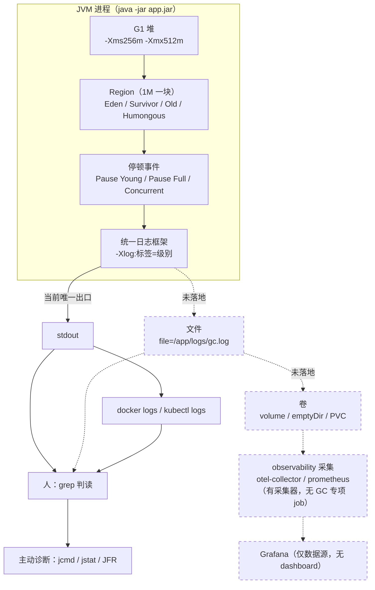
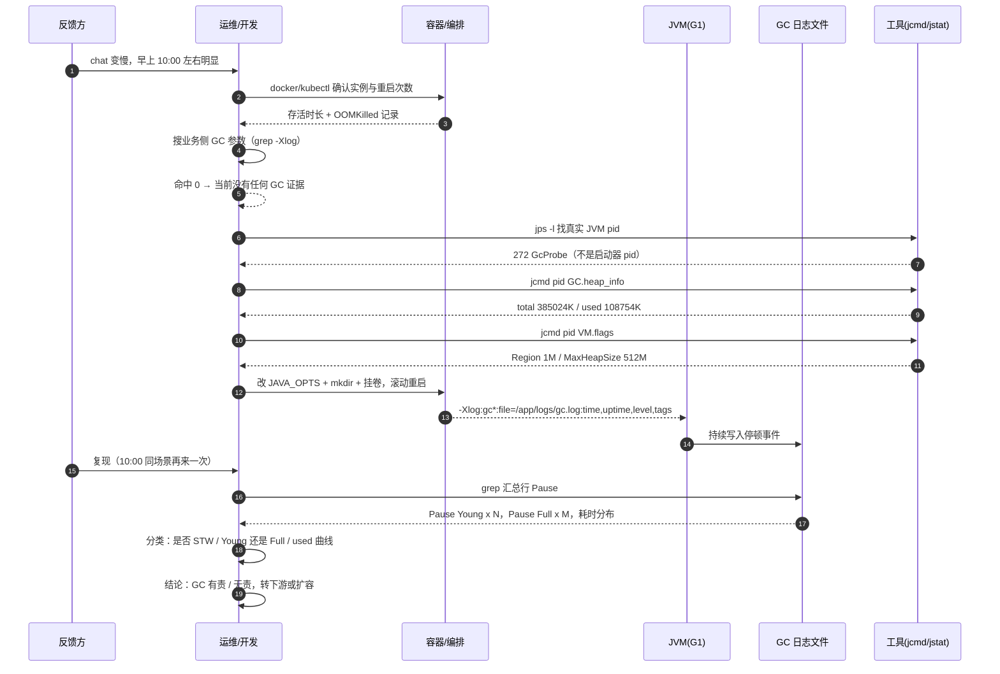

# 12.2 GC 日志与停顿分析

> **一句话结论**：没有 GC 日志，"最近好像变慢了"这句话就只能靠猜；`-Xlog:gc*` 交出来的是一份带时间戳的停顿账本，它把"是不是 GC 干的停顿 / Young 还是 Full / 堆到底缺不缺"这三个问题从争论变成读数据。
> **阅读前置**：读过 [01-JVM参数与GC选型](./01-JVM参数与GC选型.md)，知道 G1 的 Region（堆被切成等大的方形区块来管理）、年轻代/老年代是什么；不要求你会调参数，但要用过 `java -version` 和数据块级的命令行。
> **证据基线**：JDK 17.0.19（Temurin，本机真实执行）+ Spring Boot 4.2.0 / Spring Framework 7.1.0 的仓库基线配置。文中所有 GC 日志原片、`jcmd` 输出、参数报错、grep 统计，均为本机 2026-11-27 实测文本，未做美化。预计阅读 35 分钟。

先划清三条证据边界，避免把"能读到的东西"当成"已经有的东西"：

| 证据级别 | 本仓库 / 本机的真实状态 | 本篇怎么处理 |
|---|---|---|
| **A 级**（`24-源码分析/assets/source/` 的 Java 源码摘录） | 该目录是 Spring 生态源码摘录（`AbstractApplicationContext.java.md`、`StreamingChatModel.java.md` 等），**不含 HotSpot / G1 的实现源码** | 本篇 A 级证据 = 0 条。G1 的内部实现不拿别的文件冒充，凡涉及"JVM 内部怎么做的"一律落到 C 级实测输出上 |
| **B 级**（本项目真实配置与代码） | 11 个模块的 `JAVA_OPTS`、Dockerfile、k8s yaml、`application.yml` 都在仓库里，但**业务侧 GC 日志参数 0 处** | 用来证明"当前基础缺口"和"最小落地配置该写在哪里"，每条都给真实路径与行号 |
| **C 级**（本机可复现实测） | JDK 17.0.19 可用，`jcmd`/`jstat`/`jps` 可用；**没有 docker / kubectl，也没有正在运行的业务服务** | 本篇主体证据。容器相关结论只给命令与判读方法，并明确标注"未本机实测" |

---

## 0. 先看现象

三个现象，全部来自本仓库本机的真实输出。看完你会发现它们不是三个问题，而是同一个缺口的三个侧面。

### 现象 1：仓库里找不到任何一处业务 GC 日志参数

在仓库根目录跑（排除 `learning-docs`、`node_modules`、`target`、`tools` 这些非业务目录）：

```powershell
$files = Get-ChildItem -Path . -Recurse -File -Include *.java,*.yml,*.yaml,*.xml,*.sh,*.cmd,*.bat,*.ps1,Dockerfile `
  | Where-Object { $_.FullName -notmatch '\\node_modules\\|\\\.git\\|\\learning-docs\\|\\target\\|\\tools\\' }
$files | Select-String -Pattern '-Xlog|Xloggc|PrintGC|PrintGCDetails|UseGCLogFileRotation|GCLogFileSize'
```

真实输出（一行命中都没有）：

```text
扫描文件数 = 803
GC 日志参数命中 = 0
```

再看真正决定 JVM 怎么起来的两个地方。`ai-cs-chat/Dockerfile` 第 19 行（7 个模块用的是同一句，其中 `ai-cs-knowledge/Dockerfile` 在第 18 行）：

```dockerfile
ENTRYPOINT ["sh", "-c", "java ${JAVA_OPTS:-} -jar app.jar"]
```

`deploy/docker-compose/docker-compose-all.yml` 第 174 行（api-gateway）、第 192 行（user-service）、第 213/235/253/274/293 行（knowledge / chat / search / message / notify）——7 处，值完全一样：

```yaml
      JAVA_OPTS: "-Xms256m -Xmx512m"
```

也就是说：容器里 JVM 的全部 GC 相关参数就是一句 `-Xms256m -Xmx512m`，**没有任何 `-Xlog`**。日志去哪了？去 stdout 了——而 stdout 里只有 Spring 的 INFO，没有 GC 行。

### 现象 2：真实服务日志 156 行，严格的 GC 行是 0 条，宽松 grep 反而给出 4 条假阳性

仓库里有一份真实运行留下的日志：`tools/logs/ai-cs-chat.out.log`（42643 字节，156 行）。它记录了服务完整启动：

```text
L72: 2026-08-30T01:44:16.112+08:00  INFO 27744 --- [ai-cs-chat] [           main] o.s.b.w.embedded.tomcat.TomcatWebServer  : Tomcat started on port 8083 (http) with context path ''
L93: 2026-08-30T01:44:16.834+08:00  INFO 27744 --- [ai-cs-chat] [           main] com.aics.chat.ChatApplication            : Started ChatApplication in 130.921 seconds (process running for 134.399)
```

启动耗时 **130.921 秒**。这 130 秒里有没有发生 GC 停顿？这份日志回答不了——因为里面根本没有 GC 行。更糟的是，如果你用最直觉的 `grep GC` 去查，会得到"有 4 条"的假答案：

```powershell
$lines = Get-Content tools\logs\ai-cs-chat.out.log
@($lines | Select-String -Pattern '\[gc').Count   # 严格：GC 日志行一定以 [gc 开头
@($lines | Select-String -Pattern 'GC\(').Count   # 严格：GC(0) 这种事件号
```

真实输出：

```text
count_strict_[gc = 0
count_strict_GC_paren = 0
```

而那 4 条宽松命中长这样（大小写不敏感匹配到了单词内部的 `gC`）：

```text
L18  match='gC' ctx=...re.ListenerContainerConfiguration$$SpringCGLIB$$0] is not eligible for getting processed by all Bean
L105 match='gC' ctx=...ive server push request, request = ConfigChangeNotifyRequest, requestId = 8
```

`SpringCGLIB` 和 `ConfigChangeNotifyRequest` 里的 `gC` —— 这就是"用 `grep GC` 判断有没有 GC 日志"会踩的坑：**它会给你一个乐观的假阳性。**

### 现象 3：第一次真正打开 GC 日志，日志里立刻出现一条"Full GC"，而它是你自己的诊断命令造出来的

在本机用探针程序打开 GC 日志（`gc*` 全标签），再顺手跑一次 `jcmd GC.class_histogram` 看对象分布，日志末尾就多出这么三行：

```text
[2.910s][info][gc,start    ] GC(22) Pause Full (Heap Inspection Initiated GC)
[2.917s][info][gc,heap     ] GC(22) Humongous regions: 104->96
[2.917s][info][gc          ] GC(22) Pause Full (Heap Inspection Initiated GC) 106M->96M(330M) 6.880ms
```

`Heap Inspection Initiated GC` 的意思是"因为有人要检查堆而发起的 GC"。谁要检查堆？就是你刚敲下的那条 `jcmd`。**诊断动作伪造了被诊断的现象**——如果不认识这行括号里的原因，你会在"排查 Full GC"的工单里，把自己刚制造的一次 Full GC 当成证据。

> 这些现象指向同一件事：**GC 日志的缺失让所有性能判断退化成猜；而拿到日志之后不会逐字段读，又会让日志本身变成新的误判来源。** 前者是配置问题（本篇第 3.9、3.10 节给最小落地配置），后者是读法问题（本篇第 3.3~3.7、第 6 节给判读手法）。

---

## 1. 整体地图

GC 日志这条链路上有四个角色：JVM 产生事件 → 统一日志框架格式化成文本 → 落到某个介质 → 被人和工具消费。本项目目前只打通了第一个环节的一部分（JVM 会产生事件），后面三段全是断的。



> **读图说明**：实线是当前真实存在的通路，虚线是"仓库里有配件但没接通"的通路。关键要看两条断点：①`LOG` 到 `FILE` 这条虚线是**本篇要补的第一根线**——没有它，容器一重启证据就没了（stdout 只保留在 `docker logs` 的环形缓冲里）；②`VOL → COLLECT → GRAF` 这条虚线说明采集侧并不缺组件（`deploy/observability/prometheus.yml` 已经在抓 11 个服务的 `/actuator/prometheus`），缺的是"把 GC 数据当指标还是当日志"这个决定（见 5 节取舍）。右下角 `JCMD` 是唯一"不改配置也能拿到证据"的通路，但它只能抓瞬时快照，抓不到"过去两小时的第 37 次停顿"。

各组件在本仓库的真实位置：

| 组件 | 责任 | 参与方 | 真实位置 |
|---|---|---|---|
| G1 垃圾回收器 | 划分 Region、决定何时停顿回收 | JVM（JDK 17 默认 GC） | 无配置，靠默认值生效；实测 `Using G1` |
| `JAVA_OPTS` | 唯一注入 JVM 参数的口子 | 运维 / 编排文件 | `deploy/docker-compose/docker-compose-all.yml` L174、L192；`deploy/k8s/services/ai-chat-service.yaml` L80-L81 |
| Dockerfile ENTRYPOINT | 决定 `JAVA_OPTS` 怎么被展开 | 构建期 | `ai-cs-chat/Dockerfile` L19（`sh -c` 展开）；`ai-cs-order/Dockerfile`、`ai-cs-product/Dockerfile` 用 exec form，**不展开变量** |
| 统一日志框架 | 把事件格式化成文本（装饰器） | JVM 内部 | 无配置 |
| 落盘介质 | 让证据活过重启 | 编排 / 卷 | compose 侧 7 个 Java 服务**无 volumes**；k8s services 8 个文件 `volumes=0` |
| `deploy/observability` | 采集与展示 | 监控 | `prometheus.yml`（24 行，`scrape_interval: 15s`，11 个 target）、`tempo.yaml`、`otel-collector.yaml`、`grafana/provisioning/datasources/datasources.yaml`（**只有数据源，无 dashboard**） |
| `jcmd` / `jstat` | 事后/即时主动诊断 | 人 | `D:\DevTools\jdk\jdk17.0.19\bin\` |

---

## 2. 关键概念与关键工具

先统一名词，后面每个段落都会用到。**术语第一次出现的地方都给了人话解释**，不必回翻。

| 名称 | 位置 | 作用 | 关键参数/字段 |
|---|---|---|---|
| `-Xlog` | JVM 启动参数 | JDK 9 起的统一日志框架，取代 `-Xloggc`/`-XX:+PrintGC*` 那一套 | 语法 `-Xlog:标签组合=级别:输出:装饰器` |
| `gc*` | `-Xlog` 的标签写法 | 通配符，选中所有以 `gc` 开头的标签（`gc`、`gc,start`、`gc,heap`、`gc,phases`、`gc,metaspace`…） | `gc*` 全开、`gc` 只看事件、`gc+heap=debug` 更细 |
| `file=` 输出 | `-Xlog` 的输出部分 | 把日志写进文件而不是 stdout | 目录**必须已存在**，否则 JVM 起不来（实测见 6.6） |
| `time` 装饰器 | 输出选项 | 打人类可读的绝对时间 `2026-11-27T14:00:11.265+0800` | 与 `uptime` 二选一或并存 |
| `uptime` 装饰器 | 输出选项 | 打 JVM 启动以来的秒数 `[3.775s]` | 算"第几分钟开始频繁 GC"最快 |
| `level` 装饰器 | 输出选项 | 打 `info` / `warning` / `error` | 缺了它，`[warning][gc]` 这类行会被当成普通事件 |
| `tags` 装饰器 | 输出选项 | 打 `[gc,start]`、`[gc,heap]` 等标签 | 判读时靠它区分"事件行"与"细节行" |
| `filecount` / `filesize` | 输出选项 | 轮转：最多留几份、每份多大 | **必须成对出现**，单独给任何一个 JVM 立刻起不来（实测见 6.7） |
| `Humongous` | G1 概念 | 超过 Region 一半大小的对象，单独占 Region | 1M Region 时阈值约 512KiB，实测见 6.2 |
| `committed` | 堆内存概念 | 已向 OS 申请到的内存（不是上限，也不是已用） | GC 行括号里的第三个数 `(256M)` 就是它 |
| `MaxRAMPercentage` | JVM 参数 | 按物理/容器内存的百分比定堆上限，默认 25 | 只在**没有 `-Xmx`** 时生效（实测见 3.10） |
| `MaxRAM` | JVM 参数 | JVM 识别的内存上限（默认 128GiB 封顶） | 实测 `137438953472` = 128GiB |
| `jcmd` | `%JAVA_HOME%\bin\jcmd` | 向运行中的 JVM 发诊断命令 | `GC.heap_info`、`GC.class_histogram`、`VM.flags`、`VM.command_line` |
| `jstat` | `%JAVA_HOME%\bin\jstat` | 周期采样堆各区使用率与 GC 累计耗时 | `-gcutil <pid> 1000 5`（每秒一次、共 5 次） |
| `jps` | `%JAVA_HOME%\bin\jps` | 列出本机 Java 进程与主类 | `jps -l`；**注意 pid 可能与启动器返回的不同**（6.5） |
| JFR | JVM 内置飞行记录器 | 事件级采样，能抓到每次 GC 的因果 | `jdk.GarbageCollection`、`jdk.GCPhasePause` |

---

## 3. 原理与证据逐段精读

下面 11 段，每段都按同一个节奏走：**在干什么 → 为什么这么设计 → 换写法会怎样 → 常见坑**。每一段的证据都能在本机一条命令复现（除明确标注"未本机实测"的容器部分）。

### 3.1 `-Xlog` 的三段式：标签、级别、输出

**在干什么**：`-Xlog` 把 JVM 内部几百个日志点组织成树状标签（`gc`、`gc+heap`、`gc+phases`、`safepoint`…），你可以只打开一棵子树，并指定这棵子树的日志往哪里写、前面加什么前缀。

```text
-Xlog:<标签组合>=<级别>:<输出>:<装饰器>
       ~~~~~~~~    ~~~   ~~~~    ~~~~~~
       gc*         info  file=…  time,uptime,level,tags
```

**为什么这么设计**：JDK 8 时代每个日志维度都是一个独立参数（`-XX:+PrintGCDetails`、`-XX:+PrintGCDateStamps`、`-XX:+PrintGCTimeStamps`、`-XX:+PrintTenuringDistribution`…），组合爆炸且各管各的。JDK 9 把它们收敛成一个语法，好处是"要什么开什么"，代价是**参数写错不是警告而是致命错误**。

**换写法会怎样**：把 `gc*`（全标签）换成 `gc`（只事件行），日志量会掉一个数量级——只留 `Pause Young ... 116M->96M(256M) 1.788ms` 这类汇总行，丢掉 phases/task 明细。反过来写 `gc+heap=debug` 会多出 Region 级明细，一般只在追 Humongous 问题时才开。

**常见坑**：`gc*` 的 `*` 只匹配同层标签（`gc,start` 算同层），不匹配 `gc+heap` 这种需要单独写的子标签。写 `-Xlog:gc*:file=x.log` 却期望看到 `gc+heap=debug` 的明细，是常见的期待错位。

### 3.2 拆一条带完整装饰器的真实日志行

**在干什么**：给每一行加上"什么时候、第几秒、什么级别、哪个标签"。本机跑一次带全套装饰器的探针，得到真实输出：

```text
[2026-11-27T14:00:11.265+0800][0.018s][info][gc] Using G1
[2026-11-27T14:00:11.269+0800][0.022s][info][gc,init] Heap Max Capacity: 512M
[2026-11-27T14:00:15.022+0800][3.775s][info][gc,start    ] GC(0) Pause Young (Normal) (G1 Evacuation Pause)
[2026-11-27T14:00:15.036+0800][3.789s][info][gc          ] GC(0) Pause Young (Normal) (G1 Evacuation Pause) 22M->20M(256M) 13.838ms
[2026-11-27T14:00:17.379+0800][6.132s][info][gc,start    ] GC(1) Pause Young (Normal) (G1 Evacuation Pause)
[2026-11-27T14:00:17.385+0800][6.138s][info][gc          ] GC(1) Pause Young (Normal) (G1 Evacuation Pause) 34M->33M(256M) 6.479ms
```

逐字段对照：

| 片段 | 含义 | 判读要点 |
|---|---|---|
| `2026-11-27T14:00:15.036+0800` | 绝对时间（`time` 装饰器） | 和业务日志对时间轴时用它；跨机器排查先对时区 |
| `[3.775s]` | 启动后秒数（`uptime` 装饰器） | "第 3.7 秒开始第一次 Young GC"——判断启动期是否 GC 风暴最快 |
| `[info]` | 级别 | 缺 `level` 装饰器时这列不存在，`warning` 会混在事件里看不出来 |
| `[gc,start` / `[gc` | 标签 | `gc,start` 是"开始"行，`gc` 是"汇总"行；同一次 GC 用 `GC(0)` 编号串起来 |
| `GC(0)` | 事件编号 | 从 0 递增，**跨 Young/Full/Concurrent 共用编号**，所以看编号跳号说明有事件没打出来 |
| `Pause Young (Normal) (G1 Evacuation Pause)` | 停顿类型 + 触发原因 | 括号里的第二组是"为什么开始"：`G1 Evacuation Pause`＝正常疏散，`G1 Humongous Allocation`＝大对象分配 |
| `22M->20M(256M)` | 停顿前堆占用 → 停顿后堆占用（当前已申请容量） | **第三个数不是 `-Xmx`**，见 3.4 |
| `13.838ms` | 这次停顿的实际时长（STW，Stop-The-World，应用线程全停） | 尾延迟的直接来源 |

**为什么这么设计**：一个 GC 事件在 JVM 里其实是十几条日志（start/task/phases/heap/汇总），用 `GC(n)` 编号 + 不同标签把它们串成一组，既能 `grep 'GC(0)'` 全取，也能只取 `\[gc +\]` 的汇总行。

**换写法会怎样**：不加 `uptime` 只留 `time`，跨机器对时不方便；不加 `tags`，你会分不清 `Eden regions: 2->0(16)` 是细节还是事件；不加 `level`，JDK 自己吐的 `[warning][gc]`（比如 `-Xloggc is deprecated`）就会被忽略。

**常见坑**：仓库里 `tools/nacos/bin/startup.sh` L114 用的是 `time,tags`（**缺 `level`**），而 `tools/rocketmq/bin/runbroker.cmd` L33 用的是 `time,uptime,level,tags`（最全）。照抄前者的写法，就等于主动放弃告警行——这是真实存在于本仓库的两套不一致模板。

### 3.3 一条 G1 Young GC 的完整结构（真实 15 行）

**在干什么**：把一次停顿完整摊开——谁参与、每一步花多久、各区怎么变、最后汇总成一行。以下是本机探针（`-Xms256m -Xmx512m`）真实产出的 GC(0)：

```text
[0.077s][info][gc,start    ] GC(0) Pause Young (Concurrent Start) (G1 Humongous Allocation)
[0.077s][info][gc,task     ] GC(0) Using 6 workers of 13 for evacuation
[0.079s][info][gc,phases   ] GC(0)   Pre Evacuate Collection Set: 0.08ms
[0.079s][info][gc,phases   ] GC(0)   Merge Heap Roots: 0.06ms
[0.079s][info][gc,phases   ] GC(0)   Evacuate Collection Set: 0.57ms
[0.079s][info][gc,phases   ] GC(0)   Post Evacuate Collection Set: 0.32ms
[0.079s][info][gc,phases   ] GC(0)   Other: 0.57ms
[0.079s][info][gc,heap     ] GC(0) Eden regions: 2->0(16)
[0.079s][info][gc,heap     ] GC(0) Survivor regions: 0->1(3)
[0.079s][info][gc,heap     ] GC(0) Old regions: 0->0
[0.079s][info][gc,heap     ] GC(0) Archive regions: 0->0
[0.079s][info][gc,heap     ] GC(0) Humongous regions: 115->96
[0.079s][info][gc          ] GC(0) Pause Young (Concurrent Start) (G1 Humongous Allocation) 116M->96M(256M) 1.788ms
[0.079s][info][gc          ] GC(1) Concurrent Undo Cycle
[0.080s][info][gc,marking  ] GC(1) Concurrent Cleanup for Next Mark 1.163ms
[0.080s][info][gc          ] GC(1) Concurrent Undo Cycle 1.221ms
```

十行 `GC(0)` 里藏着四个判读点：

1. **`Using 6 workers of 13 for evacuation`**：13 个并行 GC 线程里只用了 6 个。原因写在启动段——这台机器 `CPUs: 16 total`，JVM 按 CPU 数算出 `Parallel Workers: 13`，但回收集太小（这次只有 2 个 Eden Region），启不满。
2. **`phases` 五行加起来 ≈ 1.6ms，汇总行写 1.788ms**：差额是没被 phases 覆盖的固定开销。所以"想优化停顿"先看 `Evacuate Collection Set`（这次 0.57ms），它才是搬对象的成本。
3. **`Humongous regions: 115->96`**：一个 Region 1M 的堆里，有 96~115M 被大对象占着。这一行是 3.5 与 6.2 的伏笔——探针故意分配 512KiB 数组，正好 ≥ Region 一半（512KiB），全部变成 Humongous。
4. **`GC(1) Concurrent Undo Cycle`**：编号 1 是一次**并发**阶段（不 STW），耗时 1.221ms。它和 GC(0) 共享编号序列，但不产生停顿——把 Concurrent 行当成"又一次停顿"是常见误读。

**为什么这么设计**：停顿优化必须知道时间花在哪一段，所以 G1 把一次 GC 拆成可度量的阶段；Region 计数则是 G1 的核心账本（一切都是 Region 的买卖）。

**换写法会怎样**：只开 `-Xlog:gc`（不带 `*`），你只会看到最后那行汇总——知道"停了 1.788ms"，但完全不知道是搬对象慢还是并发线程太少。

**常见坑**：把 `2->0(16)` 读成"Eden 从 2M 降到 0M，总共 16M"。正确读法是 `2 个 Region -> 0 个 Region（当前共分配了 16 个 Region）`——**单位是 Region 个数，括号里是当前容量**。`(16)` 换算成字节要乘 Region 大小（本例 1M）。

### 3.4 三个数字 `116M->96M(256M)`：最容易被读错的一行

**在干什么**：给出这次停顿的堆账本：停顿前用了多少、停顿后剩多少、当前堆有多大。

**为什么这么设计**：判断"堆够不够"必须同时看"用了多少"和"能用到多少"，所以 G1 把三个数并排打出来。

**换写法会怎样**：只给前两个数（早年的 Parallel GC 就是这么打的 `116M->96M(512M)` 里的第三个数是最大堆），读者很难发现 G1 的第三个数是**可伸缩的已申请容量**。下面是本机同一次运行里，随着堆自适应增长，第三个数自己变大的真实证据：

```text
GC(10) Pause Young (Concurrent Start) (G1 Humongous Allocation) 115M->96M(335M) 1.568ms
GC(20) Pause Young (Concurrent Start) (G1 Humongous Allocation) 151M->96M(376M) 2.177ms
```

启动参数明明是 `-Xmx512m`（启动段 `Heap Max Capacity: 512M` 可查），但第三个数是 256M → 335M → 376M。**把 `(256M)` 当成 max heap 就是这里的头号误判**：你会得出"堆只有 256M，难怪一直 GC，赶紧加到 2G"的结论，而真实情况是堆用了 96M / 上限 512M，**根本不缺内存**。

**常见坑**（三个连环坑）：
- 把第三个数当 `-Xmx` → 误判堆不足；
- 把 `151M->96M` 的差（55M）当成"回收了 55M 垃圾"，其实是"Humongous Region 从 151 降到 96"，里面还混着刚被释放的 Region 记账；
- 看到 `used` 一直 96M 不动，以为"内存泄漏"，其实是探针故意常驻了 48 个 1MiB 对象。

### 3.5 判断一：这次卡顿到底是不是 GC 造成的

**在干什么**：把"用户感觉慢"这件事，切成"应用自己的耗时"和"JVM 让应用停下来的耗时"。GC 停顿是 STW 的：这段时间里**所有应用线程都被按在安全点（safepoint，可以安全暂停线程的位置）上不动**，NIO 线程、Tomcat 工作线程一个都跑不了。

**为什么这么设计**：STW 是回收正确性的前提（不暂停就无法安全地移动对象）。所有回收器都有，区别只是长短。

**换写法会怎样**：想"不做 STW"就得换成并发回收（ZGC / Shenandoah），代价是更高的 CPU 与内存开销，以及"吞吐略有下降"。本项目堆只有 512M、暂停在毫秒级（本机探针实测 1.788ms / 2.177ms / 6.880ms / 13.838ms），换 ZGC 在**这个量级上收益为负**——这是取舍，不是升级。

**判读方法（三步，全部用真实输出）**：
1. 拿业务侧的慢请求时间戳去对 GC 日志的 `time` 列，看是否有重叠；
2. 看重叠的那次 GC 的耗时是否与慢的幅度同量级（毫秒级停顿解释不了 3 秒的慢请求）；
3. 若重叠但量级差两个数量级，说明"GC 只是恰好同框"，要继续查下游（本项目 chat 服务的 `TimeLimiter` 是 30s/60s，`ai-cs-chat/src/main/resources/application.yml` L71、L74——超时链路比 GC 更可能是慢的元凶）。

**常见坑**：GC 日志里没有的停顿不代表没停顿——`safepoint` 相关停顿（偏向锁撤销、大量线程进入安全点）在 `gc*` 标签下看不到，要看 `-Xlog:safepoint`。**"GC 日志没停顿" ≠ "JVM 没停过"**。

### 3.6 判断二：是 Young 还是 Full

**在干什么**：区分"轻量但频繁的年轻代回收"与"重量级、会连带整理老年代的全堆回收"。两者的处置方式完全相反：前者往往无害（甚至是健康的），后者才是容量/泄漏信号。

本机真实抓到的两类（不同探针、不同参数）：

```text
# 类型一：Young（只回收年轻代，快）
[0.077s][info][gc,start    ] GC(0) Pause Young (Concurrent Start) (G1 Humongous Allocation)
[0.079s][info][gc          ] GC(0) Pause Young (Concurrent Start) (G1 Humongous Allocation) 116M->96M(256M) 1.788ms

# 类型二：Full（全堆，慢，且带原因）
[2.910s][info][gc,start    ] GC(22) Pause Full (Heap Inspection Initiated GC)
[2.917s][info][gc          ] GC(22) Pause Full (Heap Inspection Initiated GC) 106M->96M(330M) 6.880ms
```

判读口诀：**看 `Pause Young` / `Pause Full` 两个词 + 看括号里的原因**。原因里出现这些词要立刻警觉：

| 括号里的原因 | 含义 | 该做什么 |
|---|---|---|
| `(G1 Evacuation Pause)` | 正常疏散（Eden 满了） | 无需处理，看频率与耗时即可 |
| `(G1 Humongous Allocation)` | 大对象分配触发 | 查对象大小 vs Region 大小（6.2 有真实复现） |
| `(Heap Inspection Initiated GC)` | **有人主动要求检查堆**（jcmd/jmap） | 这是诊断动作造成的，不是故障（现象 3） |
| `(G1 Compaction Pause)` | 全堆整理（真正的 Full） | 查碎片与老年代占用 |
| `(Metadata GC Threshold)` | 元空间满触发 | 查类加载/动态代理数量，配 `MaxMetaspaceSize` |

**为什么这么设计**：G1 是分代 + 增量的，绝大多数停顿应该是 Young；一旦开始频繁 Full，说明"疏散失败/晋升失败/碎片化"这一档的问题出现了，必须换策略（扩堆、提前 mixed GC、调 `InitiatingHeapOccupancyPercent`）。

**常见坑**：**并发阶段不是停顿**。`GC(1) Concurrent Undo Cycle 1.221ms`、`GC(1) Concurrent Cleanup for Next Mark 1.163ms` 都是 Concurrent 标签，不 STW。把这类行算进"总停顿时间"，会把停顿统计放大好几倍。

### 3.7 判断三：堆是不是真的不够

**在干什么**：这是最贵的一个判断，因为它的结论直接通向"加内存"或"改代码"。证据必须来自"一段时间内的 used 曲线"，而不是某一次快照。

本机真实快照（探针跑了两秒后，用 `jps -l` 找到真实 pid 再抓）：

```text
$ jcmd 272 GC.heap_info
272:
 garbage-first heap   total 385024K, used 108754K [0x00000000e0000000, 0x0000000100000000)
  region size 1024K, 3 young (3072K), 1 survivors (1024K)
 Metaspace       used 431K, committed 640K, reserved 1114112K
  class space     used 26K, committed 128K, reserved 1048576K
```

三个词必须分清（这张表是 3.7 的全部价值）：

| 词 | 含义 | 本机数值 | 别读成 |
|---|---|---|---|
| `total` | 已向 OS 申请到的堆容量（committed） | 385024K ≈ 376M | 不是上限，上限是 512M |
| `used` | 当前存活对象占用 | 108754K ≈ 106M | 不是"峰值" |
| `reserved`（Metaspace 那行） | 预留地址空间 | 1114112K ≈ 1.06G | 不是实际占用（`used` 才 431K） |

四条判据，按可信度从高到低：

1. **Full GC 之后的 `used` 是否持续爬升**——压缩后仍单调上涨才是泄漏（配 [04-内存泄漏排查实战](./04-内存泄漏排查实战.md) 的 `GC.class_histogram` 对比法）；
2. **Young GC 后的 `used` 是否稳定在某个平台**——本机 `96M` 反复出现，就是"平台"，说明常驻对象是设计好的，不是泄漏；
3. **`total` 是否已经贴着上限**——`376M` vs `512M` 说明还有余量；若 `total` 常年 = `Heap Max Capacity` 且 `used` 贴边，才是真的紧；
4. **是否频繁出现 `Pause Full`**——Young 频繁不代表不足（见 6.2 的反例），Full 频繁才代表不足。

**常见坑**：只看 `used` 不看 `total`，会把"堆在自适应扩张"误读成"内存快满了"。本机 `total` 从 256M 涨到 376M 的过程中，`used` 一直 106M 左右——如果只盯 `used/512`，你会算出 20% 使用率而完全错过扩张行为。

### 3.8 GC 停顿与尾延迟（P99）的关系

**在干什么**：解释为什么"平均响应时间很好看，P99 却很难看"。P99 指把 100 个请求按耗时排序，第 99 个的耗时——也就是"最慢的 1% 用户经历的时间"。尾延迟就是这撮人的体感。

**机制（不编数字，只讲因果）**：一个请求如果落在 STW 窗口内，它被推迟的时间 ≈ 剩余停顿时间；而且**一次请求可能被多次停顿叠加**。用本机真实停顿值举例（探针数据，非生产数据）：一次 `13.838ms` 的 Young GC，如果某个请求恰好要做 500ms 的 LLM 流式输出，在这 500ms 内发生 3 次 Young GC，那么这条请求的耗时就会被拉长约数十毫秒的量级。

关键推论有三条：

1. **GC 停顿抬高的是尾部，不是平均值**。一次 13ms 的停顿对平均 200ms 的接口几乎无感，但对本来 30ms 的快接口是 +40%。
2. **停顿频率比单次时长更影响 P99**，因为落在窗口内的请求比例 ≈ Σ停顿时长 / 观测窗口。本机探针在 0.077s~0.170s 之间打了 20 次 Young GC，这 100ms 里几乎处处有停顿——如果这是生产，那 100ms 内的请求全部受影响。
3. **并发度越低，单次停顿越容易被"看见"**。Tomcat 默认 `maxThreads` 200 且队列无界，意味着停顿期间请求不会失败，只会**排队变慢**——停顿 13ms，排队就可能变成几百毫秒（见 [07-线程池调优与背压](./07-线程池调优与背压.md)）。

**怎么测**（本环境**未本机实测**，因为没有运行中的业务服务，也没有压力工具链）：

```bash
# 应用侧：把 GC 停顿做成可直接对时间轴的指标（JFR 事件）
jcmd <pid> JFR.start name=gc settings=profile duration=120s filename=/app/logs/gc.jfr
# 事后解析每次停顿的起止时间，与 k6/压测的慢请求时间戳对齐
jfr print --events jdk.GarbageCollection /app/logs/gc.jfr | head -40
```

判读方法：`jdk.GarbageCollection` 事件带 `startTime`/`duration`；把慢请求的时间戳与这些窗口求交集，交集占比高才说明 GC 有责任。**为什么本环境测不了**：`docker -> MISSING`、`kubectl -> MISSING`，且没有正在运行的服务实例，无法产生真实请求与真实停顿的叠加样本；`scripts/loadtest/k6/sse-chat.js` 虽然存在，但需要服务在线。

**常见坑**：拿"平均 GC 停顿 2ms"去解释"P99 是 800ms"。量级差 400 倍时，GC 不可能是主因——本项目更该先查 `ai-cs-chat/src/main/resources/application.yml` L71/L74 的 30s/60s `TimeLimiter` 与 L84-L91 的三次重试（重试会把一次慢放大成三次）。

### 3.9 容器里的落盘与轮转

**在干什么**：让 GC 日志活过容器重启，并且不会把盘写满。三个动作：`file=` 指定路径 → `filecount`+`filesize` 做轮转 → 挂卷把目录搬到宿主机。

**为什么这么设计**：容器是易失的。stdout 只留在 `docker logs` / `kubectl logs` 背后那份由宿主机日志驱动（或 kubelet 的 `containerLogMaxSize`）管理的文件里，**容器一删就没了**；而 GC 证据恰恰最需要在"容器被 OOMKilled 重启"之后回看。要做事后归因，必须有文件 + 卷。

本机实测三件事，全部有真实输出：

**(1) 目录不存在 → JVM 直接起不来**（不是"静默不落盘"）：

```text
[0.006s][error][logging] Error opening log file 'nodir/gc.log': No such file or directory
[0.006s][error][logging] Initialization of output 'file=nodir/gc.log' using options '(null)' failed.
Error: Could not create the Java Virtual Machine.
Error: A fatal exception has occurred. Program will exit.
```

**(2) `filecount` 与 `filesize` 必须成对**，单独给任何一个都是致命错误：

```text
-Xlog:gc*:file=x1.log:filecount=3   →  [0.006s][error][logging] Invalid decorator 'filecount=3'.
-Xlog:gc*:file=x2.log:filesize=10m  →  [0.006s][error][logging] Invalid decorator 'filesize=10m'.
Error: Could not create the Java Virtual Machine.
```

**(3) `filecount=3` 实际会在盘上留下 4 个文件**（当前 + 3 份历史），这是本机真实目录列表：

```text
Name       Length
----       ------
gcr2.log      364   ← 正在写的
gcr2.log.0   1052   ← 最老
gcr2.log.1   1093
gcr2.log.2   1135
```

所以按 `filecount=10,filesize=100M` 估算磁盘占用要按 **11 × 100M ≈ 1.1G** 算，不是 1G。本仓库 vendored 的中间件脚本就是用这套参数（`tools/nacos/bin/startup.sh` L114 `filecount=10,filesize=100m`）。

落地到本项目，最小改动是两处（**当前均未落地**，属于本文给出的建议配置）：

```dockerfile
# ai-cs-chat/Dockerfile 阶段 2 改造示意（当前 L15-L19 无这些行）
FROM eclipse-temurin:17-jre-jammy
WORKDIR /app
RUN mkdir -p /app/logs
VOLUME ["/app/logs"]
COPY --from=builder /build/ai-cs-chat/target/*.jar app.jar
EXPOSE 8083
ENTRYPOINT ["sh", "-c", "java ${JAVA_OPTS:-} -Xlog:gc*:file=/app/logs/gc.log:time,uptime,level,tags:filecount=5,filesize=20m -jar app.jar"]
```

`mkdir -p /app/logs` 不是可选项——按上面的实测，目录不存在 JVM 会拒绝启动。

挂卷侧（compose 示例，当前 7 个 Java 服务 `volumes` 命中数为 0）：

```yaml
    volumes:
      - ./logs/api-gateway:/app/logs      # 落到宿主机，容器重建不丢
```

k8s 侧对应的是 `emptyDir`（Pod 内有效、Pod 删即失）或 PVC（跨 Pod 持久化）。实测 8 个 `deploy/k8s/services/*.yaml` 里 `volumes=0 volumeMounts=0 emptyDir=0`，即**当前一个都没有**。

**常见坑**：把 GC 日志写进 `/tmp` 或容器工作目录却不挂卷，等于"给了一个只在本次容器生命周期内有效的证据"——恰恰是最需要证据的 OOM/重启场景下，证据跟容器一起没了。

### 3.10 `-XX:MaxRAMPercentage` 与容器 limit 的相互影响

**在干什么**：决定"JVM 认为自己能用多少内存"。有两个入口：写死的 `-Xmx`，或按比例算的 `-XX:MaxRAMPercentage`。

本机真实测量（先看裸机默认值）：

```text
$ java -XX:+PrintFlagsFinal -version | findstr "MaxHeapSize InitialHeapSize MaxRAM MaxRAMPercentage"
   size_t InitialHeapSize      = 532676608        {product} {ergonomic}
   double InitialRAMPercentage = 1.562500         {product} {default}
   size_t MaxHeapSize          = 8514437120       {product} {ergonomic}
 uint64_t MaxRAM               = 137438953472     {pd product} {default}
   double MaxRAMPercentage     = 25.000000        {product} {default}
```

裸机物理内存 `34042929152` 字节（31.7 GiB），`MaxHeapSize = 8514437120` ≈ 25% × 31.7 GiB。**默认 25% 是 ergonomic（人体工程学默认值，JVM 自己算出来的，不是你写的）**。

再验证百分比确实生效，以及和 `-Xmx` 谁说话算数（两个真实对比）：

```text
$ java -XX:MaxRAMPercentage=50 -XX:+PrintFlagsFinal -version | findstr "MaxHeapSize MaxRAMPercentage"
   size_t MaxHeapSize      = 17028874240     {product} {ergonomic}      ← 50% × 31.7GiB
   double MaxRAMPercentage = 50.000000       {product} {command line}

$ java -Xmx512m -XX:MaxRAMPercentage=50 -XX:+PrintFlagsFinal -version | findstr "MaxHeapSize MaxRAMPercentage"
   size_t MaxHeapSize      = 536870912       {product} {command line}   ← -Xmx 赢
   double MaxRAMPercentage = 50.000000       {product} {command line}
```

结论有三条：

1. `MaxRAMPercentage` **只在没有 `-Xmx` 时生效**；本项目处处写死 `-Xmx`（compose L174/L192、k8s L81），所以这个参数在本项目**目前完全不起作用**。
2. 一旦容器上限（cgroup memory limit）小于宿主机，JDK 10+ 的 `UseContainerSupport`（默认开启）会让 `MaxRAM` 取容器 limit，`MaxRAMPercentage` 才有意义。**本环境无法实测**（`docker -> MISSING`），给命令与判读方法：

```bash
# 容器内实测（需在真实容器里跑，本环境无 docker，未实测）
docker run --rm -m 1g eclipse-temurin:17-jre java -XX:+PrintFlagsFinal -version | grep -E 'MaxHeapSize|MaxRAM '
# 判读：MaxRAM 应 ≈ 1g（容器 limit），MaxHeapSize 应 ≈ 256m（25%）
```

3. **本项目的真实风险是反向的**：k8s 给 chat 的 limit 是 `memory: "1Gi"`，而 `JAVA_OPTS` 写死 `-Xms512m -Xmx512m`（`deploy/k8s/services/ai-chat-service.yaml` L81、L87）。堆 512M + 元空间 + 代码缓存 + 线程栈 + 直接内存 ≈ 700~900M，**离 1Gi 只有一两百兆余量**，一旦触发 OOMKilled，表现是"容器莫名重启"，而不是 Java 的 `OutOfMemoryError`——因为杀它的是内核 OOM killer。这就是"堆参数与容器 limit 必须一起看"的原因。

对照 `deploy/k8s/elasticsearch.yaml` L64-L65 与 L75：那边显式写了 `ES_JAVA_OPTS: -Xms512m -Xmx512m` 且 limit `memory: "2Gi"`，还留了注释"容器内存需大于 JVM 堆+堆外内存"——**同一个仓库里，搜索组件懂这个道理，业务服务没有**。

**常见坑**：以为"配了 `MaxRAMPercentage=75` 就自动适配所有环境"，结果 Dockerfile 里那句 `-Xmx512m` 把它彻底覆盖了，参数看着配了、其实没生效。排查方法就是本节的 `PrintFlagsFinal`：**看右侧 `{command line}` 还是 `{ergonomic}`**，只有 `{command line}` 才是你写的那句话在起作用。

### 3.11 用 `jcmd` 主动诊断：三个命令与一个陷阱

**在干什么**：在不重启进程的前提下，向运行中的 JVM 要一份"现在堆长什么样、谁占着内存"的快照。

三个最常用的命令，本机真实输出：

```text
$ jcmd 272 VM.command_line
jvm_args: -Xms256m -Xmx512m -Xlog:gc*:file=gc-run.log
java_command: GcProbe
Launcher Type: SUN_STANDARD

$ jcmd 272 VM.flags
-XX:CICompilerCount=12 -XX:ConcGCThreads=3 -XX:G1HeapRegionSize=1048576 -XX:InitialHeapSize=268435456
-XX:MaxHeapSize=536870912 -XX:MaxNewSize=321912832 -XX:MinHeapSize=268435456
-XX:+UseCompressedClassPointers -XX:+UseCompressedOops -XX:+UseG1GC

$ jcmd 272 GC.heap_info
 garbage-first heap   total 385024K, used 108754K [0x00000000e0000000, 0x0000000100000000)
  region size 1024K, 3 young (3072K), 1 survivors (1024K)
```

`VM.flags` 的价值在于**看见推导出来的值**：`-XX:G1HeapRegionSize=1048576`（1M）解释了大对象阈值是 512KiB；`-XX:MaxNewSize=321912832`（307M）解释了年轻代上限。

第四个命令是坑：`GC.class_histogram`。真实输出（前几行）：

```text
$ jcmd 272 GC.class_histogram
 num     #instances         #bytes  class name (module)
   1:          2768       50511720  [B (java.base@17.0.19)
   2:           137         142376  [C (java.base@17.0.19)
   3:           699          87256  java.lang.Class (java.base@17.0.19)
   5:          2633          63192  java.lang.String (java.base@17.0.19)
   6:          1061          33952  java.util.concurrent.ConcurrentHashMap$Node (java.base@17.0.19)
  13:            19           6992  java.lang.Thread (java.base@17.0.19)
```

它顺手在 GC 日志里留下了一条 `Pause Full (Heap Inspection Initiated GC)`（见现象 3）。**正确用法是加 `-all`**——本机同进程实测，加了 `-all` 只做堆遍历、不触发 Full GC（日志里没有新增 Pause 行）：

```text
$ jcmd 27736 GC.class_histogram -all
   1:          3653       52066528  [B (java.base@17.0.19)
```

**为什么这么设计**：不带 `-all` 时为了给出"准确的对象图"，JVM 会先做一次全堆整理；带 `-all` 时放弃"绝对准确"换取"不打扰应用"。这是个刻意的工程取舍。

**换写法会怎样**：用 `jmap -histo <pid>` 有同样的触发 Full GC 行为（`jmap -histo:live` 更明确地触发），要选"不打扰"的版本就用 `jcmd ... -all`。

**常见坑**（连锁三个）：把直方图里的 `[B`（byte 数组）当成"业务里有个大 byte 数组泄漏"——`[B` 是 JVM 给的基本类型数组类名，`50511720` 字节可能就是这个探针故意持有的 48 个 1MiB 对象；把诊断间接触发的 Full GC 当故障；用 `Start-Process` 返回的 pid 去 `jcmd`（**那不是 JVM pid**，6.5 有真实对比）。

---

## 4. 一次完整排查/执行时序

场景："用户反馈最近 chat 服务变慢了"。下面是从"接到反馈"到"拿出一条可复现证据链"的完整时序，每一步都标了"判读错会长什么样"。



> **读图说明**：第 5~7 步是"没有证据时的临时手段"——只能拿到瞬时快照，拿不到历史；第 12 步才是把证据链补齐的动作（改参数必须重启，这是 `-Xlog` 只能在启动时生效的硬约束，除了用 `jcmd VM.log` 动态开启，但那不能加 `file=` 落盘）。注意第 4 步到第 12 步之间有一个不可逆的损失：**重启前的证据永远拿不回来了**，这也解释了为什么"GC 日志应该默认开着"，而不是等出事再开。

每步该怎么判读：

| 步骤 | 该看什么 | 正常长什么样 | 异常长什么样 / 会误判成什么 |
|---|---|---|---|
| 2 实例状态 | 存活时长、`OOMKilled`、重启次数 | 存活数天 | 存活 2 小时 + `OOMKilled` → 先怀疑堆+limit，不是"内存泄漏" |
| 5 找 pid | `jps -l` 的 pid 与主类 | 主类名与进程名一致 | 用启动器 pid → `jcmd` 报 "Process not found"（6.5） |
| 7 `GC.heap_info` | `total` / `used` / `region size` | `used` 远小于 `total` | `used` 贴 `total` 且 `total` 贴上限 → 真紧 |
| 9 `VM.flags` | `G1HeapRegionSize` / `MaxHeapSize` | 1M / 512M | Region 1M + 大对象 → 6.2 的 Humongous 陷阱 |
| 13 汇总行 | `Pause Young` 次数与耗时 | 秒级间隔、个位数毫秒 | 每 10ms 一次 Young → 先查大对象，别急着说泄漏 |
| 14 分类 | STW 行 vs Concurrent 行 | 两类分开统计 | 把 Concurrent 算进停顿 → 停顿被放大数倍 |

---

## 5. 设计取舍

GC 日志这件事上，每个选择都有"看得更多"与"代价更高"的对价。下表是本项目相关维度的对照，最后一列是本文给出的**建议值**（当前均未落地）：

| 维度 | 方案 A | 方案 B | 本项目建议 | 理由与代价 |
|---|---|---|---|---|
| 日志粒度 | `gc*` 全标签（含 phases/task/heap） | `gc` 只事件行 | **`gc*`** | 全标签体积大 5~10 倍，但排查碎片/Humongous 时必须；`gc` 省盘却丢诊断力 |
| 输出目标 | 仅 stdout（当前） | 文件 + 卷 | **两者都要**：文件落卷 + 保留 stdout | 文件是事后归因的唯一载体；stdout 保留 `docker logs` 习惯用法 |
| 轮转策略 | `filecount`+`filesize` 自管 | 交给宿主机 logrotate / 采集器 | **自管**（`filecount=5,filesize=20m`） | 自管不依赖宿主机配置，代价是按 6 份算盘（3.9 实测） |
| 堆参数 | 写死 `-Xmx512m`（当前） | `-XX:MaxRAMPercentage` | **短期保留 `-Xmx`，但必须与 limit 一起复核** | 百分比制在 k8s 更贴合 limit；写死值在 limit 变化时不会自动跟随（3.10） |
| GC 数据形态 | 日志（文件） | 指标（`/actuator/prometheus` 的 `jvm_gc_*`） | **日志用于归因，指标用于告警** | 指标只有聚合值，回答不了"哪一次停顿、什么原因" |
| 主动诊断 | `jcmd` 快照 | JFR 连续记录 | **出事用 `jcmd`，常态开 JFR 低开销** | JFR 可回溯，但要注意 `settings=profile` 的开销 |
| 采集接线 | 已有 `deploy/observability`（prometheus 抓 11 个服务） | 新增 GC 专项 job / Grafana 面板 | **先补面板**（数据已在 `/actuator/prometheus`） | 采集器与 `micrometer-registry-prometheus` 都已就位，缺的是面板与用途定义 |

可扩展点清单（**以下均为当前未落地**，按投入从低到高排序）：

1. 给 7 个 Dockerfile 的 ENTRYPOINT 加 `-Xlog:gc*:file=/app/logs/gc.log:time,uptime,level,tags:filecount=5,filesize=20m`；
2. 每个 Dockerfile 加 `RUN mkdir -p /app/logs` + `VOLUME ["/app/logs"]`（顺序不能反，否则 3.9 的启动失败会重现）；
3. compose 侧为 7 个 Java 服务补 `volumes: ./logs/<svc>:/app/logs`；
4. k8s 侧为 8 个 service yaml 补 `emptyDir`（低成本）或 PVC（跨 Pod 保留）；
5. `deploy/observability/grafana` 增加 GC dashboard（`jvm_gc_pause_seconds_*` 已在暴露，只是没有面板）；
6. 把 `-Xmx` 与 `limits.memory` 的比例做成一条检查脚本（当前 chat 是 512M/1Gi，余量偏薄）；
7. `application.yml` 增加 `logging.file.name`（当前业务日志只有 stdout，连"日志目录"这个概念都还没有）。

---

## 6. 踩坑与调试手法

八条，每条都是本机真实复现过的。顺序按"新手最可能先踩到"排列。

### 6.1 用 `grep GC` 判断有没有 GC 日志 → 4 条假阳性

**症状**：`grep GC app.log` 有输出，于是认为"日志里有 GC 信息"。

**根因**：GC 日志行有严格形状（`[gc]`、`GC(0)`），而 `GC` 这两个字母在 `SpringCGLIB`、`ConfigChangeNotifyRequest` 里到处都是。

**查法**：

```powershell
$lines = Get-Content tools\logs\ai-cs-chat.out.log
@($lines | Select-String -Pattern '\[gc').Count    # 真正的 GC 行以 [gc 开头
@($lines | Select-String -Pattern 'GC\(').Count    # 或带事件号 GC(
```

真实输出：`0` 和 `0`（而宽松 `GC` 是 4 条，全是词内巧合）。

**判读**：两个严格模式都为 0 = 确实没有 GC 日志。**误判风险**：只看宽松命中数就宣布"有 GC 日志，只是没打印停顿"——把"配置缺失"误判成"负载轻"。

### 6.2 把 Young GC 频繁当内存泄漏

**症状**：GC 日志里几十毫秒内连续十几条 `Pause Young`，于是判定"内存泄漏，快加堆"。

**根因**：大对象（本例 512KiB）超过 Region 一半（1M Region 阈值 512KiB）就会变成 Humongous 对象，**每次分配都可能触发一次 Young GC**，与堆是否够用无关。

**查法**（本机真实日志，同一秒内 GC(0)~GC(20)）：

```text
GC(10) Pause Young (Concurrent Start) (G1 Humongous Allocation) 115M->96M(335M) 1.568ms
GC(20) Pause Young (Concurrent Start) (G1 Humongous Allocation) 151M->96M(376M) 2.177ms
```

**判读**：`151M->96M(376M)` 说明堆用了 96M、上限 512M——**堆远没满**，泄漏假设当场否决；真正的问题是括号里的 `G1 Humongous Allocation`。**误判风险**：直接扩堆只会让 Region 变大（Region 大小随堆变化），可能缓解也可能毫无改善，而泄漏假设被错误确认后，下一次还会犯。

### 6.3 把 `(256M)` 当 `-Xmx`

**症状**：看到 `116M->96M(256M)`，得出结论"堆只有 256M，难怪一直 GC"。

**根因**：G1 汇总行第三个数字是**当前已申请容量**，会随负载自适应增长。

**查法**：

```text
GC(20) ... 151M->96M(376M) 2.177ms     ← 同一进程内第三个数已涨到 376M
启动段：Heap Max Capacity: 512M        ← 真正的上限
```

```powershell
# 参数侧核对
& java -Xmx512m -XX:+PrintFlagsFinal -version | Select-String 'MaxHeapSize'
```

**判读**：第三个数会变 = 它不是上限。**误判风险**：基于错误上限去算使用率（96/256 = 37% vs 真实的 96/512 = 19%），会做出错误的扩容决策。

### 6.4 把 JDK 8 的 GC 参数抄进 JDK 17 的 `JAVA_OPTS`

**症状**：容器起来就退出，日志里只有几行 `Unrecognized VM option`。

**根因**：`-XX:+PrintGCDetails`、`-XX:+PrintGCTimeStamps` 这类参数在 JDK 9 被弃用、在 17 已**彻底移除**；移除不是"忽略"，而是**启动失败**。

**查法**（本机真实输出）：

```text
$ java -XX:+PrintGCDetails -XX:+PrintGCTimeStamps -XX:+UseG1GC -version
Unrecognized VM option 'PrintGCTimeStamps'
Error: Could not create the Java Virtual Machine.
Error: A fatal exception has occurred. Program will exit.

$ java -XX:+UseConcMarkSweepGC -version
Unrecognized VM option 'UseConcMarkSweepGC'
Error: Could not create the Java Virtual Machine.
```

而 `-Xloggc` 只是**弃用警告**、还能工作：

```text
$ java -Xloggc:legacy.log -version
[0.007s][warning][gc] -Xloggc is deprecated. Will use -Xlog:gc:legacy.log instead.
```

**判读**：`Unrecognized VM option` = 参数已移除，必须改写；`is deprecated` = 还能用但会走默认标签（`gc` 而非 `gc*`）。**误判风险**：同一个仓库里 `tools/nacos/bin/startup.sh` L114（JDK17 写法）与 L118（JDK8 写法）并存、`tools/seata/seata/bin/seata-setup.sh` L143 与 L147 也是这种双分支——照抄错了分支，就会得到"容器起来就退出"。

### 6.5 拿启动器的 pid 去 `jcmd`

**症状**：`jcmd <pid> GC.heap_info` 报进程不存在，或抓到的是别的进程。

**根因**：`Start-Process`/`sh -c` 返回的是**启动器**的 pid，不是 JVM 的 pid。

**查法**（本机真实输出，启动器 pid 与真实 pid 不同）：

```text
$ jps -l
1168 jdk.jcmd/sun.tools.jps.Jps
272 GcProbe
22872 jdk.compiler/com.sun.tools.javac.launcher.Main
```

**判读**：按主类名从 `jps -l` 取 pid，不要用启动器返回的那个。**误判风险**：抓到 `javac` 或 `jps` 自己，得到一份与自己服务无关的堆信息，还会"证实"一个错误的泄漏结论。

### 6.6 `file=` 指向不存在的目录 → JVM 直接拒绝启动

**症状**：加了 `-Xlog:gc*:file=/app/logs/gc.log`，容器启动即崩，日志里没有业务输出。

**根因**：统一日志框架不会自动建目录，路径不可写就是致命错误。

**查法**（本机真实输出）：

```text
[0.006s][error][logging] Error opening log file 'nodir/gc.log': No such file or directory
Error: Could not create the Java Virtual Machine.
```

**判读**：看到 `[error][logging]` 前缀就是日志框架自己的错误，不是应用异常。**误判风险**：把它读成"磁盘满了"或"权限问题"而反复折腾宿主机权限，实际只是镜像里缺 `mkdir -p`。

### 6.7 `filecount` / `filesize` 只写一个

**症状**：想加轮转，只写了 `filecount=5`，JVM 起不来。

**根因**：两者是成对的输出选项，单独出现会被当成无效装饰器。

**查法**（本机真实输出）：

```text
-Xlog:gc*:file=x1.log:filecount=3   → Invalid decorator 'filecount=3'.
-Xlog:gc*:file=x2.log:filesize=10m  → Invalid decorator 'filesize=10m'.
```

**判读**：报错信息说 `Invalid decorator`，其实它俩是 output option 而不是 decorator——**错误信息本身也会误导人**。**误判风险**：以为是语法写错位置，反复调冒号顺序，而正确答案是补齐另一项。

### 6.8 相信 `GC.class_histogram` 是只读的

**症状**：跑完直方图，GC 日志里冒出一条 `Pause Full`，于是开始排查"莫名其妙的 Full GC"。

**根因**：不带 `-all` 的 `GC.class_histogram` 会为拿到准确对象图而先做一次全堆整理。

**查法**（本机真实两段证据）：

```text
# 不带 -all：日志里出现
[2.910s][info][gc,start] GC(22) Pause Full (Heap Inspection Initiated GC)

# 带 -all：把日志清空重跑，没有新增 Pause 行，直方图照常输出
$ jcmd 27736 GC.class_histogram -all
   1:          3653       52066528  [B (java.base@17.0.19)
```

**判读**：括号里的 `Heap Inspection Initiated`、`System.gc()` 都是"人为触发"。**误判风险**：在 OOM 排查中，把诊断命令造成的 Full GC 当成故障证据，写出一个完全错误的时间线。

---

## 7. ⚠️ 版本差异

先说结论：**GC 日志在 JDK 17 与 21 之间语法完全一致**，真正的断层在 JDK 8 → 9。所以"从 8 迁到 17"才是会打断启动的那一步。

| 项 | 旧写法（JDK 8） | 当前基线（JDK 17） | 变化点 | 迁移动作 |
|---|---|---|---|---|
| 日志开关 | `-Xloggc:gc.log` | `-Xlog:gc:file=gc.log` | JDK 9 起 `-Xloggc` 弃用（实测有 warning，仍工作） | 换成 `-Xlog`，并补 `time,uptime,level,tags` |
| 详细度 | `-XX:+PrintGCDetails` | `-Xlog:gc*`（标签选择） | 参数**已移除**，实测报 `Unrecognized VM option` 并拒绝启动 | 删除旧参数，用标签控制（6.4） |
| 时间戳 | `-XX:+PrintGCDateStamps` / `PrintGCTimeStamps` | `time` / `uptime` 装饰器 | 同上，已移除 | 写进装饰器位置 |
| 轮转 | `-XX:+UseGCLogFileRotation -XX:NumberOfGCLogFiles=10 -XX:GCLogFileSize=100M` | `filecount=10,filesize=100M`（成对） | 已移除；新参数必须成对（6.7） | 改写并验证能启动 |
| 默认回收器 | Parallel（服务端） | **G1**（实测 `Using G1`） | 参数风格完全不同（`PSYoungGen` vs Region） | 不要照抄 Parallel 时代的字段与调参习惯（见下方"旧文档曾这样写"） |
| CMS | `-XX:+UseConcMarkSweepGC` | **已移除** | 实测 `Unrecognized VM option 'UseConcMarkSweepGC'` | 迁到 G1（或 ZGC），并重做停顿预算 |
| 容器感知 | 无 | `UseContainerSupport` 默认开 | JDK 10+ JVM 自动读 cgroup limit | 保留写死的 `-Xmx` 时要人工复核与 limit 的比例（3.10） |
| 分代 ZGC | — | JDK 21 起可用（JEP 439） | 需显式开启，非默认 | 仅在堆大且暂停不可忍时评估；**本机未实测**（只有 17.0.19，无 JDK 21） |
| 虚拟线程 | — | JDK 21 起可用（JEP 444） | 大量虚拟线程会带来新的堆对象形态（`StackChunk`） | 若未来在 21 上用虚拟线程，GC 日志需重新建立基线；**本机未实测** |
| JFR GC 事件 | 需商业特性/手动 | `jdk.GarbageCollection` 免费可用 | 可把停顿做成事件流 | 用 `jcmd JFR.start` 采证（3.8） |

**旧文档曾这样写**（本篇修正的两处事实错误）：

1. 旧稿称 `tools/nacos/bin/startup.sh:114` 是"仓库内唯一的真实 `-Xlog:gc*` 配置"。实测全仓 `-Xlog:`/`-Xloggc` 共 **13 处命中，分布在 8 个中间件脚本**（`tools/nacos` 2 处、`tools/rocketmq` 7 处含 benchmark 1 处、`tools/seata` 4 处），业务侧仍是 0。结论方向没错（业务没有），但"唯一"是错的，会让人以为"照 nacos 抄一份就够了"，而 nacos 那份缺 `level` 装饰器。
2. 旧稿在"一条 G1 年轻代日志"的示例里混入了 `PSYoungGen: 128M(192M)->6M(192M)`。`PSYoungGen` 是 **Parallel Scavenge（JDK 8 默认）** 的字段名，G1 的日志里**永远不会出现它**——G1 打的是 `Eden regions: 2->0(16)` 这种 Region 计数。把两种回收器的日志格式混在同一个示例里，会让读者照着错误的形状去 grep。

---

## 8. 面试高频问与答

只列问题，答案请先用本篇的判读方法自己组织一遍，再对照"自测题"里的参考答案。

1. GC 日志里 `116M->96M(256M)` 三个数字分别是什么？为什么第三个数会变？
2. `Pause Young` 和 `Pause Full` 的处理策略有什么不同？各自对应什么根因？
3. `Concurrent Undo Cycle` 这种"Concurrent"行算不算停顿？为什么统计停顿时要过滤掉？
4. 你在 GC 日志里看到 `G1 Humongous Allocation` 每秒触发一次，怎么定位？
5. 为什么 `-XX:MaxRAMPercentage=75` 配了却没生效？
6. `jcmd GC.class_histogram` 和 `GC.class_histogram -all` 有什么区别？什么时候必须用 `-all`？
7. 一次 Young GC 只停了 3ms，能解释 P99 从 200ms 涨到 900ms 吗？怎么验证？
8. 容器里 JVM 被 OOMKilled，但日志里没有 `OutOfMemoryError`，怎么解释？
9. `-Xlog:gc*:file=/app/logs/gc.log` 加进 `JAVA_OPTS` 后容器起不来，可能有哪些原因？
10. 你怎么证明"这次变慢不是 GC 造成的"？（正反两面都要能说）
11. 为什么说"`filecount=5` 实际占 6 份文件"？轮转参数的单位与计数规则是什么？
12. 从 JDK 8 迁到 17，GC 日志相关的参数要改哪些？改错了会有什么现象？
13. 只有 `jcmd` 快照、没有 GC 日志的情况下，你能确定"堆够不够"吗？能确定到什么程度？
14. 生产环境要不要默认开 `gc*` 全标签？怎么权衡日志量与诊断力？

---

## 9. 动手练习

五条以上，每条都给了验收标准（能不能算"做完了"）。

### 练习 1：在本机产出一份真实 GC 日志并逐字段讲解

```powershell
cd learning-docs\tools\tmp
& java -Xlog:gc*:file=gc.log -version
(Get-Content gc.log).Count
Get-Content gc.log | Select-Object -First 20
```

**验收标准**：能说出 `Heap Max Capacity: 8120M` 与 `-XX:+PrintFlagsFinal` 里 `MaxHeapSize = 8514437120` 是同一个值的两种写法（8120 × 1048576）；能指出**没有装饰器时行首是 `[uptime][level][tag]` 三段**。

### 练习 2：制造并识别一次 Humongous 风暴

写一个分配 512KiB 数组的程序，用 `-Xms256m -Xmx512m -Xlog:gc*:file=gc-run.log` 跑起来。

**验收标准**：日志里出现 `(G1 Humongous Allocation)` 且 `Humongous regions:` 计数明显；能解释为什么 Region 是 1M 时阈值是 512KiB；能把 `151M->96M(376M)` 读成"堆没满"，并说明如何用 `jcmd VM.flags` 的 `G1HeapRegionSize` 佐证。

### 练习 3：亲手制造一条假的 Full GC 并把它认出来

对运行中的进程跑 `jcmd <pid> GC.class_histogram`（注意用 `jps -l` 找 pid），然后看 GC 日志。

**验收标准**：日志里出现 `Pause Full (Heap Inspection Initiated GC)`；能说明这条是**诊断动作**造成的；再跑一次 `GC.class_histogram -all` 验证不再新增 Pause 行。

### 练习 4：验证 `-Xmx` 与 `MaxRAMPercentage` 的优先级

```powershell
& java -XX:MaxRAMPercentage=50 -XX:+PrintFlagsFinal -version | Select-String 'MaxHeapSize|MaxRAMPercentage'
& java -Xmx512m -XX:MaxRAMPercentage=50 -XX:+PrintFlagsFinal -version | Select-String 'MaxHeapSize|MaxRAMPercentage'
```

**验收标准**：两组输出的 `MaxHeapSize` 分别是约 15.86GiB 与 536870912；能指出右侧 `{command line}` 与 `{ergonomic}` 的差别；能解释为什么本项目的 `-Xmx512m` 让百分比失效。

### 练习 5：把 `filecount` / `filesize` 的三种写法都试一遍

分别跑 `filecount=3` 单独、`filesize=10m` 单独、两者成对（把 filesize 调到 1k 强制轮转）。

**验收标准**：前两次都是 `Invalid decorator` + JVM 拒绝启动；第三次在目录里看到 `x.log`、`x.log.0`、`x.log.1`、`x.log.2` 共 4 个文件，并能据此算出"`filecount=N` 实际占 N+1 份磁盘"。

### 练习 6：给本项目写一份最小落地方案（不修改仓库文件）

读 `ai-cs-chat/Dockerfile` L15-L19、`deploy/docker-compose/docker-compose-all.yml` L174、`deploy/k8s/services/ai-chat-service.yaml` L80-L87，写出一份"改哪里、改成什么、怎么验证"的方案。

**验收标准**：方案包含 `mkdir -p /app/logs`（并说明不加会怎样）、`-Xlog` 完整参数（四个装饰器齐全）、轮转参数成对、compose `volumes` 与 k8s `emptyDir` 各自的写法；能指出 chat 的 `-Xmx512m` 对 `limits.memory: 1Gi` 余量偏薄。

---

## 小结

- **GC 日志不是"性能调优的可选配件"，而是"变慢"这件事唯一可归因的一手证据**；没有它，所有判断都退化成对配置文件的猜测。
- 本项目的真实基础缺口是：**803 个业务文件里 GC 日志参数 0 命中**，`JAVA_OPTS` 只有 `-Xms256m -Xmx512m`，ENTRYPOINT 只 `java ${JAVA_OPTS:-} -jar app.jar`，容器里没有任何落盘卷。
- `-Xlog:gc*:file=…:time,uptime,level,tags` 的四类装饰器各有分工：`time` 对业务时间轴、`uptime` 看第几秒开始、`level` 捞告警、`tags` 区分事件与细节；仓库里 vendored 的中间件脚本给出了两套不一致的模板（nacos 缺 `level`，rocketmq 最全）。
- 三个核心判断都有明确的证据形状：**是不是 STW 停顿**（`Pause` vs `Concurrent`）、**Young 还是 Full**（看括号里的触发原因）、**堆够不够**（看 `total`/`used`/上限三者关系，而不是只看一个数）。
- 最容易读错的是 `116M->96M(256M)` 的第三个数——它是**可伸缩的已申请容量**，实测在同一进程里从 256M 涨到 376M，而 `-Xmx` 始终是 512M。
- 诊断动作会污染证据：`jcmd GC.class_histogram`（不带 `-all`）会自己触发一次 `Pause Full (Heap Inspection Initiated GC)`，这是本机真实复现过的"自己造证据"。
- 容器场景的两个硬约束实测确认：`file=` 目录不存在 → JVM 拒绝启动；`filecount`/`filesize` 不成对 → JVM 拒绝启动；`filecount=3` 实际落 4 个文件。
- **今天就能做的一件事**：在自己的服务上跑一次 `java -Xlog:gc*:file=gc.log -version`，把 `Heap Max Capacity` 与 `-XX:+PrintFlagsFinal` 的 `MaxHeapSize` 对上，再把这行参数（补齐四个装饰器与成对轮转）写进 Dockerfile——这是把"好像变慢了"变成"有账本可查"的最小一步。

---

## 自测题

<details>
<summary>1. GC 日志里 `116M->96M(256M)` 三个数字分别是什么？</summary>

`116M` 是这次停顿前的堆占用，`96M` 是停顿后的堆占用，`256M` 是**当前已申请到的堆容量（committed）**，不是 `-Xmx`。本机实测同一进程里这个数字会自适应增长（256M → 335M → 376M），而启动段打印的 `Heap Max Capacity: 512M` 才是上限。
</details>

<details>
<summary>2. 怎么区分"是 Young 还是 Full"，各自意味着什么？</summary>

看汇总行的 `Pause Young` / `Pause Full`，再看紧跟的括号原因。`Pause Young (G1 Evacuation Pause)` 是正常疏散，频率高但通常无害；`Pause Full (G1 Compaction Pause)` 才是全堆整理，频繁出现说明疏散失败、碎片化或老年代吃紧。`(G1 Humongous Allocation)` 与 `(Heap Inspection Initiated GC)` 属于"被触发"的原因，是定位线索而不是结论。
</details>

<details>
<summary>3. `Concurrent Undo Cycle` 这种行算停顿吗？统计时要注意什么？</summary>

不算。`Concurrent` 前缀的标签（`gc` 汇总行里出现 Concurrent 字样、或 `gc,marking` 下的并发阶段）表示与应用线程并行执行，不 STW。统计停顿必须只取 `Pause` 行，否则会把停顿时间放大数倍——本机真实日志里 `Concurrent Undo Cycle 1.221ms` 就与 `Pause Young ... 1.788ms` 同框出现。
</details>

<details>
<summary>4. 为什么 Young GC 频繁不等于内存泄漏？</summary>

因为触发条件可能不是"堆满"，而是"大对象分配"。本机实测：512KiB 数组在 1M Region 的堆上 ≥ Region 一半，成为 Humongous 对象，每次分配都触发一次 Young GC，而每次回收后占用稳定在 `96M`、上限 512M——**占用平台稳定 + 堆远未满**，泄漏假设当场排除。要看泄漏应看"Full GC 后的 used 是否持续爬升"。
</details>

<details>
<summary>5. `-XX:MaxRAMPercentage=75` 为什么可能完全没生效？</summary>

因为它只在**没有 `-Xmx`** 时参与计算。本机实测：`-XX:MaxRAMPercentage=50` 单独用时 `MaxHeapSize = 17028874240`；加上 `-Xmx512m` 后 `MaxHeapSize = 536870912`（`{command line}` 覆盖 `{ergonomic}`）。本项目处处写死 `-Xmx`，所以该参数目前不起作用。
</details>

<details>
<summary>6. `GC.class_histogram` 与 `GC.class_histogram -all` 的差别是什么？</summary>

不带 `-all` 时会先做一次全堆整理以取得准确对象图，**会在 GC 日志里留下 `Pause Full (Heap Inspection Initiated GC)`**（本机真实复现）；带 `-all` 只遍历不整理，不产生该停顿。生产排查优先用 `-all`，否则你的诊断动作会污染证据。
</details>

<details>
<summary>7. 一次 3ms 的 Young GC 能解释 P99 从 200ms 涨到 900ms 吗？</summary>

基本不能。量级差两个数量级以上时，GC 只可能贡献尾部的一小部分。验证方法是把 GC 停顿的起止时间与慢请求时间戳求交集：重叠比例高才说明有责任。本项目更该先查 `ai-cs-chat/src/main/resources/application.yml` L71/L74 的 30s/60s `TimeLimiter` 与 L84-L91 的三次重试（重试会把一次慢放大成三次）。
</details>

<details>
<summary>8. 容器被 OOMKilled 但日志里没有 `OutOfMemoryError`，为什么？</summary>

因为杀进程的是内核 OOM killer，不是 JVM 的堆分配失败。当容器 limit 接近"堆 + 元空间 + 代码缓存 + 线程栈 + 直接内存"的总和时，JVM 还没到 `-Xmx` 就已经被内核杀掉。本项目 chat 是 `-Xmx512m` 配 `limits.memory: 1Gi`，余量偏薄，属于这种风险区。判据在 `kubectl describe pod` 的 `Last State: OOMKilled` / `docker inspect` 的 `OOMKilled=true`。
</details>

<details>
<summary>9. 加了 `-Xlog:gc*:file=/app/logs/gc.log` 后容器起不来，可能是什么原因？</summary>

三个本机实测得到的答案：①目录不存在 → `[error][logging] Error opening log file ...: No such file or directory` 并 `Could not create the Java Virtual Machine`；②`filecount`/`filesize` 只写一个 → `Invalid decorator`；③顺手把 JDK 8 的 `-XX:+PrintGCDetails` 也带上了 → `Unrecognized VM option`。三者都表现为"容器启动即退出"，必须看容器日志的前几行才能区分。
</details>

<details>
<summary>10. 你怎么证明"这次变慢不是 GC 造成的"？</summary>

需要三份证据同时成立：①同一时间窗口内 GC 汇总行的停顿总时长与频率；②这些停顿的时间戳与慢请求时间戳的交集比例；③量级对比（毫秒级停顿解释不了秒级慢）。若三份证据都不支持，就应当转向下游/上游：本项目可查 `TimeLimiter` 的 30s/60s、三次重试、以及 `deploy/observability/prometheus.yml` 抓到的接口指标。反面同样重要：**GC 日志缺失时你无法做这个证明**，只能说"没有证据"。
</details>

<details>
<summary>11. `filecount=5` 实际占几份文件？为什么？</summary>

占 6 份。本机用 `filecount=3,filesize=1k` 强制轮转后，目录里真实出现 `gcr2.log`（正在写）+ `gcr2.log.0`/`.1`/`.2`（历史）共 4 个文件。所以磁盘预算要按 `(filecount+1) × filesize` 算。
</details>

<details>
<summary>12. 从 JDK 8 迁到 17，GC 日志参数要改哪些？</summary>

四类：`-Xloggc:` → `-Xlog:gc:file=`（旧写法在 17 上只 deprecated，仍工作）；`-XX:+PrintGCDetails` / `+PrintGCTimeStamps` / `+PrintGCDateStamps` → 标签与 `time,uptime` 装饰器（旧参数已移除，实测导致 JVM 拒绝启动）；`-XX:+UseGCLogFileRotation` 那一组 → `filecount=..,filesize=..`（成对）；`-XX:+UseConcMarkSweepGC` → 已移除，必须改用 G1/ZGC。另外注意默认 GC 从 Parallel 变成 G1，字段形状完全不同（`PSYoungGen` 不会出现在 G1 日志里）。
</details>

<details>
<summary>13. 只有 `jcmd` 快照、没有 GC 日志时，能确定"堆够不够"到什么程度？</summary>

只能拿到**瞬时**结论：`total`/`used`/上限三者的关系、Region 数、Metaspace 占用（本机实测 `total 385024K, used 108754K`、`region size 1024K`）。能判断"此刻够不够"，**不能**判断"过去两小时有没有恶化"、"有没有 Full GC"、"停顿分布如何"。这正是"GC 日志必须默认开"的核心理由：快照回答不了时间维度的问题。
</details>

<details>
<summary>14. 生产要不要默认开 `gc*` 全标签？怎么权衡？</summary>

建议默认开，但要配轮转与卷。`gc*` 的信息密度远高于 `gc`（含 phases/task/heap/Region 计数），是本机复现 Humongous、Region 自适应这些现象的唯一来源；代价是体积大 5~10 倍，用 `filecount=5,filesize=20m` 这类成对参数限住即可（约 120MB 上限）。仓库里 `tools/rocketmq/bin/runbroker.cmd` L33 的 `time,uptime,level,tags:filecount=5,filesize=30m` 就是一个可参考的真实模板。
</details>
