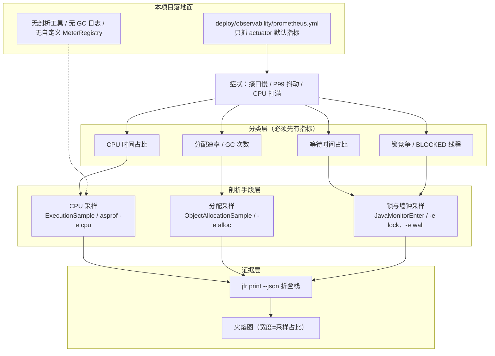
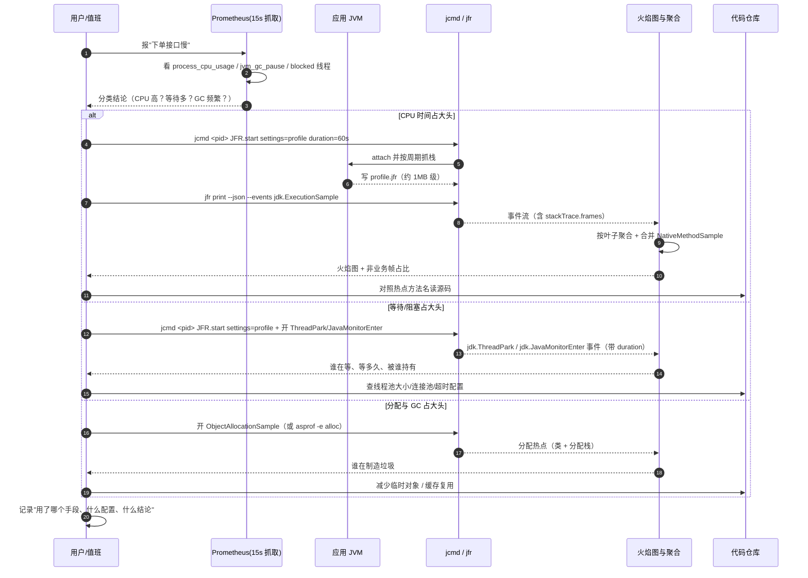

# 03. 火焰图与性能剖析

> **一句话结论**：火焰图只回答"CPU 时间花在哪个调用栈上"，它无法回答"为什么慢"——先用量化指标把耗时分成 CPU 密集 / 等待 / 分配 / 锁竞争四类，再决定用 CPU 采样、分配采样还是锁与墙钟采样；顺序反了，你会对着一张漂亮的图得出错误结论。
> **阅读前置**：读过 [01-JVM参数与GC选型](./01-JVM参数与GC选型.md) 与 [08-性能问题定位方法论](./08-性能问题定位方法论.md)；知道线程栈、JIT 内联、GC 线程分别是什么。
> **证据基线**：JDK 17.0.19（Temurin，本机实测）+ Spring Boot 4.2.0；A 级 2 处源码摘录、B 级 12 处本仓文件、C 级 4 组本机实测（含一次完整 JFR attach 录制）。预计阅读 40 分钟。

**证据边界**

| 级别 | 本仓本机状态 | 本篇怎么处理 |
|---|---|---|
| A 级 | `learning-docs/24-源码分析/assets/source/` 有 OTel `Span.java`、`Tracer.java`，**没有** ThreadPoolExecutor / ForkJoinPool / HttpClient 摘录 | 只用 Span/Tracer 讲"APM span 是什么"，其余不硬凑 A 级 |
| B 级 | 全仓无 async-profiler / JFR / Arthas 配置；无 GC 日志参数；无自定义 `MeterRegistry` 埋点；`deploy/observability/` 只有 4 个抓取配置、无面板无告警 | 逐条给路径行号，如实写"当前无 JVM 级剖析手段" |
| C 级 | 本机有 JDK 17（`jcmd`/`jfr` 可用）、Node 24；**无 docker / kubectl**，没有运行中的本项目服务 | 用自写 JVM 复现真实 JFR 录制 + Node 采样模拟 + 真实启动日志；容器内 attach 只给命令与判读，明确标注未本机实测 |

---

## 0. 先看现象

### 现象一：整仓搜不到任何剖析、录制、堆转储配置

在仓库根执行（排除文档目录与构建产物），搜一切"能抓运行时快照"的关键词：

```pwsh
Get-ChildItem -Recurse -File -Include *.java,*.xml,*.yml,*.yaml,*.sh,*.ps1,*.properties,Dockerfile |
  Where-Object { $_.FullName -notmatch '\\(learning-docs|target|node_modules|\.venv|\.git|docs)\\' } |
  Select-String -Pattern 'async-profiler|asprof|FlightRecorder|StartFlightRecording|jcmd|arthas|jprofiler|yourkit|jmap|HeapDump' |
  ForEach-Object { "$($_.Path.Replace($PWD.Path,'')):$($_.LineNumber)  $($_.Line.Trim())" }
```

真实输出只有两条，而且都在**第三方 vendored 中间件自带的启动脚本**里：

```text
\tools\nacos\bin\startup.sh:99           JAVA_OPT="${JAVA_OPT} -XX:+HeapDumpOnOutOfMemoryError -XX:HeapDumpPath=..."
\tools\seata\seata\bin\seata-setup.sh:136  -XX:+HeapDumpOnOutOfMemoryError -XX:HeapDumpPath=...
```

项目自己的 9 个 Java 模块 Dockerfile、12 份配置、全部 `*.java` 里：0 命中。再把自定义指标埋点也搜一遍——`MeterRegistry` 在主代码里 **0 个字面量命中**，只有 `.idea/workspace.xml` 里一条 micrometer jar 路径。

### 现象二：本机 JVM 的堆上限是 7.93 GiB，同一份代码在容器里被写死 512 MiB

```pwsh
java -XX:+PrintFlagsFinal -version | Select-String 'MaxHeapSize|InitialHeapSize|UseG1GC|FlightRecorder|UseSHA'
```

真实输出（截取，共 550 行 flag）：

```text
  size_t InitialHeapSize     = 532676608                                    {product} {ergonomic}
  size_t MaxHeapSize         = 8514437120                                   {product} {ergonomic}
   bool UseG1GC              = true                                          {product} {ergonomic}
   bool FlightRecorder       = false                                         {product} {default}
   bool UseSHA               = true                                          {C2 product} {default}
```

`8514437120 / 1024³ ≈ 7.93 GiB`——这是 ergonomics（机器有 16 个逻辑处理器）推出来的默认值，不是项目设定。而项目真正跑的容器里是：

1. `deploy/docker-compose/docker-compose-all.yml#L224` 定义服务 `ai-chat-service`，`#L236` 给 `JAVA_OPTS: "-Xms256m -Xmx512m"`；
2. `deploy/k8s/services/ai-chat-service.yaml#L92` 是 `value: "-Xms512m -Xmx512m"`；
3. 两个 Dockerfile 形态不一样：`ai-cs-chat/Dockerfile#L21` 是 `ENTRYPOINT ["sh","-c","java ${JAVA_OPTS:-} -jar app.jar"]`（能吃到 JAVA_OPTS），而 `ai-cs-product/Dockerfile#L11` 是 `ENTRYPOINT ["java","-jar","app.jar"]`（吃不到）。

**同一条命令在开发机和生产容器上测出来的东西不是一回事**，这是本主题最容易踩的坑：本机 `jcmd` 看到 7.93 GiB 堆，容器里只有 512 MiB，栈采样/分配采样的结论完全不可移植。

### 现象三：真跑一次 JFR，一半时间在等，CPU 采样里一个样本都没有

用一个自写的小程序复现三类负载：纯 CPU 算术（`spin`）、纯 CPU SHA-256（`hash`）、`Thread.sleep(5)` 等待（`await`），用项目的 `-Xms256m -Xmx512m` 启起来，然后**不带任何 `-XX:+FlightRecorder`** 直接 attach 录制：

```pwsh
jcmd <pid> JFR.start settings=profile duration=12s filename=tmphot.jfr
jcmd <pid> JFR.check
```

```text
Started recording 1. The result will be written to:
D:\...\learning-docs\tools\tmp\tmphot.jfr
Recording 1: name=1 duration=12s (running)
```

程序自己按阶段累加的墙钟占比是 `spin=37.3% hash=14.5% await=48.1%`（`cycles=2087 totalWall=25992ms`）。而 `jfr summary` + 按叶子方法聚合后：

```text
jdk.ExecutionSample     379      <- 12 秒只有 379 个 Java 栈样本
jdk.NativeMethodSample  157
按叶子聚合：TmpHot.spin 379/379 = 100.0%
栈里出现 await/sleep 的样本：4 个（约 1%）
```

**近一半墙钟时间在等待，CPU 采样里只有 4 个样本。** 这就是本主题的核心矛盾：火焰图的宽度是"被 CPU 采样器抓到的次数"，不是"耗时占比"。

这些现象指向同一件事：**本项目的现状是"指标能出、剖析全无"**——actuator + prometheus registry 依赖 11 个 pom 里都有（如 `ai-cs-chat/pom.xml#L212`、`#L221-L222`），`deploy/observability/prometheus.yml` 也每 15 秒抓一次 `/actuator/prometheus`，所以 JVM 的基础指标（`jvm.memory.*`、`jvm.gc.*`、`jvm.threads.*`）其实拿得到；但没有一行剖析配置、没有 GC 日志、没有自定义埋点，一旦"慢"变成"为什么慢"，现有的证据链立刻断掉。而火焰图恰恰只覆盖四类耗时里的一类。

---

## 1. 整体地图



> **读图说明**：竖着看是**决策顺序**，横着看是**工具选择**。关键箭头有三个：`M1 → P1`（只有确认"CPU 时间占大头"才该做 CPU 采样）、`M2 → P3`（等得久要用墙钟/锁采样，不是 CPU 采样）、`R2 -.-> P1`（虚线表示"当前没有"）。最容易看错的箭头是 `S → M3 → P2`：分配采样能告诉你"谁在制造垃圾"，但如果你的症状是"GC 停顿把请求卡住"，光看分配火焰图会得出"分配速率正常、所以不是 GC 问题"的错误结论——那是 §3.4 的等待问题，要去 `02-GC日志与停顿分析.md` 拿证据。

| 组件 | 责任 | 参与方 | 真实位置（行数） |
|---|---|---|---|
| JVM 采样器（JFR） | 定时抓 Java 栈 / 本地栈 / 锁事件，写 `.jfr` 二进制 | JDK 17 自带，无需额外装 | `jdk.ExecutionSample` 周期 10ms、`jdk.NativeMethodSample` 20ms（`profile.jfc`） |
| `jcmd` | 运行时下发 `JFR.start / check / dump / stop`，无需重启 | 运维 / 开发，需同用户 + 同 pid namespace | JDK 17 自带，本机实测可用 |
| `jfr` 命令行 | 把 `.jfr` 转 JSON / summary / 自定义 `.jfc` 配置 | 同上 | JDK 17 自带，子命令见 §7 |
| 火焰图工具 | 把折叠栈渲染成 SVG/HTML | 在线工具或 `asprof -o html` | 本仓无 |
| 指标来源 | `jvm.memory.*`、`jvm.gc.*` 等基础指标 | Prometheus 每 15s 抓一次 | `deploy/observability/prometheus.yml` |
| 业务 span | 段耗时（`firstTokenMs`、`rag.retrieval`） | chat 服务自建 Observation | `ai-cs-chat/src/main/java/com/aics/chat/observability/TraceRecorder.java` |

---

## 2. 关键概念与关键工具

| 名称 | 位置 | 作用 | 关键参数 |
|---|---|---|---|
| CPU 采样（on-CPU） | JFR `jdk.ExecutionSample` / asprof `-e cpu` | 看"谁在消耗 CPU" | 周期 `method-sampling-java-interval`，`profile.jfc` 里是 `10 ms` |
| 本地栈采样 | JFR `jdk.NativeMethodSample` | 抓 JNI / intrinsic / native 那段 CPU | 周期 `method-sampling-native-interval`，`profile.jfc` 里是 `20 ms` |
| 分配采样 | JFR `jdk.ObjectAllocationSample` / asprof `-e alloc` | 看"谁在制造垃圾" | `throttle`（每秒上限），与本篇 C 级实验里的 TLAB 事件无关，需自行开启 |
| 锁/墙钟采样 | JFR `jdk.JavaMonitorEnter`、`jdk.ThreadPark`；asprof `-e lock`、`-e wall` | 看"谁在等、等什么" | 墙钟模式按固定间隔抓**所有**线程，含睡眠/阻塞 |
| `.jfc` 配置 | `%JAVA_HOME%\lib\jfr\profile.jfc`（35871 B）、`default.jfc`（35918 B） | 定义采样周期与事件集合 | `jfr configure --input profile.jfc --output fast.jfc 'jdk.ExecutionSample#period=1 ms'` |
| `jcmd` | `%JAVA_HOME%\bin\jcmd` | attach 下发录制命令 | `JFR.start settings= duration= filename=`、`JFR.dump`、`JFR.stop` |
| `jfr` | `%JAVA_HOME%\bin\jfr` | 后处理 | `print --json --events <name> --stack-depth 64`、`summary`、`configure` |
| 折叠栈（folded stack） | 无（数据形态） | 火焰图的输入格式：`a;b;c 计数` | 一次采样 = 一条自底向上的栈 |
| safepoint | JVM 概念 | 所有线程到达的安全点，栈可遍历 | 采样常发生在 safepoint，见 §3.5 |
| 慢查询日志 | MySQL 参数 `slow_query_log` / `long_query_time` | SQL 侧证据 | 本仓 compose 未开（§3.8） |
| APM span | `Span`/`Tracer` 接口；本仓 `TraceSpanObservationHandler` | 段耗时归因，回答"慢在哪一段" | `spanBuilder(name)` → `startSpan()` → `end()` |

工具选型的内存版对比（详细取舍见 §5）：

| 维度 | JFR（JDK 自带） | async-profiler | Arthas profiler |
|---|---|---|---|
| 安装前提 | 无，JDK 11+ 自带 | 需下载对应平台的 `asprof` 二进制 | 需下载 arthas jar |
| 谁维护 | OpenJDK | 社区（Alibaba 等贡献） | 阿里开源 |
| 输出 | `.jfr` → JSON/summary | 直接出 HTML/SVG 火焰图、JFR 格式 | 命令内看文本 |
| 本项目适配 | **唯一零依赖选项** | 需改镜像或挂载 | 需改镜像或挂载 |

---

## 3. 原理与证据逐段精读

### 3.1 采样剖析到底在干什么

**在干什么。** profiler 每 T 毫秒让目标线程暴露一次"当前正在执行的方法"，然后记下**整条调用栈**（从线程入口到当前帧）。所有记录按"完整栈 + 出现次数"累加，得到折叠栈；火焰图就是把折叠栈按字典序画出来：横轴是采样次数的累加宽度，纵轴是栈深度，每个矩形的宽度 = 该栈节点被采样到的次数。

**为什么这么设计。** 这是统计式（sampling）而非插桩式（instrumentation）。插桩要在每个方法进出打点，开销与**代码路径数 × 调用次数**线性相关，还会改变 JIT 内联决策（打点后方法变大，可能不再内联），测出来的就不是原来的程序了。采样只按固定间隔"看一眼现在在跑谁"，开销与样本率相关、与代码规模无关，所以能开在生产上——本机实测一次 12 秒、profile 配置的录制只产生 240.6 KB 文件（§3.5），这个量级是可以长期挂在线上转的。

**换写法会怎样。** 换成插桩式（Spring AOP 记时、`@Timed`、Arthas `watch`、BTrace）能拿到**精确**调用次数和单次耗时分布，这是采样给不了的（采样只能给占比）。代价是：调用量越大越慢；而且 JIT 把 callee 内联进 caller 之后，你的埋点位置和真实执行流对不上了——埋点还在，但它记到的时间已经包含被内联进来的逻辑。

**常见坑。**
1. 把"宽度"读成"耗时占比"。宽度只是"被 CPU 采样器抓到的次数占比"。一次 500 ms 的 `socketRead` 在 CPU 采样里通常是 0 个样本——本机实测里 `Thread.sleep` 占了 48.1% 的墙钟，CPU 采样只命中 4 个样本（§3.4）。
2. 以为"样本少的调用栈 = 不重要的代码"。采样是概率性的，30 个样本意味着 ±18% 的相对误差（1/√n 量级），不到 1% 的东西在 12 秒录制里可能只有 1~2 个样本，纯属噪声。
3. 忘了采样器自己也在消耗 CPU。本机实测里 JFR 自己的事件写入函数 `jdk/jfr/internal/JVM.emitEvent` 吃掉了 19.5% 的样本（§3.5），这部分是工具的税，不是业务的热点。

### 3.2 三类剖析手段：分别能回答什么问题

**在干什么。** 三类手段抓的不是同一种"正在发生的事"：

| 手段 | 触发条件 | 能回答 | 不能回答 | 本项目对应命令 |
|---|---|---|---|---|
| CPU 采样（on-CPU） | 线程处于 RUNNABLE 且正在跑字节码 | 哪个方法在烧 CPU、占比多少 | 为什么慢（等待时间完全不出现） | `jcmd <pid> JFR.start settings=profile duration=60s filename=a.jfr` + `jfr print --events jdk.ExecutionSample` |
| 分配采样 | TLAB 分配超过阈值 | 谁在制造垃圾、哪类对象最多 | 这些垃圾是否真的引起停顿 | JFR `jdk.ObjectAllocationSample`（需在 `.jfc` 里显式开启）/ `asprof -e alloc` |
| 锁与墙钟采样 | 固定间隔抓所有线程，或锁进入/等待事件 | 谁在等、等了多久、锁被谁持有 | 纯 CPU 热点（墙钟模式下 CPU 与等待混在一起） | `jcmd JFR.start` 后看 `jdk.JavaMonitorEnter`/`jdk.ThreadPark`；asprof `-e wall`、`-e lock` |

**为什么这么设计。** 因为"慢"有三种完全不同的物理成因：CPU 不够（该扩、该降算法复杂度）、等外部（该加超时、该改并发模型）、GC/分配压力（该减对象、该调堆）。它们的证据形态天然不同，硬用一种采样覆盖三类问题必然失真。

**换写法会怎样。** 只用墙钟采样（`-e wall`）看起来"什么都能看见"，但它把 CPU 时间和等待时间混在一张图里：一个 8 核机器上 200 个线程都在 `socketRead`，火焰图会显示成一片巨宽的 IO 栈，你会误以为"IO 是性能瓶颈"，而实际情况可能是下游只要 50 ms、你的线程池只有 4 个核心线程（见 `07-线程池调优与背压.md`）。

**常见坑。** 以为"CPU 火焰图里 GC 线程很宽 = GC 有问题"。GC 线程的栈出现在 CPU 采样里，说明它真的在烧 CPU，但**并发 GC 线程烧 CPU 和 STW 停顿是两件事**：G1 的并发标记线程占满 CPU 会让应用变慢，但停顿时间要看 `02-GC日志与停顿分析.md` 里的停顿记录，这一点不能从火焰图推出。

### 3.3 火焰图怎么读：四条判据与一条反判据

先看真实数据。下面这次录制（`-XX:-UseSHA`，12 秒，1 ms 名义周期）里，业务代码 `TmpHot.hash()` 明明占了 51.7% 的墙钟，但按叶子方法聚合出来是这样：

```text
实时输出（真实，非示意）：
  java/lang/invoke/VarHandleByteArrayAsInts$ArrayHandle.index   3316   75.3%
  TmpHot.spin                                                   1069   24.3%
  sun/security/provider/SHA2.implCompress                          13    0.3%
  TmpHot.hash                                                       2    0.05%
  java/security/MessageDigest.getInstance                             1
```

也就是说，**业务方法自己只拿到 2 个样本，它的时间被记在了 JDK 内部的 `VarHandleByteArrayAsInts$ArrayHandle.index` 上**。判据因此是四条：

1. **宽度是采样占比**，不是耗时占比，也不是"重要程度"。宽度大只说明"这段时间它在这条栈上"。
2. **上下是调用栈**，下方是调用方、上方是被调用方；矩形上面压着的宽度，是从它里面出去的。
3. **平台顶（平顶）说明采样器没看到更深的帧**——常见原因有三：内联（callee 被折进 caller，图上不再有单独帧）、进入 native/intrinsic（栈停在 JNI 边界，例如上面那个 `VarHandle…index`）、名称是解释器帧（`Interpreted`）。
4. **叶子名不等于业务代码名**。样本的叶子可能是 JDK 内部类、可能是 safepoint 相关帧、可能是采样器自己（`jdk/jfr/internal/*`）。读图第一步是"把非业务帧归类"，第二步才是"算业务占比"。

**一条反判据（最容易误用）：平台顶不是热点的唯一判据。** 旧写法常说"看到平顶就是热点"，但平顶也可能意味着"这里真的很宽，但它不是你要优化的地方"：

- 平顶出现在 `sun.nio.ch.EPoll.wait` / `Net.poll`：这是 IO 多路复用，宽是正常的，**这里的宽度不代表 CPU 消耗**（这类栈只在墙钟模式下才宽，CPU 模式下几乎不出现）；
- 平顶出现在 `java.lang.Object.wait` / `Thread.sleep` / `LockSupport.park`：纯等待，优化它没有意义，要去查"为什么需要等"；
- 平顶出现在 `G1ConcRefinementThreads` 之类的 GC 线程：该调堆或减分配，不是改这个方法。

**在干什么。** 火焰图的横轴是"按字典序排列的栈帧"，矩形宽度 = 该节点被采样到的次数；画图时先按总宽度排序，让大块尽量靠上靠左。

**为什么这么设计。** 这是 Brendan Gregg 的折叠栈可视化：以宽度为主序，是为了让"主要矛盾"集中在图形左上，一眼可见；代价是**相邻矩形之间的横向顺序没有语义**，两个挨着的大块可能毫无调用关系。

**换写法会怎样。** 换成"按耗时排序的表格"（自己聚合出 Top N 方法及其占比）信息量其实等价，而且更适合做前后对比（改动前/改动后的 Top N 差异）；火焰图真正的价值是**保留调用关系**——你能看到某个热点是被谁调起来的，这是 Top N 表格给不了的。

**常见坑。** 拿"左右相邻"当"调用关系"读。横向位置是排序结果，纵向才是调用栈；另外不要用"矩形的高度"判断任何东西，高度只表示栈深度。


### 3.4 如何避免"优雅的等待"混进来

**在干什么。** "优雅的等待"指线程状态是 WAITING/TIMED_WAITING、栈里是 `park`/`sleep`/`socketRead`/`poll` 的那类样本。它们在 CPU 采样里几乎抓不到，但可能占掉 80% 的请求耗时。本机实测的对照：

```text
程序自报墙钟占比（真实输出）：spin=37.3%  hash=14.5%  await=48.1%   （totalWall=25992ms）
JFR 采样结果：jdk.ExecutionSample 379 个，叶子 100.0% 是 TmpHot.spin
              1093 个样本（含 NativeMethodSample）里，栈里含 await/sleep 的只有 4 个
              线程状态统计：STATE_RUNNABLE 1054 个（采样只对 RUNNABLE 线程发生）
```

这就是"CPU 火焰图看不见慢"的机制层面解释：**CPU 采样只在线程可运行且被调度到 CPU 上时才发生**，睡眠的线程没有样本，所以"等待"在整个图里是空的。

**为什么这么设计。** CPU 采样回答的是"CPU 去哪儿了"，它天然只覆盖 on-CPU 时间；要覆盖 off-CPU 必须换手段。

**换写法会怎样。** 想看等待，有三条路：

1. **墙钟采样**：`asprof -e wall -d 30 -f wall.html <pid>`（本机无 asprof，未实测）。它按固定间隔抓**所有**线程，包括睡眠中的，于是等待会显示成一条很宽的栈（通常是 `EPoll.wait`、`park`、`socketRead0`）。
2. **JFR 的阻塞类事件**：`jdk.ThreadPark`（park 多久）、`jdk.JavaMonitorEnter`（等锁多久）、`jdk.SocketRead`/`jdk.SocketWrite`（socket 读写耗时，需在 `.jfc` 里开）。它们**带持续时间**，比"抓栈"更适合回答"等了多久"。
3. **业务 span**：本项目已有自建 span 体系，`ai-cs-chat/src/main/java/com/aics/chat/service/impl/ResilientAiService.java#L486-L497` 在 `finally` 里记录 `promptTokens`、`firstTokenMs`、`error`；`ChatServiceImpl.java#L931-L985` 有 `rag.retrieval` span。段耗时直接从这里拿，不用靠火焰图猜。

**常见坑。** 拿一张 CPU 火焰图解释"接口慢"。本机实测里那样一张图会显示"100% 时间在 `TmpHot.spin`"，你会去优化那段算术，而真实答案是"一半时间在 `Thread.sleep`"——优化方向完全错。**判读入口应该是：先看等待占比，再看 CPU 占比。**

### 3.5 采样偏差与安全点偏差

**在干什么。** 采样是概率估计，必然有偏差。本机实测到四种偏差，每一种都真实存在：

**为什么这么设计。** 因为采样器不是"观察者"而是程序的一部分：它要按周期触发（触发策略决定相位）、要能遍历栈（安全点决定可见性）、要能命名帧（intrinsic/内联决定归属）、要限制自己的开销（节流决定样本量）。这四件事各自都是工程折中，折中就会留下可复现的偏差——所以读图前必须先知道它们。

**偏差一：代码形态决定可见性（intrinsic / native 边界）。** 同一段 `MessageDigest.getInstance("SHA-256")` 循环，只改一个 JVM 参数：

| 实验 | 墙钟占比（程序自报） | CPU 采样里该段的样本 |
|---|---|---|
| SHA-256 走 intrinsic（默认 `UseSHA=true`） | `hash=13.0%`（≈27% 的 CPU 时间） | **0 个**（`TmpHot.hash` 一个都没出现） |
| 加 `-XX:-UseSHA` 强制走 Java 实现 | `hash=51.7%`（这次哈希确实更慢了） | 叶子 `VarHandleByteArrayAsInts$ArrayHandle.index` 3316 个（75.3%），`TmpHot.hash` 只有 2 个 |

**为什么。** intrinsic 意味着这段逻辑被替换成了虚拟机内置的本地实现，Java 栈上不再有可归属的帧；采样器要么记不到，要么把归属丢给了相邻的 JDK 内部帧。**这就是"火焰图里找不到自己的类"的最常见原因**，不是"这段代码不耗 CPU"。

**偏差二：名义周期 ≠ 样本数。** `profile.jfc` 里 `jdk.ExecutionSample` 的 period 是 `10 ms`，理论上 12 秒应该有 1200 个样本，实测只有 379 个（另有 157 个 native 样本）。把周期改成 1 ms（`jfr configure --input profile.jfc --output fast.jfc 'jdk.ExecutionSample#period=1 ms' 'jdk.NativeMethodSample#period=1 ms'`，实测可行），同负载样本数只从 536 涨到 1054（约 2 倍，不是 10 倍）；周期改成 100 ms 只剩 38 个。**结论：不能拿 `1/period` 推算样本量，也不能据名义周期判断分辨率。**

**偏差三：相位锁定（最危险的一种）。** 用 Node 写了一个纯模拟脚本（**不是真 profiler，只是把"定时抓段"这件事按不同采样策略跑一遍**），负载是固定 20 ms 周期内的五段：spin 8ms / sha 3ms / 等待 5ms / 短尖峰 2ms / 序列化 2ms，真相占比 `40 / 15 / 25 / 10 / 10`：

```javascript
// learning-docs/tools/tmp/sampling-sim.js（已删除，逻辑如下；纯模拟）
const SEG = [['spin',8],['sha',3],['wait',5],['shortSpike',2],['jsonSerde',2]];
const CYCLE = 20, TOTAL = 12000;
function sampleAt(t){ let x = t % CYCLE; for (const [n,ms] of SEG){ if (x < ms) return n; x -= ms; } }
function run(period, jitter){
  const hit = {}; let t = 0, n = 0;
  while (t < TOTAL){ const s = sampleAt(t); hit[s]=(hit[s]||0)+1; n++;
    t += jitter ? period*(0.5+Math.random()) : period; }
  return {n, pct: SEG.map(([k])=>[k, (100*(hit[k]||0)/n).toFixed(1)])};
}
```

真实输出（`node sampling-sim.js`）：

```text
固定相位（t += period）：       每点抖动（t += period*(0.5+rand)）：
1ms   40.0/15.0/25.0/10.0/10.0  (12000 样本)   1ms   40.0/15.1/25.1/9.8/10.0  (12007)
5ms   50.0/25.0/25.0/0.0/0.0    ( 2400 样本)   5ms   39.5/15.3/25.3/9.9/10.0  ( 2399)
10ms  50.0/50.0/0.0/0.0/0.0     ( 1200 样本)   10ms  39.1/14.8/24.9/10.2/11.0  ( 1199)
20ms  100.0/0/0/0/0             (  600 样本)   20ms  40.4/15.0/24.7/10.8/9.0   (  586)
100ms 100.0/0/0/0/0             (  120 样本)   100ms 39.5/10.1/26.1/12.6/11.8  (  119)
```

读法：**固定相位、周期性负载 → 占比完全失真**（20 ms 周期正好等于负载周期，每次都抓到同一段，图上显示 100% spin，真相 40%）。**每点抖动 → 占比基本无偏，但分辨率急剧下降**（100 ms 只有约 120 个样本，1% 以下的东西根本看不见，第二次跑同一配置 `wait` 从 26.1% 跳到 19.0% 就是这种噪声）。

这条实测也修正了旧文档里"低频短方法会被系统性漏采、占比必然偏低"的说法：在真随机抖动下短方法占比**不偏低**，损失的是分辨率与稳定性；会系统性漏采的是"固定相位"和"intrinsic 边界"这两类情况。

**偏差四：安全点偏差（safepoint bias）。** JVM 只有在**安全点**才能遍历栈，很多采样实现是在进入安全点时抓栈，于是栈会偏向"经常到达安全点的位置"（例如方法返回前、循环回边）。JDK 里的 `jdk.ExecutionSample` 走的是 VM 内部的采样机制，比早期 `jstack` 式实现好得多，但**如果你用 `jstack` 手工轮询来近似采样，这个偏差会非常大**：一个长循环里如果长时间不走到安全点，你的 30 次 `jstack` 可能全部落在同一个位置，得出"这里 100% 是热点"的错误结论。

**换写法会怎样。** 想减少这些偏差有四个动作：周期不要设得太整（不要恰好等于负载周期，例如定时任务 1 s、采样周期也设 1 s）；时长覆盖至少若干个业务周期；样本量至少几百再看百分比；遇到"找不到自己的类"先查 intrinsic/native（`-XX:-UseSHA`、`-XX:-UseAES`、换 Pure Java 实现对照）。

**常见坑。** ①把"样本少"当成"不慢"；②把"一次录制的占比"当成"稳定结论"——本机 Node 模拟里同一 100ms 配置两次运行，`wait` 段一次 26.1% 一次 19.0%；③用 `jstack` 轮询代替采样，把 safepoint 偏差当成真实热点。

### 3.6 async-profiler 与 JFR 的取舍

**在干什么。** 两者都做采样，但产品形态不同：

| 维度 | JFR | async-profiler |
|---|---|---|
| 安装 | JDK 11+ 自带（本机 JDK 17 实测可用） | 需要 `asprof` 二进制，随 JVM 版本对应 |
| 采样机制 | VM 事件（ExecutionSample / NativeMethodSample / 锁事件等） | `AsyncGetCallTrace` + perf_events，号称不受 safepoint 偏差影响 |
| CPU 采样覆盖 | Java 帧 + 本地帧分开两类事件，需合并 | 一次采样同时含 Java 与本机帧（`-e cpu`） |
| 墙钟 / 锁 | 需开启 `jdk.ThreadPark`、`jdk.JavaMonitorEnter`、`jdk.SocketRead` 等事件，靠"持续时间"字段聚合 | 原生支持 `-e wall`、`-e lock`、`-e alloc`，直接出图 |
| 输出 | `.jfr` 二进制 → `jfr print --json`，自己聚合（本篇的聚合脚本就是这么写的） | 直接输出 HTML/SVG 火焰图，也可输出 JFR 格式 |
| 生产可用性 | 官方定位就是生产可开；本机实测 12s/profile 配置 = 240.6 KB，可控 | 同样可上生产，但容器里需要 `SYS_PTRACE` 与共享 pid，需改部署 |
| 本项目适配度 | **零改动**（JDK 里就有） | 需要改 Dockerfile 或挂载，且 `deploy/k8s` 未配 `pid: host` |

**为什么这么设计。** JFR 是 VM 的一部分，天生能拿到 VM 内部视角（GC、类加载、线程、异常、分配阈值事件），但它不是为"专业火焰图"设计的：它的输出是事件流，图上的一切要你自己按帧聚合。async-profiler 专注"给我一张好看的火焰图"，因此牺牲了"零安装"。

**换写法会怎样。** 只用 JFR 且只跑默认 `--events jdk.ExecutionSample`，会漏掉 native 那部分 CPU（本机实测 native 样本 157 / 219 / 774 个，与 Java 样本同量级），还会漏掉锁与睡眠。只用 async-profiler 的 `-e cpu`，会拿不到 GC/类加载/异常这些 VM 侧事件，遇到"GC 把 CPU 吃了"这类问题还是要回 JFR。

**常见坑。** 相信"asprof 开销一定 < 1%"这类口径。开销取决于采样周期、栈深度、以及**是否开启了高基数字段的事件**；本机实测 JFR 自己就吃掉了 14.5%~19.5% 的样本（见 §3.5），任何"百分比开销"结论都必须带上配置与负载，否则不可移植。

### 3.7 线上剖析的合规与开销控制

**在干什么。** 在真实流量上开剖析，要同时管住四件事：开销、时长、落盘、数据敏感性。

**为什么这么设计。** 因为剖析是"在病人身上动刀"：它天然有开销（采样器自己也要 CPU）、天然产生数据（`.jfr` 里含栈与字符串）、天然需要特权（attach 其他进程）。生产环境的默认约束是"可回滚、可审计、不泄密"，所以每一项都要有上限与责任人，而不是"需要的时候随便开一下"。

**开销。** 本机实测的量化口径（同一进程、三类配置）：

| 配置 | 录制文件 | Java 样本 | native 样本 | 采样器自身占比 |
|---|---|---|---|---|
| `profile.jfc`（10ms/20ms），12 s | 240.6 KB | 379 | 157 | 未单独统计 |
| `fast.jfc`（1ms/1ms），12 s | 220.9 KB | 835 | 219 | `JVM.emitEvent` 19.5% |
| `slow.jfc`（100ms/100ms），12 s | 212.4 KB | 31 | 7 | `JVM.emitEvent` 4/7 |

注意最后一行：样本越稀疏，**采样器自身的相对占比越不稳定**，因此"这个工具开销小"不能用稀疏配置来证明。

**时长与落盘。** 推荐组合（未本机实测容器场景，因为本环境无 docker）：`settings=profile duration=60s filename=/var/log/aics/profiling/a.jfr`，落盘路径要在容器挂载的卷上，否则容器重启即丢；磁盘余量按"12 秒 ≈ 240 KB"的量级估，60 秒 profile 配置约 1 MB 级，不要设成 `maxsize` 默认（250 MB）直接长久录制。

**权限。** attach 需要与目标 JVM 同用户、同一 pid namespace。容器内需要 `pid: host`（或 `--pid=container:...`）与 `SYS_PTRACE`；k8s 侧 `deploy/k8s/` 目前没有任何 `securityContext.capabilities` 或 `shareProcessNamespace` 配置——这一条是明确的**未落地项**（§3.9 落地清单里有）。

**合规与脱敏。** `.jfr` 与栈里会带：类名、方法名、线程名、URL、异常消息、SQL 语句（如果开了 `jdk.JavaExceptionThrow`/JDBC 事件）。本项目已经有 `ai-cs-chat/src/main/java/com/aics/chat/util/PiiMasker.java`（`#L33-L70` 定义手机号/身份证/银行卡/邮箱/地址五个正则，`#L87-L91` 做掩码），说明代码侧承认"日志里可能混入 PII"；剖析产物同理，应按同一标准处理：录制文件不落在可公开访问的目录、不在 issue/文档里贴原始栈（贴之前把 URL 参数和 SQL 字面量替换掉）、录制前记录申请人与时间段。

**换写法会怎样。** 换成"出问题再说、临时开一次"的模式：常态零开销，但事故当时往往没有权限、没有可复现流量、没有留存的进程（重启即丢），结果只能靠猜。换成"长期开着最高采样率"：证据最全，但按本机实测的量级（1ms 配置下采样器自身占 14.5%~19.5% 的样本）就是在给生产加一份持续 CPU 税。折中是"低速率常开 + 事故时提速"。

**常见坑。** ①把 `.jfr` 直接存到容器 `/tmp` 且不挂卷——容器一重启，唯一的证据没了；②设了 `maxsize=250MB`（默认量级）又忘了 `maxage`，磁盘被悄悄吃掉；③在压缩包/工单里直接贴原始栈，URL 里的手机号、SQL 里的身份证一起进了工单系统。

### 3.8 前端、SQL、跨服务耗时的证据从哪拿

**在干什么。** 火焰图只管 JVM 内部。一个"慢请求"的时间分布通常是：网关 → 服务 A（CPU/等待）→ 下游 HTTP → MySQL/Redis/ES → 模型 API。每段的证据源不同：

| 段 | 证据源 | 本仓现状 |
|---|---|---|
| 服务内代码 | CPU/墙钟采样（本篇） | **未落地**（无剖析配置） |
| 服务间调用 | APM span / 分布式追踪 | 部分有：chat 侧自建 span（`TraceSpanObservationHandler`、`TraceRecorder`），落 `llm_trace` 表 |
| SQL | 慢查询日志 + `EXPLAIN` / `EXPLAIN ANALYZE` | **未开启**：compose 里没有 `slow_query_log` 配置，见 `05-SQL调优与执行计划.md` |
| 数据库连接等待 | HikariCP 指标（`hikaricp.connections.*`） | 有依赖、无自定义埋点；actuator 默认能出 |
| 前端 | 浏览器 Performance / LCP、INP | 见 `../08-测试/05-性能压测实战-k6与JMeter.md` 的压测侧口径 |
| 模型 API | 本地 span 的 `firstTokenMs` | 有：`ai-cs-chat/src/main/java/com/aics/chat/service/impl/ResilientAiService.java#L486-L497` |

**为什么这么设计（span 为什么只能回答段耗时）。** 因为 span 是一个"开始—结束"的打点。OTel 的 `Tracer` 接口用法就是最直白的证据：

```java
Span childSpan = tracer.spanBuilder("MyChildSpan").setParent(parent).startSpan();
childSpan.addEvent("Starting the work.");
try { doSomeWork(childSpan); } finally { childSpan.end(); }
```

（src: Tracer.java#L47-L54）

`end()` 记录结束时间戳，中间发生了什么它完全不知道。要给 span 加属性只能靠显式打点：

```java
default Span setAttribute(String key, @Nullable String value) {
  return setAttribute(AttributeKey.stringKey(key), value);
}
```

（src: Span.java#L102-L104）

所以 `ResilientAiService` 里 `finishLlmObservation` 要给 `promptTokens`、`firstTokenMs`、`error` 一个个 `setAttribute`——这些都是"你以为自己想知道的东西"，而不是"实际发生了什么"。**想知道实际发生了什么，还是得回到采样。** 本仓的 `llm_trace` 表（`ai-cs-message/src/main/java/com/aics/message/entity/LlmTrace.java#L44`）与 `model_usage`（`ModelUsage.java#L39`，`#L48` 注释"关联 llm_trace.request_id"）就是这条链的落库端。

**SQL 侧怎么拿证据。** 顺序是"先确认有没有慢查询日志 → 再看执行计划 → 再看 ORM 生成的 SQL"。本仓用的是 MyBatis-Plus 分页（`ai-cs-knowledge/src/main/java/com/aics/knowledge/config/MybatisPlusConfig.java#L35-L38` 注册 `PaginationInnerInterceptor(DbType.MYSQL)`，调用侧 `KnowledgeServiceImpl.java#L90-L102` 的 `new Page<>(page,pageSize)` → `selectPage`），分页 SQL 由插件生成，**你看到的接口耗时和实际 SQL 不一定对得上**（一次 `selectPage` 会产生 count + 分页两条 SQL）。所以必须开 `slow_query_log` 才能对上账；当前 compose 没开，属于未落地项。

**换写法会怎样。** 用"全链路插桩"（每个 mapper 方法、每次 HTTP 调用都记时）替代"span + 采样"：能拿到完整段耗时且不依赖采样率，但代价是每个请求多出 N 次计时与聚合、段内 CPU 仍然是黑盒，而且插桩点如果打在 mapper 方法上，会把一条业务调用生成的**两条 SQL 合并成一段耗时**，反而比慢查询日志更失真。

**常见坑。**
1. 把 span 属性当"越多越好"。`ai-cs-chat/src/main/java/com/aics/chat/service/impl/ResilientAiService.java#L466-L474` 特意把 `provider`/`model` 放成低基数属性、`scenario` 放高基数——高基数进 trace、不进 metric，否则指标基数会爆。
2. 只看总 span，不看子 span 的 `firstTokenMs`，把"下游首包慢"误判成"我们的服务慢"。
3. 以为开了慢查询日志就能抓到问题：MySQL 的 `long_query_time` 默认是 `10` 秒，绝大多数"慢"都在它下面，必须调到 `1` 秒级才有用。

### 3.9 本项目现状与最小落地清单

**在干什么。** 把"想剖析"翻译成"本仓当前能不能剖析"，逐项核对配置与依赖是否存在，再按投入产出排出落地顺序。

**核实的现状（全部当次 grep/read 过）：**

| 项目 | 现状 | 证据 |
|---|---|---|
| async-profiler / asprof | 无 | 全仓 0 命中（§0 现象一） |
| JFR 录制参数 | 无 | `FlightRecorder`/`StartFlightRecording` 0 命中；项目自身 `HeapDump` 也 0 |
| Arthas | 无 | 全仓 0 命中（仅 `tools/nacos`、`tools/seata` 自带脚本里的 HeapDump 参数） |
| GC 日志参数 | 无 | `Xlog:gc` / `PrintGCDetails` / `verbose:gc` 在项目配置与 Dockerfile 里 0 命中 |
| actuator + prometheus | **有** | 11 个 pom 都有，如 `ai-cs-chat/pom.xml#L212`、`#L219-L222` |
| 自定义指标埋点 | 无 | `MeterRegistry` 主代码 0 命中 |
| 抓取配置 | 有，但只有取数 | `deploy/observability/prometheus.yml`（15s、11 个 target、`/actuator/prometheus`） |
| 面板与告警 | 无 | `deploy/observability/` 只有 4 个文件：`otel-collector.yaml`、`prometheus.yml`、`tempo.yaml`、`grafana/provisioning/datasources/datasources.yaml` |

**先从哪儿下手：本仓的候选热点清单（推断，未经采样验证，不许当结论引用）**

| 候选 | 真实位置 | 机制上为什么值得怀疑 | 该用哪类手段验证 |
|---|---|---|---|
| SHA-256 摘要 + 逐字节转 hex | `ai-cs-chat/src/main/java/com/aics/chat/cache/VectorCacheStore.java#L105-L118` | 每次算 `cacheKey` 都 `MessageDigest.getInstance` 新建摘要器并 StringBuilder 拼 hex；但默认走 intrinsic，**CPU 采样可能完全采不到** | 直接计时打点；或 `-XX:-UseSHA` 对照（§3.5） |
| 语义缓存全表扫余弦 | `ai-cs-chat/src/main/java/com/aics/chat/cache/SemanticCacheService.java#L69-L81` | 一次 `HGETALL` 拉回整库条目后 `for` 循环算 `cosine`；条目上限 200（`ai-cs-chat/src/main/resources/application.yml#L178-L187`） | CPU 采样看 `EmbeddingMath.cosine` 宽度；再看 Redis 返回体积 |
| 正则脱敏链 | `ai-cs-chat/src/main/java/com/aics/chat/util/PiiMasker.java#L87-L91` | 5 个静态 `Pattern` 顺序 `replaceAll`，长文本上正则回溯成本非线性 | CPU 采样看 `Pattern`/`Matcher` 帧 |
| spans JSON 序列化 | `ai-cs-chat/src/main/java/com/aics/chat/observability/TraceRecorder.java` | 每个请求结束都要序列化一次 spans 并落库 | 分配采样看 `byte[]`/`char[]` 热点 |
| 观测线程池排队 | `ai-cs-chat/src/main/java/com/aics/chat/config/ObservabilityExecutorConfig.java#L27-L40` | core 1 / max 4 / queue 1000 / `AbortPolicy`，突发流量下会排队甚至抛拒绝 | **不是 CPU 问题**：看线程池活跃数与队列长度（见 `07-线程池调优与背压.md`） |
| 模型 API 等待 | `ai-cs-chat/src/main/resources/application.yml#L68-L79` | TimeLimiter 30s/60s + retry 3 次，等待在 CPU 采样里不可见 | 墙钟采样或 `firstTokenMs` span（§3.4） |

**最小落地清单（按投入产出排序，每条都给验收标准）：**

1. **开 JFR 的可控入口（零依赖，先做这个）。** 在 `deploy/k8s/services/*.yaml` 的容器 `command/args` 或 compose 的 `JAVA_OPTS` 里加 `-XX:StartFlightRecording=settings=profile,maxsize=64m,maxage=30m,filename=/tmp/aics.jfr`（`/tmp` 要挂卷）。验收：容器重启后 `jfr summary` 能读到 `Duration > 0`、文件不超过 64 MB。
2. **把采样周期与外置 `.jfc` 固化到镜像。** 用 `jfr configure` 生成 `aics.jfc`（ExecutionSample 20ms、NativeMethodSample 20ms、开启 `jdk.ThreadPark`/`jdk.JavaMonitorEnter`/`jdk.SocketRead`），随镜像下发。验收：`jfr summary` 里 `jdk.ActiveSetting` 事件能看到上述设置。
3. **补 GC 日志**（与 `02-GC日志与停顿分析.md` 联调）：`-Xlog:gc*,gc+heap=info:file=/var/log/aics/gc.log:time,uptime:filecount=5,filesize=20m`。验收：`ai-cs-chat` 容器内 gc.log 有内容且滚动到 5 个文件后覆盖最旧。
4. **在 Prometheus 侧加"该不该剖析"的判定查询**：`rate(jvm_gc_pause_seconds_sum[5m])`、`jvm_threads_states_threads{state="blocked"}`、`process_cpu_usage`。验收：Grafana 里能看到这三条曲线（面板当前不存在，需新建）。
5. **容器 attach 权限**：`shareProcessNamespace: true` + `SYS_PTRACE`。验收：`kubectl exec` 进容器后 `jcmd 1 JFR.check` 有返回（**本环境无 kubectl/docker，未实测**）。
6. **合规**：规定录制文件目录权限、保留期与导出审批。验收：一次演练中 `.jfr` 不出现在可匿名访问的路径下。

**为什么这么设计（为什么按这个顺序）。** 因为剖析能力的缺口是**结构性**的（缺参数、缺权限、缺落盘），不是"临时敲个命令"能补的；顺序按"零依赖 → 需改部署 → 需建面板 → 需改组织流程"排列，每一档都能独立交付并验收，避免"全都要做"导致一件也没做。

**换写法会怎样。** 不做清单、直接上一个装好 async-profiler 的镜像：看起来一步到位，但 `deploy/k8s/` 全仓没有 `shareProcessNamespace`、也没有 `SYS_PTRACE` 能力，装上照样 attach 不上；而 JFR 零依赖，能立刻结束"完全没有证据"的状态。

**常见坑。** 把本节清单当成"已经做过"——上面那张表里每一条落地项在当前仓库中**都不存在**，写提案、交接或面试作答时必须保留"未落地"字样。

### 3.10 jstack、Arthas、JFR、async-profiler 该怎么分工

**在干什么。** 这四件工具经常被混为一谈，实际给的证据完全不同：

| 工具 | 给你什么 | 缺什么 | 什么时候用 |
|---|---|---|---|
| `jstack` / `jcmd <pid> Thread.print` | 某一瞬间的完整线程栈，含锁信息（`waiting to lock <0x...>`、`locked <0x...>`） | 没有时间维度；手工轮询近似采样会踩 safepoint 偏差；算不出占比 | 死锁、线程卡死、看"现在有几个线程在处理请求"。**不能当火焰图用** |
| Arthas `thread -n 3` | 最忙的若干线程栈 + 粗略 CPU 占比 | 需要额外装 arthas；采样实现与精度依版本 | 快速定位"谁在烧 CPU"，结论是粗略量级 |
| Arthas `profiler start/stop` | 直接生成 HTML 火焰图（其实现基于 async-profiler，具体版本以其文档为准） | 需要额外装 arthas | 已有 Arthas 时的快捷通道 |
| JFR | 事件流：采样、锁、GC、异常、IO，可长期挂 | 要自己聚合（本篇的 Node 脚本） | **本项目首选**：零依赖 |
| async-profiler | 直接出图，`-e cpu/-e wall/-e lock/-e alloc` 齐全 | 需二进制 + 容器权限（`SYS_PTRACE`、共享 pid） | 有部署权限、需要墙钟/分配图时 |

**为什么这么设计。** `jstack` 是"快照"，火焰图是"统计"。前者回答"此刻在干什么"（一次调用就能确定死锁、确定哪个线程在跑），后者回答"一段时间内 CPU 花在哪"（需要成百上千次采样）。用快照去近似统计，是本节最常见的错误。

**换写法会怎样。** 用 `jstack` 每秒一次连抓 60 次、手工统计栈顶方法，看起来像"穷人版火焰图"，但：①每次抓栈都要到安全点，长循环/大方法会被系统性低估；②60 个样本的分辨率只能看 20% 以上的差异；③脚本聚合容易把内联后的帧算错。真要做占比，就用 JFR。

**常见坑。** 把 `BLOCKED` 线程当"CPU 忙"。`BLOCKED` 是在等 `synchronized` 监视器，线程根本不占 CPU；`RUNNABLE` 里也有大量"在等 IO 但状态是 RUNNABLE"的情况（例如某些 socket 读）。判读线程状态必须结合栈顶帧，不能只看状态名。

---

## 4. 一次完整排查/执行时序



> **读图说明**：这张图的关键是第 3 步那个**分岔**——`P-->>U: 分类结论` 之前绝不要碰 profiler。三个箭头值得盯：`P->>P`（用已有指标做判定，本项目这条链路是通的：`prometheus.yml` 每 15 秒抓 `/actuator/prometheus`）、`J->>A: attach`（跨进程，权限不足会在这里失败）、`G->>G: 合并 NativeMethodSample`（漏了这步就会把 native 那部分 CPU 算成"没有热点"）。最容易看错的箭头是 `U->>J`：很多人从"报慢"直接连到"attach 录制"，省掉了分类，结果拿 CPU 火焰图去解释一个 IO 等待问题。

**每一步该怎么判读：**

| 步骤 | 该看到什么 | 判读结论 | 失败/异常时的现象 |
|---|---|---|---|
| 1 报慢 | 具体接口 + 时间窗 | 时间窗决定录制时长与时段 | 只有"整体慢" → 先拆接口 |
| 2 看指标 | `process_cpu_usage` 接近核数上限？`jvm_gc_pause` 涨？blocked 线程涨？ | CPU 高→CPU 采样；GC 涨→GC 日志；blocked 涨→锁/墙钟 | 指标全是平的 → 慢在服务之外（网关/DB/前端），别开 profiler |
| 3 分类 | 四类耗时各占多少 | 决定走哪一支 | 只算 CPU 不算等待 → 必然误判 |
| 4 attach 录制 | `Started recording 1` + `JFR.check` 显示 running | 录制已在跑 | `AttachNotSupportedException` / `No such process` → pid namespace 或权限问题 |
| 5 后处理 | `jfr summary` 有样本数 | 样本数 < 100 就重录（周期调小或时长加长） | 只有 `jdk.CheckPoint` 没有 `ExecutionSample` → 事件没开 |
| 6 聚合 | 叶子分布 + 非业务帧占比 | 业务帧占比低 → 先解释非业务帧（intrinsic/JDK 内部/采样器自身） | `jdk/jfr/internal/*` 占大头 → 采样太密，周期调回 10~20ms |
| 7 读码 | 热点方法名在本仓能 grep 到 | 能对上才谈优化 | grep 不到 → 说明是 JDK/框架代码，改的是用法不是那个类 |

---

## 5. 设计取舍

| 选择 | 代价 | 收益 | 本项目建议 |
|---|---|---|---|
| 用 JFR 而不是先装 async-profiler | 火焰图要自己聚合（本机实测需写 40 行 Node 脚本解析 `jfr print --json`） | 零安装、零改镜像、JDK 自带 | **先做**，把"有没有证据"补上比"证据好不好看"重要 |
| 长期 `-XX:StartFlightRecording` 常开 | 持续 ~240KB/12s 级写入 + 采样器税收 | 事后有据可查，不用等复现 | 建议 `maxsize=64m,maxage=30m` 限制，而不是无界 |
| 只在事故时手动 attach | 需要当时有人在、有权限 | 零常态开销 | 与常开并存：常开粗粒度，事故时切 `fast.jfc` |
| 墙钟采样 vs CPU 采样 | 墙钟会混入等待，图更"花" | 能看见"优雅的等待" | 先 CPU 后墙钟，两者对照看 |
| 用 span 代替剖析 | 只能到"段"，段内仍是黑盒 | 成本最低、已有 | 本项目现状（`llm_trace` + `firstTokenMs`） |
| 完全插桩（AOP 记时） | 开销随 QPS 线性、扰动内联 | 精确次数与耗时分布 | 不要用于热路径，用于少量关键分支 |

**可扩展点清单：**

- 把 `aics.jfc` 随镜像下发，统一采样周期，避免"每人每机一套参数"；
- 在 `deploy/observability/` 增加 `profiling/` 目录：录制申请模板、`.jfr` 解析脚本（可复用本篇的 `jfr print --json` 聚合思路）、产物存放规约；
- 给 Grafana 加"该不该剖析"三连面板（CPU/GC/blocked），面板当前**不存在**；
- 在网关侧补 RED 指标（Rate/Errors/Duration），当前只有 actuator 默认指标；
- 把 `PiiMasker` 的脱敏规则复用到剖析产物的导出流程；
- 为 `ai-cs-order` / `ai-cs-product` 补 Dockerfile 的 `JAVA_OPTS` 展开（当前是 exec form，`JAVA_OPTS` 完全不生效，加了 JFR 参数也没用）。

---

## 6. 踩坑与调试手法

### 坑 1：拿本机 JVM 的参数当生产基线

**症状。** 本机 `jcmd` 一切正常，容器里加的 `-XX:StartFlightRecording` 完全没生效。
**根因。** 本机是 ergonomics 推出来的 7.93 GiB 堆 + 16 处理器；容器里 `JAVA_OPTS` 写死 `-Xms256m -Xmx512m`，且 `ai-cs-order`/`ai-cs-product` 的 Dockerfile 是 exec form，根本不展开 `JAVA_OPTS`。
**查法。**

```pwsh
java -XX:+PrintFlagsFinal -version | Select-String 'MaxHeapSize|InitialHeapSize'
Select-String -Path .\ai-cs-*\Dockerfile -Pattern 'ENTRYPOINT'
Select-String -Path .\deploy\docker-compose\*.yml -Pattern 'JAVA_OPTS'
```

真实输出要点：本机 `MaxHeapSize = 8514437120`（7.93 GiB）；`ai-cs-product/Dockerfile#L11` 是 `ENTRYPOINT ["java","-jar","app.jar"]`；compose 里 `JAVA_OPTS: "-Xms256m -Xmx512m"` 共 14 处。
**判读。** exec form（不带 `sh -c`）→ `JAVA_OPTS` 环境变量是死的，加任何 JVM 参数都无效。
**误判风险。** 看到 `docker-compose-all.yml` 里有 `JAVA_OPTS` 就以为全部服务都吃到了——order/product 走的是另一套 Dockerfile。

### 坑 2：看到 `FlightRecorder = false` 就以为"JFR 没开、不能用"

**症状。** `PrintFlagsFinal` 里 `bool FlightRecorder = false`，于是判断"这个 JDK 没启用 JFR"。
**根因。** `FlightRecorder` 这个 flag 是"启动时就强制启用"的开关，JDK 13 起已被废弃；不等于 JFR 不可用。
**查法。**

```pwsh
java -XX:+FlightRecorder -version
java -XX:StartFlightRecording=duration=2s,filename="$env:TEMP\smoke.jfr",settings=profile -version
jfr summary "$env:TEMP\smoke.jfr"
```

真实输出：

```text
OpenJDK 64-Bit Server VM warning: Option FlightRecorder was deprecated in version 13.0 and will likely be removed in a future release.
[0.792s][info][jfr,startup] Started recording 1. The result will be written to: ...\smoke.jfr
（jfr summary）Version: 2.1  Chunks: 1  Duration: 0 s   ...  jdk.BooleanFlag 526 / jdk.ActiveSetting 337
```

**判读。** 有 `Started recording 1` 就说明能用；`-XX:+FlightRecorder` 只会在 stderr 打一条废弃告警，什么也没多做。
**误判风险。** 反过来也成立：日志里"Started recording"不代表**采样事件**开了——默认 `default.jfc` 与 `profile.jfc` 的事件集不同，要看 `jfr summary` 里有没有 `jdk.ExecutionSample`。

### 坑 3：只看 `jdk.ExecutionSample`，漏掉整类 CPU 时间

**症状。** 火焰图上"总量"和 `top` 看到的 CPU 对不上，总觉得少了一块。
**根因。** JFR 把 Java 帧和本地帧分成两个事件：`ExecutionSample`（Java）与 `NativeMethodSample`（native/JNI/intrinsic 边界），量级可以相当（本机实测同一 12 秒里 835 个 vs 219 个；另一轮 4403 vs 774）。
**查法。**

```pwsh
jfr print --json --events jdk.ExecutionSample,jdk.NativeMethodSample --stack-depth 64 x.jfr
```

**判读。** 两个事件必须**合并**再算占比（本篇聚合脚本就是这么做的：合并后 `JVM.emitEvent` 19.5%、`spin` 78.9%）。
**误判风险。** 只统计 Java 样本会把"native 占比高"误读成"Java 侧没有热点"，从而去加线程、加缓存，方向全错。

### 坑 4：把采样器自己的栈当成业务热点

**症状。** 火焰图里 `jdk/jfr/internal/JVM.emitEvent` 占了 19.5%，或者 `VarHandleByteArrayAsInts$ArrayHandle.index` 占 75.3%，读图人以为"JDK 内部有性能问题"。
**根因。** 前者是 JFR 写事件本身的开销（工具税），后者是 intrinsic 把业务逻辑折进了 JDK 内部帧（归属转移）。
**查法。**

```pwsh
# 按叶子聚合，把 jdk/jfr/internal、java/lang/invoke 前缀单独列出
node learning-docs\tools\tmp\agg.js x.jfr jdk.ExecutionSample
```

**判读。** 先算"非业务帧合计占比"，再从剩余部分找热点；如果非业务帧超过 20%，先怀疑采样太密（把 1ms 调回 10~20ms）而不是业务代码。
**误判风险。** 把 `jdk/jfr/internal/*` 当作"JFR 影响生产"的证据——它只在录制期间出现，且占比与周期强相关，不能外推成"常态开销 19.5%"。

### 坑 5：火焰图里找不到自己的类，就断定"这段代码不慢"

**症状。** 明明怀疑 `VectorCacheStore.sha256Hex()`，CPU 火焰图里却有 0 个样本。
**根因。** `MessageDigest` 的 SHA-256 走 intrinsic，Java 栈上没有可归属帧（本机实测：`hash` 占 13.0% 墙钟，样本 0 个；加 `-XX:-UseSHA` 后同一段变成 75.3% 的叶子）。
**查法。**

```pwsh
java -XX:+PrintFlagsFinal -version | Select-String 'UseSHA|UseAES'
# 对照实验：同一负载分别用默认与 -XX:-UseSHA 各录一次
jcmd <pid> JFR.start settings=profile duration=30s filename=with.jfr
# 重启并加 -XX:-UseSHA 后再录一次，比较执行体差异
```

本仓可核对的嫌疑点（真实存在，非推断）：`ai-cs-chat/src/main/java/com/aics/chat/cache/VectorCacheStore.java#L105-L118` 每次 `cacheKey` 都新 `MessageDigest.getInstance("SHA-256")`（`#L107`）并用 StringBuilder 逐字节转 hex（`#L109-L113`）；同类用法还有 `ConfirmationService.java#L77`、`AgentTraceRecorder.java#L122`。
**判读。** 对 intrinsic 代码，用**改实现**（换 Pure Java 对照、或改缓存策略）来验证，而不是靠火焰图。
**误判风险。** 用 `-XX:-UseSHA` 之后测出的耗时**比默认更慢**（实测墙钟占比从 13.0% 涨到 51.7%），这个数不能当作"默认配置下的成本"。

### 坑 6：拿名义采样周期推算样本数与可信度

**症状。** `profile.jfc` 写 `10 ms`，12 秒应该有 1200 个样本，实际只有 379 个，于是认为"JFR 丢样本、不可信"。
**根因。** 样本量取决于"线程处于可采样状态的时间"与采样器节流；本机实测 1 ms 周期相对 10 ms 只提升约 2 倍（536 → 1054），不是 10 倍。
**查法。**

```pwsh
jfr summary x.jfr | Select-String 'ExecutionSample|NativeMethodSample|Duration'
```

**判读。** 用**实际样本数**判断分辨率：几百个样本能看 5% 以上的差异，几十个样本只能看"有没有"。
**误判风险。** 反过来也危险：认为"周期越小越准"。固定相位 + 周期性负载时，周期与负载周期共振可让占比失真到 100%（Node 模拟里 20ms 周期对 20ms 负载，真相 40% 显示 100%）。

### 坑 7：容器里 attach 失败 / 录制文件写不进去

**症状。** `jcmd 1 JFR.start` 报 `java.io.IOException: No such process` 或 `AttachNotSupportedException`；或者录制成功但容器重启后文件消失。
**根因。** 容器默认独立 pid namespace（看不到 1 号进程之外）、缺 `SYS_PTRACE`；`/tmp` 没挂卷。
**查法（命令与判读，本环境无 docker/kubectl，未本机实测）。**

```bash
# 宿主机上确认目标进程与 pid namespace
docker exec -it ai-chat-service sh -c 'jcmd -l'
# 若看不到目标 JVM，说明 namespace 隔离；compose 需加 pid: host
# k8s 需 shareProcessNamespace: true + securityContext.capabilities.add: ["SYS_PTRACE"]
docker exec -it ai-chat-service sh -c 'jcmd 1 JFR.start settings=profile duration=30s filename=/var/log/aics/a.jfr'
```

**判读。** `jcmd -l` 能列出目标进程却没有权限 → 加 `SYS_PTRACE`；列出后 `JFR.start` 成功但文件 0 字节 → 路径不可写或卷没挂。
**误判风险。** 把 `No such process` 当成"JVM 崩了"——它多数时候只是 namespace 隔离。

---

## 7. 版本差异

| 项 | 旧写法 / 旧基线 | 当前基线 | 变化点 | 迁移动作 |
|---|---|---|---|---|
| JDK 版本 | 旧文档写"`pom.xml:30` 为 Java 17"（**核实为真**），但本机 `java -version` 是 17.0.19 而不是 21 | 编译与运行均为 17（`pom.xml#L30` `<java.version>17</java.version>`、`#L31-L32` source/target=17） | 团队机器常装 21，容易测出与生产不一致的行为 | 录制前先 `java -version` 与 `jcmd -l` 对齐，别拿 21 的结论套 17 |
| `-XX:+FlightRecorder` | 旧文把"有没有 FlightRecorder 参数"当"能不能用 JFR"的判据 | 该参数自 JDK 13 起废弃；本机实测 `-XX:+FlightRecorder` 只打一条 `deprecated in version 13.0` 告警 | `PrintFlagsFinal` 里 `FlightRecorder = false` 与可用性无关 | 判据改为"能否 `JFR.start` 成功" |
| JFR 命令行 | 旧文只写 `jcmd JFR.start` + `jfr` 无子命令说明 | `jfr` 子命令实测为 `print / configure / metadata / summary / assemble / disassemble / version / help`，**没有 `view`** | JDK 21 起有 `jfr view hot-methods` 之类的一步式视图 | 17 上要自己聚合（或用脚本）；21 上可以直接 `jfr view` |
| 采样事件名 | 旧文只讲 `ExecutionSample` | 必须同时看 `jdk.NativeMethodSample`（实测同量级：157/219/774） | JMX 时代的 `jdk.ExecutionSample` 命名与 native 分离更明显 | 聚合脚本要合并两个事件 |
| 虚拟线程 | 旧文无此内容（当时也没有） | JDK 17 无虚拟线程（19/20 是 preview，21 才正式） | 21 上线后线程栈采样口径变化，需 `jdk.VirtualThreadPinned` 等事件 | 上 21 后重做抽样口径；17 上不用考虑 |
| GC 默认 | 旧文散落"G1 默认" | 本机实测 `UseG1GC = true {ergonomic}`、`UseZGC = false` | 21 的 ZGC 是分代式，17 不是 | 换 GC 前先照 `01-JVM参数与GC选型.md` 的对照表 |
| 应用框架 | 真实启动日志 `tools/logs/ai-cs-chat.out.log` 里 banner 是 `Spring Boot :: (v3.2.5)` | 当前 `pom.xml#L39` `<spring-boot.version>4.2.0</spring-boot.version>` | 4.x 的 actuator 端点/指标前缀与 3.x 有差异 | 老日志里的耗时数据不能当当前基线；指标名按 4.x 重查 |
| async-profiler 口径 | 旧文写"开销 ~1%"、"JFR 官方口径 <1%"、"attach 后 5~15%" | 本篇实测：录制文件量级可量化（240KB/12s），但**采样器自身可占 14.5%~19.5% 的样本**，与周期强相关 | 百分比开销必须绑定配置与负载 | 引用时带上 `.jfc` 配置、周期、时长、负载 |
| 采样偏差说法 | 旧文写"低频短方法会被系统性漏采、占比必然偏低" | Node 模拟实测：真随机抖动下占比**无偏**，损失的是分辨率；系统偏差来自相位锁定与 intrinsic | 把"漏采"改成"分辨率不足 + 两种系统性偏差" | 读图结论要写清样本数 |
| 服务名 | 旧文混用 `aics-chat-service` / `ai-chat-service` | compose 服务名是 `ai-chat-service`（`deploy/docker-compose/docker-compose-all.yml#L224`），k8s 清单是 `deploy/k8s/services/ai-chat-service.yaml` | 容器名 `container_name` 另有一套（`aics-*` 前缀） | 抓取/注入脚本按"compose 服务名"或"container_name"分别核对 |

---

## 8. 面试高频问与答

> 只列问题，答案在文末自测题的折叠里逐个展开。

1. 火焰图能回答什么问题、不能回答什么问题？宽度和高度分别代表什么？
2. 为什么生产上一般用采样而不是插桩？插桩会破坏什么？
3. CPU 采样为什么"看不见"一次 500 ms 的数据库查询？
4. 你要排查"接口慢"，第一步做什么？为什么不是直接开 profiler？
5. `jdk.ExecutionSample` 与 `jdk.NativeMethodSample` 为什么要合并统计？
6. 火焰图里平顶（plateau）意味着什么？有哪几种平顶是不该优化的？
7. 为什么火焰图里找不到你怀疑的那个方法？举两种真实机制。
8. 什么是安全点偏差（safepoint bias）？它会让 `jstack` 轮询得出什么错误结论？
9. 名义采样周期 10 ms、录制 12 秒，为什么只有 300 多个样本？
10. async-profiler 与 JFR 各自的前提、输出、适合场景是什么？
11. 线上开剖析要控制哪些东西？如何证明"开销可接受"？
12. 分配采样能回答什么、不能回答什么？
13. `Span.end()` 记录的耗时和 CPU 采样记录的耗时，为什么可以差一个数量级？
14. 容器里 `jcmd` attach 失败，你怎么定位是权限、namespace 还是进程名问题？
15. 如果只能用一条指标判断"该不该做 CPU 剖析"，你选哪条？为什么？
16. 剖析产物里可能包含哪些敏感信息？你会怎么处理？
17. `jstack` 快照和火焰图有什么本质区别？为什么两者不能互相替代？

---

## 9. 动手练习

### 练习 1：在本机复现"等待不可见"

用 JDK 17 写一个含纯 CPU 段与 `Thread.sleep` 段的小程序，分别录制 12 秒，统计"程序自报墙钟占比"与"CPU 采样叶子分布"的差。
**验收标准**：能贴出两段真实输出；能指出"sleep 段墙钟占比 > 40% 而样本 < 5 个"；能说明这是 CPU 采样的设计边界而非工具缺陷。

### 练习 2：验证名义周期与样本数的关系

用 `jfr configure --input profile.jfc --output fast.jfc 'jdk.ExecutionSample#period=1 ms'` 生成 1 ms 配置，同负载各录一次 10 ms 与 1 ms。
**验收标准**：给出两次的 `jfr summary` 样本数与文件大小；结论写成"名义周期缩小 10 倍，样本数只增加约 N 倍"，并说明为什么不能拿 `1/period` 估算。

### 练习 3：复现 intrinsic 导致的"找不到自己的类"

对同一段 SHA-256 循环分别用默认参数与 `-XX:-UseSHA` 各录一次，比较叶子分布。
**验收标准**：能给出两次的叶子 Top3 与占比；能指出默认配置下业务方法样本 ≈ 0，而 `-XX:-UseSHA` 后出现 JDK 内部叶子名；能解释"为什么这两种情况的耗时不能互相换算"。

### 练习 4：用 Node 复现相位锁定偏差

写一个固定周期负载 + 固定相位采样器，再改成"每次采样加抖动"，对比占比。
**验收标准**：能展示"周期==负载周期时占比失真到 100%，真相 40%"；能展示"加抖后占比回到 40% 附近但样本数降到百分之一"；能明确标注这是模拟、不是真实 profiler。

### 练习 5：给本项目做一份"剖析就绪"清单

对照 §3.9 的 6 条落地项，逐条到本仓核对是否存在（Dockerfile / compose / k8s / `deploy/observability`）。
**验收标准**：每条都有"存在/不存在 + 路径行号"；不存在的项给出补丁级建议（改哪个文件、加什么参数）；不得把未落地项写成已实现。

### 练习 6：从 `llm_trace` 反推一次慢请求

用 `TraceRecorder` 与 `llm_trace` 表的结构，说明一次 chat 请求能拆出哪几段耗时，哪几段 span 覆盖不到。
**验收标准**：能列出至少 3 个 span 名（含 `rag.retrieval`、`OBS_LLM`）与对应字段（`firstTokenMs`、`promptTokens`）；能指出"span 段内 CPU 仍需要采样"这一盲区。

---

## 小结

- 火焰图是"CPU 时间归属图"，不是"耗时归属图"；宽度是采样占比，纵向才是调用栈，横向顺序无语义。
- 慢有四种成因（CPU / 等待 / 分配 / 锁），先用量化指标分类，再选剖析手段；顺序反了结论必错。
- CPU 采样看不见等待：本机实测 `Thread.sleep` 占 48.1% 墙钟，CPU 采样只命中 4 个样本。
- 火焰图里的"热点"可能是 intrinsic 归属转移（`VarHandle…index` 75.3%）或采样器自身（`JVM.emitEvent` 19.5%），读图第一步是剔除这两类。
- 名义周期不等于样本数：10ms→1ms 周期缩小 10 倍，样本只涨约 2 倍；判断可信度要看实际样本数。
- 系统性偏差来自"相位锁定"与"intrinsic 边界"，不是"短方法被漏采"；真随机采样下占比无偏、损失的是分辨率。
- 本项目现状是"指标能出（actuator + prometheus 已具备）、剖析全无（0 配置 / 0 GC 日志 / 0 自定义埋点）"，`deploy/observability` 只有 4 个抓取文件、无面板无告警。
- **今天就能做的一件可操作归纳**：在 `ai-cs-chat` 的启动参数里加 `-XX:StartFlightRecording=settings=profile,maxsize=64m,maxage=30m,filename=/tmp/aics.jfr`，重启后跑 `jfr summary /tmp/aics.jfr`，确认 `jdk.ExecutionSample` 计数大于 0——这一步就把"出事时没有任何 JVM 级证据"的状态结束了。

---

## 自测题

<details>
<summary>1. 火焰图能回答什么问题、不能回答什么问题？宽度和高度分别代表什么？</summary>

**参考答案**：能回答"CPU 时间在调用栈上如何分布"。不能回答"为什么慢"——等待（sleep/socketRead/park）、GC 停顿、下游延迟都不出现在 CPU 火焰图里。宽度 = 该栈节点被采样到的次数占比；高度 = 栈深度；横向相邻顺序是按字典序/宽度排序的结果，没有调用语义。
</details>

<details>
<summary>2. 为什么生产上一般用采样而不是插桩？插桩会破坏什么？</summary>

**参考答案**：插桩开销与调用次数线性相关，且会在方法体里加代码、改变方法大小从而改变 JIT 内联决策，测到的不是原来的程序；采样开销与样本率相关、与代码规模无关。插桩还会在热路径引入同步/分配，放大被测对象本身。
</details>

<details>
<summary>3. CPU 采样为什么"看不见"一次 500 ms 的数据库查询？</summary>

**参考答案**：CPU 采样只在目标线程处于 RUNNABLE 且真正占用 CPU 时抓栈。等待数据库返回时线程处于 WAITING/TIMED_WAITING（在 `socketRead`/`poll` 上），没有样本。本机实测同类现象：`Thread.sleep` 占 48.1% 墙钟、样本 4 个。要看见它需墙钟采样（`asprof -e wall`）或 `jdk.ThreadPark`/`jdk.SocketRead` 这类带持续时间的 JFR 事件。
</details>

<details>
<summary>4. 你要排查"接口慢"，第一步做什么？为什么不是直接开 profiler？</summary>

**参考答案**：第一步从已有指标分类耗时（CPU 占比、等待占比、GC 频率与停顿、BLOCKED 线程数），再决定用哪类采样。直接开 CPU profiler 的风险是：如果慢在等待或下游，CPU 火焰图会显示一个"干净但无用"的结果，甚至把优化方向引到错误的代码上。本项目可以先看 `deploy/observability/prometheus.yml` 抓到的 actuator 指标。
</details>

<details>
<summary>5. `jdk.ExecutionSample` 与 `jdk.NativeMethodSample` 为什么要合并统计？</summary>

**参考答案**：JFR 把 Java 帧采样与本地帧（JNI/intrinsic 边界/native）采样分成两类事件，两者的量级可以相当（本机实测 835 vs 219、4403 vs 774）。只看 Java 样本会把 native 侧的 CPU 消耗算成"没有热点"，导致"CPU 用满但找不到热点"的错觉。
</details>

<details>
<summary>6. 火焰图里平顶（plateau）意味着什么？有哪几种平顶是不该优化的？</summary>

**参考答案**：平顶表示采样器没有看到更深的帧，常见原因是内联、进入 native/intrinsic、或解释器帧。不该优化的三种：`EPoll.wait`/`Net.poll`（IO 多路复用，宽不代表 CPU 消耗）、`Object.wait`/`Thread.sleep`/`LockSupport.park`（纯等待，要查"为什么等"）、GC 并发线程（应调堆/减分配）。所以"平台顶 = 热点"不是可靠判据。
</details>

<details>
<summary>7. 为什么火焰图里找不到你怀疑的那个方法？举两种真实机制。</summary>

**参考答案**：①intrinsic 替换——SHA-256 默认走 `UseSHA` 内置实现，Java 栈上无归属帧，本机实测该段占 13.0% 墙钟却 0 个样本；②JIT 内联——callee 被折进 caller，图上不再有独立帧，时间算在调用方；③归属转移到 JDK 内部帧（`-XX:-UseSHA` 后叶子变成 `VarHandleByteArrayAsInts$ArrayHandle.index` 75.3%）。
</details>

<details>
<summary>8. 什么是安全点偏差（safepoint bias）？它会让 `jstack` 轮询得出什么错误结论？</summary>

**参考答案**：JVM 只有在安全点才能遍历线程栈，因此部分采样实现的采样点集中在"能到达安全点的位置"，偏向方法返回、循环回边等。用 `jstack` 手工高频轮询近似采样时，如果某段长循环长时间不到安全点，多次轮询会反复抓到同一位置，得出"这里 100% 是热点"的错误结论。
</details>

<details>
<summary>9. 名义采样周期 10 ms、录制 12 秒，为什么只有 300 多个样本？</summary>

**参考答案**：样本量取决于线程处于可采样状态的时间与采样器节流，不等于 总时长/周期。本机实测 profile 配置（10ms/20ms）12 秒得到 379 个 ExecutionSample + 157 个 native 样本；把周期改成 1 ms 只增加约 2 倍（536→1054）。因此不能用 `1/period` 估算样本量，判断可信度要看实际样本数与业务周期数。
</details>

<details>
<summary>10. async-profiler 与 JFR 各自的前提、输出、适合场景是什么？</summary>

**参考答案**：JFR 零安装（JDK 11+ 自带，本机 17 实测可用）、输出 `.jfr` 需自行聚合（`jfr print --json`）、覆盖 VM 侧事件（GC/分配/锁/异常），适合"先补证据"与 VM 内部问题；async-profiler 需额外二进制与容器权限（`SYS_PTRACE`、共享 pid），基于 `AsyncGetCallTrace`+perf，直接出 HTML 火焰图，支持 `-e cpu/alloc/wall/lock`，适合快速要一张好看的图与墙钟/锁分析。
</details>

<details>
<summary>11. 线上开剖析要控制哪些东西？如何证明"开销可接受"？</summary>

**参考答案**：控制采样周期（10~20ms 起步）、录制时长（30~60s）、单文件大小（`maxsize`）、落盘位置（挂卷）、attach 权限（同用户 + 同 namespace + `SYS_PTRACE`）、数据合规（栈里含 URL/SQL/异常消息，需脱敏与审批）。证明方式：给出同一进程、同一负载下不同配置的实测对比（样本数、文件字节数、采样器自身占比），例如本篇 12 秒 / profile 配置下 240.6 KB 的录制文件、`JVM.emitEvent` 14.5%~19.5%；不给配置只说"开销 1%"是不可采信的。
</details>

<details>
<summary>12. 分配采样能回答什么、不能回答什么？</summary>

**参考答案**：能回答"谁在制造垃圾、哪类对象最多、分配发生在哪条栈上"；不能回答"这些垃圾是否导致停顿"或"停顿多久"——那属于 GC 日志/GC 事件的范畴（`02-GC日志与停顿分析.md`）。也不能直接给出分配字节数的精确总量（采样+节流是估算）。
</details>

<details>
<summary>13. `Span.end()` 记录的耗时和 CPU 采样记录的耗时，为什么可以差一个数量级？</summary>

**参考答案**：`Span.end()` 只记开始/结束时间戳，包含段内的所有等待与 IO；CPU 采样只统计线程真正占用 CPU 的时间。同一段"模型调用"span 可能 8 秒，其中真正消耗 CPU 的部分只有几十毫秒。且 span 的粒度由人工打点决定，采样覆盖率由采样器决定，两者不可互相替代。
</details>

<details>
<summary>14. 容器里 `jcmd` attach 失败，你怎么定位是权限、namespace 还是进程名问题？</summary>

**参考答案**：先 `jcmd -l` 看能否列出目标 JVM：列不出 → pid namespace 隔离（compose 加 `pid: host`，k8s 加 `shareProcessNamespace: true`）；列出但 attach 报权限 → 缺 `SYS_PTRACE`；报 `No such process` 但进程在 → 目标 pid 是容器内 pid 而非宿主 pid，要用容器内的 1 号或实际 pid；attach 成功后文件 0 字节 → 写入路径不可写或未挂卷。**本环境无 docker/kubectl，以上为命令与判读方法，未本机实测。**
</details>

<details>
<summary>15. 如果只能用一条指标判断"该不该做 CPU 剖析"，你选哪条？为什么？</summary>

**参考答案**：选 `process_cpu_usage`（进程 CPU 使用率，相对核数），或直接看容器 CPU 使用率是否逼近 limit。因为它直接回答"CPU 是不是瓶颈"：接近上限 → CPU 采样有意义；远低于上限而延迟高 → 是等待/下游问题，CPU 剖析纯属浪费。本项目的 `-Xmx512m` + 无 `cpus` 限制（全仓 0 处 `cpus`/`mem_limit`）意味着 CPU 争抢只会体现为宿主机层面的资源竞争，更需要这条指标兜底。
</details>

<details>
<summary>16. 剖析产物里可能包含哪些敏感信息？你会怎么处理？</summary>

**参考答案**：类名/方法名、线程名、URL（含查询参数）、SQL 文本（若开 JDBC 事件）、异常消息、连接信息。处理：录制文件落在受控目录并设保留期、导出走审批、对外粘贴前替换 URL 参数与 SQL 字面量、复用本仓 `PiiMasker` 的脱敏规则（`ai-cs-chat/src/main/java/com/aics/chat/util/PiiMasker.java#L33-L91` 已定义手机号/身份证/银行卡/邮箱/地址规则）。
</details>

<details>
<summary>17. `jstack` 快照和火焰图有什么本质区别？为什么两者不能互相替代？</summary>

**参考答案**：`jstack`/`Thread.print` 是**某一瞬间**的快照，一次调用就能给出所有线程的完整栈与锁归属，适合判死锁（`waiting to lock` ↔ `locked`）与"现在线程都在干什么"；火焰图是**统计**，需要成百上千次采样才能给出占比。快照没有时间维度、手工轮询近似采样会踩 safepoint 偏差且分辨率极低；火焰图无法回答"这个锁被谁持有"这类瞬时结构问题。正确分工是：先用快照确认结构性异常（死锁、线程全卡在同一处），再用采样确认占比。
</details>
