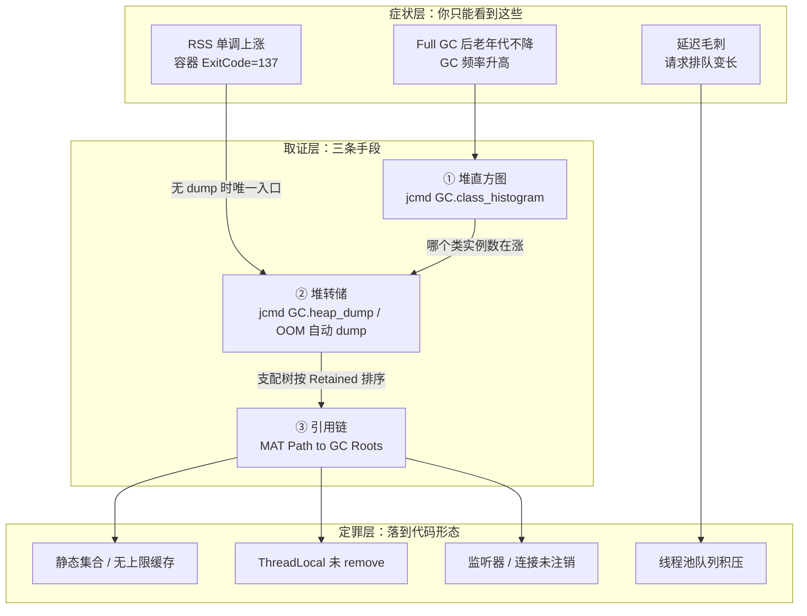
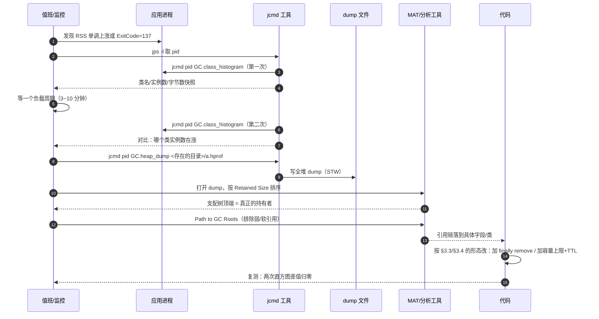

# 内存泄漏排查实战：从"堆在涨"到"这条引用链是谁牵着的"

> **一句话结论**：Java 的内存泄漏几乎都是同一个句式——**某个活着的对象（静态集合、线程池里的线程、未注销的监听器、无上限的缓存）还攥着你以为用完的对象**，所以排查手段只有三条：**堆直方图**看"谁的数量在涨"、**堆转储**看"谁占着内存"、**引用链**看"谁牵着它"；而本项目当前的真实状态是**这三条证据一条都没配**（业务 Dockerfile 无 dump 参数、无 GC 日志、无 JFR/async-profiler、`deploy/observability` 无 JVM 面板），所以一旦在生产泄漏，你手里只有"容器被杀了"这一条信息。
> **阅读前置**：知道堆/元空间/直接内存三块的区别；能读懂 `ThreadLocal` 的 `set/get/remove`；对 `ExecutorService` 的"核心线程 → 队列 → 最大线程 → 拒绝策略"顺序有印象；看得懂 `jcmd` / `jps` 的输出格式。GC 证据链（`jstat`、GC 日志、停顿）看同目录 [02-GC日志与停顿分析](./02-GC日志与停顿分析.md)，分配热点看 [03-火焰图与性能剖析](./03-火焰图与性能剖析.md)。
> **证据基线**：B 级为本仓当次逐文件读码核对（2026-11-27）：`ai-cs-chat` 的 4 处 ThreadLocal 用法、4 个缓存实现、2 个线程池、`application.yml` 全部 193 行；C 级为本机 JDK 17.0.19（Temurin）真跑的 `jcmd`/`java` 输出与 node 模拟；A 级引 `24-源码分析/assets/source/` 已入库摘录。预计阅读 55~70 分钟。

**证据边界**（先说清楚本篇哪些是"跑出来的"、哪些只是"读出来的"）：

| 类别 | 本仓/本机状态 | 本篇怎么处理 |
| --- | --- | --- |
| A 级：JDK / 框架源码摘录 | `24-源码分析/assets/source/` 有 908 份 `.md`，但**没有** `ThreadLocal`/`OutOfMemoryError`/`ThreadPoolExecutor`/`WeakReference` 的摘录 | 只引 MyBatis `LruCache`（有界 LRU 的教科书实现）与 Spring AI `MessageWindowChatMemory`（有界窗口）两段做对照 |
| B 级：本项目源码与配置 | ThreadLocal 4 处、缓存 4 个实现、线程池 2 个、`application.yml` 193 行，全部当次核对 | 每条结论带 `文件#L行` |
| C 级：本机 JVM 取证 | `java`/`javac`/`jcmd`/`jps`/`jmap`/`jstat`/`jfr` 全部可用，**`jhat` MISSING**（JDK 9 起已移除） | 泄漏 demo、直方图、heap dump、OOM 三类报错、队列模拟，全部贴真实输出 |
| C 级：MAT / 引用链分析 | 本机无 MAT、无 IDE、无 `jhat` | **未本机实测**：只给操作步骤与判读口径，不贴截图、不写"支配树 Retained 值 = X MB" |
| C 级：容器侧证据（`docker stats`、OOMKilled 日志、真实 TPS/GC 停顿） | 本机无 `docker`/`mvn`/`kubectl`，也没有启动中的服务 | 一律标注「未本机实测」，只给命令与判读方法，**不编造任何性能数字** |

---

## 0. 先看现象

### 现象一：容器被杀了，日志里连一句 OOM 都没有，也没有 dump 文件

先看 compose 里真正注入的 JVM 参数——7 个业务服务是同一个值：

```yaml
# deploy/docker-compose/docker-compose-all.yml#L175（L193/L214/L236/L254/L275/L294 同值）
JAVA_OPTS: "-Xms256m -Xmx512m"
```

启动行也只有一句 `java ${JAVA_OPTS:-} -jar app.jar`：

```text
ai-cs-chat/Dockerfile
L17: FROM eclipse-temurin:17-jre-jammy
L21: ENTRYPOINT ["sh", "-c", "java ${JAVA_OPTS:-} -jar app.jar"]
```

但项目文档里写的却是另一套（带 `UseG1GC` + 自动 dump）：

```dockerfile
# docs/05-部署上线.md#L49-L54
ENTRYPOINT ["java", \
    "-Xms256m", "-Xmx512m", \
    "-XX:+UseG1GC", \
    "-XX:+HeapDumpOnOutOfMemoryError", \
    "-XX:HeapDumpPath=/app/logs/", \
    "-jar", "app.jar"]
```

本机统计（命令在 §6.1，可复现）：145 个配置文件里 `HeapDumpOnOutOfMemoryError` 只有 **2** 处、`HeapDumpPath` 只有 **2** 处，且**两处都在 vendored 中间件脚本里**（`tools/nacos/bin/startup.sh#L99`、`tools/seata/seata/bin/seata-setup.sh#L136`）；7 个业务 `Dockerfile` 与 5 份 compose **一处都没有**。顺带一提：`ai-cs-chat/Dockerfile` 里没有 `USER` 行，也没有 `mkdir /app/logs`（全仓 grep `mkdir` 只命中 Python 模块与 mvn 行），所以就算照文档把 `-XX:HeapDumpPath=/app/logs/` 加上，也要先确认这个目录真的存在。

**问题不在 JVM，在启动参数没落地**：出事那一刻，能证明"是谁吃掉 512MB 堆"的唯一证据压根没有被生成。

### 现象二：dump 打不出来，而且只留一行字

本机真跑（`-Xmx96m` + dump 参数，路径故意指向不存在的目录）：

```text
$ java -Xmx96m -XX:+HeapDumpOnOutOfMemoryError -XX:HeapDumpPath=D:\no-such-dir\leak.hprof -cp . LeakDemo map
round=10000 usedMB=83 staticSize=10000
java.lang.OutOfMemoryError: Java heap space
Dumping heap to D:\no-such-dir\leak.hprof ...
Unable to create D:\no-such-dir\leak.hprof: No such file or directory
```

对比同一份代码、路径存在时的输出：

```text
$ java -Xmx128m -XX:+HeapDumpOnOutOfMemoryError -XX:HeapDumpPath=.\tmp\leak.hprof -cp . LeakDemo map
round=10000 usedMB=83 staticSize=10000
java.lang.OutOfMemoryError: Java heap space
Dumping heap to ...\tools\tmp\leak.hprof ...
Heap dump file created [136689531 bytes in 0.075 secs]
```

**判读**：`Unable to create` 那行之后**不会**再有第二行提示，进程照样退出（`ExitCode=1`）。也就是说 dump 失败和 dump 成功在"服务挂了"这件事上没有任何区别——你只能事后去翻目录。

### 现象三：用"内存用了多少"判泄漏，一定误判

同一份 demo（§3.1 的代码）跑三遍，只改"谁持有对象"，把每 10000 轮打印的 `usedMB`（= `totalMemory - freeMemory`，**没 GC 前**）抄下来：

```text
# 正确写法（每轮 finally remove，同等工作量）
round=10000 usedMB=29
round=20000 usedMB=111
round=30000 usedMB=12
round=40000 usedMB=82
round=50000 usedMB=6
round=60000 usedMB=88
```

数字在 6 ~ 111MB 之间来回跳，看起来"涨得吓人"，其实一分钱都没漏。而真正的泄漏长这样，单调、稳定、不回头：

```text
# 静态集合无上限（形态 A）
round=10000 usedMB=80 staticSize=10000
round=30000 usedMB=240 staticSize=30000
round=60000 usedMB=497 staticSize=60000
```

**这些现象指向同一件事：泄漏的判据从来不是"内存用了多少"，而是"GC 之后还剩多少对象活着、它们被谁牵着"——而回答这个问题的三件工具（直方图、堆转储、引用链），本项目当前的启动参数里一件都没有。**

---

## 1. 整体地图



> **读图说明**：竖着看只有两条主干——`A1 → B2 → B3` 是"容器被杀、连现场都没有"的**事后路径**（必须先有 dump 才有引用链）；`A2 → B1 → B2 → B3` 是"服务还活着、及时发现"的**在线路径**（直方图不需要落盘，代价最小，所以它是第一入口）。**最容易看错的箭头是 `A3 → C4`**：延迟毛刺直接连到"队列积压"，说明这条分支根本不产生堆泄漏——队列积压吃的是**内存里的等待任务 + 线程栈**，往往 GC 后堆是干净的、直方图也看不出异常，你如果拿"堆没涨"去证伪"不是内存问题"就会漏诊。反过来，若把 `A2` 错连到 `C4`（堆不降却去查队列），会白查半天。

### 组件与责任划分

| 组件 | 责任 | 参与方 | 真实位置（本仓） |
| --- | --- | --- | --- |
| JVM 启动参数 | 决定堆上限、是否能在 OOM 时留现场 | 运维 / 部署脚本 | `deploy/docker-compose/docker-compose-all.yml#L175`（`-Xms256m -Xmx512m`，无 dump 参数） |
| 容器层 OOM | 在 JVM 之前先杀进程（ExitCode 137） | 运维 / K8s | `deploy/k8s/services/ai-chat-service.yaml#L91`（`-Xms512m -Xmx512m`） |
| `/actuator/prometheus` | 暴露 Micrometer 指标（含 `jvm_memory_*`） | 平台 / Prometheus | `deploy/observability/prometheus.yml`（job `ai-cs-services`，`metrics_path: '/actuator/prometheus'`） |
| 语义缓存（Redis Hash + ZSET） | 缓存 RAG 回答，**有 200 条上限 + 168h TTL** | 后端 / 业务 | `ai-cs-chat/src/main/java/com/aics/chat/cache/SemanticCacheService.java#L143` |
| 向量缓存 L1（进程内 LRU） | 缓存 embedding，**有 4096 条上限**、L1 无 TTL | 后端 / 业务 | `ai-cs-chat/src/main/java/com/aics/chat/cache/VectorCacheStore.java#L48` |
| Agent run 状态（Redis） | 多轮确认上下文，**TTL = 720s** | 后端 / 业务 | `ai-cs-chat/src/main/java/com/aics/chat/agent/store/RedisAgentRunStore.java#L36` |
| Agent run 状态（内存） | 同上，**无上限、无 TTL、无 remove** | 测试 / 单实例 | `ai-cs-chat/src/main/java/com/aics/chat/agent/store/InMemoryAgentRunStore.java#L17` |
| 用量上报线程池 | 异步 Feign 落库，**队列 1000、AbortPolicy** | 后端 / 观测 | `ai-cs-chat/src/main/java/com/aics/chat/config/ObservabilityExecutorConfig.java#L27` |
| Tomcat 工作线程 | 请求并发上限，**全默认（200、无界队列）** | 框架 | 各模块 `application*.yml` 里 `max-threads` 命中 0 处 |

---

## 2. 关键概念与关键工具

| 名称 | 位置 | 作用 | 关键参数 / 判读点 |
| --- | --- | --- | --- |
| `jps -l` | `D:\DevTools\jdk\jdk17.0.19\bin\jps.exe` | 列出本机 JVM 进程号，取 `<pid>` | 输出 `37228 LeakDemo`（主类名在第二列） |
| `jcmd <pid> GC.class_histogram` | 同上（`jcmd.exe`） | **堆直方图**：按类统计实例数与字节数，先做一次 Full GC | 默认单位是**字节**；`-all` 会连不可达对象一起算（对比用） |
| `jcmd <pid> GC.heap_dump <path>` | 同上 | **在线导出堆转储**，不杀进程 | 全堆 dump 是 STW；路径目录必须存在 |
| `-XX:+HeapDumpOnOutOfMemoryError` | JVM 参数 | OOM 时自动 dump（唯一"无人工介入"的取证方式） | 必须配合 `-XX:HeapDumpPath=<存在的目录>` |
| `jmap -histo:live <pid>` | `jmap.exe` | 老式直方图，等价物已被 `jcmd` 覆盖 | `:live` 会触发 Full GC；JDK 17 仍可用 |
| `jhat <file>` | **本机 MISSING** | JDK 8 时代的 dump 浏览器（OQL 控制台） | JDK 9 起从 JDK 移除，见 §7 |
| MAT（Eclipse Memory Analyzer） | 本机未安装 | 支配树、Leak Suspects、Path to GC Roots | 必须用与 dump 同大版本的 JDK 打开 |
| `WeakReference` / `WeakHashMap` | `java.base` | 让缓存"跟着 key 的死活走"，自动摘除 | key 必须是弱引用对象，且必须有别的强引用链 |
| `ThreadLocal.remove()` | 代码 | 摘掉线程 `ThreadLocalMap` 里的 Entry | 只 `set(null)` 不清 Entry；**必须 remove** |
| `-XX:MaxMetaspaceSize` | JVM 参数 | 元空间上限，默认 **无上限**（本机实测 `18446744073709551615`） | 不设它，Metaspace OOM 会先用光容器内存被 137 杀 |
| `-XX:MaxDirectMemorySize` | JVM 参数 | 堆外内存上限，默认 **0 = 等于最大堆**（本机实测 `0 {default}`） | Netty/NIO/HTTP 客户端泄漏看这里，堆直方图里看不见 |
| `queueCapacity` + 拒绝策略 | `ai-cs-chat/src/main/java/com/aics/chat/config/ObservabilityExecutorConfig.java#L34` | 队列容量决定"排队"还是"拒绝" | `ThreadPoolTaskExecutor` 默认 `AbortPolicy` |
| Redis `maxmemory` | `deploy/redis/redis.conf#L24` | 缓存层总闸 | `256mb` + `allkeys-lru`（L25），超了**随机淘汰业务 key** |

**负向事实（同样是证据，本项目"没有配"）**：全仓 `async-profiler` **0** 处、`asyncProfiler` **0** 处、`StartFlightRecording` **0** 处、业务侧 `Xlog:gc` **0** 处（3 处命中全在 vendored 脚本）、`mem_limit` **0** 处、`cpus` **0** 处、`MaxRAMPercentage` **0** 处、`AlwaysPreTouch` **0** 处。

---

## 3. 原理与证据逐段精读

### 3.1 先分清两件事：泄漏 vs "内存占用高"

**在干什么**：把"内存涨了"这件事拆成两个互斥的命题——**(a) 对象已经无用但 GC 收不掉**（泄漏）；**(b) 对象有用，只是缓存/批量/队列主动占着**（占用高）。两者的判据完全不同：前者看"GC 之后存活集是否单调增长"，后者看"存活集是否被上限约束住"。

本机真跑的三份"同等工作量（60000 轮 × 8KB）"对照，同一份代码，只改持有方式：

```java
import java.util.*;
import java.util.concurrent.*;

public class LeakDemo {
    static final Map<String, byte[]> STATIC_MAP = new HashMap<>();           // 形态 A：静态集合无上限
    static final ThreadLocal<List<byte[]>> TL_ACC = new ThreadLocal<>();     // 形态 B：ThreadLocal 挂累积列表

    static long usedMb() {
        Runtime r = Runtime.getRuntime();
        return (r.totalMemory() - r.freeMemory()) / (1 << 20);
    }

    public static void main(String[] args) throws Exception {
        String mode = args.length == 0 ? "ok" : args[0];          // ok / map / tl
        ExecutorService pool = Executors.newFixedThreadPool(8);
        for (int n = 1; n <= 60000; n++) {
            final int id = n;
            if ("map".equals(mode)) {
                STATIC_MAP.put("q" + id, new byte[8192]);
            } else {
                pool.submit(() -> {
                    List<byte[]> acc = TL_ACC.get();
                    if (acc == null) { acc = new ArrayList<>(); TL_ACC.set(acc); }
                    acc.add(new byte[8192]);
                    if ("ok".equals(mode)) { TL_ACC.remove(); }    // 唯一的差别
                }).get();
            }
            if (n % 10000 == 0) {
                System.out.printf("round=%d usedMB=%d staticSize=%d%n", n, usedMb(), STATIC_MAP.size());
                Thread.sleep(400);                                  // 留窗口给 jcmd 取直方图
            }
        }
        System.out.println("loop done, pid=" + ProcessHandle.current().pid() + ", staying alive for jcmd");
        Thread.sleep(120000);
    }
}
```

同一进程内隔 3 秒取两次直方图（`-Xmx512m`），真实输出：

```text
################ MODE=ok ################
--- t=1.2s ---
   1:          5120         275248  [B (java.base@17.0.19)
  97:            10            240  java.util.ArrayList (java.base@17.0.19)
--- t=4.2s ---
   1:          5227         279792  [B (java.base@17.0.19)
 103:            10            240  java.util.ArrayList (java.base@17.0.19)
--- t=4.2s heap_info ---
 garbage-first heap   total 27648K, used 1168K [0x00000000e0000000, 0x0000000100000000)

################ MODE=map ################
--- t=1.2s ---
   1:         65087      247234208  [B (java.base@17.0.19)
--- t=4.2s ---
   1:        125166      494197768  [B (java.base@17.0.19)
--- t=4.2s heap_info ---
 garbage-first heap   total 524288K, used 492418K [0x00000000e0000000, 0x0000000100000000)

################ MODE=tl ################
--- t=1.2s ---
   1:         25108      164434824  [B (java.base@17.0.19)
  73:            18            432  java.util.ArrayList (java.base@17.0.19)
--- t=4.2s ---
   1:         65214      492759320  [B (java.base@17.0.19)
  77:            18            432  java.util.ArrayList (java.base@17.0.19)
--- t=4.2s heap_info ---
 garbage-first heap   total 524288K, used 485920K [0x00000000e0000000, 0x0000000100000000)
```

**判读**：`ok` 模式两次直方图 `[B` 只差 107 个（+2.1%，属于采样噪声），GC 后 `used` 只剩 **1168K**；`map` 与 `tl` 都是"同一个类数量翻倍、字节数翻倍"——**这才是泄漏的指纹：单个类的实例数随请求量单调增长，且 GC 收不掉**。

**为什么这么设计（判据为什么必须是 GC 后）**：`totalMemory() - freeMemory()` 里混着"已经死了但还没回收"的垃圾，Eden 越用越大、G1 又不急着归还，所以你看到的是一条锯齿甚至上扬的曲线。`jcmd GC.class_histogram` 内部**先做一次 Full GC** 再统计，等于强制把"垃圾"和"存活"分开——这是它比 `top`/`docker stats` 值钱的全部原因。

**换写法会怎样**：如果用 RSS 或 `usedMB` 做告警阈值，`ok` 模式那种"29 → 111 → 12 → 82 → 6 → 88"会在半夜把你叫起来三次，而真正泄漏的服务反而因为"还没涨到阈值"被放过。反过来，如果按"GC 后老年代占比 > 80% 且 Full GC 频率上升"告警，成本高但结论可靠。

**常见坑。**
1. **只看一次直方图**：单张快照无法区分"一直很多"和"正在变多"。必须两个时间点 + 相同负载，且两次之间发生过 GC（`jcmd GC.class_histogram` 自己会触发，所以相邻两次采样天然可比）。
2. **把 `[B` 当成"某个业务类"**：`[B` 是 `byte[]`、`[C` 是 `char[]`、`[I` 是 `int[]`、`[Ljava.util.HashMap$Node;` 是 `HashMap.Node[]`。只看 `byte[]` 涨，你并不知道是哪个业务对象在装它——必须往下走 dump + 引用链。
3. **`-Xmx512m` 的容器里用本机默认堆去推演**：本机 `java` 不带参数时 `MaxHeapSize = 8514437120`（7.93 GiB，ergonomics 按宿主机 1/4 算），跟容器里 `-Xmx512m` 是两个世界，别混着用。

### 3.2 泄漏的本质：一条从 GC Root 到对象的"活引用链"

**在干什么**：把"对象为什么收不掉"具象成图论问题——从 **GC Roots**（线程栈里的局部变量、静态字段、JNI 引用、活动线程对象）出发做可达性分析，只要能走到你那个对象，它就算"活着"。泄漏 = 有一条你以为不存在的路径，把它接回了某个 Root。

对照读一段有界版本长什么样（A 级，MyBatis 的 LRU 装饰器）：

```java
  public void setSize(final int size) {
    keyMap = new LinkedHashMap<Object, Object>(size, .75F, true) {
      @Override
      protected boolean removeEldestEntry(Map.Entry<Object, Object> eldest) {
        boolean tooBig = size() > size;
        if (tooBig) {
          eldestKey = eldest.getKey();
        }
        return tooBig;
      }
    };
  }
```

`(src: LruCache.java.md#L49-L61)` — 见 [[源码:LruCache.java.md#L49-L61]]。`accessOrder=true` 让 `get` 也算一次"访问"，`removeEldestEntry` 返回 `true` 就把最久未用的条目**从 Map 里摘掉**，随后 `cycleKeyList` 顺手把 `delegate` 里的真实值也删掉：

```java
  private void cycleKeyList(Object key) {
    keyMap.put(key, key);
    if (eldestKey != null) {
      delegate.removeObject(eldestKey);
      eldestKey = null;
    }
  }
```

`(src: LruCache.java.md#L88-L94)` — 见 [[源码:LruCache.java.md#L88-L94]]。**有界缓存的本质不是"用了 LRU 算法"，而是"存在一条一定会执行的摘引用路径"**：只要 `put` 走得到 `removeEldestEntry`，引用链就永远不会长过 `size`。

**为什么这么设计**：MyBatis 的二级缓存是**跨请求共享**的，一旦无界，每条 SQL 的结果集都会永久钉在堆里；`size` 默认 1024（`LruCache.java` 的构造器 `setSize(1024)`）就是为了给"共享 + 无界"这对致命组合加一个硬闸。

**换写法会怎样**：把 `removeEldestEntry` 去掉、只留 `LinkedHashMap`——代码照样编译、功能照样正确、单测照样通过，**唯一的区别是它会在几个月后的某个凌晨把堆撑爆**。这是泄漏最典型的伪装：**没有任何异常、没有任何日志，只有一条缓慢上升的曲线**。

**常见坑。**
1. **以为 `Collections.synchronizedMap(LinkedHashMap)` 就是线程安全 LRU**：`synchronizedMap` 只包了方法级互斥，业务侧"先 get 再 put"仍是两步，`removeEldestEntry` 里的 `size()` 读到的是锁内状态没问题，但**淘汰与回填的顺序**在并发下可能让刚回填的条目立刻被淘汰（本项目 `VectorCacheStore` 就有这个特性，见 §3.4）。
2. **只摘 key 不摘 value**：像 MyBatis 那样拆成 `keyMap` + `delegate` 时，忘了让 `delegate` 一起删，等于换了个 Map 继续泄漏。
3. **用 `SoftReference` 当"自动清理"**：软引用只在**真正内存紧张**时才被清，代价是每次清理前服务已经处在 GC 风暴里——它不是不泄漏，它只是把爆点推迟到最难看的时刻。

### 3.3 ThreadLocal：一个"没有上限、也没有过期"的 map，key 是线程

**在干什么**：`ThreadLocal` 的值实际存在**每个线程自己的 `ThreadLocalMap`** 里，key 是 ThreadLocal 实例（弱引用），value 是**强引用**。所以线程活多久，value 就可能被钉多久——而 Tomcat 的 200 个工作线程、`ThreadPoolTaskExecutor` 的核心线程，**都是"几乎永生"的**。

本项目一共有 4 处 ThreadLocal 使用点，逐个点评"这里清理做对了吗"：

**① `ChatUserContext`（`ai-cs-chat/src/main/java/com/aics/chat/util/ChatUserContext.java`）——做对了。**

```java
    private static final ThreadLocal<Long> USER_ID = new ThreadLocal<>();

    public static void clear() {
        USER_ID.remove();
    }
```

L26 / L39-41。value 是一个 `Long`，本身只占几个字节，所以它**不是内存泄漏点，而是"数据串线"点**：线程被复用后 `getUserId()` 拿到的是上一个人的 id。是否在 `finally` 里清理——**是**，六个调用点全部在 `finally`：

| 调用点 | 位置 | 是否 `finally` |
| --- | --- | --- |
| 同步对话 | `ai-cs-chat/src/main/java/com/aics/chat/controller/ChatController.java#L85`（set）→ `#L87`（finally clear） | ✅ |
| RAG 对话 | 同文件 `#L127`（set）→ `#L130`（finally clear） | ✅ |
| 其余三对端点 | 同文件 `#L175`/`#L178`、`#L237`/`#L240`、`#L257`/`#L260` | ✅ |
| Agent 同步 | `ai-cs-chat/src/main/java/com/aics/chat/agent/AgentController.java#L53`（set）→ `#L71`（finally clear） | ✅ |
| Agent 确认 | 同文件 `#L85`（set）→ `#L92`（finally clear） | ✅ |
| Agent SSE（异步线程） | 同文件 `#L148`（set）→ `#L177`-`#L180`（finally clear） | ✅ |

**② `TraceContextHolder`（`ai-cs-chat/src/main/java/com/aics/chat/observability/TraceContextHolder.java`）——做对了，而且它自己写明了风险。**

```java
    private static final ThreadLocal<TraceContext> HOLDER = new ThreadLocal<>();

    public static void clear() {
        HOLDER.remove();
        MDC.remove(MDC_REQUEST_ID);
    }
```

L25 / L104-107。它的 Javadoc L100-102 直接写了「不清理 → trace 串线与内存泄漏（ThreadLocal 值被线程持有，无法被 GC）」。这个方法重得多：value 是 `TraceContext`，里面挂着 prompt 文本、request/response 片段（`setPrompt(...)`，被 `LlmJudgeService` L72 写入），一次请求几十 KB 很正常——**200 个工作线程 × 几十 KB ≈ 几 MB 常驻，泄漏放大 200 倍**。

清理时机在拦截器的 `afterCompletion` 里，且放在 `finally`：

```java
        try {
            traceRecorderFactory.getObject().record(ctx);
        } catch (Exception e) {
            log.warn("LLM trace 落库失败: requestId={}, err={}", ctx.getRequestId(), e.getMessage());
        } finally {
            TraceContextHolder.clear();
        }
```

`ai-cs-chat/src/main/java/com/aics/chat/observability/TraceInterceptor.java#L78-L84`。这里有个值得学的细节：`begin()` 在"关闭采样"和"未命中采样"两条路径上**直接返回 null 且不写 MDC**（`TraceContextHolder.java#L42-L51` 早于 L56 的 `HOLDER.set` 与 L59 的 `MDC.put`），所以"没 set 就提前 return、不 clear"不会留残留。

**③ `HeaderAuthenticationFilter`（`ai-cs-user/src/main/java/com/aics/user/security/HeaderAuthenticationFilter.java`）——做对了，注释还点出了跨线程池复用。**

```java
        try {
            filterChain.doFilter(request, response);
        } finally {
            // OncePerRequestFilter 跨线程池复用，必须清理 ThreadLocal，防身份串线
            SecurityContextHolder.clearContext();
        }
```

L50-55。这是 `Spring Security` 的 `ThreadLocal`（`SecurityContextHolder` 默认 `MODE_THREADLOCAL`），value 是 `Authentication`——里面挂着 userId 和权限列表，**泄漏量小、串线后果大**（越权）。

**④ `LlmJudgeService`（`ai-cs-chat/src/main/java/com/aics/chat/rag/eval/LlmJudgeService.java`）——做对了，但写法值得警惕。**

```java
    private static final ThreadLocal<Integer> LAST_TOTAL_TOKENS = new ThreadLocal<>();
```

L54，`set` 在 L124，`remove` 在 L104 与 **L130**。它把"最近一次打分消耗的 token 数"通过 ThreadLocal 传给门禁读取——这类"用 ThreadLocal 传返回值"的写法，**只要有一条 return 路径漏了 remove 就是泄漏**（虽然这里 value 是 `Integer`，泄漏量可忽略，但模式很危险）。

**跨线程传播的正确姿势**（本项目 `ResilientAiService` 的做法，值得抄）：`supplyAsync` 之前先 `capture()`，进线程后 `restore(captured)`，任务尾部 `clear()`：

```java
            TraceContext captured = TraceContextHolder.capture();
            Long userId = ChatUserContext.getUserId();
            ... CompletableFuture.supplyAsync(() -> {
                TraceContextHolder.restore(captured);
                ...
```

`ai-cs-chat/src/main/java/com/aics/chat/service/impl/ResilientAiService.java#L173-L177`，`clear()` 在 `#L237`、`#L330`、`#L342`。**规矩是"谁 restore 谁 clear"**——异步线程来自 `ForkJoinPool.commonPool()`（本机已知 15 并发，未本机实测），一样会被复用。

**为什么这么设计**：ThreadLocal 是"隐式传参"，能免掉在几十层方法签名里加 `userId` 参数；代价就是把生命周期管理责任**隐式**交给了调用方——编译器不会提醒你 `finally`。

**换写法会怎样**：把 userId 显式作为参数/`RequestContext` 传递，泄漏与串线风险归零，代价是改签名、改测试，以及 SSE 这类异步场景仍然要手动传递。或者用 `ScopedValue`（JDK 21 预览，JDK 25 才正式），它在作用域结束时自动解绑——但本项目跑 JDK 17（见 §7），用不了。

**常见坑。**
1. **`set(null)` 当作清理**：`ThreadLocalMap` 里的 Entry 还在，key 弱引用 + value 为 null 只是让"真正的对象"可回收，Entry 数组本身照样跟着线程活着。**必须 `remove()`**。
2. **清理写在 `catch` 或方法末尾**：SSE、`CompletableFuture`、`@Transactional` 回滚、`Error`，任一异常路径都会跳过它。**只有 `finally` 是全覆盖的**。
3. **在 `@Async`/线程池任务里 set 却在外层 clear**：清的是调用方线程，不是执行线程。本项目全仓 `@Async` **0 处**、`newFixedThreadPool`/`newCachedThreadPool` 主代码 **0 处**，所以这个坑目前只出现在 `CompletableFuture` + 两个自定义线程池（§3.5）上。

### 3.4 缓存：有上限、有过期，缺一不可

**在干什么**：把"重复计算"换成"占内存"。缓存天然是"合法的内存占用"，所以它和泄漏的唯一分界线是**有没有硬上限 + 有没有过期**——两个都缺就是泄漏，缺一个就只是"迟早出事"。

本项目 4 个缓存实现，正好凑成一个"两对正反例"：

| 实现 | 上限 | 过期 | 结论 |
| --- | --- | --- | --- |
| `SemanticCacheService`（Redis） | ✅ 每知识库 200 条（`max-entries: 200`） | ✅ 168h（`ttl-hours: 168`） | **两个都做对** |
| `VectorCacheStore` L1（进程内） | ✅ 4096 条（`l1-max-entries: 4096`，LRU 淘汰） | ❌ L1 无 TTL | 上限兜住，够用但"旧值永不逃逸" |
| `VectorCacheStore` L2（Redis） | ❌ 无条数上限 | ✅ 168h | 靠 Redis `maxmemory 256mb` + `allkeys-lru` 兜 |
| `RedisAgentRunStore` | ❌ 无条数上限 | ✅ 720s（算出来的） | 靠短 TTL，可以接受 |
| `InMemoryAgentRunStore` | ❌ **无** | ❌ **无** | **教科书式反例**（好在不是生产注入的实现） |

**正例精读：语义缓存的淘汰是一条"有执行保证"的路径**

```java
    private void evictOverflow(String knowledgeBase) {
        int maxEntries = Math.max(1, properties.getSemantic().getMaxEntries());
        Long size = redisTemplate.opsForZSet().zCard(INDEX_KEY + knowledgeBase);
        if (size == null || size <= maxEntries) {
            return;
        }
        Set<String> stale = redisTemplate.opsForZSet()
                .range(INDEX_KEY + knowledgeBase, 0, size - maxEntries - 1);
        ...
        redisTemplate.opsForZSet().remove(INDEX_KEY + knowledgeBase, stale.toArray());
        redisTemplate.opsForHash().delete(ENTRY_KEY + knowledgeBase, stale.toArray());
```

`ai-cs-chat/src/main/java/com/aics/chat/cache/SemanticCacheService.java#L143-L155`。`put()` 在写完 Hash + ZSET + 两次 `expire(ttl)` 之后**同步调用** `evictOverflow`（L129-134），所以上限是"每次写入后都重新校验一次"的强约束，而不是靠定时任务。

三个细节值得单独指出：

1. **上限/过期都来自配置，且带 `Math.max(1, ...)` 兜底**（L144）——配置被改成 0 也不会退化成"无上限"，只会退化成"最多 1 条"。
2. **`expire` 挂在整个 Hash/ZSET 上，不是单条**（L132-133）——所以 168h 是"这组键最后一次写入后"的滑动过期，**不是每条自己的 TTL**。热点知识库永远不会整体过期，只有 200 条上限在起作用。这是"看起来有过期、其实主要靠上限"的典型。
3. **`lookup()` 里 `opsForHash().entries(...)` 是全量拉取**（L69）——200 条 ×（问题向量 + 回答 JSON），每次查询都在应用侧反序列化一遍。`n=200` 时是本机微秒级，但它同时意味着**缓存越大、单次查询越慢、GC 压力越大**，所以"上限"在这里也是性能闸（Javadoc L37-38 自己写了这条取舍）。

**反例精读：同一个接口，两种实现，一个有 TTL 一个什么都没有**

```java
    // RedisAgentRunStore.java#L36-L38：TTL = 总超时 + 确认超时 + 60s 缓冲
    long ttlSeconds = properties.getTotalTimeoutMs() / 1000
            + properties.getConfirmTimeoutMinutes() * 60L + 60;
    redisTemplate.opsForValue().set(KEY_PREFIX + context.getRunId(), json, Duration.ofSeconds(ttlSeconds));
```

按 `AgentProperties` 的默认值（`totalTimeoutMs = 60000`、`confirmTimeoutMinutes = 10`，见 `ai-cs-chat/src/main/java/com/aics/chat/agent/AgentProperties.java#L28` 与 `#L31`）算出来是 `60 + 600 + 60 = 720` 秒——**每条 run 状态最多活 12 分钟**，这个数是能算出来的，不用猜。

```java
    // InMemoryAgentRunStore.java#L17-L29
    private final Map<String, AfterSaleContext> store = new ConcurrentHashMap<>();

    @Override
    public void save(AfterSaleContext context) {
        store.put(context.getRunId(), context);
    }

    @Override
    public Optional<AfterSaleContext> load(String runId) {
        return Optional.ofNullable(store.get(runId));
    }
```

`ai-cs-chat/src/main/java/com/aics/chat/agent/store/InMemoryAgentRunStore.java#L17`。**接口上根本没有 `delete` 方法**（`ai-cs-chat/src/main/java/com/aics/chat/agent/store/AgentRunStore.java#L10`-`L21` 只有 `save`/`load`），所以这个实现**永远不可能删除任何东西**：一次 run 一条，`AfterSaleContext` 里带着对话历史与工具调用记录，涨到堆满为止。它不是"写得不好"，而是"只在单实例/测试场景成立"——生产注入的是 `@Qualifier("redisAgentRunStore")`（`ai-cs-chat/src/main/java/com/aics/chat/agent/workflow/AfterSaleAgentService.java#L95`），这个注解就是这条边界。

**为什么这么设计**：Redis 侧可以用 `expire` 把"清理"变成一句原子命令，不需要写清理线程；进程内 Map 没有这个能力，只能自己写"定时扫 + 大小闸"，而没人写。

**换写法会怎样**：把 `InMemoryAgentRunStore` 换成 `Caffeine`（`maximumSize` + `expireAfterWrite`）或自己加 `LinkedHashMap.removeEldestEntry`（§3.2），泄漏立刻归零；代价是多一个依赖或多 30 行代码。

**常见坑。**
1. **以为"写在 Redis 里就不会泄漏"**：Redis 有 `maxmemory 256mb` + `allkeys-lru`（`deploy/redis/redis.conf#L24`-`L25`）——超了之后淘汰的是**任意 key**，包括会话、限流计数器、语义缓存。也就是说**应用侧不设上限，最终代价不是 OOM，而是"缓存神秘丢失 + 命中率莫名下降"**，这类故障比 OOM 更难查。
2. **只设 TTL 不设上限**：TTL 是"时间闸"，热点 key 只要一直被写就一直活着（滑动过期）。写多读少的场景必须设条数上限。
3. **把"L1 有上限"当成"整个缓存有上限"**：`VectorCacheStore` 的 L1 是 4096 条，L2 是 Redis 无条数上限。L1 单个条目的成本是 `float[]`（维度 × 4 字节 + 对象头）：**按 1024 维算约 4KB/条、4096 条约 16MB；按 4096 维算约 16KB/条、4096 条约 64MB**——embedding 维度由 Nacos 里的模型决定，仓库内没有常量，**这是估算不是实测**。

### 3.5 线程池队列积压：GC 后堆很干净，但内存还是被吃光

**在干什么**：把"内存问题"里**不是泄漏**的那一半说清楚——任务在队列里排队，每个任务对象、它的闭包、它的上下文都活着，`ThreadPoolTaskExecutor` 的队列默认是 `LinkedBlockingQueue`，**队列容量就是你配置的那个数**；而 Tomcat 的请求队列默认是**无界的**（`maxQueueSize = Integer.MAX_VALUE`，本项目 `application*.yml` 里 `max-threads`/`accept-count`/`tomcat:` 命中 **0** 处，全是框架默认）。

本项目的两个自定义线程池（`ObservabilityExecutorConfig.java#L27`-`L59`）：`usageExecutor` core=1/max=4/**queue=1000**，`evalExecutor` core=1/max=2/**queue=500**，拒绝策略默认 `AbortPolicy`（类注释 L33 自己写了"队列满时报错由调用方捕获告警"）。

用 node 做确定性模拟（参数全部取自真实配置，任务耗时是**模拟输入假设值**）：

```javascript
// 线程池排队/拒绝模拟：线程上限=4、队列上限=1000（usageExecutor 的真实配置）
const MAX_POOL = 4, QUEUE_CAP = 1000;
const TASK_MS = Number(process.argv[3] ?? 25);   // 单任务耗时（模拟输入）
const ARRIVE_MS = Number(process.argv[2] ?? 10); // 到达间隔（模拟输入）
const freeAt = new Array(MAX_POOL).fill(0);
let queue = [], accepted = 0, rejected = 0, firstRejectAt = -1, maxQueue = 0;
for (let t = 0; t <= 60000; t += ARRIVE_MS) {
  for (let i = 0; i < MAX_POOL && queue.length > 0; i++) {
    if (freeAt[i] <= t) { queue.shift(); freeAt[i] = t + TASK_MS; }
  }
  let placed = false;
  for (let i = 0; i < MAX_POOL; i++) {
    if (freeAt[i] <= t) { freeAt[i] = t + TASK_MS; placed = true; break; }
  }
  if (placed) accepted++;
  else if (queue.length < QUEUE_CAP) { queue.push(t); accepted++; }
  else { rejected++; if (firstRejectAt < 0) firstRejectAt = t; }
  maxQueue = Math.max(maxQueue, queue.length);
}
console.log(`60s 汇总：受理=${accepted} 拒绝=${rejected} 队列峰值=${maxQueue} 首次拒绝 t=${firstRejectAt}ms`);
```

真实输出三档：

```text
=== 稳态：到达 10ms / 任务 25ms（100 req/s < 160 req/s 容量）===
60s 汇总：受理=6001 拒绝=0 队列峰值=0 首次拒绝 t=-1ms

=== 轻度过载：到达 5ms / 任务 25ms（200 req/s > 160 req/s）===
60s 汇总：受理=10601 拒绝=1400 队列峰值=1000 首次拒绝 t=25020ms

=== 严重过载：到达 2ms / 任务 25ms（500 req/s）===
60s 汇总：受理=10232 拒绝=19769 队列峰值=1000 首次拒绝 t=2896ms
```

**判读**：轻度过载那一档最关键——**前 25 秒一切正常**（队列在涨、没人报错），第 25.02 秒开始拒绝。这段"看起来很健康"的窗口里，队列里的 1000 个任务 + 它们的上下文全是活对象，**堆直方图会显示它们正常、GC 也能收，但你已经在泄漏的路上了**。这就是为什么"队列积压"必须和"堆泄漏"分开归因。

再看 chat 侧的真实超时/重试常量（`ai-cs-chat/src/main/resources/application.yml`）：TimeLimiter `chatService` **30s**、`sseChatService` **60s**、`visionService` 5s，且都 `cancel-running-future: true`（L77-87）；Retry `chatService` `max-attempts: 3`、`wait-duration: 1s`、`multiplier: 2`（L91-94）。于是**一个最坏路径的 chat 请求占用 Tomcat 线程 ≈ 30s × 3 + 1s + 2s = 93 秒**。同一个 node 脚本算 Little 定律：

```text
chatService 最坏占用 = 30s 超时 × 3 次 + 1s + 2s 退避 = 93s
  QPS=10 → 在途并发=930，超出 maxThreads(200) 需排队=730
  QPS=50 → 在途并发=4650，超出 maxThreads(200) 需排队=4450
  QPS=100 → 在途并发=9300，超出 maxThreads(200) 需排队=9100
chatService 单次超时 30s（不重试）
  QPS=50 → 在途并发=1500，超出 maxThreads(200) 需排队=1300
sseChatService 首包超时 60s
  QPS=50 → 在途并发=3000，超出 maxThreads(200) 需排队=2800
```

**这是算式不是压测**：输入是配置里的真实常量 + 假设的 QPS，输出是"要多少并发才能不排队"，**本机没有运行中的服务，任何 TPS/P99 数字都无从得来**。

**为什么这么设计**：异步化 + 队列的本意是"削峰"，让瞬时爆发排队而不是丢任务（类注释 L14-16 原话）；代价是**把"过载"从"快速失败"改造成"慢慢变慢"**——延迟先涨、内存随后涨、最后要么超时、要么拒绝。

**换写法会怎样**：给 `ThreadPoolTaskExecutor` 设 `RejectedExecutionHandler` 为 `CallerRunsPolicy`（背压回调用方，让 Tomcat 线程慢下来）或 `AbortPolicy` + 明确的降级响应；Tomcat 侧设 `server.tomcat.max-connections`/`accept-count` 让队列有界。代价是过载时用户看到 503 而不是转圈。

**常见坑。**
1. **`queueCapacity` 设成 `Integer.MAX_VALUE`（老 `Executors.newFixedThreadPool` 的默认行为）**：`maximumPoolSize` 永远用不上（队列不装满就不会扩容），线程数恒为 core，队列无限膨胀——这是"线程池调优"最经典的坑，本项目主代码已经把所有 `Executors.newXxx` 清成 0 处，算躲过了。
2. **只看线程池 activeCount 不看 queueSize**：`activeCount=4`（打满）时你觉得"还行"，实际 `queueSize=1000` 已经在吃内存。判据必须两条一起看。
3. **把 `Retry` 当"提高成功率"**：`max-attempts: 3` 意味着**超时类失败会把线程占用放大 3 倍**（93s vs 30s），在已经过载时重试是负优化，且放大的是"队列里的活对象数"。

### 3.6 OOM 的三种类型与各自的排查入口

**在干什么**：`OutOfMemoryError` 不是一种病，是三种，报错文案不同、排查入口完全不同：

| 类型 | 报错文案（真实） | 吃的是 | 第一入口 |
| --- | --- | --- | --- |
| 堆 | `java.lang.OutOfMemoryError: Java heap space` | `-Xmx` | 直方图 → 堆 dump |
| 元空间 | `java.lang.OutOfMemoryError: Metaspace` | 类元数据（类加载器泄漏） | `jcmd GC.class_histogram` 看 `java.lang.Class` 数 + 类加载器数 |
| 直接内存 | `java.lang.OutOfMemoryError: Cannot reserve 4194304 bytes of direct buffer memory (allocated: 67108864, limit: 67108864)` | 堆外（Netty/NIO/HTTP 客户端/`ByteBuffer.allocateDirect`） | **堆直方图看不见**，必须看 JMX/`BufferPool` 指标或 `-XX:NativeMemoryTracking` |

本机真跑的前两种（第三种见下）：

```text
$ java -Xmx128m -XX:+HeapDumpOnOutOfMemoryError -XX:HeapDumpPath=.\tmp\leak.hprof -cp . LeakDemo map
java.lang.OutOfMemoryError: Java heap space
Dumping heap to ...\tools\tmp\leak.hprof ...
Heap dump file created [136689531 bytes in 0.075 secs]
```

直接内存的真跑输出（`DirectOom.java`，每轮 `ByteBuffer.allocateDirect(4 << 20)`，`-XX:MaxDirectMemorySize=64m`）：

```text
direct buffers=15 approxMB=60
Exception in thread "main" java.lang.OutOfMemoryError: Cannot reserve 4194304 bytes of direct buffer memory (allocated: 67108864, limit: 67108864)
	at java.base/java.nio.Bits.reserveMemory(Bits.java:178)
	at java.base/java.nio.DirectByteBuffer.<init>(DirectByteBuffer.java:121)
	at java.base/java.nio.ByteBuffer.allocateDirect(ByteBuffer.java:332)
	at DirectOom.main(DirectOom.java:12)
```

**判读**：报错串里 `allocated: 67108864` 正好等于 `limit: 67108864`，说明**每一块 `DirectByteBuffer` 都被 `ArrayList` 强引用着、没被 Cleaner 回收**——这就是"堆外泄漏"。而本机默认 `MaxDirectMemorySize = 0`（`java -XX:+PrintFlagsFinal -version` 实测，`{default}`），含义是"上限 = 最大堆"，所以**不显式设它，你连"堆外到底用多少"都没有一个数可看**。

同一份 `PrintFlagsFinal` 里还有两个关键默认值：

```text
   size_t InitialHeapSize                          = 532676608           {product} {ergonomic}
 uint64_t MaxDirectMemorySize                      = 0                   {product} {default}
   size_t MaxHeapSize                              = 8514437120          {product} {ergonomic}
   size_t MaxMetaspaceSize                         = 18446744073709551615 {product} {default}
     bool UseG1GC                                  = true                {product} {ergonomic}
```

`MaxMetaspaceSize = 18446744073709551615`（`2^64-1`）意味着**元空间默认无上限**：类加载器泄漏不会以 `Metaspace` OOM 的形态出现，而是**先把容器内存吃满、被 `ExitCode=137` 杀掉**——于是你连 JVM 的异常日志都拿不到，只剩下"容器自己没了"。

**为什么这么设计**：三块内存各有各的分配器——堆由 GC 管、元空间由类加载器管、直接内存由 `Cleaner`/`Unsafe` 管。GC 只管第一块，所以**"堆直方图干净"永远不能证明"没有内存泄漏"**。

**换写法会怎样**：把 `-XX:MaxMetaspaceSize=256m`、`-XX:MaxDirectMemorySize=256m` 显式写进 `JAVA_OPTS`（本项目只在 vendored 的 `tools/nacos/bin/startup.sh#L98`、`tools/seata/seata/bin/seata-setup.sh#L135` 里有，业务服务 0 处），OOM 就会变成**有明确报错的 OOM** 而不是 137。

**常见坑。**
1. **用堆 dump 查直接内存泄漏**：dump 里只有 `DirectByteBuffer` 对象（几十字节），真正的内存挂在 `Cleaner` 引用的 native 块上。查法是用 `-XX:NativeMemoryTracking=summary` + `jcmd <pid> VM.native_memory summary`（未本机实测，本项目未配置）。
2. **元空间 OOM 只看 `Metaspace` 用量不看类加载器数**：`Metaspace` 涨可能是"类变多"，也可能是"类加载器太多"（每次热部署/动态代理/CGLIB 泄漏一个）。判据是 dump 里 `ClassLoader` 实例数，不是总量。
3. **相信"OOM 会自动 dump"就一定会有文件**：见 §0 现象二——目录不存在、磁盘满、容器被 137 直接杀掉，三种情况都是**连一行 `Dumping heap to` 都看不到**。

---

## 4. 一次完整排查/执行时序



> **读图说明**：竖读三段——**第 1~7 步是"确认在漏"**（两次直方图对比，不需要 dump、不需要停机，代价最低，所以永远从这里开始）；**第 8~10 步是"抓现场"**（`GC.heap_dump` 会 STW，是整条链路上唯一有业务代价的一步）；**第 11~13 步是"定罪"**（支配树找持有者 → Path to GC Roots 找路径 → 落到代码）。最容易看错的是**第 6 步那个等待**：很多人取完第一次直方图就急着 dump，结果 dump 里全是一个瞬间的切片，**没有"增长"作参照，支配树顶端只是"当前最大的对象"，不是"正在泄漏的对象"**——把正常的大缓存当成泄漏去改，是最常见的误判。

**哪一步失败会报什么、你看到什么**：

| 步骤 | 失败原因 | 你看到的 | 判读入口 |
| --- | --- | --- | --- |
| 2 `jps -l` 找不到进程 | 进程已退出/在别的容器/PID namespace 不同 | 只列出 `jps` 自己 | 容器里执行；或用 `docker exec` 进同一个 namespace |
| 3/7 `jcmd` 报 `AttachNotSupportedException: 拒绝访问。` | 进程已死，或 JVM 不是当前用户/`-XX:+DisableAttachMechanism` | 见 §6.3 的真实栈 | 换 `docker exec` 用同用户执行 |
| 8 `GC.heap_dump` 报 `Unable to create ...: No such file or directory` | dump 目录不存在 / 无写权限 / 磁盘满 | 只有一行，进程照样退 | §6.2 |
| 9 MAT 打不开 dump | 版本不匹配（dump 里有更高版本的类格式）/ 堆太大内存不够 | `Unknown HPROF Version` 或直接 OOM | 用 ≥ dump 来源 JDK 版本；`MemoryAnalyzer.ini` 调 `-Xmx` |
| 12 Path to GC Roots 一片空白 | 选错了"排除弱引用/软引用"选项 | 没有任何路径 | 去掉排除项重查 |

---

## 5. 设计取舍

| 维度 | 方案 A | 方案 B | 本项目选择 | 理由与代价 |
| --- | --- | --- | --- | --- |
| 取证方式 | OOM 自动 dump（`HeapDumpOnOutOfMemoryError`） | 手动 `jcmd GC.heap_dump` | **都没配**（业务侧 0 处） | A 零人工但有"目录不存在/磁盘满"失败面；B 可控但要人守着。代价：现在只能靠"重启后复现" |
| 常开剖析 | JFR（`StartFlightRecording`，开销低） | async-profiler（`alloc` 采样） | **都没配**（各 0 处） | JFR 几乎免费却无人开；profiler 需要额外挂载与权限 |
| 缓存上限 | 只设 TTL（时间闸） | 设条数上限 + TTL（双闸） | **语义缓存双闸**、向量缓存 L1 单闸、Redis 靠 `allkeys-lru` | 双闸最稳；单靠 TTL 对热点 key 无效；单靠 LRU 会让旧值永久驻留 |
| ThreadLocal | 隐式传参（`ThreadLocal`） | 显式参数 / `ScopedValue` | **`ThreadLocal` + 6 处 `finally clear`** | 少改签名；代价是每个新端点都得记得 `finally`，靠人肉纪律 |
| 异步执行 | 有界队列 + 拒绝（`AbortPolicy`） | 无界队列 + 排队 | **有界（1000/500）+ AbortPolicy** | 内存可控、过载可观测；代价是瞬时爆发会丢用量数据（只告警） |
| 请求入口 | Tomcat 默认无界队列 | 显式 `accept-count`/`max-connections` | **全默认**（0 处配置） | 少配置项；代价是过载时延迟无界上升（§3.5） |
| 多实例状态 | 进程内 `Map` | Redis + TTL | **Redis（`redisAgentRunStore`）** | 多实例共享 + 自动过期；内存实现仅作单实例/测试路径 |

**可扩展点清单（都是当前未落地的改法，不是已实现）**：

1. 7 份 compose 的 `JAVA_OPTS` 追加 `-XX:+HeapDumpOnOutOfMemoryError -XX:HeapDumpPath=/app/logs/ -XX:MaxMetaspaceSize=256m -XX:MaxDirectMemorySize=256m`，并在 Dockerfile 里 `mkdir -p /app/logs`（现在 `mkdir` 全仓仅 2 处，都不在 Java 服务的 Dockerfile 里）。
2. 打开 JFR：`-XX:StartFlightRecording=filename=/app/logs/app.jfr,dumponexit=true`（全仓 0 处）。
3. `deploy/observability` 增加 Grafana JVM dashboard + 告警规则（当前只有 4 个文件，`grafana/provisioning` 下只有 datasources，无 dashboard）。
4. `InMemoryAgentRunStore` 加 `Caffeine` 或 `removeEldestEntry`，并给 `AgentRunStore` 接口补 `delete(runId)`。
5. Tomcat 侧显式 `server.tomcat.max-connections` / `accept-count`，并给 chat 的 TimeLimiter 与 Retry 组合做一次压测复核（93s 的线程占用是最坏值，需要实测分布才能定 `accept-count`）。
6. 给 `usageExecutor`/`evalExecutor` 的 `queueSize()` 暴露到 `/actuator/prometheus`（当前只有 Micrometer 默认的 `executor.*`，且无面板）。

---

## 6. 踩坑与调试手法

### 6.1 统计"到底有没有配"：grep 认不出 `.conf`/`Dockerfile`

**症状**：`Select-String -Include *.yml` 统计出"0 处 dump 参数"，于是得出"全仓没有"的结论，漏掉了 vendored 脚本里的 2 处。

**根因**：`Get-ChildItem -Include` 只匹配给定扩展名，`Dockerfile`（无扩展名）与 `*.sh` 不在其中。

**查法**（本机真跑，输出即下方）：

```powershell
$files = Get-ChildItem -Recurse -File -Include *.yml,*.yaml,*.sh,*.conf,*.Dockerfile,Dockerfile |
  Where-Object { $_.FullName -notmatch '\\learning-docs\\|\\target\\|node_modules|\\\.git\\|\.worktrees|tools\\rocketmq' }
"扫描的配置文件数: $($files.Count)"
foreach ($pat in 'HeapDumpOnOutOfMemoryError','HeapDumpPath','Xlog:gc','async-profiler','StartFlightRecording','MaxMetaspaceSize','mem_limit','MaxRAMPercentage') {
  "{0,-28} {1}" -f $pat, ($files | Select-String -Pattern $pat -ErrorAction SilentlyContinue).Count
}
```

```text
扫描的配置文件数: 145
HeapDumpOnOutOfMemoryError   2
HeapDumpPath                 2
Xlog:gc                      3
async-profiler               0
StartFlightRecording         0
MaxMetaspaceSize             3
mem_limit                    0
MaxRAMPercentage             0
```

**判读**：`2` 不等于"业务配了"——必须再看命中的**文件名**（`tools/nacos/bin/startup.sh`、`tools/seata/seata/bin/seata-setup.sh` 都是 vendored 中间件）。**误判风险**：把 `2` 当成"已配置"，进而得出"我们 OOM 时有 dump"的错误结论；正确口径是"业务服务 0 处，中间件 2 处"。

### 6.2 dump 静默失败：目录不存在时只有一行字

**症状**：OOM 了、也看到 `Dumping heap to ...`，但去目录里翻不到 `.hprof`。

**根因**：`-XX:HeapDumpPath` 指向的目录必须**已经存在**，JVM 不会替你创建；失败后只打一行 `Unable to create`，不打第二次提示。

**查法**（本机真跑）：

```powershell
java -Xmx96m -XX:+HeapDumpOnOutOfMemoryError -XX:HeapDumpPath=D:\no-such-dir\leak.hprof -cp . LeakDemo map
```

```text
java.lang.OutOfMemoryError: Java heap space
Dumping heap to D:\no-such-dir\leak.hprof ...
Unable to create D:\no-such-dir\leak.hprof: No such file or directory
```

**判读**：出现 `Unable to create` → dump 不存在，别去 MAT 里等；只有 `Heap dump file created [<字节数> bytes in <秒> secs]` 才算成功（本机样例 `136689531 bytes in 0.075 secs`）。**误判风险**：容器里用 `/app/logs/` 而镜像里没有这个目录（本项目 7 个 Java Dockerfile 都没有 `mkdir`），于是本地演练成功、线上失败——环境差异把这个问题藏起来了。

### 6.3 `jcmd` 报"拒绝访问"：进程已经死了

**症状**：脚本里 `jcmd $pid GC.class_histogram` 什么都没输出，只有一坨异常栈。

**根因**：Attach 机制要求目标进程**活着且同用户/同命名空间**；进程刚 OOM 退出时，你的脚本还在往下跑。

**查法**（本机真跑，把 `$p.Id` 换成已退出进程的 pid）：

```powershell
jcmd <已退出的pid> GC.heap_info
```

```text
com.sun.tools.attach.AttachNotSupportedException: 拒绝访问。
	at jdk.attach/sun.tools.attach.VirtualMachineImpl.<init>(VirtualMachineImpl.java:64)
	at jdk.attach/sun.tools.attach.AttachProviderImpl.attachVirtualMachine(AttachProviderImpl.java:69)
	at jdk.attach/com.sun.tools.attach.VirtualMachine.attach(VirtualMachine.java:207)
	at jdk.jcmd/sun.tools.jcmd.JCmd.executeCommandForPid(JCmd.java:113)
```

**判读**：`AttachNotSupportedException` + `拒绝访问` 在 Windows 上几乎等价于"进程不在了"（或 JVM 用了 `-XX:+DisableAttachMechanism`）。**误判风险**：以为是自己权限不够去加管理员权限重试，实际是进程已经死了——先 `jps -l` 确认目标还在。

### 6.4 采样窗口内进程跑完了：只拿到"最后一次快照"

**症状**：demo 里 `[B` 从 65087 涨到 125166，但真实服务里两次直方图一模一样。

**根因**：直方图是**瞬时存活集**，如果两次采样之间负载掉下来了（比如夜间低峰），池化/复用的对象会回落，差值自然为 0。

**查法**：把采样与业务量对齐——同一分钟内取两次，并在两次之间记录 `jstat -gcutil <pid> 1000 3` 的输出，确认 GC 次数与老年代占比在动。

```powershell
jps -l                                  # 取 pid
jcmd <pid> GC.class_histogram | Select-String '\[B |java.util.ArrayList '
Start-Sleep -Seconds 180                # 等一个负载周期，不要用秒级
jcmd <pid> GC.class_histogram | Select-String '\[B |java.util.ArrayList '
jstat -gcutil <pid> 1000 3
```

**判读**：两次 `[B` 差值 < 5%（本机 `ok` 模式实测 5120 → 5227 = **+2.1%**）视为无泄漏；差值翻倍（`map` 模式 65087 → 125166 = **+92%**）配合 `heap_info` 的 `used` 不回落（`492418K` vs 总 `524288K`）才成立。**误判风险**：只看字节数不看实例数——一个类实例数不变但字节数暴涨，通常是"单条变大"（比如缓存里存了更长的 LLM 回答），不是"条数泄漏"。

### 6.5 `jhat` 不存在：教程里的命令在 JDK 17 上直接报错

**症状**：照旧教程敲 `jhat heap.hprof`，PowerShell 报"无法将'jhat'项识别为 cmdlet"。

**根因**：`jhat` 在 JDK 9 就从 JDK 里移除了（本机 JDK 17.0.19 实测 `MISSING`），替代品是 MAT / `jvisualvm`（也已从 JDK 移除）/ `jcmd` + OQL 工具。

**查法**：

```powershell
foreach ($t in 'java','javac','jcmd','jps','jmap','jstat','jhat','jfr') {
  $c = Get-Command $t -ErrorAction SilentlyContinue
  "{0,-8} {1}" -f $t, ($(if ($c) { $c.Source } else { 'MISSING' }))
}
```

```text
java     D:\DevTools\jdk\jdk17.0.19\bin\java.exe
javac    D:\DevTools\jdk\jdk17.0.19\bin\javac.exe
jcmd     D:\DevTools\jdk\jdk17.0.19\bin\jcmd.exe
jps      D:\DevTools\jdk\jdk17.0.19\bin\jps.exe
jmap     D:\DevTools\jdk\jdk17.0.19\bin\jmap.exe
jstat    D:\DevTools\jdk\jdk17.0.19\bin\jstat.exe
jhat     MISSING
jfr      D:\DevTools\jdk\jdk17.0.19\bin\jfr.exe
```

**判读**：`MISSING` 说明这条路径在你的机器上根本走不通，别再照抄 2015 年的博客。**误判风险**：`MISSING` 也可能只是"没在 PATH 里"——用 `$env:JAVA_HOME\bin\jhat` 再试一次才能确认真的不存在（本机 `JAVA_HOME=D:\DevTools\jdk\jdk17.0.19`，其 `bin` 下确实没有 `jhat.exe`）。

### 6.6 编译 demo 报"编码 GBK 的不可映射字符"

**症状**：`javac` 编译带中文注释的 demo 直接失败，报一堆 `错误: 编码 GBK 的不可映射字符`。

**根因**：Windows 上 `javac` 默认按**平台编码**（本机 GBK）读源文件，而文件是 UTF-8。

**查法**：

```powershell
javac -d . LeakDemo.java          # 默认编码 → 失败
javac -encoding UTF-8 -d . LeakDemo.java
```

```text
javac : ...LeakDemo.java:8: 错误: 编码 GBK 的不可映射字符 (0x80)
        ^
14 个错误
# 加 -encoding UTF-8 后
=== javac exit: 0 ===
```

**判读**：`exit=0` 且生成了 `.class` 才算过；`getClass().class` 文件大小非 0（本机 `LeakDemo.class` = 3345 字节）。**误判风险**：把"编译失败"当成"代码逻辑有问题"去改代码，实际问题在编码参数——注意这跟内存排查本身无关，但它是**复现 demo 路上的第一块石头**，值得单独记住。

### 6.7 直方图里认不出类名

**症状**：dump 出来 `[B`、`[C`、`[Ljava.util.HashMap$Node;` 一大片，看不出业务类。

**根因**：JVM 的类名用 JVM 内部签名（`[` = 数组，后面是元素类型码：`B`=byte、`C`=char、`I`=int、`J`=long、`L...;`=对象）。

**查法**（本机真跑，原始输出前 7 行）：

```text
37228:
 num     #instances         #bytes  class name (module)
-------------------------------------------------------
   1:        105087      411874208  [B (java.base@17.0.19)
   2:         52707        1686624  java.util.HashMap$Node (java.base@17.0.19)
   3:         54999        1319976  java.lang.String (java.base@17.0.19)
   4:           273         563792  [Ljava.util.HashMap$Node; (java.base@17.0.19)
   5:           346         165120  [C (java.base@17.0.19)
   6:           908         111712  java.lang.Class (java.base@17.0.19)
   7:          1157          80488  [Ljava.lang.Object; (java.base@17.0.19)
```

**判读**：第 1 行 `[B` 的实例数（105087）与第 2 行 `HashMap$Node`（52707）大致同阶 → 说明"每个 Node 旁边挂着一个 byte[]"，与 demo 里 `STATIC_MAP.put("q"+id, new byte[8192])` 完全对得上（60000 轮，采到 52707 时正好在增长中）。**误判风险**：`[C`（char[]）多不代表泄漏——`String` 内部就是 `byte[]`+`char[]`，`Class` 数（908）在稳态下永远是几百到几千，别把它当可疑对象。

---

## 7. 版本差异

| 项 | 旧写法 | 当前基线 | 变化点 | 迁移动作 |
| --- | --- | --- | --- | --- |
| dump 查看器 | `jhat heap.hprof`（JDK 8） | **MAT / `jvisualvm`（已移出 JDK）/ 商业工具** | JDK 9 起 `jhat` 从 JDK 移除（本机 JDK 17.0.19 实测 MISSING） | 装 MAT；脚本里凡出现 `jhat` 一律替换 |
| 直方图 | `jmap -histo:live <pid>` | `jcmd <pid> GC.class_histogram` | `jcmd` 是 JDK 7+ 统一入口，`jmap` 在 Windows 上对活进程支持不稳 | 统一用 `jcmd`；`-all` 参数等价于"含不可达" |
| GC 日志 | `-Xloggc:gc.log -XX:+PrintGCDetails -XX:+PrintGCDateStamps` | `-Xlog:gc*:file=gc.log:time,tags:filecount=10,filesize=100m` | JDK 9 统一日志（JEP 158）；`PrintGCDetails` 等旧参数在 17 上已废弃 | 改 `-Xlog`；本项目只有 vendored seata 脚本还在用旧写法（`tools/seata/seata/bin/seata-setup.sh#L147`） |
| 堆外泄漏 | `-XX:MaxDirectMemorySize` 手工设值 + `Bits` 计数 | 同上 + **`-XX:NativeMemoryTracking=summary` + `jcmd VM.native_memory summary`** | NMT 在 JDK 11+ 才稳定可用 | 加 NMT 参数（有 ~5% 开销，按需开） |
| **JDK 17** | — | **本项目实际基线（Temurin 17.0.19）**：`UseG1GC = true {ergonomic}`、`MaxMetaspaceSize` 无上限、ZGC 非分代 | — | 见下两行的差异点 |
| **JDK 21** | — | 分代 ZGC（JEP 439）、虚拟线程（JEP 444）、结构化并发（预览） | **①** 虚拟线程随任务结束销毁 → `ThreadLocal` 泄漏从"线程池常驻线程钉住值"变成"任务期间累积"，**泄漏量上限从 `线程数 × 大小` 变成 `在途任务数 × 大小`，两者差一个量级**；**②** ZGC 分代后 `jstat` 里 `O`（老年代）的语义在 G1 与 ZGC 间不可直接比较 | 若升 21 并开虚拟线程（`spring.threads.virtual.enabled=true`，Spring Boot 3.2+/4.x 支持），**必须重做一遍"每次请求占多少堆"的账**；`ThreadLocal` 清理仍需做（虚拟线程也会复用到 carrier 线程上） |
| 项目文档 vs 实机 | `CLAUDE.md` 写"本地 `JAVA_HOME` 指向 JDK 21" | **本机实测 `JAVA_HOME=D:\DevTools\jdk\jdk17.0.19`，`java -version` 为 17.0.19** | 文档与实机不一致（`MaxHeapSize` 的 ergonomics 结果、GC 默认算法都可能因此不同） | 以实机为准记录基线；升 21 前先确认 `MaxHeapSize`/`MaxMetaspaceSize` 的默认值变化 |

---

## 8. 面试高频问与答

> 只列问题，答案在自测题的折叠里找相关线索。

1. 怎么区分"内存泄漏"和"内存占用高"？你的判据是哪一条指标？
2. 为什么 `jcmd GC.class_histogram` 的结果比 `top`/`docker stats` 的 RSS 更可信？
3. 一次泄漏排查，你会先取哪三样证据？顺序为什么不能换？
4. `ThreadLocal` 为什么会泄漏？只 `set(null)` 不 `remove()` 有什么问题？
5. 线程池里的 `ThreadLocal` 泄漏量级由什么决定？换了虚拟线程（JDK 21）之后变了吗？
6. `ThreadPoolTaskExecutor` 的 `queueCapacity` 设太大有什么后果？和内存泄漏是什么关系？
7. OOM 有哪三种？各自的第一步排查动作是什么？
8. `-XX:MaxDirectMemorySize` 的默认值是多少？为什么不显式设它就等于没有这个数？
9. `-XX:+HeapDumpOnOutOfMemoryError` 加了就一定有 dump 吗？哪三种情况会拿不到？
10. heap dump 为什么要评估代价？生产上 dump 一个 4GB 堆大约会停多久？（说出你如何估算，而不是背数字）
11. 缓存"有上限"和"有过期"为什么缺一不可？只设 TTL 会怎样？
12. Redis 已经配了 `maxmemory 256mb` + `allkeys-lru`，应用侧还需要设缓存上限吗？
13. 支配树（Dominator Tree）排序找的是"最大对象"还是"泄漏对象"？为什么只看它不够？
14. `Path to GC Roots` 里"排除弱引用/软引用"这个选项在什么场景下必须打开、什么场景下必须关掉？
15. 你知道 `jhat` 吗？为什么新版本 JDK 里没有它？
16. 如果一个服务堆很干净、GC 也正常，但内存就是涨，你会往哪几个方向查？

---

## 9. 动手练习

### 练习 1：复现"三模式"并读出泄漏指纹

把 §3.1 的 `LeakDemo.java` 落盘，`javac -encoding UTF-8` 编译，分别以 `ok` / `map` / `tl` 三个模式在 `-Xmx512m` 下启动，每个模式在 `t=1.2s` 与 `t=4.2s` 各取一次 `jcmd <pid> GC.class_histogram`，最后取一次 `GC.heap_info`。

**验收标准**：能复现出 **`ok` 模式 `[B` 实例数 `5120 → 5227`（差值 < 5%）且 `heap_info` 的 `used` 落在 1~2MB 量级；`map` 模式 `[B` 从 `65087` 量级涨到 `125166` 量级（翻倍），`used` ≈ 总堆的 94%；`tl` 模式 `ArrayList` 实例数只有 **18** 个但 `[B` 涨到 6 万量级**。能说出"为什么 `tl` 模式看 `ArrayList` 数看不出问题"。

### 练习 2：把"OOM 才有 dump"变成"目录不存在就没有 dump"

用 `-Xmx96m -XX:+HeapDumpOnOutOfMemoryError -XX:HeapDumpPath=D:\no-such-dir\a.hprof` 跑 `map` 模式，然后再用已存在的目录跑一次。

**验收标准**：能贴出两段真实输出——失败时只有 `Unable to create ...: No such file or directory`（**没有**第二行提示），成功时有 `Heap dump file created [<字节> bytes in <秒> secs]`；并能说出本项目 7 个 Java Dockerfile 里 `mkdir` 命中 **0** 处，所以照 `docs/05-部署上线.md#L49-L54` 的写法上线必须补建目录。

### 练习 3：用直方图给一个真实缓存算上限

读 `ai-cs-chat/src/main/java/com/aics/chat/cache/CacheProperties.java#L53` 的 `l1MaxEntries = 4096`，写出"L1 最多占多少堆"的公式，并给出两档估算（1024 维 / 4096 维）。

**验收标准**：给出公式 `4096 × (维度 × 4 字节 + 对象头 ~16 字节)`，两档结果分别落在 **16MB 量级 / 64MB 量级**，并明确写"embedding 维度由 Nacos 里的模型决定，仓库内无常量，这是估算不是实测"。

### 练习 4：点出 4 处 ThreadLocal 的清理是否成对

在本仓 grep `ThreadLocal` 与 `setUserId`/`clearContext`/`TraceContextHolder.clear`，把每一处的 `set` 与 `clear` 配对，标出是否在 `finally`。

**验收标准**：能列出 **6 对** `ChatUserContext` 的 set/clear（`ChatController` 5 对 + `AgentController` 3 对中的对应端点，共 6 个端点）、`TraceContextHolder` 由 `TraceInterceptor#L82-L84` 的 `finally` 清理、`HeaderAuthenticationFilter#L52-L55` 的 `finally` 清理、`LlmJudgeService` 的 L104/L130 两处 `remove`；并指出**全仓没有一处 set 缺 clear**（这就是"当前代码干净"的结论边界）。

### 练习 5：用模拟器算出"队列什么时候开始拒绝"

把 §3.5 的 node 模拟器落盘（允许参数化到达间隔与任务耗时），跑 `(10,25)`、`(5,25)`、`(2,25)` 三档。

**验收标准**：能复现 **`拒绝=0 队列峰值=0` / `拒绝=1400 队列峰值=1000 首次拒绝 t=25020ms` / `拒绝=19769 队列峰值=1000 首次拒绝 t=2896ms`** 三组数字，并解释"为什么轻度过载那一档最危险"（前 25 秒无任何错误信号）。

### 练习 6：给 `InMemoryAgentRunStore` 补上限（只写不动别人的代码）

**不要在别人文件上改**。在纸上/本地草稿里给出两种改法：`Caffeine.newBuilder().maximumSize(n).expireAfterWrite(d)` 与 `LinkedHashMap.removeEldestEntry` + `synchronizedMap`。

**验收标准**：两种改法都能说清"上限设多少、TTL 设多少、为什么"；并能指出 `AgentRunStore` 接口缺 `delete(String runId)`（`ai-cs-chat/src/main/java/com/aics/chat/agent/store/AgentRunStore.java#L10`-`L21` 只有 `save`/`load`），所以**任何实现都只能靠 TTL 兜**——这是接口设计层面的隐患。

---

## 小结

- 泄漏的唯一硬判据是 **GC 之后存活集单调增长**；`usedMB`/RSS 都会骗你（本机实测 `ok` 模式在 6 ~ 111MB 之间来回跳，一分钱没漏）。
- 手段只有三条：**直方图**（谁的数量在涨，零成本、可在线）→ **堆转储**（谁占着内存，STW）→ **引用链**（谁牵着它，离线）。
- ThreadLocal 的本体是"每个线程一个 Map"，**线程活多久，value 就钉多久**；`remove()` 是唯一正确清理，`set(null)` 不算。本项目 4 处使用点**全部**在 `finally` 里清理（含 SSE 异步线程的 `AgentController#L177-L180`）。
- 缓存必须"**上限 + 过期**"双闸：语义缓存两样都有（200 条 / 168h），向量缓存 L1 只有上限，Redis 靠 `maxmemory 256mb + allkeys-lru` 兜底——**应用侧不设上限，代价不是 OOM，而是"缓存神秘丢失"**。
- 同一个接口两个实现能差出一次事故：`RedisAgentRunStore` 有 720s TTL（`60 + 600 + 60`，可算），`InMemoryAgentRunStore` 无上限无 TTL 且接口没有 `delete`。
- 队列积压**不是泄漏**：GC 后堆干净、直方图正常，但内存就是被 1000 个排队任务吃着；chat 最坏路径一次占用 Tomcat 线程 **≈ 93s**（30s×3 + 1s + 2s）。
- OOM 有三种，堆直方图只治第一种；本机实测 `MaxMetaspaceSize` **无上限**、`MaxDirectMemorySize` **默认为 0（= 最大堆）**，所以元空间/直接内存出问题时通常表现为"容器 137 被杀"，而不是一条好看的异常。
- **今天就能做的一件可操作归纳**：把这行加到 7 份 compose 的 `JAVA_OPTS` 里，并在 Dockerfile 里补 `mkdir -p /app/logs` —— `-XX:+HeapDumpOnOutOfMemoryError -XX:HeapDumpPath=/app/logs/ -XX:MaxMetaspaceSize=256m -XX:MaxDirectMemorySize=256m`。当前业务侧这 4 个参数命中 **0 处**（dump 相关的 2 处只在 vendored 中间件脚本里），也就是说今天发生泄漏，你连一份证据都不会有。

---

## 自测题

<details>
<summary>1. 怎么区分"内存泄漏"和"内存占用高"？判据是哪一条？</summary>

**参考答案**：判据是**GC 之后存活集是否单调增长**。泄漏 = 对象已无用但有一条活引用链把它接回 GC Root，所以 GC 收不掉、曲线不回落；占用高 = 对象有用但被缓存/批量/队列主动持有，受上限约束、达到上限后回落或平移。实操上用 `jcmd <pid> GC.class_histogram`（内部先 Full GC）取两次快照对比实例数，而不是看 `usedMB` 或 RSS。
</details>

<details>
<summary>2. 为什么直方图比 RSS / usedMB 更可信？</summary>

**参考答案**：RSS 含未归还给 OS 的已提交页与堆外内存，`totalMemory()-freeMemory()` 还混着"已死未回收"的垃圾，G1 又不会立刻归还，所以曲线是锯齿甚至假上扬（本机 `ok` 模式 29→111→12→82→6→88）。`jcmd GC.class_histogram` **先做一次 Full GC 再统计**，把垃圾和存活分开，输出还是按类聚合的实例数+字节数，能直接看出"哪个类在涨"。
</details>

<details>
<summary>3. 排查顺序为什么是"直方图 → dump → 引用链"，不能换？</summary>

**参考答案**：按代价从低到高排。直方图零成本、可在线上反复取，用来确认"到底有没有泄漏、哪个类是嫌疑"；dump 会 STW 且产物巨大，只有确认在漏才值得付这个代价；引用链必须基于 dump 离线做，而且只有先有"增长的类"作参照，支配树顶端才等于"泄漏持有者"而不是"当前最大的正常对象"。
</details>

<details>
<summary>4. ThreadLocal 为什么会泄漏？`set(null)` 为什么不算清理？</summary>

**参考答案**：ThreadLocal 的值存在**每个线程自己的 `ThreadLocalMap`** 里，key 是 ThreadLocal 的弱引用、**value 是强引用**；线程池里的线程近似永生，于是 value 被钉到线程死亡。`set(null)` 只是把 Entry 的 value 置空，**Entry 本身还在数组里**，`ThreadLocalMap` 不会缩容；只有 `remove()` 才会真正删除 Entry 并把 key/value 都置 null。
</details>

<details>
<summary>5. ThreadLocal 的泄漏量级由什么决定？JDK 21 虚拟线程改变了吗？</summary>

**参考答案**：平台线程下量级 = **常驻线程数 × 单个 value 的大小**（本项目 Tomcat 默认 200 线程，`TraceContext` 里挂着 prompt 与片段，几十 KB × 200 ≈ 几 MB）。JDK 21 的虚拟线程在任务结束后销毁，泄漏量级变成 **在途任务数 × value 大小**，看起来"更轻"；但仍必须清理——虚拟线程会复用到 carrier 线程，且任务期间累积的集合照样撑爆堆。
</details>

<details>
<summary>6. `queueCapacity` 设太大有什么后果？和内存泄漏什么关系？</summary>

**参考答案**：`ThreadPoolTaskExecutor` 只有在**队列装满之后**才扩容到 `maxPoolSize`，所以容量设成极大（老 `Executors.newFixedThreadPool` 就是无界）会让线程数恒为 core，任务全部堆在队列里；队列里的任务对象及其上下文都是活对象，**过载时表现为"内存涨、GC 正常、直方图没异常"**——不是泄漏，但同样吃内存，且故障形态是"慢慢变慢"而不是"快速失败"。本机模拟：轻度过载时前 25.02 秒完全无错误信号。
</details>

<details>
<summary>7. OOM 的三种类型与第一步动作？</summary>

**参考答案**：`Java heap space`（堆，→ 直方图/dump）、`Metaspace`（类元数据/类加载器泄漏，→ 看 `java.lang.Class` 与 `ClassLoader` 实例数）、`Cannot reserve N bytes of direct buffer memory`（堆外，→ `BufferPool`/NMT，堆直方图看不见）。本项目 `MaxMetaspaceSize` 实测无上限、`MaxDirectMemorySize` 默认 0（=最大堆），所以后两类常常先被容器 137 杀掉而非抛异常。
</details>

<details>
<summary>8. `-XX:MaxDirectMemorySize` 默认值是多少？为什么说"不设就没有这个数"？</summary>

**参考答案**：本机实测 `MaxDirectMemorySize = 0 {default}`，语义是"上限 = 最大堆"（即 `-Xmx` 决定）。所以堆外到底用了多少，既没有独立上限也没有独立指标可看；本机 demo 把上限显式设成 `64m` 后立刻拿到精确报错 `allocated: 67108864, limit: 67108864`——有上限才有可读的数字。
</details>

<details>
<summary>9. 加了 `HeapDumpOnOutOfMemoryError` 却拿不到 dump，可能是哪三种情况？</summary>

**参考答案**：① `HeapDumpPath` 目录不存在或无写权限（真实输出 `Unable to create ...: No such file or directory`，且只有这一行）；② 磁盘满；③ 容器在 JVM 之前就先被 OOMKiller 杀掉（`ExitCode=137`），JVM 根本没机会执行 dump 钩子。本项目还要叠加第 ④ 种：**业务服务压根没配这两个参数**（145 个配置文件里 2 处命中全在 vendored 中间件脚本）。
</details>

<details>
<summary>10. heap dump 的生产代价怎么估？</summary>

**参考答案**：代价主要由"存活对象数 × 写盘速度"决定，dump 期间**全堆 STW**；本机小堆实测 `491511137 bytes in 0.396 secs`（另有约 0.67s 的总墙钟含 attach），但这**不能外推到 4GB 堆**——它依赖磁盘带宽、dump 路径是否网络盘、堆里对象密度。正确做法是在预发环境实测一次并记录 `secs` 值，再决定生产是否常开自动 dump。本篇不给生产数字，因为本机没有运行中的服务、无 docker，无法实测。
</details>

<details>
<summary>11. 缓存"有上限"和"有过期"为什么缺一不可？</summary>

**参考答案**：只有 TTL 时，**热点 key 一直被写入就一直延期**（本项目 `SemanticCacheService` 的 `expire` 挂在整组 key 上，L132-133，是滑动过期），条目数无约束；只有上限时，**冷数据会长期占坑**且旧值永不逃逸（`VectorCacheStore` 的 L1 就是这种，4096 条上限、无 TTL）。两个一起才是"内存有硬顶 + 陈旧值会自己走"。
</details>

<details>
<summary>12. Redis 已经配了 `maxmemory 256mb` + `allkeys-lru`，应用侧还要设上限吗？</summary>

**参考答案**：要。`allkeys-lru` 是**全库随机淘汰**，超限时可能淘汰会话、限流计数器、语义缓存等任何 key——应用侧不设上限，故障形态不是 OOM，而是"缓存神秘丢失、命中率莫名下降"，比 OOM 更难定位。本项目语义缓存自己设了 200 条/知识库 + 168h，向量缓存 L2 则**没有条数上限**，只靠 Redis 兜底，这就是一个真实的隐患点。
</details>

<details>
<summary>13. 支配树（Dominator Tree）找的是"最大对象"还是"泄漏对象"？只看它够不够？</summary>

**参考答案**：支配树按 **Retained Size**（独占可达内存）排序，找的是"当前占得最多的持有者"，**不等于"正在泄漏的持有者"**——一个正常的大缓存同样排在最前。必须配合"两次直方图确认了在增长"以及"对象数量随时间上升"这两条证据，才能把支配树顶端认定为泄漏源；否则极易把大缓存当泄漏去改。
</details>

<details>
<summary>14. `Path to GC Roots` 的"排除弱引用/软引用"什么时候必须开、什么时候必须关？</summary>

**参考答案**：默认（老板本 MAT）会**带上**软/弱/虚引用路径，于是你能看到一堆 `WeakReference` → `ThreadLocalMap` → 线程 的噪声路径；先**开启排除**锁定强引用链（这才是让对象真正无法回收的原因）；如果你怀疑泄漏就藏在弱引用容器里（比如 `ThreadLocal` 的 key 侧、`WeakHashMap`），再**关掉排除**专门看那条链。
</details>

<details>
<summary>15. `jhat` 去哪了？现在用什么？</summary>

**参考答案**：`jhat` 在 **JDK 9 就被移出 JDK**（本机 JDK 17.0.19 实测 `MISSING`，用 `Get-Command` 与 `$env:JAVA_HOME\bin` 双向确认过），`jvisualvm` 也在 JDK 9 后不再随 JDK 分发。现在用 Eclipse MAT（支配树/Leak Suspects/Path to GC Roots 最全）、`jcmd` 的 `GC.class_histogram`/`GC.heap_dump` 组合，以及商业 APM 的 dump 分析。
</details>

<details>
<summary>16. 堆很干净、GC 也正常，但内存还是涨，往哪查？</summary>

**参考答案**：四个方向——① **堆外**：`DirectByteBuffer`/Netty `ByteBuf`/HTTP 客户端连接池，用 `-XX:MaxDirectMemorySize` 设上限 + `NativeMemoryTracking` 看；② **元空间**：类加载器泄漏（热部署、动态代理、CGLIB），看 `ClassLoader` 实例数；③ **线程栈**：线程数暴涨（每个线程 512KB~1MB 栈），查 `jcmd <pid> Thread.print` 的线程总数与 `queueSize`；④ **进程侧非 JVM 内存**：JNI、`glibc` arena、page cache。本项目 `deploy/observability` 里没有任何 JVM/进程内存面板，所以这四条目前都得手工进容器看。
</details>

---

> 上一篇：[03-火焰图与性能剖析](./03-火焰图与性能剖析.md) ｜ 下一篇：[05-SQL调优与执行计划](./05-SQL调优与执行计划.md)
