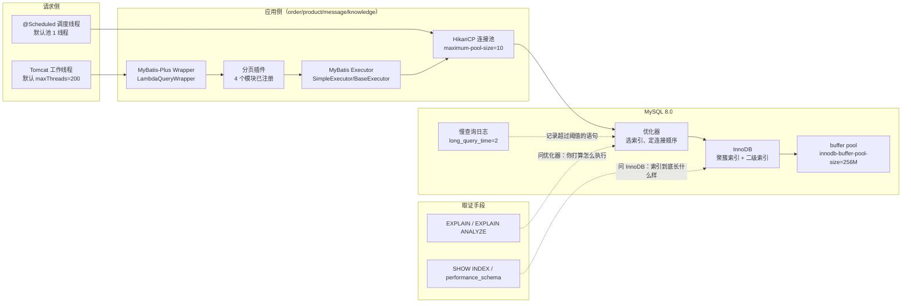
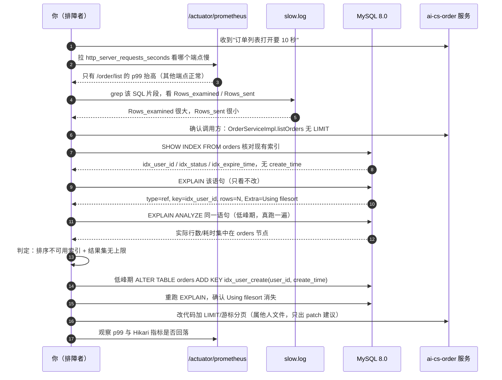

# SQL 调优与执行计划：先拿到 rows，再谈加索引

> **一句话结论**：SQL 调优的入口永远是执行计划——`EXPLAIN` 的 `type/rows/filtered/Extra` 四列告诉你"扫了多少行、按什么顺序、有没有额外排序"，不先拿到这四个数字就加索引，等于蒙着眼睛改代码。
> **阅读前置**：会写 `SELECT`/`JOIN`；知道 B+ 树索引是排好序的结构；跑过至少一个 Spring Boot + MyBatis-Plus 的 CRUD 服务；能看懂 `application.yml` 里的 `hikari` 段。
> **证据基线**：JDK 17.0.19（本机实测）、Spring Boot 4.2.0 / Spring Framework 7.1.0、MyBatis 3.6.0 + MyBatis-Plus 3.0.5（starter 4.1.0）、MySQL 8.0（`deploy/docker-compose/docker-compose-all.yml` 用的是 `mysql:8.0` 镜像）、HikariCP 7.1.0；分支 `main`，核对日期 2026-11-27；本机 **无 MySQL / 无 docker / 无 mvn**，凡涉及"跑一条 EXPLAIN 看到什么"的部分都明确标注为**未本机实测**，只给命令模板与判读表。预计阅读 50~70 分钟。

**证据边界**（先看清楚哪句话是实测、哪句话是静态推演）：

| 级别 | 证据来源 | 本仓/本机状态 | 本篇怎么用 |
| --- | --- | --- | --- |
| A 源码 | `learning-docs/24-源码分析/assets/source/*.java.md`（905 份摘录） | 可读，用于 `SimpleExecutor`/`BaseExecutor`/`SpringManagedTransaction` 三处 | 解释"一条 SQL 从 Mapper 到连接归还"的真实调用点 |
| B 本项目 | DDL、Mapper、Service、Nacos 配置、编排文件 | 全部当次读过，行号为本次核对 | 逐条指出"这条查询涨到千万行会怎样" |
| C 本机命令 | `java -XX:+PrintFlagsFinal`、HikariCP 默认值探针、`node` 脚本解析 DDL、`Test-NetConnection`、`Get-Content` 读真实日志 | 已跑并贴真实输出 | 提供可复现的"取证据"手法 |
| D 未落地 | 慢日志分析工具、`mysqld_exporter`、JVM 指标、`EXPLAIN ANALYZE` 实测 | **本仓无该配置、本机无数据库** | 一律写成"未落地/未实测"，只给命令与判据 |

---

## 0. 先看现象

### 现象 1：定时任务日志里"无超时订单"，却花了 10 秒

`tools/logs/ai-cs-order.out.log` 里真实的相邻四行（`Get-Content tools/logs/ai-cs-order.out.log -Encoding UTF8 | Select-Object -Skip 176 -First 4`）：

```text
2026-08-30T02:46:27.672+08:00  INFO 19564 --- [ai-cs-order] [   scheduling-1] c.aics.order.task.OrderTimeoutScheduler  : 定时任务：扫描超时未支付订单...
2026-08-30T02:46:32.713+08:00  WARN 19564 --- [ai-cs-order] [   scheduling-1] com.zaxxer.hikari.pool.PoolBase          : HikariPool-1 - Failed to validate connection com.mysql.cj.jdbc.ConnectionImpl@1c0ec502 (No operations allowed after connection closed.). Possibly consider using a shorter maxLifetime value.
2026-08-30T02:46:37.735+08:00  WARN 19564 --- [ai-cs-order] [   scheduling-1] com.zaxxer.hikari.pool.PoolBase          : HikariPool-1 - Failed to validate connection com.mysql.cj.jdbc.ConnectionImpl@42faee41 (No operations allowed after connection closed.). Possibly consider using a shorter maxLifetime value.
2026-08-30T02:46:37.808+08:00  INFO 19564 --- [ai-cs-order] [   scheduling-1] c.aics.order.task.OrderTimeoutScheduler  : 定时任务：无超时订单
```

27.672 → 37.808，整整 **10.1 秒**，而业务结论是"没有一条超时订单"。**这里的 10 秒不是 SQL 慢**：两次 `Failed to validate connection` 各消耗约 5 秒（Hikari `validationTimeout` 默认 5000ms），SQL 本身在最后 73 毫秒内就跑完了。同一份日志里 03:02:08.135 → 03:02:23.253 又花了 15.1 秒（三次校验失败）。这就是本篇要反复强调的判读纪律：**看到慢，先分清"等连接"和"扫数据"，两者的证据在完全不同的地方**。（这三段日志是真实历史运行记录，**本机无 MySQL，无法复现连接被断的场景**。）

### 现象 2：`orders` 有 `create_time` 列，却没有任何索引，而列表查询正是按它排序

用 `node` 静态解析 `deploy/mysql` 下的全部 DDL（脚本见第 6 节坑 5，真实输出摘录）：

```text
  orders  (ai_customer_service, 定义见 all-init.sql)
      PRIMARY PRIMARY            (id)
      UNIQUE  uk_order_no        (order_no)
      KEY     idx_user_id        (user_id)
      KEY     idx_status         (status)
      KEY     idx_expire_time    (expire_time)
      -> 有 create_time 但无索引；status 只有单列索引
```

而 `ai-cs-order/src/main/java/com/aics/order/service/impl/OrderServiceImpl.java#L69-L76` 的列表查询是：

```java
public List<OrderVO> listOrders(Long userId) {
    // 用户订单列表：按创建时间倒序（无分页、无 LIMIT）
    List<Order> orders = orderMapper.selectList(new LambdaQueryWrapper<Order>()
            .eq(Order::getUserId, userId)
            .orderByDesc(Order::getCreateTime));
    return orders.stream().map(this::toVO).toList();
}
```

`WHERE user_id = ? ORDER BY create_time DESC` + 索引只有 `idx_user_id(user_id)` ⇒ 命中的行必须在内存里重排（`Extra` 会出现 `Using filesort`），且**没有 LIMIT**，行数等于该用户的全部历史订单。今天用户只有几十单，看不出问题；千万级订单表会怎样，第 3.6、3.7 节逐条推演。

### 现象 3：本机连不上 3306，`EXPLAIN` 根本没跑过

```text
PS> (Test-NetConnection -ComputerName 127.0.0.1 -Port 3306 -InformationLevel Quiet)
False
PS> Get-Command mysql -ErrorAction SilentlyContinue
PS>
```

`False` + 第二条命令无输出 ⇒ 本机既没有 MySQL 服务，也没有 MySQL 客户端。这解释了为什么本篇所有 `EXPLAIN` 都是**模板 + 判读表**而不是"实测输出"：在没有库的机器上编造一行 `type=ALL rows=987654` 是最容易犯的错。

这些现象指向同一件事：**慢不慢不由"感觉"和"日志总耗时"决定，而由执行计划里的 `type`（访问方式）、`rows`（预估扫描行数）、`filtered`（过滤后剩多少）、`Extra`（有没有 filesort/临时表）决定；不先取得这四个数字，"加个索引试试"就是在拿生产库做实验。**

---

## 1. 整体地图



> **读图说明**：竖着看是两条通路。上面一条是**在线请求**（Tomcat 200 线程 → Wrapper → Executor → Hikari 10 → MySQL），下面一条是**定时任务**（`@Scheduled` 默认 1 个线程，同样要抢 Hikari 的 10 个连接）。两条通路在 `A3` 汇合，这就是"一个慢查询能同时拖垮接口和定时任务"的结构原因。右下角两根虚线是本篇的方法论：`O1` 问的是**优化器打算怎么做**（EXPLAIN 的 `rows` 只是估算），`O2` 问的是**索引真实结构**（有哪些列、顺序如何、是否冗余）。最容易看错的箭头是 `A3 --> M1`：很多人以为连接池是"数据库的线程池"，其实它只是**客户端侧的许可证数量**，MySQL 那边的对应物是 `max-connections=500`（`deploy/mysql/mysql.cnf#L14`）；把两者混为一谈，就会得出"连接池调大就能提速"的错误结论。

| 组件 | 责任 | 参与方 | 真实位置（本次核对） |
| --- | --- | --- | --- |
| LambdaQueryWrapper / 分页插件 | 拼 SQL、拼 `LIMIT`、拼 `COUNT` | 业务 Service | `ai-cs-product/src/main/java/com/aics/product/config/MybatisPlusConfig.java#L20-L22` |
| Mapper（无 XML） | 只继承 `BaseMapper<T>`，SQL 全由 MP 生成 | 各模块 mapper 包 | `ai-cs-order/src/main/java/com/aics/order/mapper/OrderMapper.java#L10-L12` |
| HikariCP | 限制同时打开的物理连接数 | Spring 数据源 | `tools/nacos-config/ai-cs-order.yml#L12-L18`（`maximum-pool-size: 10`） |
| Tomcat Connector | 限制同时处理的 HTTP 请求 | 容器 | 全仓 YAML **0 处** `server.tomcat.*`，走默认值 200（`ai-cs-chat/src/main/java/com/aics/chat/config/ObservabilityExecutorConfig.java#L12` 的注释也写着"默认 200"） |
| 慢查询日志 | 把超阈值的语句落到文件 | MySQL 服务端 | `deploy/mysql/mysql.cnf#L19-L21` |
| 索引定义 | 决定能走哪种访问方式 | DDL | `deploy/mysql/order-init.sql#L41-L45`、`deploy/mysql/product-init.sql#L36-L40` |

---

## 2. 关键概念与关键工具

| 名称 | 位置 | 作用 | 关键参数 / 关键列 |
| --- | --- | --- | --- |
| `EXPLAIN` | MySQL 客户端 | 显示**优化器打算怎么执行**（不真正执行） | `type`、`possible_keys`、`key`、`key_len`、`rows`、`filtered`、`Extra` |
| `EXPLAIN ANALYZE` | MySQL 8.0.18+ | **真跑一遍**并给出实际耗时/实际行数（TREE 格式） | `actual time=…`、`rows=…`、`loops=…` |
| `EXPLAIN FORMAT=JSON` | MySQL 5.6+ | 给成本模型细节 | `cost_info.query_cost`、`used_columns` |
| `SHOW INDEX FROM t` | MySQL | 索引清单与列顺序（`Seq_in_index`） | `Cardinality`（基数，选择性来源） |
| 慢查询日志 | `deploy/mysql/mysql.cnf#L19-L21` | 事后捞慢 SQL | `slow-query-log=1`、`long-query-time=2` |
| `performance_schema` | MySQL 8 内置 | 语句级统计（`events_statements_summary_by_digest`） | `COUNT_STAR`、`SUM_ROWS_EXAMINED` |
| `information_schema.STATISTICS` | MySQL | 用 SQL 批量核对索引（可替代手点客户端） | `INDEX_NAME`、`COLUMN_NAME`、`SEQ_IN_INDEX` |
| MyBatis-Plus 分页插件 | order/product/message/knowledge 四模块 | 改写 SQL 追加 `LIMIT`、并**额外发一条 COUNT** | `PaginationInnerInterceptor(DbType.MYSQL)` |
| HikariCP | `tools/nacos-config/ai-cs-order.yml#L12-L18` | 连接许可证 | `maximum-pool-size=10`、`connection-timeout=30000`、`max-lifetime=1500000` |
| 本机 JDK | 17.0.19 | 解释"为什么压测机和应用机表现不同" | `MaxHeapSize = 8514437120`（7.93 GiB，ergonomic 从物理内存 ×25%） |
| `node` 静态 DDL 扫描 | `learning-docs/tools/tmp/ddl-index-scan.mjs`（临时脚本，交稿前已删） | 无数据库时也能核索引 | 输出表数/索引数/缺口 |

---

## 3. 原理与证据逐段精读

### 3.1 一条查询的完整旅程：从 Mapper 到连接归还

**在干什么。** MyBatis 的 `SimpleExecutor.doQuery` 是"拼好的 SQL 真正变成 JDBC 调用"的地方：

```java (src: SimpleExecutor.java.md#L71-L83)
@Override
public <E> List<E> doQuery(MappedStatement ms, Object parameter, RowBounds rowBounds, ResultHandler resultHandler,
    BoundSql boundSql) throws SQLException {
  Statement stmt = null;
  try {
    Configuration configuration = ms.getConfiguration();
    StatementHandler handler = configuration.newStatementHandler(wrapper, ms, parameter, rowBounds, resultHandler,
        boundSql);
    stmt = prepareStatement(handler, ms.getStatementLog());
    return handler.query(stmt, resultHandler);
  } finally {
    closeStatement(stmt);
  }
}
```

这段代码在 `[[源码:SimpleExecutor.java.md#L71-L83]]`。往上一层，`BaseExecutor.query` 先查一级缓存，未命中才落库：

```java (src: BaseExecutor.java.md#L158-L160)
public <E> List<E> query(MappedStatement ms, Object parameter, RowBounds rowBounds, ResultHandler resultHandler,
    CacheKey key, BoundSql boundSql) throws SQLException {
  ErrorContext.instance().resource(ms.getResource()).activity("executing a query").object(ms.getId());
```

见 `[[源码:BaseExecutor.java.md#L158-L160]]`，紧随其后的 `localCache.getObject(key)` 与 `queryFromDatabase(...)` 就是"缓存优先"的分叉点。连接归还发生在事务收尾：

```java (src: SpringManagedTransaction.java.md#L117-L119)
@Override
public void close() throws SQLException {
  DataSourceUtils.releaseConnection(this.connection, this.dataSource);
}
```

见 `[[源码:SpringManagedTransaction.java.md#L117-L119]]`。

**为什么这么设计。** `closeStatement` 放在 `finally`、连接归还交给 `DataSourceUtils`，是为了让"语句必关、连接必还"与业务异常解耦：只要连接不回到 Hikari，`maximum-pool-size=10` 这 10 张许可证就会被慢慢耗光，第 11 个请求开始等 `connection-timeout`（30 秒）——这就是第 3.8 节那条传导链的起点。

**换写法会怎样。** 如果自己 `dataSource.getConnection()` 而不 `close()`，10 次之后所有请求都在 `HikariPool-1 - Connection is not available, request timed out after 30000ms` 上排队；症状和"SQL 慢"长得一模一样（接口 RT 30 秒、Tomcat 线程堆满），但 `EXPLAIN` 一切正常。反过来，如果开了 `@Transactional` 包住整段业务且里面夹着远程调用（LLM、HTTP），连接会被"借用"到事务结束才归还——事务越长，连接占用越久，这是本项目在 `chat` 侧把可观测性写库丢进独立线程池（`ObservabilityExecutorConfig`）的现实动机。

**常见坑。**
1. 以为"Mapper 是空接口所以没有 SQL"——全仓 `*Mapper.xml` **0 个**（`Get-ChildItem -Recurse -Include *Mapper.xml` 计数为 0），SQL 全由 MP 生成，所以**看不到 SQL 文本**，只能靠 `log-impl` 或慢日志反查。
2. MyBatis 一级缓存（`localCache`）在**同一 SqlSession** 内生效；Service 方法没有事务时每次都是新会话，缓存等于不存在——不要用"我明明查了两次"去解释数据库压力。
3. 把 `RowBounds` 当成真分页：`doQuery` 的 `rowBounds` 是**内存分页**（先查全量再截取），线上必须用 `LIMIT`。

### 3.2 EXPLAIN 六列：只盯 `key` 会误判

**在干什么。** `EXPLAIN` 输出的是优化器的**计划**：走哪个索引、按什么顺序连表、预估扫多少行、有没有额外排序。判读顺序固定为 `type → key → rows → filtered → Extra`，缺一个都可能得出反向结论。

```sql
-- 模板（本机无 MySQL，未实测；把 t 换成 orders/product/llm_trace）
EXPLAIN SELECT id, order_no, pay_amount, create_time
FROM orders
WHERE user_id = 10086
ORDER BY create_time DESC
LIMIT 20;
```

`type` 的等级（从好到坏，MySQL 8.0 语义）：

| type | 含义 | 典型出现条件 | 危险信号 |
| --- | --- | --- | --- |
| `system` / `const` | 至多一行，常量 | 主键或唯一索引等值 | 无 |
| `eq_ref` | 每行匹配被驱动表唯一一行 | 联表用主键/唯一键 | 无 |
| `ref` | 用普通索引等值匹配 | `WHERE user_id = ?` 命中 `idx_user_id` | 看 `rows` |
| `range` | 索引范围扫描 | `expire_time < ?`、`BETWEEN` | 范围过大时退化 |
| `index` | **扫整棵二级索引**（不是扫表但也不是定位） | `ORDER BY` 列正好是索引、或覆盖索引全扫 | 常被误认为"走了索引就没事" |
| `ALL` | 全表扫 | 无可用索引、前导通配、函数包列 | **必须解释清楚为什么** |

**为什么这么设计。** 优化器基于成本（`cost_info`）选计划，而成本的输入是**统计信息**（`Cardinality`、直方图）。统计信息不准（数据倾斜、长期未 `ANALYZE TABLE`）时，优化器会选错索引——所以 `possible_keys` 有值而 `key` 是 `NULL`，往往不是"没有索引"，而是"有索引但优化器认为不划算"，此时要看 `rows`/`filtered` 与 `SHOW INDEX` 的基数。

**换写法会怎样。** 把 `SELECT *` 换成列清单，`Extra` 可能从 `Using where` 变成 `Using index`（覆盖索引），`rows` 不变但**回表次数归零**；给 `WHERE user_id=? ORDER BY create_time DESC` 建 `(user_id, create_time)`，`Extra` 里的 `Using filesort` 会消失，`type` 仍是 `ref` 但排序成本消失。两处改动都不改变"扫多少行"，但改变"每行还要额外做什么"。

**常见坑。**
1. 只看 `key` 不看 `rows`：`key=idx_status` 看起来很美，`rows=480000` 说明这个索引只帮你把全表缩小了一点点。
2. 把 `filtered` 当成"过滤掉了多少"：它是**百分比**，`filtered=1.00` 表示过滤后只剩 1%，其余 99% 的行被读出来又丢掉——这正是"索引选择性差"的量化表达。
3. `key_len` 忽略：联合索引 `(user_id, create_time)` 上 `key_len` 只有 8，说明只用到了 `user_id`，`create_time` 没进比较（见 3.4）。

### 3.3 EXPLAIN ANALYZE：`rows` 是估算，`actual rows` 才是事实

**在干什么。** MySQL 8.0.18 起支持 `EXPLAIN ANALYZE`，它**真的执行**语句（`SELECT` 会真跑，写语句请用 `EXPLAIN`），输出 TREE 形态，每层带 `actual time`、`rows`（实际行数）、`loops`（该节点被执行次数）：

```sql
-- 模板（本机无 MySQL，未实测）
EXPLAIN ANALYZE
SELECT id, order_no, pay_amount
FROM orders
WHERE user_id = 10086
ORDER BY create_time DESC
LIMIT 20;
-- 关注的三个对比：
--   1) 估算 rows  vs  实际 rows      -> 偏差 > 10 倍说明统计信息不可信
--   2) 节点 total time 的占比        -> 找出真正的热点节点
--   3) loops > 1 的节点              -> N+1 或联表被驱动次数过多
```

**为什么这么设计。** 优化器的 `rows` 是**估算值**（基于索引基数与采样），一旦估算偏差大，后续所有成本计算都建立在错误前提上，于是"明明有索引却走了全表"。`ANALYZE` 让估算值与实际值并排出现，偏差本身就是诊断信号。

**换写法会怎样。** 用 `EXPLAIN ANALYZE` 之后常见的三种改写：把 `WHERE DATE(create_time) = '2026-11-27'` 改成范围条件（`>= 当日零点 AND < 次日零点`）让索引可用；把 `SELECT *` 收窄成列清单让覆盖索引成立；把"一条 SQL 联 5 张表"拆成"先取主表 ID，再按 ID 批量查"。这三种改写的效果差异，只有 `actual rows` 能告诉你哪个真的有效。

**常见坑。**
1. 在**生产**上直接 `EXPLAIN ANALYZE` 一个全表扫的语句——它真的会跑，等于自己制造一次慢查询。
2. 以为 `EXPLAIN ANALYZE` 会显示索引使用情况：它给的是执行树，走哪个索引要看同一语句的 `EXPLAIN` 或 `FORMAT=JSON`。
3. MySQL 8.0.18 之前没有这个命令（替代品是 `SHOW PROFILE`，已在 8.0 移除，见第 7 节）。

### 3.4 索引失效的三条主线：函数/隐式转换、前导通配、最左前缀

**在干什么。** 索引是**按列值排好序**的结构，"失效"的本质是：**查询条件没有落在排序后的有序前缀上**，优化器只能逐行判断。三条主线对应三种破坏方式。

```sql
-- 主线 1：列被函数/运算包住 → 索引失效
--   坏：WHERE DATE(create_time) = '2026-11-27'
--   好：WHERE create_time >= '2026-11-27 00:00:00' AND create_time < '2026-11-28 00:00:00'

-- 主线 2：隐式类型转换（本项目高危，因为 status 是 VARCHAR）
--   status 定义见 deploy/mysql/order-init.sql#L35：VARCHAR(20) DEFAULT 'PENDING_PAY'
--   坏：WHERE status = 1            -- 数字 1 被转成字符串比较，或列被转成数字，索引可能失效
--   好：WHERE status = 'PENDING_PAY'

-- 主线 3：前导通配
--   坏：WHERE name LIKE '%耳机%'    -- 等价于"任何位置出现"，无法用有序前缀
--   好：WHERE name LIKE '耳机%'      -- 可以用索引前缀

-- 主线 4（最左前缀）：联合索引 (user_id, create_time)
--   好：WHERE user_id = ? AND create_time > ?   -- 两列都用上
--   半好：WHERE user_id = ?                     -- 只用 user_id（key_len 只有 8）
--   失效：WHERE create_time > ?                 -- 跳过最左列，无法定位
```

**为什么这么设计。** B+ 树只能沿有序键定位。`DATE(col)` 把每个值都换了身份，树的顺序与函数结果的顺序不再一致；`%x%` 让"从哪个位置开始找"无从谈起；联合索引按 `(a, b)` 先按 a 排再按 b 排，所以只给 b 时找不到起点。MySQL 8.0.13 引入**索引跳跃扫描（skip scan）**能在最左列基数极低时部分缓解第四条，但它不是"最左前缀不再重要"，而是"优化器偶尔愿意多做几次定位"。

**换写法会怎样。**
- `%kw%` 改前缀匹配 `kw%`：本项目 `ai-cs-product/src/main/java/com/aics/product/service/impl/ProductServiceImpl.java#L88` 用的是 `wrapper.like(Product::getName, keyword)`，MP 会生成 `name LIKE '%kw%'`，`idx_name`（`deploy/mysql/product-init.sql#L39`）**用不上**，`Extra` 会带 `Using where` + `Using filesort`（因为还要 `orderByDesc(createTime)`）。
- 把函数挪到常量侧（`create_time >= …`）：索引立刻可用，代价是业务代码要算好区间边界。
- 隐式转换改成显式字符串常量：`OrderStatus` 枚举本身就存字符串（`ai-cs-order/src/main/java/com/aics/order/enums/OrderStatus.java#L13-L17`），`PENDING_PAY`/`PAID`/`CANCELLED`/`REFUNDING`/`REFUNDED`——**任何写 `status = 1` 的旧代码都是 bug**，旧稿就踩过这个坑（见第 7 节）。

**索引下推（ICP）。** `Extra` 出现 `Using index condition` 表示：WHERE 中能用索引的列先筛，**不能**用索引的列下推到存储引擎层、在回表**之前**过滤，减少回表次数。它是"少回表"的手段，不改变"扫多少行"。

```sql
-- 模板（本机无 MySQL，未实测）：product 上 (category_id, name) 联合索引的假想验证
EXPLAIN SELECT id, name, price FROM product
WHERE category_id = 12 AND name LIKE '%耳机%';
-- 期望看到：key=idx_category_id（或新联合索引）、Extra=Using index condition
-- 若 Extra 只有 Using where，说明过滤发生在 Server 层、回表次数没减少
```

**常见坑。**
1. `LIKE 'kw%'` 也会因为**字符集/排序规则**（collation）不一致而失效：`deploy/mysql/order-init.sql#L46` 用 `utf8mb4_general_ci`，`llm-observability-init.sql#L26` 用 `utf8mb4_unicode_ci`——联表时若字符集不统一，等值比较会退化成逐行转换。本项目各库 collation **不统一**，这是一个真实隐患。
2. `!=`、`NOT IN`、`IS NOT NULL` 不等于"一定全表扫"，但通常选择性极差，`rows` 会接近总行数。
3. 把 `OR` 混进最左前缀场景：`(user_id) OR (order_no)` 会让单索引无从下手，MySQL 可能用 `index_merge`，也可能干脆 `ALL`——必须看 `type`。

### 3.5 回表与覆盖索引：`rows` 不变，代价可以差一个数量级

**在干什么。** 二级索引叶子节点存的是**索引列 + 主键**。`SELECT` 若还要别的列，就得拿主键回聚簇索引再取一次——这就是"回表"。每回一次表，都是一次随机 I/O（可能命中 buffer pool，也可能没有）。`Extra=Using index` 表示查询的列全在索引里，**不回表**。

```sql
-- 模板（本机无 MySQL，未实测）
-- A. 需要回表：pay_amount 不在任何索引里
EXPLAIN SELECT order_no, pay_amount FROM orders WHERE user_id = 10086;
-- B. 覆盖索引：只取索引里已有的列（uk_order_no 覆盖 order_no）
EXPLAIN SELECT order_no FROM orders WHERE order_no = '20260830023736010001';
-- C. 若把 (user_id, create_time) 建成联合索引，再查这两列即为覆盖
EXPLAIN SELECT create_time FROM orders WHERE user_id = 10086 ORDER BY create_time DESC LIMIT 20;
```

**为什么这么设计。** 二级索引不存全行，是为了让索引小、能常驻内存（本项目 `innodb-buffer-pool-size=256M`，`deploy/mysql/mysql.cnf#L4`——256MB 对千万级表意味着**索引都未必全放得下**）。用"小索引定位 + 必要时回表"换取"索引体积可控"。

**换写法会怎样。** 本项目一个真实的对照：`ai-cs-message/src/main/java/com/aics/message/service/impl/LlmTraceServiceImpl.java#L104` 的 `pageTraces` 会把实体整行查出来再 `.map(toVO)`，而 `llm_trace` 有 `TEXT` 列 `spans_json`（`deploy/mysql/llm-observability-init.sql#L19`）。整行查询意味着**这些大字段也被读出**（虽然 InnoDB 会把超长内容放到溢出页，但主记录仍带指针与长度、且 `TEXT` 读取会额外页访问）。列表页完全不需要 `spans_json`——把列表查询改成列清单，是零风险的收益。

**常见坑。**
1. 以为"加了索引就不用回表"：只有查询列被索引完全覆盖时才是 `Using index`。
2. 覆盖索引把大列塞进索引：`spans_json` 这类 `TEXT` 进不了普通索引（前缀索引长度也受限），别想着"全列覆盖"。
3. 千万行下，`SELECT *` 的真正成本是**网络传输 + JVM 堆对象**，不是磁盘：一条 300 字节的行 × 5 万行 = 15MB 的 GC 压力，`-Xmx512m`（本仓 14 处业务服务 `JAVA_OPTS: "-Xms256m -Xmx512m"`）下这会直接触发频繁 Young GC。

### 3.6 排序与临时表：`Using filesort` / `Using temporary` 从哪里来

**在干什么。** `Extra` 里这两个词是**成本倍增器**：
- `Using filesort`：无法用索引顺序直接得到 `ORDER BY` 的顺序，必须把结果集读出来再排（不一定写磁盘，内存里排也算 `filesort`）。
- `Using temporary`：`GROUP BY`/`DISTINCT`/`UNION`/部分子查询需要物化中间结果，常伴随临时表（可能落盘）。

```sql
-- 场景 1（本项目真实缺口）：orders 只有 idx_user_id，没有 (user_id, create_time)
EXPLAIN SELECT id, order_no, pay_amount, create_time
FROM orders WHERE user_id = 10086 ORDER BY create_time DESC;
-- 预期：type=ref, key=idx_user_id, Extra=Using where; Using filesort

-- 场景 2（改善方向，未落地）：把它建成联合索引
-- ALTER TABLE orders ADD KEY idx_user_create (user_id, create_time);
-- 再跑同样 EXPLAIN：Extra 里的 Using filesort 应消失

-- 场景 3（本项目真实缺口）：messages 按会话取最近消息，只有 idx_session_id
EXPLAIN SELECT id, content, create_time FROM chat_message
WHERE session_id = 9001 ORDER BY create_time DESC LIMIT 50;
-- 预期：type=ref, key=idx_session_id, Extra=Using filesort
-- 索引定义见 deploy/mysql/all-init.sql#L332-L335
```

**为什么这么设计。** 索引自带顺序，所以"用索引顺序满足 `ORDER BY`"最便宜。一旦 `ORDER BY` 的列不在**同一条索引的连续前缀**上，优化器只能先取行再排。注意"索引里有 `create_time`"不等于"排序能用它"：`idx_create_time(create_time)` 单独存在时，`WHERE user_id=?` 走的是另一棵树，两棵树的顺序对不上。

**换写法会怎样。** 三个选择，代价不同：
1. 建 `(user_id, create_time)` → 排序消失，写入成本 +1 个索引（本项目 `orders` 目前 5 个索引，写放大可接受）。
2. 让业务接受"按 id 倒序"（`ORDER BY id DESC` 天然走主键）→ 语义近似（自增 id 与时间正相关），零成本。
3. 用 `LIMIT` + 只查第一页 → 排序行数被截断，公式见 3.7。

**常见坑。**
1. 看到 `Using filesort` 就喊救命：`LIMIT 20` 时排序 20 行也可能很快——**必须先看 `rows`**。
2. `Using temporary` 常见于 `GROUP BY` + `ORDER BY` 不同列，或者 `kb_document` 那种 `like(title) OR like(tags)`（`ai-cs-knowledge/src/main/java/com/aics/knowledge/service/impl/KnowledgeServiceImpl.java#L96-L101`）：OR 打破单索引可用性，再叠 `orderByDesc(createTime)`，`Extra` 几乎是 `Using where; Using temporary; Using filesort`。
3. MP 的 `selectPage` 会**额外发一条 `SELECT COUNT(*)`**：一次"分页查询"实际是两条 SQL，COUNT 那条同样可能全表扫。本仓 4 个模块注册了分页插件（order `OrderConfig.java#L25-L27`、product `MybatisPlusConfig.java#L20-L22`、knowledge `#L35-L38`、message `#L31-L34`），但**没有任何一处关闭 `searchCount`**（全仓 grep `searchCount` 命中 0），所以 COUNT 永远在。

### 3.7 深分页与游标分页：`LIMIT 20000, 20` 的真相

**在干什么。** `LIMIT offset, size` 的执行方式是"**先按顺序取 offset+size 行，再丢掉前 offset 行**"。所以页数越靠后，被丢弃的行越多。用 `node` 算一下 1000 万行、每页 20 条时的偏移（真实输出，纯算术推演，非实测性能）：

```text
page=     1  LIMIT 0, 20  -> 索引定位前 0 行(丢弃) + 回表取 20 行
page=   100  LIMIT 1980, 20  -> 索引定位前 1980 行(丢弃) + 回表取 20 行
page=  1000  LIMIT 19980, 20  -> 索引定位前 19980 行(丢弃) + 回表取 20 行
page= 10000  LIMIT 199980, 20  -> 索引定位前 199980 行(丢弃) + 回表取 20 行
page=100000  LIMIT 1999980, 20  -> 索引定位前 1999980 行(丢弃) + 回表取 20 行
```

命令：`node -e "const N=10_000_000,S=20; for(const p of [1,100,1000,10000,100000]){const off=(p-1)*S; console.log('page='+p+' LIMIT '+off+', '+S);}"`。**注意这是"被丢弃行数"的算术关系，不是耗时实测**——真正的耗时取决于这些行是否需要回表、是否命中 buffer pool。

**为什么这么设计。** MySQL 的 `LIMIT` 是"流式丢弃"，不是"跳表"。要跳到第 N 行，就必须从第一行开始数过去（除非有可定位的键值）。

**换写法会怎样。** 游标（keyset / seek）分页把"第几页"换成"上一页最后一条的位置"：

```sql
-- 模板（本机无 MySQL，未实测）
-- 慢：深分页
SELECT id, order_no, create_time FROM orders
WHERE user_id = 10086 ORDER BY create_time DESC LIMIT 199980, 20;

-- 快：游标分页（携带上一页最后一条的 create_time 与 id 作为游标）
SELECT id, order_no, create_time FROM orders
WHERE user_id = 10086
  AND (create_time, id) < ('2026-08-30 02:46:27', 88123)
ORDER BY create_time DESC LIMIT 20;
```

代价：不能"跳到第 N 页"、排序键必须唯一稳定（所以要带 `id` 兜底）、前端要改成分页游标而非页码。本项目 `OrderController.java#L34-L38` 的 `GET /order/list` **连分页都没有**（`listOrders` 无 `LIMIT`），所以现在的形态比深分页更糟：数据量涨上去是"一次性全量返回"。

**常见坑。**
1. 用 `LIMIT` 掩盖慢查询：`LIMIT 20` 只截断**返回**，不减少"排序前的扫描"，除非 `ORDER BY` 能用索引顺序。
2. `ORDER BY create_time DESC LIMIT 20` 里 `create_time` 有重复值时，翻页会漏行/重行——游标分页必须带唯一列（`id`）。
3. 以为 MP 的 `Page` 帮你做了游标分页：`Page<>(page, size)` 生成的就是 `LIMIT offset, size`（`ProductServiceImpl.java#L84`、`LlmTraceServiceImpl.java#L93`），深页一样慢。

### 3.8 连接池、连接数与慢查询的传导链

**在干什么。** 把三个数字放在一起：Tomcat `maxThreads=200`（默认，本仓无覆盖）、Hikari `maximum-pool-size=10`、MySQL `max-connections=500`。在线高峰时最多 200 个请求线程，但只有 10 张连接许可证；第 11 个并发查询开始**等**（`connection-timeout: 30000`，见 `tools/nacos-config/ai-cs-order.yml#L18`）。

```text
一次慢查询的放大过程（推演，非实测）：
  1 条 SQL 从 50ms 变 5s
  -> 该 SQL 每秒需要 1 个连接跑 5s，10 个连接最多支撑 2 QPS
  -> 第 11 个请求起在 Hikari 排队，每个最多等 30s
  -> 排队期间 Tomcat 工作线程被占住（默认 200 个）
  -> 200 个线程占满后，新请求进 accept 队列（Tomcat 默认 acceptCount=100），再满则拒绝
  -> 同时 @Scheduled 的 1 个调度线程也在抢连接，定时任务一起卡住
```

真实证据有三处：
1. 配置：`tools/nacos-config/ai-cs-order.yml#L12-L18` 与 `tools/nacos-config/ai-cs-product.yml#L6-L12` 都是 `maximum-pool-size: 10`、`minimum-idle: 2`、`idle-timeout: 600000`、`max-lifetime: 1500000`（25 分钟）、`connection-timeout: 30000`、`connection-test-query: SELECT 1`。
2. 默认值（本机实测，HikariCP 7.1.0）：`java --class-path "…HikariCP-7.1.0.jar;…slf4j-api-2.0.20.jar" HikariDefaults.java` 输出 `maximumPoolSize = 10`、`minimumIdle = -1`、`connectionTimeout = 30000 ms`、`idleTimeout = 600000 ms`、`validationTimeout = 5000 ms`、`maxLifetime = 1800000 ms`——**本项目显式写的值与框架默认值几乎相同**，说明这套参数基本是"照默认抄的"，没有人按真实并发算过。
3. 日志：现象 1 那两行 `Failed to validate connection ... Possibly consider using a shorter maxLifetime value`。

**为什么这么设计。** 连接池不是越大越好：MySQL 每个连接一个线程 + 一份会话内存，`max-connections=500`（`deploy/mysql/mysql.cnf#L14`）是服务端上限，而 10 个/服务 × 多个服务实例才是真实占用。池子小的目的是**保护数据库**，代价是把压力转移到应用侧的等待队列。

**换写法会怎样。** 把 `maximum-pool-size` 从 10 调到 50，短期看排队消失，长期看 MySQL 端 50 × 实例数 个活跃连接抢 `buffer pool`（256MB）与 CPU，**单个查询变更慢**，整体吞吐未必上升。正确的顺序是：先把慢查询的 `rows` 降下来，再根据"平均持有时间 × 目标 QPS"反推池大小。

**常见坑（含一条真实误判）。**
1. **"shorter maxLifetime" 的告警不能照做**：本项目 `max-lifetime` 已是 1500000ms（25 分钟），比 MySQL 常见 `wait_timeout=28800`（8 小时）小得多。连接被对端关掉的原因更可能是**数据库在公网**（`jdbc:mysql://123.60.31.79:3306/...`，见 `tools/nacos-config/ai-cs-order.yml#L9`）经过 NAT/防火墙空闲回收。此时把 `max-lifetime` 再调小只是重启连接更频繁；真正常用的解法是配 `keepalive-time`（Hikari 支持，本仓未配）或走内网。
2. 校验失败后 Hikari 会重建连接，**业务并未失败**——日志里 10 秒的"慢"就是这个重建过程，不是 SQL 慢。
3. `connection-test-query: SELECT 1` 在生产上多余（JDBC4 驱动支持 `isValid`），每次借用多一次往返；它会让"高 QPS + 小池"场景更容易触发校验开销。

### 3.9 慢查询日志：怎么开、怎么读、抓不到什么

**在干什么。** 慢日志是事后取证的入口。本项目已开（`deploy/mysql/mysql.cnf#L19-L21`）：

```text
slow-query-log=1
slow-query-log-file=/var/log/mysql/slow.log
long-query-time=2
```

**为什么这么设计。** `long_query_time=2` 是"只记明显异常"的粗筛。代价是 **1.9 秒的 SQL 永远不出现**——在 QPS 高的时候，1.9 秒已经足够把连接池打满（10 个连接 × 0.5 QPS ≈ 5 QPS 上限）。

**换写法会怎样。** 两个可选项（**本仓均未配置**，属于未落地）：
- `log_queries_not_using_indexes=1`：把"没走索引"的语句也记下来（`mysql.cnf` 全文 grep 该键 = 0 命中）。风险是日志暴涨，需配 `log_throttle_queries_not_using_indexes`。
- `long_query_time=0.5` 或按 `min_examined_row_limit` 过滤：抓"扫了很多行但很快"的语句。

读日志时关注四个字段，而不是只看 `Query_time`：

```text
# 模板（本机无 MySQL，无法提供真实慢日志条目）
# Time: 2026-11-27T10:00:00.123456+08:00
# User@Host: root[root] @  [10.0.0.5]
# Query_time: 2.512345  Lock_time: 0.000123 Rows_sent: 20  Rows_examined: 199980  <-- 关键
SET timestamp=1764208800;
SELECT id, order_no FROM orders WHERE user_id = 10086 ORDER BY create_time DESC LIMIT 199980, 20;
```

`Rows_examined >> Rows_sent` 就是"扫了很多、只要一点"，这与 `EXPLAIN` 的 `rows` 是同一件事的两种证据。若 `Rows_examined ≈ Rows_sent` 但 `Query_time` 很大，问题在**锁等待**（看 `Lock_time`）或**网络/结果集大小**，不在索引。

**常见坑。**
1. 只看 `Query_time` 排名：深分页语句 `Rows_examined` 极大但可能只有 1 秒，而一条锁等待 2.5 秒的更新语句反而更该优化。
2. 忘了慢日志是**秒级**记录，毫秒级抖动看不到——需要 `performance_schema.events_statements_summary_by_digest`（本仓未接入任何 exporter，见第 5 节）。
3. 容器里日志写到了容器内部路径 `/var/log/mysql/slow.log`，没挂载出来就等于没开——本仓 compose 里未见该日志的卷挂载配置，属于"开了但取不到"的典型。

---

## 4. 一次完整排查/执行时序



> **读图说明**：竖读分三段。**第 1~3 步是定位**——先用指标确定"是哪一个端点慢"，避免把问题归到全局；这一段的判据是"只有单个端点 p99 抬高"。**第 4~9 步是取证**——`SHOW INDEX` 回答"有哪些索引"，`EXPLAIN` 回答"优化器打算怎么用"，`EXPLAIN ANALYZE` 回答"实际用了多少"。三者缺一不可：只看 `SHOW INDEX` 会误判"有索引就够了"，只看 `EXPLAIN` 可能被错误估算骗，只看 `ANALYZE` 不知道索引长什么样。**第 10~14 步是验证**——先加索引、再确认计划变化、最后才动代码。最容易看错的是第 7 步到第 8 步：`rows` 是估算，如果这一步就下结论，可能改错索引；务必用第 8 步的实际行数确认。

**哪一步失败会报什么、从哪判读**：

| 步骤 | 失败原因 | 你看到的 | 判读入口 |
| --- | --- | --- | --- |
| 2 | Actuator 未暴露或 Prometheus 未抓 | `curl` 404 / 指标里没有 `http_server_requests` | `tools/nacos-config/aics-shared.yml#L28-L32`（`include: health,info,prometheus`）、`deploy/observability/prometheus.yml#L9` |
| 4 | 慢日志没挂出容器 | `slow.log` 不存在或为空 | compose 里的 `volumes`；`mysql.cnf#L20` 只是容器内路径 |
| 5 | 代码没有分页 | `listOrders` 无 `LIMIT` | `ai-cs-order/src/main/java/com/aics/order/service/impl/OrderServiceImpl.java#L69-L76` |
| 7 | 优化器不选索引 | `possible_keys` 有值但 `key=NULL` | 看 `rows`、`filtered` 与 `SHOW INDEX` 的 `Cardinality` |
| 8 | 在高峰真跑了一次全表扫 | 业务短暂变慢 | 只能低峰期做；或改用 `EXPLAIN FORMAT=JSON` 的成本估算 |
| 11 | `ALTER` 锁表 | 大批 `Waiting for table metadata lock` | `performance_schema.metadata_locks`；MySQL 8 多支持在线 DDL，但长事务会挡住 |
| 13 | 改完没变快 | p99 不变 | 可能排序不是瓶颈，回到第 6 步看 `Rows_sent` 是否本身就大 |

---

## 5. 设计取舍

| 维度 | 方案 A | 方案 B | 本项目现状 | 理由与代价 |
| --- | --- | --- | --- | --- |
| 排序 | 建 `(user_id, create_time)` 联合索引 | 应用层排序 | 现状是**都没有**：`idx_user_id` 单列 + SQL 里 `ORDER BY create_time` | A 让 `filesort` 消失，代价是多一个索引（写放大）；B 让数据库省事但把成本压到 JVM（`-Xmx512m` 下更危险） |
| 分页 | `LIMIT offset,size`（MP `Page`） | 游标（keyset） | 现状：product/knowledge/message 用 MP `Page`；order **无分页** | A 实现简单、支持跳页，深页慢；B 快但要求排序键唯一、前端改协议 |
| 模糊搜索 | `LIKE '%kw%'`（MySQL） | 交给 ES | product 用 `like`（`ProductServiceImpl.java#L88`）；项目另有 `ai-cs-search`（ES 8.12）但商品搜索未接 | A 零成本但全表扫；B 才是正解，代价是双写与一致性 |
| 主键 | 自增 BIGINT | 字符串业务键 | `llm_trace` 用 `VARCHAR(64) request_id` 作主键（`deploy/mysql/llm-observability-init.sql#L22`） | A 聚簇索引紧凑、写入顺序友好；B 便于幂等上报，代价是所有二级索引都带 64 字节主键、插入随机导致页分裂 |
| 逻辑删除 | `deleted` 进索引 | 只靠 `@TableLogic` 过滤 | `Product.java#L45` 有 `@TableLogic`，但 `product` 的索引里**没有** `deleted`（`deploy/mysql/product-init.sql#L36-L40`） | A 让 `deleted=0` 也能走向索引前缀；B 简单，代价是每行都要回表判断 |
| 连接池 | 按并发公式算 | 抄默认值 | 现状是**抄默认**：`maximum-pool-size=10` 与 HikariCP 默认值一致 | 抄默认最省事；代价是高峰期排队行为不可预期 |
| 慢查询取证 | 慢日志 + digest 表 | `mysqld_exporter` + 看板 | 只有慢日志（阈值 2s），**无 exporter**（`deploy/observability/prometheus.yml` 只有 11 个 Java 服务，无 MySQL target） | A 够用但要人肉；B 可看趋势，代价是多一个组件 |

**可扩展点清单**（全部是"当前未落地"的改法，不是已实现）：

1. `orders` 增 `(user_id, create_time)`；`chat_message` 增 `(session_id, create_time)`；`llm_trace` 增 `(user_id, create_time)`——三条都是"等值列 + 排序列"，与 `model_usage` 现有 `idx_user_time(user_id, create_time)`（`deploy/mysql/llm-observability-init.sql#L46`）是同一模式，等于项目里已有正确示范但没推广。
2. `orders` 增 `(status, expire_time)`，直接服务 `OrderTimeoutScheduler` 的 `status=? AND expire_time<?`。
3. `cart_item` 删 `idx_user_id`：`uk_user_product(user_id, product_id)` 的最左列已经是 `user_id`（`deploy/mysql/order-init.sql#L19-L20`），单列索引是**冗余索引**，只增加写成本。
4. `llm_trace` 主键改自增 `BIGINT` + `uk_request_id`，`request_id` 保留唯一约束，消除二级索引里 64 字节主键的冗余。
5. `deploy/mysql/mysql.cnf` 增 `log_queries_not_using_indexes=1` + `log_throttle_queries_not_using_indexes=1`，并把 `long-query-time` 降到 0.5s。
6. 接 `mysqld_exporter` 到 Prometheus（当前 `deploy/observability/prometheus.yml` 无 MySQL target），补 `performance_schema` 指标。
7. 把慢日志文件挂载到宿主机（compose 的 `volumes`），否则"开了等于没开"。
8. `product` 的索引补 `deleted`（如 `(status, deleted, create_time)` 或把 `deleted` 塞进现有联合索引尾部），让逻辑删除过滤也能部分走索引。

---

## 6. 踩坑与调试手法

### 坑 1：把"Hikari 校验重试"当成 SQL 慢

**症状**：定时任务日志"扫描…"到"无超时订单"之间隔 10 秒以上（现象 1）。
**根因**：连接空闲被对端关闭，Hikari 在借出时校验失败（`validationTimeout` 5000ms），逐个重建。
**查法**：

```powershell
# 把"业务日志"和"连接池日志"按时间对齐看
Get-Content tools/logs/ai-cs-order.out.log -Encoding UTF8 |
  Select-String -Pattern 'OrderTimeoutScheduler|HikariPool|PoolBase' |
  Select-Object -Last 20 | ForEach-Object { $_.Line -replace '\s+',' ' }
```

**判读**：若两条业务日志之间夹着 `Failed to validate connection`，耗时归因到连接重建；若中间什么都没有而是业务日志自己隔了 10 秒，才轮到怀疑 SQL。
**误判风险**：直接照日志建议去调 `max-lifetime`（本项目已是 25 分钟），把真正原因（公网连接被 NAT 回收 / 无 `keepalive-time`）漏掉。

### 坑 2：`idx_name` 明明存在，`LIKE '%kw%'` 却全表扫

**症状**：商品搜索页 `keyword` 非空时明显变慢，空关键词反而快。
**根因**：`ProductServiceImpl.java#L88` 用 MP 的 `like`，生成 `name LIKE '%kw%'`，前导通配使 `idx_name`（`deploy/mysql/product-init.sql#L39`）无法定位起点。
**查法**：

```sql
-- 模板（本机无 MySQL，未实测）
EXPLAIN SELECT id, name, price FROM product
WHERE name LIKE '%耳机%' AND status = 1 AND deleted = 0
ORDER BY create_time DESC LIMIT 10;
```

**判读**：`type=ALL`、`key=NULL`、`Extra=Using where; Using filesort` ⇒ 索引存在但无用。若把条件换成 `name LIKE '耳机%'`，`type` 应变为 `range`、`key=idx_name`。
**误判风险**：以为"再加一个 `idx_name` 就好了"（已经有了）；或者真的把 `like` 改成 `likeRight`，却发现业务是"按中间词搜"——需求不匹配时，正解是上 ES（`ai-cs-search` 已在项目中，只是商品未接入）。

### 坑 3：以为"注册了分页插件就有分页"

**症状**：订单列表接口在数据变多后超时，但代码"看起来用了 MP"。
**根因**：MP 的分页插件只改写**带 `Page` 参数**的调用；`OrderServiceImpl.listOrders` 用的是 `selectList`，没有 `Page`，也没有 `LIMIT`（`OrderServiceImpl.java#L69-L76`），而 `OrderController.java#L34-L38` 的 `GET /order/list` 连 `page/size` 参数都没有。
**查法**：

```powershell
# 谁注册了分页插件、谁真的用了 Page
Select-String -Path (Get-ChildItem ai-cs-* -Recurse -Include *.java |
  Where-Object { $_.FullName -notmatch '\\test\\|\\target\\' } |
  Select-Object -ExpandProperty FullName) -Pattern 'PaginationInnerInterceptor|new Page<|selectPage' |
  ForEach-Object { "{0}:{1}: {2}" -f $_.Path.Split('\')[-1], $_.LineNumber, $_.Line.Trim() }
```

**判读**：`PaginationInnerInterceptor` 出现在 4 个模块（order/product/knowledge/message），`new Page<` 出现在 product/knowledge/message，**order 一处都没有** ⇒ order 的列表查询是全量。
**误判风险**：只看"插件已注册"就断定"全局已分页"；插件是**被动**的，不传 `Page` 就不改写。

### 坑 4：深分页"明明是索引列"却越翻越慢

**症状**：第 1 页 30ms，第 1000 页 2s（数量级示意，非实测）。
**根因**：`LIMIT 19980, 20` 要求先数过 19980 行；若这 19980 行还要回表取列，成本按行数线性上升。
**查法**：

```powershell
# 先把"被丢弃行数"算清楚，判断量级（纯算术）
node -e "const S=20; for (const p of [1,100,1000,10000]) console.log('page',p,'offset',(p-1)*S);"
```

```sql
-- 再确认这条 SQL 是否需要回表（模板，未实测）
EXPLAIN SELECT * FROM orders WHERE user_id = 10086 ORDER BY create_time DESC LIMIT 199980, 20;
-- 若 Extra 不含 Using index，说明每行都回表，深页成本 = offset × 回表次数
```

**判读**：`Extra=Using index` 时深页只是"扫索引"，尚可忍受；`Using where`（回表）时深页线性变慢。
**误判风险**：把 `LIMIT` 调小当成优化（只减少返回，不减少扫描）；或在 MySQL 8 上误以为 `LIMIT` 会走"跳跃扫描"。

### 坑 5：手工数索引，漏掉冗余与缺口（用 node 静态解析代替肉眼）

**症状**：评审时说"这张表索引挺全的"，实际 `orders` 缺排序列、`cart_item` 有冗余索引。
**根因**：`deploy/mysql` 下 16 个 SQL 文件、110 条 `CREATE TABLE`（含分库副本与重复定义），肉眼统计必错。
**查法**（临时脚本，放在 `learning-docs/tools/tmp/`，交稿前删除）：

```javascript
// ddl-index-scan.mjs 核心逻辑（真实运行过的脚本，节选）
const re = /CREATE\s+TABLE\s+(?:IF\s+NOT\s+EXISTS\s+)?((?:`?[A-Za-z0-9_]+`?\.)?`?[A-Za-z0-9_]+`?)\s*\(/gi;
// 对每个表体，收集 PRIMARY/UNIQUE/KEY 行里的列顺序，
// 然后按「库.表」去重、统计：无二级索引的表、只有单列索引的状态列、create_time 未进任何索引
```

真实输出（节选）：

```text
=== 汇总（去重后按逻辑表名统计） ===
SQL 文件数                : 16
CREATE TABLE 语句总条数   : 110
去重后物理表(库.表)       : 67
去重后逻辑表名            : 56
索引条目总数(含主键)      : 151
二级索引总数              : 106
含联合索引的表            : 17 / 56
无二级索引的表 11 张      : users, roles, permissions, xxl_job_info, xxl_job_log, ...
```

**判读**：56 张逻辑表里只有 17 张有联合索引；11 张没有任何二级索引（3 张 RBAC 表 + 8 张 xxl-job 调度表，它们靠主键查，暂不构成问题）；`orders`"有 create_time 但无索引"是脚本直接报出来的。
**误判风险**：把 `CREATE TABLE` 条数（110）当成表数量（真实逻辑表 56 张，因为分库 `user_db_0/user_db_1` 副本与 `all-init.sql`/`init.sql` 重复定义）；用 `SHOW INDEX` 只能看一个库，跨库统计必须脚本化。

### 坑 6：给"状态列"加单列索引，选择性一变就废

**症状**：`orders` 有 `idx_status(status)`，但按状态筛订单依然慢。
**根因**：`status` 是 `VARCHAR(20)`，取值只有 5 个（`OrderStatus.java#L13-L17`）。当 `PENDING_PAY` 占比高时（大促期间大量未支付单），`rows` 接近全表，优化器宁可不走。
**查法**：

```sql
-- 看基数（Cardinality 越小，选择性越差）
SHOW INDEX FROM orders;
-- 看真实分布（模板，未实测）
SELECT status, COUNT(*) FROM orders GROUP BY status;
```

**判读**：`Cardinality` 只有个位数 ⇒ 单列索引只适合"稀有状态"查询。真正该建的是把状态与另一个高选择性/排序列组合：`(status, expire_time)`（服务超时扫描）、`(user_id, create_time)`（服务列表页）。
**误判风险**：旧稿写过 `status=1`、`WHERE status != 1` 的例子（把它当 `TINYINT`）——本项目 `status` 是**字符串枚举**，写数字会触发隐式转换，等于自己制造索引失效。

### 坑 7：定时任务无 `LIMIT` + 单线程调度器，一次慢查询堵住所有定时任务

**症状**：订单超时扫描、其他 `@Scheduled` 任务集体延迟。
**根因**：`OrderTimeoutScheduler.java#L36-L45` 用 `selectList(eq(status, PENDING_PAY).lt(expireTime, now()))`，**没有 `LIMIT`**，返回全部超时订单后逐单 `cancelExpiredOrder`（N+1 次查询/更新）；Spring 默认 `TaskScheduler` 只有 **1 个线程**，所以它慢，别的定时任务全排队。全仓 `@Async` 命中 0 处，也没有自定义调度线程池。
**查法**：

```powershell
# 看定时任务之间的实际间隔（若某次远超 5 分钟，说明被堵住了）
Get-Content tools/logs/ai-cs-order.out.log -Encoding UTF8 |
  Select-String 'OrderTimeoutScheduler' | Select-Object -Last 12 |
  ForEach-Object { ($_.Line -split '\s+')[0] + '  ' + ($_.Line -split ': ')[-1] }
```

**判读**：相邻两次"扫描…"的时间差应≈5 分钟（`@Scheduled(fixedDelay=300000)`）；明显超出即被阻塞。
**误判风险**：以为"任务慢是数据库慢"——实际是"任务写得像全表导出"，加 `LIMIT` 分批 + 索引 `(status, expire_time)` 才是对症。

### 坑 8：慢日志阈值 2s，抓不到 1.9s 的杀手

**症状**：慢日志很干净，但接口 p99 已经 1.9s、连接池时不时打满。
**根因**：`long-query-time=2`（`deploy/mysql/mysql.cnf#L21`），且未开 `log_queries_not_using_indexes`；10 个连接下 1.9s 的 SQL 已足以把吞吐压到 ~5 QPS。
**查法**：

```powershell
# 确认哪些慢查询相关的键存在/缺失（本仓真实结果：只有 3 个键，缺 2 个）
Select-String -Path deploy\mysql\mysql.cnf -Pattern 'slow|long-query|not_using_indexes|min_examined' |
  ForEach-Object { "L{0}: {1}" -f $_.LineNumber, $_.Line.Trim() }
```

**判读**：输出只有 `slow-query-log=1` / `slow-query-log-file=...` / `long-query-time=2` ⇒ 阈值 2s、未记录"无索引"语句。此时改用 `performance_schema.events_statements_summary_by_digest` 查 `SUM_ROWS_EXAMINED` 与 `SUM_TIMER_WAIT` 排序。
**误判风险**：没有慢日志就断言"没有慢查询"；或者直接调成 0 秒，把日志盘写爆。

---

## 7. 版本差异

| 项 | 旧写法 | 当前基线 | 变化点 | 迁移动作 |
| --- | --- | --- | --- | --- |
| 看实际执行 | `SHOW PROFILE` | `EXPLAIN ANALYZE`（8.0.18+） | `SHOW PROFILE` 在 8.0 已移除 | 把 `SET profiling=1` 的排查脚本改成 `EXPLAIN ANALYZE` + `FORMAT=TREE` |
| 索引统计 | `information_schema.TABLES` 的行数 | `information_schema.STATISTICS` + `performance_schema` digest | 8.0 的统计更细、可查直方图 | 批量核对索引用 `STATISTICS`，别用 `TABLES` 估行数 |
| 最左前缀铁律 | "跳过最左列必然全表扫" | 8.0.13+ 支持索引跳跃扫描（skip scan） | 低基数最左列时可能仍用索引 | 不要用 skip scan 当设计依据，`EXPLAIN` 看到 `type=range` 才算数 |
| 隐式转换 | 旧稿示例 `status = 1` / `status != 1` | `orders.status` 是 `VARCHAR(20)`，值为 `PENDING_PAY` 等（`deploy/mysql/order-init.sql#L35`、`OrderStatus.java#L13-L17`） | **旧稿事实错误**：状态不是 `TINYINT` | 所有状态比较改字符串常量；旧稿的"`idx_status` 选择性低"结论保留，但原因要写成"字符串枚举 + 单列索引" |
| `order_item` 索引 | 旧稿写 `idx_order_no` 在 `order-init.sql:59` | `L59` 是 `idx_order_id`，`L60` 才是 `idx_order_no`（`deploy/mysql/order-init.sql#L59-L60`） | **旧稿行号错误** | 引用行号前重新 `Get-Content -Encoding UTF8` 核对 |
| 订单列表分页 | 旧稿称 `listOrders` 是"游标分页形态" | 实际无分页、无 `LIMIT`、无投影（`OrderServiceImpl.java#L69-L76`） | **旧稿把未实现写成已实现** | 描述现状时贴代码；把游标分页放进"可扩展点清单" |
| 慢日志参数 | 旧稿写 `mysql.cnf:19-21` | 行号正确，但只覆盖 3 个键，缺 `log_queries_not_using_indexes` | 无变化，需补缺口说明 | 补 `log_queries_not_using_indexes` + 挂载宿主机路径 |
| 分页插件 | "MP 分页插件已全局启用" | 只有 order/product/knowledge/message 4 个模块注册，且 order 未使用 | 注册 ≠ 使用 | 核对"注册点"与"调用点"两处 |
| JDK 17 vs 21 | 老文档默认 JDK 8/11 的线程模型 | 本项目基线 JDK 17（本机 `openjdk 17.0.19`） | **JDK 21 才正式有虚拟线程**（JEP 444）；21 上 `spring.threads.virtual.enabled=true` 可让 Tomcat 每请求一个虚拟线程，`maxThreads=200` 的"线程被慢 SQL 占满"问题形态会变成"平台线程被 carrier 阻塞" | 迁 21 时同步评估：连接池仍是 10 张许可证，虚拟线程**不会**增加数据库连接；慢 SQL 依旧排队，只是排队者从平台线程变成虚拟线程（更省内存） |
| JDK 17 vs 21 的 GC | 旧文常写 `-XX:+UseParallelGC` | 17/21 默认都是 G1（本机 `-XX:+PrintFlagsFinal` 实测 `UseG1GC = true`） | 默认 GC 已换 | 大结果集导致的 GC 压力，先看 `MaxHeapSize=8514437120`（本机 ergonomic 7.93 GiB）与容器 `-Xmx512m` 的巨大差距：**容器内 512m 才是真实约束** |
| Hikari 默认值 | 文档常写"默认 10，别乱调" | 本机实测 HikariCP 7.1.0：`maximumPoolSize=10`、`connectionTimeout=30000`、`maxLifetime=1800000`、`validationTimeout=5000` | 本项目 Nacos 里写的是 `max-lifetime=1500000`（比默认更短）、`minimum-idle=2`（默认是 `-1` 即跟随 max） | 调整前先跑一次默认值探针，别把"默认"和"本项目值"混着讲 |

---

## 8. 面试高频问与答

> 只列问题，答案在与本节对应的自测题折叠里（部分问题需要你自己补完，答案给的是线索与判据）。

1. `EXPLAIN` 里 `type=index` 和 `type=ALL` 都像"扫很多"，区别是什么？为什么 `index` 有时反而更慢？
2. `key` 为 `NULL` 但 `possible_keys` 有值，说明什么？下一步查什么？
3. `rows` 是估算还是实测？估算严重偏低会导致什么连锁后果？
4. `EXPLAIN ANALYZE` 与 `EXPLAIN` 的本质区别是什么？生产上为什么不能随便用？
5. `filtered` 列怎么读？`filtered=1.00` 意味着什么？
6. 索引失效有哪三类典型场景？各给一个"改写法"。
7. 联合索引 `(a, b, c)` 上，`WHERE b = 1 AND c = 2` 能不能用索引？MySQL 8.0.13 之后有什么变化？
8. 什么是索引下推（ICP）？它在 `Extra` 里长什么样？它减少的是"扫描行数"还是"回表次数"？
9. 覆盖索引为什么快？`Using index` 与 `Using index condition` 的区别是什么？
10. `Using filesort` 一定意味着磁盘排序吗？什么时候可以不管它？
11. `LIMIT 100000, 20` 为什么慢？游标分页怎么改写？代价是什么？
12. 连接池 `maximum-pool-size=10`、Tomcat `maxThreads=200`，第 11 个并发查询会怎样？第 201 个请求呢？
13. 一条 SQL 从 50ms 变成 5s，会怎样一步步把整个服务拖垮？给出传导链。
14. 慢查询日志 `long_query_time=2` 有什么盲区？`log_queries_not_using_indexes` 打开后要注意什么？
15. 为什么用字符串做主键（如 `VARCHAR(64)` 的 `request_id`）会让所有二级索引变大？什么时候仍值得这么做？
16. 逻辑删除列要不要进索引？为什么本项目 `product` 的 `deleted` 没进索引会留下隐患？

---

## 9. 动手练习

> 本机 **无 MySQL、无 docker、无 mvn**，因此下面凡涉及"跑 SQL"的练习都要求写成**命令模板 + 判读表 + 预期输出形态**，并明确标注"未在本机实测"。另外，`ai-cs-*` 与 `deploy/` 下的文件**属于他人文件，不要直接改**，只输出 patch 建议。

### 练习 1：为 `orders` 列表查询写出"证据链报告"

读 `OrderServiceImpl.java#L69-L76` 与 `deploy/mysql/order-init.sql#L41-L45`，产出一份报告：现状 `EXPLAIN`（模板）、`Extra` 预期值、`Rows_examined/Rows_sent` 的预期形态、加 `(user_id, create_time)` 后的变化、以及一千/百万/千万三档数据量的量级推演。
**验收标准**：① 报告里出现 `type/key/rows/filtered/Extra` 五列的具体预期值；② 明确指出"无 `LIMIT`"是比 `filesort` 更严重的问题；③ 给出的 `ALTER` 语句能在 MySQL 8.0 语法下直接执行；④ 明确写出"未实测"。

### 练习 2：用 node 复算索引现状，并找出 3 个冗余或缺失索引

写一个解析 `deploy/mysql/*.sql` 的脚本（参考坑 5 的逻辑），输出：逻辑表数、二级索引数、含联合索引的表数、无二级索引的表清单。
**验收标准**：① 脚本能正确处理 `` `db`.`table` `` 与多文件重复定义；② 输出与本文第 1、6 节的数字一致（16 文件 / 110 条建表 / 56 逻辑表 / 106 二级索引）；③ 列出至少 3 个具体问题（例如 `cart_item.idx_user_id` 与 `uk_user_product` 前缀重复、`orders` 缺 `(user_id, create_time)`、`product` 索引不含 `deleted`）；④ 交稿前删除脚本。

### 练习 3：把 `OrderTimeoutScheduler` 的扫描改成"分批 + 联合索引"

针对 `OrderTimeoutScheduler.java#L36-L45`，写出改造方案（**只输出 patch 建议，不改文件**）：`LIMIT 200` 分批、补 `(status, expire_time)` 索引、失败重试与幂等说明。
**验收标准**：① patch 里能看到 `lastId`（或 `expire_time` 游标）与 `LIMIT`；② 说明为什么"每批 200 条"而不是"一次全量"（结合 `maximum-pool-size=10` 与事务持有时长）；③ 指出 `@Scheduled` 默认单线程带来的相互阻塞；④ 不改动原文件，patch 以文本形式给出。

### 练习 4：给 `product` 的关键词搜索做取舍论证

读 `ProductServiceImpl.java#L83-L106` 与 `deploy/mysql/product-init.sql#L36-L40`，论证"`LIKE '%kw%'` + `orderByDesc(createTime)`"在数据量涨到百万时的表现，并比较三条路：改前缀匹配、建 `(status, create_time)` 缩小扫描、迁到 `ai-cs-search`（ES）。
**验收标准**：① 三种方案各写"能解决什么、解决不了什么"；② 明确"前导通配无法用 B+ 树索引"这一结论及理由；③ 给出 `EXPLAIN` 模板与 `Extra` 预期；④ 说明为什么本项目**当前没有**把商品搜索接到 ES（未落地，不要写成已实现）。

### 练习 5：算出本项目的"连接池上限吞吐"

用 `maximum-pool-size=10`、`connection-timeout=30000`、假设平均查询持有连接 50ms / 500ms / 5s 三档，算出理论 QPS 上限与"第 11 个请求的等待时间"；再叠加 `Tomcat maxThreads=200` 说明线程耗尽的临界点。
**验收标准**：① 三档各给一个算式（如 `10 / 0.05 = 200 QPS`）；② 明确标注这是**模型推演**，不是压测结果；③ 指出"调大池子前应先降单查询耗时"的理由；④ 提到 `max-connections=500`（`deploy/mysql/mysql.cnf#L14`）是服务端上限。

### 练习 6：设计一份"慢查询取证"清单（本仓能落与不能落）

基于 `deploy/mysql/mysql.cnf` 与 `deploy/observability/prometheus.yml` 现状，列出：已具备的能力、缺失的能力、每项的落地动作与验证方式。
**验收标准**：① 明确"已开慢日志（阈值 2s）/ 未开 `log_queries_not_using_indexes`"；② 明确"Prometheus 只抓 11 个 Java 服务，无 MySQL target，无 `mysqld_exporter`"；③ 明确"无 JVM 指标、无 GC 日志、无 async-profiler/JFR 配置"；④ 每条落地动作给出可执行的验证命令（不要求真跑，要求命令正确）。

---

## 小结

- **执行计划是唯一入口**：`type → key → rows → filtered → Extra` 五列按顺序读，`rows` 与 `filtered` 量化"扫了多少、剩多少"，`Extra` 告诉你"还额外做了什么"。
- **`rows` 是估算，`actual rows` 才是事实**：MySQL 8.0.18+ 的 `EXPLAIN ANALYZE` 是校验估算偏差的工具，但会在生产上真跑语句。
- **索引失效只有三条主线**：列被函数/隐式转换包住、前导通配、跳过联合索引最左列。本项目三条都真实存在：`status` 是字符串枚举、`ProductServiceImpl.java#L88` 用 `%kw%`、`orders` 只有单列 `idx_user_id`。
- **`Using filesort` 来自"索引顺序与 `ORDER BY` 顺序不一致"**：`orders` 有 `create_time` 列却无索引（`deploy/mysql/order-init.sql#L41-L45`），而列表查询正是按它倒序且**无 `LIMIT`**。
- **深分页的代价是线性的**：`LIMIT 199980, 20` 要数过 199980 行；游标分页把它变成常数级，代价是放弃跳页。
- **连接池是许可证，不是加速器**：10 张许可证 × 单个慢查询 5s ⇒ 吞吐上限 2 QPS；200 个 Tomcat 线程只是让排队的人更多。
- **慢日志只抓"超过阈值"的语句**：`long_query_time=2` 会漏掉 1.9s 的杀手，且本仓未开 `log_queries_not_using_indexes`、无 MySQL exporter、无 JVM 指标。
- **今天就能做的一件可操作归纳**：打开 `ai-cs-order/src/main/java/com/aics/order/service/impl/OrderServiceImpl.java#L69-L76` 与 `deploy/mysql/order-init.sql#L41-L45` 并排放在屏幕上，先给这条查询写出一条 `EXPLAIN`（模板即可），把 `type/key/rows/filtered/Extra` 五项填进表格——**在填满这张表之前，不要动任何索引**。

---

## 自测题

<details>
<summary>1. `type=index` 与 `type=ALL` 的区别是什么？为什么 `index` 有时更慢？</summary>

**参考答案**：`ALL` 是**全表扫描**（扫聚簇索引叶子，读整行）；`index` 是**全索引扫描**（扫某棵二级索引的叶子，只读索引列）。`index` 通常比 `ALL` 便宜，因为它更小、更可能全在 buffer pool 里；但若二级索引的列比"查询真正需要的列"多不了多少，或者查询本来就可以用 `LIMIT` 提前结束，`index` 会**丢掉提前终止的机会**（要扫完整棵索引），此时反而比 `ALL` + `LIMIT` 慢。判读标准：看 `rows` 与 `Extra`，不要只看 `type` 排名。

</details>

<details>
<summary>2. `key` 为 `NULL` 但 `possible_keys` 有值，说明什么？下一步查什么？</summary>

**参考答案**：说明优化器**考虑过**这些索引，但算完成本后认为不划算，选择全表扫。常见原因：① 索引选择性差（`Cardinality` 低，如只有 5 个取值的状态列）；② 条件不是最左前缀；③ 需要在大量行上回表，优化器判断全表扫更便宜；④ 统计信息过期。下一步：`SHOW INDEX FROM t`（看 `Cardinality`）、`SELECT` 条件列的真实分布、必要时 `ANALYZE TABLE` 再 `EXPLAIN`，最后考虑改成联合索引把"过滤+排序"一次满足。

</details>

<details>
<summary>3. `rows` 是估算还是实测？估算偏低会导致什么连锁后果？</summary>

**参考答案**：`EXPLAIN` 的 `rows` 是**每步预估扫描行数**（基于索引基数与采样，非实测）。若估算偏低：优化器会认为"这个计划很便宜"，可能选错驱动表顺序、选错索引，甚至把本应走索引的查询变成嵌套循环放大回表次数；后果是实际 `Rows_examined` 远大于预期、慢日志里 `Rows_examined >> Rows_sent`。用 `EXPLAIN ANALYZE` 对比 `rows`（估算）与 `rows`（实际，在 TREE 输出里）即可发现偏差，必要时执行 `ANALYZE TABLE` 更新统计。

</details>

<details>
<summary>4. `EXPLAIN ANALYZE` 与 `EXPLAIN` 的本质区别？生产上为什么不能随便用？</summary>

**参考答案**：`EXPLAIN` 只**生成计划**、不执行，因此无副作用；`EXPLAIN ANALYZE`（MySQL 8.0.18+）**真的执行语句**并输出 `actual time`/实际 `rows`/`loops`。生产风险：一条全表扫的 `SELECT` 会真的跑一遍，等于自己制造慢查询；`loops` 大的节点会被执行多次；写语句（`UPDATE/DELETE`）配合 `ANALYZE` 更要谨慎。正确做法：低峰期、加 `LIMIT`、或在从库/影子库执行。

</details>

<details>
<summary>5. `filtered` 列怎么读？`filtered=1.00` 意味着什么？</summary>

**参考答案**：`filtered` 是**该步骤过滤后剩余行的百分比估算**。`filtered=100`（即 `1.00` 或 `100.00` 依版本显示）表示"读出来的行全部通过条件"，反过来说**条件几乎没有筛掉任何行**——如果这些行是索引命中的，说明索引只做了"定位"、没做"过滤"，实际过滤发生在 Server 层。`filtered=1` 才说明筛掉了 99%。它与 `rows` 相乘才能估算最终结果规模，所以要和 `rows` 一起看。

</details>

<details>
<summary>6. 索引失效有哪三类典型场景？各给一个改写法。</summary>

**参考答案**：① **列被函数/运算包住或发生隐式类型转换**：`WHERE DATE(create_time)='2026-11-27'` → 改成范围 `>= '2026-11-27 00:00:00' AND < '2026-11-28 00:00:00'`；本项目 `orders.status` 是 `VARCHAR(20)`，写 `status = 1` 会触发隐式转换，应写 `status = 'PENDING_PAY'`。② **前导通配**：`LIKE '%kw%'` → 改 `LIKE 'kw%'`，或用 ES。③ **跳过联合索引最左列**：索引 `(user_id, create_time)` 上的 `WHERE create_time > ?` → 改 `WHERE user_id = ? AND create_time > ?`（或建新的单列索引）。

</details>

<details>
<summary>7. 联合索引 `(a,b,c)` 上 `WHERE b=1 AND c=2` 能用索引吗？MySQL 8.0.13 之后有什么变化？</summary>

**参考答案**：传统答案是"不能用，因为跳过最左列 `a`"。MySQL 8.0.13 起引入**索引跳跃扫描（skip scan）**：当最左列 `a` 的**基数很低**时，优化器可以对 `a` 的每个取值各做一次 `b,c` 的范围定位，等效于"把联合索引当多棵小树用"。但它有前提（最左列不同值少、优化器成本判断通过），不能当设计依据。判据始终是 `EXPLAIN` 里 `type` 是否从 `ALL`/`index` 变成 `range`/`ref`。

</details>

<details>
<summary>8. 什么是索引下推（ICP）？它在 `Extra` 里长什么样？减少的是扫描行数还是回表次数？</summary>

**参考答案**：ICP（Index Condition Pushdown）把 `WHERE` 中**能由索引列判断**但**不能用于定位**的条件下推到存储引擎层，在**回表之前**用索引里已有的列过滤，从而减少回表次数。`Extra` 显示 `Using index condition`（与 `Using where` 可能同时出现）。它**不减少索引扫描行数**，只减少回表次数——所以深分页那种"必须扫过 offset 行"的问题它治不了。

</details>

<details>
<summary>9. 覆盖索引为什么快？`Using index` 与 `Using index condition` 的区别？</summary>

**参考答案**：覆盖索引指查询涉及的列**全部**在索引里，因此只扫二级索引、**不回表**，省掉按主键随机访问聚簇索引的开销（千万级表上这是数量级差异）。`Using index` = 完全覆盖、零回表；`Using index condition` = 用上了 ICP 做索引内过滤，但**仍需回表**取其余列。两者可同时出现（`Using index condition; Using index` 场景存在于部分版本输出中，判读时以"是否需要回表"为准）。

</details>

<details>
<summary>10. `Using filesort` 一定意味着磁盘排序吗？什么时候可以不管它？</summary>

**参考答案**：不一定。`filesort` 只是"无法用索引顺序直接产出有序结果"，排序可能在内存完成（`sort_buffer_size` 内），只有超出才会落盘（外部归并）。可以暂时不管的情形：结果集很小（`rows` 十几行且 `LIMIT` 很小）、排序在应用层本来也要做、或者业务能接受"按主键排序"（改用 `ORDER BY id DESC` 天然有序）。不能不管的情形：`rows` 大 + 无 `LIMIT` + 高频调用。

</details>

<details>
<summary>11. `LIMIT 100000, 20` 为什么慢？游标分页怎么改写？代价是什么？</summary>

**参考答案**：`LIMIT offset, size` 的语义是"按顺序取 `offset+size` 行，丢弃前 `offset` 行"，所以偏移越大，被读出来又被丢掉的行越多；若这些行还要回表，成本随 offset 线性上升。游标分页（keyset/seek）改写为 `WHERE (create_time, id) < (上一页最后的 create_time, id) ORDER BY create_time DESC LIMIT 20`，直接从定位点开始取，成本与页深无关。代价：不能跳页、排序键必须唯一稳定（所以要带 `id`）、前端协议要从"页码"改为"游标"。

</details>

<details>
<summary>12. 连接池 10、Tomcat 线程 200，第 11 个并发查询会怎样？第 201 个请求呢？</summary>

**参考答案**：第 11 个**同时需要连接**的查询拿不到许可证，进入 Hikari 的等待队列，最长等 `connection-timeout`（本项目 30000ms），超时抛 `SQLTransientConnectionException: Connection is not available`。等待期间它占着**一个 Tomcat 工作线程**；当 200 个线程都被"等连接"的请求占满，新请求进入 Tomcat 的 `acceptCount` 队列，队列满后被拒绝（连接被拒或超时）。关键认知：**连接池不提升吞吐，它把并发压力从数据库转移到应用侧的线程与队列**。

</details>

<details>
<summary>13. 一条 SQL 从 50ms 变 5s，会怎样一步步拖垮整个服务？</summary>

**参考答案**：① 单查询持有连接时间 ×100，`池大小 10 ÷ 0.5s ≈ 20 QPS` 的吞吐上限被打到 `10 ÷ 5s = 2 QPS`；② 超过部分在 Hikari 排队，等 `connection-timeout` 30s；③ 排队请求占满 Tomcat 工作线程（默认 200），新请求进 `acceptCount` 队列进而被拒；④ 同一服务里的 `@Scheduled`（默认 1 线程）也在抢连接，定时任务一起停摆；⑤ 若结果集很大，还会叠加 JVM 侧影响：对象分配推高 GC 频率（容器里 `-Xmx512m` 时尤其明显），GC 停顿又拉长持有时长，形成正反馈。破局顺序：先降 `rows`（索引/改写 SQL），再谈池大小与线程数。

</details>

<details>
<summary>14. 慢查询日志 `long_query_time=2` 有什么盲区？`log_queries_not_using_indexes` 打开后要注意什么？</summary>

**参考答案**：盲区：① 1.9s 的语句永远不入日志，但在小连接池下足以打满吞吐；② 只记录**执行时间**超阈值的语句，锁等待时间计入 `Query_time` 但原因要看 `Lock_time`；③ 快速但扫描行数巨大的语句不会出现；④ 若容器内路径没挂载出来，等于没开。`log_queries_not_using_indexes=1` 会把"未使用索引"的语句全部记录，在写多/小表多的库上日志会暴涨，应配 `log_throttle_queries_not_using_indexes`（每秒最多记录条数）并配合 `min_examined_row_limit` 过滤。

</details>

<details>
<summary>15. 为什么用字符串做主键（如 `VARCHAR(64)`）会让所有二级索引变大？什么时候仍值得？</summary>

**参考答案**：InnoDB 二级索引叶子存"索引列 + 主键值"，主键是 64 字节字符串时，**每个二级索引的每一行都要多存最多 64 字节**（加上长度前缀），索引体积与 I/O 随之膨胀；同时字符串主键的插入是**随机顺序**，聚簇索引容易页分裂、buffer pool 命中率下降。本项目的例子：`llm_trace` 用 `PRIMARY KEY (request_id)`，而它还有 3 个二级索引（`idx_user_id`/`idx_scenario`/`idx_create_time`）。值得的场景：该键天然唯一、且是**幂等写入**的业务键（重复上报要返回首次结果），此时用"自增主键 + 唯一索引"更好——既保留唯一约束，又让聚簇索引紧凑有序。

</details>

<details>
<summary>16. 逻辑删除列要不要进索引？`product.deleted` 没进索引有什么隐患？</summary>

**参考答案**：`@TableLogic` 会让 MP 在每条查询后自动追加 `deleted = 0`（本项目 `Product.java#L45` 已启用）。若 `deleted` 不在索引里，这个条件只能在 Server 层逐行判断：① 索引命中的行仍要回表读 `deleted`（无法覆盖，除非把 `deleted` 放进联合索引尾部）；② 已删除行越多，索引里"无效条目"越多，扫描的 `rows` 与回表次数越高。实践建议是把 `deleted` 放在联合索引**尾部**（如 `(status, create_time, deleted)` 或 `(category_id, deleted)`），让过滤在索引内完成；代价是索引列更多、写入略贵。

</details>
