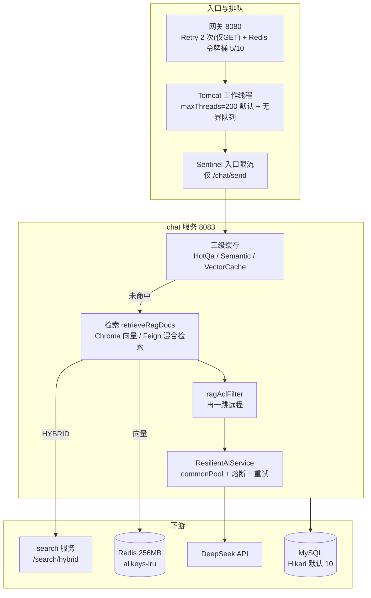
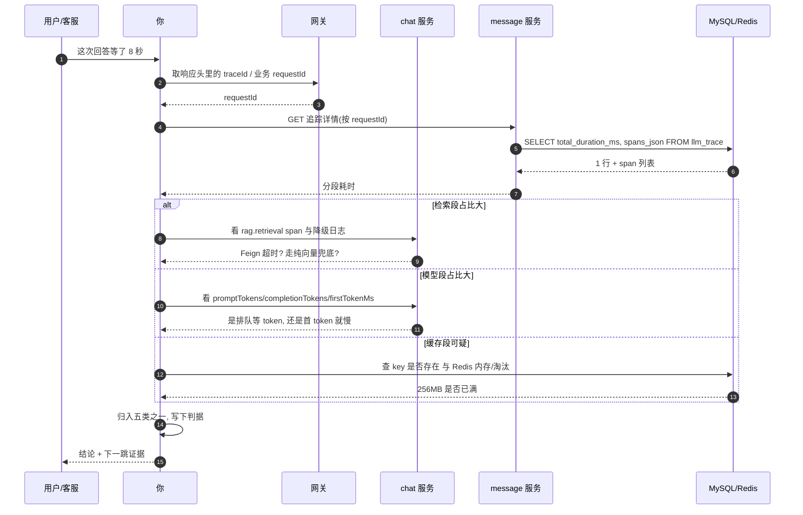

# 接口性能优化实战：把「慢」归到五种原因里的哪一种

> **一句话结论**：接口慢有且只有五种原因——等下游、等数据库、等锁、等 CPU、等网络；优化的第一步永远是「先把一次请求拆成若干段、量出每段耗时、把它归进这五类之一」，而不是先改代码。
>
> **阅读前置**：读得懂 `@Transactional`、Feign、Resilience4j 注解的基本用法；知道线程池 = 「固定数量工人 + 排队队列」这件事。本篇所有数字要么来自本机实测输出，要么来自本仓库配置原文，要么明确标注为算术推演。
>
> **证据基线**：JDK 17.0.19 / node 24.16.0 / Spring Boot 4.2.0 / Spring Cloud 2026.0.0 / MyBatis-Plus 3.5.13；本机**无 docker、无 mvn、无运行中的服务**，因此「在跑的进程里测」这条路全部改成「静态核对 + 可复现的小实验」。预计阅读 35 分钟。

## 证据边界（先声明，再看正文）

| 级别 | 本仓本机状态 | 本篇怎么处理 |
|------|--------------|--------------|
| A 级（框架源码） | `learning-docs/24-源码分析/assets/source/` 下有 `FeignClientsConfiguration.java.md`、`FeignClientFactoryBean.java.md`、`RetryGatewayFilterFactory.java.md` 等摘录 | 只用这几处解释「默认值从哪来」，锚点写到 `#L`；引不到的地方一律不臆造 |
| B 级（本项目代码/配置） | 11 个 `ai-cs-*/src/main/resources/application.yml`、`ai-cs-chat` 与 `ai-cs-order` 的 Java 源码、`deploy/` 下的 compose 与 mysql/redis/prometheus 配置，全部当次核对过 | 本篇主体。路径与行号逐条核对过，写完整相对路径 |
| C 级（本机命令实测） | `java -XX:+PrintFlagsFinal`、`javap`、`node` 三个是**真能跑**的；`jcmd -l` 只能列出它自己 | 每条都贴真实输出 + 怎么读 + 误判风险 |
| 未本机实测 | TPS / QPS / P99 / GC 停顿 / 火焰图 / 线程 dump 现场 | **一个都不写数字**；只给命令与判读方法，并说明为什么本机测不了（无 docker / 无 mvn / 无运行中服务） |

---

## 0. 先看现象

### 现象一：知道「慢」，但说不出慢在哪一段

```powershell
cd D:\Projects\Persion\ai-customer-service
Get-ChildItem -Recurse -Include *.java ai-cs-chat |
  Select-String -Pattern 'log\.(info|warn|debug)\(' |
  Where-Object { $_.Line -match '耗时|elapsed|cost|latency|duration' }
```

真实输出（全文就这几条）：

```text
ai-cs-chat\src\main\java\com\aics\chat\nl2sql\Nl2SqlQueryService.java:210: log.info("NL2SQL 执行成功: db={}, sql={}, rows={}, cost={}ms", ...)
ai-cs-chat\src\main\java\com\aics\chat\observability\QuotaService.java:67: log.info("模型用量配额超限: ...")
ai-cs-chat\src\main\java\com\aics\chat\rag\rerank\SiliconFlowRerankService.java:199: log.info("Rerank完成: 输入{}条, 过滤后{}条, 耗时配置={}ms", ...)
ai-cs-chat\src\main\java\com\aics\chat\service\impl\ChatServiceImpl.java:672: log.warn("SSE流式降级: sessionId={}, msg={}", ...)
```

整条 chat 链路上真正打印「某一段花了多少毫秒」的日志只有 NL2SQL 与 Rerank 两处，**主链路 `chatWithRag` / `chatStreamSse` 一段都没有**。所以线上报「聊天慢」时，你手里只有总耗时一个数：是检索慢、ACL 慢、还是模型慢，全凭猜。

### 现象二：配了 30s / 60s 超时，但代码里没有一处用上它

```powershell
Get-ChildItem -Recurse -Include *.java ai-cs-* |
  Select-String -Pattern '@TimeLimiter|@CircuitBreaker|@Retry\(|@SentinelResource'
```

真实输出（去掉了源码注释行）：

```text
ai-cs-chat\src\main\java\com\aics\chat\service\impl\VisionModelClient.java:153: @TimeLimiter(name = "visionService", fallbackMethod = "fallbackDescribe")
ai-cs-chat\src\main\java\com\aics\chat\service\impl\VisionModelClient.java:154: @Retry(name = "visionService", fallbackMethod = "fallbackDescribe")
ai-cs-chat\src\main\java\com\aics\chat\service\impl\VisionModelClient.java:155: @CircuitBreaker(name = "visionService", fallbackMethod = "fallbackDescribe")
ai-cs-chat\src\main\java\com\aics\chat\controller\ChatController.java:79: @SentinelResource(value = SentinelRules.RESOURCE_CHAT_SEND, blockHandler = "chatSendBlocked")
```

`ai-cs-chat/src/main/resources/application.yml` 里 `chatService`（30s）、`sseChatService`（60s）两个 `resilience4j.timelimiter.instances` 声明得好好的，但**全仓 `@TimeLimiter` 只出现在 `visionService` 上**。也就是说这两个超时值目前只是「配置文本」，没有任何方法被它包住。

### 现象三：所有兜底参数都是框架默认值，没人算过

```powershell
Get-ChildItem -Recurse -Include application.yml ai-cs-*\src\main\resources |
  Select-String -Pattern 'tomcat|hikari|max-threads|maximum-pool-size|connection-timeout|read-timeout'
```

真实输出（只有 order 的三行注释，没有任何配置项）：

```text
ai-cs-order\src\main\resources\application.yml:26: spring.cloud.openfeign.circuitbreaker.enabled: true
ai-cs-order\src\main\resources\application.yml:27: #   实例名 = FeignClient 的 contextId（productClient / payClient）
ai-cs-order\src\main\resources\application.yml:28: #   降级由 FallbackFactory 决定
```

与此同时，容器给的堆是 `-Xms256m -Xmx512m`（见 `deploy/docker-compose/docker-compose-all.yml#L175`），而这台机器的 JVM 默认值是：

```text
size_t MaxHeapSize       = 8514437120  {product} {ergonomic}     # 7.93 GiB
double MaxRAMPercentage  = 25.000000   {product} {default}
```

容器 512 MiB vs 裸机默认 7.93 GiB，**同一个应用在两处跑的是完全不同的内存行为**，但两处都没有 GC 日志、没有 JVM 指标（`deploy/observability/prometheus.yml` 只有一个通用 job，没有 JMX exporter）。

**这些现象指向同一件事**：这套系统从来没有「把一次请求拆开量过」。没有分段耗时，就无法把慢归到等下游 / 等数据库 / 等锁 / 等 CPU / 等网络里的任何一类；无法归类，任何「优化」都只能靠猜——而猜出来的改动，事后也无法验证是否真的动到了那段耗时。

---

## 1. 整体地图



> **读图说明**：看两条主箭头的**串接关系**，不要看节点数量。第一条是 `CACHE -->|未命中| RET --> ACL --> LLM`：这一串是**严格串行**的，任何一段慢都会整段叠加到用户头上。第二条是 `RET -->|HYBRID| SEARCH`：它和 `RET -->|向量| REDIS` 是**同一条路径的两种模式**（混合检索失败会退回纯向量，两次都算在请求耗时里），不是两条并行分支——把这两条看成「可以同时走」是最常见的读图错误，会让您误以为检索有并行兜底。

| 组件 | 责任 | 参与方 | 真实位置 |
|------|------|--------|----------|
| 网关重试 | 只对 GET 的 5xx 重试 2 次 | `ai-cs-gateway` | `ai-cs-gateway/src/main/java/com/aics/gateway/config/RouteConfig.java#L176-L177` |
| 网关限流 | Redis 令牌桶，每用户 5/s、桶 10 | Redis + Lua | `RouteConfig.java#L52-L53`；`ai-cs-gateway/src/main/resources/application.yml` 中 `replenish-rate: 5` / `burst-capacity: 10` |
| 入口限流 | Sentinel 只包 `/chat/send` 一个资源 | `ai-cs-chat` | `ai-cs-chat/src/main/java/com/aics/chat/controller/ChatController.java#L79` |
| 工作线程 | Tomcat 默认 200 线程 + 无界队列 | `ai-cs-chat` | 无显式配置，全仓 0 命中 |
| 缓存 | 热门问答 → 语义缓存 → 完整 RAG | `ai-cs-chat` | `ai-cs-chat/src/main/java/com/aics/chat/service/impl/ChatServiceImpl.java#L424` |
| 检索 | 向量（Chroma）/ 混合（Feign 到 search） | `ai-cs-chat` `ai-cs-search` | `ai-cs-chat/src/main/java/com/aics/chat/rag/retrieve/HybridRetriever.java#L176-L213` |
| 模型调用 | 逐模型串行 + 单次瞬时重试 + 熔断 | DeepSeek | `ai-cs-chat/src/main/java/com/aics/chat/service/impl/ResilientAiService.java#L194` |
| 落库 | 用量/追踪异步 Feign 上报 | `ai-cs-message` | `ai-cs-chat/src/main/java/com/aics/chat/config/ObservabilityExecutorConfig.java#L27` |

---

## 2. 关键概念与关键工具

先把「五种原因」和「量它们的工具」对齐，后面每一节都从这里取工具。

| 名称 | 位置 | 作用 | 关键参数（真实值） |
|------|------|------|--------------------|
| 延迟分解（span） | `ai-cs-chat/src/main/java/com/aics/chat/service/impl/ChatServiceImpl.java#L931-L939` | 把检索段包成 Observation，落 span | `rag.retrieval`，lowCardinality `span.type=RETRIEVAL` |
| LLM 调用链落库 | `deploy/mysql/llm-observability-init.sql#L12-L26` | 一行 = 一次请求 | `total_duration_ms`、`spans_json`、主键 `request_id` |
| 模型用量表 | `deploy/mysql/llm-observability-init.sql#L29-L49` | token 与费用 | `input_tokens` / `output_tokens` / `estimated_cost` |
| TTFT 口径 | `ai-cs-chat/src/main/java/com/aics/chat/service/impl/ResilientAiService.java#L279-L288` | 首 token 到达时刻减去开始时刻 | `AtomicLong firstTokenMs`，只在第一次 `doOnNext` 写 |
| Feign 超时 | A 级：[[源码:FeignClientFactoryBean.java.md#L123-L125]] | 未配就是 `new Request.Options()` 的默认 | connect **10s** / read **60s**（见 §3.4 的 `javap` 输出） |
| Feign 重试 | A 级：[[源码:FeignClientsConfiguration.java.md#L148-L152]] | 默认不重试 | `Retryer.NEVER_RETRY` |
| Resilience4j 重试 | `ai-cs-chat/src/main/resources/application.yml#L92` | 只对 `chatService` | `max-attempts: 3`、`wait-duration: 1s`、`multiplier: 2` |
| Resilience4j 超时 | 同文件 `#L78` / `#L82` / `#L86` | 三个实例 | 30s / 60s / 5s，均 `cancel-running-future: true` |
| 熔断器 | 同文件 `circuitbreaker.instances` | 三个实例同参 | 窗口 10、最小 3 次、失败率 50%、开态 30s、半开放行 3 |
| 网关重试 | `ai-cs-gateway/src/main/java/com/aics/gateway/config/RouteConfig.java#L176-L177` | 只对幂等 GET 生效 | `setRetries(2)` + `setMethods(HttpMethod.GET)` |
| MySQL 连接上限 | `deploy/mysql/mysql.cnf#L14-L15` | 服务端上限与空闲回收 | `max-connections=500`、`wait-timeout=28800` |
| 应用侧连接池 | 无显式配置 | HikariCP 默认 | 10 连接 / 30s 获取超时 |
| Redis 上限 | `deploy/redis/redis.conf#L24-L25` | 达到 256MB 就按 LRU 淘汰 | `maxmemory 256mb`、`maxmemory-policy allkeys-lru` |
| 慢查询阈值 | `deploy/mysql/mysql.cnf#L19-L21` | 判「等数据库」的第一手证据 | `slow-query-log=1`、`long-query-time=2` |
| 压测脚本 | `scripts/loadtest/k6/sse-chat.js#L13-L29` | 首 token 与整条流两个指标 | `http_req_waiting p95<2000`、`http_req_duration p95<15000` |
| 异步落库线程池 | `ai-cs-chat/src/main/java/com/aics/chat/config/ObservabilityExecutorConfig.java#L27` | 把 Feign 上报从请求线程挪走 | core 1 / max 4 / 队列 1000 |

---

## 3. 原理与证据逐段精读

### 3.1 延迟分解：为什么「先分类」比「先优化」重要

**在干什么。** 把一个请求的墙钟时间切成互不重叠的段：入口到网关、网关到服务、服务内各步骤、每段是一次远程调用还是本地计算。项目里已经有一个半成品骨架——`retrieveRagDocs` 把检索包成 `rag.retrieval` 这个 Observation：

```java
Observation observation = Observation.createNotStarted("rag.retrieval", observationRegistry)
        .lowCardinalityKeyValue("span.type", "RETRIEVAL")
        .lowCardinalityKeyValue("knowledgeBase", String.valueOf(kbId))
        .highCardinalityKeyValue("query", query);
observation.start();
...
} catch (Exception e) {
    observation.error(e);
    throw e;
} finally {
    observation.stop();
}
```

**为什么这么设计。** `lowCardinality` 放「知识库 ID、span 类型」这种取值有限、可以当标签聚合的维度；`highCardinality` 放 `query` 这种几乎唯一的取值，只进 span 不进指标——放错位置会把 Prometheus 的时间序列基数打爆。`finally { observation.stop() }` 保证异常路径也有一段耗时记录，否则「慢且失败」的请求在图上会凭空消失。

**换写法会怎样。** 如果只用 `long start = System.currentTimeMillis()` 在一个方法里首尾打一行日志，你能得到的是「整个 `chatWithRag` 花了多少」，得不到「其中检索、ACL、模型各占多少」。而分类恰恰依赖后者：同一个 3 秒，可能是检索 200ms + 模型 2800ms（等下游），也可能是检索 2900ms + 模型 100ms（等下游的另一个下游）——两者的优化动作完全不同。

**常见坑。**
1. 只在成功路径打点。`retrieveRagDocs` 的 `finally`（`ai-cs-chat/src/main/java/com/aics/chat/service/impl/ChatServiceImpl.java#L982`）写法是对的，但主链路 `chatWithRag`（同文件 `#L411-L486`）从 `guardInput` 到 `cacheRagAnswer` 八段**一段都没有独立计时**，所以「慢」发生时你甚至分不清是不是在缓存写入上花的。
2. 把 `llm_trace.total_duration_ms` 当成分段耗时。它只有一列（`deploy/mysql/llm-observability-init.sql#L18`），分段信息在 `spans_json` 里，**必须解析 JSON 才有意义**。
3. 忘了时间基准。所有 span 都要在同一时钟、同一时刻起算，跨机器比对时要看 trace 的父子关系而不是各自减出来的毫秒数。

### 3.2 同步依赖链：一次请求的耗时是「加」出来的

**在干什么。** `chatWithRag` 的真实执行顺序（行号逐个核对过）：

| 序 | 步骤 | 行号 | 形态 | 能并行吗 |
|----|------|------|------|----------|
| 1 | `guardInput` 输入风控 | `#L417` | 纯内存/CPU | 不能，先决条件 |
| 2 | `lookupCachedAnswer` 查缓存 | `#L424` | Redis + 向量相似 | 不能，命中了就直接返回 |
| 3 | `retrieveRagDocs` 检索 | `#L437` | 远程（Feign/Chroma） | **可以**，与第 4 步无依赖 |
| 4 | `ragAclFilter.filter` 权限过滤 | `#L439` | 又一次远程 | **可以**，与第 3 步并行 |
| 5 | `knowledgeBaseService.buildContext` | `#L441` | 纯 CPU | 依赖 3、4 |
| 6 | `promptRegistry.render` 渲染提示词 | `#L444` | 纯 CPU | 依赖 5 |
| 7 | `callRagChat(...).get()` 等模型 | `#L453` | 远程，最慢 | 不能，必须等前面全齐 |
| 8 | `cleanResponse` / `guardOutput` / `buildCitations` / `recordAnswerSpan` / `triggerOnlineEval` / `cacheRagAnswer` | `#L454`-`#L475` | CPU + 异步 + 写缓存 | 收尾，可以部分异步 |

**为什么这么设计。** 第 3、4 步串行是因为代码把 ACL 过滤写成了「检索结果的后续处理」（`#L439` 拿 `#L437` 的返回值当输入），写法最直观。第 7 步必须串行是物理约束：没有上下文就没有提示词，没有提示词模型无从开始。

**换写法会怎样。** 第 3、4 步改成并行（先拿知识库 ACL 规则、再并发检索），理论上省掉 min(检索, ACL) 那一段。风险有三条：一是 ACL 现在过滤的是「检索结果」，改成并行就得改成「先取规则、检索回来再本地筛」，语义要对齐；二是并行意味着同样的线程占用翻倍，在 Tomcat 只有 200 线程时是拿「单请求延迟」换「整体吞吐」；三是 `CompletableFuture` 里 ThreadLocal（`ChatUserContext`）会丢——项目在 `ResilientAiService.java#L173-L177` 已经踩过这个坑，写法是先 `capture()` 再在异步块里 `restore()`。

**常见坑。**
1. 以为 `@Transactional` 里的远程调用不占时间。真实反例在订单侧：`ai-cs-order/src/main/java/com/aics/order/service/impl/OrderCreateTxService.java#L72-L73` 同时挂了 `@GlobalTransactional` 和 `@Transactional`，而 `#L93-L95` 的循环里每个商品一次 `productClient.deductStock(...)`。**数据库事务（等数据库/等锁）+ 循环里的远程调用（等下游）叠在同一把连接上**，N 个商品就是 N 次网络往返全在事务内。
2. 把「加了缓存」当成万能解。第 2 步命中确实能跳过 3~7 全部，但缓存未命中时它只是**多了一段 Redis 往返**。

### 3.3 串行改并行的收益与风险（本机实测）

**在干什么。** 用 `node` 复现「一次请求要调 3 个下游、每个 200ms」，分别串行与并行跑，量端到端耗时。

```javascript
const DOWNSTREAM_MS = 200;
function fakeIo(name) {
  const start = performance.now();
  return new Promise((resolve) => {
    setTimeout(() => resolve({ name, ms: performance.now() - start }), DOWNSTREAM_MS);
  });
}

async function serial() {
  const t0 = performance.now();
  await fakeIo('A'); await fakeIo('B'); await fakeIo('C');
  return performance.now() - t0;
}

async function parallel() {
  const t0 = performance.now();
  await Promise.all([fakeIo('A'), fakeIo('B'), fakeIo('C')]);
  return performance.now() - t0;
}
```

真实输出（node v24.16.0，本机）：

```text
node v24.16.0 | 每次下游等待 = 200 ms | 下游个数 = 3
串行 serial   : 各段 214.4ms + 204.0ms + 215.0ms => 端到端 633.5ms
并行 parallel : 各段 200.5ms + 200.6ms + 200.6ms => 端到端 200.7ms
差值          : 432.8ms
理论最优下界  : 200.0ms （三段完全重叠时等于最慢那一段）
并行节省比例  : 68.3%
```

**怎么读。** 串行的 633.5ms ≈ 3 × 211ms，是三段相加；并行的 200.7ms ≈ 单段 ≈ 理论下界。所以「3 个下游 × 200ms = 600ms」这个说法是对的，而且把它并行化能把 600 降到 200 ——这是**结构性的 3 倍**收益，不是「调参调出来的 10%」。

**为什么不能无条件并行。** 上面测的是「纯等待」。真实项目里并行有三道坎：
1. **线程从哪来。** `ResilientAiService.java#L176` 直接 `CompletableFuture.supplyAsync(...)` 没传 executor，用的是 `ForkJoinPool.commonPool`。本机 `commonPool.parallelism` 是 15（16 核 - 1），而 commonPool 是**全 JVM 共享**的，任何一处阻塞调用（比如等模型）都会把它的线程钉住，连 `parallelStream` 一起卡死。
2. **降级路径会叠得更长。** `HybridRetriever.java#L208-L211` 的兜底是「Feign 失败 → 再走一次纯向量检索」，两次是串行的。把这条链路并行化后，失败时仍然要多付一次向量检索。
3. **批量子查询没并行。** `HybridRetriever.java#L252` 是 `for (String q : queries) { lists.add(searchVector(kb, q, topK)); }`——多查询改写产生 N 个 query，N 次向量化 + N 次检索全部串行。这是仓库里**最明确的一处可并行点**，改成并行后延迟从 N×t 降到约 t，但代价是向量库连接数瞬时放大 N 倍。

**常见坑。** 并行之后总耗时反而变长，八成是撞了「下游是同一个资源」：3 个下游其实打的是同一台 MySQL、同一个 Hikari 10 连接池，并行只是让 3 个请求一起排队等连接。

### 3.4 连接池与超时的耦合：超时大于「重试总时长」就等于没有超时

**在干什么。** 这条是「等下游」类故障最隐蔽的放大器。先把默认值钉死——Feign 的超时不是项目配的，是框架无参构造的默认：

```text
javap -p -c -classpath C:\Users\16680\.m2\repository\io\github\openfeign\feign-core\13.17\feign-core-13.17.jar "feign.Request`$Options"

public feign.Request$Options();
    Code:
       0: aload_0
       1: ldc2_w        #22    // long 10l
       4: getstatic     #24    // Field java/util/concurrent/TimeUnit.SECONDS
       7: ldc2_w        #25    // long 60l
      10: getstatic     #24    // Field java/util/concurrent/TimeUnit.SECONDS
      13: iconst_1
      14: invokespecial #11    // Method "<init>":(JLjava/util/concurrent/TimeUnit;JLjava/util/concurrent/TimeUnit;Z)V
```

**怎么读。** 无参构造函数把 `10 秒 + SECONDS` 和 `60 秒 + SECONDS` 传给四参构造，第三个数 `iconst_1` 是 `followRedirects=true`。也就是说：**connect 超时 10s、read 超时 60s** 是 `Request.Options()` 的出厂值，而 [[源码:FeignClientFactoryBean.java.md#L123-L125]] 正是拿这个出厂值当字段初始值：

```java
private int readTimeoutMillis = new Request.Options().readTimeoutMillis();
private int connectTimeoutMillis = new Request.Options().connectTimeoutMillis();
```

(src: FeignClientFactoryBean.java.md#L123-L125)

**为什么这么设计。** 让「不写配置」也有一个保守上限，同时把重试交给上层（[[源码:FeignClientsConfiguration.java.md#L150-L152]] 返回 `Retryer.NEVER_RETRY`）——Feign 自己绝不重试，重试必须是显式决策。

**换写法会怎样 / 算术推演。** 现在把三个数字放在一起：read 超时 10s、重试 3 次、下游 9 秒才失败。

```javascript
const READ_TIMEOUT_MS = 10_000;      // feign 默认 read
const DOWNSTREAM_FAIL_MS = 9_000;    // 下游 9s 返回失败(不是挂住)
const MAX_ATTEMPTS = 3;              // resilience4j maxAttempts=3 = 共 3 次
const BACKOFF = [0, 1_000, 2_000];   // wait-duration 1s, multiplier 2
const POOL_SIZE = 10;                // hikari 默认
```

真实输出：

```text
单次尝试耗时           : 9.00s（下游先失败，10.00s 超时根本没机会触发）
一个逻辑请求的连接占用 : 3 × 9.00s = 27.00s
一个逻辑请求的墙钟耗时 : 27.00s + 退避 3.00s = 30.00s
放大倍数               : 3.0 倍（相对"一次就放弃"）
池大小 10 时的饱和到达率 : 0.37 个/秒

离散步进模拟（每秒到 1 个请求，每个占连接 27s，池 10）：
  t(s) | 占池 | 排队
     0 |    1 |    0
     9 |   10 |    0
    10 |   10 |    1
    20 |   10 |   11
    40 |   10 |   21
    80 |   10 |   51

池第一次被占满 : 算术 t=9s（第 10 个请求到达），模拟 t=9s → 一致
第一次出现排队 : 模拟 t=10s（池满之后第 1 秒）
排队深度 >= 池大小的秒数 : 71s / 90s（这些秒里新请求只能等连接）
队列增长速度   : ≈ 1 个/秒（释放速度 0，因为每个请求要占 27.00s）
```

**怎么读。** 三个结论，全部可复算：
1. **超时 10s 是死参数。** 起决定作用的是「下游 9s 就失败」，10s 永远轮不到触发。想靠「把超时调小」救这个场景是无效的——要调的是**下游为什么 9s 才失败**。
2. **连接占用 = 重试次数 × 单次失败耗时**，不是超时值。27s 是它的真身。
3. **池耗尽的临界点由到达率决定**：池 10、每个占 27s → 每秒超过 10/27 ≈ 0.37 个请求就填满。一旦填满，后面的请求排队，队列以「到达率」的速度增长（因为释放速度≈0）。

**常见坑。**
1. 只看「平均耗时」不看「连接占用时长」。平均 9s 的接口，放大成 27s 的连接占用后，QPS 只要过 0.4 就能把 10 连接的池打满——而这一层在接口监控上表现为「响应时间突然整体上升」，容易被误判成「数据库变慢了」。
2. 把重试放在「会写数据」的调用上。网关侧对此有明确取舍：`ai-cs-gateway/src/main/java/com/aics/gateway/config/RouteConfig.java#L176-L177` 只对 `HttpMethod.GET` 开 2 次重试，注释写着 POST/PUT 重试可能重复下单/重复扣款。判读依据在 A 级源码里也一致——[[源码:RetryGatewayFilterFactory.java.md#L161-L164]]：

```java
HttpMethod httpMethod = exchange.getRequest().getMethod();
boolean retryableMethod = retryConfig.getMethods().contains(httpMethod);
```

(src: RetryGatewayFilterFactory.java.md#L161-L164)

   只有「请求方法在被配置的方法集合里」才可能重试。所以 **`/chat/send` 是 POST，网关这一层永远不会重试它**——它没有重试保护，只有 Sentinel 限流。
3. 忽略退避。`multiplier: 2` + `wait-duration: 1s` 意味着第 3 次尝试前要等 2s，池紧张时这 2s 也在占着「请求的墙钟时间」。墙钟 30s、连接 27s，差的 3s 就是退避。

### 3.5 缓存的三类收益与它的三个代价

**在干什么。** `ai-cs-chat/src/main/resources/application.yml` 的 `aics.cache` 注释把命中顺序写死了：「热门问答（精确 O(1)）→ 语义缓存（向量相似）→ 完整 RAG 链路」。三层各有明确参数：`hot-qa{promote-threshold:3, ttl-hours:24}`、`semantic{threshold:0.92, max-entries:200, ttl-hours:168}`、`vector{l1-max-entries:4096, ttl-hours:168}`。

向量缓存是标准的两级：`VectorCacheStore.java#L59-L78` 先查进程内 L1，未命中查 Redis L2 并回填 L1；`#L83-L96` 写入时 L1 常驻、L2 带 TTL，Redis 出异常只记 `warn` 不抛。

**三类收益（都能在代码里指到具体位置）。**
1. **省掉整条链路**：`ChatServiceImpl.java#L424` 命中即 `#L432` 直接返回，跳过检索、ACL、模型——这是唯一一类「数量级」收益。
2. **省掉重复的向量化**：`VectorCacheStore` 缓存的是「文本 → float[]」，命中就免掉一次 embedding 调用的网络往返。
3. **把高频问题变成 O(1)**：`HotQaCacheService.java#L45-L47` 用 ZSET 计频、Hash 存答案，`#L100` 里 `count >= promoteThreshold` 才升级成热点。

**三个代价。**
1. **一致性**：`ttl-hours: 168` 意味着知识库改了文档，最坏 7 天后才生效。项目没有主动失效逻辑（全仓没有按知识库变更清理 `aics:hotqa:*` 的代码），所以「改了文档用户还看到旧答案」是设计内行为。
2. **淘汰不可控**：`deploy/redis/redis.conf#L24-L25` 是 `maxmemory 256mb` + `allkeys-lru`。allkeys 意味着**任何** key 都可能被淘汰，包括会话、限流令牌桶的计数、语义缓存。256MB 装满时，语义缓存会被静默挤掉，命中率跌下去而没有任何告警。
3. **假命中**：`semantic.threshold: 0.92` 是相似度阈值，阈值低会把不同问题当同一个答案返回——这是「性能变好了、质量变差了」的典型现场，而且从耗时指标上完全看不出来。

**常见坑。** 用「命中率上升」证明优化成功。命中率上升也可能是缓存把**错误答案**返回得更快了。要同时看 `CacheStatsController` 的统计和 `model_usage` 里 token 数的下降是否同步。

### 3.6 N+1 与批量接口：本项目里是「N+1 次远程」而不是「N+1 次 SQL」

**在干什么。** 仓库里最真实的两处 N+1，都在订单创建/取消路径上，且都在事务里：

```java
for (CartItem item : cartItems) {
    productClient.deductStock(item.getProductId(), item.getQuantity());
}
```

```java
for (CartItem item : cartItems) {
    OrderItem orderItem = new OrderItem();
    ...
    orderItemMapper.insert(orderItem);
}
```

**为什么这么设计。** 第一段在 `OrderCreateTxService.java#L93-L95`，是 Seata AT 的「分支事务」写法：每个商品一条独立的分支事务、独立 undo_log，库存不足时全局回滚靠 undo_log 反向补偿。拆成一条批量调用会让「部分成功」的粒度从「单商品」粗化成「整批」，补偿逻辑要重写。第二段在 `#L120-L129`，逐条 `orderItemMapper.insert`，是因为插入后可能还要用主键做后续处理。

**换写法会怎样。** 第一段：`ProductClient` 目前只有单商品接口（`ai-cs-order/src/main/java/com/aics/order/client/ProductClient.java#L35-L36` 的 `deductStock`、`#L41-L42` 的 `restoreStock`、`#L48-L49` 的 `getProduct`），**没有批量扣减接口**——所以「改成批量」不是改调用方，是要新增商品服务接口，并重新设计分支事务边界，属于跨服务改造。第二段：`saveBatch` + JDBC `rewriteBatchedStatements=true` 能把 N 次往返压成 1 次，但项目里 **`rewriteBatchedStatements` 0 处**（11 个 yml 全文核对过），所以即使换成 `saveBatch`，MySQL 驱动仍可能逐条发送。

**常见坑。**
1. 只用「N 次 = N × 单次耗时」估算而不看事务。真正的时间是 `N × (往返 + 每次事务提交 + 可能的锁等待)`，且在 `@Transactional` 内，慢的远程调用会**拉长事务持有时间**——这直接抬高了「等锁」的概率。
2. 忘了 `restoreStock` 这类循环也出现在退订/退款路径：`ai-cs-order/src/main/java/com/aics/order/service/impl/OrderServiceImpl.java#L194-L196` 与 `#L230-L232`。三处同样写法，改一处不改另两处等于没改。

### 3.7 序列化与响应体大小：最先该量、最容易忽略

**在干什么。** 一个 `/chat/send` 响应体里除了答案文本，还有 `buildCitations`（`ChatServiceImpl.java#L1041`）生成的引用列表、历史裁剪后的上下文。`MAX_HISTORY_SIZE = 20`、`KEEP_RECENT_SIZE = 10`（`#L150`、`#L153`）决定了塞进模型和塞回前端的量。

**为什么这么设计。** 20 条上限是「够用又不至于把提示词撑爆」的经验值；超过 20 就 `compressHistory`（`#L278`）——而压缩本身是一次**额外的 LLM 调用**，这是「为了省钱反而多花一次模型时间」的经典取舍。

**换写法会怎样。** 三条路，收益递减：
1. **字段裁剪**：`citations` 只回 `docId + title + score`，不回原文片段。改动最小、收益确定。
2. **gzip**：Spring Boot 的 `server.compression.enabled` **本项目 0 处配置**（全仓 grep `compression|gzip` 只命中一处无关的「上下文压缩」注释），所以响应是明文的。开启要点是 `mime-types` 含 `application/json`、`min-response-size` 别设太大。
3. **分页**：引用列表、历史消息都支持分页。项目已具备能力——`ai-cs-message/src/main/java/com/aics/message/service/impl/LlmTraceServiceImpl.java#L93` 用 `Page<LlmTrace>`，`PaginationInnerInterceptor` 注册在 `ai-cs-message/src/main/java/com/aics/message/config/MybatisPlusConfig.java#L34`。

**常见坑。** 以为序列化慢是「Jackson 慢」。绝大多数情况是**报文大**：同样 500ms，1MB 报文里可能 400ms 花在网络上（等网络）。判断手法是先看 `Content-Length`，再看 `http_req_waiting` 与 `http_req_duration` 的差。

### 3.8 流式响应改善的是首字节时间，不是总耗时

**在干什么。** SSE 让客户端尽早看到第一个字。项目里 TTFT 的口径写在 `ResilientAiService.java#L279-L288`：`start` 在订阅前记录，`doOnNext` 里只有 `firstTokenMs` 还是 -1 时才写入差值——只记第一次。

**为什么这么设计。** 只要第一个 token 到了就能写进 `llm_trace`/指标，不必等整条流结束；`doFinally`（`#L292-L328`）再补上总时长与 token 数落库。

**换写法会怎样 —— 本机实测。** 模拟「总共 2000ms 吐完、第一个 token 在 300ms」：

```text
模型总时长 2000ms / 首 token 300ms / 10 个 chunk
非流式 : 首字节 2015ms  总耗时 2015ms
流式   : 首字节 189ms  总耗时 1991ms
首字节改善 : 1826ms（91%）
总耗时变化 : -24ms（几乎为 0）
```

**怎么读。** 首字节从 2015ms 降到 189ms，改善 91%；总耗时几乎没变（-24ms 是计时抖动）。所以流式治的是**感知慢**，不治**服务端慢**：线程占用、下游调用次数、token 成本一个都没少。

**常见坑。**
1. 把 SSE 当吞吐优化。看 `ChatServiceImpl.java#L601`：`Flux<String> flux = futureFlux.get();` 是**阻塞 get 且没有超时**，Tomcat 工作线程会一直停在这里等首 token，直到 `#L646` 才 `subscribe` 出去。流式只是把「首字节」提前了，线程该占还是占。
2. 注释与代码不一致：`#L600` 注释写「受 TimeLimiter 保护，不会无限等待」，但如 §0 现象二所述，`chatService`/`sseChatService` 的 TimeLimiter **没有任何方法在用**。真正兜底的是 `#L156` 的 `SSE_EMITTER_TIMEOUT = 5 * 60 * 1000L`——5 分钟。这个 5 分钟不是「超时保护」，是「最坏情况下线程被占 5 分钟」。
3. 压测指标选错。`scripts/loadtest/k6/sse-chat.js#L5-L6` 的注释已经把话说清楚：k6 的 `http_req_waiting` 近似 TTFB、`http_req_duration` 是整条流总时长，要看逐帧得换扩展。并且 `#L26-L29` 的阈值是**待校准的保守基线**（注释写「先给个保守基线，跑通后再校准」），不能当成实测结论引用。

### 3.9 限流与降级：拒绝得快不是优化

**在干什么。** 三处入口保护，各自边界很清楚：
- Sentinel：`ChatController.java#L79` 的 `@SentinelResource(value = SentinelRules.RESOURCE_CHAT_SEND, ...)`——**全仓唯一一处**，只包 `/chat/send`。
- 网关令牌桶：`RouteConfig.java#L52-L53` 的 `new RedisRateLimiter(replenishRate, burstCapacity)`，参数取自 `replenish-rate: 5` / `burst-capacity: 10`。
- 网关本地限流兜底：`aics.gateway.rate-limit.enabled: false`，默认关闭（注释说明已由 Redis 令牌桶替代）。

**为什么这么设计。** 令牌桶允许短时突发（桶 10），长期速率 5/s；`enabled: false` 那层是「Redis 挂了怎么办」的降级开关，平时关掉避免两套限流叠加。

**换写法会怎样。** 限流生效时 P99 会**变好看**——因为超限的请求 100ms 就被拒了，根本没进慢队列。这是最容易自欺的一项：`http_req_duration` 的 P99 下降，可能只是「慢请求被拒了」。要同时看三件事：`http_req_failed` 的比例、被拒请求的占比、以及**成功请求**的 P99 是否也降了。

**常见坑。**
1. 拿「拒绝得快」当「系统变快」。降级同理：`HybridRetriever.java#L210` 混合检索失败会 `log.warn("混合检索失败，降级纯向量...")` 然后走纯向量——接口**成功了**、耗时**还不一定降**，因为失败那次 Feign 的耗时已经付掉了（最坏 10s connect / 60s read），后面又要多付一次向量检索。
2. 以为熔断器会替你兜时间。`circuitbreaker` 的窗口是 10 次、最小 3 次调用、失败率 50%——前 3 次慢请求已经实实在在地慢完了，第 4 次才开始快速失败。熔断保护的是**后面的请求**，不是**正在慢的那些**。

---

## 4. 一次完整排查时序：从「用户说慢」到「归到五类之一」



> **读图说明**：竖读三段。**第一段（1-6）只做定位，不做判断**——目标是把一个「8 秒」变成「若干段毫秒」。**第二段（7-14）是唯一的分叉点**：`alt` 里三个分支的判据互斥，选错分支会让你去优化一段只占 5% 的代码。**第三段（15-16）是纪律**：没有写进 `llm_trace` 的推理等于没发生，下次还得重来。最容易看错的是箭头 9/10：`GET 追踪详情` 走的是 chat 侧 `ObservabilityController` 经 Feign 转给 message 服务（`ai-cs-chat/src/main/java/com/aics/chat/feign/TraceFeignClient.java#L40`、`#L48`），**不是直接查 message 的库**——如果你以为能直连 DB 查，就会漏掉「message 服务自己也在慢」这个可能。

| 步骤 | 失败/异常原因 | 你看到的 | 判读入口 |
|------|---------------|----------|----------|
| 1-2 拿 requestId | 请求没进 chat（网关就拒了） | `llm_trace` 查不到行 | 先看网关限流日志（`RateLimitFilter` 的 warn） |
| 3-4 查追踪 | Feign 到 message 失败 | 空结果 + `Result` 的 code 非 0 | 这一步本身可能是「等下游」 |
| 5-6 取分段 | `spans_json` 为空 | 只有 `total_duration_ms` | 说明该请求走的是无 span 的路径（缓存命中或早期失败） |
| 7-9 定位检索 | 混合检索降级 | `log.warn("混合检索失败，降级纯向量...")` | 检索段耗时 ≈ Feign 超时 + 一次向量检索 |
| 10-12 定位模型 | 首 token 就慢 vs 整体慢 | `firstTokenMs` 相对 `total_duration_ms` 的比例 | 首 token 慢 = 排队/限流；整体慢 = 生成 token 多 |
| 13-14 定位缓存 | Redis 满 | 命中率骤降但无报错 | `maxmemory 256mb` + `allkeys-lru` |
| 15-16 归类 | 不写结论 | 下次同样的慢再来一遍 | 归类必须落到「五类之一 + 一条命令」 |

---

## 5. 设计取舍

| 维度 | 方案 A | 方案 B | 本项目选择 | 理由与代价 |
|------|--------|--------|------------|------------|
| 超时控制 | `@TimeLimiter` 注解（30s/60s） | 手写 `future.get(timeout)` | **两者都有，但只接了后者** | `VisionModelClient.java#L153` 走注解；`ResilientAiService.timedCall`（`#L390`）手写 `future.get(timeoutMs)`。代价：yml 里 30s/60s 两个实例成了死配置 |
| 下游调用 | 单商品 Feign（N 次） | 批量接口（1 次） | **A** | 保住 Seata 分支事务的单商品粒度；代价是 N 次往返全在事务内 |
| 检索兜底 | 失败即报错 | 失败降级纯向量 | **B** | 可用性优先；代价是失败时多付一次向量检索，最坏「慢且成功」 |
| 重试 | 全方法重试 | 只对幂等 GET 重试 | **B**（网关） | `RouteConfig.java#L176-L177`；代价是 POST 的 `/chat/send` 没有重试保护 |
| 多查询改写 | 串行循环检索 | 并行检索 | **A** | `HybridRetriever.java#L252`；延迟 N×t，换的实现简单 |
| 用量落库 | 请求线程内同步 Feign | 专用线程池异步 | **B** | `usageExecutor` core1/max4/queue1000；代价是队列满了按 AbortPolicy 抛异常（类注释已说明由调用方捕获告警） |
| 缓存淘汰 | 给语义缓存单独配 `volatile-lru` | 全库 `allkeys-lru` | **B** | `deploy/redis/redis.conf#L25`；代价是内存紧张时会话与限流计数也会被淘汰 |

**可扩展点清单（都是当前未落地的改法，不是已实现）：**
- 把 `chatService` / `sseChatService` 的 TimeLimiter 真正接到方法上，或者删掉这两个实例声明，避免「以为有超时」。
- `retrieveRagDocs` 的 ACL 过滤与检索并行（需要把「事后过滤」改成「事前取规则」）。
- `HybridRetriever.java#L252` 的子查询并行化。
- 新增商品批量扣减接口，把 `OrderCreateTxService.java#L93-L95` 的 N 次远程压成 1 次。
- `chatWithRag` 八段各自打一条耗时日志（当前只有总耗时）。
- 开 `server.compression` 给 JSON 响应加 gzip。
- Redis 拆分实例或改 `volatile-lru`，保住语义缓存。
- Prometheus 增加 JVM job（JMX exporter）与 GC 日志参数——当前 `deploy/observability/prometheus.yml` 只有一个通用 target 列表。

---

## 6. 踩坑与调试手法

### 坑 1：以为 30s TimeLimiter 在生效

**症状**：模型上游挂了，接口挂了 5 分钟才返回，配置里的 30s 完全没起作用。
**根因**：`resilience4j.timelimiter.instances.chatService` 只是声明，Resilience4j 不会自动给任何方法加超时——必须有 `@TimeLimiter` 或手工 `TimeLimiter.decorateFutureSupplier`。全仓 `@TimeLimiter` 只在 `visionService` 上。
**查法**：

```powershell
Get-ChildItem -Recurse -Include *.java ai-cs-* |
  Select-String -Pattern '@TimeLimiter' |
  ForEach-Object { "$($_.Path -replace [regex]::Escape($PWD.Path+'\'),''):$($_.LineNumber)" }
```

**判读**：只出现 `VisionModelClient.java:153` 就说明 chatService/sseChatService 未接。此时真正的上限来自 `SSE_EMITTER_TIMEOUT`（5 分钟）与 `ResilientAiService.timedCall` 的 `future.get(timeoutMs)`。
**误判风险**：`timedCall` 确实有超时，但它的 `timeoutMs` 来自模型定义（`holder.getDefinition().getTimeoutMs()`），与 yml 里的 30s 不是同一个数——看到「有超时」就以为「30s 生效」会算错容量。

### 坑 2：把「超时」调小来解决池耗尽

**症状**：连接池耗尽报警，第一反应是把 read timeout 从 60s 调到 10s。
**根因**：见 §3.4，占用时长 = 重试次数 × 单次失败耗时。若下游 9s 才失败，10s 超时永远不触发。
**查法**（先量下游到底多久失败，再决定调谁）：

```powershell
# 1) 看 Feign 实际生效的超时（启动后才有 env）
#    先在配置里搜有没有覆盖：
Get-ChildItem -Recurse -Include *.yml,*.yaml ai-cs-* |
  Select-String -Pattern 'openfeign|connectTimeout|readTimeout|Retryer'
# 2) 看慢查询阈值是否被击穿
Select-String -Path deploy\mysql\mysql.cnf -Pattern 'long-query-time|max-connections|wait-timeout'
```

**判读**：`openfeign` 只命中 `ai-cs-order/src/main/resources/application.yml#L26` 的 `circuitbreaker.enabled`，没有超时覆盖 → 生效值就是框架默认 10s/60s。此时应改的是「下游为什么慢」或「重试次数」，不是超时。
**误判风险**：把 `max-connections=500` 当成应用能用的连接数。它是**服务端**上限，应用侧仍受 Hikari 默认 10 限制。

### 坑 3：用流式当性能优化

**症状**：改成 SSE 后「用户说不卡了」，于是认为吞吐问题解决了。
**根因**：SSE 只提前首字节（本机实测 2015ms → 189ms），总耗时不变；`ChatServiceImpl.java#L601` 的 `futureFlux.get()` 仍阻塞占用工作线程。
**查法**：

```powershell
# 流式路径是否真的非阻塞：看有没有带超时的 get
Select-String -Path ai-cs-chat\src\main\java\com\aics\chat\service\impl\ChatServiceImpl.java `
  -Pattern 'futureFlux|SseEmitter\(|subscribe\('
```

**判读**：`#L601` 是无参 `get()` → 没有超时；`#L525` 的 `new SseEmitter(5*60*1000L)` 是唯一的硬上限。
**误判风险**：k6 的 `http_req_waiting` 会被当成「服务端处理时间」，其实它只是首字节时间；用它评估吞吐会高估容量。

### 坑 4：给 POST 接口加网关重试

**症状**：想「提升下单成功率」，把路由重试配成对所有方法生效。
**根因**：重试只对幂等请求安全。项目的取舍已经写在代码里。
**查法**：

```powershell
Select-String -Path ai-cs-gateway\src\main\java\com\aics\gateway\config\RouteConfig.java `
  -Pattern 'setRetries|setMethods|HttpMethod.GET'
```

**判读**：看到 `setRetries(2)` + `setMethods(HttpMethod.GET)` 就说明只对 GET；`/chat/send`、下单接口都是 POST，不受保护也不受风险。
**误判风险**：以为「网关有重试」等于「所有接口都能扛一次抖动」。实际上业务写接口一次超时就会直接暴露给用户。

### 坑 5：`CompletableFuture.supplyAsync` 默认线程池被阻塞调用占满

**症状**：本地单接口很快，一压测全站变慢，连不相关的接口都卡。
**根因**：`ResilientAiService.java#L176` 用无 executor 的 `supplyAsync` → `ForkJoinPool.commonPool`（本机 parallelism 15），它是全 JVM 共享的；阻塞等待模型会把池子钉住。
**查法**：

```powershell
Get-ChildItem -Recurse -Include *.java ai-cs-* |
  Select-String -Pattern 'supplyAsync|runAsync|ExecutorService|ThreadPoolExecutor|@Async' |
  Group-Object { $_.Line -match 'supplyAsync' } | ForEach-Object { "$($_.Name) = $($_.Count)" }
```

**判读**：`supplyAsync` 有 14 处、`ExecutorService`/`ThreadPoolExecutor` 0 处、`@Async` 0 处 → 异步几乎全靠 commonPool 与 19 处 `ThreadPoolTaskExecutor`。凡是没有 `@Qualifier` 指定的 `supplyAsync`，都在吃公共池。
**误判风险**：`commonPool.parallelism=15` 看着够用，但它同时被 `parallelStream` 共享，且 `ForkJoinPool` 对阻塞任务只做有限的补偿，不能当业务线程池用。

### 坑 6：Redis 256MB + allkeys-lru 把缓存命中率悄悄打掉

**症状**：什么都没改，语义缓存命中率从某天开始下降，接口慢慢变慢。
**根因**：`maxmemory 256mb` 到达后按 LRU 淘汰，`allkeys` 不区分 key 类型，热 key 与冷 key 一起竞争。
**查法**：

```powershell
Select-String -Path deploy\redis\redis.conf -Pattern 'maxmemory'
# 运行时（本机 Redis 未起，下面命令未执行）
# redis-cli info memory
# redis-cli info stats | Select-String keyspace
```

**判读**：`maxmemory 256mb` + `maxmemory-policy allkeys-lru` 是配置事实；`evicted_keys` 持续增长就说明确实在淘汰。
**误判风险**：本条**未本机实测**——本机没有运行中的 Redis。不要用「命中率下降」直接归因淘汰，也可能是知识库文档变更导致 query 分布变化。

### 坑 7：在事务里做远程调用，把「等下游」变成「等锁」

**症状**：下单偶发 3s+，`slow-query-log` 里却看不到慢 SQL。
**根因**：`OrderCreateTxService.java#L72-L73` 的 `@GlobalTransactional` + `@Transactional`，内部 `#L93-L95` 逐商品 `deductStock`。事务持锁期间等网络，别的请求等这把锁。
**查法**：

```powershell
Select-String -Path ai-cs-order\src\main\java\com\aics\order\service\impl\OrderCreateTxService.java `
  -Pattern '@GlobalTransactional|@Transactional|for \(CartItem|deductStock'
```

**判读**：事务注解与 `for` 循环在同一方法体内 → 远程调用在事务范围内。此时「等锁」是结果、「等下游」是原因，两者容易互相误判：慢 SQL 日志干净而锁等待高，说明是持锁时间长，不是 SQL 慢。`deploy/mysql/mysql.cnf#L7` 的 `innodb-lock-wait-timeout=30` 是锁等待上限。
**误判风险**：把锁等待超时（30s）当成「业务超时」。它只是 InnoDB 放弃等待的阈值。

---

## 7. 版本差异

### 7.1 旧稿与本仓当前事实的差异

| 项 | 旧写法（旧文档曾这样写） | 当前基线（本次核对） | 变化点 | 迁移动作 |
|----|--------------------------|----------------------|--------|----------|
| 慢的原因分类 | 「六类原因」 | **五类**：等下游 / 等数据库 / 等锁 / 等 CPU / 等网络 | 分类骨架换了 | 按本篇 §0-§1 重建心智模型，六类表作废 |
| N+1 位置 | `OrderServiceImpl.java:105-107`、`:132-142` | `ai-cs-order/src/main/java/com/aics/order/service/impl/OrderCreateTxService.java#L93-L95`（扣库存）、`#L120-L129`（逐条 insert）；另 `OrderServiceImpl.java#L194-L196`、`#L230-L232`（回补库存） | 代码已重构到独立事务服务 | 旧行号引用作废，改引本篇四处 |
| 并行示例 | `ChatServiceImpl.java:584-601` | `#L601` 仍是 `futureFlux.get()`（无超时）；可并行点更明确的是 `HybridRetriever.java#L252` | 行号偏移 + 找到了更值得改的点 | 以 §3.3 为准 |
| 缓存三级的证据 | `application.yml:165` 注释 | `ai-cs-chat/src/main/resources/application.yml#L171` 注释 + `VectorCacheStore.java#L59-L96` | 行号偏移 | 以本篇 §3.5 为准 |
| 「10 倍」收益 | 写成结论 | 旧稿的 10 倍属**推演**；本机实测的并行收益是 68.3%（3×200ms → 200ms） | 推演 vs 实测的差别 | 不引用 10 倍；引用 §3.3 的真实输出 |
| TimeLimiter | 描述为「已生效的 30s/60s」 | 两个实例只在 yml 声明，**代码 0 处 `@TimeLimiter` 使用** | 从「已实现」降级为「未接上」 | 按 §6 坑 1 处理；这点必须写清，否则会算错最坏耗时 |
| Feign 超时 | 未提及 | 框架默认 10s connect / 60s read + `Retryer.NEVER_RETRY`（A 级源码 + `javap` 双重确认） | 新增证据 | 引 §3.4，不要写成「项目配置」 |
| 网关重试 | 未提及 | 只对 `HttpMethod.GET` 重试 2 次，POST 无保护 | 新增证据 | 引 `RouteConfig.java#L176-L177` |
| 可观测性 | 提到 Micrometer/k6 | `deploy/observability/prometheus.yml` 只有一个通用 job，**无 JVM 指标、无 GC 日志参数** | 能力边界要说清 | 引 §5 可扩展点，不要写成「已具备」 |

### 7.2 JDK 17 与 JDK 21 的差异（性能工程视角）

本机实测的 JVM 事实（`java -XX:+PrintFlagsFinal -version`，Temurin 17.0.19）：

```text
int  ActiveProcessorCount  = -1          {product} {default}
bool UseG1GC               = true        {product} {ergonomic}
bool UseZGC                = false       {product} {default}
size_t MaxHeapSize         = 8514437120  {product} {ergonomic}   # 7.93 GiB
double MaxRAMPercentage    = 25.000000   {product} {default}
int  CICompilerCount       = 12          {product} {ergonomic}
```

再做一次**负向确认**（JDK 17 里根本不存在这些 flag，所以命中数为 0）：

```powershell
$f = java -XX:+PrintFlagsFinal -version 2>&1
"ZGenerational 命中数: " + ($f | Select-String -Pattern 'ZGenerational').Count
"VirtualThread 命中数: " + ($f | Select-String -Pattern 'VirtualThread').Count
```

真实输出：

```text
ZGenerational 命中数: 0
VirtualThread 命中数: 0
```

**怎么读。** 命中数为 0 有两种可能：flag 不存在，或者它不是 `PrintFlagsFinal` 会打印的类型。这里两种情况都指向同一个结论——JDK 17 既没有分代 ZGC，也没有可用的虚拟线程。这正是本篇最关心的两处版本差异：

| 能力 | JDK 17（本项目编译/运行基线，`pom.xml#L30`） | JDK 21 | 对本篇五类原因的影响 |
|------|---------------------------------------------|--------|----------------------|
| 虚拟线程 | 无（JDK 19/20 为预览，21 才正式） | `Thread.ofVirtual()`、`Executors.newVirtualThreadPerTaskExecutor()` | 「等下游」类请求可以用虚拟线程把阻塞变廉价；§3.3 的并行化不必再借 commonPool |
| Spring Boot 开关 | 不可用 | `spring.threads.virtual.enabled=true`（Boot 3.2+）可让 Tomcat 用虚拟线程接请求 | 直接改变「Tomcat 200 线程」这个上限的语义 |
| 分代 ZGC | 无（`ZGenerational` 不存在） | `-XX:+UseZGC -XX:+ZGenerational` | 停顿时长从「等 CPU/GC」这一类里被大幅削掉，但本项目未开 GC 日志，**无从证明** |
| G1（默认） | `UseG1GC=true` | 同样默认 G1 | 两版默认一致，`-Xmx512m` 容器里 G1 的 Region 与停顿目标行为接近 |
| 结构化并发 | 预览（API 在 21 才定稿形态） | `StructuredTaskScope` 预览 | 影响 §3.3「并行三段 IO」的错误传播写法 |

**迁移动作（针对本篇主题，不是泛泛升级）：**
1. 先在容器里补 GC 日志，才有资格谈 GC 调优——当前项目 compose/Dockerfile/Java 代码 **0 处** GC 日志参数（只有 `tools/nacos/bin/startup.sh#L114`、`tools/rocketmq/bin/runbroker.sh#L93` 这类 vendored 三方脚本有）。
2. 升级 JDK 21 之前，先把 `chatService`/`sseChatService` 的 TimeLimiter 接上——虚拟线程会让「没有超时的阻塞」变得更隐蔽（线程不贵了，但请求还是会无限等）。
3. `pom.xml#L30` 的 `java.version` 是 17；改 21 要同步改 CI 的 `JAVA_HOME`，否则本地能跑、流水线报 `UnsupportedClassVersionError`。

---

## 8. 面试高频问与答

> 只列问题，答案在自测题的折叠里找相关线索。

1. 接口慢有哪五类原因？你会用什么顺序去排除它们？
2. 一次请求调 3 个下游、每个 200ms，串行改并行能省多少？什么时候反而更慢？
3. 为什么 `CompletableFuture.supplyAsync` 不传线程池是危险的？
4. 超时设成 10s，重试 3 次，下游 9s 才失败——连接会被占用多久？池什么时候耗尽？
5. Feign 的默认 connect/read 超时是多少？怎么确认你的服务没有被覆盖？
6. 网关重试为什么只对 GET 生效？对 POST 重试会发生什么？
7. 熔断器能保护「正在慢的请求」吗？它的窗口参数怎么影响你的最坏耗时？
8. 缓存的三类收益分别省掉了哪一段耗时？代价各是什么？
9. N+1 查询和 N+1 远程调用，优化手法有什么区别？
10. 流式响应改善的是哪个指标？它为什么不是吞吐优化？
11. 限流生效时 P99 会变好看，为什么这不能算优化？
12. 在 `@Transactional` 方法里做 Feign 调用，会把「等下游」变成哪一类问题？
13. `-Xms256m -Xmx512m` 与 `MaxHeapSize=7.93GiB` 并存，说明什么？
14. JDK 21 的虚拟线程能怎么帮到「等下游」类慢请求？
15. 你怎么证明一次优化真的有效？（说出你要采集的两个指标）

---

## 9. 动手练习

### 练习 1：复现「串行 vs 并行」的真实差值

写一个 node 脚本，三次 `setTimeout(200)`，分别串行 `await` 与 `Promise.all`，各跑 5 轮取中位数。
**验收标准**：串行端到端 ≈ 600ms（±10%）、并行 ≈ 200ms（±10%）；能解释并行为什么不能低于「最慢那一段」。**若本机无 node，改为在纸上推算并写明无法实测。**

### 练习 2：算出你自己服务的连接占用

把 §3.4 的脚本参数改成你线上真实值（read timeout、重试次数、下游 P99 失败耗时），算出「一个逻辑请求占用连接多少秒」与「池多大时饱和到达率是多少」。
**验收标准**：给出三个数——单请求连接占用秒数、饱和到达率（个/秒）、池填满所需时间；并说明你把哪个参数当成「决定项」。

### 练习 3：把 chat 主链路八段各自计时

给 `ChatServiceImpl.chatWithRag` 的 8 个步骤各加一次 `System.nanoTime()` 差值日志（或 Observation span），跑一次未命中缓存的请求。
**验收标准**：日志里能读出 8 个耗时且加起来 ≈ 总耗时（误差 <5%）；能指出占比最大的一段并归入五类之一。**本机无运行中的服务与 mysql/mvn，本练习需在有环境的机器上做；本机只能做静态推演。**

### 练习 4：验证 Feign 默认超时

在你自己的项目里 `Select-String` 搜 `openfeign`、`connectTimeout`、`readTimeout`、`Retryer`，再用 `javap` 反编译 `feign.Request$Options` 确认无参构造的默认值。
**验收标准**：能给出「声明值 / 生效值 / 依据（配置项或源码行号）」三列对照表；能解释为什么「搜不到配置」也是结论。

### 练习 5：量化 gzip 的收益

对同一批 `/chat/send` 响应（含 citations），分别记录 `Content-Length` 与开 gzip 后的传输字节数。
**验收标准**：给出压缩比与你预估的「等网络」段节省的毫秒数；说明这个数为什么依赖客户端带宽而不是服务端 CPU。**无运行环境时改为：读 `ChatServiceImpl.java#L1041` 的 `buildCitations`，估算单条 citation 的字段体积。**

### 练习 6：给一处 N+1 写改造方案（不写代码）

选 `OrderCreateTxService.java#L93-L95`，写出「改成批量」需要动的三处：商品服务新增接口、Feign 客户端新增方法、Seata 分支事务边界如何变化。
**验收标准**：方案里明确写出「改造后部分成功的语义怎么变」，并给出一条回滚策略；能说明为什么这次改造不是改一行循环。

---

## 小结

- 接口慢只有五种原因：**等下游、等数据库、等锁、等 CPU、等网络**。归类的动作发生在优化之前，靠的是分段测量，不是经验。
- 本项目主链路 `chatWithRag` 的八段是**严格串行**的，其中检索与 ACL 过滤是唯一一对「理论上可并行」的步骤（`ChatServiceImpl.java#L437`、`#L439`）。
- 并行化收益是结构性的（本机实测 3×200ms：633.5ms → 200.7ms，省 68.3%），但代价是线程占用翻倍，而项目目前没有业务线程池、`@Async` 0 处、异步几乎全落在共享的 `ForkJoinPool.commonPool` 上。
- 超时与重试必须一起算：**连接占用 = 重试次数 × 单次失败耗时**（10s 超时 / 3 次 / 下游 9s 失败 → 27s，池 10 时 0.37 个/秒就饱和）。只调超时可能完全无效。
- 缓存的三类收益大小差一个数量级：命中整链路是数量级收益，省向量化与热点 O(1) 是常数级收益；代价是一致性（TTL 168 小时）、淘汰不可控（256MB `allkeys-lru`）、假命中（阈值 0.92）。
- 流式改善的是首字节时间（本机实测 2015ms → 189ms），**不是**总耗时；`ChatServiceImpl.java#L601` 的 `futureFlux.get()` 仍然占用工作线程。
- 限流与降级的「快」是拒绝得快或失败得快，`http_req_duration` 的 P99 下降可能只是慢请求被拒了，必须同时看成功率。
- **今天就能做的一件可操作归纳**：打开 `ai-cs-chat/src/main/java/com/aics/chat/service/impl/ChatServiceImpl.java`，在 `chatWithRag` 的 8 个步骤之间插 7 个 `System.nanoTime()` 差值日志，跑一次未命中缓存的请求，把最大的一段写进注释——这一步做完，你才有资格说「这个接口慢在哪一类」。

---

## 自测题

<details><summary>1. 接口慢有哪五类原因？你会用什么顺序排除它们？</summary>

**参考答案**：等下游、等数据库、等锁、等 CPU、等网络。排除顺序按「证据成本从低到高」：先看分段耗时（有没有一段独大）→ 若是远程调用段，看该段是否超时/重试/降级（等下游）；若是 SQL 段，对照 `deploy/mysql/mysql.cnf#L21` 的 `long-query-time=2` 与慢日志（等数据库）；慢 SQL 日志干净但耗时高，看锁等待（`innodb-lock-wait-timeout=30`，等锁）；都没有则看 CPU（线程状态、GC）与网络（报文大小、`Content-Length`）。

</details>

<details><summary>2. 一次请求调 3 个下游、每个 200ms，串行改并行能省多少？什么时候反而更慢？</summary>

**参考答案**：串行 ≈ 600ms，并行 ≈ 200ms，省约 2/3（本机实测 633.5ms → 200.7ms，68.3%）。反而更慢的三种情况：三个下游其实打同一个资源池（并行只是让它们一起排队）；线程来源是共享的 `ForkJoinPool.commonPool`，已被别的阻塞任务占满；并行后错误处理变复杂导致重试次数上升。

</details>

<details><summary>3. 为什么 `CompletableFuture.supplyAsync` 不传线程池是危险的？</summary>

**参考答案**：它默认用 `ForkJoinPool.commonPool`，全 JVM 共享、parallelism = CPU-1（本机 15），且同时被 `parallelStream` 使用。阻塞型任务（等模型、等 DB）会把池内线程钉住，导致其它不相关的异步任务全部排队。项目里 `ResilientAiService.java#L176` 就是这种写法，它靠 `TraceContextHolder.capture()` + `restore()` 解决了 ThreadLocal，但没解决线程池隔离。正确做法是像 `ObservabilityExecutorConfig.java#L27` 那样给专用 `ThreadPoolTaskExecutor` 并显式 `@Qualifier`。

</details>

<details><summary>4. 超时设成 10s、重试 3 次、下游 9s 才失败——连接占用多久？池何时耗尽？</summary>

**参考答案**：9s < 10s，超时永远不触发，每次尝试都吃满 9s；3 次尝试 = 27s 连接占用，加退避 1s+2s 共 30s 墙钟。池 10 时饱和到达率 = 10/27 ≈ 0.37 个/秒；每秒 1 个请求时，第 10 个请求到达（t≈9s）池即满，t=10s 开始排队，队列以约 1 个/秒增长（本机模拟：t=80s 时排队 51 个）。

</details>

<details><summary>5. Feign 的默认 connect/read 超时是多少？怎么确认没被覆盖？</summary>

**参考答案**：connect 10s、read 60s、followRedirects=true，来自 `Request.Options()` 无参构造（`javap` 反编译可见 `10l` + `SECONDS`、`60l` + `SECONDS`、`iconst_1`），并被 [[源码:FeignClientFactoryBean.java.md#L123-L125]] 当字段初值。确认方法：搜 `openfeign|connectTimeout|readTimeout|Retryer`——本项目只在 `ai-cs-order/src/main/resources/application.yml#L26` 命中 `circuitbreaker.enabled`，没有超时覆盖，故生效值就是默认值。重试侧：[[源码:FeignClientsConfiguration.java.md#L150-L152]] 返回 `Retryer.NEVER_RETRY`。

</details>

<details><summary>6. 网关重试为什么只对 GET 生效？对 POST 重试会发生什么？</summary>

**参考答案**：因为重试会重复执行副作用。`RouteConfig.java#L176-L177` 写的是 `setRetries(2)` + `setMethods(HttpMethod.GET)`，注释明确「POST/PUT 重试可能造成重复下单/重复扣款」。机制上 A 级源码 [[源码:RetryGatewayFilterFactory.java.md#L161-L164]] 会判断 `retryConfig.getMethods().contains(httpMethod)`，不在集合里就不重试。对 POST 重试的后果是重复扣款/重复下单。所以 `/chat/send`（POST）在网关这层没有重试保护，只有 `ChatController.java#L79` 的 Sentinel 限流。

</details>

<details><summary>7. 熔断器能保护「正在慢的请求」吗？</summary>

**参考答案**：不能。它保护的是**后续**请求。项目 `circuitbreaker` 是 `sliding-window-size: 10`、`minimum-number-of-calls: 3`、`failure-rate-threshold: 50`、`wait-duration-in-open-state: 30s`——至少要累计 3 次调用才可能开始统计，达到 50% 失败率才打开。前几次慢请求已经完整地慢完了。它降低的是「持续故障期间的总伤害」，不是单请求延迟。

</details>

<details><summary>8. 缓存的三类收益分别省掉哪一段？代价是什么？</summary>

**参考答案**：①命中整链路（`ChatServiceImpl.java#L424` → `#L432`）省掉检索 + ACL + 模型，是数量级收益；②`VectorCacheStore#L59-L78` 省掉一次 embedding 的往返，常数级；③`HotQaCacheService` 把高频问题变 O(1)，常数级但命中率最高。代价：TTL 168 小时带来的最长 7 天不一致（无主动失效逻辑）；`maxmemory 256mb` + `allkeys-lru` 让语义缓存可能被会话/限流计数挤掉；`semantic.threshold: 0.92` 过低会造成「答得快但答错」。

</details>

<details><summary>9. N+1 查询和 N+1 远程调用，优化手法有什么区别？</summary>

**参考答案**：N+1 SQL 可以靠框架解决——`saveBatch` + JDBC `rewriteBatchedStatements=true` + 一次 `IN` 查询，改动在本地。N+1 远程调用必须**对端提供批量接口**：`ProductClient` 只有单商品 `deductStock`/`restoreStock`/`getProduct`（`ai-cs-order/src/main/java/com/aics/order/client/ProductClient.java#L35-L49`），要批量就得改商品服务契约，还要重新设计 Seata 分支事务粒度（`OrderCreateTxService.java#L93-L95`）。另外 N+1 远程调用通常发生在事务内，会同时抬高「等锁」风险。

</details>

<details><summary>10. 流式响应改善哪个指标？为什么不是吞吐优化？</summary>

**参考答案**：改善首字节时间（TTFT）。本机实测：非流式首字节 2015ms、流式 189ms（省 91%），而总耗时 2015ms vs 1991ms 几乎不变。它不是吞吐优化，因为服务端的工作量没变：`ChatServiceImpl.java#L601` 的 `futureFlux.get()` 仍阻塞占用 Tomcat 工作线程，下游调用次数、token 成本、连接占用都不变。唯一硬上限是 `#L156` 的 `SSE_EMITTER_TIMEOUT = 5 * 60 * 1000L`。

</details>

<details><summary>11. 限流生效时 P99 变好看，为什么不能算优化？</summary>

**参考答案**：超限请求在入口就被拒（100ms 内返回），根本没进入慢队列，于是 `http_req_duration` 的 P99 只统计了「被放行的那部分」，自然变好看。要证明真优化，必须同时看：成功率（`http_req_failed`）、被拒请求占比、以及**成功请求**的 P99 是否也下降。项目里 `scripts/loadtest/k6/sse-chat.js#L29` 就同时设了 `http_req_failed: ['rate<0.05']`，说明这两个指标必须一起看。

</details>

<details><summary>12. 在 `@Transactional` 方法里做 Feign 调用，会把「等下游」变成哪一类问题？</summary>

**参考答案**：变成「等锁」。事务持有数据库连接与行锁期间在等网络，别的请求要等这把锁。典型现场是 `OrderCreateTxService.java#L72-L73`（`@GlobalTransactional` + `@Transactional`）+ `#L93-L95`（逐商品 `deductStock`）。判读要点：慢 SQL 日志干净、锁等待指标高 → 是持锁时间长而不是 SQL 慢；`deploy/mysql/mysql.cnf#L7` 的 `innodb-lock-wait-timeout=30` 只是 InnoDB 放弃等待的阈值，不是业务超时。

</details>

<details><summary>13. `-Xms256m -Xmx512m` 与 `MaxHeapSize=7.93GiB` 并存说明什么？</summary>

**参考答案**：同一份代码在容器里和裸机上跑的是完全不同的内存行为。容器由 `deploy/docker-compose/docker-compose-all.yml#L175` 注入 `JAVA_OPTS: "-Xms256m -Xmx512m"`；裸机默认 `MaxHeapSize=8514437120`（7.93 GiB，由 `MaxRAMPercentage=25` ergonomic 算出）。两者都没有 GC 日志（项目 0 处 GC 参数），也没有 JVM 指标（`deploy/observability/prometheus.yml` 只有一个通用 job）。所以「等 CPU」这一类原因在这套系统里目前**无法被证实或排除**。注意 `ai-cs-order/Dockerfile#L21` 与 `ai-cs-product/Dockerfile#L11` 是 exec form `ENTRYPOINT ["java","-jar","app.jar"]`，**不会读取 `JAVA_OPTS`**，这两个服务的堆大小与其余 7 个不一致。

</details>

<details><summary>14. JDK 21 的虚拟线程能怎么帮到「等下游」类慢请求？</summary>

**参考答案**：虚拟线程让「阻塞等待」变得廉价——每个请求一个虚拟线程，等待网络时不占用平台线程，于是 Tomcat 200 线程这个硬上限不再是并发上限。对本篇的意义：§3.3 里的并行化不必再借共享的 `ForkJoinPool.commonPool`（本机 commonPool.parallelism=15），也不会因为阻塞任务把公共池钉死。但前提是「阻塞必须是有界的」：虚拟线程不解决「没有超时的 `future.get()`」，那只会把「线程耗尽」变成「虚拟线程堆积」。本机 JDK 17 负向确认：`ZGenerational` 与 `VirtualThread` 命中数均为 0，即两项能力都不存在。

</details>

<details><summary>15. 你怎么证明一次优化真的有效？</summary>

**参考答案**：至少两个指标同时动，且方向一致。例如「把检索改并行」要同时看：①同一条件下的端到端 P99（不是平均）；②线程/连接占用（`usageExecutor`、Hikari 活跃连接、Tomcat busy threads）——如果 P99 降了但连接占用翻倍，那你只是把延迟换成了容量风险。再补一条否定性证据：被优化那一段的耗时在分段日志里确实下降了，而不是整体被别的原因冲淡。没有分段日志的项目（比如当前的 `chatWithRag`）无法完成第三步，这也是本篇反复强调「先分解再优化」的原因。

</details>

<details><summary>16. 为什么说「拒绝得快不是优化」？举项目里的一个降级例子。</summary>

**参考答案**：因为优化要让「成功请求的完成时间」下降，而拒绝/降级只是改变了「谁来承担这个请求」。项目例子：`HybridRetriever.java#L208-L211` 混合检索失败会 `log.warn` 后降级纯向量——接口成功了，但失败那次 Feign 的耗时（默认 read 60s 上限）已经付掉，之后还要再付一次向量检索，最坏结果是「慢且成功」，比直接失败更难排查。判读时要把「成功请求 P99」与「降级次数」分开统计。

</details>
