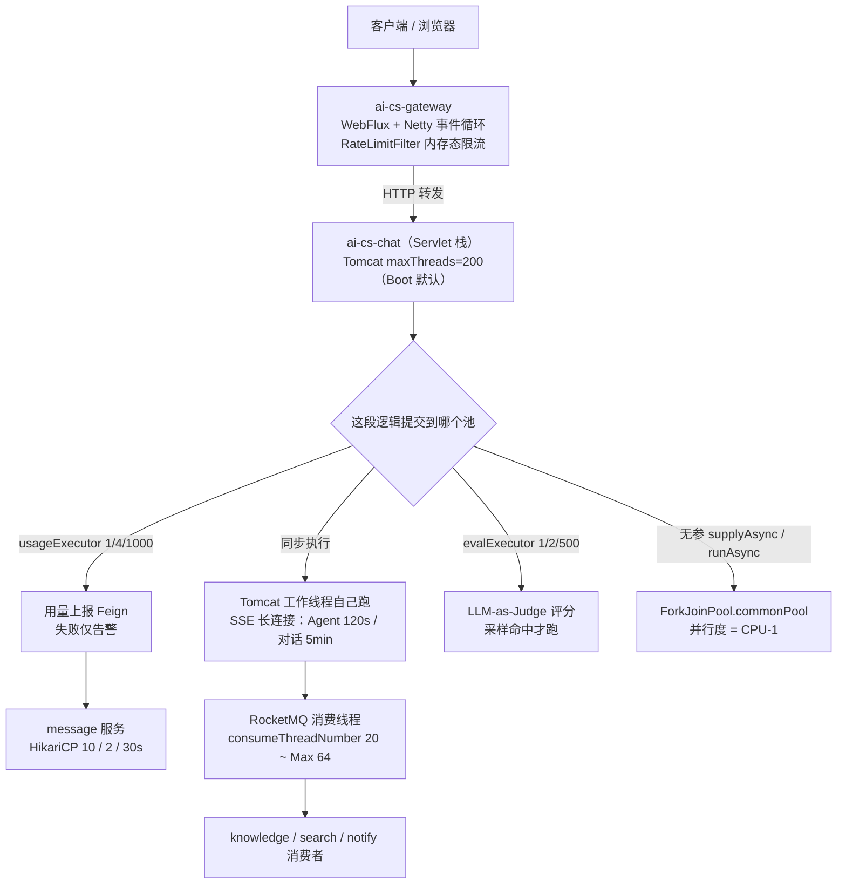
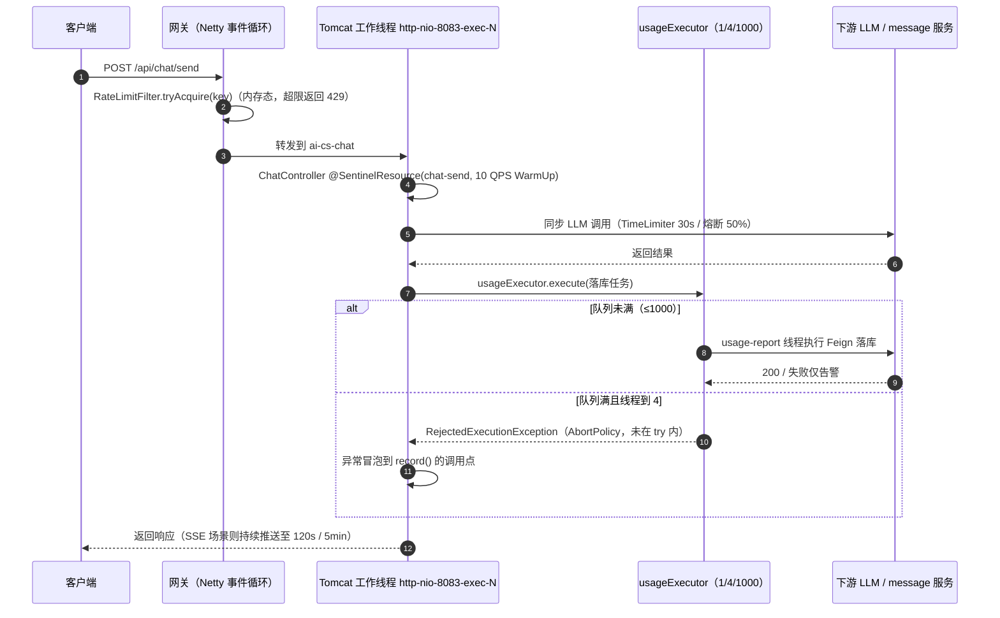

# 线程池调优与背压：队列选错，过载就变成延迟

> **一句话结论**：决定线程池"过载时会发生什么"的不是线程数，而是**队列容量 + 拒绝策略**——无界队列把过载改写成"越来越慢的延迟"，拒绝策略选错把过载改写成"静默丢数据"或"异常炸回调用方"；线程数只决定吞吐上限。
> **阅读前置**：Java `Runnable`/`Future`/`ThreadPoolExecutor` 的基本用法、Spring Boot 的 `@Bean` 与 `application.yml`、一次 HTTP 请求在 Servlet 栈里由谁执行；不要求读过本项目代码。
> **证据基线**：B 级＝本仓库真实文件 16 处（当次 read/grep 核对，行号为 2026-11-27 基线）；C 级＝本机实测 5 组（node 排队仿真 2 组、真实 `ThreadPoolExecutor` 探针 1 组、jar 元数据核对 2 组）；A 级＝无（`learning-docs/24-源码分析/assets/source/` 未收录 JDK 并发源码，本篇不硬引）。预计阅读 35 分钟。

**证据边界（先看这张表，免得把"设计意图"当"已实现"）**

| 级别 | 本仓库有什么 | 本篇怎么用 |
|------|--------------|-----------|
| A 级（JDK 源码摘录） | `learning-docs/24-源码分析/assets/source/` 内**没有** `ThreadPoolExecutor.java` | 不引用，避免编造锚点 |
| B 级（项目真实文件） | `ObservabilityExecutorConfig`、`ModelUsageRecorder`、`OnlineEvalService`、`ResilientAiService`、`TraceContextHolder`、`Nl2SqlDataSourceConfig`、Sentinel 流控配置、网关限流过滤器、7 个 RocketMQ 监听器、Nacos 数据源配置 | 每个结论都挂"完整路径:行号" |
| C 级（可复现实测） | 本机 JDK 17.0.19 + Node 24.16.0 可直接跑：真实 `ThreadPoolExecutor` 探针、离散事件排队仿真、jar 内默认值核对 | 给命令 + 真实输出 + 判读 |
| 明确未落地 | 线程池指标（全仓 `MeterRegistry`/`Timer.builder`/`Counter.builder` 命中 0）、Tomcat 参数显式配置（全仓 yml 0 命中）、告警规则（`deploy/observability/prometheus.yml` 无 `rule_files`）、虚拟线程启用（`spring.threads.virtual.enabled` 默认 false 且本机 JDK 17） | 一律写"未落地/未实测"，并给核对命令 |

---

## 0. 先看现象

三个症状都不来自"线程开少了"，而来自"队列和拒绝策略没选"。

### 现象 1：只超载 25%，延迟从 50ms 长到 12 秒，而且一个请求都没被拒绝

本机离散事件仿真（命令与脚本见 §3.2，`learning-docs/tools/tmp/tp-queue-sim.mjs`）：8 线程、每任务 50ms（供给上限 160/s）、到达 200 qps，跑 60 秒。

```text
基线: core=8 max=8 服务=50ms 吞吐上限 160/s，到达 200qps（为上限的 125%），仿真 60s，调用方线程 200
┌─────────┬───────────────────────┬──────────┬──────────┬──────────┬──────────┬────────┬────────┬────────────────┬─────────┬─────────┬─────────┬─────────┐
│ (index) │ 策略                  │ 排队@10s │ 排队@30s │ 排队@60s │ 峰值排队 │ 完成数 │ 拒绝数 │ CallerRuns次数 │ p50(ms) │ p95(ms) │ p99(ms) │ max(ms) │
├─────────┼───────────────────────┼──────────┼──────────┼──────────┼──────────┼────────┼────────┼────────────────┼─────────┼─────────┼─────────┼─────────┤
│ 0       │ '无界队列+Abort'      │ 400      │ 1200     │ 2400     │ 2400     │ 9601   │ 0      │ 0              │ 6050    │ 11450   │ 11930   │ 12050   │
│ 1       │ '有界1000+Abort'      │ 400      │ 1000     │ 1000     │ 1000     │ 9601   │ 1400   │ 0              │ 6050    │ 6300    │ 6300    │ 6300    │
│ 2       │ '有界1000+CallerRuns' │ 400      │ 1000     │ 1000     │ 1000     │ 11001  │ 0      │ 1400           │ 5170    │ 6300    │ 6300    │ 6300    │
│ 3       │ '有界200+CallerRuns'  │ 200      │ 200      │ 200      │ 200      │ 11801  │ 0      │ 2200           │ 1300    │ 1300    │ 1300    │ 1300    │
└─────────┴───────────────────────┴──────────┴──────────┴──────────┴──────────┴────────┴────────┴────────────────┴─────────┴─────────┴─────────┴─────────┘
```

**判读**：第 0 行是"默认配置 + 无界队列"的典型心电图——`拒绝数=0` 看起来"一切正常"，`排队@10s=400 / @30s=1200 / @60s=2400` 却是线性增长（40 个/秒，正好等于 200−160 的缺口），延迟随之从 6 秒爬到 12 秒且**没有上界**。真实世界里这个"心电图"的终点不是慢，而是 `OutOfMemoryError` 或上游调用方超时重试雪崩。

### 现象 2：`maxPoolSize=8`，线程池却永远只用到 1 个线程

本机跑真实 JDK `ThreadPoolExecutor`（脚本 `learning-docs/tools/tmp/TpeProbe.java`，JDK 17.0.19）：

```text
== B. core=1 max=8 queue=无界 AbortPolicy ==
  提交 task-1 后: poolSize=1 active=1 queue=0
  task-1 运行于 worker-1
  提交 task-2 后: poolSize=1 active=1 queue=1
  提交 task-3 后: poolSize=1 active=1 queue=2
  提交 task-4 后: poolSize=1 active=1 queue=3
  提交 task-5 后: poolSize=1 active=1 queue=4
  提交 task-6 后: poolSize=1 active=1 queue=5
  task-2 运行于 worker-1
  task-3 运行于 worker-1
  task-4 运行于 worker-1
  最终: poolSize=1 largestPoolSize=1 剩余队列=2 完成=3
```

**判读**：`max=8`，而 `largestPoolSize=1`、`queue` 一路涨到 5。这就是无界队列（或容量过大的有界队列）最容易被误解的地方：**队列没满就不会扩容到 `max`**，`maxPoolSize` 只是个永远不会被唤醒的逃生门。你以为是"8 个并发"，实际是"1 个并发 + 无限排队"。

### 现象 3：队列满时，异常不在线程池里告警，而是抛回对话主链路

`ai-cs-chat/src/main/java/com/aics/chat/observability/ModelUsageRecorder.java:104-115` 的写法是"异步落库 + 内部 try 兜异常"，但 try 只包住了 Feign 调用，**没包住 `execute()` 本身**：

```java
// ai-cs-chat/src/main/java/com/aics/chat/observability/ModelUsageRecorder.java:104-115（节选）
        // 异步落库：Feign 调用是网络 IO，若同步执行会拖慢用户请求；
        // 独立线程池隔离 + 失败仅告警，保证"计量不影响业务"（见 ObservabilityExecutorConfig）
        usageExecutor.execute(() -> {
            try {
                modelUsageFeignClient.recordUsage(dto);
            } catch (Exception e) {
                // 落库失败仅告警：计量不阻断主链路
                log.warn("模型用量上报失败: requestId={}, model={}, err={}",
                        dto.getRequestId(), model, e.getMessage());
            }
        });
```

同一个"坑"出现在 `ai-cs-chat/src/main/java/com/aics/chat/observability/OnlineEvalService.java:67`（`evalExecutor.execute(...)`，内层 try 从第 75 行才开始）。两个池都用 `ThreadPoolTaskExecutor` 默认拒绝策略（`ObservabilityExecutorConfig.java:33` 注释自述"拒绝策略默认 AbortPolicy"），于是**队列满 → `RejectedExecutionException` → 抛给调用 `record()` 的业务线程 → 计量失败反过来弄挂/拖慢对话主链路**，而这正是这两处注释声称要防的事。

**判读**：这类问题的现场特征极其隐蔽——日志里没有任何"线程池满"，只有一个莫名其妙的 `RejectedExecutionException` 出现在业务异常栈里；不打日志、纯靠猜就会去查 Feign 超时、查网络，方向全错。

**这些现象指向同一件事**：线程池的过载行为由**队列容量与拒绝策略**决定，而线程数只在这两者之后才起作用；默认值（无界队列 + `AbortPolicy`）既不会保护你，也不会告诉你它正在放弃。

---

## 1. 整体地图



> **读图说明**：图里只有 4 个"线程归属"出口（E/F/G/H），它们全部串在**同一个 Tomcat 工作线程的发起点**后面——也就是说 `C` 节点的 200 个线程既是入口，也是这 4 个池的"生产者"。最容易看错的箭头是 `D -->|无参 supplyAsync| H`：这一支没有独立线程池、没有队列、没有拒绝策略，它和 Tomcat 抢的是同一个 `ForkJoinPool.commonPool`（并行度 = CPU 核数 − 1），一旦这里阻塞，**整台机器上所有用 commonPool 的代码一起变慢**，而不是只有这条链路。

| 组件 | 责任 | 参与方（谁在里面排队） | 线程归属 | 上限来源 |
|------|------|------------------------|----------|----------|
| 网关 `RateLimitFilter` | 入口限流（滑动窗口 / 令牌桶，内存态） | 按 `X-User-Id` 或来源 IP 计数 | Netty 事件循环（不阻塞） | `ai-cs-gateway/src/main/java/com/aics/gateway/filter/RateLimitFilter.java` 默认 60 请求 / 60 秒 / 用户 |
| chat 的 Tomcat | 承接 HTTP、执行 Controller 同步逻辑 | 200 个工作线程 + 100 个 accept 队列位 + 8192 连接 | `http-nio-8083-exec-*` | Boot 默认（全仓 yml 0 处显式配置，见 §3.6） |
| `usageExecutor` | 用量上报 Feign 落库 | 1000 个队列位 | `usage-report-*` | `ai-cs-chat/src/main/java/com/aics/chat/config/ObservabilityExecutorConfig.java:27-40` |
| `evalExecutor` | 线上采样评分（额外 LLM 调用） | 500 个队列位 | `online-eval-*` | 同文件 `ObservabilityExecutorConfig.java:47-59` |
| commonPool | 兜住所有无参 `supplyAsync`/`runAsync` | 无界（`ForkJoinPool` 工作队列） | `ForkJoinPool.commonPool-worker-*` | JDK 默认并行度 |
| RocketMQ 消费线程 | 消息驱动的下游处理 | 每消费者 20~64 线程 | `ConsumeMessageThread_*` | `rocketmq-spring-boot` 2.3.0 注解默认值（§3.6 实测） |
| HikariCP（6 个库型服务） | 数据库连接 | 10 个连接 / 每服务 | 借用 Tomcat 工作线程 | `tools/nacos-config/ai-cs-order.yml:12-18` 等 |

---

## 2. 关键概念与关键要素

| 名称 | 位置（可核对） | 作用 | 关键参数 / 本项目取值 |
|------|----------------|------|----------------------|
| `corePoolSize` | `ObservabilityExecutorConfig.java:31` | 常驻线程数，任务优先交给它们 | `1` |
| `maxPoolSize` | `ObservabilityExecutorConfig.java:32` | 队列满后才允许扩到的线程数上限 | `4` |
| `queueCapacity` | `ObservabilityExecutorConfig.java:34` | 队列长度，**直接决定延迟上限** | `1000`（评估池 `500`，`:54`） |
| 拒绝策略 `RejectedExecutionHandler` | 未显式设置 → `ThreadPoolTaskExecutor` 默认 `AbortPolicy` | 队列满且线程到顶时的最后一招 | 抛 `RejectedExecutionException` |
| `keepAlive`/`allowCoreThreadTimeOut` | 未设置 | 超出 `core` 的空闲线程回收时间 | Boot 默认 `60s`、core 线程不回收 |
| `ThreadPoolTaskExecutor` | `ai-cs-chat/src/main/java/com/aics/chat/config/ObservabilityExecutorConfig.java` | Spring 对 `ThreadPoolExecutor` 的包装（支持优雅停机等待） | `setWaitForTasksToCompleteOnShutdown(true)`（`:37`、`:56`） |
| `ForkJoinPool.commonPool` | `ResilientAiService.java:176/255/382`、`VisionModelClient.java:165`、`AgentController.java:138` | 无参异步的默认去处，无队列无拒绝 | 并行度 = CPU−1 |
| Tomcat 工作线程 | 全仓无 `server.tomcat.*` 配置 | 执行 Controller、被 SSE 长连接长期占用 | `maxThreads=200`、`min-spare=10`、`max-connections=8192`、`accept-count=100` |
| `accept-count` | 同上 | 内核已 accept 但等不到工作线程的连接排队长度 | `100` |
| HikariCP | `ai-cs-chat/src/main/java/com/aics/chat/nl2sql/Nl2SqlDataSourceConfig.java:47-52` | 连接池，本身也是一个"有界 + 排队"的资源池 | `maximumPoolSize=3`、`minimumIdle=1`、`connectionTimeout=5000`（每库一个，5 库 = 15 连接） |
| `consumeThreadNumber` / `consumeThreadMax` | 7 个 `@RocketMQMessageListener` 全未设值 | 消费者最小/最大线程数 | 注解默认 `20` / `64`（实测见 §3.6） |
| 背压（backpressure） | 见 §3.9 | 让上游"感知并减速"，而不是让中间层无限缓冲 | 三种实现：有界队列 + `CallerRuns`、入口限流、超时熔断 |

---

## 3. 原理与证据逐段精读

### 3.1 七参数与执行顺序：核心 → 队列 → 扩容 → 拒绝

**在干什么**：`ThreadPoolExecutor.execute()` 只有四步决策，顺序是固定的、很多人记反的：

1. 线程数 < `corePoolSize` → **新建核心线程**直接跑；
2. 否则**进队列**（`workQueue.offer`）；
3. 队列满 → 线程数 < `maxPoolSize` → **扩容**到 max 再跑；
4. 队列满且线程到顶 → **拒绝策略**。

**C 级证据**（真实 JDK，不是仿真）：

```powershell
java learning-docs\tools\tmp\TpeProbe.java
```

```text
== A. core=1 max=2 queue=1 AbortPolicy ==
  提交 task-1 后: poolSize=1 active=1 queue=0
  提交 task-2 后: poolSize=1 active=1 queue=1
  task-1 运行于 worker-1
  提交 task-3 后: poolSize=2 active=2 queue=1
  task-3 运行于 worker-2
  提交 task-4 被拒: RejectedExecutionException
  task-2 运行于 worker-2
  最终: poolSize=2 largestPoolSize=2 剩余队列=0 完成=3
```

看 task-3：队列里**还躺着 task-2**（`queue=1`），`poolSize` 却从 1 涨到 2——这就是"队列满才扩容"。看 task-4：队列还是满的（1/1），线程已到 max=2，于是拒绝。

**为什么这么设计**：这是"延迟 vs 资源"的默认折中。线程很贵（每线程约 1MB 栈 + 调度开销），JDK 选择先缓冲后扩容；这个设计假设**队列很短**，短队列下"先缓冲"几乎不增加延迟。一旦队列无界，这个假设就崩了。

**换写法会怎样**：若改成"核心满就扩容"（自定义 `execute` 或 `SynchronousQueue` + 大 max），延迟更可控但线程数会随并发飙升，200 并发就是 200 线程——那是 Tomcat 早就替你做过的事，业务池没必要再复制一遍。

**常见坑**：把 `maxPoolSize` 当"并发数"写进文档/告警。真正生效的并发是 `min(core + 扩容出来的线程, 队列未满时的 core)`；`ObservabilityExecutorConfig` 的注释写得很诚实（`ObservabilityExecutorConfig.java:30-33`）："核心 1 / 最大 4：低频轻量任务"+"队列 1000：削峰缓冲"——也就是说这个池的真实形态是"1 个线程 + 1000 个缓冲位"，`max=4` 只在极端突发时才出现。

### 3.2 队列选择：无界队列 = 永不扩容，只堆延迟

**在干什么**：队列决定"过载的形态"。`new LinkedBlockingQueue<>()`（无容量）或 `ThreadPoolTaskExecutor` 不设 `queueCapacity`（默认 `Integer.MAX_VALUE`）等于告诉线程池："永远不要扩容，永远不要拒绝，把压力全变成排队时间。"

**C 级证据 1**：现象 2 的探针 B 段已证明 `largestPoolSize=1`（`max=8`）。

**C 级证据 2**：把排队长度换算成延迟，用 Little's Law（`L = λ × W`，`L` 队列长度、`λ` 到达率、`W` 停留时间）核对仿真数据：

| 场景 | 排队长度 | 服务速率 | 换算 `W = L / 服务速率` | 仿真实测 max 延迟 |
|------|----------|----------|--------------------------|-------------------|
| 无界队列，60s | 2400 | 8 线程 / 50ms = 160/s | 2400 / 160 = 15.0s | 12.05s（60s 时队列才涨到 2400，最后一批任务只等了更短时间） |
| 有界 1000 | 1000 | 160/s | 1000 / 160 = 6.25s | 6.30s ✅ |
| 有界 200 | 200 | 160/s | 200 / 160 = 1.25s | 1.30s ✅ |

**判读**：有界队列的两行几乎与公式完全吻合（差的 50ms 就是任务本身的服务时间），这说明**队列容量和延迟上限是一一映射的**——`queueCapacity=1000` 就是一句承诺："单任务最长会等 1000/吞吐 秒"。无界队列那一行偏离公式，恰恰是因为它没有稳态：队列还在涨，延迟还没追上它自己的长度。换算外推：按 40 个/秒的增速，8 小时无界队列会积到约 115 万任务（这是算术外推，**不是**本机实测的内存占用；堆占用请用 §6 的 `jcmd GC.class_histogram` 现场量）。

**C 级证据 3（反面对照）**：同样的池，把到达降到 150 qps（低于 160/s 供给）再跑一遍：

```text
基线: core=8 max=8 服务=50ms 吞吐上限 160/s，到达 150qps（为上限的 94%），仿真 60s，调用方线程 200
┌─────────┬───────────────────────┬──────────┬──────────┬──────────┬──────────┬────────┬────────┬────────────────┬─────────┬─────────┬─────────┬─────────┐
│ (index) │ 策略                  │ 排队@10s │ 排队@30s │ 排队@60s │ 峰值排队 │ 完成数 │ 拒绝数 │ CallerRuns次数 │ p50(ms) │ p95(ms) │ p99(ms) │ max(ms) │
├─────────┼───────────────────────┼──────────┼──────────┼──────────┼──────────┼────────┼────────┼────────────────┼─────────┼─────────┼─────────┼─────────┤
│ 0       │ '无界队列+Abort'      │ 0        │ 0        │ 0        │ 0        │ 9001   │ 0      │ 0              │ 50.33   │ 51      │ 51      │ 51      │
│ 1       │ '有界1000+Abort'      │ 0        │ 0        │ 0        │ 0        │ 9001   │ 0      │ 0              │ 50.33   │ 51      │ 51      │ 51      │
│ 2       │ '有界1000+CallerRuns' │ 0        │ 0        │ 0        │ 0        │ 9001   │ 0      │ 0              │ 50.33   │ 51      │ 51      │ 51      │
│ 3       │ '有界200+CallerRuns'  │ 0        │ 0        │ 0        │ 0        │ 9001   │ 0      │ 0              │ 50.33   │ 51      │ 51      │ 51      │
└─────────┴───────────────────────┴──────────┴──────────┴──────────┴──────────┴────────┴────────┴────────────────┴─────────┴─────────┴─────────┴─────────┘
```

四种配置的延迟都是 ~51ms、`拒绝数=0`。**这就是为什么"有界队列会不会误伤正常流量"这个担心是多余的**：未过载时有界队列和无界队列表现完全一样，差别只在过载时才开始显形。

**为什么这么设计**：队列本质是"用内存买时间"。缓冲有价值的前提是过载是**瞬时**的（削峰）；如果过载是**持续**的（容量不足），缓冲只是把"快速失败"换成"慢速失败 + 更多资源占用"。

**换写法会怎样**：
- 换 `SynchronousQueue`（不缓冲，直接交给空闲线程或拒绝）：延迟最优、拒绝最激进，适合"上游可重试"的场景；
- 换 `PriorityBlockingQueue`：只能用于有明确优先级语义的任务（且是**无界**的，坑更隐蔽）；
- 换 `ArrayBlockingQueue`：容量固定、内存可预测，本项目 `ArrayBlockingQueue` 在业务代码里 0 处使用（全仓 `new ThreadPoolExecutor` 命中 0）。

**常见坑**：`ThreadPoolTaskExecutor` 不设 `setQueueCapacity()` 时默认 `Integer.MAX_VALUE`，而很多"看起来配置了线程池"的代码只设了 core/max——`ObservabilityExecutorConfig` 之所以值得当样板，就是因为它把 `setQueueCapacity` 显式写出来了（`:34`、`:54`）。

### 3.3 有界队列 + CallerRuns：把过载还给调用方，形成背压

**在干什么**：队列满了、线程也到顶了，`CallerRunsPolicy` 让**提交任务的那个线程**亲自执行任务。效果是提交方被"罚款"——它从"无限提交"变成"提交一次要自己干 50ms"，于是提交速率被动降到系统能承受的水平。这就是最朴素、最不需要中间件的背压。

**C 级证据 1（拒绝策略的行为差异）**：真实 JDK 探针 C 段：

```text
== C. core=1 max=2 queue=1 CallerRunsPolicy ==
  提交 task-1 后: poolSize=1 active=1 queue=0
  提交 task-2 后: poolSize=1 active=1 queue=1
  task-1 运行于 worker-1
  提交 task-3 后: poolSize=2 active=2 queue=1
  task-3 运行于 worker-2
  task-4 运行于 main
  提交 task-4 后: poolSize=2 active=2 queue=0
  task-2 运行于 worker-2
  最终: poolSize=2 largestPoolSize=2 剩余队列=0 完成=3
```

`task-4 运行于 main` —— 提交者线程亲自下场。这一段还有个容易看漏的细节：`提交 task-4 后 queue=0`，说明 `CallerRuns` 执行期间队列被工作线程吃空了；"提交"这个动作因此变慢，背压就这么传到上游。

**C 级证据 2（排队长度与延迟对照，200 qps 过载 25%）**：见 §0 现象 1 表格第 2/3 行。三个关键对比：

| 对比 | 无界队列 | 有界 1000 + Abort | 有界 1000 + CallerRuns | 有界 200 + CallerRuns |
|------|----------|-------------------|------------------------|----------------------|
| 排队@60s | 2400（仍在涨） | 1000（钉住） | 1000（钉住） | 200（钉住） |
| p99 延迟 | 11930ms | 6300ms | 6300ms | 1300ms |
| 拒绝数 | 0 | 1400 | 0 | 0 |
| CallerRuns 次数 | 0 | 0 | 1400 | 2200 |
| 完成数（含内联执行） | 9601 | 9601 | **11001** | **11801** |

**判读**：`Abort` 的 1400 次拒绝 = `CallerRuns` 的 1400 次内联执行，是同一批任务的两条命运。`CallerRuns` 一行把"丢 1400 个任务"换成了"自己吃掉 1400 次 50ms 的活"——系统总完成量因此更高（11001 > 9601），代价是**提交方被拖慢**。而把队列从 1000 缩到 200，延迟上限直接从 6.3s 掉到 1.3s：**延迟上限几乎完全由队列容量决定**。

**为什么这么设计**：`CallerRuns` 的语义是"你可以慢，但不许丢，也不许无限缓冲"。代价很明确：如果提交方是 Tomcat 工作线程，那么被征用的这 50ms 就是"HTTP 线程被占用"，200 个线程被征满之后，压力会继续外推到 `accept-count`（100）和 TCP backlog——**背压必须逐层设计，不能只在最里层加**。

**换写法会怎样**：`CallerRuns` 用在 `usageExecutor`（计量上报）上就不合适——计量任务本来是"尽力而为"，让 HTTP 线程替它干活等于把可观测性成本强行塞回主链路。这也是 `ObservabilityExecutorConfig` 选 `AbortPolicy` 的合理之处；问题不在策略选错，而在**默认 Abort 的异常没被接住**（现象 3）。

**常见坑**：`CallerRuns` + `ThreadLocal` 陷阱——任务现在可能跑在 Tomcat 线程里，而那个线程的 MDC/traceId 是**当前请求**的。如果这个任务是为**别的**请求发出的（例如汇总任务），日志会挂上错误 requestId（参见 §3.8 的 `TraceContextHolder` 设计说明）。

### 3.4 四类拒绝策略与它们的业务含义

| 策略 | 过载时的实际行为 | 对业务意味着 | 适用（本项目的对应场景） |
|------|------------------|--------------|--------------------------|
| `AbortPolicy`（默认） | 抛 `RejectedExecutionException` | 快速失败，但**异常必须有人接**；没接住就污染主链路 | 计量/评估这类"可丢但不可阻塞"的任务——前提是把 `execute()` 包进 try（当前未做到，见现象 3） |
| `CallerRunsPolicy` | 提交线程亲自执行 | 不丢任务、自动降速；代价是提交线程被占用 | 允许变慢但不允许丢的关键写入（本项目目前 0 处使用） |
| `DiscardPolicy` | 静默丢弃 | **数据无声消失**，日志里连一行都没有 | 几乎不应该用；要用必须带"丢弃计数"指标（本项目无指标，等于纯黑洞） |
| `DiscardOldestPolicy` | 丢队列里最老的任务 | 新任务优先，老任务超时后才被丢，**延迟目标被悄悄改写** | 实时性极强的场景（如行情推送）；本项目无此语义 |

核对现有池的策略来源：

```powershell
cd D:\Projects\Persion\ai-customer-service
Select-String -Path (Get-ChildItem -Recurse -File -Include *.java | Where-Object { $_.FullName -notlike '*\test\*' } | Select-Object -ExpandProperty FullName) -Pattern 'setRejectedExecutionHandler|RejectedExecutionHandler|DiscardPolicy|CallerRunsPolicy'
```

```text
（无输出：全仓没有任何一处显式设置拒绝策略）
```

**判读**：0 命中意味着 4 个池（`usageExecutor`、`evalExecutor`、commonPool 无策略、Tomcat 线程池不在代码里）**全部落到默认 `AbortPolicy`**。这不是"配置遗漏"，而是一次没人做过的决策——面试里可以当作"取舍未显式化"的案例讲。

### 3.5 线程数怎么定：CPU/IO 密集公式与它的局限

**在干什么**：经典经验公式（Brian Goetz《Java 并发编程实践》）：

```text
CPU 密集： N = N_cpu + 1
IO 密集：  N = N_cpu × U × (1 + W / C)
           N_cpu=核数，U=目标 CPU 利用率(0~1)，W=等待时间，C=计算时间
```

**为什么这么设计**：`W/C` 刻画"一个任务里有多少时间在等"。等得越多，就要越多线程去填满 CPU。

**局限（三条，比公式本身更重要）**：

1. `W/C` 通常**估不准**，且随下游健康度漂移（LLM 首 token 延迟 800ms 与 8s 是两个世界）；
2. 公式只管"本层吞吐"，不管**下游容量**：`ObservabilityExecutorConfig` 的池扩到 100 线程也没用，因为目标是 `message` 服务的接口容量；
3. 线程数**不改变吞吐上限**，只改变"上限以内能做到多满"——真正的吞吐上限是 `线程数 / 平均服务时间`，而延迟上限由队列给。

**本项目的量级参考**（可复算，非压测）：`usageExecutor` 是 1 线程（`:31`），若单次 Feign 落库 50ms，则理论上限 ≈ 20 次/秒。是否够用取决于真实 QPS，**本机未实测**（不启动服务）；量法见 §6 坑 6。

**换写法会怎样**：把公式套成"核数×200"这种拍脑袋数字（Druid 老文档、部分博客的 `2×N_cpu+有效磁盘数`）在 IO 密集时会同时踩两个坑：线程数超过下游连接池（10 连接）后线程只能排队，`context switch` 白白增加。

**常见坑**：拿"容器里的 `availableProcessors()`"当核数——容器 CPU limit 与 JVM 看到的核数不一定一致，本项目本机实测 `availableProcessors()=16`（探针输出第一行），而生产容器的 limit 常是 2~4，公式一算就偏 4 倍。

### 3.6 Tomcat 线程模型：200 个工作线程 + 100 个 accept 位，以及全仓 0 处显式配置

**在干什么**：Servlet 栈把线程池外包给容器。请求路径是：`连接 → max-connections → accept 队列（accept-count）→ 工作线程（maxThreads）→ Controller`。

**C 级证据（本机 jar 元数据核对，不启动服务）**：

```powershell
$root = Join-Path $env:USERPROFILE '.m2\repository\org\springframework\boot'
Add-Type -AssemblyName System.IO.Compression.FileSystem
foreach ($jar in Get-ChildItem $root -Recurse -Filter 'spring-boot-tomcat-4*.jar' -File) {
  $zip = [System.IO.Compression.ZipFile]::OpenRead($jar.FullName)
  foreach ($e in $zip.Entries | Where-Object { $_.FullName -like '*configuration-metadata.json' }) {
    $sr = New-Object System.IO.StreamReader($e.Open()); $txt = $sr.ReadToEnd(); $sr.Close()
    [regex]::Matches($txt, '\{[^{}]*"name":\s*"server\.tomcat\.(threads\.(max|min-spare)|max-connections|accept-count)"[^{}]*\}') |
      ForEach-Object { ($_.Value -replace '\s+',' ') }
  }
  $zip.Dispose()
}
```

```text
{ "name": "server.tomcat.accept-count", ..., "defaultValue": 100 }
{ "name": "server.tomcat.max-connections", ..., "defaultValue": 8192 }
{ "name": "server.tomcat.threads.max", ..., "description": "Maximum amount of worker threads. Doesn't have an effect if virtual threads are enabled.", "defaultValue": 200 }
{ "name": "server.tomcat.threads.min-spare", ..., "defaultValue": 10 }
```

注意 `threads.max` 的官方描述里那句 **"Doesn't have an effect if virtual threads are enabled"**——这是 §3.10 的伏笔：开虚拟线程后"200"这个数就整条失效。

**B 级证据（本项目没动过这些默认）**：

```powershell
cd D:\Projects\Persion\ai-customer-service
Select-String -Path (Get-ChildItem -Recurse -File -Include *.yml,*.yaml,*.properties).FullName -Pattern 'tomcat|accept-count|max-threads|max-connections'
```

```text
（无输出：全仓 0 处显式配置 Tomcat）
```

**判读**：`ai-cs-chat` 因此跑在 `200/10/8192/100` 上。这不是错，但要知道三个后果：

1. **SSE 会长期占线程**。`ai-cs-chat/src/main/java/com/aics/chat/agent/AgentController.java:117` 的 `AGENT_STREAM_TIMEOUT = 120_000L`（2 分钟）、`ai-cs-chat/src/main/java/com/aics/chat/service/impl/ChatServiceImpl.java:156` 的 `SSE_EMITTER_TIMEOUT = 5 * 60 * 1000L`（5 分钟）——在这段时间里 `AsyncContext` 虽已异步化，但 `Controller` 返回前的同步逻辑与 `flux.subscribe(...)`（`ChatServiceImpl.java:646`）仍绑在请求上下文中，**并发流式会话数受 200 约束**；
2. **`accept-count=100` 是第二道缓冲**，工作线程满后还有 100 个连接能等一会儿，超了就由内核/客户端感知；
3. **200 个线程 × 每线程一次 LLM 调用**意味着并发上限 200，而 LLM 供应商的并发限制通常远低于此——所以真正的瓶颈常在 Sentinel/熔断那一层，而不在 Tomcat。

**换写法会怎样**：把 `maxThreads` 调到 1000 不会提升并发，只会让 1000 个线程同时阻塞在 LLM 上，把连接池、限流、供应商配额一起打爆——这正是"线程池不是开大就好"。

**常见坑**：只调 `maxThreads` 不调 `accept-count`，过载时客户端看到的是"连接被拒"而不是"排队"；反过来只调 `accept-count`，则是"连接都进来但全在等"，两边一起把故障从"快速拒绝"变成"慢速超时"。

### 3.7 HikariCP × 业务线程池：两个"有界池"相乘

**在干什么**：连接池本身也是一个**有上限 + 有排队**的资源池。业务线程池的线程数是"消费者数"，连接池大小是"服务台数"，两者相乘决定数据库层承受的排队。

**B 级证据**：
- 库型服务在 Nacos 里统一写 `10 / 2 / 30000`：`tools/nacos-config/ai-cs-order.yml:12-18`（knowledge、message、order、pay、product、mq 同形）。
- `ai-cs-chat` 走另一条路：`ai-cs-chat/src/main/resources/application.yml:12-15` 排除了 `DataSourceAutoConfiguration`（chat 没有业务主库），需要库的地方自建池：`ai-cs-chat/src/main/java/com/aics/chat/nl2sql/Nl2SqlDataSourceConfig.java:42-53` 每个库一个 `HikariDataSource`，`maximumPoolSize=3`、`minimumIdle=1`、`connectionTimeout=5000`、`idleTimeout=600000`、`maxLifetime=1500000`，池名 `nl2sql-<库标识>`，覆盖 5 个库（`:29-30` 注释）。
- 与 HikariCP 自身默认对照（C 级）：`javap -p -constants -classpath <HikariCP-7.1.0.jar> com.zaxxer.hikari.HikariConfig` 输出 `private static final int DEFAULT_POOL_SIZE = 10;`——即"写了 10"其实等于默认值，**真正被显式收紧的是 `minimumIdle=2`（NL2SQL 侧是 1）**。

**相乘效应怎么算**（口径，不是压测值）：若每个请求持有连接 `t=100ms`，池大小 `P=10`，则连接层吞吐上限 = `P / t = 100 次/秒`；而 Tomcat 有 200 个线程。一旦超过 100 次/秒，**线程不报错、也不被拒绝，而是阻塞在 `getConnection`**，最长阻塞 `connectionTimeout=30000`（30 秒）——30 秒里这 200 个线程全部被钉住，整个服务"看着在线，其实不动"。

**为什么这么设计**：连接数是**下游（MySQL）的稀缺资源**，连接池小是保护数据库；但"小池 + 大线程池 + 长超时"这个组合会把保护措施变成雪崩加速器。合理配比是"业务线程池 ≈ 连接池 × (1 + 等待/计算)"，或者干脆让连接池的排队显式失败（缩短 `connectionTimeout`）。

**换写法会怎样**：把 `maximumPoolSize` 调到 200 会瞬间打出 200 条连接，MySQL `max_connections` 一满，其它服务一起挂；这是典型的"我的服务活了，别人的服务死了"。

**常见坑**：只看 Hikari 的 `activeConnections` 指标就断言"池没满所以没问题"——没注意到 `pendingThreads`（等连接的线程数）才是延迟来源；本仓库**未落地** Hikari 指标导出（`MeterRegistry` 全仓 0 命中），所以这条只能靠命令现场看（§6 坑 6）。

### 3.8 异步的两个经典坑：丢了 traceId、异常被吞

**在干什么**：把任务从一个线程搬到另一个线程时，**线程本地变量（ThreadLocal）不会自动跟过去**。项目里的 traceId/MDC 就是靠 `ThreadLocal` 存的。

**B 级证据（设计得很明白）**：`ai-cs-chat/src/main/java/com/aics/chat/observability/TraceContextHolder.java`

- `:23` `MDC_REQUEST_ID = "requestId"`、`:25` `ThreadLocal<TraceContext> HOLDER`；
- `:73` `capture()`、`:87-95` `restore(TraceContext)`（`HOLDER.set` + `MDC.put`）、`:104-107` `clear()`（两个都 `remove`）；
- `:80-85` 注释直接列出三种跨线程方案：① 显式传参（**本项目选的**）② `InheritableThreadLocal`（线程池复用会串数据）③ `TransmittableThreadLocal`/Reactor 自动传播（侵入框架）。

四处无参异步的实际处理（全仓 `supplyAsync(`/`runAsync(` 命中 5 处）：

| 位置 | 是否恢复 traceId | 说明 |
|------|------------------|------|
| `ai-cs-chat/src/main/java/com/aics/chat/service/impl/ResilientAiService.java:173,176,177` | ✅ `capture()` → `supplyAsync` 内 `restore()` | 注释自述"在 ForkJoinPool 线程里恢复 trace 上下文" |
| `ai-cs-chat/src/main/java/com/aics/chat/service/impl/ResilientAiService.java:255` | ✅ 同构（流式） | `:271-279` 注释讲 Flux 惰性订阅 |
| `ai-cs-chat/src/main/java/com/aics/chat/service/impl/ResilientAiService.java:382` | ✅ 同构（另一条超时控制路径） | 行尾注释"异步执行 LLM 调用，这样才能用 future.get(timeout) 做超时控制" |
| `ai-cs-chat/src/main/java/com/aics/chat/service/impl/VisionModelClient.java:162,165,166` | ✅ `capture()` → `restore()` | 视觉调用与文本调用分属不同模型通道 |
| `ai-cs-chat/src/main/java/com/aics/chat/agent/AgentController.java:138` | ❌ 仅重设 `ChatUserContext` | `:148` `ChatUserContext.setUserId(uid)`；同文件 `TraceContextHolder` 0 命中（推断：该链路的工作线程内不会延续父 trace） |

**判读**：这是一个"知道坑存在但只填了 4/5"的现场。`AgentController` 那条 SSE 链路的补偿方式是重设 `ChatUserContext`（业务必需，`:144` 注释写明"工作线程内必须重设"），traceId 则没补——排查该链路时要意识到 span 可能断链，别把它当成"调用没发生"。

**异常被吞的三种形态**（都在本项目有对应代码）：

1. **`CompletableFuture` 的异常藏在 `Future` 里**：`ResilientAiService.java:217` 的 `catch (Exception e)` 在 lambda 内，若有人只 `future.get()` 不接 `ExecutionException`，异常就"消失"；
2. **`execute()` 的异常抛在提交处**（现象 3）：`ModelUsageRecorder.java:106` / `OnlineEvalService.java:67`；
3. **`ThreadPoolTaskExecutor` 的 `submit` 与 `execute` 不同**：`execute` 抛到调用方，`submit` 把异常装进 `Future`——用错一个词，告警逻辑就静默失效（本项目两处都用 `execute`，属于"会抛"的那一侧，问题只剩"没接"）。

**常见坑**：只在 `Runnable` 里 `try-catch` 就以为"线程池异常都处理了"。`try` 的位置决定了你能接住哪一类异常：**包 `execute()` 才能接住拒绝异常，包 `run()` 只能接住任务内部异常**。

### 3.9 背压的三种实现：本项目哪一层有，哪一层没有

**在干什么**：背压 = 让上游感知到"下游处理不过来"，从而主动减速。三种常见落地方式：

| 实现 | 机制 | 本项目落点（B 级） | 落地状态 |
|------|------|--------------------|----------|
| ① 有界队列 + `CallerRuns` | 提交线程被征用，提交变慢 | 全仓 `setRejectedExecutionHandler` **0 命中**；两个池都用默认 `AbortPolicy` | ❌ 未落地 |
| ② 入口限流 / 并发闸门 | 超过阈值直接拒绝（429 / blockHandler） | `ai-cs-chat/src/main/java/com/aics/chat/config/SentinelFlowConfig.java:27-45` 注册 2 条 QPS 规则（`chat-send` 10 QPS WarmUp 10s、`chat-rag` 5 QPS，阈值定义在 `ai-cs-chat/src/main/java/com/aics/chat/config/SentinelRules.java`）；网关侧 `ai-cs-gateway/src/main/java/com/aics/gateway/filter/RateLimitFilter.java:51-64`（`:59` 判定、`:61` 返回 429） | ✅ 已落地，但网关限流是**单机内存态**（`:47-48` 两个限流器实例在进程内），多实例下实际阈值 = 单机阈值 × 实例数 |
| ③ 超时 + 熔断 | 慢就断，别把线程挂在等待上 | `ai-cs-chat/src/main/resources/application.yml:73-87` 三个 `TimeLimiter`（`chatService` 30s 带 `cancelRunningFuture=true`、`sseChatService` 60s、`visionService` 5s）、`:114-159` 熔断（窗口 10、最小调用 3、失败率 50%、打开 30s） | ✅ 已落地 |

**为什么这么设计**：限流管"入口进来多少"，线程池管"里面能同时干多少"，超时熔断管"下游不行时别死等"。三者缺一，过载就会从缺的那一层漏下去。本项目缺的正是"线程池层"的背压——所以过载时的典型表现是：网关放行、Sentinel 放行、Tomcat 收下、`usageExecutor` 队列涨到 1000 后开始抛异常（§3.4 判读）。

**换写法会怎样**：把 `usageExecutor` 的队列从 1000 缩到 100 再加 `CallerRuns`，症状会从"偶发 `RejectedExecutionException`"变成"高峰时对话线程偶发变慢 50ms"——后者可观测、可控，前者只能靠猜。**这就是"把延迟换成可见"的取舍。**

**常见坑**：以为"网关限流 = 全局背压"。网关的 `RateLimitFilter` 用进程内的 `SlidingWindowRateLimiter`/`TokenBucketRateLimiter`（`:47-48`），多副本时每个副本各自计数，实际放行量是阈值 × 副本数；真正的全局背压要么用 Redis 计数器（`ai-cs-gateway/pom.xml:96-99` 已引入 `spring-boot-starter-data-redis-reactive` 但限流器**未**改造成 Redis 实现），要么靠下游容量收敛。

### 3.10 虚拟线程（JDK 21）：会改变什么、不会改变什么

**在干什么**：虚拟线程（Virtual Thread）把线程的"调度单位"从 OS 线程变成 JVM 里的轻量对象，阻塞时自动卸载载体线程。它针对的正是 §3.5 里那个 `W/C` 很大的场景——**IO 等待不再需要占一个 OS 线程**。

**B 级证据（本项目没开启）**：Boot 元数据里 `spring.threads.virtual.enabled` 的 `defaultValue` 为 `false`（本机 `spring-boot-autoconfigure-4.2.0.jar` 核对，命令同 §3.6）；且本机 JDK 为 **17.0.19**，虚拟线程要 21+，所以：

> **未本机实测**：本篇不给任何虚拟线程下的吞吐/延迟数字。下面只讲设计影响与判读方法。

**设计影响（四条）**：

1. **Tomcat 的 `maxThreads` 失效**——§3.6 从 jar 里读到的官方描述就是 "Doesn't have an effect if virtual threads are enabled"，`200` 这个硬上限会消失；
2. **线程池的"池"失去意义**：虚拟线程不该被池化（`Executors.newVirtualThreadPerTaskExecutor()` 每任务一线程），因此"队列容量 + 拒绝策略"这套背压模型**不能照搬**到虚拟线程上；
3. **背压必须有别的落点**：没有池=没有队列=没有拒绝，只能靠 `Semaphore` 限并发、有界队列（自己实现的 `BlockingQueue` 消费者）、或入口限流（§3.9 的②）来兜；
4. **旧的隐患会放大**：`synchronized` 块内阻塞会钉住载体线程（JDK 21 的 *pinning*），`ThreadLocal` 数量激增，`MDC` 传播更依赖框架（§3.8 的方案③）。

**怎么判读（命令，未实测）**：启动后看 `curl http://localhost:8083/actuator/threaddump | Select-String 'virtual'`（Boot 3.2+ 起 actuator 的 threaddump 支持虚拟线程），或 JFR 里看 `jdk.VirtualThreadPinned` 事件数量——pinning 次数不为 0 就说明有 `synchronized` 阻塞需要换 `ReentrantLock`。

**常见坑**：把"换虚拟线程"当性能优化开关。如果瓶颈是下游（LLM 并发 20、连接池 10），虚拟线程只是让你**更快地把下游打满**，然后把故障从"线程不够"变成"下游 429 / 熔断"。

---

## 4. 一次完整执行时序

以"一次对话请求 + 一次用量上报"为例，把线程切换的边界画清楚：



> **读图说明**：这张图的主线是"**谁在执行**"。第 9 步是唯一一次线程切换（Tomcat 线程 → `usage-report-*` 线程），第 10/11 步的分支决定这次切换是"成功托付"还是"反噬调用方"。最容易误读的是第 12 步——`RejectedExecutionException` 会回到**第 9 步那个 Tomcat 线程**上，而不是在线程池内部被吞；如果你只在线程池里找日志，永远找不到它。第 6 步（Sentinel）和第 3 步（网关限流）是两道理应更早拦住过载的闸门，它们放行了才轮到线程池承压。

**每一步该怎么判读**：

| 步骤 | 判读要点 | 现场信号 |
|------|----------|----------|
| 3 | 网关限流是否真的按用户维度生效 | 429 响应体（`RateLimitFilter.java:94-100`）+ 日志 `限流触发` |
| 6 | Sentinel 是否在拦（`chat-send` 10 QPS） | `ChatController.java:101` 的 `log.warn("对话接口触发Sentinel流控: ...")` |
| 7 | LLM 是否在超时边缘 | `TimeLimiter` 30s（`application.yml:77-79`）触发时线程被 `cancelRunningFuture` 打断 |
| 9 | 提交是否发生在 try 之外 | 代码位置（`ModelUsageRecorder.java:106`）——这是"能不能接住拒绝异常"的分水岭 |
| 11/12 | 队列是否已满 | 需要线程池指标（**本项目未落地**），退而用 §6 坑 2 的 `jcmd` 现场看线程名与堆对象 |
| 13 | 长连接占用 vs `maxThreads=200` | `jstack` 统计 `http-nio-8083-exec` 数量（§6 坑 5） |

---

## 5. 设计取舍

| 决策点 | 可选方案 | 本项目当前选择 | 代价 | 证据 |
|--------|----------|----------------|------|------|
| 计量上报要不要异步 | 同步（简单、可靠）/ 异步池（不占请求线程） | 异步独立池 | 队列满时任务丢失或异常外溢 | `ObservabilityExecutorConfig.java:27-40` |
| 队列容量 | 无界（不丢）/ 1000（削峰）/ 100（低延迟） | `1000` / `500` | 延迟上限 6.25s 级；容量大 = 故障更"慢"更"闷" | `:34`、`:54` |
| 拒绝策略 | Abort / CallerRuns / Discard | 默认 `AbortPolicy` | 必须有人接异常，否则反噬主链路（现象 3） | 全仓 `setRejectedExecutionHandler` 0 命中 |
| 线程数 | core=max（固定）/ 弹性 | 固定小池（1/4、1/2） | 高峰吞吐被池大小卡死，但保护下游 | `:31-32`、`:52-53` |
| 异步执行者 | 自建池 / commonPool | 可观测性用自建池，LLM 调用用 commonPool | commonPool 与全机共享，一处阻塞全局慢 | `ResilientAiService.java:176` 等 5 处 |
| Tomcat 参数 | 默认 / 显式调优 | 全走默认 200/10/8192/100 | SSE 长连接与高峰期难以按场景调 | 全仓 yml 0 命中 |
| 入口限流 | 网关内存态 / Redis 全局 / Sentinel | 两者都有（网关按用户、Sentinel 按资源） | 网关限流多实例下阈值漂移 | `RateLimitFilter.java:47-48`、`SentinelFlowConfig.java:27-45` |

**可扩展点清单**（都能在现有代码结构上增量做，不需要重构）：

1. 给两个池加 `setRejectedExecutionHandler`：计量用"记数 + 丢弃"（配指标），评分用 `CallerRuns` 或丢弃；
2. 把 `execute()` 提交语句挪进 `try`（`ModelUsageRecorder.java:106`、`OnlineEvalService.java:67`），让 `RejectedExecutionException` 变成本地告警而不是主链路异常；
3. 用 `ThreadPoolTaskExecutor#setTaskDecorator` 统一注入 `TraceContextHolder.restore/clear`，替掉 5 处手写；
4. 暴露线程池指标（`ThreadPoolTaskExecutor` 支持 `getThreadPoolExecutor()`，配 Micrometer 的 `ExecutorServiceMetrics`）——目前 `MeterRegistry` 全仓 0 命中，属于"可观测性空白"；
5. 在 `application.yml` 显式写 `server.tomcat.threads.max` / `accept-count`，把"默认值"变成"决策值"；
6. 网关限流器改 Redis 实现（依赖已在 `ai-cs-gateway/pom.xml:96-99`），把单机阈值变成全局阈值。

---

## 6. 踩坑与调试手法

### 坑 1：以为 `maxPoolSize` 会生效，实际队列一挡就永远不扩容

```powershell
# 现场确认：线程池线程名与数量（本机未启动服务，需在运行中的进程上执行）
jcmd <pid> Thread.print | Select-String -Pattern 'usage-report-|online-eval-|commonPool-worker' | Group-Object { ($_ -split '"')[1] -replace '-\d+$','' }
```

**判读**：`usage-report-` 前缀的线程数若长期 = 1（而配置 max=4），说明队列从未满，扩容逻辑从未触发——这不是 bug，是配置语义（§3.1）。
**误判风险**：把"只有 1 个线程"当成"任务被丢掉了"。要先看队列是否有积压（坑 2），再看拒绝计数，最后才怀疑丢失。

### 坑 2：想"看一眼队列有多长"，发现没有任何现成指标

```powershell
# 1) 先确认项目是否已导出线程池指标（结论：0 命中）
cd D:\Projects\Persion\ai-customer-service
Select-String -Path (Get-ChildItem -Recurse -File -Include *.java | Where-Object { $_.FullName -notlike '*\test\*' } | Select-Object -ExpandProperty FullName) -Pattern 'MeterRegistry|Timer\.builder|Counter\.builder|ExecutorServiceMetrics'
```

```text
（无输出）
```

```powershell
# 2) 退路：从堆里数排队对象（未实测，需运行中的进程）
jcmd <pid> GC.class_histogram | Select-String -Pattern 'FutureTask|ThreadPoolExecutor'
```

**判读**：`FutureTask` 实例数 ≈ 队列长度 + 正在执行数；持续增长且不回落 = 供给不足（§3.2 的线性增长曲线）。
**误判风险**：`GC.class_histogram` 会触发一次 full GC（`jcmd` 默认 `-all` 不带，但 histogram 本身需安全点），**不要在高峰期对生产跑**；另外 `FutureTask` 也被别处使用，需结合线程名前缀交叉验证。

### 坑 3：拒绝异常"消失"，日志里只有业务异常

```powershell
# 找出所有"提交语句写在 try 之外"的位置
cd D:\Projects\Persion\ai-customer-service
Select-String -Path (Get-ChildItem -Recurse -File -Include *.java | Where-Object { $_.FullName -notlike '*\test\*' } | Select-Object -ExpandProperty FullName) -Pattern 'executor\.execute\(|Executor\.execute\(' -Context 1,3
```

**判读**：本仓库两处命中——`ModelUsageRecorder.java:106`、`OnlineEvalService.java:67`，且两处的 `try` 都在 lambda **内部**（第一行是 `try {`，说明 catch 只覆盖任务体）。这类代码在队列满时会把 `RejectedExecutionException` 抛给业务线程。
**误判风险**：看到 `try {` 就以为已防护。判断标准只有一个：**`try` 是否包住了 `execute(...)` 这一行本身**。

### 坑 4：异步任务日志里 `requestId` 是空的（或串到了别人的请求上）

```powershell
# 检查哪些异步入口做了 capture/restore
cd D:\Projects\Persion\ai-customer-service
Select-String -Path (Get-ChildItem -Recurse -File -Include *.java | Where-Object { $_.FullName -notlike '*\test\*' } | Select-Object -ExpandProperty FullName) -Pattern 'TraceContextHolder\.(capture|restore|clear)' | ForEach-Object { "$($_.Path.Replace((Get-Location).Path+'\','')):$($_.LineNumber)" }
```

**判读**：命中集中在 `ResilientAiService.java`（`:173,177,237` 等）与 `VisionModelClient.java`（`:162,166`）；`AgentController.java` 无命中 → 该链路的异步工作线程不会延续父 traceId（§3.8 表）。
**误判风险**：`requestId` 为空**不一定**是 bug——新请求新 trace 时 `TraceContextHolder.begin()` 会生成新 UUID（`:54`），要看的是"跨线程后 requestId 变了"而不是"有没有值"。

### 坑 5：200 个 Tomcat 线程被 SSE 长连接占满，看着 CPU 空闲却接不了新请求

```powershell
# 统计工作线程占用（未实测，需运行中的进程）
jcmd <pid> Thread.print > dump.txt
(Select-String -Path dump.txt -Pattern '"http-nio-8083-exec-\d+"' ).Count
Select-String -Path dump.txt -Pattern 'SseEmitter|emitter.send|subscribe' -Context 0,2
```

**判读**：`exec-*` 线程数接近 200，且栈里能看到 `SseEmitter`/`flux.subscribe` → 线程被长连接占住（`ChatServiceImpl.java:156` 的 5 分钟、`AgentController.java:117` 的 2 分钟）。
**误判风险**：SSE 已通过 `AsyncContext` 异步化，**理论上**请求线程会归还容器；dump 里看到 SSE 栈帧不等于"线程池被占满"，要同时看 `activeCount` 与 `accept-count` 溢出情况（对方连接被拒、或 `curThreadsBusy=200`）。

### 坑 6：数据库变慢时，线程"全都卡在 getConnection"

```powershell
# 连接池排队（未实测；本项目未导出 Hikari 指标，只能现场量）
jcmd <pid> Thread.print | Select-String -Pattern 'HikariPool|getConnection' -Context 2,2
```

**判读**：若出现大量 `HikariPool-1 - Connection is not available, request timed out after 30000ms`，说明 `connectionTimeout=30000`（`tools/nacos-config/ai-cs-order.yml:12-18`）把 200 个线程各钉了 30 秒；对照池大小 10 → 连接层吞吐上限 = 10/持有时间（§3.7）。
**误判风险**：只看到"SQL 慢"就怪数据库。连接池排队与 SQL 慢的栈完全不同：前者在 `HikariPool.getConnection` 上等待，后者的栈在 JDBC socket read。

---

## 7. 版本差异

| 旧写法 / 旧文档 | 当前基线（本仓库） | 变化点 | 迁移动作 |
|------------------|--------------------|--------|----------|
| `Executors.newFixedThreadPool(n)` | 全仓 `Executors.` 命中 **0**，统一用 `ThreadPoolTaskExecutor` Bean | 工厂方法的队列是**无界**的 `LinkedBlockingQueue`，等于把 §3.2 的坑封装成默认值 | 新增池一律显式 `setQueueCapacity` + `setRejectedExecutionHandler` |
| `@Async` 裸用（默认 `SimpleAsyncTaskExecutor`，不复用线程） | 全仓 `@Async` 命中 **0** | 本项目没踩这个坑，但也说明异步执行入口只有 5 处手写 `supplyAsync/runAsync` | 若引入 `@Async`，必须显式指定 `@Async("usageExecutor")` 之类 |
| 旧稿写"RocketMQ 消费线程默认 20" | 注解 `consumeThreadNumber()` 默认 **20**、`consumeThreadMax()` 默认 **64**（§3.6 实测 `javap -v` 输出） | 是"20~64 区间"而不是单个 20；7 个监听器全未设值 | 高压消费者显式设 `consumeThreadMax`，并让消费线程数与下游池大小对齐 |
| 旧稿写"队列满时报错由调用方捕获告警" | `usageExecutor.execute(...)` 在 `try` **外**（`ModelUsageRecorder.java:106`） | 注释描述的是**意图**，代码没做到——异常会抛给业务线程 | 把提交语句包进 `try`，或换"记数 + 丢弃"策略 |
| "Servlet 栈就用 `spring-boot-starter-web`，MVC starter 只有一个名字" | 11 个 Servlet 模块仍写 `spring-boot-starter-web`（如 `ai-cs-chat/pom.xml:22`、`ai-cs-order/pom.xml:24`）；但网关为了排除 MVC 写的是 `spring-boot-starter-webmvc`（`ai-cs-gateway/pom.xml:50`），`ai-cs-user/pom.xml:107` 用 `spring-boot-starter-webmvc-test` | Boot 4 起 `spring-boot-starter-webmvc` 才是 MVC 的正式坐标，`-web` 作为聚合 starter 仍存在 | 写 exclusion / 测试依赖时要用 `-webmvc` 名字，否则排除不掉；Servlet 栈与 Tomcat 默认值不受影响（§3.6） |
| Tomcat `maxThreads=200` 是硬上限 | 同上，但 Boot 4 的官方描述追加 "Doesn't have an effect if virtual threads are enabled" | 虚拟线程开关（`spring.threads.virtual.enabled` 默认 `false`）会整条绕过 200 上限 | 开虚拟线程前先补背压（§3.10） |
| Hikari `maximumPoolSize` 需要"调大才够用" | 库型服务统一 `10/2/30000`；`HikariConfig` 的 `DEFAULT_POOL_SIZE = 10`（C 级 `javap` 实测） | "写 10"就等于默认值，真正被收紧的是 `minimumIdle=2` | 想改容量要有测算依据（§3.7 的 `P/t` 口径） |
| JDK 8/11 的 `ThreadPoolExecutor` 语义 | JDK 17.0.19（本机实测版本）语义一致；虚拟线程需 21+ | 项目 `pom` 目标 17，本机也是 17 | 想用虚拟线程必须先升 JDK，再重做背压设计 |

---

## 8. 面试高频问与答

1. `ThreadPoolExecutor` 的 execute 决策顺序是什么？为什么是"先队列后扩容"？
2. 队列为什么不能无界？无界队列在过载时会发生什么？
3. 四类拒绝策略分别适合什么业务语义？`CallerRuns` 的代价是什么？
4. 为什么 `CallerRunsPolicy` 能形成背压？它在 Servlet 容器里会带来什么副作用？
5. 线程数怎么计算？CPU 密集和 IO 密集的公式差异本质是什么？这些公式的局限在哪？
6. Tomcat 的 `maxThreads`、`accept-count`、`max-connections` 三者分别拦在哪一层？
7. Tomcat 线程池和业务线程池都调大，会解决问题还是会放大问题？
8. HikariCP 的连接池大小和业务线程池大小是什么关系？连接池小于并发时延迟去哪了？
9. 异步任务里为什么 traceId 会丢？`InheritableThreadLocal` 为什么不能解决（引出线程池复用串数据）？
10. `submit` 和 `execute` 的异常处理差异是什么？`RejectedExecutionException` 会抛在哪个线程上？
11. `Future.get()` 抛出的异常为什么要包一层 `ExecutionException`？不处理会怎样？
12. 线上如何判断"线程池满了"还是"下游慢"？各自看什么信号？
13. 虚拟线程会取代线程池吗？开了虚拟线程之后背压应该放在哪一层？
14. SSE / 长轮询场景下，为什么线程池的设计和普通 HTTP 接口不一样？

---

## 9. 动手练习

### 练习 1：复现"无界队列永不扩容"

```powershell
cd D:\Projects\Persion\ai-customer-service
java learning-docs\tools\tmp\TpeProbe.java
```

**验收标准**：能从输出里指出 `largestPoolSize=1` 那一行，并解释"为什么 max=8 只用了 1 个线程"；能说出把队列换成 `ArrayBlockingQueue(1)` 后 `largestPoolSize` 会变成几。

### 练习 2：改仿真参数，验证"延迟上限由队列容量决定"

```powershell
# 把脚本里的 capacity 3000 加进 cases 数组后重跑，或直接改 OFFERED_QPS 观察供给缺口
node learning-docs\tools\tmp\tp-queue-sim.mjs 240
```

**验收标准**：给出 240 qps（过载 50%）时"有界 1000"一行的排队长度与 p99，并用 `L / 服务速率` 手算复核（允许 ±100ms 误差），说明为什么无界队列那一行不能用同一公式。

### 练习 3：给 `usageExecutor` 补上"可观测的拒绝"

在 `ai-cs-chat/src/main/java/com/aics/chat/config/ObservabilityExecutorConfig.java` 的 `usageExecutor()` 里加一个记录拒绝次数的 `RejectedExecutionHandler`，并把 `ModelUsageRecorder.java:106` 的 `execute` 挪进 `try`。
**验收标准**：能写出"拒绝计数"的自增点；能说明为什么选"记数+丢弃"而不是 `CallerRuns`（提示：§3.3 末段的成本分析）；改动后 `mvn -pl ai-cs-chat test` 仍通过（**本机未跑 mvn，仅给验收方式**）。

### 练习 4：算出本项目连接层与线程层的容量差

读 `tools/nacos-config/ai-cs-order.yml:12-18` 与 `ai-cs-chat/src/main/resources/application.yml`（无 Tomcat 配置 → 默认 200 线程），按"每请求持有连接 100ms"估算连接层吞吐上限，并说明 200 个线程 vs 10 个连接在超载时的排队位置。
**验收标准**：给出 `P/t = 100 次/秒` 的算式、指出"线程阻塞在 `getConnection` 最长 30s"，并说清为什么增加线程数无济于事。

### 练习 5：给 Agent SSE 链路补 traceId 传播

在 `ai-cs-chat/src/main/java/com/aics/chat/agent/AgentController.java:138` 的 `runAsync` 前后加 `TraceContextHolder.capture()` / `restore()` / `clear()`（对照 `ResilientAiService.java:173-177,237` 的写法）。
**验收标准**：能指出 `clear()` 必须放在 `finally`（否则线程复用串 traceId）；能说明为什么**不能**用 `InheritableThreadLocal` 替代（`TraceContextHolder.java:80-85` 注释给了三条理由）。

### 练习 6：用 jar 元数据回答"我们的 Tomcat 到底是多少线程"

```powershell
# 复用 §3.6 的脚本，把正则换成 server.tomcat 全量
```

**验收标准**：能贴出 `threads.max=200`、`accept-count=100`、`max-connections=8192` 三条原始输出，并说明为什么"代码里搜不到"不等于"没有配置"。

---

## 小结

- 线程池的四步决策是**核心 → 队列 → 扩容 → 拒绝**；`maxPoolSize` 只在"队列满"之后才有机会生效。
- 无界队列（含 `ThreadPoolTaskExecutor` 不设 `queueCapacity`）的真实形态是"core 个线程 + 无限缓冲"，过载时它把失败从**延迟**变形为**越来越慢 + 最终 OOM**。
- 延迟上限 ≈ `queueCapacity / 吞吐`：本机仿真里 1000 → 6.3s、200 → 1.3s，与 `L/λ` 公式吻合（§3.2 表）。
- 拒绝策略是业务语义选择：`Abort` 要求"有人接异常"，`CallerRuns` 提供背压但征用提交线程，`Discard` 类必须配丢弃计数才有可观测性。
- 本项目 4 个池全是默认 `AbortPolicy`（全仓 `setRejectedExecutionHandler` 0 命中），且两处 `execute()` 写在 `try` 之外——队列满时异常会反噬业务线程（`ModelUsageRecorder.java:106`、`OnlineEvalService.java:67`）。
- 线程池之外还有两层有界资源：Tomcat 默认 `200/10/8192/100`（全仓 0 处显式配置，SSE 会长期占线程）与 HikariCP `10/2/30000`（聊天的 NL2SQL 是每库 `3/1/5000`）——三层的容量必须一起算，否则过载只是在层间搬家。
- **可操作归纳（四个问题定一个池）**：① 过载是瞬时的还是持续的？② 延迟上限能接受多少（= 队列容量 / 吞吐）？③ 丢了任务谁负责（`Abort` 有人接吗 / 能否接受 `CallerRuns` 拖慢提交方）？④ 线程里丢没丢 traceId 与异常？四问答完，`core/max/queue/reject` 才有依据，否则都只是在猜。

---

## 自测题

**1. `core=2, max=8, queueCapacity=10`，立刻提交 3 个任务，线程池里有几个线程？**

<details>
<summary>参考答案</summary>

2 个。前两个任务占满核心线程，第 3 个进队列——队列没满就不会扩容，`maxPoolSize=8` 此时完全不参与决策（本机探针 A 段实测：`core=1/max=2/queue=1` 时第 3 个任务才触发扩容到 2）。
</details>

**2. 为什么"不设 `queueCapacity` 的 `ThreadPoolTaskExecutor`"是很危险的配置？**

<details>
<summary>参考答案</summary>

`ThreadPoolTaskExecutor` 的默认队列容量是 `Integer.MAX_VALUE`（无界）。过载时它既不扩容也不拒绝，只把延迟线性堆高：本机探针 B 段实测 `max=8` 却 `largestPoolSize=1`，队列一路涨到 5 却不扩容。无界队列最终会把"慢"变成 `OutOfMemoryError`。
</details>

**3. `queueCapacity=1000`、池吞吐 160/s，单个任务最长要排多久？给出算式。**

<details>
<summary>参考答案</summary>

约 `1000 / 160 = 6.25s`，再加上任务自身服务时间 50ms ≈ 6.3s。仿真实测 p99=6300ms 与之一致；`queueCapacity=200` 时同算式给 1.25s，实测 1300ms。这就是"队列容量=延迟上限"的定量含义。
</details>

**4. `CallerRunsPolicy` 在 Tomcat 环境里最需要警惕的副作用是什么？**

<details>
<summary>参考答案</summary>

它让 HTTP 工作线程亲自执行后台任务，等于把后台成本转嫁到请求线程（本机探针 C 段实测 `task-4 运行于 main`）。200 个工作线程被征满后，压力外推到 `accept-count=100` 与内核 TCP backlog，故障形态从"快速 429"变成"连得上但很慢"。
</details>

**5. `AbortPolicy` 触发时，`RejectedExecutionException` 抛在哪个线程上？本项目为什么因此踩坑？**

<details>
<summary>参考答案</summary>

抛在调用 `execute()` 的那个线程（Tomcat 工作线程），不是池内线程。`ai-cs-chat/src/main/java/com/aics/chat/observability/ModelUsageRecorder.java:106` 的 `execute()` 写在 `try` 之外，`try` 只包住 lambda 内部，所以队列满时异常冒到业务线程——而两处注释都声称"失败仅告警、不影响主链路"。
</details>

**6. `submit()` 与 `execute()` 在异常处理上的差别是什么？**

<details>
<summary>参考答案</summary>

`execute()` 把任务内部异常直接抛给调用线程；`submit()` 把异常封装进 `Future`，不调用 `get()` 就永远看不到（`get()` 还会包一层 `ExecutionException`）。拒绝异常两者行为相同，都抛在提交处。本项目两处异步都用 `execute`，属于"会抛"的一侧，问题只剩"没人接"。
</details>

**7. IO 密集线程数公式 `N = N_cpu × U × (1 + W/C)` 的三个局限是什么？**

<details>
<summary>参考答案</summary>

① `W/C` 估不准且随下游健康度漂移（LLM 首 token 800ms 与 8s 完全是两个模型）；② 只算本层吞吐，不算下游容量（连接池 10、供应商并发 20），瓶颈常在下游；③ 线程数不改变吞吐上限（`线程数/平均服务时间`），只改变上限之内的填充度，延迟仍由队列决定。
</details>

**8. Tomcat 的 `maxThreads=200`、`accept-count=100`、`max-connections=8192` 分别拦在哪一层？**

<details>
<summary>参考答案</summary>

`max-connections` 拦"同时打开的连接数"；`accept-count` 拦"已 accept 但抢不到工作线程的连接"（内核 accept 队列长度）；`maxThreads` 拦"同时执行的请求"。本项目三者在全仓 yml 里 0 处显式配置，全部走 Boot 默认，数值由 `spring-boot-tomcat-4.2.0.jar` 元数据核对得出。
</details>

**9. 业务线程池开到 100 线程、数据库连接池只有 10，超载时延迟去哪了？**

<details>
<summary>参考答案</summary>

延迟跑到 `getConnection` 上。连接层吞吐上限 = `池大小 / 每次持有时间`（10 / 100ms = 100 次/秒），超出的线程阻塞等连接，最长 `connectionTimeout=30000`（30 秒，见 `tools/nacos-config/ai-cs-order.yml:12-18`），期间线程被钉住、CPU 可能空闲但服务不响应。加线程数对这种排队毫无帮助。
</details>

**10. 异步任务里 traceId 为什么会丢？为什么本项目不用 `InheritableThreadLocal`？**

<details>
<summary>参考答案</summary>

traceId 存在 `ThreadLocal`（`ai-cs-chat/src/main/java/com/aics/chat/observability/TraceContextHolder.java:25` 的 `HOLDER`，同时写 MDC），跨线程不自动传递。`InheritableThreadLocal` 只在**线程创建时**继承一次，而线程池线程会复用，于是上一个任务的上下文会串到下一个任务（`TraceContextHolder.java:80-85` 注释明确列出这一点），所以本项目选"显式 `capture()`/`restore()`/`clear()`"。
</details>

**11. 怎么快速判断某个线程池在过载时是"丢任务"还是"抛异常"？**

<details>
<summary>参考答案</summary>

看有没有 `setRejectedExecutionHandler`。全仓 grep 该关键字 0 命中 → `ThreadPoolTaskExecutor` 默认 `AbortPolicy`，行为是"抛 `RejectedExecutionException`"而不是静默丢弃。若换成 `DiscardPolicy`/`DiscardOldestPolicy` 就是静默丢，必须配丢弃计数指标才可观测——本项目全仓 `MeterRegistry` 命中 0，等于没有任何丢弃口径。
</details>

**12. 开启虚拟线程后，"队列容量 + 拒绝策略"这套背压模型还成立吗？**

<details>
<summary>参考答案</summary>

不成立。虚拟线程不该池化（每任务一个虚拟线程），没有池就没有队列和拒绝策略；`spring-boot-tomcat` 元数据里 `threads.max` 的官方描述直接写 "Doesn't have an effect if virtual threads are enabled"。因此背压要挪到 `Semaphore` 限并发、有界 `BlockingQueue` 消费者或入口限流（Sentinel/网关）上，同时警惕 `synchronized` 阻塞造成的 pinning。
</details>
