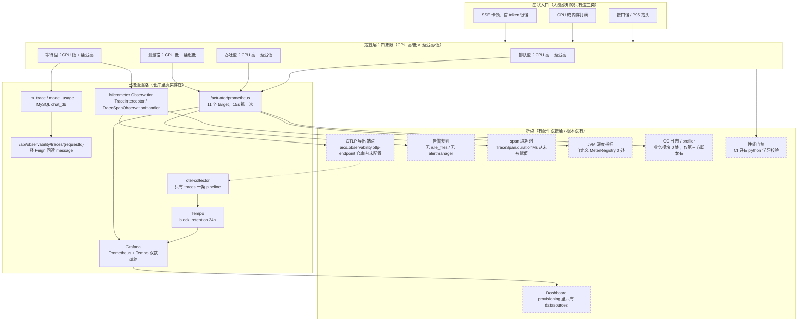
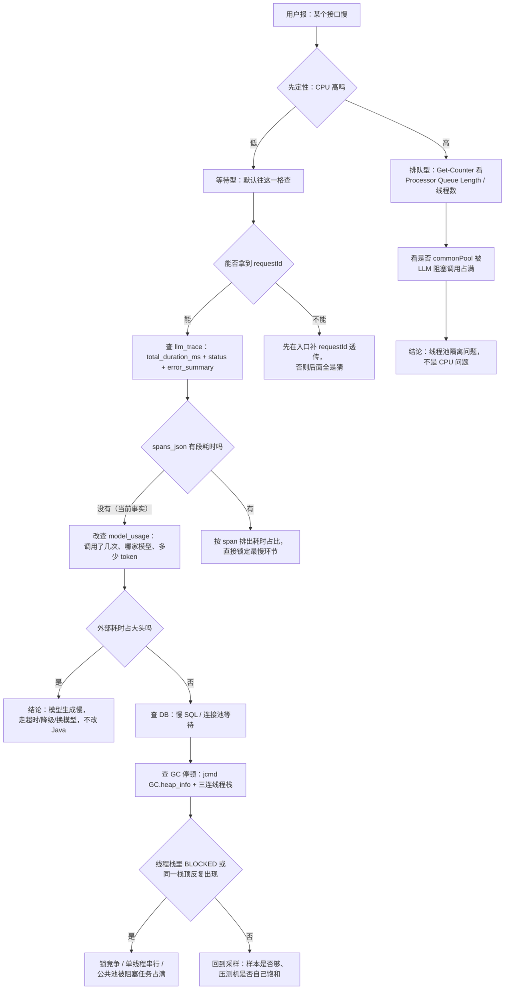
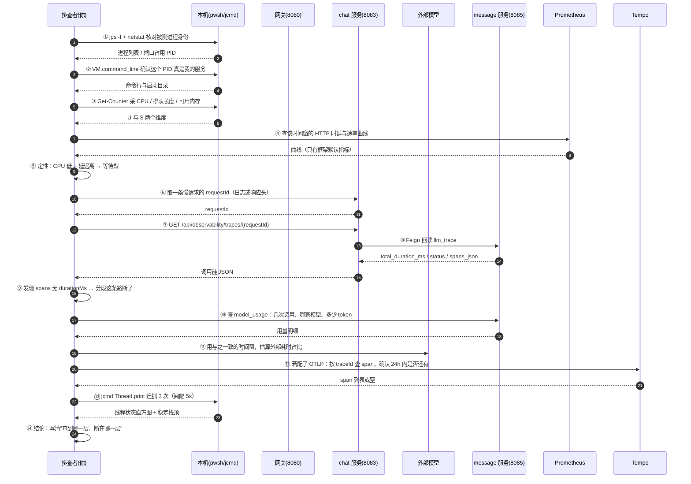

# 12.8 性能问题定位方法论：先定性再定量

> **一句话结论**：性能排查的第一产出不是"优化方案"，而是"证据分级 + 资源定性"——先证明你在测谁（进程、端口、命令行），再证明测试条件（谁在抢 CPU），再选对统计量（分位而不是均值），最后才轮到调参；顺序一错，后面全省。
> **阅读前置**：已读 12.1（JVM 参数与 GC 选型）、12.2（GC 日志与停顿分析）；知道 P95/P99 与平均值的区别，会用 pwsh、读过 `jcmd`/`jps` 的输出格式。
> **证据基线**：本仓库静态资产当次 read/grep 核对（路径与行号可复查）+ 本机真机取证（JDK 17.0.19 的 `jps`/`jcmd`、node 24.16.0、本机 16 逻辑核 / 31.7 GB）；**本篇未做任何压测**（本机无 k6、无 Docker，`docs/27-性能基线报告.md` 也写明实测基线未完成）。预计阅读 45~55 分钟。

先划清三条证据边界，免得把"教程里的经验"当成"本仓库的事实"：

| 证据级别 | 本仓库 / 本机真实状态 | 本篇怎么处理 |
|---|---|---|
| A 级（源码摘录） | `learning-docs/24-源码分析/assets/source/` 里是 Java 源码摘录，本篇讲方法论不需要 Spring 内部实现 | 本篇 A 级 0 条，不硬引；能落到本项目源码的地方一律用 B 级 |
| B 级（本项目文件） | 部署侧 4 个观测配置文件、`llm_trace`/`model_usage` 建表 SQL、Trace 拦截器与 span 处理器、Resilient 调用模板、性能基线报告 | 每个结论都给**完整路径 + 行号**，可当次复核 |
| C 级（本机实测） | 3 条命令：进程与端口身份核对、node 分位脚本、`jcmd` 取 JVM 快照；真实输出全部贴出 | 只用来证明"取证方法与误判风险"，**不冒充本项目吞吐/延迟** |

---

## 0. 先看现象

### 现象 1：11 个服务的日志、pid 文件都在，机器上却没有一个 ai-cs 进程

```pwsh
cd D:\Projects\Persion\ai-customer-service\tools\logs
Get-ChildItem -Filter *.pid | ForEach-Object { "$($_.Name) = [$((Get-Content $_.FullName -Raw).Trim())]" }
Get-ChildItem -Filter *.pid | ForEach-Object {
  $p = (Get-Content $_.FullName -Raw).Trim()
  $proc = Get-Process -Id $p -ErrorAction SilentlyContinue
  "{0} pid={1} alive={2} name={3}" -f $_.BaseName, $p, ($null -ne $proc), ($proc.ProcessName)
}
```

```text
ai-cs-chat.pid = [27744]
ai-cs-gateway.pid = [48264]
ai-cs-knowledge.pid = [2792]
ai-cs-message.pid = [9264]
ai-cs-mq.pid = [36316]
ai-cs-notify.pid = [24896]
ai-cs-order.pid = [20880]
ai-cs-pay.pid = [13528]
ai-cs-product.pid = [28612]
ai-cs-search.pid = [14084]
ai-cs-user.pid = [24812]
frontend.pid = [21172]
ai-cs-chat pid=27744 alive=False name=
ai-cs-gateway pid=48264 alive=False name=
ai-cs-knowledge pid=2792 alive=False name=
ai-cs-message pid=9264 alive=False name=
ai-cs-mq pid=36316 alive=False name=
ai-cs-notify pid=24896 alive=False name=
ai-cs-order pid=20880 alive=True name=msedgewebview2
ai-cs-pay pid=13528 alive=False name=
ai-cs-product pid=28612 alive=False name=
ai-cs-search pid=14084 alive=False name=
ai-cs-user pid=24812 alive=False name=
frontend pid=21172 alive=False name=
```

判读：12 个 pid 里 11 个已死，唯一"活着"的 `20880` 是 **msedgewebview2**（浏览器内核进程），和订单服务毫无关系——这是 Windows PID 复用：进程号被回收后分配给了新进程。**pid 文件不是"服务在跑"的证据，它只是"上次启动时占过这个号"的遗物。**

### 现象 2：本机 USE 三件套——CPU 七成、排队长度是核数的 7 倍

```pwsh
$s = Get-Counter -Counter '\Processor(_Total)\% Processor Time','\System\Processor Queue Length','\Memory\Available MBytes','\PhysicalDisk(_Total)\Avg. Disk sec/Transfer' -SampleInterval 1 -MaxSamples 2
$s.CounterSamples | ForEach-Object { "{0} = {1}" -f $_.Path, [math]::Round($_.CookedValue,4) }
(Get-CimInstance Win32_ComputerSystem | Select-Object NumberOfLogicalProcessors,@{n='MemGB';e={[math]::Round($_.TotalPhysicalMemory/1GB,1)}}) | Format-List
```

```text
\\yxw\processor(_total)\% processor time = 70.7467
\\yxw\system\processor queue length = 114
\\yxw\memory\available mbytes = 8785
\\yxw\physicaldisk(_total)\avg. disk sec/transfer = 0.0001
\\yxw\processor(_total)\% processor time = 72.0094
\\yxw\system\processor queue length = 84
\\yxw\memory\available mbytes = 8807
\\yxw\physicaldisk(_total)\avg. disk sec/transfer = 0.0001

NumberOfLogicalProcessors : 16
MemGB                     : 31.7
```

判读：CPU 70% 不算爆，但 `Processor Queue Length`（就绪队列里等 CPU 的线程数）在 84~114 之间波动，而本机只有 16 个逻辑核。**就绪线程数 ≫ 核数，说明大量线程在等 CPU 而不是在用 CPU**。这直接决定一件事：此刻在本机测出来的任何延迟都混着排队时间，既不能当基线，也不能跨时间比较。

### 现象 3：同一个真实文件重复解析 200 次，均值与尾部差 6.7 倍

```pwsh
cd D:\Projects\Persion\ai-customer-service\learning-docs\tools\tmp
node probe-latency.mjs
```

```text
file=ai-cs-order.out.log bytes=296219 warn=541 error=2
n=200  mean=4.34ms  p50=3.79ms  p95=7.53ms  p99=16.26ms  max=25.40ms
first5=[4.99, 6.39, 4.61, 3.15, 3.79]
last5 =[4.63, 3.07, 3.06, 2.73, 2.33]
p95/p50=1.98x  max/p50=6.69x
```

判读：这段脚本干的事极朴素——对 `tools/logs/ai-cs-order.out.log`（296219 字节）重复"读文件 + 按行统计 WARN/ERROR"，记录每次耗时。三点信息：① 均值 4.34ms 比中位数 3.79ms 高 15%，**均值被尾部拽着走**；② p99 是 p50 的 4.3 倍、max 是 6.7 倍，说明存在明确的慢尾部，只报 mean 会让读者以为"很稳定"；③ first5 段普遍比 last5 慢，是首次读的冷缓存与调度抖动，**采样不预热就会把"前几次"污染进统计**。

> 这些现象指向同一件事：性能排查失败，多数不是"不会优化"，而是**证据不成立**——测了错的进程、在错的条件下测、用了错的统计量。先定性（是哪一类资源、是不是被测对象）、再定量（分位与基线），这套纪律比任何调参技巧都值钱。

---

## 1. 整体地图



> **读图说明**：实线是**仓库里真能跑通的通路**：chat 服务把每个请求包成 Observation → `/actuator/prometheus` 被 Prometheus 每 15 秒抓一次 → Grafana 用 Prometheus + Tempo 两个数据源展示；LLM 侧另有一条独立通路，`llm_trace` 落 MySQL，再由 `/api/observability/traces/{requestId}` 回读。虚线是**断点**，一共三条要记住：① `Micrometer → otel-collector` 之间的 `aics.observability.otlp-endpoint` 在仓库任何 yml 里都没有配置，配置类 `ObservabilityProperties.java` 第 32 行默认值是空串，所以默认走"结构化日志导出"而不是 OTLP，**外部 Tempo 里能不能看到 span，取决于 Nacos 里有没有人手配了这个值，仓库无法自证**；② Prometheus 有 11 个 target 但**没有 rule_files / 没有 alertmanager**，也就是"能画图、不会喊人"；③ `TraceSpan.durationMs` 字段存在却无人赋值（第 3.6 节详述），所以"哪一段慢"这件事在现有数据里是查不出来的。图里 `QUAL` 指向 `B7` 是想说明：定性方法再对，没有门禁就守不住——每次发布都靠人跑一遍，等于没有。

组件、责任、参与方与真实位置：

| 组件 | 责任（在定位里干什么） | 参与方 | 真实位置 |
|---|---|---|---|
| Actuator + Micrometer registry | 暴露 `/actuator/prometheus`，提供 HTTP/进程/JVM 层指标 | 每个业务服务自身 | `tools/nacos-config/aics-shared.yml:32`（`exposure.include` 唯一一处） |
| Prometheus | 15s 抓取 11 个服务，存时序，供定性用 | 观测栈 | `deploy/observability/prometheus.yml:1-24` |
| otel-collector | 只接 OTLP traces 并转给 Tempo，**无 metrics pipeline** | 观测栈 | `deploy/observability/otel-collector.yaml:16-20` |
| Tempo | 存 trace，块保留 24h | 观测栈 | `deploy/observability/tempo.yaml:19` |
| Grafana | 双数据源展示，无预置 dashboard | 观测栈 | `deploy/observability/grafana/provisioning/datasources/datasources.yaml:1-16` |
| TraceInterceptor | 请求入口按采样率建 TraceContext，出口落库 | chat 服务 | `ai-cs-chat/src/main/java/com/aics/chat/observability/TraceInterceptor.java:31-85` |
| TraceSpanObservationHandler | 把 Observation 组装成 span 挂到请求上下文 | chat 服务 | `ai-cs-chat/src/main/java/com/aics/chat/observability/TraceSpanObservationHandler.java:41-93` |
| llm_trace / model_usage | 明细事实表：一次请求一条 trace、一次调用一条用量 | MySQL chat_db | `deploy/mysql/llm-observability-init.sql:12-49` |
| LlmTraceController | 提供按 requestId 回读与分页查询 | message 服务 | `ai-cs-message/src/main/java/com/aics/message/controller/LlmTraceController.java:42-89` |
| 排查者（人） | 定性、取快照、写结论；**唯一能把断点连起来的一环** | 你 | 本机 pwsh + `jcmd` |

---

## 2. 关键概念与关键要素

| 名称 | 位置 | 作用 | 关键参数 / 取值 |
|---|---|---|---|
| USE 方法 | 方法论（本篇 §3.2） | 对**每一类资源**问三件事：使用率、饱和度、错误数 | Utilization / Saturation / Errors |
| RED 方法 | 方法论（本篇 §3.3） | 对**每一个服务**问三件事：速率、错误、时延 | Rate / Errors / Duration |
| P95 / P99 | 任何统计口径 | 用分位代替均值描述"用户体验"，避免长尾被平均掉 | 本机实测 p95/p50=1.98x、max/p50=6.69x |
| Processor Queue Length | Windows 计数器 | 就绪队列长度＝等 CPU 的线程数，**判断"排队型"最直接的证据** | 本机 84~114，16 核 → 严重排队 |
| TTFT（首 token 时延） | chat 流式链路 | 流式体验的核心指标，与"整流时长"分开看 | `firstTokenMs`，`ai-cs-chat/src/main/java/com/aics/chat/service/impl/ResilientAiService.java:279-316` |
| Observation | Micrometer API | 一次操作的观测单元，handler 在 stop 时消费 | `Observation.createNotStarted(...)`，同上文件 `470` 行附近 |
| low / high cardinality key | Observation 设计 | 低基数可做聚合维度，高基数只能当明细 | `span.type`/`provider`/`model` vs `detail`/`tokens`，见 `TraceSpanObservationHandler.java:53-70` |
| span | 一次请求内的环节单元 | 把"慢"切成"哪一段慢" | 类型 INTENT/RETRIEVAL/RERANK/LLM/TOOL/ANSWER/SAFETY |
| 采样率 | chat 观测 | 控制 trace 存储与开销；1.0=全量 | `aics.observability.sample-rate`，`ai-cs-chat/src/main/java/com/aics/chat/observability/ObservabilityProperties.java:29` |
| scrape_interval | Prometheus | 抓取节奏，决定时序分辨率 | 15s，`deploy/observability/prometheus.yml:3` |
| block_retention | Tempo | trace 保留时长，决定"能回溯多久" | 24h，`deploy/observability/tempo.yaml:19` |
| TimeLimiter | Resilience4j | 给 LLM 调用设上限，超了取消 | 30s / 60s / 5s，`ai-cs-chat/src/main/resources/application.yml:74-87` |
| Retry | Resilience4j | 瞬时故障重试，**会放大尾部延迟** | max-attempts 3、wait 1s、multiplier 2，同文件 `88-102` |
| CircuitBreaker | Resilience4j | 失败率超阈值快速失败 | 窗口 10 次、最少 3 次、50%、开 30s、半开 3 次，同文件 `114-130` |
| ForkJoinPool.commonPool | JVM 公共池 | chat 的 LLM 调用实际跑在这里（`CompletableFuture.supplyAsync` 未传 executor） | 并行度默认 = 核数-1；阻塞型任务放这里＝自伤，`ResilientAiService.java:176` / `255` |

---

## 3. 原理与证据逐段精读

### 3.1 先定性：四象限把"慢"拆成四种完全不同的病

**在干什么**：拿到"接口慢"这种模糊症状后，先量两个数——CPU 使用率、请求延迟，把问题归到四个格子里，再决定后面看什么。

| 格子 | CPU | 延迟 | 指向 | 第一件事看什么（本项目可查的） |
|---|---|---|---|---|
| 排队型 | 高 | 高 | 线程/进程太多，CPU 不够分；或某处自旋/正则/序列化爆炸 | 就绪队列（本机 84~114）、线程数、GC 频率；chat 侧还要看是否 `commonPool` 被 LLM 阻塞占满 |
| 等待型 | 低 | 高 | 在等别人：下游 HTTP、DB 慢查询、连接池、锁、GC 停顿、SSE 慢客户端 | `llm_trace.total_duration_ms` 与外部 LLM 耗时的差、`model_usage` 调用次数、线程栈里 BLOCKED/WAITING 的栈顶 |
| 吞吐型 | 高 | 低 | 资源被打满但用户不觉得慢——这是**正常态**，是容量规划的输入，不是故障 | Prometheus 的 rate 曲线；此时做优化只能换来"更多吞吐"，不会让单请求更快 |
| 测量错 | 低 | 低 | 口径错了：测的是缓存命中、测的端口不是被测服务、样本太小、压测机自己空转 | 先复盘 §0 现象 1：`jps` + 端口 + `VM.command_line` 核对身份 |

**为什么这么设计**：性能问题的解空间太大（JVM 参数、SQL、线程池、网络、LLM 供应商……），而资源类型只有几类。先定性等于把解空间砍到 1/4，且这一步只需要 10 秒、零成本；先调参则可能花两天把一个等待型问题"优化"成排队型问题。

**换写法会怎样**：不做定性、直接上 profiler（火焰图/jstack）当然也能查，但代价是——CPU 火焰图只有 30 行有效信息就得采 30 秒采样，且**在等待型问题里火焰图会是一片平坦**（线程都在等，没有热点），你会误判成"代码没问题"。

**常见坑**：把"CPU 高"当成"程序写得烂"。本仓库 chat 服务的 LLM 调用跑在 `ForkJoinPool.commonPool`（`ResilientAiService.java:176`、`255` 处 `CompletableFuture.supplyAsync(...)` 未传 executor），一个 30~60 秒的阻塞调用会把公共池线程钉死，CPU 反而不高、延迟很高、堆栈里一堆 WAITING——典型等待型，但根因是**线程池选错**而不是"CPU 不够"。另外 60 秒 TimeLimiter（`application.yml:82`）意味着：只要模型慢，用户就要等满 60 秒才收到错误，这期间的"延迟"根本不是 Java 算出来的。

### 3.2 USE 落到本项目：每一类资源都问 U/S/E，并标出"哪一格取证会断"

**在干什么**：把系统拆成 10 类资源，对每类都问使用率（U）、饱和度（S）、错误（E），一格一格填。填不出来的格子就是"这台机器上查不出"，必须写进结论，而不是拿别的格子顶替。

| 资源 | U（用了多少） | S（排队/积压） | E（报错） | 本项目取证位 | 断点 |
|---|---|---|---|---|---|
| CPU | `% Processor Time`（本机 70.7%/72.0%） | `Processor Queue Length`（本机 114/84） | — | `Get-Counter`（§6.2 有完整命令） | 无历史趋势，只能现场采 |
| 内存 | `Available MBytes`（8785） | page faults、swap | OOM 日志 | 同上 | 无 `-Xlog:gc` 日志，堆增长曲线看不到 |
| 磁盘 IO | `Avg. Disk sec/Transfer`（0.0001s） | 队列长度 | IO 错误 | 同上 | 无 iostat 类长期采集 |
| 网络 | 带宽 | TCP 重传 | 连接重置 | 无资产 | 完全断 |
| 线程池 | 活跃线程/核心数 | 队列长度 | 拒绝数 | `usageExecutor` 1/4、队列 1000（`ai-cs-chat/src/main/java/com/aics/chat/config/ObservabilityExecutorConfig.java:27-40`） | 无指标导出（0 处 MeterRegistry），只能靠日志与线程栈 |
| JVM 堆/GC | 堆使用率 | GC 停顿（STW） | `OutOfMemoryError` | `jcmd GC.heap_info`（§6.3） | **无 GC 日志**，停顿次数/时长查不到 |
| DB 连接池 | 活跃/空闲 | 等待获取连接 | 超时异常 | HikariCP `maximum-pool-size` 10（`docs/27-性能基线报告.md` 静态基线表） | 无池指标自定义；慢 SQL 未采集 |
| Redis | 命中率 | 延迟 | 连接失败 | 无资产 | 完全断 |
| RocketMQ | 堆积量 | 消费延迟 | 消费失败 | 无资产 | 完全断 |
| 外部 LLM | 调用次数/耗时 | 并发限制 | 4xx/5xx | `model_usage`（`deploy/mysql/llm-observability-init.sql:29-49`） | 无供应商侧延迟指标，只有我方视角总耗时 |

**为什么这么设计**：USE 的价值不在"填表"，而在**逼你说出"不知道"**。表格里出现越多"断"，越说明这套系统只支持"事后猜"，不支持"事中判"——这就是本仓库当下的真实状态。

**换写法会怎样**：只查 CPU + JVM 内存（最常见的偷懒版），会漏掉连接池与下游等待两类——而这两类恰恰是 Java 服务最常见的长尾来源；本仓库 `llm_trace` 里 `total_duration_ms` 与下游耗时的差值，就是这个盲区唯一的线索。

**常见坑**：把"U 高"直接当"瓶颈在此"。CPU 70% 且队列 114，瓶颈是**排队**（S），不是使用率（U）；优化算法让单次耗时降 10%，排队不会缓解，反而可能因为请求更密而更糟——先加核或减并发才有意义。

### 3.3 RED 落到本项目：三个数里我们只稳拿一个半

**在干什么**：对每个服务量 Rate（请求速率）、Errors（错误率）、Duration（时延分布），三个数足够描述"用户是否受伤"。

| 维度 | 本项目能不能算 | 拿什么算 | 说明 |
|---|---|---|---|
| Rate | 半能 | Prometheus 抓 `/actuator/prometheus` 的 HTTP 观测序列（框架默认提供） | 仓库内 0 处自定义 `Counter`/`Timer`（全仓 grep 命中 0），业务级速率算不出来 |
| Errors | 半能 | 同上按状态码维度；429 是网关限流（`ai-cs-gateway/src/main/java/com/aics/gateway/config/RateLimitProperties.java:43,46`，5 token/s、桶 10） | `docs/27-性能基线报告.md` 明确：**429 是验证点不是错误**，不能算进错误率，否则限流一开错误率就 20% |
| Duration | 能（粗） | `llm_trace.total_duration_ms`（`deploy/mysql/llm-observability-init.sql:18`）+ k6 的 `http_req_duration` | 只有整体耗时，**没有分段**；且明细在 MySQL 不在时序库，做不了分位曲线 |

**为什么这么设计**：`llm_trace` 是"事实表"思路——把每次请求的完整上下文（场景、状态、耗时、span JSON、错误摘要）写一行，成本低、可追责；代价是它不适合做聚合。所以 RED 的 Duration 一旦要"看曲线"，就必须回到 Prometheus，而 Prometheus 那边没有业务打点。

**换写法会怎样**：如果反过来只在 Prometheus 打点，就退化成"只有数字没有上下文"——P95 抬头了却不知道是哪个用户、哪个模型、什么错误。两条路必须都有：指标用来看趋势，明细用来看个案。

**常见坑**：拿 `llm_trace` 做"平均耗时"汇报。表里 `status` 默认 `'SUCCESS'`（第 17 行）、`total_duration_ms` 默认 0（第 18 行、`deploy/mysql/llm-observability-init.sql:17-19`），一旦有链路只写了部分数据，0 值会静默拉低平均值；做统计必须先 `WHERE total_duration_ms > 0`，否则均值永远是"很好看"的。

### 3.4 从症状到工具的决策树



> **读图说明**：这棵树的**分叉点只有一个**——CPU 高不高，其余全是"取证到哪一层"。左侧分支（排队型）必须先排除"线程池选错"再谈加核，因为本仓库 chat 的阻塞 LLM 调用跑在 `ForkJoinPool.commonPool` 上（`ai-cs-chat/src/main/java/com/aics/chat/service/impl/ResilientAiService.java:176`），加核只是在放大公共池的并行度；右侧分支（等待型）的关键在 `能否拿到 requestId`，拿不到就得先补透传——图上从 `G` 没有回头箭头，是因为"没有 requestId 就想定位个案"在本仓库是走不通的死路。`H` 到 `I` 那条"没有段耗时（当前事实）"的跳转，是本篇最重要的一条现实约束：`TraceSpan.durationMs` 字段存在但从没被赋值（详见 3.6），所以只能退而求其次，用 `model_usage` 的调用次数与 token 量侧面推断。

**在干什么**：把"该怎么查"写成固定顺序，避免跳步。

**为什么这么设计**：每一步都是**验证**而不是**猜测**：定性验证资源类型，requestId 验证能否定位个案，spans 验证能否分段，model_usage 验证是否外部依赖。任一步失败都应记录"此处无法取证"，而不是用经验补。

**换写法会怎样**：一上手就 `jstack` 抓线程栈，在等待型问题里你会看到几十个 `TIMED_WAITING`（正常的 Tomcat 线程），误以为"系统空闲"——实际上慢在下游。正确的用法是**间隔 5 秒连续抓 3 次**（§6.3），看同一栈顶是否稳定出现。

**常见坑**：把"CPU 低"当成"没问题"。本机实测 CPU 70% 时线程仍在排队，而真实的生产服务 CPU 30% 也可能因为 GC 停顿/连接池等待把 P95 顶到 2 秒——CPU 只回答"算得多不多"，不回答"等得久不久"。

### 3.5 采样与压测纪律：基线、单一变量、可重复、压测机不是瓶颈

**在干什么**：在动任何参数之前，先建立**可比对的基线**：同一环境、同一脚本、同一预热方式、同一指标口径，跑 N 次，取分位。

本项目已有的口径与脚本（全部真实存在）：

| 资产 | 内容 | 对纪律的意义 |
|---|---|---|
| `docs/27-性能基线报告.md` | 指标口径表：吞吐=`http_reqs/duration`、P95/P99 取 `http_req_duration`、SSE 首 token 取 `http_req_waiting`；并明写**实测基线未完成** | 口径先定，数据后补——这是"先定量定义，再定数量"的正确顺序 |
| `scripts/loadtest/k6/gateway-rate-limit.js` | 恒定到达率 30 req/s × 30s 打网关 | 到达率型压测：验证限流而非验容量 |
| `scripts/loadtest/k6/sse-chat.js` | ramping-vus 1→20→0 压 SSE | 并发型压测：验流式体验，必须看 `http_req_waiting` |
| `scripts/loadtest/README.md:32` | "别用本机既当压测机又当被测机出报告" | 纪律被写进仓库了，但本机 `Processor Queue Length` 114 说明这条纪律目前**只能靠自觉** |

**为什么这么设计**：压测的唯一目的是"可比较"。只要两次测量之间除了被测变量之外还有别的变化（缓存冷热、GC 时机、别人的 Gradle 编译、IDE 索引），差值就没有意义。

**换写法会怎样**：不做基线直接调参，最常见结局是"改了 JVM 参数后 P95 从 800ms 降到 600ms"——其实是这次跑的时候后台编译结束了。省下的 20 分钟，后面要用两天来找回。

**常见坑**：三条最狠的作弊源——① **压测机与被测机同机**（本项目脚本明确禁止，但单机开发时几乎必然违反）；② **不预热**（§0 现象 3 的 first5 比 last5 慢）；③ **只跑一次**（一次分不清是改善还是抖动）。另外 k6 在本机 **MISSING**（`docs/27-性能基线报告.md` 记录 winget 安装失败），所以本篇不提供任何压测数字——没有工具就没有数据，写数字就是编。

### 3.6 变更关联：性能问题几乎总跟着发布走

**在干什么**：把"变慢"和"变了什么"对齐——先看最近 24 小时合了什么、部署了什么、Nacos 里改了什么配置。

**为什么这么设计**：性能回归的分布极不均匀，绝大多数由**变更**引入（新索引缺失、连接池调小、超时放宽、重试次数加一、采样率从 0.1 调到 1.0）。本仓库 `docs/28-故障案例库.md` 里的 4 个真实案例——C1 事务注解自调用失效、C2 从库复制过滤漏库、C3 `pay.sandbox` 死配置、C4 K8s 清单缺 3 个服务——**全都是"配置/注解写错"型**，没有一个是"算法写慢"，这恰好说明本项目的主要风险面在变更而非代码本身；同时这份案例库里**没有一条性能案例**（唯一沾边的是第 296 行"SSE 连接泄漏 ... 待走读"），也就是说性能问题在本仓库尚无可复用的历史证据。

**换写法会怎样**：不查变更，直接从"代码可能慢在哪"开始审，会审出大量"理论上可以更快"的结论，却解决不了"昨天还好今天慢"——而那才是线上 90% 的场景。

**常见坑**：只看 git commit 不看**配置中心**。本仓库大量配置在 Nacos（`ai-cs-chat/src/main/resources/application.yml:27-31` 用 `optional:nacos:` 导入 `aics-shared.yml` 与 `ai-cs-chat.yml`），而这些文件不进 Git——`exposure.include` 全仓只有 `tools/nacos-config/aics-shared.yml:32` 一处，业务模块 `application.yml` 里 0 处，意味着**指标端点开不开取决于 Nacos**。你翻 Git 历史永远翻不到那次"有人把 prometheus 端点关了"。

### 3.7 性能预算与回归门禁：本项目目前只有"人肉门禁"

**在干什么**：给关键接口定一个预算（比如 SSE 首 token ≤ 2s、非流式 chat P95 ≤ 8s），并在 CI 里用脚本守住它，超了就红。

**为什么这么设计**：预算的价值不是"数字好看"，而是把"慢"从主观变成客观；门禁的价值是让"退化"在合入前暴露，而不是在用户投诉时暴露。

**本项目的真实状态**：`.github/workflows/python-learning-validate.yml` 是**唯一**的 workflow，只做 Python 学习材料校验；没有 Java 构建、没有压测 job、没有性能门禁。JVM 参数侧也没有预算可言：全仓 `-Xlog`/`Xloggc`/`PrintGC` 与 profiler（async-profiler/arthas/jprofiler）命中 12 处，**全部在第三方组件自带脚本**里（如 `tools/nacos/bin/startup.sh:114,118`、`tools/rocketmq/bin/runbroker.sh:93,97`、`tools/seata/seata/bin/seata-setup.sh:143,145,147`），11 个业务服务 0 处——也就是**线上没有 GC 日志可查**。

**换写法会怎样**：不设预算的团队，性能结论永远是"我觉得快了/好像更卡了"，且每次上线都靠人肉 review；设了预算但没门禁，预算会在第三个月变成文档里的历史遗迹。

**常见坑**：把门禁阈值定在"理论上限"。预算应基于**当前基线 + 可接受回退**（如 P95 不超过基线 120%），基线本身缺失时（本项目就是），最务实的做法是先落地"采集"（GC 日志 + 自定义指标 + 段耗时），而不是先落地"阈值"。

### 3.8 断点清单：这套系统"能定位到哪一层、到哪一层就断"

**在干什么**：把 §1 图里的虚线翻成可执行的一句话结论，作为排查前的期望管理。

| 想回答的问题 | 现有资产能到哪一层 | 断在哪 |
|---|---|---|
| 哪个服务慢了 | 能：Prometheus 按 target 分，11 个 static target（`deploy/observability/prometheus.yml:11-22`） | 只有框架默认指标，无业务 RED 打点 |
| 哪个接口慢了 | 能（粗）：HTTP 观测序列按 path 维度 | 无预设 dashboard，得手写 PromQL |
| 这一次请求慢在哪一段 | 只能到"哪一段失败/用了哪个模型" | `TraceSpan.durationMs` 无赋值 → **查不到段耗时** |
| 是不是下游模型慢 | 能（侧推）：`model_usage` 的调用次数与 token 量 + `llm_trace.total_duration_ms` | 无供应商侧独立延迟 |
| 是不是 GC 停顿 | 只能现场 `jcmd GC.heap_info` 看堆占用 | **无 GC 日志**，停顿次数/最长停顿永不可查 |
| 有没有告警过 | 不能 | 无 `rule_files`、无 alertmanager |
| trace 能否跨服务串起来 | 不确定 | OTLP 端点未在仓库配置，Tempo 只有 24h 保留 |

> **读图说明**（承接上表）：这张表就是本篇的"止损线"——凡是落在"断在哪"这一列的问题，回答时必须原话说"本机/本仓库查不到，需要先补 X"，而不是用经验值填空。补 X 的顺序建议是先补**最便宜的三个**：段耗时（代码里一行 `span.setDurationMs(...)`）、GC 日志（启动参数 `-Xlog:gc*`）、一条 Prometheus 告警规则。

---

## 4. 一次完整执行时序

场景：运营反馈"AI 对话首 token 越来越慢"，你要在 30 分钟内给出定性结论。



> **读图说明**：时序的骨架是**"先证明对象 → 再证明条件 → 再取证据 → 最后承认边界"**。第 ①~② 步是身份核对（对应 §0 现象 1 与 §6.1），第 ③ 步是定性（对应 §0 现象 2），第 ④~⑬ 步是分层取证，第 ⑭ 步是本篇主张的交付物——一份**包含断点声明的结论**，而不是一句"我优化了 XX"。注意 Chat 与 Msg 之间的 ⑧ 是 `Feign` 回读，`llm_trace` 的**存储方是 message 服务**（`ai-cs-chat/src/main/java/com/aics/chat/controller/ObservabilityController.java:46` 只是薄委托），所以查不到数据时要先分清是"没落库"还是"没查对"，这两件事的修法完全不同。

每一步该怎么判读：

| 步骤 | 该看什么 | 正常长什么样 | 异常长什么样 / 说明什么 |
|---|---|---|---|
| ① 进程与端口 | `jps -l` 是否包含你的主类；`netstat -ano` 端口占用 PID 是否与 pid 文件一致 | 主类名/端口/PID 三者一致 | 三者不一致 → 你正在测别的进程（§6.1、§6.2） |
| ② 命令行 | `VM.command_line` 里的 `-Dcatalina.base`、jar 路径、启动目录 | 指向本仓库 | 指向别的项目 → 全部数据作废，这是本篇最贵的一个坑 |
| ③ USE 采样 | `% Processor Time`、`Processor Queue Length`、`Available MBytes` | 队列长度 < 核数 | 队列 84~114 / 16 核 → 排队型或压测机自身饱和 |
| ④ 时延曲线 | 抓取是否连续、series 数量 | 15s 一个点、11 个 target 都有数据 | 某 target 缺序列 → 该服务没开 `/actuator/prometheus`；曲线断 → 服务重启/抓取超时 |
| ⑥ requestId | 日志里 `trace 开始: requestId=...`（debug 级）或响应体 | 每请求唯一 | 拿不到 → 先补透传，否则只能做群体统计 |
| ⑦⑧ 调用链 | `status`、`error_summary`、`spans_json` 内容 | 有 span 名与类型序列 | 有 span 无耗时 → 见 3.8 与 §6.7；`status=FAILED` 时先看 `error_summary` 前 500 字符 |
| ⑩ 用量明细 | 一次请求的调用条数、`provider`/`model`、token 数 | 1 条（无 fallback） | 多条 → 走了 fallback 链或重试，延迟被放大 |
| ⑫ Tempo | 同 traceId 是否可查、时间是否超 24h | 24h 内可查 | 查不到两种可能：没配 OTLP，或已过 retention |
| ⑬ 线程栈 | 状态直方图、连续 3 次相同栈顶 | 大多数 RUNNABLE/TIMED_WAITING 且栈顶分散 | 同一栈顶 3 次不变 → 锁/串行点；大量 WAITING 且栈顶在下游 socket → 等待型确认 |
| ⑭ 结论 | 是否写明"断在哪一层" | 有定性、有证据路径、有断点 | 只有结论没有证据路径 → 下次还得从头查 |

---

## 5. 设计取舍

| 维度 | 方案 A | 方案 B | 本项目建议 | 理由与代价 |
|---|---|---|---|---|
| 定位顺序 | 直接上 profiler/火焰图 | 先 USE/RED 定性，再按需采样 | **B** | A 在等待型问题上火焰图一片平坦，会误导；B 成本几乎为零，但需要人守住纪律 |
| trace 落库形态 | 只进 Prometheus 指标 | 明细进 MySQL（`llm_trace`）+ 指标进 Prometheus | **B**（现状） | 明细能追个案，但做不了分位曲线；两者都要，代价是两套口径要人对齐 |
| span 粒度 | 只记 LLM 一段 | 记 INTENT/RETRIEVAL/RERANK/LLM/TOOL/ANSWER 全链 | **B**（现状，类型齐全） | 粒度已够，但 `durationMs` 未赋值 → 空有骨架没有重量；补一行代码即可，代价极低、收益最高 |
| 导出通道 | 全量 OTLP 到 Tempo | 结构化日志导出 + 可选 OTLP | **B**（现状） | 无后端时日志仍可按键检索，是可观测的"降级阶梯"；代价是 Tempo 侧数据不完整、24h 就没了 |
| 采样率 | 1.0 全量 | 生产调到 0.05~0.2 | 视流量，**未实测** | 全量最简单也最贵（每请求一条 MySQL 行 + 一次 Feign）；调低会丢掉慢请求样本，需按错误/超时优先采样（当前未实现） |
| 压测环境 | 同机压测出报告 | 独立压测机 + 独立被测机 | **B** | `scripts/loadtest/README.md:32` 已写明禁止；同机时 `Processor Queue Length` 会把 P95 直接放大 |
| 门禁 | 人工 review 性能影响 | CI 里跑预算回归 | **B（暂无法落地）** | 当前 CI 只有 Python 校验；落地需要先有基线，基线又需要先有采集——顺序不能倒 |

可扩展点清单（**均为当前未落地**，按性价比排序）：

1. 给 `TraceSpan` 补段耗时：在 `TraceSpanObservationHandler.onStop` 里写 `span.setDurationMs(...)`，让 `spans_json` 真正能分段。
2. 给 11 个服务加 `-Xlog:gc*:file=...`，让 GC 停顿第一次变成可回溯数据（现在 0 处）。
3. 在 `deploy/observability/prometheus.yml` 加 `rule_files`，先落 3 条最菜的告警：`up==0`、5xx 比例、P95 超阈值。
4. 自定义 RED 指标：`MeterRegistry` 目前 0 处，至少给 chat 的 LLM 调用加 Timer（按 provider/model 维度）。
5. `model_usage` 落库改异步批处理的可观测化：`usageExecutor` 队列满时才告警（现在只是抛错）。
6. 慢请求优先采样：`sample-rate<1` 时按 `status=FAILED` 或耗时阈值强制采集。
7. `scripts/loadtest` 增加"压测机自身 USE 采集"步骤，避免再次在本机出报告。
8. 把 `docs/27-性能基线报告.md` 的实测基线补齐（需独立环境 + k6），当前明写未完成。
9. Grafana 加 dashboard 到 provisioning 目录（现在只有 datasources，没有任何面板）。
10. SSE 连接数指标（`docs/28-故障案例库.md:296` 的"SSE 连接泄漏"仍是"待走读"）。

---

## 6. 踩坑与调试手法

### 6.1 坑：拿 pid 文件当"服务在跑"的证据

**症状**：脚本用 `tools/logs/ai-cs-*.pid` 判断服务存活，报告"11 个服务全部在线"，但接口全部超时。

**根因**：Windows PID 会被复用。`20880` 现在是 `msedgewebview2`，和订单服务无关。

**查法**：

```pwsh
cd D:\Projects\Persion\ai-customer-service\tools\logs
Get-ChildItem -Filter *.pid | ForEach-Object {
  $p = (Get-Content $_.FullName -Raw).Trim()
  $proc = Get-Process -Id $p -ErrorAction SilentlyContinue
  "{0} pid={1} alive={2} name={3}" -f $_.BaseName, $p, ($null -ne $proc), ($proc.ProcessName)
}
```

**真实输出**（节选）：`ai-cs-order pid=20880 alive=True name=msedgewebview2`，其余 11 个 `alive=False`。

**判读**：进程存活必须同时满足三条——PID 在、**进程名对**（`java`）、**命令行指向本仓库**。只看 PID 与 alive 一定被骗。

**误判风险**：反过来也成立——进程名 `java` 也可能是别的 Java 项目（本机就有 Gradle daemon 和别人的 Tomcat），所以"名字对"仍不够，最终要靠命令行。

### 6.2 坑：把端口 8080 上的 JVM 当成"我的网关"

**症状**：`jps -l` 只有一个 Tomcat JVM，端口 8080 在监听，于是顺手对它 `jcmd`，得到一堆"看起来合理"的数值，写进结论。

**根因**：8080 是"网关默认端口"，也是全世界 Java 项目的默认端口；本机这个 7892 根本不是本仓库进程。

**查法**：

```pwsh
netstat -ano | Select-String ':80[89][0-9]\s'
Get-CimInstance Win32_Process -Filter 'ProcessId=7892' | Select-Object ProcessId,@{n='cmd';e={$_.CommandLine.Substring(0,400)}}
& 'D:\DevTools\jdk\jdk17.0.19\bin\jcmd.exe' 7892 VM.command_line
& 'D:\DevTools\jdk\jdk17.0.19\bin\jcmd.exe' 7892 VM.version
```

**真实输出**（节选）：

```text
TCP    0.0.0.0:8080           0.0.0.0:0              LISTENING       7892

cmd : "D:\DevTools\jdk\jdk1.8\jre\bin\java.exe" -Djava.util.logging.config.file="D:\Projects\AsiaInfo\YunNan\AssetCentre\.tomcat-customeraccount\conf\logging.properties" ...

jvm_args: ... -Dcatalina.base=D:\Projects\AsiaInfo\YunNan\AssetCentre\.tomcat-customeraccount -Dcatalina.home=D:\DevTools\apache-tomcat-9.0.121 ...
java_command: org.apache.catalina.startup.Bootstrap start

OpenJDK 64-Bit Server VM version 25.492-b09
JDK 8.0_492
```

**判读**：`-Dcatalina.base` 指向 `D:\Projects\AsiaInfo\...`，JDK 8u492——这是**另一个项目**的 Tomcat。对它的任何采样都不属于 ai-cs。顺带一个反向知识点：用 JDK 17 的 `jcmd` 能连上 JDK 8 的 JVM 并读 `VM.flags`/`GC.heap_info`，**工具版本跨版本可用**，但这会让人更容易误采到无关进程。

**误判风险**：`alive=True` + 端口监听 + 有 `jcmd` 输出，三条"看起来都对"，但它们没有一条能证明"这是被测服务"——**唯一能证明的是命令行里的启动目录**。

### 6.3 坑：只看平均值、只采一次

**症状**：报"平均 4.34ms，性能良好"，用户却持续反馈偶发卡顿。

**根因**：均值掩盖长尾；单次采样把冷启动算进稳态。

**查法**：用 `learning-docs/tools/tmp/probe-latency.mjs`（本篇就地取证用的脚本，跑完可删）对真实日志重复采样：

```pwsh
cd D:\Projects\Persion\ai-customer-service\learning-docs\tools\tmp
node probe-latency.mjs
```

**真实输出**：`n=200 mean=4.34ms p50=3.79ms p95=7.53ms p99=16.26ms max=25.40ms` / `first5=[4.99, 6.39, 4.61, 3.15, 3.79]` / `last5=[4.63, 3.07, 3.06, 2.73, 2.33]` / `p95/p50=1.98x max/p50=6.69x`。

**判读**：`max/p50=6.69` 表示最慢一次是中位数的 6.7 倍——用户投诉的正是这一次。`first5` 高于 `last5` 说明前几次被冷缓存/调度污染，**统计前必须丢弃预热段**。

**误判风险**：这 200 次测量本身也在跟别的进程抢 CPU（§0 现象 2 的队列长度 114），所以绝对数值不可当基线；可用的只有**同一批次内的相对关系**（分位形状、冷热差异）。

### 6.4 坑：在本机既压测又采指标，还拿它当容量结论

**症状**：k6 打网关得到 P95，比单独 curl 时高 3 倍，于是断定"网关有性能问题"。

**根因**：压测进程与被测服务同机抢 CPU，且排队时间被算进被测服务的响应时间里。

**查法**：

```pwsh
$s = Get-Counter -Counter '\Processor(_Total)\% Processor Time','\System\Processor Queue Length' -SampleInterval 1 -MaxSamples 3
$s.CounterSamples | ForEach-Object { "{0} = {1}" -f $_.Path, [math]::Round($_.CookedValue,4) }
```

**真实输出**：`processor(_total)\% processor time = 70.7467`、`system\processor queue length = 114`、`... = 72.0094`、`... = 84`。

**判读**：16 核机器上就绪队列 84~114，意味着平均每个核上有 5~7 个线程在等——此时任何 P95 都混着排队时间。正确做法是把压测机与被测机分开（`scripts/loadtest/README.md:32` 的要求），或在报告里注明"单机压测，仅可相对比较"。

**误判风险**：`Get-Counter` 采的是**整机**，不区分进程；机器上跑着 Gradle daemon、IDE、浏览器，你无法证明这些 CPU 是谁烧的——需要下钻到 `Get-Process | Sort CPU` 才能归因。

### 6.5 坑：以为 `/actuator/prometheus` 里"什么都有"

**症状**：想查 HikariCP 活跃连接数、chat 的 LLM 调用耗时、SSE 并发数，去 Prometheus 里查，全都查不到。

**根因**：项目**没有任何自定义指标**——全仓 `MeterRegistry` / `Timer.builder` / `Counter.builder` 命中 **0**（当次 grep 核对）。Prometheus 里只有框架自动注册的指标（HTTP 观测、JVM 内存/GC/线程、进程 CPU 等，由 actuator + micrometer-registry-prometheus 的自动配置提供；**本篇未在本机实测，因为禁止启动服务**）。同时 `otel-collector.yaml:16-20` 的 pipeline 只有 `traces`，**metrics 根本没有采集通道**。

**查法**：

```pwsh
cd D:\Projects\Persion\ai-customer-service
Get-ChildItem -Recurse -File -Include *.java | Select-String -Pattern 'MeterRegistry|Timer\.builder|Counter\.builder'
Select-String -Path 'deploy\observability\otel-collector.yaml' -Pattern 'receivers|exporters|pipelines|metrics|traces'
Select-String -Path 'tools\nacos-config\aics-shared.yml' -Pattern 'exposure|show-details|metrics'
```

**真实结果**：第一条无任何输出（0 命中）；`otel-collector.yaml` 的 pipeline 只有 traces；`aics-shared.yml` 只有 `exposure.include: health,info,prometheus`（第 32 行）、`show-details: never`（第 35 行）、`metrics.tags.application`（第 38 行）。

**判读**：能查的只有"框架视角"的通用指标；想看"业务视角"（每模型耗时、每次 RAG 检索耗时、SSE 并发）必须自己打点。另外 `exposure.include` 里没有 `metrics`，意味着你**不能**用 `GET /actuator/metrics/{name}` 临时下钻某个指标——只能等 Prometheus 抓。

**误判风险**：`health,info,prometheus` 是配置在 `tools/nacos-config/aics-shared.yml` 里的，业务模块的 `application.yml` **一处都没有**（全仓仅 2 处命中，另一处是 Nacos 数据目录里的镜像副本）。所以一旦某个服务的 Nacos 配置没导入成功，`/actuator/prometheus` 直接 404，而你会以为是"服务没打指标"——先 `curl` 一下端点再说。

### 6.6 坑：把"接口慢"当"Java 慢"（尤其流式与重试链）

**症状**：chat 接口偶发 60 秒超时，团队开始查 GC 和线程池。

**根因**：慢在外部模型与重试链，不在 JVM。真实配置：TimeLimiter `sseChatService` 60s（`ai-cs-chat/src/main/resources/application.yml:82`）、非流式 30s（第 78 行）、视觉 5s（第 86 行）；Retry `max-attempts: 3`、`wait-duration: 1s`、`multiplier: 2`（第 91-94 行）——一次最坏路径是"等满超时 + 退避等待 + 再等满"，几倍于单次超时。

**查法**：

```pwsh
cd 'D:\Projects\Persion\ai-customer-service'
Select-String -Path 'ai-cs-chat\src\main\resources\application.yml' -Pattern 'timeout-duration|max-attempts|wait-duration|multiplier|sliding-window|failure-rate-threshold'
Select-String -Path 'ai-cs-chat\src\main\java\com\aics\chat\service\impl\ResilientAiService.java' -Pattern 'supplyAsync|firstTokenMs|doFinally|onError'
```

**真实结果**（节选）：`78: timeout-duration: 30s`、`82: timeout-duration: 60s`、`86: timeout-duration: 5s`、`92: max-attempts: 3`、`93: wait-duration: 1s`、`94: multiplier: 2`；`ResilientAiService.java:279` 的 `AtomicLong firstTokenMs`、`292` 的 `doFinally`、`300` 的 `onError`。

**判读**：先把"用户感知延迟"拆成 `TTFT`（首 token）与"整流时长"，再对比 `llm_trace.total_duration_ms`。若 `total_duration_ms` 的大头无法用 Java 侧解释（无 GC、无锁、无 DB），就默认是模型生成——`docs/27-性能基线报告.md` 的"三条边界"里明写：LLM 链路的大头是模型生成，测的是端到端体验不是 Java 性能。

**误判风险**：SSE 场景下 `http_req_waiting` 才是首 token 时延，用 `http_req_duration` 会把整个流式会话时长当成"首包延迟"，得出"慢 10 倍"的错误结论（`docs/27-性能基线报告.md` 的口径表已把这条写死）。

### 6.7 坑：以为 trace 里有段耗时，实际只有骨架

**症状**：`llm_trace.spans_json` 里能看见 `intent`/`retrieval`/`llm` 等 span 名与类型，于是拿去算"哪一段最慢"，发现字段全是 `null`。

**根因**：`TraceSpan` 有 `durationMs` 字段（`ai-cs-chat/src/main/java/com/aics/chat/observability/TraceSpan.java:37`），但组装 span 的处理器只写 name/type/provider/model/tokens/retries/attempt/detail/status/errorSummary，**从不写 durationMs**（`TraceSpanObservationHandler.java:53-83`）；全仓 grep `setDurationMs` 在 chat 的 observability 包内 0 命中（唯一命中的是 Agent 侧的 `AgentTraceRecorder` 与 RAG 评估结果，与本表无关）。

**查法**：

```pwsh
cd 'D:\Projects\Persion\ai-customer-service'
Select-String -Path 'ai-cs-chat\src\main\java\com\aics\chat\observability\TraceSpan*.java' -Pattern 'durationMs|setDurationMs|setName|setStatus'
Select-String -Path 'deploy\mysql\llm-observability-init.sql' -Pattern 'spans_json|total_duration_ms'
```

**真实结果**：`TraceSpan.java:37: private Long durationMs;`；`TraceSpanObservationHandler.java` 中无 `durationMs` 相关写入；`llm-observability-init.sql` 里 `spans_json TEXT` 与 `total_duration_ms BIGINT DEFAULT 0`。

**判读**：现有数据只能回答"这次请求走了哪几段、哪段失败、用了哪个模型"，**回答不了"哪段慢"**。所以 §3.4 的决策树里 `H→I` 那条跳转是现实约束，不是偷懒。

**误判风险**：JSON 里字段缺失（`null`）常被误读成"这段耗时为 0"，进而得出"检索不花钱"的荒唐结论；看到 `null` 要读成"未采集"。

---

## 7. 版本差异

| 旧写法 / 旧结论 | 当前基线 | 变化点 | 迁移动作 |
|---|---|---|---|
| `ai-cs-chat/pom.xml:156` 注释写"micrometer-tracing 1.2.x / opentelemetry 1.31.x" | 依赖版本由 `spring-boot-dependencies` BOM 统一管理（基线 Spring Boot 4.2.0）；仓库注释未同步 | 注释是旧 Boot 版本时期写的，实际解析版本要看 BOM；**本机禁止 mvn，未实测解析结果** | 升级文档/注释时以 BOM 为准，不要在 pom 里手写版本号 |
| 各服务只用 Micrometer Tracing 的 OTLP 导出 | chat 额外显式依赖 `micrometer-observation`（`ai-cs-chat/pom.xml:160`），并用 Observation API 手写埋点 | 观测从"框架自动"扩展到"业务自定义 span" | 新增业务埋点时统一走 `Observation.createNotStarted(...)` + 现有 handler，不要另起一套 |
| 追踪后端按 Jaeger/Zipkin 讲 | 本项目是 OTLP → otel-collector → **Tempo**（`deploy/observability/otel-collector.yaml:16-20`），保留 24h | 保留期短、无 metrics pipeline | 不要把 Tempo 当长期归档；要长期留证必须落 MySQL 明细 |
| 老稿"CPU 26% 说明机器很闲，结论是应用本身慢" | 那组数字来自 **PID 7892**，是本机另一个项目（AsiaInfo AssetCentre）的 Tomcat 8u492 进程 | 取证对象错了，结论作废 | 本篇 §0/§6.2 已换成"先核对命令行再采数"；引用任何 JVM 快照必须附带 `VM.command_line` |
| 老稿用 `jstat -gcutil <pid>` 三屏相同证明"没有 GC" | `jstat` 对 JDK 8 的 Parallel GC 输出 `CGC -`，三屏相同更可能是**采样窗口内没触发**而非"无 GC" | 判读方法错 | 停 GC 要走 `-Xlog:gc*` 或 `jcmd GC.heap_info` 趋势，不能靠三屏 `jstat` 下结论 |
| 服务默认暴露全部 actuator 端点（旧教程常见） | 本项目 `exposure.include: health,info,prometheus`（`tools/nacos-config/aics-shared.yml:32`），**无 `metrics`** | 端点收紧 | 想临时下钻指标，先确认该服务拿得到 Nacos 共享配置，否则只能靠 Prometheus |
| 熔断/超时写在方法注解参数里 | 全部在 yml（`ai-cs-chat/src/main/resources/application.yml:73-159`） | 配置外部化 | 调参改 Nacos/yml 并重新核对最坏路径（超时 × 重试 × fallback） |
| 假设"有 Prometheus 就有告警" | `prometheus.yml` 24 行内**无 `rule_files`、无 `alerting`**，Grafana provisioning 里**无 dashboard** | 观测栈只完成"采集+存储" | 别在复盘里写"告警未及时"，先确认压根没有告警 |

---

## 8. 面试高频问与答（只列问题）

1. 拿到"接口慢"这三个字，你前 10 分钟会做哪几件事？按什么顺序？
2. USE 和 RED 的区别是什么？分别在什么粒度上问问题？两者能不能只用一种？
3. CPU 高但延迟低，是问题吗？你会动手改什么，不改什么？
4. CPU 低但延迟高，你会按什么顺序排除等待源？
5. 为什么性能报告里必须给 P95/P99 而不是平均值？什么情况下平均值反而更有信息量？
6. 你如何证明"你测的那个进程就是被测服务"？说三条独立证据。
7. 压测结果不可信，最常见的三个原因是什么？你怎么在报告里防止别人误用？
8. 一次请求慢，你怎么在没有 profiler 的情况下定位到具体环节？
9. 分布式追踪里 span 只有名字没有耗时段，你会怎么判断"哪一段慢"？又如何把它修好？
10. GC 停顿怎么量化？没有 GC 日志时你能做什么、不能做什么？
11. 线程栈怎么采才有意义？一次 jstack 为什么经常没用？
12. 性能回归怎么防？没有性能门禁的团队，你会先落地什么？
13. 你怎么把"性能问题"和"发布变更"关联起来？配置中心改了东西你怎么发现？
14. 线上不能复现的偶发慢请求，你怎么采样、怎么留证？

---

## 9. 动手练习

| # | 练习 | 命令/入口 | 验收标准 |
|---|---|---|---|
| 1 | 证明"pid 文件不等于服务在跑" | `tools/logs` 下逐个 pid 与 `Get-Process` 对照 | 能说出哪个 pid 被复用、复用成了什么进程，并给出两条替代判据 |
| 2 | 核对一台机器上某个端口的真实归属 | `netstat -ano` + `Win32_Process.CommandLine` + `jcmd VM.command_line` | 输出三段证据，明确指出"这个 PID 属于哪个项目、什么 JDK 版本" |
| 3 | 采一次完整的 USE 快照 | `Get-Counter` 四计数器 + `Get-CimInstance Win32_ComputerSystem` | 输出 U/S/E 三列填写结果，并对"排队长度 / 核数"给出定性结论 |
| 4 | 用分位代替均值描述一组真实样本 | 改 `probe-latency.mjs` 的 `N` 与目标文件，跑 3 次 | 报告 mean/p50/p95/p99/max 与 p95/p50 比值，并解释三次之间的差异来自哪里 |
| 5 | 在没有 GC 日志的情况下取 JVM 堆与线程快照 | `jcmd <pid> GC.heap_info` + 间隔 5s 连抓三次 `Thread.print` | 给出线程状态直方图，并指出是否存在"三次相同栈顶" |
| 6 | 从 `llm_trace` 设计一条"能分段"的最小改动 | 读 `TraceSpanObservationHandler.java` 与 `TraceSpan.java` | 写出补 `setDurationMs` 的位置与取值来源，并说明如何验证生效 |
| 7 | 给 Prometheus 补一条最菜的告警 | 改 `deploy/observability/prometheus.yml` 加 `rule_files` | 写出一条 `up == 0` 规则 + 说明为什么本项目当前一条告警都不会响 |
| 8 | 复盘一次"慢"的口径错误 | 读 `docs/27-性能基线报告.md` 的三个边界 | 用 100 字说清"SSE 首 token 时延该用哪个 k6 指标、为什么" |

验收统一要求：**每个练习都要写出"我查到哪一层、断在哪一层"**，只给结论不给证据路径的算没做。

---

## 小结

- 性能排查的第一产出是**定性结论 + 证据分级**，不是优化方案；定错资源类型，后面所有动作都是把别人的瓶颈搬到自己身上。
- 定性只需 10 秒：量 CPU 使用率与延迟，落进四象限；"CPU 低 + 延迟低"要先怀疑测量，而不是庆祝。
- 取证第一步永远是**证明被测对象**：`jps` → `netstat -ano` → `VM.command_line`，三条证据链缺一条就可能测了别人的进程（本篇两个真实案例：PID 复用、同机另一个 Tomcat）。
- USE 的价值在于逼你说出"不知道"：本仓库 10 类资源里有 4 类（网络、Redis、RocketMQ、线程池指标）**完全断**，结论里必须写明。
- 统计量选错等于白测：本机实测 `max/p50=6.69x`，均值永远看不见这条尾巴；采样必须丢弃预热段、同一批次内比较。
- 本项目能定位到"哪个服务/哪个接口/哪次请求失败用了哪个模型"，**定位不到"哪一段慢"**（`TraceSpan.durationMs` 无赋值）、**看不到 GC 停顿**（业务模块 0 处 GC 日志）、**不会被告警**（无 rule_files）。
- 下一步最便宜的三件事：给 span 补 `durationMs`、给 11 个服务加 `-Xlog:gc*`、给 Prometheus 加 3 条告警规则——都改 10 行以内，收益是"从只能事后猜变成能事中判"。

---

## 自测题

**1. 只有"接口慢"三个字，你的第一步做什么？为什么不是先看代码？**

<details><summary>参考答案</summary>

第一步是**定性**：量 CPU 使用率与请求延迟，把问题放进四象限（CPU 高/低 × 延迟高/低）。原因是解空间太大而资源类型只有几类，10 秒的定性能把后续排查范围砍掉四分之三；先看代码则会在"等待型"问题上审出大量"理论上可以更快"却与本次故障无关的结论。定性之后紧接着是核对被测对象身份，避免整场排查建立在错误进程上。
</details>

**2. `tools/logs/ai-cs-order.pid` 写着 20880，且该 PID 确实存在，能否认为订单服务在运行？**

<details><summary>参考答案</summary>

不能。本机实测该 PID 现在对应 `msedgewebview2`（浏览器内核进程），是 Windows PID 复用。判据必须同时满足：PID 在、进程名是 `java`、**命令行/`-Dcatalina.base` 指向本仓库**。三条缺一条都可能被骗，其中命令行是最强证据。
</details>

**3. 端口 8080 在监听，`jcmd` 也能连上，为什么不能直接对它做性能采样？**

<details><summary>参考答案</summary>

因为 8080 与 "org.apache.catalina.startup.Bootstrap" 都太通用。本机 7892 的 `VM.command_line` 显示 `-Dcatalina.base=D:\Projects\AsiaInfo\...`、`VM.version` 是 `JDK 8.0_492`，是另一个项目的 Tomcat 9。对它采样得到的堆、线程、GC 数据全都不属于 ai-cs。必须先核对命令行与 JDK 版本再采。
</details>

**4. 本机 `Processor Queue Length` 84~114、16 逻辑核，说明什么？对压测结论有什么影响？**

<details><summary>参考答案</summary>

就绪队列远大于核数，说明大量线程在**等 CPU 而不是用 CPU**，属于饱和度（USE 的 S）问题。此时任何在本机测得的延迟都混着排队时间，既不能当基线也不能跨时间比较；把这样的数字写成容量结论，等于把压测机的瓶颈记到了被测服务头上。正确做法是压测机与被测机分离，或在报告里注明"单机压测，仅可相对比较"。
</details>

**5. 为什么必须给 P95/P99？什么情况下平均值反而更有用？**

<details><summary>参考答案</summary>

因为用户投诉的往往是尾部：本机实测 p50=3.79ms 而 max=25.40ms（6.69 倍），均值 4.34ms 完全掩盖了这件事。分位能把"最差的那批请求"暴露出来。平均值在两种情况下更有信息量：一是分布极窄（无长尾）时它更稳定；二是做容量规划算总资源消耗（如总 token 数、总 CPU 秒）时，均值×总量才有意义。
</details>

**6. 采样时为什么必须丢弃预热段？**

<details><summary>参考答案</summary>

冷启动阶段包含类加载、JIT 编译、页缓存未命中等一次性开销，不具重复性。实测同一脚本 200 次的 `first5`（4.99/6.39/4.61/3.15/3.79ms）普遍高于 `last5`（4.63/3.07/3.06/2.73/2.33ms）。把预热段算进统计会系统性高估耗时，且会让"调参前后对比"完全失真。
</details>

**7. 只有一次 `jstack`，为什么经常没用？该怎么采？**

<details><summary>参考答案</summary>

一次快照只能看到瞬时状态，无法区分"正常的等待"与"卡死的竞争"。本机实测直方图里 `TIMED_WAITING(sleeping)`、`WAITING(parking)`、`RUNNABLE` 混杂，单看一屏无法归因。正确做法是间隔 5 秒连抓 3 次，看同一栈顶是否稳定出现：稳定出现在业务方法 → 锁竞争或串行点；稳定出现在 socket read → 下游等待；三次完全不同 → 说明是抖动而非卡点。
</details>

**8. 本项目 `spans_json` 里有 span 名，为什么还是算不出"哪一段最慢"？**

<details><summary>参考答案</summary>

因为 `TraceSpan.durationMs`（`ai-cs-chat/src/main/java/com/aics/chat/observability/TraceSpan.java:37`）从未被赋值：`TraceSpanObservationHandler.onStop` 只写 name、spanType、provider、model、tokens、retries、attempt、detail、status、errorSummary。缺口径字段就只能知道"走了哪几段、哪段失败"，不知道各段耗时。修法是在 handler 里补 `span.setDurationMs(...)`（Observation 的 start/stop 时间差），并用一次真实请求验证 JSON 里出现非 null 的 `durationMs`。
</details>

**9. 为什么说"有 Prometheus 不等于有告警"？本项目具体缺什么？**

<details><summary>参考答案</summary>

告警需要显式规则与通知通道。`deploy/observability/prometheus.yml` 共 24 行，只有 global 与一个 job 的 11 个 static target，**没有 `rule_files`、没有 `alerting`/alertmanager**；Grafana 的 provisioning 目录只有 `datasources.yaml`，没有任何 dashboard。所以现状是"能画图、不会喊人"，复盘里写"告警没响"要先确认压根没有告警。
</details>

**10. 429 该不该算进错误率？为什么？**

<details><summary>参考答案</summary>

不算。429 是网关限流在正常工作（`ai-cs-gateway/src/main/java/com/aics/gateway/config/RateLimitProperties.java:43,46`：5 token/s/用户、桶容量 10），压测脚本本来就是故意超发去打这个阈值。把它算进错误率会让"限流生效"看起来像"系统故障"，从而把验证点误读成缺陷。`docs/27-性能基线报告.md` 的口径表明写 `http_req_failed`（429 不算失败）。
</details>

**11. 没有 GC 日志时，关于停顿你能说什么、不能说什么？**

<details><summary>参考答案</summary>

能说：当前堆占用与各代使用率（`jcmd GC.heap_info`，本机实测 PSYoungGen 412272K/881152K、ParOldGen 214256K/446976K、Metaspace 53149K）、以及是否有 OOM。不能说：GC 次数、每次停顿多长、最长停顿、分配速率——这些必须靠 `-Xlog:gc*` 的记录。本项目业务模块 0 处 GC 日志参数（12 处命中全在 Nacos/RocketMQ/Seata 自带脚本），所以线上停顿事实上不可回溯。
</details>

**12. 你如何把"性能变慢"与"发布/配置变更"关联起来？本项目有个额外的坑是什么？**

<details><summary>参考答案</summary>

对齐时间窗：查最近的提交、构建产物、部署记录与**配置中心变更**。本项目的额外坑是大量配置在 Nacos（`ai-cs-chat/src/main/resources/application.yml:27-31` 用 `optional:nacos:` 导入 `aics-shared.yml`、`ai-cs-chat.yml`），不进 Git——比如 `exposure.include` 全仓只有 `tools/nacos-config/aics-shared.yml:32` 一处，业务 `application.yml` 里 0 处。所以"有人把 prometheus 端点关了"这类变更在 Git 历史里永远查不到。
</details>

**13. chat 的 LLM 阻塞调用跑在 `ForkJoinPool.commonPool` 上，为什么这是性能隐患？**

<details><summary>参考答案</summary>

`ResilientAiService.invokeNonStream/invokeStream` 用 `CompletableFuture.supplyAsync(...)` 但没传 executor（`ai-cs-chat/src/main/java/com/aics/chat/service/impl/ResilientAiService.java:176`、`255`），默认进入 JVM 公共池，并行度约等于核数-1，且被整个进程共享。而单次 LLM 调用可能阻塞到 TimeLimiter 的 30s/60s，几个并发就能把公共池占满，导致**所有**用公共池的异步任务（包括其他业务、甚至并行流）一起排队——表现为 CPU 不高、延迟很高、线程栈一堆 WAITING。修法是给 LLM 调用配专用有界线程池并显式隔离。
</details>

**14. 你会给这个项目设计的第一条性能门禁是什么？**

<details><summary>参考答案</summary>

不是"P95 ≤ X ms"，而是**采集门禁**：① 11 个服务的 `/actuator/prometheus` 必须可访问（探活式检查）；② GC 日志参数必须存在（静态检查启动脚本）；③ `spans_json` 里 `durationMs` 必须非 null（抽样校验）。理由是当前基线缺失（`docs/27-性能基线报告.md` 明写实测基线未完成、CI 只有 Python 校验），在没有基线的系统上设阈值只会产生噪音；先把"能测"变成硬约束，阈值才有意义。
</details>
