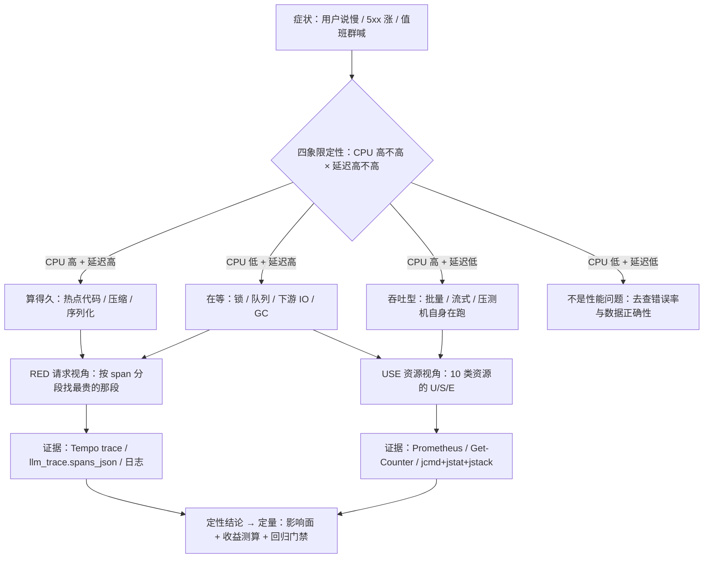

# 性能问题定位方法论：不知道瓶颈在哪一类资源，任何优化都是猜测

> **一句话结论**：性能排查的产出物不是"调好的参数"，而是"这次慢在哪一类资源上"的可复核证据链——先定性（算得久／在等／在排队），再定量（多慢、影响多少请求、收益多大）；顺序颠倒，工具只会帮你把猜测写得更像结论。
> **阅读前置**：读过 [01-JVM参数与GC选型](01-JVM参数与GC选型.md)、[02-GC日志与停顿分析](02-GC日志与停顿分析.md)、[06-接口性能优化实战](06-接口性能优化实战.md)、[07-线程池调优与背压](07-线程池调优与背压.md)；能在 pwsh 里跑 `jcmd`／`jstat`；知道 RED（Rate、Errors、Duration）与 USE（Utilization、Saturation、Errors）这两个缩写。
> **证据基线**：Spring Boot 4.2.0 / Spring Framework 7.1.0 / Resilience4j 2.4.0 / JDK 17.0.19（Temurin，本机实测）。本机 16 逻辑核、31.7 GB 内存；`docker`／`k6`／`kubectl` 三者 MISSING，JDK 工具链、`Get-Counter`、node 24.16.0 可用。预计阅读 45~60 分钟。

本篇的证据按三级标注，先交代边界，避免把"仓库里有配置"读成"线上已生效"：

| 级别 | 本篇用到的证据 | 本仓／本机状态（已探测） | 本篇怎么处理 |
| --- | --- | --- | --- |
| A 级 | `learning-docs/24-源码分析/assets/source/` 的框架源码摘录（共 905 份 `.java.md`） | 有摘录；但**没有** `ThreadPoolExecutor`、`ForkJoinPool` 的摘录 | 只在"熔断器／span 是什么"这类定义处引 2 处，线程池机理全部走 B／C 级 |
| B 级 | 本项目的配置与代码 | 全部可核对，正文逐条给路径+行号 | 每条判断挂一个可点开的位置 |
| C 级 | 本机命令实测 | `jcmd`／`jstat`／`jstack`／`Get-Counter`／`node`／本机 Redis 可用；`docker`／`k6` MISSING | 贴真实输出并写判读；**吞吐、P99 基线、火焰图、GC 停顿一律不给数字**，只给命令与判据 |

## 0. 先看现象

下面三个现象都来自本机真实输出（采集时间 2026-11-27 14:37~14:41 Asia/Shanghai），它们分别是"CPU 视角看起来没问题"、"GC 视角看起来像卡死"、"监控视角看起来齐全"的典型误读现场。

### 现象一：CPU 只用了四分之一，值班人却说"接口慢"

```powershell
PS> Get-Counter -Counter '\Processor(_Total)\% Processor Time' -SampleInterval 1 -MaxSamples 2
Timestamp                 CounterSamples
---------                 --------------
2026/11/27 14:39:12       \\yxw\processor(_total)\% processor time : 25.8494745604989
2026/11/27 14:39:13       \\yxw\processor(_total)\% processor time : 28.2575509183773

PS> Get-Counter -Counter '\System\Processor Queue Length','\Memory\Available MBytes','\PhysicalDisk(_Total)\Avg. Disk sec/Transfer'
\\yxw\system\processor queue length       : 21
\\yxw\memory\available mbytes             : 11078
\\yxw\physicaldisk(_total)\avg. disk sec/transfer : 0.00019896640625
```

这台机 16 逻辑核，26% ≈ 4.2 个核在忙；空闲内存 11 GB；磁盘每次传输 0.199 ms，属于健康值。单看 CPU 利用率会得出"资源还有富余，不是性能问题"的结论。但 `Processor Queue Length = 21`（就绪队列里排着 21 个线程等 CPU）说明：**不是算力不够，而是有东西在排队**——典型是锁竞争、线程池满、下游 IO 阻塞后集体唤醒。

问题不在 CPU 容量，在"排队"。

### 现象二：`jstat` 三屏一字不差，`CGC` 列还是个横线

```powershell
PS> jps -l
7892 org.apache.catalina.startup.Bootstrap

PS> jstat -gcutil 7892 1000 3
  S0     S1     E      O      M     CCS    YGC     YGCT    FGC    FGCT    CGC    CGCT     GCT
  0.00  99.97  21.87  73.35  97.83  95.23     15    0.896     2    0.219     -       -    1.116
  0.00  99.97  21.87  73.35  97.83  95.23     15    0.896     2    0.219     -       -    1.116
  0.00  99.97  21.87  73.35  97.83  95.23     15    0.896     2    0.219     -       -    1.116

PS> jcmd 7892 VM.flags | Select-String 'GC|HeapSize'
-XX:CICompilerCount=12 -XX:InitialHeapSize=532676608 -XX:MaxHeapSize=8512339968 ...
-XX:+UseParallelGC
```

两个误读叠加在这段输出里：①三屏完全相同，容易被读成"进程卡住了"，实际是**没有新分配就没有新 GC**，这是空闲态的样子；②`CGC`／`CGCT` 是 `-`，容易被读成"没有并发 GC"的缺陷，实际是 **`VM.flags` 里写着 `-XX:+UseParallelGC`**——Parallel 收集器只有 Young／Old 两代，本来就没有并发回收列。

`jstat` 列的含义取决于收集器，先确认收集器再看列，否则看的是别人的表。

### 现象三：11 个抓取目标、两个数据源，但全仓没有一处 `exposure`、没有一条告警规则

```powershell
PS> (Select-String deploy\observability\prometheus.yml -Pattern 'alerting|rule_files' -AllMatches).Count
0
PS> Select-String -Path ai-cs-*\src\main\resources\application.yml -Pattern 'exposure|endpoints\.' -AllMatches
（无输出，0 命中）
PS> Select-String -Path deploy\observability\grafana\provisioning -Pattern 'alerting' -Recurse
（无输出，0 命中）
```

`deploy/observability/prometheus.yml` 里确实配了 11 个 `host.docker.internal:<port>` 目标，Grafana 也有 Prometheus + Tempo 两个数据源；但 ① 全仓 `application.yml` 里 **0 处** `management.endpoints.web.exposure.include`，Spring Boot 默认只暴露 `health`，`/actuator/prometheus` 是不是 404 取决于未入库的 Nacos 共享配置；② `prometheus.yml` 没有 `rule_files`、Grafana 没有 alerting provisioning，**指标齐了也没人叫醒你**；③ `ai-cs-chat/src/main/resources/application.yml`（193 行）里连 `management:` 块都没有，chat 链路的采样率与 OTLP 端点只能来自未入库的 `ai-cs-chat.yml`。

"配了监控"和"能定位问题"之间隔着三跳：指标要能被抓到、要有人看、出问题要能叫。

这些现象指向同一件事：**性能排查缺的从来不是工具，而是"先用结构化方法定性，再决定拿哪个工具定量"的纪律**；没有这条纪律，`jstat`、Prometheus、火焰图都只是装饰——你会在 CPU 空闲的机器上查 GC，在 GC 空闲的进程里翻线程栈，在指标齐全的栈里找不到一条能回答"慢在哪一段"的曲线。

## 1. 整体地图

性能定位只有一个入口：**症状**。所有方法都是把"慢"这个模糊词，拆成可被资源指标或请求指标证伪的假设。



> **读图说明**：两条关键箭头决定你接下来一小时查什么。第一条 `Q --> C2`（CPU 低+延迟高 → "在等"）：线上绝大多数性能事故落在这个分支，但它最常被当成"CPU 不够"而直接扩机器。第二条 `C2 --> P` 与 `C2 --> U` 的分工——请求视角回答"慢在哪一段"，资源视角回答"那一段为什么慢"，两者必须互证，只走一边就会得出"span 显示模型段 28 秒"却答不出"为什么 28 秒"的结论。最容易看错的是 `C3 --> U`：CPU 高而延迟低属吞吐型场景（压测、批量刷数），此时延迟曲线本来就不好看，误判成故障会白查一天。

各组件在这条链上各自负责一小段，先把"谁产出什么数据"对上号：

| 组件 | 责任 | 参与方 | 真实位置 |
| --- | --- | --- | --- |
| 网关限流 `RateLimitFilter` | 入口限流，返回 429；429 是"被保护"，不是"故障" | 前端 → 网关 | `ai-cs-gateway/src/main/java/com/aics/gateway/filter/RateLimitFilter.java`（`getOrder()` = `HIGHEST_PRECEDENCE + 150`，排在 AuthFilter 之后） |
| Sentinel 入口流控 | `/chat/send` QPS 阈值 10 且 WarmUp 10s | 网关 → chat | `ai-cs-chat/src/main/java/com/aics/chat/config/SentinelFlowConfig.java#L27-L45`、`SentinelRules.java` |
| Resilience4j 熔断／重试／超时 | 保护"对下游模型"的调用 | chat 服务内部 | `ai-cs-chat/src/main/resources/application.yml#L73-L159`、`ResilientAiService.java#L378-L406` |
| Micrometer Observation + OTel | 生成 span、按端点导出 trace | chat 服务 | `ai-cs-chat/src/main/java/com/aics/chat/observability/ObservationConfig.java` |
| OTel Collector | 收 OTLP，转 Tempo（只有 traces 管道） | 观测栈 | `deploy/observability/otel-collector.yaml#L16-L20` |
| Tempo | 存 trace，本地盘、保留 24h | 观测栈 | `deploy/observability/tempo.yaml` |
| Prometheus | 按 11 个 static target 抓 `/actuator/prometheus` | 观测栈 | `deploy/observability/prometheus.yml#L10-L22` |
| `llm_trace` / `model_usage` 表 | 请求级账本：每次调用一行，含 `spans_json` | chat → MySQL | `deploy/mysql/llm-observability-init.sql#L12`、`#L29` |
| `jcmd` / `jstat` / `jstack` / `Get-Counter` | 现场取证（本机可用，无需部署） | 值班人 | 本机 JDK 17 工具链、`Microsoft.PowerShell.Diagnostics` |

> **读图说明（表读法）**：横向读"组件→责任"，能回答"我想知道 X，该去看谁"；纵向读"参与方"，能回答"这段耗时属于谁的责任边界"。最容易错的是把"网关限流"和"chat 熔断"混为一谈：前者保护系统不被外部打垮（挡在门口），后者保护 chat 不被下游拖死（挡在门口之后），排查时看到 429 就去查流量，看到熔断打开就去查下游模型可用性，方向完全不同。

## 2. 关键概念与关键工具

先统一词汇。下文所有判断都要能落到这张表的某一行上，否则就是"感觉慢"。

| 名称 | 位置 | 作用 | 关键参数 |
| --- | --- | --- | --- |
| RED 方法 | 本文 §3.1 | 请求视角三件事：Rate（到达率）、Errors（错误率）、Duration（耗时分布） | 必须看分位（P50/P95/P99），不看平均值 |
| USE 方法 | 本文 §3.1 | 资源视角三件事：Utilization（使用率）、Saturation（饱和度／排队）、Errors（错误） | 每类资源都要问三次，缺 Saturation 就漏掉"在等" |
| 四象限定性 | 本文 §3.2 | 用 CPU 与延迟两个维度先分流 | 判据是"延迟是否随负载线性涨"，不是绝对值 |
| span 分段 | `ai-cs-chat/src/main/java/com/aics/chat/observability/TraceSpan.java` | 把一次请求的耗时拆成若干段，找最贵的一段 | `type`／`name`／`durationMs`／`firstTokenMs` |
| TTFT（首 token 时延） | `ResilientAiService.java#L279-L316` | 流式场景用户感知的第一屏时间 | `AtomicLong firstTokenMs`，写入 span 与高基数标签 |
| 排队论 Little's Law | 本文 §3.5 | 并发数 = 到达率 × 平均停留时间；用来判断"线程数够不够" | `L = λ × W` |
| 基线（baseline） | 本文 §3.5 | 同环境、同负载下的可对比数据 | 预热后采样、跑两遍看波动 |
| 性能预算（budget） | 本文 §3.6 | 把"不能更慢"写成可判定的阈值 | 接口 P95 上限、错误率上限、单请求 CPU 上限 |
| Prometheus 抓取 | `deploy/observability/prometheus.yml` | 每 15s 拉一次 `/actuator/prometheus` | `scrape_interval: 15s`，11 个 target |
| Tempo trace 查询 | `deploy/observability/tempo.yaml` | 按 traceId 看完整调用树 | `block_retention: 24h`，本地存储 |
| `llm_trace` 表 | `deploy/mysql/llm-observability-init.sql#L12` | 请求级落库账本，可 SQL 聚合 | `request_id` 主键、`spans_json`、`total_duration_ms` |
| `jcmd` | 本机 JDK `bin` | 一站式取堆、线程、flag、类直方图 | `<pid> GC.heap_info`、`<pid> VM.flags`、`<pid> Thread.print` |
| `jstat` | 本机 JDK `bin` | 周期性采样 GC 计数与耗时 | `-gcutil <pid> <间隔ms> <次数>` |
| `jstack` | 本机 JDK `bin` | 抓线程栈快照，找阻塞点 | 连抓 3 次做差集，避免单帧巧合 |
| `Get-Counter` | Windows PowerShell | 取 OS 级计数器（CPU、队列、磁盘、内存） | `-SampleInterval`、`-MaxSamples` |
| k6 | `scripts/loadtest/k6/`（本机 MISSING） | 恒定到达率／阶梯加压压测 | `http_req_waiting` 才是 SSE 首 token 时延 |

## 3. 原理与证据逐段精读

以下 6 段按"先定性、再取证、再定量"的顺序排。每段都用四层写：**在干什么→为什么这么设计→换写法会怎样→常见坑**。

### 3.1 USE 与 RED 是两套账：为什么资源视角和请求视角都不能单独用

**在干什么。** USE 问资源（Utilization／Saturation／Errors），RED 问请求（Rate／Errors／Duration）。前者回答"机器累不累"，后者回答"用户疼不疼"。本项目的两套账各自有真实抓手：

| 资源类（USE） | 本项目的 Utilization 抓手 | Saturation 抓手（最容易漏的一半） | Errors 抓手 |
| --- | --- | --- | --- |
| CPU | `Get-Counter '\Processor(_Total)\% Processor Time'` | `\System\Processor Queue Length`（就绪队列） | JVM 无对应项，看 `jstack` 是否有大量 RUNNABLE 争抢 |
| 内存 | `jcmd <pid> GC.heap_info`、`\Memory\Available MBytes` | Old 区使用率是否逼近 100%、`FGC` 计数增长 | `OutOfMemoryError` 日志 |
| 堆外／Metaspace | `jcmd GC.heap_info` 的 Metaspace 段 | Metaspace 是否持续涨（动态代理、反射膨胀） | `Metaspace` OOM |
| 磁盘 IO | `\PhysicalDisk(_Total)\Avg. Disk sec/Transfer` | `\PhysicalDisk(_Total)\Current Disk Queue Length` | 写日志失败 |
| 连接池（HikariCP） | 活跃连接数（默认上限 10） | 等连接的线程数（`jstack` 里 `HikariPool.getConnection`） | 获取连接超时异常 |
| Tomcat 工作线程 | 无 `server.tomcat.*` 配置，默认 `max-threads` 200 | 线程全在 WAITING／队列里堆请求（服务端无界队列） | 拒绝连接 |
| 业务线程池 | `usageExecutor` 1/4/1000、`evalExecutor` 1/2/500 | 队列是否顶到容量（`AbortPolicy` 直接抛异常） | 上报失败仅 `log.warn` |
| Redis | `INFO memory` 的 `used_memory` | `blocked_clients` | 连接超时 |
| MySQL | `deploy/mysql/mysql.cnf#L14` `max-connections=500` | 慢查询日志里的 `Lock time`、`Rows_examined` | 连接数打满 |
| LLM 下游 | 调用次数／失败率（`llm_trace.status`） | 熔断器状态、重试次数 | `FAILED` 记录的 `error_summary` |

请求侧（RED）本项目只有三个真实抓手：网关 429（`RateLimitFilter`）、`llm_trace` 的 `status`／`total_duration_ms`、trace 里的 span 段耗时。**没有一处 Timer／Counter／Gauge**——chat 模块 0 处 `MeterRegistry`（已 grep），所以"接口 P99 曲线"在本仓并不存在，只能靠 `llm_trace` 自己 `GROUP BY` 算。

**为什么这么设计。** 两套账是互补的，不是二选一。RED 能精确到"哪一段慢"，但答不出"为什么慢"；USE 能回答"资源到顶了没"，但答不出"用户受影响多少"。真实排查的路径是先 RED 定位段，再用 USE 解释段——这正好对应 §1 图里 `C2 --> P` 与 `P --> E2` 两条边。

**换写法会怎样。** 只用 RED：你会看到"模型段 28 秒"，然后去优化 prompt，而真因可能是 Tomcat 线程池被 SSE 长连接占满、请求在队列里已经排了 20 秒。只用 USE：你会看到"CPU 26%、内存充足、磁盘正常"，得出"系统很健康"的结论，而用户正在等第 30 秒的超时。

**常见坑。**
1. 把 USE 的 Saturation 当成 Utilization 的分母——`Processor Queue Length=21` 与 `% Processor Time=26%` 必须一起看，单看前者会误判"CPU 不够"，单看后者会误判"没问题"。
2. 用平均值代替分位——SSE 场景下平均值会被大量正常请求稀释，P99 才是用户投诉的那批。
3. 把"配置里的默认值"当成"运行时的值"——`max-threads` 默认 200 是 Tomcat 的默认，不是本项目实测值；本项目 `ai-cs-chat/src/main/resources/application.yml` 里没有 `server.tomcat.*`，所以只能推论"用的默认值"，要证明必须运行时 `jcmd <pid> Thread.print` 数线程名。
