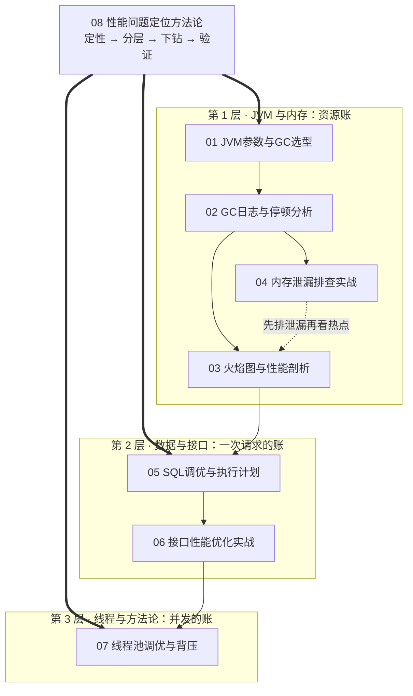

# 12 · 性能工程

> **一句话结论**：性能工程的产出不是一个更高的 TPS，而是三笔能被人核对的账——**机器给得起多少堆**、**一次请求的时间花在哪一段**、**出事时谁的日志能作证**；本仓库已经把管道、熔断、限流、落库这些"硬件"铺好了，缺的是把三笔账变成数字的那一步。
> **阅读前置**：知道 JVM 内存分区（堆 / 元空间 / 线程栈 / 直接内存）、能读 YAML 与 Spring Boot 配置、看得懂 Docker Compose 结构即可；不需要会压测、不需要本机有 Docker——需要替代命令的地方本文都给。
> **证据基线**：B 级＝本仓库配置与代码（路径 + 行号可复核）；C 级＝本机实跑命令输出（Windows + Temurin **17.0.19**，2026-11 采集）；A 级源码摘录本篇不引（下沉到各分篇）。**所有 TPS / QPS / P99 / 火焰图 / GC 停顿数字均未在本机实测**，本文只写"怎么测、怎么读、误判在哪"。预计阅读 25 分钟。

---

## 1. 定位：性能工程在本项目要回答的三个问题

"性能"这个词在项目里通常被当成形容词用（"接口有点慢"），于是优化动作全靠猜。工程化的第一步是把它拆成三个**有明确判据**的问题，本模块的八篇就是围着这三个问题排的。

### 1.1 上线前估不准：没人把"堆 + 容器上限"这笔账写下来

先看仓库里真实存在的配置（`deploy/docker-compose/docker-compose-all.yml:224-236`，摘录）：

```yaml
  ai-chat-service:
    image: ai-cs-chat:${VERSION:-latest}
    container_name: aics-chat-service
    restart: always
    ports:
      - "8083:8083"
    environment:
      SPRING_PROFILES_ACTIVE: prod
      JAVA_OPTS: "-Xms256m -Xmx512m"
```

`JAVA_OPTS` 在 6 份 compose 里共出现 16 行，**唯一值**只有 `-Xms256m -Xmx512m`（`docker-compose-all.yml` 内 7 个业务服务分别在 175 / 193 / 214 / 236 / 254 / 275 / 294 行）。看起来"统一了"，但同仓 6 份 compose 里 `mem_limit`、`cpus:`、`deploy:` 的命中数都是 **0**：

```text
# 命令见 §4.3
mem_limit        0
cpus:            0
deploy:          0        ← 没有任何 CPU/内存上限
healthcheck     28        ← 只关心"进程还在"，不关心"够不够用"
```

容器没有内存上限时，JVM 用**宿主机**内存推算默认堆（`MaxRAMPercentage=25%`）。本机实测（C 级）：

```text
$ java -XX:+PrintFlagsFinal -version | Select-String 'MaxHeapSize|MaxRAMPercentage|UseG1GC'
   size_t MaxHeapSize       = 8514437120   {product} {ergonomic}
   double MaxRAMPercentage  = 25.000000    {product} {default}
     bool UseG1GC           = true         {product} {ergonomic}
```

8514437120 字节 = **7.93 GiB**，反推物理内存 ≈ 31.72 GiB。把账算完是这样：

```text
$ node -e "…（脚本见 §4.3）"
MaxHeapSize(ergonomic) = 8514437120 bytes = 7.93 GiB
推算物理内存 = MaxHeapSize/25% = 31.72 GiB
若 7 个业务服务各用 -Xmx512m，声明堆上限合计 = 3.50 GiB
若 7 个 JVM 都吃默认 25% 宿主内存 = 55.51 GiB （远超物理内存）
```

**判读**：最后一行说明"漏写 `-Xmx`"在 16 核 / 32G 的机器上不是风格问题而是必然 OOM；本仓恰好写了 `-Xmx512m`，所以真正的缺口不是"参数缺失"，而是**没有人把 7×512m 堆 + 每进程堆外 + MySQL/Redis/ES/Nacos 的内存加起来跟宿主机比一次**，也没有任何压测数据证明 512m 够用。

K8s 侧写了 `resources`（`deploy/k8s/` 含 services 共 27 处），但 heap 与 limit 的关系仍需人工对账。`deploy/k8s/services/ai-chat-service.yaml:91-99`：

```yaml
            - name: JAVA_OPTS
              value: "-Xms512m -Xmx512m"   # JVM 堆 512MB（AI 服务计算较多，给大一点）
          resources:
            requests:             # 调度承诺值
              cpu: "200m"
              memory: "512Mi"
            limits:               # 硬上限：AI 服务比普通服务配额高
              cpu: "1000m"
              memory: "1Gi"
```

堆就已经吃掉 `requests.memory` 的 100%；元空间、线程栈、直接内存、代码缓存一律超预算（本机一个**与本仓无关**的 Tomcat 进程实测 `Metaspace … reserved 1085440K` ≈ 1.06 GiB，可见堆外并不便宜）。其余 6 个 k8s Service 是同一形态：`-Xmx256m` 配 `requests.memory: 256Mi` / `limits.memory: 512Mi`。**"估不准"的根因是这个比例从来没被写下来过。**

### 1.2 上线后说不清：有请求层指标，没有运行时层证据

仓库的观测栈是"半条链路"：

| 有 | 真实路径 | 能给什么 |
|---|---|---|
| 指标暴露 | `tools/nacos-config/aics-shared.yml:26-38`（`include: health,info,prometheus`）+ 11 个模块 pom 的 actuator / micrometer-registry-prometheus（如 `ai-cs-chat/pom.xml:209-222`） | 每个服务 `/actuator/prometheus` 可刮 |
| 抓取 | `deploy/observability/prometheus.yml`（24 行，15s，1 个 job，**11 个 target**：`host.docker.internal:8080..8090`） | HTTP 计数、延迟直方图，JVM 基础指标 |
| 链路 | `deploy/observability/otel-collector.yaml`（20 行）+ `deploy/observability/tempo.yaml`；10 个模块配置了 OTLP（如 `ai-cs-gateway/src/main/resources/application.yml:59-66`，`sampling.probability` 默认 **1.0 全采**） | 单请求分段耗时 |
| 业务落库 | `deploy/mysql/llm-observability-init.sql:12-21`（`llm_trace`）、`:29-44`（`model_usage`） | 按 `request_id` 追一次对话的 token 与总耗时 |

缺的是把数字**变成判断**的那层：

- **collector 不进 metrics**：`otel-collector.yaml` 只有 otlp receiver → tempo exporter，没有 metrics pipeline / prometheus exporter，所以 JVM 指标只能靠 Prometheus 直刮，链路侧和指标侧天然对不上时间轴。
- **没有面板、没有告警**：`deploy/observability` 整棵树只有 4 个文件（prometheus.yml / otel-collector.yaml / tempo.yaml / grafana provisioning 的数据源），`grafana` 下的 dashboard 与 alert 命中数是 **0**。
- **耗时只有总数**：`llm_trace.total_duration_ms` 是一整段，`model_usage` 只有 input/output/total tokens 与 `estimated_cost`，没有"检索多久 / 首 token 多久 / 生成多久"的分段列。
- **GC 日志 0 命中**：全仓 `Xlog:gc|PrintGCDetails|HeapDumpOnOutOfMemoryError` 命中 **0 行**。"服务每 5 分钟卡两秒"这类问题，事后**没有任何证据可用**（`llm_trace` 只能证明"慢"，不能证明"为什么慢"）。

### 1.3 出问题查不到：事前没留证，事后只能赌运气

全仓 `async-profiler|StartFlightRecording` 命中 **0** 行，没有 heap dump 参数，没有 `-XX:+ExitOnOutOfMemoryError`。能救命的只剩 JDK 自带工具——它们**不需要 docker，也不需要重跑服务**。本机实测（C 级，取数对象是本机一个与本仓无关的 Tomcat 进程，只为演示方法）：

```text
$ jps -l
7892 org.apache.catalina.startup.Bootstrap

$ jcmd 7892 GC.heap_info
 PSYoungGen      total 864768K, used 307990K
  eden space 837632K, 33% used
  from space 27136K, 98% used        ← 注意：这不等于泄漏
 ParOldGen       total 224768K, used 39791K
 Metaspace       used 38753K, capacity 39356K, committed 39680K, reserved 1085440K

$ jcmd 7892 Thread.print | 按线程名前缀分组统计
14 GC / 10 DefaultQuartzScheduler_Worker / 8 C2 / 5 Thread / 4 C1 / 3 CacheScheduler_Worker
```

**判读**：`from space 98% used` 只代表"上一轮 Minor GC 后存活对象快填满 survivor"，是回收节奏的瞬态，不是泄漏证据；线程按前缀分组能一眼看出"谁在偷偷开线程"（这 14 个 `GC` 线程来自 ParallelGC 的并行回收线程，不是业务线程）。**结论：取证链在本机可用**（`jps/jcmd/jstat/jstack/jmap` 全在 `D:\DevTools\jdk\jdk17.0.19\bin\`），前提是故障发生时进程还活着、还有人知道敲哪条命令。

> 上面三种现象指向同一件事：**能力有、管道有、证据没有。** 所以本模块不按"优化技巧"组织，而按「资源账（第 1 层）→ 请求账（第 2 层）→ 证据链与并发（第 3 层）」组织。

### 1.4 证据边界（先说清什么能核、什么不能核）

| 级别 | 含义 | 本文中的量 |
|---|---|---|
| A | `learning-docs/24-源码分析/assets/source/` 里的 JDK / 框架源码摘录 | 本篇 **0** 处；源码锚点下沉到 01 / 02 / 07 分篇 |
| B | 本仓库配置与代码，路径 + 行号可逐行复核 | 20+ 处（compose / k8s / application.yml / prometheus.yml / SQL DDL / redis.conf） |
| C | 本机实跑命令输出（可自行复现） | 5 组：`PrintFlagsFinal`、`jcmd`、`node` 算术、`Select-String` 统计、`jps` |
| 未实测 | 需要运行中的服务或压测环境才能得到 | 任何 TPS / QPS / P99、GC 停顿时长、火焰图、Pod 内存曲线、慢查询耗时 |

---

## 2. 模块地图：三层 + 一个方法论入口



**读图说明**：

- **粗箭头（`==>`）是入口**：08 不是"最后一篇总结"，而是真正的起点——它给的是"先定性、再分层、只下钻一层、拿到证据再下结论"的顺序，没有这个框架，读 01 很容易退化成抄参数。
- **第 1 层内部是因果链**：01 决定"给多少堆、用哪个回收器"，才有 02 的"日志长什么样、停顿算不算长"；02 分叉到 04（老年代持续上涨 → 查泄漏）和 03（GC 正常但 CPU 高 → 查热点）。
- **跨层只有一条主轴**：03（火焰图）→ 05（看到 JDBC 占比高就去下钻 SQL）→ 06（单条 SQL 好了再看接口整体的缓存 / 批量 / 序列化）→ 07（接口本身够快，但并发一上来就雪崩，问题在池子与背压）。
- **虚线是回流**：04 确认泄漏后仍要 03 定位"谁在分配"，因为 dump 只告诉你"什么对象多"，不告诉你"哪段代码造的"。

三层责任对照：

| 层 | 管的账 | 本项目语境下的典型问题 | 要动的真实文件 |
|---|---|---|---|
| 第 1 层 JVM 与内存 | 机器给得起多少堆、停顿多长 | `-Xmx512m` 够不够；堆外是否挤爆 `limits.memory: 1Gi`；老年代为什么只涨不降 | compose 的 `JAVA_OPTS`、`deploy/k8s/services/*.yaml` 的 resources、Dockerfile |
| 第 2 层 数据与接口 | 一次请求的时间花在哪 | 分页深翻、N+1、缓存命中率、SSE 首 token 太慢 | MP `PaginationInnerInterceptor` 四处配置、`aics.cache` 段、`ResilientAiService` 流式链 |
| 第 3 层 线程与方法论 | 并发下的排队、拒绝与定位顺序 | Tomcat 200 线程 + 无界队列；`CompletableFuture` 共用 commonPool；熔断/超时/重试参数互相打架 | `ai-cs-chat/src/main/java/com/aics/chat/config/ObservabilityExecutorConfig.java`、`ai-cs-chat/src/main/resources/application.yml` 的 resilience4j 段 |

**推荐阅读顺序**：`08 → 01 → 02 → (04 | 03) → 05 → 06 → 07`，然后**回填**：每读完一篇，回到本文 §4 的资产/缺口表勾一项，确认自己"能在本仓库指出证据在哪"。反过来（从 01 顺序读到 08）也能读通，但会缺一个判断"我现在该看哪一层"的坐标系。

同一句"系统很慢"，落到不同层对应完全不同的动作。这张对照表是读完 08 之后应该能自己画出来的：

| 症状 | 先看哪一层 | 第一条命令 / 第一个证据 | 常见误判 |
|---|---|---|---|
| 每隔几分钟整体卡顿 1–2 秒 | 第 1 层（GC） | `jstat -gcutil <pid> 1000` 看老年代与 FGC 计数 | 直接加 `-Xmx`，把停顿从"频繁短停"变成"稀少长停" |
| 内存缓慢上涨、最终 OOMKilled | 第 1 层（泄漏） | `jcmd <pid> GC.heap_info` 连续两次对比 old 区 | 把"survivor 满"当成泄漏 |
| CPU 100% 但 GC 正常 | 第 1 层（热点） | `jcmd <pid> JFR.start duration=60s`（本仓未配 profiler） | 只看线程数，不看"谁在烧 CPU" |
| 单个接口 P99 高、均值正常 | 第 2 层（接口/数据） | Tempo 找 P99 那条 trace，看 span 断点 | 用平均值解释长尾 |
| 并发一上来就雪崩、排队变长 | 第 3 层（线程/池） | `jcmd <pid> Thread.print` 看线程是否都卡在同一处 | 盲目扩实例，掩盖下游瓶颈 |
| 上游慢导致本服务线程被占满 | 第 3 层（超时/熔断） | 看 CB 状态与 TimeLimiter 配置（`application.yml:77-87`） | 把超时调大当"修复" |

---

## 3. 八篇一句话摘要

| 篇 | 解决什么问题 | 本项目对应资产或缺口 | 证据类型 |
|---|---|---|---|
| 01 JVM 参数与 GC 选型 | `-Xms/-Xmx/元空间/回收器`到底怎么定，容器里为什么不能用默认值 | 有：7 服务统一 `-Xms256m -Xmx512m`（compose）+ k8s 按服务区分；缺：无 `MaxRAMPercentage`、无容器感知显式声明、无 `ExitOnOutOfMemoryError` | B（compose / k8s）+ C（`PrintFlagsFinal`） |
| 02 GC 日志与停顿分析 | 停顿多少算长、日志里哪几列才是判据 | **缺口**：全仓 GC 日志参数 0 命中；能临时补救的只有 `jcmd GC.heap_info` / `jstat -gcutil` | B（0 命中的核查）+ C（`jcmd`） |
| 03 火焰图与性能剖析 | CPU 高但 GC 正常时，怎么找到那一行代码 | **缺口**：无 async-profiler / JFR 配置，只能事后用 `jcmd <pid> JFR.start` 抓一次 | C（JFR 取证法，本篇未实跑采样） |
| 04 内存泄漏排查实战 | 老年代只涨不降怎么证明是泄漏、怎么定位 | 有：`usageExecutor`/`evalExecutor` 队列上限 1000/500（可观察排队）；缺：无 heap dump 参数、OOM 时什么都没留下 | B（线程池配置）+ C（`GC.heap_info` 读法） |
| 05 SQL 调优与执行计划 | 一条 SQL 慢在哪一步、索引为什么没走 | 有：MP 分页拦截器 4 处（防全表）、Hikari `maximum-pool-size: 10` 显式配置；缺：无慢查询样本、无 `EXPLAIN` 基线 | B（配置与拦截器）+ 未实测（真实执行计划） |
| 06 接口性能优化实战 | 接口 rt 高是算得慢、等得久，还是传得多 | 有：SSE 流式 + TTFT 打点（`firstTokenMs` 进 observation）、两级缓存配置；缺：无分段耗时、无基线 | B（`ResilientAiService` / `aics.cache`） |
| 07 线程池调优与背压 | 并发上来后排队/拒绝/雪崩怎么算、怎么配 | 有：2 个自定义 `ThreadPoolTaskExecutor`、Resilience4j 熔断+超时+重试、Sentinel 入口限流 1 处；缺：Tomcat/池参数全是默认、`@Async` 0 处、`CompletableFuture` 无自定义 executor | B（配置与代码）+ C（池语义模拟脚本） |
| 08 性能问题定位方法论 | 拿到"慢"这个模糊词后的固定动作序列 | 有：Prometheus 11 target + Tempo 链路可作第一手分层；缺：无 RCA 模板、无告警 | B（观测栈）+ 方法论（无实测数据） |

---

## 4. 本项目性能资产与缺口

### 4.1 已落地、能拿来用的资产

| 能力 | 真实路径 | 能回答 | 不能回答 |
|---|---|---|---|
| Actuator + Prometheus 指标暴露 | `tools/nacos-config/aics-shared.yml:26-38`；`ai-cs-chat/pom.xml:209-222`（其余 10 模块同构） | "这台实例现在多少请求、JVM 用了多少堆" | 没有面板，得手写 PromQL |
| 11 target 抓取 | `deploy/observability/prometheus.yml`（`scrape_interval: 15s`） | 全服务一张时间轴 | 15s 粒度抓不到秒级抖动；无 recorder 规则 |
| 链路追踪 | `deploy/observability/otel-collector.yaml`、`deploy/observability/tempo.yaml`、`ai-cs-gateway/src/main/resources/application.yml:59-66` | 单请求在网关 / 服务 / 下游各花多久 | 只收 traces，不含 metrics |
| 业务耗时落库 | `deploy/mysql/llm-observability-init.sql:12-21`（`llm_trace`，`request_id` 幂等键 + `total_duration_ms` + `spans_json`）、`:29-44`（`model_usage`，token 与 `estimated_cost`） | 事后按 id 复盘一次对话的成本与总时长 | 无分段耗时列；token 计费是 `estimated` 估算 |
| 超时 / 重试 / 熔断 | `ai-cs-chat/src/main/resources/application.yml:77-87`（TimeLimiter 30s / 60s / 5s）、`:91-113`（retry 3 次、指数退避 1s×2）、`:114-159`（CB 窗口 10 次、失败率 50%、open 30s） | "上游慢不要拖垮自己" | 参数没有压测依据，30s 是否等于 Tomcat 线程占用 30s 未验证 |
| 入口限流 | `ai-cs-chat/src/main/java/com/aics/chat/controller/ChatController.java:79`（全仓**唯一**一处 `@SentinelResource`，资源名 `SentinelRules.RESOURCE_CHAT_SEND`）+ 网关 Redis 令牌桶 | 保护最贵的那个接口 | 其余 10 个服务无入口限流 |
| 可观测的线程池 | `ai-cs-chat/src/main/java/com/aics/chat/config/ObservabilityExecutorConfig.java:27-40`（`usageExecutor` core 1 / max 4 / queue 1000）、`:47-59`（`evalExecutor` core 1 / max 2 / queue 500） | 异步上报与在线评估不会打爆主流程 | 两个池都不在 Prometheus 面板上（无 `metrics` 面板） |
| 缓存容量护栏 | `deploy/redis/redis.conf:24-25`（`maxmemory 256mb` + `allkeys-lru`）；`ai-cs-chat/src/main/resources/application.yml:179-193`（vector L1 4096 条 / 168h、semantic 0.92 / 200 条、hot-qa 3 次晋升 / 24h） | 缓存不会无限涨 | 256MB 够不够、LRU 淘汰率多少，无数据 |
| 压测脚本 | `scripts/loadtest/k6/sse-chat.js`（阶梯至 20 VU，看 `http_req_waiting`）、`scripts/loadtest/k6/gateway-rate-limit.js`（30 req/s 打穿 `replenish-rate=5`）、`scripts/loadtest/README.md` | 有现成场景可跑 | 没有任何一次跑出的基线数值入库 |
| 自动分页 | `ai-cs-knowledge/src/main/java/com/aics/knowledge/config/MybatisPlusConfig.java:38`、`ai-cs-message/src/main/java/com/aics/message/config/MybatisPlusConfig.java:34`、`ai-cs-order/src/main/java/com/aics/order/config/OrderConfig.java:27`、`ai-cs-product/src/main/java/com/aics/product/config/MybatisPlusConfig.java:22` | 分页 SQL 自动改写，避免全表回传 | 深翻页仍是 `LIMIT offset`，不解决 |

### 4.2 明确的缺口（都核过，不是推测）

| 缺口 | 怎么确认的（可复现） | 后果 | 补起来的最小动作 |
|---|---|---|---|
| 无 GC 日志 | 全仓 `Xlog:gc`/`PrintGCDetails` 命中 0 行 | 停顿、晋升失败、Full GC 全部无法归因 | Dockerfile 里加 `-Xlog:gc*:file=/tmp/gc.log:time,uptime:filecount=5,filesize=20m` |
| JVM 指标不进 collector | `otel-collector.yaml` 仅 traces 管道 | 指标与链路无法在同一视图中对齐 | collector 加 prometheus receiver + exporter，或维持直刮但补 recorder |
| 无 profiler / JFR / heap dump | `async-profiler`、`StartFlightRecording`、`HeapDumpOnOutOfMemoryError` 命中 0 | CPU 热点靠猜；OOM 后无现场 | 加 `-XX:+HeapDumpOnOutOfMemoryError -XX:HeapDumpPath=…`；按需 `jcmd <pid> JFR.start duration=60s` |
| 无压测基线 | `scripts/loadtest/` 有脚本、无任何结果文件；README 自己写明"别本机既压又被测" | 无法回答"这版比上版慢了吗" | 独立环境跑一次 `sse-chat.js`，把 P50/P95/TTFT 写进 `scripts/loadtest/README.md` |
| 无告警规则 | `deploy/observability` 下 dashboard / alert 关键字 0 命中 | 出事靠用户投诉 | 先加 3 条：堆使用 > 80%、接口 P99 超预算、熔断器 open |
| 无 CI 性能门禁 | `mvn verify` 只跑 JaCoCo 覆盖率门禁（行 40% / 分支 30%），无 JMH、无压测 job | 性能退化能进主干 | 至少加"启动后 `/actuator/prometheus` 冒烟 + 关键接口基准断言" |
| 池参数全默认 | 11 个模块 `src/main/resources/application.yml` 里 `hikari|max-threads|accept-count|tomcat:` 命中 **0** | Tomcat `maxThreads=200` + 无界排队；DB 池 10 是写在 Nacos 侧的 | 把 `server.tomcat.*`、Hikari 参数与压测结论绑定后显式写死 |
| 异步没有专属池 | `@Async` 全仓 **0** 处；`CompletableFuture.supplyAsync` 在 `ai-cs-chat/src/main/java/com/aics/chat/service/impl/ResilientAiService.java:176`、`:255`、`:382` 三处都**不传 executor** | 与 Tomcat 共用 `ForkJoinPool.commonPool`（本机 `availableParallelism=16`），一慢全慢 | 显式传 `usageExecutor` 之外的独立业务池，并给拒绝策略 |

> DB 连接的现状补一句：`tools/nacos-config/ai-cs-knowledge.yml:6-12` 显式写了 `maximum-pool-size: 10`、`minimum-idle: 2`、`connection-timeout: 30000`、`max-lifetime: 1500000`，message / mq / order / pay / product 5 份同构；`ai-cs-user` 走 ShardingSphere 驱动，池参数不在该文件里。**"10 条连接 × N 个实例"是否撑得住，同样没有数据。**

### 4.3 本机就能跑的核对命令（不需要 Docker，也不需要启动服务）

**① 看 JVM 自己怎么算堆**

```powershell
java -XX:+PrintFlagsFinal -version | Select-String 'MaxHeapSize|InitialHeapSize|MaxRAMPercentage|UseG1GC|ActiveProcessorCount'
```

```text
   size_t InitialHeapSize      = 532676608    {product} {ergonomic}
   size_t MaxHeapSize          = 8514437120   {product} {ergonomic}
   double MaxRAMPercentage     = 25.000000    {product} {default}
     bool UseG1GC              = true         {product} {ergonomic}
      int ActiveProcessorCount  = -1           {product} {default}
```

判读：`{ergonomic}` 表示"JVM 自己算的"，`{default}` 表示默认值——**只有 `{command line}` 才是你在 `JAVA_OPTS` 里写下的**。想知道某个服务的真实生效值，必须进容器用同样的命令看，不要在宿主机上推断。误判风险：本机 16 核 / 32G 的结论不能搬到 2C4G 的 Pod 上，`MaxHeapSize` 随机器变。

**② 数"缺口"到底有多少（可写进周报）**

```powershell
# 资源限制
foreach ($p in 'mem_limit','cpus:','deploy:','healthcheck') {
  "$p`t" + (Select-String -Path deploy\docker-compose\*.yml -Pattern $p).Count }
# GC 日志 / profiler 参数
(Get-ChildItem -Recurse -Include *.yml,*.yaml,Dockerfile -File |
  Where-Object { $_.FullName -notlike '*learning-docs*' } |
  Select-String -Pattern 'Xlog:gc|PrintGCDetails|HeapDumpOnOutOfMemoryError|async-profiler|StartFlightRecording').Count
```

```text
mem_limit       0
cpus:           0
deploy:         0
healthcheck     28
0
```

判读：数字为 0 是**结论**，不是"我没找到"——命令里已经排除了文档目录，`Dockerfile` 也在扫描范围内，所以"没有 GC 参数"这件事是可核对的。误判风险：`-Include` 只覆盖这几类后缀，如果有人把参数写进 `.env` 或 shell 脚本，需要把 `.env`、`.sh` 加进去再跑一遍。

**③ 给活着的进程取证（本机 `jps` 能看到的任何 JVM）**

```powershell
jps -l
jcmd <pid> VM.flags | Select-String 'MaxHeapSize|UseG1GC|ParallelGCThreads'
jcmd <pid> GC.heap_info
jcmd <pid> Thread.print | Select-String '^"' |  # 再按前缀分组
```

```text
$ jcmd 7892 VM.flags
-XX:CICompilerCount=12 -XX:InitialHeapSize=532676608 -XX:MaxHeapSize=8512339968
-XX:MaxNewSize=2837446656 -XX:+UseCompressedOops -XX:+UseParallelGC
```

判读：`MaxHeapSize` 与 ① 里的 8514437120 差 ~2MB，是因为对齐到 region/页；差得多就说明启动脚本里另有 `-Xmx`。误判风险：`jcmd` 需要与目标进程**同用户、同架构**，容器内进程要在容器内或宿主机 PID 命名空间下才看得到；`jmap -histo:live` 会触发一次 Full GC，**别在生产随手敲**。

**④ 并发容量先做算术，再谈压测**

在没有压测环境的情况下，"能扛多少"至少可以先算出一个上限——这是**算术，不是实测数字**：

```powershell
node -e "
const threads=200, limit=30;
console.log('Tomcat maxThreads='+threads+', TimeLimiter='+limit+'s ⇒ 最多 '+threads+' 个请求同时在飞');
for (const rt of [0.3,1,3,10]) console.log('平均 rt='+rt+'s ⇒ 理论吞吐上限 = '+threads+'/'+rt+' = '+(threads/rt).toFixed(1)+' rps');
console.log('若 30 个请求卡在 30s 超时上 ⇒ 占用线程 30 个，剩余可用 '+(threads-30)+' 个；排队请求无上限（默认无界队列）');
"
```

```text
Tomcat maxThreads=200, TimeLimiter=30s ⇒ 最多 200 个请求同时在飞
平均 rt=0.3s ⇒ 理论吞吐上限 = 200/0.3 = 666.7 rps
平均 rt=1s ⇒ 理论吞吐上限 = 200/1 = 200.0 rps
平均 rt=3s ⇒ 理论吞吐上限 = 200/3 = 66.7 rps
平均 rt=10s ⇒ 理论吞吐上限 = 200/10 = 20.0 rps
若 30 个请求卡在 30s 超时上 ⇒ 占用线程 30 个，剩余可用 170 个；排队请求无上限（默认无界队列）
```

判读：这组数字（用 Little 定律 `并发 = 吞吐 × 响应时间` 反推）说明 SSE 场景下"rt 从 1s 涨到 3s，吞吐掉 3 倍"，而 `chat` 的 TimeLimiter 给到 30s（`application.yml:77-79`）、`sseChatService` 给到 60s（`:81-83`）——**只要下游慢一会儿，200 个线程就全被"合法地"占住 30 秒**，后面的请求进无界队列无限等待。误判风险：`200` 是 Spring Boot 对 Tomcat 的默认值，本仓 11 个模块的 `application.yml` 里 `max-threads` 命中 0（见 ②），所以"默认"就是"生产值"；而 rt 分布不是均值，实际排队按 P99 而非 P50 发生——真要结论必须压测。

---

## 5. 两条路线：按你现在的处境选一条

### 5.1 路线 A · 线上排障（48 小时时间盒）

适用于"已经在出事、需要给人一个交代"。核心原则：**每一步只下钻一层，每层必须留下证据**。

| 时段 | 目标 | 动作（可直接照抄） | 判据 |
|---|---|---|---|
| 0–0.5h | 定性 | 是"全站慢"还是"某个接口慢"？从什么时候开始？最近一次发布 / 配置变更是什么 | 能一句话说清范围与起点 |
| 0.5–2h | 分层 | Tempo 找一条慢请求看各 span；Prometheus 看接口 rt 分位与错误率是否同时抬升 | 能指出"慢在网关 / 服务内 / 下游"哪一段 |
| 2–8h | 反证 | GC：`jcmd GC.heap_info` + `jstat -gcutil <pid> 1000` 看趋势；线程：`jcmd Thread.print` 按前缀分组；数据：慢 SQL + 执行计划 | 得到"是 GC / 是等下游 / 是排队 / 是 DB"的结论 |
| 8–24h | 复现与止损 | 用 `scripts/loadtest/k6/sse-chat.js` 在**非生产**环境复现；止损优先（限流阈值、熔断、扩容、回滚） | 复现步骤与线上现象一致 |
| 24–48h | 收口 | 一条 RCA（时间线 + 根因 + 证据链接）+ 一条告警 + 一条参数修订（带压测依据） | 下次同类问题能在 1 小时内发现 |

### 5.2 路线 B · 系统性建设（3 周）

适用于"还没出事，但说不清余量"。产出物都是**仓库里的文件**，不是 PPT。

| 周 | 主题 | 交付物（落到真实路径） | 完成判据 |
|---|---|---|---|
| 第 1 周 | 资源账 | 一张表：7 个服务的 `-Xmx` / 堆外估算 / `requests.memory` / `limits.memory` / 期望 QPS；同步修订 `deploy/docker-compose/docker-compose-all.yml` 与 `deploy/k8s/services/*.yaml` | 每个服务的"堆 / 堆外 / limit"三列都有数字，且 `堆 + 堆外 < limit` |
| 第 2 周 | 证据链 | 统一 GC 日志参数（Dockerfile / compose 一处改全量生效）；JFR 按需采集的 runbook；跑一次 `scripts/loadtest/k6/sse-chat.js` 并把 TTFT / P95 写入 `scripts/loadtest/README.md` | 随便挑一个"变慢"的投诉，能用 GC 日志 + 链路 + 基线三方对齐 |
| 第 3 周 | 门禁与告警 | Prometheus 告警规则 3 条起步 + Grafana 面板（JVM 内存 / GC 暂停 / 接口 P99 / 熔断状态）；CI 里加冒烟基准 | 告警能触发一次演练；退化版本能被打回 |

---

## 6. 依赖关系

| 方向 | 文档 | 为什么从这里进来 |
|---|---|---|
| 上游入口 | [00-学习路线总览/README.md](../00-学习路线总览/README.md) | 不知道整体顺序与当前技术缺口时，先看总览 |
| 前置 | [01-Java基础/03-JVM内存模型与GC实战.md](../01-Java基础/03-JVM内存模型与GC实战.md) | 不知道堆/元空间/线程栈各占多少，01、02 两篇会读成参数手册 |
| 前置 | [01-Java基础/04-并发编程进阶.md](../01-Java基础/04-并发编程进阶.md) | 07 篇的队列、拒绝策略、`CompletableFuture` 语义都在这里 |
| 强相关 | [07-运维部署/04-Prometheus可观测性.md](../07-运维部署/04-Prometheus可观测性.md) | 指标怎么暴露、怎么刮、PromQL 怎么写；本文只说"有什么资产" |
| 强相关 | [07-运维部署/06-优雅停机与零丢失滚动更新.md](../07-运维部署/06-优雅停机与零丢失滚动更新.md) | 停机与"慢请求"经常被混为一谈；`timeout-per-shutdown-phase: 30s` 与 TimeLimiter 30s 会互相影响 |
| 强相关 | [13-稳定性工程/02-容量规划与性能预算.md](../13-稳定性工程/02-容量规划与性能预算.md) | 性能工程的"预算"从哪来：SLI/SLO 与容量水位 |
| 强相关 | [13-稳定性工程/07-告警治理.md](../13-稳定性工程/07-告警治理.md) | 本文 §5.2 第 3 周的告警怎么设计才不吵 |
| 下游基础 | [03-数据库与ORM/02-MyBatisPlus实战.md](../03-数据库与ORM/02-MyBatisPlus实战.md) | 05 篇的分页、条件构造器、拦截器顺序 |
| 下游基础 | [11-数据结构与算法/09-缓存淘汰-LRU-LFU与两级缓存.md](../11-数据结构与算法/09-缓存淘汰-LRU-LFU与两级缓存.md)、[10-限流算法-四大算法与网关实现.md](../11-数据结构与算法/10-限流算法-四大算法与网关实现.md) | `allkeys-lru`、令牌桶、Sentinel 的实现层原理 |
| 配套工具 | [08-测试/05-性能压测实战-k6与JMeter.md](../08-测试/05-性能压测实战-k6与JMeter.md) | 基线怎么跑、报告怎么写；`scripts/loadtest/` 的脚本逐段精读在这篇 |

一句话记忆：**JVM 基础决定你能不能读懂 02/04；Prometheus 决定你有没有第一手数据；稳定性工程决定你的"慢"到底该对齐哪个预算。**

---

## 7. 检查点清单

读完本模块，逐条打勾；每条都给了"怎么证明你会了"。

- [ ] 能说出 `-Xms/-Xmx` 在容器里为什么不能靠默认值，并能用 `java -XX:+PrintFlagsFinal -version` 指出哪个值是 `{command line}`、哪个是 `{ergonomic}`。
- [ ] 能在本仓库指出 7 个业务服务的 `JAVA_OPTS` 写在哪，以及 compose 与 k8s 两套配置的数值为什么不一样（compose 256/512，k8s chat 512/512）。
- [ ] 能对 `deploy/k8s/services/ai-chat-service.yaml` 写出"堆 + 堆外 vs limits"的算式，并指出当前哪个数字最可能先撞线。
- [ ] 能在不重启服务的前提下，用 `jcmd` 拿到堆使用、线程列表、GC 分代占用三份证据。
- [ ] 能解释为什么"`from space 98% used`"不能作为内存泄漏的证据。
- [ ] 能说出本仓库为什么看不到 GC 停顿（0 条 GC 日志参数），并写出要加的完整参数。
- [ ] 能画出一次 SSE 对话请求的耗时分层（网关 → 服务 → 检索 → 模型首 token → 生成），并指出哪一段有现成打点、哪一段没有。
- [ ] 能算出 `chat` 服务在 `-Xmx512m` + Tomcat 200 线程下，最坏情况有多少请求在排队，以及为什么"无界队列 = 无限等待"。
- [ ] 能说明 `CompletableFuture.supplyAsync` 不传 executor 时用的是哪个池，以及它和 Tomcat 抢线程的后果。
- [ ] 能列出给这套系统补"性能门禁"的最小三件事，并说明每一件的验收方式（不许写"加个监控"）。
- [ ] 能在没有 Docker 的机器上，独立完成一次"配置缺口统计 + JVM 取证"并给出结论。

---

## 8. 诚实清单

| 断言 | 状态 | 说明 |
|---|---|---|
| 本机无 `docker` / `docker-compose` / `kubectl` | ✅ 已核 | 三个命令探测结果均为 MISSING |
| 本机**有** `mvn` | ⚠️ 与常见说法相反 | `Apache Maven 3.9.16`（Java 17.0.19），所以"编译验证"在本机可行；但**没有**任何服务在跑 |
| 本机 JDK 版本 | ✅ 已核 | `openjdk 17.0.19` / Temurin-17.0.19+10 —— **不是 21**；而 `ai-cs-product/Dockerfile:1` 用的是 `eclipse-temurin:21-jre-alpine`，仓库内存在 17/21 双基线，读参数时必须先确认目标镜像 |
| 无运行中的本仓服务 | ✅ 已核 | `jps -l` 只有一个与本仓无关的 Tomcat（本机另一个项目），所以本文所有"运行中取证"演示都标了"对象不是本仓服务" |
| 所有 TPS / QPS / P99 / 火焰图 / GC 停顿数字 | ❌ 未实测 | 需要运行中的服务 + 独立压测机；本机既不能起 compose，也没有 Docker，且压测与被测同机等于自欺（`scripts/loadtest/README.md` 已写明） |
| `prometheus.yml` 的 11 个 target 是否真的都 UP | ❌ 未实测 | 只能静态确认配置形态；要确认得启动观测栈后看 `/targets` 页 |
| §4.1 表里"能回答什么" | ⚠️ 部分为设计意图 | 指标暴露 = 代码里存在依赖与端点配置（B 级可核）；"抓得到、看得懂"取决于部署环境是否真跑起来 |
| §5.2 第 2 周"跑一次压测写进 README" | 📋 计划 | 本文写作时仓库内没有基线数值，`scripts/loadtest/README.md` 也只有脚本说明 |
| 本文的 C 级输出 | ✅ 可复现 | 全部在本文 §4.3 给了完整命令；环境差异（核数、内存、JDK 版本）会改变具体数值，判断方法不变 |

> 维护约定：任何一条从"缺口"变成"已落地"时，请同时更新 §4.1 / §4.2 两表与本节状态列——**性能文档最容易腐化的地方，就是把"计划"写成"已经"**。
