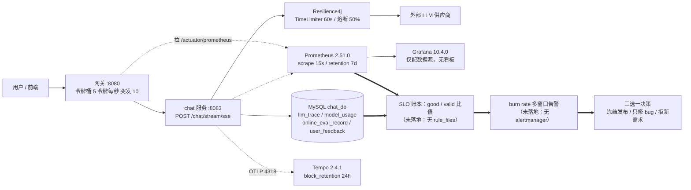
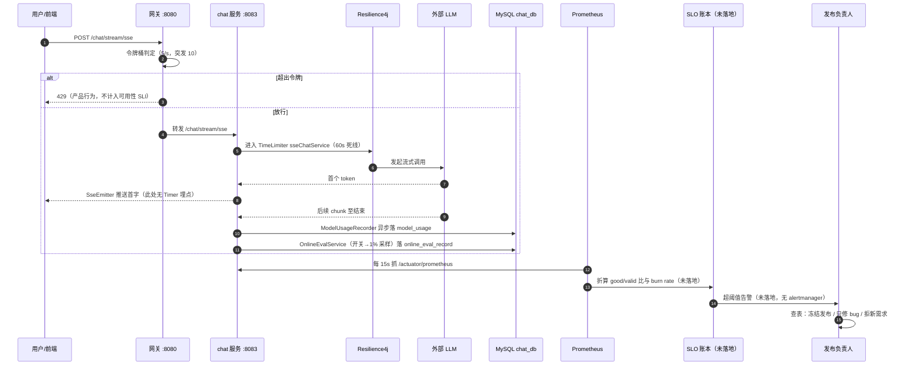

# SLI · SLO 与错误预算：把「该不该发布」变成一次查表

> **一句话结论**：SLO 本身不产生任何可靠性，它的全部价值在于能在三个时刻替你拍板——该不该发布、该不该放下手上的需求去修 bug、该不该拒绝新需求；一旦它只躺在文档里没人拿它否决过一次发布，它就等于不存在。
> **阅读前置**：知道 Micrometer / Actuator 是什么、能读最基础的 PromQL、了解 Resilience4j 的超时与熔断在做什么（不熟先读 [05-降级预案与开关治理](./05-降级预案与开关治理.md)）。
> **证据基线**：Spring Boot 4.2.0 / Micrometer 1.18.0 / micrometer-tracing 1.8.0 / OpenTelemetry 1.68.0 / Spring AI 2.1.0 / Resilience4j 2.4.0 / Prometheus 2.51.0 / Grafana 10.4.0 / Tempo 2.4.1 / JDK 17.0.19 / Node 24.16.0；证据 A 2 条 · B 20 条 · C 1 组（node 实算）；预计阅读 45 分钟。

## 证据边界

本篇涉及的能力在本仓库冷热不均，先把边界钉死，避免把「有代码」读成「已运行」。

| 类别 | 本仓状态 | 本篇怎么处理 |
|---|---|---|
| SLI 供数通道（Prometheus 抓取） | ✅ 已入库：`deploy/observability/prometheus.yml` 配了 11 个 target、15s 抓取 | 直接引行号 |
| 业务自定义指标（首 token 时延、AI 打分） | ❌ 未入库：668 个 Java 文件里 `MeterRegistry` 命中 0 | 写成「缺口 + 最小补法」，不假装已有 |
| 记录规则 / 告警规则 | ❌ 未入库：该文件全文 24 行，无 `rule_files`、无 `alerting` | 只给目标态 YAML 并标注「未落地」 |
| Alertmanager | ❌ 未入库：`deploy/docker-compose/docker-compose-observability.yml` 里没有该服务 | 告警只讲「阈值怎么算」和「怎么判读」，不讲路由配置 |
| SLO 文档 / 错误预算账本 | ❌ 未入库：全仓 `SLO` 字样只命中 1 处注释 | 明确说「本仓没有 SLO」，不虚构目标值 |
| AI 质量数据（线上评估） | ⚠️ 半落地：代码与 5 张表齐备，但开关默认 false 且全仓无配置项 | 只讲清分子分母怎么取，不讲「已产出分数」 |
| 离线评测门禁（RAG eval） | ✅ 已入库：四门禁 + P95 计算 | 反复强调它 ≠ 线上 SLO |
| 本机可执行性 | ✅ node 24.16.0 / pwsh / JDK 17.0.19；❌ 无 docker、不许联网 | C 级只做纯算术；要跑服务的命令标「未本机实测」 |

---

## 0. 先看现象

### 现象一：想知道「上周 chat 接口可用性多少」，仓库给不出分子

查任何一本 SLO 教材，第一步都是「先有可测量的事件比」。本仓库在指标侧的真实情况是这样：

```text
PS> $m = Get-ChildItem -Recurse -Filter *.java -Path ai-cs-* | Where-Object { $_.FullName -notmatch 'learning-docs' }
PS> "java 文件数: " + $m.Count
java 文件数: 668
PS> "MeterRegistry 命中: " + ($m | Select-String -Pattern 'MeterRegistry' | Measure-Object).Count
MeterRegistry 命中: 0
PS> "Timer.builder 命中: " + ($m | Select-String -Pattern 'Timer\.builder' | Measure-Object).Count
Timer.builder 命中: 0
```

668 个 Java 文件里没有一行手工埋点。这意味着 `/actuator/prometheus` 暴露出来的只有框架自动给的 HTTP 指标（`http_server_requests_seconds_*`、JVM、连接池），而**客服系统真正关心的两件事——用户等多久看到第一个字、AI 答得对不对——一条指标都没有**。SLI 分子缺失，SLO 无从谈起：你无法为「没测的东西」定目标。

### 现象二：故障复盘时没人能回答「这个月还能不能发版」

第二个现象不是缺指标，而是缺规则。整个采集端的配置只有 24 行：

```text
PS> Select-String -Path deploy\observability\prometheus.yml -Pattern 'rule_files|alerting|alertmanager'
PS> (Get-Content deploy\observability\prometheus.yml).Count
24
```

第一条命令没有任何输出——不是命令写错，是文件里真的没有这三个词：没有 `rule_files`（记录规则/告警规则的入口），没有 `alerting`（Alertmanager 地址），也就没有记录规则去把原始计数器折算成「已消耗预算」。第二条命令说明这个文件除了 `global` 和一个 `static_configs` 列表之外什么都没有。

于是「发版还是不发版」这个问题，只能靠会议上的嗓门决定。SLO 讨论要解决的正是这一点：把决策从「谁声音大」换成「查表」。

### 现象三：「AI 最近答得变差了」只能当感觉讲

客服系统还有一个普通服务没有的 SLI 维度：答案质量。本仓库为此准备了完整的落地面——5 张表、LLM-as-Judge 打分器、采样器——但线上的开关是关的：

- `ai-cs-chat/src/main/java/com/aics/chat/observability/OnlineEvalProperties.java#L26` 里 `private boolean enabled = false;`，默认关闭；
- `ai-cs-chat/src/main/java/com/aics/chat/observability/OnlineEvalProperties.java#L29` 里 `private double sampleRate = 0.01;`，默认只抽 1%；
- 全仓配置文件里搜不到任何 `aics.eval` 或 `sample-rate` 项（`Select-String -Path ... -Pattern 'aics\.eval|sample-rate|sampleRate'` 无输出），所以上面的默认值就是运行时真实值。

用户点踩确实能落库（`ai-cs-chat/src/main/java/com/aics/chat/controller/ChatFeedbackController.java#L50`，`POST /chat/feedback`），但它只是一个事件，没有分母、没有窗口、没有目标值——于是「变差了」永远停留在体感层。

> 这些现象指向同一件事：缺的不是监控工具，而是一条「可测量的事件比 → 目标值 → 预算余额 → 决策」的闭环。工具全都在，闭环一节都没接上。

---

## 1. 整体地图



> **读图说明**：实线箭头是「已有代码真实执行」的调用链，虚线箭头是「已存在但不构成 SLO」的旁路采集，粗箭头（`==>`）是**本篇要补但本仓库尚未落地**的链路——这是全图唯一需要你警惕的地方：如果你的眼睛顺着 `PROM ==> RULE ==> ALERT` 一路读下去，会以为「预算告警已经在跑」，实际上这条链路上每一环都空着。另外不要读错 `DB ==> RULE`：MySQL 里已有 `llm_trace`、`online_eval_record` 这些**数据**，但从没有查询把它们折算成 SLI 比值，数据在、账本不在。

| 组件 | 责任 | 参与方 | 本仓状态 |
|---|---|---|---|
| 网关（`ai-cs-gateway/src/main/resources/application.yml#L48-L49`） | 令牌桶限流，超限返回 429 | 平台 | ✅ 已落地，参数 5 / 10 |
| chat 服务（`ai-cs-chat/src/main/java/com/aics/chat/controller/ChatController.java#L167`） | SSE 流式对话入口 | 业务 | ✅ 已落地 |
| Resilience4j（`ai-cs-chat/src/main/resources/application.yml#L71-L156`） | 超时死线 + 熔断，防雪崩 | 业务 | ✅ 已落地，3 组实例 |
| Prometheus（`deploy/observability/prometheus.yml#L2-L22`） | 抓指标，15s 一次，留 7 天 | 平台 | ✅ 已落地，⚠️ 只有默认 HTTP 指标 |
| SLO 账本 / 记录规则 | 把计数器折算成「已消耗预算」 | 平台 + 业务 | ❌ 未落地 |
| 告警（`deploy/observability/prometheus.yml` 无 `alerting`） | 越过阈值时叫人 | 平台 + oncall | ❌ 未落地 |
| 线上质量评估 | LLM-as-Judge 抽检打分 | 算法 + 业务 | ⚠️ 代码与表齐备，开关默认关 |
| 决策会（周度复盘） | 用预算余额决定发布节奏 | 研发主管 + 产品 | ❌ 未落地（无会议机制） |

---

## 2. 关键概念与关键要素

打分位前先把术语钉死。**SLI 不是「感觉服务挺好」，它是一个可测量的事件比：好事件数 ÷ 有效事件数。**

| 名称 | 位置（本仓真实落点） | 作用 | 关键参数 / 取值 |
|---|---|---|---|
| SLI（Service Level Indicator，服务水平指标） | 目前只能从 `/actuator/prometheus` 的 `http_server_requests_seconds_count` 现算 | 一个可测量的事件比，衡量「服务现在有多好」 | 分子=good event，分母=valid event，两者必须同源 |
| SLO（Service Level Objective，服务水平目标） | ❌ 无（全仓只 `ai-cs-chat/src/main/java/com/aics/chat/rag/eval/RagEvalServiceImpl.java#L210` 一处注释提到 SLO） | SLI 在某个窗口内要达到的目标值 | 典型 99.9% / 28 天；本篇按 28 天算 |
| SLA（Service Level Agreement，服务水平协议） | ❌ 无（学习项目无对外合同） | 违反目标时的外部后果（赔付/违约） | 与 SLO 的区别是「对谁承诺、违反赔什么」 |
| 错误预算（error budget） | ❌ 无账本 | `1 − SLO`，允许「不完美」的额度 | 99.9% × 28 天 = 40.32 分钟（C 级实算） |
| burn rate（预算燃烧速率） | ❌ 无告警 | 窗口错误率 ÷ 允许错误率，预算消耗的「几倍速」 | 窗口错误率 1% 且 SLO 99.9% → 10x |
| 多窗口告警 | ❌ 无 | 长窗口判「是否严重」，短窗口判「是否还在烧」 | 见 §3.4 的五组实测换算 |
| 窗口类型 | — | 滚动窗口 vs 日历月 | 滚动 28 天；日历月会让月初月末的预算口径跳变 |
| 熔断器阈值（本仓仅有的「局部质量门限」） | `ai-cs-chat/src/main/resources/application.yml#L117-L130` | 10 次调用里失败率 ≥50% 就断开 30s | `COUNT_BASED` / 10 / 3 / 50 / 30s |
| SSE 首 token 超时 | `ai-cs-chat/src/main/resources/application.yml#L81-L83` | 首 token 迟迟不到就判死 | `timeout-duration: 60s` |
| 离线评测门禁 | `ai-cs-chat/src/main/java/com/aics/chat/rag/eval/RagEvalServiceImpl.java#L183-L195` | 压测当天判「这版能不能合」 | hitRate / llmScore / p95 / 平均 token 四门禁 |
| 质量打分器 | `ai-cs-chat/src/main/java/com/aics/chat/rag/eval/LlmJudgeService.java#L60` | LLM 给答案打 1~5 分 | `score(question, answer, referenceAnswer)`，结果钳制 1~5 |

---

## 3. 原理与证据逐段精读

### 3.1 SLI 是可测量的事件比，不是形容词

- **在干什么**：把一个模糊判断（「服务好不好」）拆成两个集合的除法。可用性 SLI = 成功事件数 ÷ 有效事件数；延迟 SLI = 「耗时低于阈值的请求数」÷「全部有效请求数」。
- **为什么这么设计**：只有除法才能给出 0~1 之间的数，只有 0~1 之间的数才能和 99.9% 相减得到预算。「平均耗时 800ms」不能相减，「99.9% 之外的 0.1% = 40.32 分钟」才能相减。这就是为什么 SLO 体系里所有指标都必须先写成比值。
- **换成别的写法会怎样**：如果 SLI 写成「p95 < 2s」（一个布尔判断）而不是「P95 < 2s 的请求占比」，你就失去了粒度：99 个请求 1.9s、1 个请求 60s 和 100 个请求 1.9s，两种情形下 p95 都是 1.9s，但用户体验完全不同。本仓库恰好两种写法都在用：k6 脚本用的是阈值式（`scripts/loadtest/k6/sse-chat.js#L27` 的 `http_req_waiting: ['p(95)<2000']`），而 SLO 需要的是比例式。
- **常见坑**：分子分母不同源。典型错误是把分子写成「服务内部记录的成功响应数」、分母写成「网关收到的请求数」——服务一旦没收到请求（网络断、网关 502），分子没减、分母照算，SLI 凭空变好。正确做法是分子分母都从同一个计数器取，只是用 label 过滤。

### 3.2 SLO 与 SLA：一个是内部目标，一个是对外承诺

- **在干什么**：区分「我们自己要求自己做到多少」和「我们答应客户做不到要赔多少」。
- **为什么这么设计**：SLO 要能随时收紧放松（决定权在工程），SLA 一改就要过法务、要赔钱。把两者混在一起，会导致团队为了不赔钱而把 SLO 定得极低，或者为了面子把 SLA 写成 99.99% 然后被一次发版击穿。行业通行做法是 **SLO 严于 SLA**：内部按 99.9% 管理，对外只承诺 99.5%。
- **换成别的写法会怎样**：如果只有 SLA 没有 SLO，团队唯一的动力就是「别赔钱」，于是所有资源都投在「刚好不违约」上，没有任何早期预警信号；反过来只有 SLO 没有 SLA，客户投诉时你无法用合同语言回答赔偿问题。
- **常见坑**：把 SLA 措辞直接当 SLO 用。本仓库作为学习项目没有 SLA（这是正常的），所以本篇所有目标值都是内部 SLO 性质的，**任何对外承诺都不能引用本篇数字**。

### 3.3 错误预算：把百分比换算成「还能坏几分钟」

- **在干什么**：`错误预算 = 1 − SLO`，再乘窗口总时长，得到一段可以「花掉」的时间。
- **为什么这么设计**：百分比对人不友好。99.9% 听起来只差 0.1%，但 0.1% × 28 天 = 40.32 分钟——一次发版事故就能吃完。换算成分钟之后，「这个月还能坏多久」变成一个可以当场加减的数字，预算才可能被拿去开会。
- **换成别的写法会怎样**：如果 SLO 窗口用「日历月」，1 月（31 天）和 2 月（28 天）的预算不同，跨月故障的分摊方式会引发无休止的争论；如果窗口用「自然周」，则长尾慢故障会被周界切断。滚动窗口（本篇用 28 天）避免这两个问题，代价是旧消耗「滑出窗口」的过程不直观。

本机实算（C 级，命令与真实输出见下）：

```powershell
PS> node -e "const T=28*24*60;console.log('28 天窗口 =',T,'分钟');[99.5,99.9,99.95,99.99].forEach(s=>{const b=T*(1-s/100);console.log(s+'% -> '+b.toFixed(2)+' 分钟 = '+(b/60).toFixed(3)+' 小时')})"
28 天窗口 = 40320 分钟
99.5% -> 201.60 分钟 = 3.360 小时
99.9% -> 40.32 分钟 = 0.672 小时
99.95% -> 20.16 分钟 = 0.336 小时
99.99% -> 4.03 分钟 = 0.067 小时
```

怎么读：28 天 = 40320 分钟；99.9% 的预算 = 40.32 分钟，也就是 **40 分 19.2 秒**；99.99% 只剩 4.03 分钟——比一次 `mvn clean install` 的等待还短，这就是「SLO 不是越高越好」的算术证据（§3.6 展开）。

再算一笔「把故障时长换成预算比例」的账：

```powershell
PS> node -e "const B=28*24*60*0.001;[5,12,20,30,40.32,60].forEach(d=>console.log(d+' 分钟 -> 消耗 '+(d/B*100).toFixed(2)+'%，剩余 '+(B-d).toFixed(2)+' 分钟'))"
5 分钟 -> 消耗 12.40%，剩余 35.32 分钟
12 分钟 -> 消耗 29.76%，剩余 28.32 分钟
20 分钟 -> 消耗 49.60%，剩余 20.32 分钟
30 分钟 -> 消耗 74.40%，剩余 10.32 分钟
40.32 分钟 -> 消耗 100.00%，剩余 0.00 分钟
60 分钟 -> 消耗 148.81%，剩余 -19.68 分钟
```

怎么读：这里假设的是「这 12 分钟里 100% 请求失败」的最坏情形（真实故障通常只有部分请求受影响，等于按错误率折算）。12 分钟全挂 = 吃掉近三成预算；40.32 分钟全挂 = 当月预算清零；60 分钟全挂 = 透支到 −19.68 分钟，进入§3.7 的冻结区。**注意这 12 分钟是算例里的假设时长，不是本仓库任何一次真实故障的记录**——本仓库没有任何 SLI 数据能支撑真实故障时长统计，这也是本篇要补这一课的原因。

- **常见坑**：把「保留期」当「窗口」。本仓库 Prometheus 的 `--storage.tsdb.retention.time=7d`（`deploy/docker-compose/docker-compose-observability.yml#L30`）意味着**最多只能回看 7 天**，而 SLO 窗口是 28 天。直接写 `avg_over_time(sli[28d])` 会得到空结果或不完整结果。可行解法只有两条：靠 recording rule 每 5 分钟落一条长期样本（Prometheus 只删原始样本，记录规则产出的新序列同样受 7 天限制，所以还得配 remote write 或延长 retention），或者把窗口缩短到 7 天并把错误预算按比例缩小（7 天 99.9% = 10.08 分钟）。这是本仓现状下最容易被忽略的结构性冲突。

### 3.4 burn rate 与多窗口：把「烧得快」变成告警条件

- **在干什么**：`burn rate = 窗口错误率 ÷ (1 − SLO)`。它回答「按现在的烧法，预算能撑多久」。
- **为什么这么设计**：单看「错误率 5%」没法判断严重程度——对 99% 的 SLO 它是 5 倍速，对 99.99% 的 SLO 它是 500 倍速。除以允许错误率之后，所有 SLO 的严重程度被拉回同一把尺子上，阈值可以复用：burn rate 1 表示「刚好在窗口末尾烧完」，13.44 表示「1 小时就烧掉 28 天预算的 2%」（30 天窗口下的经典值是 14.4，本篇统一按 28 天算，见下表）。
- **换成别的写法会怎样**：如果告警写成「5xx 率 > 5% 持续 5 分钟」，两个方向都错：突发但短暂的抖动会狂叫（误报），慢性劣化（每天 1% 错误率，永远不触发绝对阈值，但一个月下来必然烧穿）则完全静默（漏报）。多窗口组合（长窗口 + 短窗口同时满足才叫）正是为了同时压住这两类错误。

本机实算两组换算（C 级）：

```powershell
PS> node -e "const H=28*24;[[2,1],[5,1],[5,6],[10,24],[10,72]].forEach(([x,w])=>{const b=H*x/100/w;console.log((x)+'% 预算/'+w+'h -> burn '+(b).toFixed(2)+'x, 等价错误率 '+(b/1000*100).toFixed(3)+'%, 烧穿 '+(H/b).toFixed(1)+'h')})"
2% 预算/1h -> burn 13.44x, 等价错误率 1.344%, 烧穿 50.0h
5% 预算/1h -> burn 33.60x, 等价错误率 3.360%, 烧穿 20.0h
5% 预算/6h -> burn 5.60x, 等价错误率 0.560%, 烧穿 120.0h
10% 预算/24h -> burn 2.80x, 等价错误率 0.280%, 烧穿 240.0h
10% 预算/72h -> burn 0.93x, 等价错误率 0.093%, 烧穿 720.0h
```

怎么读这张表：第一行说「如果 1 小时内烧掉月预算的 2%，那条曲线对应的瞬时错误率是 1.344%，burn rate 13.44x，维持这个速度 50 小时就烧穿」——50 小时远长于 1 小时，所以这种告警其实抓的是「短时剧痛」。最后一行 `10% 预算/72h` 的 burn 只有 0.93x，意味着 72 小时里烧掉 10% 其实是「正常速度」（0.93 倍速），拿它当告警必然天天响。**这张表最重要的一课是：窗口长度和预算百分比必须配对，否则算出来的阈值毫无意义**。

- **常见坑**：只看短窗口。只有 1h 窗口的告警会在「每天烧 0.3%、连续 30 天」的慢性故障下完全不触发，而慢性故障恰恰是最常见、最贵的（用户不是不用了，是慢慢不用了）。

### 3.5 为一个客服系统定 SLI：四条线，各自的分子分母

客服系统的特殊性在于：它的核心链路里有一段**不由我们控制**（外部 LLM 供应商）。这决定了它的 SLI 必须分层，不能只定一条「可用性」。

| SLI 维度 | 好事件（分子） | 有效事件（分母） | 本仓取数点 | 现状 |
|---|---|---|---|---|
| 可用性 | 非 5xx 且非超时 的响应 | 网关放行（非 429）的全部请求 | `http_server_requests_seconds_count{status!~"5.."}` | ⚠️ 指标有，未落成规则 |
| 延迟 | 首 token 时延 < 2s 的会话数 | 全部 SSE 会话数 | 需新增 `Timer`，当前 `MeterRegistry` 命中 0 | ❌ 缺口 |
| 正确性（工程侧） | `llm_trace.status = 'SUCCESS'` 的调用数 | `llm_trace` 总行数 | `deploy/mysql/llm-observability-init.sql#L17` | ⚠️ 表在，无比值查询 |
| 忠实度（AI 质量） | `online_eval_record` 中 `llm_score >= 4` 的行数 | `judge_status = 'SUCCESS'` 的行数 | `deploy/mysql/llm-observability-init.sql#L74-L75` | ⚠️ 表在，开关默认关 |

四条线为什么不能合并成一条：

- **延迟的分母是会话，不是请求**。一次 SSE 请求在 `http_server_requests_seconds` 里只留下一行，且记录的是整条流的时长；用户真正感知的是「等第一个字」。本仓库把技术死线写成 60s（`ai-cs-chat/src/main/resources/application.yml#L81-L83` 的 `sseChatService`），而体验承诺必须是 2 秒量级（k6 用的是 `p(95)<2000`，见 `scripts/loadtest/k6/sse-chat.js#L27`）。两者差 30 倍是正常的：超时兜的是尾部异常，SLO 约束的是常态分布。
- **正确性的分母必须排除「调用没发出去」**。如果 LLM 连接直接失败，`llm_trace` 里可能根本没这行记录，此时分母缩小、比值变好——这与 §3.1 的分子分母不同源是同一个坑。
- **忠实度必须用「机器可判」的判据**。Spring AI 2.1.0 自带的 `FactCheckingEvaluator` 给出了标准做法：让模型只回 yes / no，再把字符串比较成布尔值：

```java
// Spring AI 2.1.0：忠实度判定的最小实现（源码摘录）
@Override
public EvaluationResponse evaluate(EvaluationRequest evaluationRequest) {
    var response = evaluationRequest.getResponseContent();
    var context = doGetSupportingData(evaluationRequest);

    String evaluationResponse = this.chatClientBuilder.build()
        .prompt()
        .user(userSpec -> userSpec.text(this.evaluationPrompt).param("document", context).param("claim", response))
        .call()
        .content();

    String normalizedResponse = (evaluationResponse != null) ? evaluationResponse.strip() : "";
    boolean passing = "yes".equalsIgnoreCase(normalizedResponse);
    return new EvaluationResponse(passing, "", Collections.emptyMap());
}
```

(src: FactCheckingEvaluator.java.md#L132-L145)

  这段代码值得逐行看的是 `boolean passing = "yes".equalsIgnoreCase(...)` 这一句 [[源码:FactCheckingEvaluator.java.md#L142-L144]]：**它把「答案是否有上下文支撑」压缩成一个二进制事件**，于是忠实度天然就是「passing 数 ÷ 总判定数」，直接可当 SLI 分子。反面写法是让模型输出 1~10 分再取平均——平均值不能相减成预算，也掩盖了「一半满分一半胡说」的双峰分布。本仓库在线侧走的是 1~5 分路线（`OnlineEvalProperties` / `llm_score`），要在 SLO 里用它，必须先加一道「≥4 分算好事件」的阈值化，否则分数无法与 99.x% 相减。
- **常见坑**：用离线评测门禁冒充线上 SLO。`ai-cs-chat/src/main/java/com/aics/chat/rag/eval/RagEvalServiceImpl.java#L183-L195` 的四个门禁（hitRate、LLM 分、P95 延迟、平均 token）判的是「一次压测/评测批次是否达标」，样本是评测集、窗口是「这一次运行」。它挡的是「坏版本合入」，不是「线上正在劣化」。两者都要有，但绝不能拿前者的通过率去填后者的预算账本。

### 3.6 SLO 定太高的代价：从冻结发布到过度工程

- **在干什么**：把 SLO 当成一个需要成本核算的工程参数，而不是一个道德口号。
- **为什么这么设计**：每提高一个 9，成本大致上一个台阶（冗余、灰度、演练、值班人力），而收益是对应时长从「小时」塌缩到「分钟」。99.9% → 40.32 分钟/28 天，99.99% → 4.03 分钟/28 天。4 分钟意味着：**任何一次带重启的发版，只要滚动过程出一点岔子就必然烧穿**，团队会长期泡在发布冻结里，功能迭代速度归零。
- **换成别的写法会怎样**：如果 SLO 定得低（例如 99% → 201.6 分钟），预算几乎花不完，于是「预算」失去约束力，团队会把它当摆设——这也是真实风险，叫「可靠性过剩」，属于§3.7 的第三种决策。可见两头都错，SLO 必须是「跳一跳够得着」的值。
- **本仓的具体建议**：核心链路里唯一不可控的是外部 LLM，所以**首 token 延迟 SLO 从 95% 起步**（与 k6 脚本的 `p(95)<2000` 口径对齐），可用性从 99.5% 起步（对应 201.6 分钟预算，够消化一次意外重启），等有能力做多副本、灰度、自动回滚后再收紧。**这些是起步建议值，不是实测出来的能力值**——本仓库没有任何线上 SLI 数据，任何数字都必须先跑一段时间再用数据校准。
- **常见坑**：把「99.99%」写进 PPT 而没算过 4.03 分钟意味着什么；或者反过来，为了不被数字绑住而定 90%，然后对外宣称「高可用」。

### 3.7 预算耗尽后的三种决策

- **在干什么**：把「预算余额」映射成「本周可以做什么、不可以做什么」。
- **为什么这么设计**：预算的用途不是惩罚，而是**给「停下来修东西」提供授权**。没有预算机制时，说「我们这周不接新需求，先修稳定性」需要主管拍板、需要和产品吵架；有了预算，这句话变成「预算已消耗 96%，按约定本周只发修复」——决策依据从人变成数。
- **三种决策的具体动作**：

| 预算状态 | 决策 | 具体动作 | 谁有权解除 |
|---|---|---|---|
| 剩余 > 50% | 正常发布 | 按原节奏发版，可跑实验性功能 | — |
| 剩余 0~50% | 只修不放 | 只允许修复类发布，提高评审门槛，冻结功能分支合并 | 下一窗口预算回流 |
| 已烧穿（< 0） | 冻结 + 全员投入可靠性 | 停止一切功能发布，列可靠性改进项，每日复盘 | 预算回正（滚动窗口自动滑出） |
| 长期花不完（< 30% 消耗） | 可靠性过剩 | 主动放宽 SLO 或加快迭代，把冗余投入换成功能 | 主管评审 |
| 分子分母本身可疑 | 先修口径 | 停下决策，先查 SLI 定义是否被改了 | 数据 owner |

- **换成别的写法会怎样**：如果预算耗尽后唯一的动作是「发一封通报邮件」，那么预算就退化成 KPI 报表，团队会开始优化指标而不是优化可靠性（例如把 5xx 改判成 4xx、把超时算成用户取消）——这是 SLO 体系最常见的腐化方式，必须靠「SLI 定义变更需要评审」这条制度挡住。
- **常见坑**：只冻结不记录。冻结期间的真实改进（加超时、加降级）如果不落回 SLI 数据，一个月后没人记得为什么当初冻结，于是下一次故障照旧。

### 3.8 本项目的现状与最小落地方案

- **在干什么**：把上面六节压缩成「本仓库下周就能做的最小动作」。
- **为什么这么设计**：SLO 体系的死亡率极高，原因几乎都是「一上来就做全量指标体系」。最小可行版本只需要三件东西：三个 SLI、一条多窗口 burn rate 告警、一次周度复盘。三件都做完了，再谈看板和 dashboard。
- **本仓现状（逐条可核对）**：Prometheus 抓 11 个 target、15s 间隔（`deploy/observability/prometheus.yml#L2-L22`）；无 `rule_files`、无 `alerting`、compose 里无 Alertmanager（`deploy/docker-compose/docker-compose-observability.yml#L21-L56` 只有 Prometheus / Grafana / Tempo / Collector）；Grafana 10.4.0 只配了数据源（`deploy/observability/grafana/provisioning/datasources/datasources.yaml`）；业务指标 0 条；代码里唯一提到 SLO 的地方是一句注释（`ai-cs-chat/src/main/java/com/aics/chat/rag/eval/RagEvalServiceImpl.java#L210`）。
- **最小落地的三步**（前两步有 YAML 可直接抄，第三步是流程）：

```yaml
# 目标态：新增规则文件 prometheus-rules.yml（本仓库尚未创建此文件）
groups:
  - name: slo-chat
    rules:
      # ① 可用性 SLI：放行请求里非 5xx 的 5 分钟比率
      - record: chat:availability:ratio5m
        expr: |
          sum(rate(http_server_requests_seconds_count{job="ai-cs-services", status!~"5.."}[5m]))
          /
          sum(rate(http_server_requests_seconds_count{job="ai-cs-services"}[5m]))
      # ② burn rate（SLO 99.5% → 允许错误率 0.005），长窗口判「是否严重」
      - record: chat:burn_rate:1h
        expr: |
          (
            sum(increase(http_server_requests_seconds_count{job="ai-cs-services", status=~"5.."}[1h]))
            /
            sum(increase(http_server_requests_seconds_count{job="ai-cs-services"}[1h]))
          ) / 0.005
      # ③ 同一个比值的短窗口，判「是否还在烧」
      - record: chat:burn_rate:5m
        expr: |
          (
            sum(increase(http_server_requests_seconds_count{job="ai-cs-services", status=~"5.."}[5m]))
            /
            sum(increase(http_server_requests_seconds_count{job="ai-cs-services"}[5m]))
          ) / 0.005
      # ④ page 级告警：两个窗口都超过 13.44 倍速才叫（缺一个都是噪声）
      - alert: ChatErrorBudgetFastBurn
        expr: chat:burn_rate:1h > 13.44 and chat:burn_rate:5m > 13.44
        for: 2m
        labels: { severity: page }
        annotations:
          summary: "chat 可用性预算快速燃烧（1h 超 13.44 倍速）"
```

  `13.44` 这个阈值不是抄来的常数，而是 §3.4 第一行的实算结果：1 小时窗口烧掉 28 天预算的 2%，恰好等于 13.44 倍速（等价瞬时错误率 1.344%，维持该速度 50 小时烧穿）。慢烧的 ticket 级告警可用 §3.4 第三行的 5.60x（6 小时烧 5%，烧穿需 120 小时）。两个数都由本机 node 算出，但「配哪一档」必须用真实流量校准——本篇只给算法，不给结论数字。
- **换成别的写法会怎样**：如果跳过 SLI 直接上「5xx > 5% 就告警」，你会得到一条又吵又漏的规则（§3.4）；如果跳过告警直接做看板，看板没人看（没有「叫人」的动作，人是不会主动打开 Grafana 的）。
- **常见坑**：规则写好了但没人接线——`rule_files` 加了文件路径却没挂到 Prometheus 容器里（本仓库的 Prometheus 用 compose 启动，需要额外 volumes 挂载并重启容器），结果 rule 文件静默不生效。校验方式是 Prometheus 的 `/api/v1/rules` 接口必须能看到组名。

---

## 4. 一次完整执行时序

从用户发一句话，到「该不该发版」这个决策被做出，完整链路如下（含未落地环节，虚线标注在说明里）。



> **读图说明**：`alt/else` 分支是本图最容易被读错的地方——429 分支**不进入** chat 服务，因此它既不会出现在 chat 的 `http_server_requests_seconds` 里，也不应该计入可用性 SLI 的分母；如果你把网关侧的全部请求当分母、chat 侧的非 5xx 当分子，SLI 会被系统性低估。另外 `P->>Q`、`Q->>D` 两跳在本仓库**没有实现**，图里画出来是为了让你看到「缺口在哪一段」，不要据此以为告警已经在跑。最后一步 `D->>D` 是自消息：它提醒你闭环的终点不是技术系统，而是一个人做的一次决定。

**每步该怎么判读**：

| 步 | 观察点 | 正常长相 | 异常长相与判读 |
|---|---|---|---|
| 1-2 | 网关 429 比例 | 与业务峰值同步起伏 | 持续 > 30% 说明 `replenish-rate: 5` 已不满足真实流量，是容量问题不是故障 |
| 3-4 | `sseChatService` 熔断器状态 | CLOSED | OPEN 超过 30s 未恢复 → LLM 侧或网络侧持续失败，查 §6 第 4 条 |
| 5 | 首 token 间隔 | 无指标可看（这就是缺口） | 只有 k6 的 `http_req_waiting` 可近似，属压测口径非生产口径 |
| 6 | `llm_trace.status` | `SUCCESS` 占绝大多数 | `FAILED` 集中某个 scenario → 该场景的模型或 prompt 变更引发 |
| 9-10 | `model_usage.estimated_cost` | 平稳随用量上升 | 突增常见于重试放大（`max-attempts: 3` × `multiplier: 2`） |
| 11 | `online_eval_record.judge_status` | `SUCCESS` 为主 | 大量 `FAILED` 说明 Judge 自身不可用，此时质量 SLI 无数据，不能当「质量变好」 |
| 12 | Prometheus `/api/v1/rules` | 能看到 `slo-chat` 组 | 空 → 规则文件没挂进容器（§3.8 常见坑） |
| 15 | burn rate 曲线 | 平时 < 1 | 长期 0.5~1 之间徘徊 = 慢性劣化，比一次尖峰更值得修 |

---

## 5. 设计取舍

SLO 体系里没有「正确答案」，只有「为某个场景选了一组折中」。下表是本仓库语境下的取舍，以及每个取舍放弃的东西。

| 取舍点 | 选项 A | 选项 B | 本仓建议 | 放弃的东西 |
|---|---|---|---|---|
| SLI 数据来源 | 新增 Micrometer `Timer`/`Counter` 埋点 | 从 MySQL 业务表（`llm_trace`、`online_eval_record`）用 SQL 聚合 | 先 B 后 A：表已在、埋点为 0，SQL 能立刻出数 | B 有分钟级延迟，且不入 Prometheus，告警链路要额外接 |
| 窗口长度 | 28 天滚动 | 7 天滚动（与 retention 对齐） | 起步用 7 天（10.08 分钟预算），同时延长 retention 后再切 28 天 | 7 天窗口对低频故障不敏感 |
| 记账粒度 | 全局一条 SLI | 按接口/场景分账 | 分账：chat 对话、知识库检索、商品查询各记一本 | 分账后告警条数变多，需要收敛规则 |
| 度量点位置 | 网关（离用户最近） | 服务内部 `/actuator/prometheus` | 可用性在网关测，延迟与质量在服务内测 | 网关测不到首 token（流式透传） |
| 429 的处理 | 计入错误率 | 单独一条「配额水位」SLI | 单独一条：429 是产品决策，不是故障 | 需要多维护一条 SLI |
| AI 质量口径 | LLM-as-Judge 1~5 分 | 阈值化成「≥4 分算好」 | 阈值化，否则不能与 99.x% 相减 | 丢失分数分布的细节 |
| 熔断阈值 | 沿用 `COUNT_BASED 10 / 50%` | 改成 `TIME_BASED` 按时间窗 | 沿用（改动风险大于收益） | `COUNT_BASED` 在低流量下抖动大（3 次调用就够触发判定） |

**可扩展点清单（每条都带验收判据，做完打勾）**：

1. **给 SSE 首 token 加 `Timer`**：在 `ChatServiceImpl` 收到首个 chunk 的回调处记录 `chat.first.token.seconds`。
   验收判据：`curl http://localhost:8083/actuator/prometheus | Select-String chat_first_token` 能抓到样本，且 `_count` 随对话次数增长。
2. **让 SLI 从 MySQL 出数**：写一条按小时聚合 `llm_trace` 的 SQL 视图。
   验收判据：对任意一天，视图返回的 `success_ratio` 与手工 `SELECT status, COUNT(*) ... GROUP BY status` 的结果一致。
3. **打开线上质量评估的开关**（`aics.eval.online.enabled`）：先在测试环境把采样率调到 1.0 验证链路。
   验收判据：`online_eval_record` 在 10 分钟内出现 `judge_status='SUCCESS'` 且 `llm_score` 落在 1~5 的行。
4. **落地记录规则 + 一条 burn rate 告警**（§3.8 的 YAML）。
   验收判据：`/api/v1/rules` 列出 `slo-chat` 组；人为让某接口持续 5xx（本地可用 `Actuator` 的 down 端点或 mock）时告警从 `inactive` 变 `pending`。
5. **周度预算复盘模板**：一张表，四列（本周消耗 / 剩余 / 触发了几次告警 / 下周是否限流发布）。
   验收判据：连续两周填表，且第二次复盘能引用第一次的数字。
6. **把预算写进发布流程**：发版 checklist 增加一行「当前预算余额 ≥ 50%？」
   验收判据：有一次真实的「因为预算不足而推迟发版」的记录——这是 SLO 是否真的生效的唯一硬指标。

---

## 6. 踩坑与调试手法

以下命令都是只读的，且不需要启动任何服务。凡是需要跑起 Prometheus 才能验证的，都明确标注「未本机实测」。

### 6.1 以为有告警规则，其实一个字都没有

```powershell
PS> Select-String -Path deploy\observability\prometheus.yml -Pattern 'rule_files|alerting|alertmanager'
PS> (Get-Content deploy\observability\prometheus.yml).Count
24
```

| 判读 | 误判风险 |
|---|---|
| 无输出 = 没有规则入口；24 行 = 整个采集端只有 global + 11 个 target | 把 `evaluation_interval: 15s`（`deploy/observability/prometheus.yml#L3`）误当成「每 15 秒评估一次告警」——它只是评估**已存在的**规则，没有 `rule_files` 时它什么都不评估 |

### 6.2 28 天窗口撞上 7 天保留期

```powershell
PS> Select-String -Path deploy\docker-compose\docker-compose-observability.yml -Pattern 'retention' | ForEach-Object { "$($_.LineNumber): $($_.Line.Trim())" }
30: - --storage.tsdb.retention.time=7d
```

| 判读 | 误判风险 |
|---|---|
| 保留期 7 天 < 28 天窗口 → `[28d]` 查询必然不完整 | 在 Grafana 里看到曲线「从某天开始就没了」，误以为是服务挂了，其实是样本过期被删 |

### 6.3 把 k6 的压测阈值当成线上 SLO

```powershell
PS> Select-String -Path scripts\loadtest\k6\sse-chat.js -Pattern 'thresholds|p\(95\)'

scripts\loadtest\k6\sse-chat.js:26:  thresholds: {
scripts\loadtest\k6\sse-chat.js:27:    http_req_waiting: ['p(95)<2000'],    // 首 token 时延 p95 < 2s（先给个保守基线，跑通后再校准）
scripts\loadtest\k6\sse-chat.js:28:    http_req_duration: ['p(95)<15000'],  // 整条流 p95 < 15s
```

| 判读 | 误判风险 |
|---|---|
| 这是**压测脚本的断言**，只在 `k6 run` 时对本次压测样本生效，不进 Prometheus、不跨时间窗口 | 把 `p(95)<2000` 抄进 SLO 文档就宣称「我们有 SLO 了」——它没有分母窗口、没有错误预算、没有告警，三个要件一个都不满足 |

### 6.4 429 计入错误率，导致 SLO 永远不达标

```powershell
PS> Select-String -Path ai-cs-gateway\src\main\resources\application.yml -Pattern 'replenish-rate|burst-capacity' | ForEach-Object { "$($_.LineNumber): $($_.Line.Trim())" }
48: replenish-rate: 5
49: burst-capacity: 10
```

| 判读 | 误判风险 |
|---|---|
| 稳态每用户 5 QPS 是**产品决策**，超限 429 属预期产物；压测脚本 30 req/s 恒定压力下大量 429 是设计使然 | 把 429 算失败 → 错误率长期 80%+，SLO 永远红着，团队从此不看这个指标（指标自杀） |

### 6.5 怀疑「自建 ObservationRegistry 掐断了指标」

读到 `ai-cs-chat/src/main/java/com/aics/chat/observability/ObservationConfig.java#L40-L57` 会发现它用 `ObservationRegistry.create()` 自建了注册表，只挂了 `TraceSpanObservationHandler`。直觉上会怀疑「Boot 自动装配的 meter handler 是不是没进来，导致 `http_server_requests_seconds` 缺失」。这个怀疑可以用字节码直接验证（不需要启动服务）：

```powershell
PS> & "D:\DevTools\jdk\jdk17.0.19\bin\javap.exe" -p -c -classpath "$env:USERPROFILE\.m2\repository\org\springframework\boot\spring-boot-micrometer-observation\4.2.0\spring-boot-micrometer-observation-4.2.0.jar" org.springframework.boot.micrometer.observation.autoconfigure.ObservationAutoConfiguration | Select-String -Pattern 'ObservationRegistry.create|PostProcessor' -Context 1,1
```

| 判读 | 误判风险 |
|---|---|
| 输出里能看到 `ObservationRegistry.create()`（自动装配方法体）与 `ObservationRegistryPostProcessor`（一个 `BeanPostProcessor`，逻辑是「拿到任意 `ObservationRegistry` bean 就给它配置 handler」）→ 自建 registry **不会**丢掉 meter handler | 只看 `ObservationConfig` 里的 `create()` 就断言「指标链路被掐断」，是纯静态阅读得出的错误结论；这类结论必须用字节码或运行期验证 |

### 6.6 拿 1% 采样当全量，质量 SLI 的置信区间宽到没意义

```powershell
PS> node -e "for(const n of [1000,10000,50000]){const k=Math.round(n*0.01);console.log(n+' 条/天 -> '+k+' 样本/天 -> ±'+(1.96*Math.sqrt(0.9*0.1/k)*100).toFixed(2)+' 个百分点')}"
1000 条/天 -> 10 样本/天 -> ±18.59 个百分点
10000 条/天 -> 100 样本/天 -> ±5.88 个百分点
50000 条/天 -> 500 样本/天 -> ±2.63 个百分点
```

| 判读 | 误判风险 |
|---|---|
| 日均 1000 条会话、1% 采样 = 每天 10 个样本，95% 置信区间半宽 ±18.59 个百分点 → 这个 SLI 在这个量级下**无法支撑 99.x% 级别的判断** | 看到「本周质量分 92%，上周 95%」就宣布劣化——在 ±18 个百分点的噪声里，这属于随机波动 |

### 6.7 知识库「同步成功率」虚高：失败被静默折成 0

`ai-cs-knowledge/src/main/java/com/aics/knowledge/service/KnowledgeVectorService.java#L69-L90` 里，`vectorize` 在「内容为空」和「向量化异常」两种情况下都 `return 0`：

```powershell
PS> Select-String -Path ai-cs-knowledge\src\main\java\com\aics\knowledge\service\KnowledgeVectorService.java -Pattern 'return 0' | ForEach-Object { "$($_.LineNumber): $($_.Line.Trim())" }
72: return 0;
90: return 0;
```

| 判读 | 误判风险 |
|---|---|
| 调用方（`ai-cs-knowledge/src/main/java/com/aics/knowledge/mq/KnowledgeSyncConsumer.java#L66`）无法区分「文档本来就空」和「向量化失败」，异常还被 catch 吞掉（同文件 L73 附近），于是「同步成功」的分母照算、分子也不减 → 知识库可用性 SLI 会系统性偏离真实 | 把这条链路直接定义为「消费成功即好事件」，得到的 SLI 会永远漂亮；正确做法是让 `vectorize` 抛出或返回可区分状态，再统计 |

---

## 7. 版本差异

| 旧写法 | 当前基线 | 变化点 | 迁移动作 |
|---|---|---|---|
| 根 `pom.xml#L155-L169` 注释写「micrometer-tracing 1.2.x / opentelemetry 1.31.x」 | BOM 实测 micrometer 1.18.0 / micrometer-tracing 1.8.0 / opentelemetry 1.68.0 / prometheus-client 1.10.0 | 注释停留在 Boot 3.2.5 时代，与实际解析版本差一个大版本 | 改注释；引用版本一律以 `spring-boot-dependencies` BOM 为准 |
| `ai-cs-chat/src/main/java/com/aics/chat/observability/ObservationConfig.java#L28-L29` javadoc 写「Boot 3.2.5：micrometer-tracing 1.2.5 / opentelemetry 1.31.0」 | 同上（Boot 4.2.0） | 同类注释漂移 | 同上 |
| 用 k6 `thresholds` 当 SLO（旧稿 §3.1 的三行表） | SLO 必须是「跨时间窗口的事件比 + 错误预算」 | 阈值只在单次压测生效，不构成 SLI | 把 k6 阈值降级为「基线校准输入」，SLO 另建 |
| 认为「供数基础已具备」（旧稿 §5） | 只有框架默认 HTTP 指标；业务指标 0 条（668 文件 `MeterRegistry` 命中 0） | 把「能抓数」误读成「能算 SLI」 | 补 3 个 SLI 的取数口径，见 §3.5 |
| `evaluation_interval: 15s` 被当成「已配告警评估」 | 无 `rule_files` 时该配置无事可做 | 语义被误解 | 加规则文件后再看这个参数 |
| Prometheus 保留 7 天，SLO 窗口按 30 天写 | 保留期 7 天 | 窗口 > 保留期 → 查询不完整 | 起步用 7 天窗口（预算 10.08 分钟），或延长 retention / 加 remote write |
| 线上质量评估「已实现」 | `enabled` 默认 false、`sampleRate` 默认 0.01、全仓无配置项 | 代码齐备但未启用 | 明确写成「半落地」，需要显式开启才能出数 |
| Spring AI 的 `Evaluator` 只用于离线 RAG 评测 | 同一个接口也可用于在线忠实度抽检 | 能力边界被低估 | 忠实度 SLI 直接复用 `FactCheckingEvaluator` 的 yes/no 判定 |

---

## 8. 面试高频问与答（只列问题）

1. SLI、SLO、SLA 三者的区别是什么？为什么顺序必须是先 SLI 后 SLO 再 SLA？
2. 什么叫「可测量的事件比」？为什么不能用「平均响应时间」当 SLI？
3. 分子分母不同源会导致什么后果？举一个「服务挂了但 SLI 变好」的例子。
4. 99.9% 的 SLO 在 28 天窗口下的错误预算是多少分钟？99.99% 呢？这个换算为什么重要？
5. 滚动窗口和日历月窗口各有什么问题？你会选哪个，为什么？
6. burn rate 的定义是什么？为什么不能直接用「错误率 > X%」当告警？
7. 多窗口 burn rate 告警里，长窗口和短窗口分别负责什么？两个窗口必须同时满足的理由是什么？
8. 为什么 1 小时窗口配「烧掉 28 天窗口预算的 2%」算出来的 burn rate 是 13.44x，而 72 小时窗口配 10% 只有 0.93x？
9. SLO 定到 99.99% 的代价是什么？在什么情况下反而应该主动放宽 SLO？
10. 错误预算耗尽后有哪几种决策？「持续烧不穿」是不是好事？
11. 客服系统的 AI 答案忠实度怎么做成 SLI？分子分母各是什么？为什么不能用 1~10 分的平均值？
12. 限流返回的 429 该不该计入错误率？如果要观测它，应该怎么定义？
13. 离线评测门禁（hitRate / p95 / LLM 分）和线上 SLO 是同一件事吗？各自的失效场景是什么？
14. SLI 的采集系统自己挂了怎么办？什么叫「元监控」？

---

## 9. 动手练习

1. **手算并复算预算表**：用 `node -e` 算出 99.5% / 99.9% / 99.95% / 99.99% 在 28 天、7 天两个窗口下的预算分钟数，并把结果贴进本文 §3.3 的表格旁做对照。
   **验收标准**：四行 × 两窗口共 8 个数，与 `node` 输出完全一致；能说清 7 天窗口下 99.9% 的预算是 10.08 分钟。
2. **写三条 SLI 的取数 SQL**：基于 `deploy/mysql/llm-observability-init.sql` 的 5 张表，分别写出可用性、正确性、忠实度的分子分母查询（忠实度要求把 1~5 分阈值化成「≥4 算好」）。
   **验收标准**：三条 SQL 都能在 `chat_db` 上空表执行不报错；每条都注明「分子排除什么、分母排除什么」。
3. **把 §3.8 的规则文件补进仓库**：新建 `prometheus-rules.yml`（放在 `deploy/observability/` 目录下），在 compose 里挂载并在启动参数加 `--web.enable-lifecycle`（或直接重启容器）。
   **验收标准**：`curl -s localhost:9090/api/v1/rules` 返回里能搜到 `slo-chat`；`/api/v1/status/config` 的 `rule_files` 字段非空。**本条未本机实测**（本机无 docker，无法启动 Prometheus 栈）。
4. **设计一条 429 配额水位 SLI**：以 `replenish-rate: 5`、`burst-capacity: 10` 为已知条件，写出「429 占比」这条 SLI 的分子分母与告警阈值，并说明它为什么不能和可用性 SLI 合并。
   **验收标准**：给出阈值数字 + 触发后你会提交的调参建议（例如「补充到 8/s，依据是高峰期望 QPS 与 429 占比」）。
5. **做一次「缺指标」的定位演练**：不查本文，从零判断「首 token 时延现在有没有指标」，写出你用的命令与结论。
   **验收标准**：用 `MeterRegistry` / `Timer.builder` 两类 grep 得出结论「没有」，并指出若要补，最小改动点落在哪个类。
6. **写一分周度预算复盘模板**：四列（本周消耗分钟 / 剩余分钟 / 本周告警次数 / 下周发布策略），并用 §3.3 的算例填一遍。
   **验收标准**：填完能得出一句明确的决策（例如「剩余 28.32 分钟，按 §3.7 表走正常发布」），而不是「继续观察」。

---

## 小结

- **SLI 是除法，不是形容词**：好事件 ÷ 有效事件，分子分母必须同源，否则会得出「服务挂了 SLI 反而变好」的荒谬结论。
- **SLO 是内部目标，SLA 是对外承诺**：本仓库作为学习项目没有 SLA，任何对外口径都不应引用本模块的目标值。
- **错误预算是把百分比变成分钟的那一步**：99.9% × 28 天 = 40.32 分钟；99.99% = 4.03 分钟，比一次编译等待还短——这就是「SLO 不是越高越好」的算术依据。
- **burn rate 解决「多严重」的量纲问题**：除以允许错误率之后，99% 和 99.99% 的严重程度可比；但窗口长度必须与预算百分比配对，`10% 预算/72h` 算出来只有 0.93x，拿它告警必然天天响。
- **客服系统要四条 SLI**：可用性（网关放行口径）、延迟（首 token，分母是会话）、正确性（`llm_trace.status`）、忠实度（`online_eval_record.llm_score` 阈值化），四条不能合并。
- **本仓现状是「有传感器、没仪表盘」**：Prometheus 抓 11 个服务，但业务指标 0 条、无 `rule_files`、无 Alertmanager、无 SLO 账本，代码里只有 1 处注释提到 SLO。
- **最小落地只有三件事**：3 个 SLI + 1 条多窗口 burn rate 告警 + 一次周度复盘；其余都是优化。
- **下周就能做的第一件事**：跑一遍 `Select-String -Path deploy\observability\prometheus.yml -Pattern 'rule_files|alerting'`，把「我们没有任何 SLO 规则」这个事实写进周会记录——先让缺口可见，再谈定目标。

---

## 自测题

**Q1. 用一句话说清 SLI 与 SLO 的区别。**
<details><summary>参考答案</summary>

SLI 是一个可测量的比值（好事件 ÷ 有效事件），SLO 是这个比值在某个时间窗口内要达到的目标。前者回答「现在多好」，后者回答「应该多好」，没有前者就无法定义后者。
</details>

**Q2. 99.9% 的 SLO 在 28 天窗口下错误预算多少分钟？写出算式。**
<details><summary>参考答案</summary>

28 × 24 × 60 = 40320 分钟，× (1 − 0.999) = **40.32 分钟**（40 分 19.2 秒）。同一算式下 99.99% 只有 4.03 分钟。
</details>

**Q3. 为什么把 429 计入错误率会让 SLO 体系失效？**
<details><summary>参考答案</summary>

因为 429 是 `ai-cs-gateway/src/main/resources/application.yml#L48-L49` 里 `replenish-rate: 5` 的设计产物，不是故障。计入后错误率长期偏高、SLO 永远红着，团队会逐渐不再看这个指标，指标失去约束力。
</details>

**Q4. 本仓库当前为什么算不出 28 天窗口的 SLI？给出两个独立原因。**
<details><summary>参考答案</summary>

一是数据保留期不够：`deploy/docker-compose/docker-compose-observability.yml#L30` 的 `--storage.tsdb.retention.time=7d`，28 天窗口的原始样本已被删除；二是业务指标缺失：668 个 Java 文件 `MeterRegistry` 命中 0，首 token 与 AI 质量根本没有序列。
</details>

**Q5. burn rate 13.44x 是怎么算出来的？它对应什么业务含义？**
<details><summary>参考答案</summary>

28 天共 672 小时，预算的 2% = 13.44 小时；在 1 小时窗口内烧掉这 13.44 小时额度 → 13.44 倍速。含义是：以该速度维持 50 小时就会烧穿整月预算，所以这是「短时剧痛」型告警。
</details>

**Q6. 多窗口告警为什么要两个窗口同时满足？只用 5m 或只用 6h 各会怎样？**
<details><summary>参考答案</summary>

只用短窗口（5m）会被瞬时抖动反复触发，噪声大；只用长窗口（6h）则对刚发生的剧痛反应太慢，故障已经在扩散。两者同时满足 = 「已经持续够久」且「还在烧」，兼顾灵敏度与稳定性。
</details>

**Q7. AI 答案忠实度怎么做成 SLI？说明分子分母，并指出本仓库的可用落点。**
<details><summary>参考答案</summary>

分子 = 判定为「有上下文支撑」的答案数，分母 = 完成判定的答案数（排除 `judge_status='FAILED'`）。落点是 `online_eval_record` 的 `llm_score`（先阈值化成 ≥4 算好事件）或复用 Spring AI `FactCheckingEvaluator` 的 yes/no 判定。
</details>

**Q8. 为什么不能用 1~5 分的平均值当忠实度 SLI？**
<details><summary>参考答案</summary>

平均值无法与 99.x% 相减形成错误预算，而且会掩盖双峰分布（一半满分、一半胡说，均值仍是 3）。SLI 必须是事件比，所以要先阈值化成「≥4 分算好事件」再求比例。
</details>

**Q9. `RagEvalServiceImpl` 的四门禁为什么不等于线上 SLO？**
<details><summary>参考答案</summary>

它在 `ai-cs-chat/src/main/java/com/aics/chat/rag/eval/RagEvalServiceImpl.java#L183-L195` 判的是「这一次评测批次是否达标」，样本来自评测集、窗口是单次运行，作用是挡住坏版本合入。线上 SLO 需要跨时间窗口的连续比值与错误预算，两者互补但不可互换。
</details>

**Q10. SLO 定到 99.99% 会发生什么？**
<details><summary>参考答案</summary>

28 天预算只有 4.03 分钟，任何一次带重启的发版出岔子就会烧穿，团队长期处于发布冻结状态，迭代速度趋零。所以 SLO 要按「跳一跳够得着」定，SSE 首 token 这类依赖外部 LLM 的链路建议从 95% 起步。
</details>

**Q11. 错误预算耗尽后有哪几种决策？「长期花不完」说明什么？**
<details><summary>参考答案</summary>

三种主决策：正常发布（>50%）、只修不放（0~50%）、冻结并全员投入可靠性（烧穿）。第四种是反向信号：长期消耗不足 30% 说明可靠的「过剩」，应主动放宽 SLO 或加快迭代，把冗余投入换成功能。
</details>

**Q12. 怀疑「自建 ObservationRegistry 掐断了 Micrometer 指标」时，你怎么验证？**
<details><summary>参考答案</summary>

用 `javap` 看 Boot 4.2.0 的 `ObservationAutoConfiguration`：它带 `@ConditionalOnMissingBean(ObservationRegistry)`，并且注册了 `ObservationRegistryPostProcessor`（对任意 `ObservationRegistry` bean 补 handler）。所以自建 registry 不会丢 meter handler，静态阅读得出的「指标被掐断」结论是错的。
</details>

**Q13. 遇到「需求方说不加监控就上不了线」而指标又确实缺，最小方案是什么？**
<details><summary>参考答案</summary>

先用已有数据源凑出 SLI：`llm_trace`（可用性/正确性）、`online_eval_record`（忠实度）都能用 SQL 按小时聚合，配合一条 Prometheus 记录规则与一条多窗口 burn rate 告警即可形成闭环；埋点属于第二步优化，不必等埋点齐了才启动 SLO。
</details>

**Q14. 为什么说 SLO 体系最终腐化的常见原因是「指标被优化」而不是「指标算错」？怎么防？**
<details><summary>参考答案</summary>

因为预算一旦与发布权挂钩，团队就有动机把 5xx 改判成 4xx、把超时算成用户取消，让 SLI 变好而不是系统变好。防法是：SLI 定义变更必须走评审并留痕（本文 §3.7 最后一行的「先修口径」决策）。
</details>

---

> 上一篇：无（本模块首篇） ｜ 下一篇：[02-容量规划与性能预算](./02-容量规划与性能预算.md)
