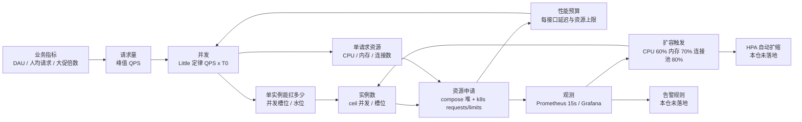
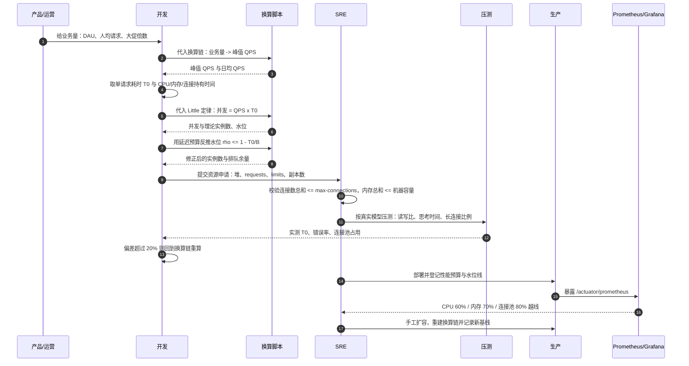

# 容量规划与性能预算：把「业务量 → 资源量」写成一条可复算的换算链

> **一句话结论**：容量规划不是「压测一次、记一个数字」，而是把「业务量 → 请求量 → 单请求资源消耗 → 实例数 → 资源申请」这条换算链写成公式；业务量一变，重算一遍就得到新的资源量，而性能预算是这条链的验收线，超了就是 bug。
> **阅读前置**：读过本目录 01 篇（稳定性总纲）与 `07-运维部署/06-优雅停机与零丢失滚动更新.md`；知道 HikariCP 连接池、Tomcat 工作线程池、K8s `requests/limits` 分别是什么。
> **证据基线**：仓库 `main`（ai-customer-service 1.0.0-SNAPSHOT，JDK 17 / Spring Boot 4.2.0）。B 级证据都给出完整路径与当次核对行号；C 级证据是本机 `node 24.16.0` 实跑输出（2026-11-27 采集）。所有假设值都写在命令里，未本机实测的部分明确标注。预计阅读 45~55 分钟。

---

## 0. 先看现象

先看三个症状。它们都能在本仓库用命令复现，而且指向的是同一个问题：**资源量是「人肉算一次、写死在编排里」的，不是一条能被重算、被监控守住的换算链。**

### 现象一：63 个容器、13.5 GiB 堆，但没有一行容器内存上限

```pwsh
cd D:\Projects\Persion\ai-customer-service
node learning-docs\tools\tmp\cap-baseline.mjs
```

真实输出（截取 compose 部分）：

```text
deploy\docker-compose\docker-compose-all.yml: services=14 ports=18 exposeOnly=0 heapXmx=5376MiB rows=11
deploy\docker-compose\docker-compose-host1.yml: services=7 ports=11 exposeOnly=0 heapXmx=1024MiB rows=2
deploy\docker-compose\docker-compose-host2.yml: services=5 ports=6 exposeOnly=0 heapXmx=1536MiB rows=3
deploy\docker-compose\docker-compose-host3.yml: services=7 ports=10 exposeOnly=0 heapXmx=2304MiB rows=5
deploy\docker-compose\docker-compose-master-slave.yml: services=12 ports=20 exposeOnly=0 heapXmx=1792MiB rows=4
deploy\docker-compose\docker-compose-observability.yml: services=4 ports=5 exposeOnly=1 heapXmx=0MiB rows=0
docker-compose.yml: services=14 ports=18 exposeOnly=0 heapXmx=1792MiB rows=4
compose 合计: files=7 services=63 ports=88 exposeOnly=1 heapXmx=13824MiB (13.50GiB) 堆行数=29
资源限制守卫命中: mem_limit=0 cpus=0
```

怎么读这三行：`services=63` 是 7 个编排文件加起来声明的服务总数（同一份 `all.yml` 和根 `docker-compose.yml` 有重叠，这是「按文件累加」口径，不是「一台机器上真跑 63 个」）；`heapXmx=13824MiB` 是 29 处 `Xmx` 数字相加，即**所有 JVM 堆上限之和**；`mem_limit=0 cpus=0` 说明**没有任何一个容器写了内存/CPU 上限**。

这意味着：`-Xmx512m` 只是「堆最多用 512 MiB」，容器真实占用还要加上 Metaspace、线程栈、直接内存、GC 结构与堆外缓存。一台 16 GiB 的开发机想同时起 `docker-compose-all.yml` 那 14 个服务，账面上 5376 MiB 堆「够」，实际容器常驻内存会明显更高，一旦宿主机内存耗尽，内核 OOM Killer 会**挑最大的容器杀**——被杀的常常是 MySQL 或 ES，而不是你以为的那个。

### 现象二：连接数是乘法，不是加法

```pwsh
cd D:\Projects\Persion\ai-customer-service
Select-String -Path 'tools\nacos-config\*.yml' -Pattern 'maximum-pool-size'
Select-String -Path 'deploy\mysql\master.cnf' -Pattern 'max-connections'
```

真实输出：

```text
tools\nacos-config\ai-cs-knowledge.yml:8 maximum-pool-size: 10
tools\nacos-config\ai-cs-message.yml:8 maximum-pool-size: 10
tools\nacos-config\ai-cs-mq.yml:8 maximum-pool-size: 10
tools\nacos-config\ai-cs-order.yml:14 maximum-pool-size: 10
tools\nacos-config\ai-cs-pay.yml:8 maximum-pool-size: 10
tools\nacos-config\ai-cs-product.yml:8 maximum-pool-size: 10
deploy\mysql\master.cnf:24 max-connections=500
```

6 个服务各 `10`，看着只占 `500` 的 12%。但这份账漏了两层：

1. **副本是乘法**。每个服务扩到 3 副本，就是 `6 × 10 × 3 = 180`，占 36%；
2. **同一进程里可能还有别的池**。chat 服务的 NL2SQL 工具会为 5 个业务库各建一个只读池，每池 3 条连接（`ai-cs-chat/src/main/java/com/aics/chat/nl2sql/Nl2SqlDataSourceConfig.java#L47`），单实例就是 `5 × 3 = 15` 条，3 副本又是 45 条。

`180 + 45 = 225`，接近一半。再叠上 DBA 自己的连接、监控采集连接、主从复制连接，`max-connections=500` 就从「很宽裕」变成「要盯着看」。

### 现象三：水位涨上去没人知道，也不会自动扩

```pwsh
cd D:\Projects\Persion\ai-customer-service
Select-String -Path 'deploy\observability\*.yml' -Pattern 'rule_files|alerting' | Measure-Object
Get-ChildItem -Recurse -File -Include *.yaml -Path deploy | Select-String -Pattern 'HorizontalPodAutoscaler' | Measure-Object
Select-String -Path 'deploy\observability\prometheus.yml' -Pattern 'scrape_interval|host.docker.internal'
```

真实输出（节选）：

```text
Count
-----
    0
    0
deploy\observability\prometheus.yml:3:  scrape_interval: 15s
deploy\observability\prometheus.yml:12:          - 'host.docker.internal:8080'   # gateway
...
deploy\observability\prometheus.yml:22:          - 'host.docker.internal:8090'   # mq
```

Prometheus 在抓（15s 一次，11 个固定 target：8080~8090），Grafana 在看，**但没有告警规则、没有 Alertmanager、也没有 HPA**。也就是说：CPU 到 90%、连接池打满、队列堆到 900/1000 的时候，系统不会通知任何人，更不会自己加副本——只能靠人盯 Grafana。

> 这些现象指向同一件事：**本仓没有「容量公式」，只有「容量结论」**。规则写在某一版编排的注释里、数字写在某次压测的记录里，既不能随业务量重算，也没有监控替你守。

---

## 1. 整体地图

先看全貌：容量规划是五跳换算，加两个闭环（观测、扩容）。



> **读图说明**：横向一串方块是「换算链」的五跳，箭头方向就是计算顺序——先有业务量才有请求量，先有请求量才有并发，先有并发才谈实例数，最后才落到编排里写的资源申请。中间从 `C` 分出一条支路 `H`：单请求资源消耗（CPU/内存/连接数）不是从延迟推出来的，而是单独测出来再回填到实例数公式里。右下三块是**闭环**：观测 → 扩容触发 → 回到实例数；其中 `K 告警规则` 与 `L HPA` 在本仓是空的（现象三已证），所以闭环目前靠人肉闭合。读这张图的关键认知是：**任何一跳的输入变了（DAU 变了、T0 变了、槽位变了），后面所有数字都要重算，而不是改一个数字了事。**

各组件与责任划分：

| 组件 | 在容量链里的责任 | 本仓载体 | 参与方 |
| --- | --- | --- | --- |
| 业务指标 | 给出 DAU、人均请求、大促倍数 | 产品需求 / 运营计划 | 产品、运营 |
| 换算公式 | 把业务量换成 QPS、并发、实例数 | 本文（公式 + 脚本） | 开发 |
| 单请求资源 | 测 T0、CPU 时间、连接持有时间 | 压测 / 本地 profile | 开发、测试 |
| 资源申请 | 堆上限、requests/limits、端口 | `deploy/docker-compose/*.yml`、`deploy/k8s/` | SRE、开发 |
| 性能预算 | 每接口延迟上限与资源上限 | 本仓仅散落在超时配置（见 3.10） | 开发、SRE |
| 观测 | 提供真实水位（CPU、内存、连接池、队列） | `deploy/observability/prometheus.yml` + Grafana | SRE |
| 扩容 | 把水位变动作变成实例数变化 | **未落地**（无告警规则、无 HPA） | SRE |

---

## 2. 关键概念与关键要素

容量规划里最容易含糊的就是名词。先把术语钉死在具体位置上：

| 名称 | 位置（本仓） | 作用 | 关键参数 / 取值 |
| --- | --- | --- | --- |
| DAU（日活） | 无落盘，业务输入 | 换算链的第一跳输入 | 本文假设 10000 |
| 人均日请求数 | 无落盘 | 把「人」换成「次」 | 本文假设 20 次/人/日 |
| 峰值小时占比 | 无落盘 | 二八原则的量化写法 | 本文假设 12% |
| 峰秒系数 | 无落盘 | 最忙 1 秒 / 峰值小时均值 | 本文假设 2.5 |
| T0（单请求耗时） | 实测得出 | Little 定律里的「停留时间」 | 普通接口 80ms、AI 对话 8s |
| 并发槽位 | `ai-cs-chat/src/main/java/com/aics/chat/config/ObservabilityExecutorConfig.java#L12-L17`（注释写明 Tomcat 默认 200 线程） | 单实例同时能处理多少个请求 | 本文取 100（200 × 50% 水位） |
| 水位 ρ | 无落盘，人肉在 Grafana 看 | 利用率；决定排队放大倍数 | 目标 ≤ 60% |
| 排队放大 | 数学结论（M/M/1） | 响应时间 = T0 / (1 − ρ) | ρ=0.7 时放大 3.33 倍 |
| 连接池 | `tools/nacos-config/ai-cs-knowledge.yml#L8` 等 6 处 | 并行 DB 访问上限，也是隐藏 QPS 上限 | `maximum-pool-size: 10`、`minimum-idle: 2`、`connection-timeout: 30000` |
| DB 连接总上限 | `deploy/mysql/master.cnf#L24` | 所有服务所有副本之和的上限 | `max-connections=500` |
| 堆上限 | `deploy/docker-compose/docker-compose-all.yml#L175` 等 | JVM 堆最大值（不是容器内存上限） | `-Xms256m -Xmx512m` |
| 容器内存/CPU 上限 | `deploy/k8s/services/ai-chat-service.yaml#L93-L99` | 调度承诺与硬上限 | `requests 200m/512Mi`、`limits 1000m/1Gi` |
| 性能预算 | 本仓仅部分体现在超时配置 | 每接口延迟与资源的「及格线」 | `resilience4j.timelimiter` 30s/60s/5s |
| 扩容触发线 | **未落地** | 到线加副本 | 本文建议 CPU 60% / 内存 70% / 连接池 80% |

---

## 3. 原理与证据逐段精读

下面 13 段按「换算链顺序 + 非线性来源 + 落地基线」排列。每段四层：在干什么 → 为什么这么设计 → 换写法会怎样 → 常见坑。

### 3.1 第一跳：业务量 → 请求量

**在干什么**：把「多少人用、每人用几次」换成「最忙那一秒要扛多少 QPS」。公式三行：

```text
日请求量   = DAU × 人均日请求
峰值小时 Q = 日请求量 × 峰值小时占比 / 3600
峰值 QPS   = 峰值小时 Q × 峰秒系数
```

**为什么这么设计**：容量的敌人从来不是「日平均」，而是「最忙那一秒」。日均 QPS 只能用来算成本，峰值 QPS 才能用来算实例数。把「二八原则」写成两个可调系数（峰值小时占比、峰秒系数）而不是一句口号，是因为不同业务形状差很多：客服系统的峰值是工作日 9~11 点和 14~16 点，大促是 0 点那一分钟。系数可调，结论才能复核。

**换写法会怎样**：如果只写「日均 QPS × 3 兜底」，你无法回答「为什么是 3」；如果直接抄一个「每实例 100 QPS」的行业数字，你又把业务形状当成了常量。两种写法都不可复算。

**常见坑**：把「会话数」当「请求数」。一次对话（会话）里至少有：建会话、拉历史、发消息、拉知识库、写回消息——本仓 chat 服务一次对话还可能触发 RAG 检索与用量上报。会话与请求差一个数量级，混用会让账偏小一半以上。

### 3.2 第二跳：请求量 → 并发（Little 定律）

**在干什么**：算出「同一时刻平均有多少个请求正在被处理」。这是全篇唯一一个必须背下来的公式：

```text
并发 = 到达率 QPS × 单请求耗时 T0   （Little 定律）
```

**为什么这么设计**：实例数买的是「并发」，而业务量给的是「QPS」，两者差一个 T0。T0 越大的接口越吃并发，这就是为什么 AI 对话服务要用完全不同的算法来估：**它一个请求占线程/连接的时间是普通接口的 100 倍**。

**换写法会怎样**：直接把 QPS 当并发（即假设 T0=1s）会在 AI 场景下低估 8 倍；反过来在纯 CRUD 场景会高估。错误方向不确定，但幅度都是倍数级。

**常见坑**：用「平均 T0」算峰值。平均 T0 里混着大量 5ms 的缓存命中，而真正决定排队的是慢请求。至少要用 P95 的 T0 算，或者按「接口类型」分开算。

### 3.3 第三跳：并发 → 实例数，以及「槽位」到底怎么定

**在干什么**：`实例数 = ceil(并发 / 单实例并发槽位)`。槽位取多少，是这一跳唯一的自由参数。

**为什么这么设计**：槽位不是 CPU 核数，而是「允许同时挂多少个请求」。对 Spring Boot 服务它由 Tomcat 工作线程数上限决定，本仓代码注释直接写了这个前提：

```java
// ai-cs-chat/src/main/java/com/aics/chat/config/ObservabilityExecutorConfig.java#L12-L13
// 不占用 Tomcat 工作线程：HTTP 请求线程数量有限（默认 200），
// 若每个聊天请求都同步做 Feign 落库，高峰期线程会被下游拖垮，进而阻塞正常对话；
```

所以单实例物理上限是 200 并发。但**不能用 200**，因为利用率到 100% 时排队时间是无穷大。

**换写法会怎样**：用 200 当槽位 = 假设单实例永远满载且不排队，实际表现是「压测 199 并发还行，200 并发直接雪崩」——因为第 201 个请求在 Tomcat accept 队列里等待，客户端看到的是超时而不是排队。

**常见坑**：把「槽位」和「线程池 max」混为一谈。业务自己的线程池（如用量上报 `maxPoolSize` 4、队列 1000）是**旁路**，它的大小不决定请求并发，但它的队列是延迟蓄水池——见 3.6。

### 3.4 单请求资源三件套：CPU、内存、连接数

**在干什么**：给每个请求估三种「消耗品」：CPU 时间、内存（含堆内对象与堆外缓冲）、连接（DB / Redis / HTTP 客户端连接）。

**为什么这么设计**：三种资源瓶颈的**症状完全不同**，必须分开记账：

| 资源 | 打满时的第一症状 | 本仓可观测点 | 扩什么有用 |
| --- | --- | --- | --- |
| CPU | 延迟整体抬升、GC 线程抢不到核 | Grafana CPU、`jvm_gc_*` | 加副本最有效 |
| 内存 | GC 频率上升 → Full GC → 请求超时；容器超限被 OOMKilled | 堆使用率、容器 RSS | 加堆要谨慎（见 3.8） |
| 连接数 | 报 `Connection is not available, request timed out after 30000ms` | Hikari 池指标 | 加副本 = 加连接，容易反向压垮 DB |

**换写法会怎样**：只按 CPU 估容量，是最常见的偷懒。本仓 chat 服务的真实形态是「大部分时间在等 LLM 返回」（IO 密集），CPU 占用极低但并发占用很高——按 CPU 估会得出「1 个实例足够」的错误结论，然后在 LLM 一慢就全线排队。

**常见坑**：忘记「后台任务也在花同一份资源」。本仓可观测性落库走独立线程池（`ai-cs-chat/src/main/java/com/aics/chat/config/ObservabilityExecutorConfig.java#L27-L59`：`usageExecutor` 核心 1/最大 4/队列 1000，`evalExecutor` 核心 1/最大 2/队列 500）。它们不占 Tomcat 线程，但会占 CPU、内存和 DB 连接——容量账里要留出这部分。

### 3.5 小流量线性外推为什么在大促失效（非线性来源一：排队）

**在干什么**：解释为什么「1 QPS 时测出的 T0」不能直接乘出「100 QPS 时还能扛多少」。

**为什么这么设计**：因为排队。把单实例看成一个服务台，服务时间 T0，利用率 ρ，排队论给出的响应时间是：

```text
响应时间 = T0 / (1 - ρ)
```

用本文假设的参数（DAU 10000、20 次/人/日、峰值小时 12%、峰秒系数 2.5、槽位 100）实跑：

```pwsh
cd D:\Projects\Persion\ai-customer-service
node learning-docs\tools\tmp\cap-calc.mjs
```

真实输出（节选，含假设）：

```text
== 1. 业务量 -> 请求量 ==
日请求量        = 200000
日均 QPS        = 2.31
峰值小时 QPS    = 6.67
峰值 QPS(峰秒)  = 16.67

== 2. 线性外推（无排队模型）：N = ceil(QPS x T0 / 槽位) ==
普通接口: 需要并发=1.33 实例=1 水位=1.3% | 按 50% 水位实例=1 多出=0.0%
AI 对话: 需要并发=133.33 实例=2 水位=66.7% | 按 50% 水位实例=3 多出=50.0%

== 3. 排队放大：M/M/1 响应时间 = T0 / (1 - rho) ==
rho=0.3 延迟放大=1.43x
rho=0.5 延迟放大=2.00x
rho=0.6 延迟放大=2.50x
rho=0.7 延迟放大=3.33x
rho=0.8 延迟放大=5.00x
rho=0.9 延迟放大=10.00x
```

怎么读：第 2 段是**线性口径**（完全不考虑排队），它说 AI 对话要 2 个实例、水位 66.7%；第 3 段说明 66.7% 水位意味着延迟已经是单请求的 3 倍左右。若你的性能预算是「AI 回答 16 秒内首字节」，那么 66.7% 的水位刚好把 8s 变成 ~24s，**预算破了**。要么接受更低水位（50% → 3 实例），要么把预算放宽到 3×T0。

第 4 段给出更直接的算法——**从预算反推水位**：

```text
要求 T0 / (1 - ρ) ≤ B  ⟹  ρ ≤ 1 - T0 / B
```

真实输出：

```text
== 4. 延迟预算反推水位：预算 B 下 rho <= 1 - T0/B ==
AI 对话 T0=8s 预算B=8.00s(1xT0) -> rho上限=0.000  [不可行：预算=均值，没有任何排队余量]
AI 对话 T0=8s 预算B=16.00s(2xT0) -> rho上限=0.500 实例=3
AI 对话 T0=8s 预算B=24.00s(3xT0) -> rho上限=0.667 实例=2
普通接口 T0=0.08s 预算B=0.08s(1xT0) -> rho上限=0.000  [不可行：预算=均值，没有任何排队余量]
```

这一段是本文最重要的结论：**「预算 = 平均值」在数学上不可行**。任何把 SLO 设为「等于单请求平均耗时」的团队，实际上是在要求 ρ=0，也就是要求无限实例。预算必须留排队余量，2×T0 是最低限度。

**换写法会怎样**：如果按线性外推直接上 2 实例，上线后表现会是「平时很好，一到 60% 负载就开始偶发超时，一过 70% 就雪崩式超时」——因为排队放大是**分式**，不是线性变差。

**常见坑**：把压测曲线当容量曲线。压测时并发是「均匀打进去的」，真实流量是「突发 + 重试」，重试会让有效到达率翻倍，ρ 直接飙到 1 以上。

### 3.6 非线性来源二：连接池（隐藏的 QPS 上限）

**在干什么**：把「池大小」翻译成「QPS 上限」。公式很短：

```text
单池可持续 QPS 上限 = 池大小 / 单请求持连接时间
```

用本仓真实的 `maximum-pool-size: 10` 实跑：

```text
== 5. 连接池 = 隐藏的 QPS 上限：cap = 池大小 / 单请求持连接时间 ==
池=10 持连接=5ms -> 上限 2000.0 QPS, 峰值 16.67 QPS 占用 0.8%
池=10 持连接=50ms -> 上限 200.0 QPS, 峰值 16.67 QPS 占用 8.3%
池=10 持连接=500ms -> 上限 20.0 QPS, 峰值 16.67 QPS 占用 83.3%
```

怎么读：同一个 10 连接的池，持连接时间从 5ms 涨到 500ms，QPS 上限从 2000 掉到 20。**池不是「连接缓存」，它是「并发许可证」**。这也解释了为什么慢 SQL 比高并发更可怕：慢 SQL 同时吃掉了连接池的许可证。

**换写法会怎样**：把池从 10 调到 50，看似「更宽裕」，实际是把 DB 侧的并发压力放大 5 倍——本仓 MySQL 只有 `max-connections=500`（`deploy/mysql/master.cnf#L24`），6 个服务 × 50 × 副本数很快就顶穿，症状会从「获取连接超时」变成「MySQL 端 `Too many connections`」，影响面从单服务扩散到全站。

**常见坑**：只看 `connection-timeout: 30000`（本仓 6 处都是 30s）以为「有超时就不怕」。30s 的超时意味着：一个慢请求能占住许可证 30 秒，10 个连接全部卡住时整个服务就停了 30 秒——超时不是保护，它只是**限制了伤害的持续时间**。

### 3.7 非线性来源三：锁竞争（并发度被人为压成 1）

**在干什么**：解释第三种「加副本没用」的瓶颈——串行化点。

**为什么这么设计**：本仓有两处典型的串行化点，都是有意为之：

```java
// ai-cs-order/src/main/java/com/aics/order/lock/OrderCreateLockService.java#L44-L53
RLock lock = redissonClient.getLock(KEY_PREFIX + userId);
boolean acquired = false;
try {
    // waitTime=0：快速失败；未指定 leaseTime → 触发看门狗自动续期
    acquired = lock.tryLock(0, TimeUnit.SECONDS);
    if (!acquired) {
        log.warn("下单防重锁竞争失败: userId={}", userId);
        throw new BusinessException(ResultCode.TOO_MANY_REQUESTS, "您有订单正在创建中，请勿重复提交");
    }
```

以及状态机里的进程内互斥（`ai-cs-order/src/main/java/com/aics/order/statemachine/OrderStateTransitionService.java#L23`：`synchronized (orderStateMachine)`）。

**为什么这么设计**：下单防重必须串行，锁粒度按 `userId` 分片已经是能拿到的最好方案；`waitTime=0` 快速失败而不是排队，是为了**把排队从服务端挪走**——排队会让用户等 3 秒再报错，快速失败让用户 50ms 就收到「请勿重复提交」。

**换写法会怎样**：把 `tryLock(0, ...)` 改成 `tryLock(3, TimeUnit.SECONDS)`，看起来更「友好」，实际是把锁持有者变成吞吐瓶颈：同一用户并发 5 次下单，其中 4 个线程会占着 Tomcat 线程等 3 秒，槽位被白白吃掉。容量上等价于「槽位减少」。

**常见坑**：同一用户的大促秒杀场景下，锁粒度 = 用户意味着「热门用户」的请求全部串行；而 `synchronized` 是**单 JVM 内**的互斥，加副本后互斥范围缩小到单实例，分布式一致性反而变弱——这是容量与正确性的经典冲突，必须显式记录取舍（见第 5 节）。

### 3.8 内存预算：Xmx 不是容器内存

**在干什么**：给每个 JVM 容器估「真实内存」，而不只是堆。

**为什么这么设计**：容器里的 JVM 实际占用 ≈ `Xmx + Metaspace + 线程栈 × 线程数 + 直接内存 + 代码缓存 + GC 结构`。本仓 compose 统一写 `JAVA_OPTS: "-Xms256m -Xmx512m"`（`deploy/docker-compose/docker-compose-all.yml#L175` 等 7 处），按经验堆外通常还要 200~300 MiB。所以「512 MiB 的堆」约等于「700~800 MiB 的容器」。

**换写法会怎样**：本仓 `deploy/k8s/services/ai-chat-service.yaml#L91-L99` 写了 `JAVA_OPTS: "-Xms512m -Xmx512m"` 同时 `limits.memory: "1Gi"`——这是**正确**的写法（堆 512 MiB，留 512 MiB 堆外余量）。反例是 compose：`Xmx512m` 却没有 `mem_limit`，等于放弃了「内存上限」这道闸门，让容器可以无限膨胀到宿主内存耗尽。

**常见坑**：给 JVM 容器设 `limits.memory == Xmx`。这是最常见的致命配置：JVM 还没触发 GC，容器先被 cgroup 限流/OOMKilled，日志里连一行 GC 都看不到，只有 `exit code 137`。

### 3.9 水位线与扩容触发

**在干什么**：定义「什么时候该加资源」。本仓没有实现，这里给的是可落地的判据。

**为什么这么设计**：水位线本质是「排队余量」的可观测代理。三条线分别对应三种资源：

| 资源 | 建议触发线 | 为什么是这个数 | 证据支撑 |
| --- | --- | --- | --- |
| CPU | 60% | ρ=0.6 时排队放大 2.5×，再往上曲线变陡 | 3.5 实跑表 |
| 内存（堆） | 70% | 留出 30% 给 GC 峰值与突发对象分配 | 见 3.8 |
| 连接池 | 80% | 池满即请求开始等 30s（`connection-timeout: 30000`），必须先扩 | `tools/nacos-config/ai-cs-knowledge.yml#L12` |

为什么不是 90%？因为容量规划是**为未来 N 分钟留余量**，不是为「现在不崩」。从 60% 到 90% 可能只差一个批量任务的时间，而扩容（拉镜像、启动 Spring、预热）要分钟级。

**换写法会怎样**：把触发线设 90%，等于「到 90% 才开始排队放大 10×」（见 3.5 表），此时再加副本，新副本冷启动期间老副本必然超时。**扩容永远发生在最坏的时机**。

**常见坑**：以为写了 `limits` 就有弹性。本仓 k8s 侧 `limits` 齐全（清单口径 `14500m/16896Mi`），但 `HorizontalPodAutoscaler` 命中 0（现象三），所以到线只会被限流/降级，不会自动加副本。网关侧倒是有兜底：`ai-cs-gateway/src/main/resources/application.yml#L48-L49` 的 `replenish-rate: 5` / `burst-capacity: 10`（每用户每秒 5 个令牌、桶容量 10），但它当前是关闭状态（同文件 `#L40` `enabled: false`，注释说明已改由 `RouteConfig` 每路由的 `RequestRateLimiter` 承担）。

### 3.10 性能预算：把延迟写成「超了就是 bug」的线

**在干什么**：给每个接口定两条线：延迟上限、资源上限。超了不算「有点慢」，算缺陷。

**为什么这么设计**：容量规划回答「能不能扛住这个量」，性能预算回答「扛住的时候体验还在不在及格线」。没有预算，压测就只能得出「P99 是 3.2 秒」这种无法判对错的观测值。本仓虽然没有独立成文的预算表，但**代码里已经把一部分预算写死了**——这是最诚实的证据：

| 预算项 | 位置 | 值 | 它实际约束的是 |
| --- | --- | --- | --- |
| 非流式 LLM 调用 | `ai-cs-chat/src/main/resources/application.yml` `resilience4j.timelimiter.instances.chatService` | `timeout-duration: 30s` | 单次对话最长等待 |
| SSE 流式首次 token | 同文件 `instances.sseChatService` | `timeout-duration: 60s` + `cancel-running-future: true` | 首字节预算（不是整段回答） |
| 视觉模型 | 同文件 `instances.visionService` | `timeout-duration: 5s` | 图片理解预算 |
| SSE 连接总时长 | `ai-cs-chat/src/main/resources/application.yml#L156` | `SSE_EMITTER_TIMEOUT = 5 * 60 * 1000L` | 连接占用槽位的上限 |

这四项加起来就是 chat 服务的容量边界：**一个 SSE 连接最长占一个槽位 5 分钟**。按 100 槽位算，单实例最多同时挂 100 个会话，5 分钟内每人只能被服务一次——这就是为什么长连接场景的实例数必须用「连接数」而不是「QPS」来算。

**换写法会怎样**：把 `SSE_EMITTER_TIMEOUT` 从 5 分钟改成 30 分钟，容量账直接变成 6 倍需求，而且没人会意识到这次「体验优化」改了容量模型。所以**超时参数必须登记在容量表里**，它和实例数是同一张账。

**常见坑**：把 `cancel-running-future: true` 当纯技术细节。它的含义是「超时后真的把下游调用取消掉」，否则线程会继续挂着算 token——不取消的超时等于没超时，容量上等价于槽位泄漏。

### 3.11 压测的正确姿势

**在干什么**：用「像真实流量的模型」去验证换算链，而不是用一个恒定 QPS 打一遍。

**为什么这么设计**：容量公式的三个输入（峰值 QPS、T0、槽位）都来自真实流量形状。压测模型不像，三个输入全错，结论全废。

必须区分的四件事：

1. **读写比**。本仓 chat 的写路径（消息落库、用量上报、`llm_trace`/`model_usage` 落 MySQL）与读路径（RAG 检索、历史会话）在资源上完全不同：写会吃 DB 连接与事务，读更多吃 CPU 与 ES/向量库。100% 读的压测结果不能用于估实例数。
2. **思考时间**（think time）。真实用户发一条消息后要看 5~30 秒再发下一条；如果压测脚本 0 思考时间连发，会人为制造出 3~10 倍的「同用户并发」，把锁竞争与防重逻辑全部触发。本仓下单场景会直接返回 `TOO_MANY_REQUESTS`（3.7 的锁）。
3. **长连接比例**。SSE 会话在压测里必须单独建模：它占槽位但不产生 QPS，混在 QPS 模型里会全线失真（见 3.10）。
4. **数据量与冷热**。空库压测的连接持有时间是毫秒级，生产有索引碎片与慢查询时是百毫秒级——按 3.6 的表，这直接改变池的 QPS 上限 100 倍。

**换写法会怎样**：用 `ab -c 200 -n 100000` 打一个登录接口，会得到一张漂亮曲线和完全错误的容量结论——因为真实流量的 90% 是「打开首页 + 拉列表」，不是登录。

**常见坑**：把压测机和被测服务放同一台机器。本仓所有 Java 服务默认 `JAVA_OPTS: "-Xms256m -Xmx512m"`，压测客户端（尤其 JMeter/wrk 高并发）会抢 CPU，测出来的延迟里有一半是压测机自己的。

### 3.12 本仓真实容量基线总账

**在干什么**：把上面所有概念落到本仓的具体数字上。全部由脚本读出，可复算。

服务端口（11 个 Java 模块，均为 `application.yml#L3`）：

| 服务 | 端口 | 配置文件 | compose 实例 | k8s 清单 |
| --- | --- | --- | --- | --- |
| gateway | 8080 | `ai-cs-gateway/src/main/resources/application.yml` | 1 | `deploy/k8s/services/api-gateway.yaml`（1 副本） |
| user | 8081 | `ai-cs-user/src/main/resources/application.yml` | 1 | `deploy/k8s/services/user-service.yaml`（1 副本） |
| knowledge | 8082 | `ai-cs-knowledge/src/main/resources/application.yml` | 1 | `deploy/k8s/services/knowledge-service.yaml`（1 副本） |
| chat | 8083 | `ai-cs-chat/src/main/resources/application.yml` | 1 | `deploy/k8s/services/ai-chat-service.yaml`（1 副本） |
| search | 8084 | `ai-cs-search/src/main/resources/application.yml` | 1 | `deploy/k8s/services/search-service.yaml`（1 副本） |
| message | 8085 | `ai-cs-message/src/main/resources/application.yml` | 1 | `deploy/k8s/services/message-service.yaml`（1 副本） |
| notify | 8086 | `ai-cs-notify/src/main/resources/application.yml` | 1 | `deploy/k8s/services/notify-service.yaml`（1 副本） |
| order | 8087 | `ai-cs-order/src/main/resources/application.yml` | **无** | **无** |
| product | 8088 | `ai-cs-product/src/main/resources/application.yml` | **无** | `deploy/k8s/services/product-service.yaml`（2 副本，唯一多副本） |
| pay | 8089 | `ai-cs-pay/src/main/resources/application.yml` | **无** | **无** |
| mq | 8090 | `ai-cs-mq/src/main/resources/application.yml` | **无** | **无** |

compose 与 k8s 的真实账（同一脚本输出）：

```text
compose 合计: files=7 services=63 ports=88 exposeOnly=1 heapXmx=13824MiB (13.50GiB) 堆行数=29
资源限制守卫命中: mem_limit=0 cpus=0
清单口径: requests=3300m/7040Mi limits=14500m/16896Mi PVC=85Gi
副本展开: requests=3800m/7808Mi limits=16000m/18432Mi PVC=95Gi
```

三件事必须讲清楚，否则这张表会被读错：

1. **`services=63` 是「按文件累加」口径**。7 个编排文件里有 6 个是「分机部署」方案（host1/host2/host3/master-slave/observability/all），同一批服务在不同文件里重复出现。真要在同一台机器上全起，得看单个文件的数：`docker-compose-all.yml` 是 14 个服务、18 条端口映射、11 个堆。
2. **`heapXmx=13824MiB` 是堆上限之和，不是内存需求**。按 3.8 的经验系数（堆外 40% 左右），真实内存需求明显更高。而 `mem_limit=0` 说明根本没人管这个上限。
3. **k8s 有两套口径，差 500m/768Mi/1000m/1536Mi/10Gi**。`清单口径` 是「每份 yaml 里的数字加一遍」（忽略副本），`副本展开` 是「按 `replicas` 真算」——`product` 是 2 副本、MySQL 从库是 2 副本（`deploy/k8s/mysql.yaml#L210`），所以展开后 requests 从 3300m 涨到 3800m、PVC 从 85Gi 涨到 95Gi。**报容量数字时不写口径，等于没说。**

中间件侧的硬上限（B 级）：

| 组件 | 参数 | 位置 | 对容量的含义 |
| --- | --- | --- | --- |
| MySQL | `max-connections=500` | `deploy/mysql/master.cnf#L24` | 所有服务 × 副本 × 池大小之和的上限 |
| MySQL | `innodb-buffer-pool-size=256M` | `deploy/mysql/master.cnf#L14` | 数据量大于此，命中率下降 → 单请求 T0 上升 |
| MySQL | `long-query-time=2` / `innodb-lock-wait-timeout=30` | `deploy/mysql/master.cnf#L31`、`#L17` | 慢查询与锁等待的判据（3.6/3.7） |
| Redis | `maxmemory 256mb` + `allkeys-lru` | `deploy/redis/redis.conf#L24-L25` | 超限**静默驱逐**最早未用 key，会话/缓存会莫名 miss |
| Redis | `maxclients 10000` | `deploy/redis/redis.conf#L31` | 连接数上限（远大于 DB，通常不是瓶颈） |
| 观测 | `scrape_interval: 15s` + 11 targets | `deploy/observability/prometheus.yml#L3`、`#L12-L22` | 水位采样粒度 15s，突发型峰值可能被平均掉 |

### 3.13 监控面：为什么现在水位只能「人看」

**在干什么**：把「观测 → 扩容」这个闭环里的可用部分说清楚。

**为什么这么设计**：Prometheus 15s 抓一次 `/actuator/prometheus`（11 个固定 target，`deploy/observability/prometheus.yml#L12-L22`），Grafana 双数据源看板——这已经足够回答「现在水位多少」。缺的是下一步：`rule_files` 0 命中、`alerting` 0 命中、HPA 0 命中。

**换写法会怎样**：没有告警规则，水位的唯一消费者是人。人会下班、会开会、会看错图；而排队放大是分式曲线（3.5），从 60% 到 90% 可能只有几分钟。

**常见坑**：把 `scrape_interval: 15s` 当成「延迟 15s 就能发现」。真实链路上，采样 15s + 规则评估 15s + 通知路由，从越线到人看到消息，分钟级很正常。所以**触发线必须留出这段延迟的余量**，这也解释了为什么 60% 而不是 85%。

---

## 4. 一次完整执行时序

下面是一次「容量评审 → 上线 → 扩容」的完整时序，编号对应 3.x 的换算链。



> **读图说明**：这张时序图有三处最值得看。第一，`3~7` 步全在「算」，一个请求都还没打出去——换算链是纸面工作，成本极低，但它决定了后面所有事；`9~12` 才是验证：压测的作用是**校准 T0 与槽位两个输入**，不是「求一个能扛多少 QPS 的数字」。第二，`11` 步的 SRE 校验有两个硬约束：连接数之和 ≤ `max-connections`（否则一扩副本就把 DB 打死）、内存之和 ≤ 机器容量（否则 OOM Killer 随机杀容器）；本仓 compose 侧 `mem_limit=0`，这一校验目前无处落地。第三，`15~17` 是闭环：观测越线 → 人扩容，中间**没有告警规则和 HPA**，所以图上画的是 `OBS-->>SRE` 而不是 `OBS-->>PROD`。

每一步该怎么判读、错了会看到什么：

| 步 | 该看什么 | 判读标准 | 这一步错了的典型症状 |
| --- | --- | --- | --- |
| 2 | 业务量三个数 | 有出处（运营计划/历史数据），不是拍脑袋 | 后面所有数字都是错的，且无从纠正 |
| 4 | T0 的取法 | 用 P95 而非均值；按接口类型分开 | 压测通过、上线排队（3.5） |
| 6 | 并发数 | 与「单实例 200 线程上限」对照 | 槽位算出 > 200，说明 T0 或 QPS 估错 |
| 7 | ρ 上限 | 必须 > 0，否则预算不可行（3.5 实跑） | 设 SLO = 平均耗时，永远达标不了 |
| 9 | 连接数合计 | ≤ `max-connections` 的 70% | `Too many connections`，全站受影响 |
| 10 | 内存合计 | 堆 + 堆外 ≤ 机器内存的 80% | OOMKilled / 宿主卡死 |
| 12 | 压测模型 | 读写比、思考时间、长连接比例都对 | 曲线漂亮、结论错误（3.11） |
| 13 | 偏差 | 实测 T0 与假设差 > 20% 就重算 | 用旧的实例数上线 |
| 17 | 越线处理 | 到线先扩、再查原因 | 到 90% 才动，扩容撞上雪崩（3.9） |

---

## 5. 设计取舍

容量方案没有「正确答案」，只有「在本仓约束下选了什么、代价是什么」。

| 取舍点 | 本仓的选择 | 备选 | 选了之后付出的代价 | 证据 |
| --- | --- | --- | --- | --- |
| 峰值估算方式 | 用两个可调系数（峰值小时占比 + 峰秒系数）表达业务形状 | 固定「日均 × 3」经验系数 | 需要人维护两个系数 | 本文 3.1 |
| 实例数公式 | 线性外推 + 水位修正（`ceil(并发/(槽位×ρ))`） | 直接用历史监控推算 | 需要压测校准 T0；不做压测就偏 | 3.5 实跑 |
| JVM 内存上限 | 统一 `-Xmx512m`（compose）/ `1Gi` limits（k8s chat） | 按服务画像分档设堆 | 小服务浪费、大服务紧张 | `deploy/docker-compose/docker-compose-all.yml#L175` |
| 容器内存守卫 | compose 完全不设 `mem_limit`；k8s 设 `limits` | 两边都设 | 开发机场景可能 OOM 杀错容器 | `mem_limit=0 cpus=0`（C 级） |
| 连接池大小 | 全服务统一 10，NL2SQL 只读池 3/库 | 按服务 QPS 与持连接时间分档 | 慢查询场景池成为瓶颈（3.6） | `tools/nacos-config/ai-cs-knowledge.yml#L8` |
| 状态机并发控制 | 单 JVM `synchronized` | Redis 分布式锁 | 多副本时互斥范围缩小 | `ai-cs-order/src/main/java/com/aics/order/statemachine/OrderStateTransitionService.java#L23` |
| 下单防重锁 | 用户维度 + `waitTime=0` 快速失败 | 排队等锁 | 同用户并发时直接 429 | `ai-cs-order/src/main/java/com/aics/order/lock/OrderCreateLockService.java#L49` |
| 长连接容量 | SSE 连接占槽位，5 分钟强制断开 | 连接与请求分离池化 | 单实例可服务会话数被硬限 5min | `ai-cs-chat/src/main/resources/application.yml#L156` |
| 观测粒度 | 15s 抓取，无告警规则 | 加规则 + Alertmanager + HPA | 水位只能人看，扩容靠人 | `deploy/observability/prometheus.yml#L3` |
| 成本水位 | 配额检查 fail-open | fail-closed 卡住对话 | 配额故障时成本失控 | `ai-cs-chat/src/main/java/com/aics/chat/observability/QuotaService.java#L72-L79` |

**可扩展点清单**（都不改业务代码，只加配置/清单）：

1. **水位告警规则**：在 `deploy/observability/` 新增 `rules/*.yml` 并在 `prometheus.yml` 里接 `rule_files`，三条规则对应 60%/70%/80%。
2. **HPA**：给 8 份 `deploy/k8s/services/*.yaml` 各加一个 `HorizontalPodAutoscaler`，指标用容器 CPU 与自定义连接池指标。
3. **compose 内存守卫**：给每个 service 加 `mem_limit`（值 = 堆 + 300Mi 左右），并在 CI 里校验「所有 mem_limit 之和 ≤ 目标机器内存」。
4. **容量公式入仓**：把 3.1/3.2 的两条公式做成脚本（已有雏形 `learning-docs/tools/tmp/cap-calc.mjs`），评审时跑一遍贴输出。
5. **性能预算表**：把 3.10 的四个超时 + 各接口 P95 目标整理成一张表，接入 CI 做「预算回归」。
6. **连接数预算校验**：写个脚本扫 `tools/nacos-config/*.yml` 的 `maximum-pool-size` × 副本数，与 `deploy/mysql/master.cnf` 的 `max-connections` 比对。
7. **压测脚本入仓**：区分读写、带思考时间、含 SSE 长连接比例，避免每次凭记忆压。

---

## 6. 踩坑与调试手法

每条都给完整命令、判读列、以及**什么情况下会误判**。

### 6.1 只按 Xmx 算内存，漏掉堆外

```pwsh
cd D:\Projects\Persion\ai-customer-service
Select-String -Path 'deploy\docker-compose\*.yml' -Pattern '^\s*(mem_limit|memswap_limit|cpus):' | Measure-Object
Select-String -Path 'deploy\docker-compose\docker-compose-all.yml' -Pattern 'JAVA_OPTS|Xmx|ES_JAVA_OPTS' | ForEach-Object { 'L' + $_.LineNumber + ' ' + $_.Line.Trim() }
```

```text
Count
-----
    0
L68   JVM_XMX: 512m
L91   ES_JAVA_OPTS: "-Xms512m -Xmx512m"
L114  JAVA_OPT_EXT: "-Xms256m -Xmx256m"
L135  JAVA_OPT_EXT: "-Xms512m -Xmx512m"
L175  JAVA_OPTS: "-Xms256m -Xmx512m"
...
```

判读列：`Count 0` = 没有任何容器内存守卫；`L175` 的 `Xmx512m` 只约束堆。

**误判风险**：看到 `Xmx512m` 就写下「这个服务占 512 MiB」。实际 RSS 通常 700~900 MiB。反向误判也存在：容器 RSS 高不等于堆有问题，可能是 page cache 或直接内存。

### 6.2 按「清单口径」报容量，漏掉副本

```pwsh
cd D:\Projects\Persion\ai-customer-service
node learning-docs\tools\tmp\cap-baseline.mjs
```

```text
清单口径: requests=3300m/7040Mi limits=14500m/16896Mi PVC=85Gi
副本展开: requests=3800m/7808Mi limits=16000m/18432Mi PVC=95Gi
```

判读列：两行差 500m / 768Mi / 1000m / 1536Mi / 10Gi，来源是 `product-service.yaml#L25`（`replicas: 2`）和 `deploy/k8s/mysql.yaml#L210`（从库 2 副本）。

**误判风险**：以为「展开口径」永远更准。若集群里有 HPA 动态扩缩，两个口径都不对——要用「峰值副本数」算。

### 6.3 连接池按服务数算，不考虑副本与副池

```pwsh
cd D:\Projects\Persion\ai-customer-service
Select-String -Path 'tools\nacos-config\*.yml' -Pattern 'maximum-pool-size' | Measure-Object
Select-String -Path 'ai-cs-chat\src\main\java\com\aics\chat\nl2sql\Nl2SqlDataSourceConfig.java' -Pattern 'setMaximumPoolSize|setMinimumIdle|setConnectionTimeout'
Select-String -Path 'tools\nacos-config\ai-cs-chat.yml' -Pattern '^\s{6}\w+: jdbc:mysql' | ForEach-Object { $_.LineNumber.ToString() + '  ' + ($_.Line.Trim().Substring(0, 40)) }
```

```text
Count
-----
    6
ai-cs-chat\src\main\java\com\aics\chat\nl2sql\Nl2SqlDataSourceConfig.java:47 ds.setMaximumPoolSize(3);
ai-cs-chat\src\main\java\com\aics\chat\nl2sql\Nl2SqlDataSourceConfig.java:48 ds.setMinimumIdle(1);
ai-cs-chat\src\main\java\com\aics\chat\nl2sql\Nl2SqlDataSourceConfig.java:49 ds.setConnectionTimeout(5000);
32  user: jdbc:mysql://123.60.31.79:3306/use
33  product: jdbc:mysql://123.60.31.79:3306/
34  order: jdbc:mysql://123.60.31.79:3306/ai
35  chat: jdbc:mysql://123.60.31.79:3306/cha
36  knowledge: jdbc:mysql://123.60.31.79:330
```

判读列：6 个显式池 × 10，加上 chat 单实例 5 个只读池 × 3 = 15。

**误判风险**：`maximum-pool-size` 只在 Nacos 配置里，仓库内 `application.yml` 里 0 命中——只 grep 仓库配置文件会得出「没配置连接池」的错误结论，实际会走 Hikari 默认值（同样是 10，但这是巧合，不是设计）。

### 6.4 用小流量平均值当峰值

```pwsh
cd D:\Projects\Persion\ai-customer-service
node learning-docs\tools\tmp\cap-calc.mjs
```

```text
== 6. 小流量外推偏差（同一份算力，两套口径）==
线性口径: 2 实例 x 100 槽位 / 8s = 25.00 QPS
守 16s 预算(50% 水位): 2 实例 = 12.50 QPS
外推高估 = 2.00x
```

判读列：同一批实例，按「无排队」算能扛 25 QPS，按「守住 16s 预算」只扛 12.5 QPS，**高估 2 倍**。

**误判风险**：反过来也成立——如果业务能接受长延迟（比如离线报告），按 12.5 QPS 配会显著浪费钱。偏差不是错，是「预算没说清楚」。

### 6.5 把队列容量当「缓冲」，其实是延迟蓄水池

```pwsh
cd D:\Projects\Persion\ai-customer-service
Select-String -Path 'ai-cs-chat\src\main\java\com\aics\chat\config\ObservabilityExecutorConfig.java' -Pattern 'setCorePoolSize|setMaxPoolSize|setQueueCapacity'
```

```text
L31 executor.setCorePoolSize(1);
L32 executor.setMaxPoolSize(4);
L34 executor.setQueueCapacity(1000);
L52 executor.setCorePoolSize(1);
L53 executor.setMaxPoolSize(2);
L54 executor.setQueueCapacity(500);
```

判读列：`usageExecutor` 4 线程 + 1000 队列；`evalExecutor` 2 线程 + 500 队列。按 Little 定律，队列满时的排队时间 ≈ `1000 / 4 × 单任务耗时`。若单任务是 200ms 的 Feign 落库，队列打满时最后入队的任务要等 **50 秒**——远超它自己的调用超时。

**误判风险**：看到「队列 1000」以为「能扛 1000 并发」。队列只保证「不拒绝」，不保证「按时完成」。而且默认 `AbortPolicy`：队列满时直接抛 `RejectedExecutionException`，本仓由调用方捕获告警——如果你只 grep 日志找异常，会以为「任务都在跑」。

### 6.6 以为网关限流在生效

```pwsh
cd D:\Projects\Persion\ai-customer-service
Select-String -Path 'ai-cs-gateway\src\main\resources\application.yml' -Pattern 'enabled:|replenish-rate|burst-capacity|algorithm' | ForEach-Object { 'L' + $_.LineNumber + ' ' + $_.Line.Trim() }
```

```text
L40 enabled: false
L43 algorithm: sliding-window
L48 replenish-rate: 5
L49 burst-capacity: 10
```

判读列：`enabled: false` 说明这套本地限流是关的；真正的限流在 `RouteConfig` 的每路由 `RequestRateLimiter`（Redis 分布式令牌桶，每用户 5 rps、桶 10）。

**误判风险**：容量评审时把「网关能限流」当成兜底。限流保护的是**下游不被打死**，不是「容量够用」；而且它按用户维度限流，对「大量不同用户同时涌入」完全无效。

### 6.7 以为水位超标会有人管

```pwsh
cd D:\Projects\Persion\ai-customer-service
Select-String -Path 'deploy\observability\*.yml' -Pattern 'rule_files|alerting' | Measure-Object
Get-ChildItem -Recurse -File -Include *.yaml -Path deploy | Select-String -Pattern 'HorizontalPodAutoscaler' | Measure-Object
Select-String -Path 'deploy\observability\prometheus.yml' -Pattern 'targets:' -Context 0,11
```

```text
Count
-----
    0
    0
deploy\observability\prometheus.yml:11:      - targets:
deploy\observability\prometheus.yml:12:          - 'host.docker.internal:8080'   # gateway
...
deploy\observability\prometheus.yml:22:          - 'host.docker.internal:8090'   # mq
```

判读列：抓取有（11 target），规则无（0），弹性无（0）。

**误判风险**：Grafana 上有漂亮的 CPU 曲线，很容易让人误以为「有监控就等于有保障」。监控解决「看得见」，告警解决「有人看」，HPA 解决「自动做」——三件事缺两件。

### 6.8 用「预算 = 平均耗时」定 SLO

```pwsh
cd D:\Projects\Persion\ai-customer-service
node learning-docs\tools\tmp\cap-calc.mjs   # 看第 4 段：预算B=1xT0 时 rho上限=0.000
```

判读列：预算等于单请求均值时，允许的利用率是 0——数学上不可能达成。

**误判风险**：这条最容易「看起来」没问题，因为小流量下确实能达标（ρ≈0）。等到流量上来才发现无论加多少实例都「刚好卡在线上」，然后误判为「代码有性能问题」。

---

## 7. 版本差异

旧稿的算式方向是对的，但口径与证据形态已经对不上本仓现状。逐条对照：

| 旧写法 | 当前基线 | 变化点 | 迁移动作 |
| --- | --- | --- | --- |
| 「compose 内存需求 ≈ 9GB，结论 16GB」，无计算过程 | 脚本可复算：63 服务 / 88 端口 / 13824 MiB 堆 | 从「一个结论」变成「一条可跑的命令」 | 用 `cap-baseline.mjs` 取代手写结论 |
| 引用「7 个 Java 服务 512MB」 | 实际 11 个 Java 模块有端口；compose 覆盖 7 个，k8s 覆盖 8 个（9 Pod） | 服务数与端口数需分开统计 | 报数字时标明「compose 覆盖」还是「模块总数」 |
| 「Hikari 10/服务 × 7 = 70 = 14%」 | 6 个服务显式 10（Nacos 侧），chat 另有 5 个只读池 × 3 | 池的分布变了，且多了一层副池 | 连接账要按「池 × 副本 × 副池」三层算 |
| 水位线 50% / 70% | 建议 60% / 70%（堆）/ 80%（连接池） | 三条线对应三种资源，不是一条线打天下 | 按资源类型分别设触发线（3.9） |
| 峰值估算只有「日均 × 3」 | 两个可调系数：峰值小时占比 + 峰秒系数 | 从经验系数到业务形状参数 | 公式化（3.1），参数随业务更新 |
| 无「性能预算」章节 | 代码里已有四层超时（30s/60s/5s/5min） | 预算已经存在，只是没成文 | 把它登记成表（3.10） |
| 无「压测姿势」章节 | 明确读写比/思考时间/长连接比例三条 | 压测从「打一遍」到「建模」 | 压测脚本入仓（5. 扩展点 7） |
| 文件路径写成 `ai-cs-gateway ... application.yml:48-49`（省略目录） | 必须写完整路径：`ai-cs-gateway/src/main/resources/application.yml#L48-L49` | 省略写法无法校验，链接点不进去 | 全文改成完整路径 |
| 问答带答案、无自测题 | 问答只列问题，另设折叠自测题 | 版式统一 | 见第 8、自测题 |
| 未提「副本展开」口径 | k8s 两套口径差 500m/768Mi/1000m/1536Mi/10Gi | 这是最容易报错的一个数字 | 报容量必标口径（3.12） |

---

## 8. 面试高频问与答

以下 12 问按「换算链顺序」排列，只列问题，答案在下一篇的对话里自己讲一遍。

1. 给你 DAU 10 万、人均 20 次请求，你怎么算出需要的实例数？中间缺哪几个参数？
2. 为什么容量规划要用 Little 定律？它假设了什么前提，什么情况下会失效？
3. 「单实例 200 线程」为什么不能当并发槽位用？你会取多少，依据是什么？
4. 压测小流量时 P99 是 100ms，上了大促变成 2 秒，可能的原因有哪些？怎么区分是排队还是代码变慢？
5. 连接池从 10 调到 50，什么情况下能让系统更慢？怎么提前发现？
6. 为什么说「性能预算等于平均耗时」在数学上不可行？
7. AI 对话服务为什么不能用 QPS 算实例数？长连接场景该怎么算？
8. 容器里 `-Xmx` 和 `limits.memory` 应该是什么关系？设成相等会怎样？
9. 水位线为什么设 60% 而不是 90%？三条水位的差别在哪？
10. 加副本什么情况下完全没用？举出本仓里的两个具体例子。
11. 你怎么向老板解释「这台机器要 32GB 而不是 16GB」？给出可复算的推导。
12. 没有告警规则和 HPA 的集群，容量风险怎么排名？你会先补哪一件？

---

## 9. 动手练习

每条都给验收标准，做完能自查。

### 练习 1：跑通换算链，并改参数看结论怎么变

```pwsh
cd D:\Projects\Persion\ai-customer-service
node learning-docs\tools\tmp\cap-calc.mjs
```

然后改脚本里的 `DAU`、`PEAK_HOUR_SHARE`、`SLOTS`，各跑一遍。

**验收标准**：能说出三个结论：① 把 DAU 从 1 万改成 10 万，峰值 QPS 与实例数各变成多少；② 把槽位从 100 改成 200，实例数为什么腰斩；③ 哪两个参数一改，结论会出现「小数向上取整」的跳变。

### 练习 2：给本仓算一笔「连接数总账」

**验收标准**：产出一张表，包含：6 个显式池（10）× 各副本数、chat 的 5 个只读池（3）× 副本数、合计值、占 `max-connections=500` 的百分比；并回答「扩到 4 副本时会不会超」。

### 练习 3：把 k8s 两套口径都算出来

```pwsh
cd D:\Projects\Persion\ai-customer-service
node learning-docs\tools\tmp\cap-baseline.mjs
```

**验收标准**：能从输出里指出差异来自哪两个文件哪一行（提示：`replicas`），并解释为什么 PVC 也变了 10Gi。

### 练习 4：给 chat 服务写一份性能预算表

**验收标准**：表格至少 5 行，覆盖：非流式对话、SSE 首次 token、SSE 总时长、视觉理解、NL2SQL 查询。每行给出「延迟上限 / 资源上限 / 越线判据（看哪个指标）/ 代码位置」。

### 练习 5：设计一个「像真实流量」的压测模型

**验收标准**：文档里明确写出：读写比、思考时间分布、SSE 长连接占比、数据量（多少会话/多少文档）、被测接口清单；并说明「如果用你的模型压，最可能先打满的是哪个资源」。

### 练习 6：给 compose 补一份内存守卫

**验收标准**：不改任何业务代码，只改 `deploy/docker-compose/` 下的编排；每个 service 补 `mem_limit`；并用脚本验证「所有 mem_limit 之和 + 宿主机其它进程 ≤ 目标机器内存」。写清楚每个值的推导（Xmx + 堆外系数）。

### 练习 7（进阶）：为扩容设计三条告警规则

**验收标准**：写出三条 PromQL（CPU 60%、堆 70%、连接池 80%），说明 `for` 时长取多少、为什么，以及「为什么不能直接用 `avg` 聚合所有实例」。

---

## 小结

- 容量规划是一条五跳换算链：业务量 → 峰值 QPS → 并发（Little 定律）→ 实例数 → 资源申请；每一跳都可写成公式，业务量一变就重算。
- Little 定律是全篇的脊梁：`并发 = QPS × T0`。T0 越大的接口（AI 对话 8s、SSE 5min）越吃并发，用 QPS 直接估实例数一定会错。
- 线性外推只在小流量成立。真实世界的三个非线性来源是：排队放大 `1/(1-ρ)`、连接池 `池/持连接时间`、锁竞争（本仓下单锁与状态机 `synchronized`）。
- 「预算 = 平均耗时」在数学上不可行：它要求 ρ=0。预算至少给 2×T0 的排队余量，2×T0 对应 ρ≤50%，3×T0 对应 ρ≤66.7%。
- 本仓真实基线：compose 7 文件 / 63 服务 / 88 端口映射（另 1 条仅 expose）/ 13824 MiB 堆 / `mem_limit=0`；k8s 清单口径 `3300m·7040Mi / 14500m·16896Mi / 85Gi`，按副本展开 `3800m·7808Mi / 16000m·18432Mi / 95Gi`。**报数字必须标口径。**
- 水位线按资源分三档（CPU 60%、堆 70%、连接池 80%），不是为了「现在不崩」，而是为了给扩容留出分钟级时间；本仓无告警规则、无 HPA，闭环靠人。
- 性能预算已经部分写在代码里（`resilience4j` 30s/60s/5s + SSE 5min），必须登记成表——改超时参数等于改容量模型。
- 下次做容量评审，先跑 `node learning-docs\tools\tmp\cap-calc.mjs`，把假设、公式、输出三样贴进评审记录；没有这三样，任何「要 32GB」的结论都不成立。

---

## 自测题

<details>
<summary>参考答案</summary>

**题 1：DAU 1 万、人均 20 次、峰值小时占比 12%、峰秒系数 2.5，峰值 QPS 是多少？写出三步计算。**

日请求 = 10000 × 20 = 200,000；峰值小时 QPS = 200000 × 0.12 / 3600 ≈ 6.67；峰值 QPS = 6.67 × 2.5 ≈ 16.67。日均 QPS 只有 2.31，用来算成本，不用来算实例数。

</details>

<details>
<summary>参考答案</summary>

**题 2：T0=8s、峰值 16.67 QPS、单实例槽位 100，需要几个实例？水位多少？**

并发 = 16.67 × 8 = 133.33；实例 = ceil(133.33/100) = 2；水位 = 133.33/200 = 66.7%。注意这是**无排队口径**，66.7% 水位时响应时间已是 3 倍 T0。

</details>

<details>
<summary>参考答案</summary>

**题 3：为什么「预算 = 单请求平均耗时」不可行？**

因为响应时间 = T0/(1−ρ)，要让它等于 T0 必须 ρ=0，即永远有空闲槽位，等价于无限实例。预算必须包含排队余量，2×T0 是下限（对应 ρ≤50%）。

</details>

<details>
<summary>参考答案</summary>

**题 4：ρ 从 0.5 涨到 0.8，响应时间放大几倍？这说明什么？**

1/(1−0.5)=2 倍 → 1/(1−0.8)=5 倍，放大 2.5 倍。说明水位从「还行」到「快崩」之间余量很小，所以触发线要设在 60% 而不是 85%。

</details>

<details>
<summary>参考答案</summary>

**题 5：池大小 10、单请求持连接 50ms，这个池的 QPS 上限是多少？本仓峰值 16.67 QPS 占多少？**

上限 = 10 / 0.05 = 200 QPS；占用 16.67/200 ≈ 8.3%。若持连接变成 500ms，上限只剩 20 QPS，占用 83.3%——慢 SQL 比高并发更危险。

</details>

<details>
<summary>参考答案</summary>

**题 6：本仓 k8s 的 requests 清单口径 3300m，为什么按副本展开是 3800m？**

因为 `product-service.yaml` 是 2 副本（+250m）而 MySQL 从库 StatefulSet 是 2 副本（清单只写一份，展开多算一份 250m）。同理内存 +768Mi、limits +1500m/+1536Mi、PVC +10Gi。

</details>

<details>
<summary>参考答案</summary>

**题 7：compose 堆上限合计 13824 MiB，但为什么不能把这个数当内存需求？**

`-Xmx` 只约束堆。真实容器内存还要加 Metaspace、线程栈（Tomcat 200 线程 × 每线程 512KB~1MB）、直接内存、代码缓存与 GC 结构，经验上堆外占 40% 左右。所以 13824 MiB 堆对应的内存需求明显更高，而本仓 `mem_limit=0` 意味着没有闸门。

</details>

<details>
<summary>参考答案</summary>

**题 8：本仓 chat 服务为什么不能用 QPS 直接算实例数？**

两个原因：① 单请求 T0 极大（LLM 调用 8s、SSE 首 token 预算 60s、连接最长 5 分钟），并发占用远高于 QPS 暗示的量；② SSE 是长连接，一个连接占一个槽位 5 分钟但不产生持续 QPS。必须按「连接数 × 时长 / 槽位」来算。

</details>

<details>
<summary>参考答案</summary>

**题 9：队列容量 1000、max 4 线程，队列打满时最后入队任务大概等多久？**

按 Little 定律粗算：排队时长 ≈ 队列长度 / 线程数 × 单任务耗时 = 1000/4 × 单任务耗时。若单任务是 200ms 的 Feign 落库，约 50 秒——远超常见 RPC 超时，说明队列只保证「不拒绝」，不保证「按时」。

</details>

<details>
<summary>参考答案</summary>

**题 10：加副本在什么情况下没用？举本仓两个例子。**

① 锁竞争：`OrderCreateLockService` 按 userId 加 Redisson 锁（同用户串行）、`OrderStateTransitionService#L23` 是单 JVM `synchronized`（多副本后互斥范围只在本实例，正确性反而下降）；② 下游连接池/DB 上限：副本 ×池大小 很快顶穿 `max-connections=500`，加副本只是把压力更快压到 DB；③ 单实例长连接数上限（SSE 5 分钟占槽位）也不是加副本就能线性解决的——要加的是会话容量。

</details>

<details>
<summary>参考答案</summary>

**题 11：本仓「有监控」但「没有容量闭环」，缺的是哪几件？**

缺三件：告警规则（`rule_files` 0 命中）、通知（无 Alertmanager）、自动扩缩（无 HPA）。有的只是抓取（15s、11 target）与看板。所以「水位越线」只能靠人看到再手工扩容，且没有留出扩容延迟余量。

</details>

<details>
<summary>参考答案</summary>

**题 12：如果只能先补一件事来降低容量风险，你补什么？为什么？**

先补告警规则（CPU/堆/连接池三条），因为它的成本最低（几十行 YAML）、收益最直接（把「无限期无人发现」变成「分钟级通知」），而且它是 HPA 的前置条件——没有可靠的指标越线信号，自动扩缩也调不出来。

</details>
