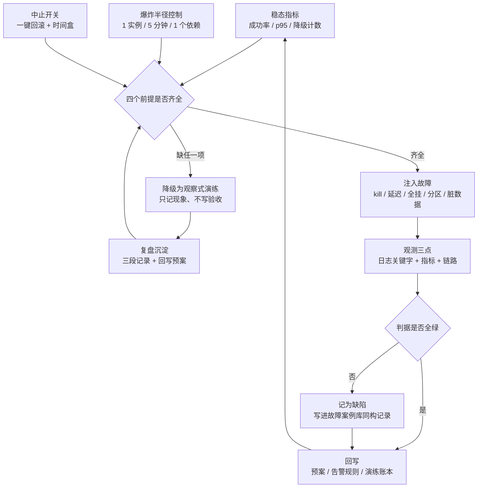
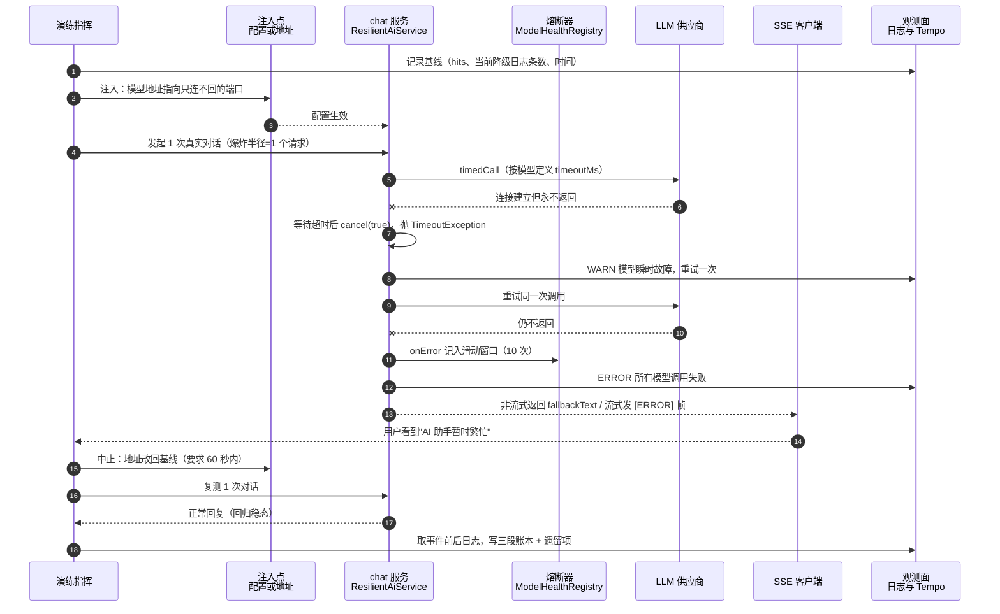

# 故障演练与混沌工程：演练的产出不是「系统没坏」，而是「坏了长什么样、谁能修、多久修好」

> **一句话结论**：演练的验收对象不是「没出事」，而是「注入之后，日志里有那一条、降级文案是那一句、恢复落在时间盒内、账本上写着谁修的」；本仓现在连判据和账本都还没造出来，所以正确的第一步不是引入 Chaos Mesh，而是拿配置开关做一次能留下记录的「手动演练」。
> **阅读前置**：01-SLI-SLO与错误预算（知道什么叫稳态、错误预算怎么算）、05-降级预案与开关治理（知道本仓有哪些开关）；会读 Spring Boot 日志、会用 pwsh 跑只读命令；懂 Flux / SSE 的 `onNext/onError/onComplete` 三回调即可，不需要会写 Reactor。
> **证据基线**：本仓 main 分支，2026-11-27 本机核对（B 级引用均当次 read 核对行号，写完整路径）；C 级两段实测在本机 node 24.16.0 + Windows PowerShell 上真实跑出，未启动服务、未联网、未装依赖。预计阅读 30~38 分钟。

## 0. 先看现象

**症状一：想演练，先去找注入工具的名字，全仓一个都搜不到。**

```pwsh
# 排除文档与构建产物，看业务/部署代码里有没有混沌工程工具的任何痕迹
(Get-ChildItem -Recurse -File -Include *.java,*.yml,*.yaml,*.ps1,*.sh,*.mjs -Path . |
  Where-Object { $_.FullName -notmatch 'node_modules|\\target\\|\\\.git\\|learning-docs' } |
  Select-String -Pattern 'chaos|ChaosBlade|toxiproxy' | Measure-Object).Count
```

```text
0
```

**症状二：想知道「降级到底触发了几次」，没有任何指标可查；判据全压在日志里。**

```pwsh
# 上半：全仓有没有自建指标（MeterRegistry / Timer.builder / Counter.builder）
(Get-ChildItem -Recurse -File -Include *.java -Path . |
  Where-Object { $_.FullName -notmatch 'node_modules|\\target\\|\\\.git\\|learning-docs' } |
  Select-String -Pattern 'MeterRegistry|Timer\.builder|Counter\.builder' | Measure-Object).Count

# 下半：chat 模块里"降级/熔断/超时/配额"相关的日志语句有多少条
(Get-ChildItem -Recurse -File -Include *.java -Path ai-cs-chat\src\main |
  Select-String -Pattern 'log\.(warn|info|error)\("[^"]*(降级|熔断|超时|配额)' | Measure-Object).Count
```

```text
0
21
```

有意思的地方就在这两行数字的反差：**21 处降级日志，0 个指标**。降级行为是"写了、也会打印"，但没有一个能被 Prometheus 抓到、能拿来判定"演练是否通过"的数。

**症状三：文档里承诺了「演练账本」，仓里却一份账本都没有。**

```pwsh
# 重写前：文件名含"演练/drill"的资产（不含本次新增的 tools\tmp 脚本）
Get-ChildItem -Recurse -File -Path learning-docs |
  Where-Object { $_.Name -match '演练|drill' -and $_.FullName -notmatch 'tools\\tmp' } |
  ForEach-Object { $_.FullName.Replace('D:\Projects\Persion\ai-customer-service\','') }
```

```text
learning-docs\13-稳定性工程\03-故障演练与混沌工程.md
```

只有这一篇文档本身。也就是说：**讲演练的文章有一篇，演练本身零次、演练脚本零个、演练记录零份**。章节 README 还写着"每个演练项要有现象-恢复-验证三段记录"（`learning-docs/13-稳定性工程/README.md` L201 附近的约束），而全仓搜不到任何一份三段记录文件。

把这四组数字放在一起，一次**演练准备度自检**就把结论摊平了（脚本见 §3.1，68 行，只读离线，2 秒跑完）：

```pwsh
& .\learning-docs\tools\tmp\drills\drill-readiness.ps1
```

```text
前提     探测                                                                  实测值 门槛 结论
--     --                                                                  --- -- --
1 稳态指标 MeterRegistry / Timer.builder / Counter.builder 命中数                   0 ≥1 FAIL
2 注入能力 chaos / ChaosBlade / toxiproxy 命中数                                    0 ≥1 FAIL
3 中止开关 @RefreshScope 真注解行数（可热更配置的类）                                          1 ≥1 PASS
4 判据资产 deploy\observability\prometheus.yml 中 rule_files / alertmanager 命中数   0 ≥1 FAIL
5 复盘载体 docs/28-*.md ~ docs/30-*.md 故障案例库文件数                                  2 ≥1 PASS

汇总：5 项前提，FAIL 3 项 → 只能做观察式演练，先补 FAIL 项
```

这些现象指向同一件事：**本仓的降级路径是「写了但没验过」的**——降级代码、降级日志、熔断参数都在（21 处日志、三套 Resilience4j 实例、`fallbackText` 文案），但没有任何一次演练证明过它们真会在故障时按设计触发。演练缺席的根因不是"没装工具"，而是"没有判据、没有账本"：没有指标你判不了，没有记录你下次还得从头猜。

## 1. 整体地图



> **读图说明**：先看 `G -- 缺任一项 --> H` 这条向下的箭头——它说明演练不是"有工具就能做"，四个前提缺一个，产出的记录就不具备验收效力，只能算观察练习。再看最外的回流箭头 `M --> A`：演练的终点不是"这次通过了"，而是把结论回写成稳态指标与判据，下一轮才有更细的基线。中间 `K -- 否 --> L` 是这张图的核心价值观：**判据不绿不是演练失败，是演练成功的发现了缺陷**，只有"注入后什么现象都没有、也说不清为什么"才叫失败。

| 组件 / 角色 | 本仓对应物 | 责任 | 参与方 |
| --- | --- | --- | --- |
| 稳态指标 | `deploy/observability/prometheus.yml`（15s 抓取、11 个 static target，无 `rule_files`） | 定义「正常」的量化边界 | 服务 owner、SRE |
| 自建业务指标 | **未落地**（全仓 0 命中 `MeterRegistry`） | 把「降级发生了几次」变成可查询的数 | 服务 owner |
| 注入手段 | **未落地**（0 命中 chaos/toxiproxy）；可用替代：配置开关、本地脚本 | 制造故障 | 演练指挥 |
| 降级链 | `ai-cs-chat/src/main/java/com/aics/chat/service/impl/ResilientAiService.java`（超时/重试/熔断/fallback） | 被验证对象 | 服务 owner |
| 中止开关 | 配置项热更（`@RefreshScope` 仅 1 个类）+ 停进程；**无开关表** | 演练中随时回滚 | 演练指挥 |
| 判据人 | 无固定角色（本次建议：当日 oncall） | 判定 PASS/FAIL | oncall |
| 账本 | `docs/28-故障案例库.md`（存在，可复用同构结构） | 沉淀现象-恢复-验证 | 复盘人 |
| 中止权 | 演练指挥 | 谁有权喊停 | 演练指挥 |

## 2. 关键概念与关键要素

| 名称 | 位置（本仓 / 通用） | 作用 | 关键参数 |
| --- | --- | --- | --- |
| 稳态（steady state） | 通用概念；本仓用 01 篇的 SLI 定义 | 演练前后都成立的"正常画像"，是判据的锚 | 成功率、p95、错误预算消耗率 |
| 稳态指标 | 本仓仅有框架自带 JVM/HTTP 指标（`ai-cs-chat/pom.xml` L209-222 引 actuator + micrometer-registry-prometheus） | 判"注入后有没有偏" | 抓取间隔 15s（`deploy/observability/prometheus.yml` L3） |
| 自建业务指标 | **未落地** | 判"降级链有没有按设计触发" | 建议名：`chat_llm_fallback_total{reason=...}`、`chat_llm_breaker_state` |
| 爆炸半径（blast radius） | 通用概念 | 限制故障影响面：几个实例、几个用户、多长时间 | 实例数=1、时长≤5min、用户比例≤1% |
| 注入（injection） | **未落地**；替代品是配置开关 | 主动制造故障，而不是等故障 | 故障形态：超时/异常/断连/脏数据 |
| 中止开关（kill switch） | 本仓仅有 `@RefreshScope` 1 个类（`ai-cs-chat/src/main/java/com/aics/chat/modelrouter/ModelRouterProperties.java` L21） | 演练随时回滚 | 回滚耗时 ≤1min |
| 时间盒（timebox） | 通用 | 演练窗口上限，超时无条件复位 | 与 `timeout-duration` 同量级（本仓 30s / 60s / 5s） |
| 判据（pass criteria） | 本仓无判据文件 | 「这次演练算不算通过」的唯一标准 | 必须可复制粘贴验证，不许"看起来正常" |
| 账本（drill ledger） | `docs/28-故障案例库.md` 同构 | 下次演练/事故时的第一手资料 | 现象 / 恢复 / 验证 三段 + 遗留项 |
| 软错误帧 | `ai-cs-chat/src/main/java/com/aics/chat/service/impl/ChatServiceImpl.java` L670-686 | HTTP 200 但内容是 `[ERROR]`，最容易骗过判据 | 前缀 `[ERROR]` |
| fail-open | `ai-cs-chat/src/main/java/com/aics/chat/observability/QuotaService.java` L77-79 | 依赖坏了就放行，保可用性 | 结果看不出来，只能看 WARN |
| 演练 vs 压测 | 通用 | 压测问"能扛多少"，演练问"坏了什么样" | 压测看吞吐，演练看降级与恢复 |
| 游戏日（game day） | 通用 | 多人、多角色、按剧本走一遍的演练形式 | 剧本 + 角色分工 + 计时 |
| 限流 vs 熔断 vs 降级的演练差异 | 本仓三者都有实现 | 限流看入口拦截、熔断看状态机、降级看文案 | 三者判据不能混用（§3.7 #8 / #9 / #1） |
| 首 token 时间（TTFT） | `ResilientAiService.java` L284-288 记录 | 流式体验的核心指标，演练时要单独看 | 单位 ms，与总耗时分开判 |
| MTTD / MTTR | 通用 | 演练真正要产出的两个时间 | 发现耗时 / 恢复耗时 |

## 3. 原理与证据逐段精读

### 3.1 前提一：先有稳态指标，否则演练只能看热闹

**在干什么**：把「正常」写成可计算的表达式，注入故障后比对它有没有偏。没有这一步，演练就退化成"我点了几下页面，感觉还行"。

**为什么这么设计**：混沌工程的定义里，实验 = 假设 + 观测 + 结论。假设是"模型超时后 3 秒内返回降级文案"，观测必须有数，结论才成立。本仓的困难在于**业务侧自建指标是 0**，只有 actuator 暴露的框架指标（`ai-cs-chat/pom.xml` L209-222 引入 `spring-boot-starter-actuator` 与 `micrometer-registry-prometheus`，抓取端点写在 `tools/nacos-config/aics-shared.yml` L31-32 的 `management.endpoints.web.exposure.include: health,info,prometheus`）。

`deploy/observability/prometheus.yml` 全文只有 24 行：`scrape_interval: 15s`（L3）、一个 job、11 个 static target（L12-22）。**没有 `rule_files`，没有 `alertmanager`**——意味着就算你算出"降级率 80%"，也不会有任何规则替你把这件事件叫出来。

**换写法会怎样**：如果坚持"先装 Prometheus 规则再演练"，本仓要先补：自建计数器 → 录音规则 → 告警通道 → 演练窗口通知，四步下来一个月就过去了，演练还是零次。反过来，如果先用日志做判据（本仓 21 处降级日志就是现成的观测点），第一周就能跑出第一份账本，指标可以后面补——**判据可以先粗糙，但不能没有**。

**常见坑**：把 `curl` 返回 200 当指标。本仓 SSE 链路在降级时是 **HTTP 200 + 一条 `[ERROR]` 内容帧**（见 3.6），只看状态码的"稳态指标"会把 100% 降级判成 100% 健康。

C 级证据：上面 §0 的 `drill-readiness.ps1` 就是这条前提的机器化版本，68 行，只读离线：

`learning-docs\tools\tmp\drills\drill-readiness.ps1`（68 行）里第 1 项检查的核心只有三行：

```pwsh
$files = Get-ChildItem -Recurse -File -Include *.java -Path . |
    Where-Object { $_.FullName -notmatch 'node_modules|\\target\\|\\\.git\\|learning-docs' }
return ($files | Select-String -Pattern 'MeterRegistry|Timer\.builder|Counter\.builder' | Measure-Object).Count
```

**怎么读这一行**：返回 0 = 没有任何自建业务指标，演练判据只能落在日志上；返回 ≥1 说明有人开始写计数器了，可以升级为"指标判据 + 日志佐证"。注意脚本里 `-Path .` 是相对脚本推导出的仓库根，跑之前先 `Set-Location` 到仓库根，否则会把 `learning-docs` 目录也数进去（这个坑我在 §6.7 里专门讲了一次）。

### 3.2 前提二：爆炸半径要三把锁（实例数 / 时长 / 依赖范围）

**在干什么**：把"注入一次故障"限定成可承受的实验：只打 1 个实例、只持续 5 分钟、只针对 1 个依赖。

**为什么这么设计**：演练的第一原则是不制造真实事故。本仓真实约束很具体——chat 服务是单实例部署（`deploy/observability/prometheus.yml` L15 只有一个 `host.docker.internal:8083` 指向 chat），**"只打一个实例"在本仓等于"全挂"**，所以不能照搬"kill 1/3 副本"的教科书做法。

**换写法会怎样**：如果按常规 K8s 演练思路做"滚动 kill 副本"，本仓没有副本可滚，直接变成停机演练；反过来，如果因为怕就没有演练，那 21 处降级日志永远是"未验证代码"。本仓可行的折中是**按依赖维度而不是按实例维度切**：只让"模型调用"这一个下游失效，其它接口正常——这样爆炸半径从"整个服务"缩到"一次对话的质量"。

**常见坑**：把"演练环境"当成必然存在的资源。本仓没有演练集群，`docs/` 下也没有演练环境的说明；现实做法是在本机或测试环境、用配置开关把下游指到一个必然超时的地址，把影响面限定为"你自己发起的请求"。

三把锁在本仓的具体取值（这张表就是演练计划里"影响面"那一栏的填写依据）：

| 锁 | 教学式默认值 | 本仓取值 | 依据 |
| --- | --- | --- | --- |
| 实例数 | 总量的 1/3 | **0 个可选**（只能 0 或 1） | chat 只有 1 个 target，`deploy/observability/prometheus.yml` L15 |
| 依赖范围 | 1 个依赖 | 1 个下游（模型 / 检索 / 缓存三选一） | 三条链路互相独立，可单点注入 |
| 时长 | ≤ 5 分钟 | ≥ 5 分钟且覆盖 3 次请求 | 单次最坏等待 ≈ `timeout × attempts`，见 §6.4 |
| 用户面 | ≤1% 流量 | 0（只用自己发的请求） | 本机/测试环境无真实流量 |
| 数据面 | 只读 | 只读（不许造脏数据进知识库，除非已备份） | L5 演练需单独审批 |

### 3.3 前提三：中止开关必须是「可热更」，不是「改完重启」

**在干什么**：演练出意外时，一分钟内把注入撤掉、把参数改回基线。

**为什么这么设计**：本仓的容错参数全部写在**本地 `application.yml`** 的 `resilience4j` 段（`ai-cs-chat/src/main/resources/application.yml` L71-159）：`timelimiter.chatService.timeout-duration: 30s`（L77-79）、`retry.chatService.max-attempts: 3`（L91-99）、`circuitbreaker.chatService` 的 `sliding-window-size: 10 / minimum-number-of-calls: 3 / failure-rate-threshold: 50 / wait-duration-in-open-state: 30s`（L117-130），另有两套同结构实例 `sseChatService`（L132-145）与 `visionService`（L147-159）。**改这些参数需要重启**；本仓真正能热更配置的类只有一个：`ai-cs-chat/src/main/java/com/aics/chat/modelrouter/ModelRouterProperties.java` L21 的 `@RefreshScope`（字符串命中 3 处，真注解 1 处，另两处是注释）。

**换写法会怎样**：把中止手段只押在"Nacos 改配置"上，演练当天会卡住——resilience4j 段不在 Nacos 的共享配置里，改本地文件得重启，重启期间的所有中断都会被误记成"演练效果"。反过来，如果中止开关是应用内的业务开关（例如"强制走降级文案"），一次 HTTP 调用就能复位，演练才敢放肆一点。

**常见坑**：把"能改"当"能撤"。判断标准很硬：**演练进行中，你能不能不发版、不重启、在 60 秒内让降级路径停止触发？** 不能，就不是中止开关。

### 3.4 前提四：复盘沉淀不是写总结，是写「三段 + 遗留项」

**在干什么**：把一次演练固定成可被下一个人复用的记录：现象（哪个日志/哪个响应）→ 恢复（谁做了什么、多久）→ 验证（用什么命令确认回到稳态）。

**为什么这么设计**：演练的产出物是知识，不是绿勾。本仓已经有承载这种结构的地方——`docs/28-故障案例库.md` 存在且是真实缺陷记录（含 `role=admin` 提权这类真实问题），演练记录应该和故障案例同构，这样"演练发现的坑"和"线上踩到的坑"能放在一起检索。

**换写法会怎样**：只写"本次演练通过，系统表现稳定"的总结，三个月后没人能复现，等于没演练。旧稿给的三段模板方向是对的，问题在于它没有"遗留改进项 → 谁 → 何时"这条闭环字段，导致演练结论落不到代码上。

**常见坑**：把时间记成"大概几分钟"。演练唯一需要精确的数字就是 MTTD / MTTR，记"约 5 分钟"跟没记一样。

账本的最小结构（可以直接存成 `docs/drills/YYYYMMDD-<故障形态>.md`，字段与 `docs/28-故障案例库.md` 保持同构，方便互链）：

```yaml
# 演练账本：一次演练一条记录，字段全部必填（缺省视为记录无效）
# ⚠️ 下面所有数值/时间都是**占位符**，是模板不是演练结果，禁止当作实测数据引用
drill_id: 20261201-llm-timeout-01
fault: 依赖延迟（模型永不返回）          # 对应 §3.6 的 L2
blast_radius: 1 个请求 / 本机 / 时长 <时间盒>
steady_state_before:                    # 现象之前：稳态是什么样
  baseline_log_lines: <演练前该日志条数>
  normal_latency_ms: <自己测的一次正常对话耗时>
inject:
  action: 模型地址指向只连不回的端口
  started_at: <注入开始时间>
observed:                               # 现象：逐条抄日志原文，不要转述
  - "WARN  模型瞬时故障，重试一次"
  - "ERROR 所有模型调用失败"
  - "SSE流式降级: sessionId=<id>, msg=AI 助手暂时繁忙，请稍后重试。"
recover:
  action: 地址改回基线（无需重启）
  started_at: <开始复位时间>
  restored_at: <复位完成时间>
  mttr_seconds: <实测秒数>
verify:                                 # 验证：可复制粘贴的命令 + 期望输出
  command: "复测 1 次对话，期望 < 基线耗时且不含 error 字段"
  result: PASS / FAIL
followups:                              # 遗留项：谁、何时、怎么验收
  - owner: <模块 owner>
    action: 评估 max-attempts 3 -> 2，缩小最坏等待
    due: <日期>
    accept: 演练复跑，最坏等待 <= <目标值>
```

**换写法会怎样**：只写"现象 + 结论"两段，最容易漏掉的正是 `followups`——而演练的全部价值最终都落在这一栏：没有它，演练只是把已知问题又看了一遍。

**常见坑**：把 `observed` 写成"日志报错了"这种转述。账本里的每条现象都必须是**日志原文或响应体原文**，否则下一个人无法用 `Select-String` 复跑核对。

### 3.5 三种注入方式的取舍：Chaos Mesh / ToxiProxy / 代码与配置开关

**在干什么**：产生"下游变慢 / 下游挂了 / 网络不通"这类故障，而不是靠祈祷故障自己出现。

**为什么这么设计**：三种方式对应的故障形态、成本和可中止性完全不同，本仓的起点决定了只能从第三种开始：

| 方式 | 能注入什么 | 部署成本 | 可中止性 | 本仓适用性 |
| --- | --- | --- | --- | --- |
| Chaos Mesh | 网络延迟/丢包/分区、Pod kill、IO/CPU 压力 | 需 K8s + CRD + 集群权限 | 强（删 CR 即撤） | ❌ `deploy/k8s/services/` 虽有 8 份 manifest（如 `deploy/k8s/services/ai-chat-service.yaml`），但仓内无 Chaos Mesh 安装清单、无演练集群与权限说明；Replicas 也全是 1 |
| ToxiProxy | 只代理 TCP：延迟、带宽、超时、断连 | 单二进制或一个容器，配置 `toxiproxy-cli` | 强（关 proxy 即撤） | ⚠️ 理论可用，需可控地改下游 base-url；本仓当前 0 命中 |
| 代码 / 配置开关 | 业务级故障：强制降级、强制超时、指定下游地址 | 零依赖，改配置或加一个测试开关 | 中（视开关是否热更，见 3.3） | ✅ 当前唯一可落地方式（0 新增依赖） |

**换写法会怎样**：先上 Chaos Mesh 的团队往往死在"权限 + 环境"两件事上，演练计划变成"等基础设施组排期"。而只做代码开关的团队容易漏掉"网络层故障"（断连、分区、半开连接），因为业务开关模拟的是"我知道它坏了"，而不是"它悄悄不响应了"。

**常见坑**：以为代码开关演练出来的结论可以外推到网络层。业务开关演练验证的是"降级分支写得对不对"，验证不了"TCP 连不上时客户端多久报错"——后者才是生产里最常见的形态。

ToxiProxy 的骨架长这样（**未本机实测**：本机无该工具、且任务约束禁止联网下载，这里只给命令与判读方法；路径为通用示例，落到本仓时把 `upstream` 指向模型/ES 的真实地址）：

```pwsh
# 1) 起代理（默认监听 8474 控制端口）
toxiproxy-server -host 127.0.0.1 -port 8474

# 2) 建一个代理：本地 18080 -> 上游模型地址；应用侧把 base-url 改成 127.0.0.1:18080
toxiproxy-cli create -l 127.0.0.1:18080 -u <上游真实地址> llm-proxy

# 3) 注入延迟：每个数据包 +2000ms，抖动 500ms（对应 §3.6 的 L2）
toxiproxy-cli toxic add -t latency -a latency=2000 -a jitter=500 llm-proxy

# 4) 演练结束：删掉 toxic（不必删代理，也不用重启应用）
toxiproxy-cli toxic remove -n latency_downstream llm-proxy
```

判读列：`toxic add` 成功后应用侧日志应出现 `模型瞬时故障，重试一次`（说明延迟已超过超时阈值）；`toxic remove` 后复测应恢复正常。**怎么读**：延迟值要故意大于 `timeout-duration`（本仓 30s，所以 `latency` 至少 30000 才能触发超时，2000 只能测"变慢未超时"的另一条分支）——这一步是本仓最容易设错的地方。

### 3.6 演练类型递进表：从「杀一个进程」到「造脏数据」

**在干什么**：按破坏力从小到大排一条阶梯，每一级都有明确的判据和前置条件，禁止跳级。

**为什么这么设计**：跳级的经典后果是"第一次演练就发现系统没兜住，而且不知道是哪一层没兜住"。逐级递进能把失败定位在具体一层。

| 级 | 故障形态 | 本仓可注入点 | 判据（看什么） | 危险度 |
| --- | --- | --- | --- | --- |
| L1 | 单实例 / 单进程 kill | 停掉 chat 进程（`ai-cs-chat` 单实例，等于全停） | 网关是否在超时内返回 503、前端是否有兜底文案 | 高（本仓无副本） |
| L2 | 依赖延迟（慢而不挂） | 把模型 base-url 指到"只接受连接不返回"的地址 | 30s 超时是否生效、`模型瞬时故障，重试一次` 是否出现 | 低 |
| L3 | 依赖全挂（连不上） | base-url 指向未监听端口（`ConnectException`） | 重试 1 次后是否落到 `fallbackText`、熔断器是否 OPEN | 低 |
| L4 | 网络分区 / 半开 | ToxiProxy 或防火墙丢包（本仓无工具） | 客户端超时时间、连接池是否耗尽 | 中（需工具） |
| L5 | 数据损坏 | 造一条超长/畸形文档进知识库、给一份脏历史 | 检索是否降级、SSE 是否 `[ERROR]` 而不是 500 | 高（要清理） |

**换写法会怎样**：直接从 L5 开始（很多人第一反应是"造点脏数据看看"），你既分不清是检索坏了还是生成坏了，也不敢再演练第二次。

**常见坑**：把 L1 当"最简单的一级"。在本仓 L1 恰恰是最危险的——单实例，kill 就是全停（§6.1 给了判断命令）。

每一级在开打之前必须准备好的东西（缺任何一项就退回上级）：

| 级 | 开打前必须确认 | 记录什么 | 允许的最小结论 |
| --- | --- | --- | --- |
| L1 | 有第二个人在场；前端兜底文案已确认；恢复命令写过一遍 | 从 kill 到用户看到兜底文案的秒数 | "单实例无冗余，恢复靠重启，MTTR=启动时间" |
| L2 | 生效的超时值（`timeoutMs` 而非 yml 的 30s，见 §6.4）；观察窗口 > 超时 | 首次 WARN 出现时刻、最终文案 | "超时生效，降级文案 N 秒后出现" |
| L3 | 重试层级只有一个（业务 retry vs 框架 retry 不叠加） | WARN/ERROR 各几条、熔断器是否 OPEN | "连不上时立即降级，无需等待超时" |
| L4 | 有代理/丢包工具 + 能改 base-url 不重启 | 连接建立失败 vs 读写超时的区别 | "网络层故障形态已区分，客户端超时值合理" |
| L5 | 数据已备份、清理脚本已写好并空跑过 | 降级是否触发、是否出现 500 | "脏输入被兜住，未产生 5xx" |

### 3.7 本仓降级路径逐条清点：哪些能被演练验证，该看哪一条日志

**在干什么**：把 §0 里那 21 处降级日志里"最值得演练"的几条挑出来，逐条写清触发条件、代码位置、观测点。

**为什么这么设计**：演练对象必须是"存在降级分支的地方"，否则演练只是看它崩了。下面每条都是本仓真实代码，行号已核对。

| # | 降级路径 | 触发条件 | 判据：看哪个日志 / 指标 |
| --- | --- | --- | --- |
| 1 | 非流式全失败 → `fallbackText` | 所有模型都超时/异常 | 日志 `所有模型调用失败`；返回文案固定为 `AI 助手暂时繁忙，请稍后重试。`（`ai-cs-chat/src/main/java/com/aics/chat/service/impl/ResilientAiService.java` L451-456、L233-235） |
| 2 | 流式全失败 → `[ERROR]` 软错误帧 | 同上，但走 SSE | 日志 `SSE流式降级: sessionId=..., msg=...`；HTTP 状态仍是 200（`ai-cs-chat/src/main/java/com/aics/chat/service/impl/ChatServiceImpl.java` L670-686，帧在 `ResilientAiService.java` L261 / L339 产生） |
| 3 | 混合检索失败 → 纯向量 | Feign `hybridSearch` 抛异常 | 日志 `混合检索失败，降级纯向量`（`ai-cs-chat/src/main/java/com/aics/chat/rag/retrieve/HybridRetriever.java` L210-211） |
| 4 | 混合检索结果为空 → 纯向量 | ES 侧返回空/异常结果 | 降级理由 `搜索服务无数据`（同文件 L183）；上层 `RAG增强检索: mode=..., degraded=true, hits=0`（`ChatServiceImpl.java` L951-952） |
| 5 | 向量检索自身失败 → 返回空列表 | 向量库不可用 | 日志 `向量检索失败`（`HybridRetriever.java` L303），**不抛异常**，结果是空文档列表 |
| 6 | 配额检查失败 → fail-open 放行 | 用量统计存储不可用 | 日志 `配额检查失败，按未超限降级`（`ai-cs-chat/src/main/java/com/aics/chat/observability/QuotaService.java` L77-79）；**结果上看不出来**，只能靠日志 |
| 7 | 向量缓存 L2 读失败 → 仅 L1 | Redis 不可用 | 日志 `向量缓存 L2 读取失败，降级 L1-only`（`ai-cs-chat/src/main/java/com/aics/chat/cache/VectorCacheStore.java` L73-77）；写失败是 `向量缓存 L2 写入失败（不影响业务）`（L94） |
| 8 | 入口限流 → 429 业务码 | Sentinel QPS 超阈值（`chat-send` 10、`chat-rag` 5） | 日志 `对话接口触发Sentinel流控`（`ai-cs-chat/src/main/java/com/aics/chat/controller/ChatController.java` L100-104；阈值见 `ai-cs-chat/src/main/java/com/aics/chat/config/SentinelRules.java` L21/L24） |
| 9 | 单模型熔断 → 从路由候选剔除 | 该模型 10 次窗口内失败率 >50% | 无日志、无指标（`ai-cs-chat/src/main/java/com/aics/chat/modelrouter/ModelHealthRegistry.java` L18-31 只在内存里切状态）→ **必须补指标，否则这条路径不可演练判定** |

**换写法会怎样**：如果只演练 #1（最显眼的那条），你会以为"降级很完备"；实际生产里更常见的是 #6 和 #9——两者都是"静默"的：一个吞异常放行、一个只在内存里剔除模型，日志里连一行都没有。**静默降级是最该演练、也最难演练的一类**。

顺带解释一个容易被演练判据坑到的框架细节：**"配了熔断器"不等于"有兜底文案"**。Spring Cloud 的熔断抽象里，`run(Supplier)` 的默认 fallback 是直接抛异常，只有带 fallback 参数的重载才走降级——[[源码:CircuitBreaker.java.md#L29-L38]]（`run(Supplier)` 的默认 fallback 是 `throw new NoFallbackAvailableException`，L31-35；真正带兜底的是 L37 的 `run(Supplier, Function<Throwable,T>)`）。所以演练时必须验证"文案"而不只是"没抛异常"：本仓的兜底文案是 `fallbackText`（`ai-cs-chat/src/main/java/com/aics/chat/service/impl/ResilientAiService.java` L451-456），它是**业务代码显式给的**，不是框架自动给的。

**常见坑**：以为"降级日志打了"就等于"降级生效"。日志只能证明分支被进入；要证明"用户真的收到了降级文案"，必须同时校验响应内容（#1 的文案、#2 的 `[ERROR]` 帧）。

这九条各自的"怎么造故障"（本仓在不引工具的前提下都能做，前三行零依赖）：

| # | 造故障的最小手法 | 是否需要重启 |
| --- | --- | --- |
| 1 / 2 | 模型 base-url 指向只连不回的端口；或用 `learning-docs\tools\tmp\chaos-drill-sim.mjs` 演练语义 | 改地址可能要（取决于是否走热更配置） |
| 3 / 4 | 让 search 服务不可达（停进程或指向空端口），触发 Feign 异常或空结果 | 否 |
| 5 | 让向量检索指向不可用的 embedding/向量库地址 | 取决于配置源 |
| 6 | 让用量统计存储（配额所需数据）不可用，观察是否 fail-open | 否 |
| 7 | 停 Redis，观察是否退化为 L1-only | 否 |
| 8 | 短时间并发压 `chat-send` 超过 10 QPS（本机可用循环请求） | 否 |
| 9 | 让某个模型连续失败 ≥3 次（`minimum-number-of-calls: 3`），观察是否被剔除 | 否 |

下面用一段**可执行脚本**把 #1/#2 的行为在本机跑出来（不联网、不起服务，用 Promise 模拟"连上了但永不返回"的下游）。脚本在 `learning-docs\tools\tmp\chaos-drill-sim.mjs`（162 行），核心与原实现的对应关系是：`timedCall` ↔ `ResilientAiService.java` L378-406 的超时与取消；`callWithTransientRetry` ↔ L356-367 的"瞬时故障重试一次"；`invokeNonStream` ↔ L172-240 的逐模型降级链；`invokeStream` ↔ L261 / L339 的 `[ERROR]` 帧。

```javascript
// 复刻 timedCall：超时即放弃该次尝试（真实实现还会 future.cancel(true)）
function timedCall(model) {
  let timer;
  const timeout = new Promise((_, reject) => {
    timer = setTimeout(() => reject(new TimeoutError(model.id, TIMEOUT_MS)), TIMEOUT_MS);
  });
  return Promise.race([callDownstream(model), timeout]).finally(() => clearTimeout(timer));
}

// 复刻 callWithTransientRetry：仅瞬时故障重试一次
async function callWithTransientRetry(model, state) {
  let lastErr;
  for (let attempt = 1; attempt <= ATTEMPTS; attempt++) {
    try { return await timedCall(model); }
    catch (e) {
      lastErr = e;
      if (attempt < ATTEMPTS && e.name === 'TimeoutException') {
        state.retries += 1;
        log.warn(`[retry] model=${model.id}`, `模型瞬时故障，重试一次（第 ${attempt} 次尝试失败：${e.message}）`);
        continue;
      }
      break;
    }
  }
  throw lastErr;
}
```

真实跑一次（300ms 超时、2 次尝试，把线上 30s/3 次等比缩小，只为 3 秒内跑完）：

```pwsh
cd learning-docs
node tools\tmp\chaos-drill-sim.mjs --scenario=all --timeout-ms=300 --attempts=2
```

```text
[    0ms] ==== 演练开始 scenario=primary-hang timeout-ms=300 attempts=2 ====
[  311ms] WARN  [retry] model=deepseek-chat 模型瞬时故障，重试一次（第 1 次尝试失败：deepseek-chat 在 300ms 内无响应）
[  623ms] ERROR [call] model=deepseek-chat 失败放弃该模型：TimeoutException: deepseek-chat 在 300ms 内无响应
[  670ms] INFO  [route] model=qwen-plus 成功返回（attempts 上限 2）
[  670ms] 最终返回："备份模型回复：您的订单已发货。"
[  670ms] 观测属性：routeReason=DEGRADE fallbackFrom=deepseek-chat modelId=qwen-plus
[  671ms] ---- 判据清单：primary-hang ----
[  671ms]   PASS  至少 1 条重试 WARN
[  671ms]   PASS  出现"失败放弃该模型"
[  671ms]   PASS  最终由备份模型返回
[  671ms]   PASS  fallbackFrom 记录了主模型
[  671ms] 结论：演练通过（降级链行为符合设计）
[  671ms] ==== 演练结束 用时 671ms ====

[  671ms] ==== 演练开始 scenario=all-hang timeout-ms=300 attempts=2 ====
[  981ms] WARN  [retry] model=deepseek-chat 模型瞬时故障，重试一次（第 1 次尝试失败：deepseek-chat 在 300ms 内无响应）
[ 1296ms] ERROR [call] model=deepseek-chat 失败放弃该模型：TimeoutException: deepseek-chat 在 300ms 内无响应
[ 1615ms] WARN  [retry] model=qwen-plus 模型瞬时故障，重试一次（第 1 次尝试失败：qwen-plus 在 300ms 内无响应）
[ 1928ms] ERROR [call] model=qwen-plus 失败放弃该模型：TimeoutException: qwen-plus 在 300ms 内无响应
[ 1929ms] ERROR [all]  所有模型调用失败
[ 1929ms] 最终返回："AI 助手暂时繁忙，请稍后重试。"
[ 1929ms] 观测属性：routeReason=ALL_FAILED fallbackFrom=qwen-plus modelId=null
[ 1929ms] ---- 判据清单：all-hang ----
[ 1929ms]   PASS  出现"所有模型调用失败"
[ 1929ms]   PASS  返回文本等于 fallbackText
[ 1929ms]   PASS  没有把异常抛给调用方
[ 1929ms] 结论：演练通过（降级链行为符合设计）
[ 1929ms] ==== 演练结束 用时 1929ms ====

[ 1929ms] ==== 演练开始 scenario=stream-hang timeout-ms=300 attempts=2 ====
[ 2237ms] WARN  [retry] model=deepseek-chat 模型瞬时故障，重试一次（第 1 次尝试失败：deepseek-chat 在 300ms 内无响应）
[ 2544ms] ERROR [call] model=deepseek-chat 失败放弃该模型：TimeoutException: deepseek-chat 在 300ms 内无响应
[ 2852ms] WARN  [retry] model=qwen-plus 模型瞬时故障，重试一次（第 1 次尝试失败：qwen-plus 在 300ms 内无响应）
[ 3156ms] ERROR [call] model=qwen-plus 失败放弃该模型：TimeoutException: qwen-plus 在 300ms 内无响应
[ 3156ms] ERROR [all]  所有模型调用失败
[ 3156ms] 最终返回："[ERROR]AI 助手暂时繁忙，请稍后重试。"
[ 3156ms] ---- 判据清单：stream-hang ----
[ 3156ms]   PASS  流式返回 [ERROR] 软错误帧
[ 3156ms]   PASS  帧内容带可读文案
[ 3156ms] 结论：演练通过（降级链行为符合设计）
[ 3156ms] ==== 演练结束 用时 3157ms ====

exit=0
```

**怎么读这段输出**（这才是演练账本该抄的部分）：

1. 第一行时间戳 `311ms`：用户等待的第一步不是"降级"，而是"重试一次"，也就是说本仓一次失败对话的最坏等待是 `timeout × 尝试次数`——线上是 `30s × 重试`，相当于用户最多干等 1 分钟才看到降级文案。这个数字只有跑一次才看得出来，看代码很容易忽略。
2. `WARN [retry] ... 模型瞬时故障，重试一次` 与 `ERROR [call] ... 失败放弃该模型`：这两条日志的**顺序与成对出现**就是判据 #1 的核心。只看到 WARN 没看到 ERROR，说明重试救回来了，不该落 fallback。
3. `观测属性：routeReason=DEGRADE fallbackFrom=deepseek-chat` 对应 `ResilientAiService.java` L466-480 里记录的 observation 属性——**这是本仓唯一"结构化的降级证据"**，Tempo 里能查到，但 Prometheus 里查不到（因为没有计数器）。
4. 第三个场景的 `[ERROR]` 帧：如果只 `curl -I` 看状态码，你会得到 200；必须读响应体前缀。这条把 §3.1 的"常见坑"当场兑现。
5. `exit=0` 只代表脚本自身判据全绿，**不代表线上降级链路一定一样**——脚本验证的是"设计语义"，线上验证还得用真实开关注入（见 §9 练习 2）。

### 3.8 AI 服务特有的演练项（普通服务没有的五个）

**在干什么**：把"模型"当作比数据库更不可控的依赖来演练。

**为什么这么设计**：AI 服务的故障形态有两类新东西：① 下游是"慢+限流+偶发空"的第三方，不是自己的库；② 故障后果可能不是报错，而是**答得不对**（质量回退），这在传统服务里没有对应概念。

| 演练项 | 注入方式（本仓可行） | 判据 | 与普通服务的差别 |
| --- | --- | --- | --- |
| 模型超时 | 把模型 base-url 指向只连不回的地址（或本脚本） | `模型瞬时故障，重试一次` → 全失败 → `fallbackText`；用户等待 ≈ `timeout × 尝试次数` | 下游超时通常以"分钟"计（本仓 30s/60s），远超 RPC 默认 1s |
| 模型限流 429 | 请求超过供应商配额；本仓入口 Sentinel 阈值 `chat-send` 10 QPS / `chat-rag` 5 QPS 先兜一层 | 是入口 429（`对话接口触发Sentinel流控`）还是供应商 429（走重试/降级） | 两个 429 语义完全不同，判据必须区分来源 |
| 向量库不可用 | 让向量检索抛异常 | `向量检索失败` + 返回空列表（`HybridRetriever.java` L303）→ 上层 `hits=0` | 不抛错是设计选择，代价是"看起来正常但没上下文" |
| 检索为空 | 用明显查不到的问题提问 | `RAG增强检索: ... hits=0`；回答是否幻觉、是否有兜底话术 | 空结果 ≠ 系统故障，但没有判据就分不清 |
| 提示词/模型变更导致质量回退 | 换模型或改 prompt（本仓 `@RefreshScope` 的路由参数可热更） | 固定问题集的前后答案对比（需人工或 LLM 裁判） | **质量回退没有 5xx**，只能靠样本对比，属于演练必须显式设计的一项 |

**换写法会怎样**：只演练"接口还在不在"的团队，会漏掉最难查的一类事故——系统全绿、用户全骂。本仓 `ai-cs-chat/src/main/java/com/aics/chat/rag/eval/LlmJudgeService.java`（L95 附近有降级日志）说明项目里已经有"LLM 裁判"的雏形，质量回退演练应当复用它，而不是手工看十条回答。

**常见坑**：把"检索为空"和"向量库挂了"混成一个演练项。前者要验证的是**回答质量**（不许瞎编），后者要验证的是**降级可见性**（有日志、有 hits=0），判据完全不同。

### 3.9 演练与业务连续性：大促前该演练什么

**在干什么**：把演练排进业务日历，在流量高峰前把"已知会坏的地方"提前踩一遍。

**为什么这么设计**：大促期间禁止演练（爆炸半径不可控），所以演练必须在冻结窗口之前完成；而每次大促的流量形态变化会引入新的单点（本仓最典型的是 chat 单实例 + 模型供应商并发上限）。

| 时间点 | 演练内容 | 判据 | 不做的后果 |
| --- | --- | --- | --- |
| T-21 | L2 依赖延迟（模型超时）+ L3 依赖全挂 | 降级文案在 `timeout × 次数` 内出现 | 大促时用户干等无兜底 |
| T-14 | 入口限流（Sentinel 10/5 QPS） | 429 业务码 + `触发Sentinel流控` 日志 | 流量打穿到供应商触发真 429 |
| T-7 | 检索链路（#3/#4/#5） | `degraded=true` 时回答仍可用 | 高峰期 ES 抖动导致答非所问 |
| T-3 | 中止开关演练（谁能停、多久停） | 60 秒内停掉降级/回滚参数 | 出事没人敢动 |
| T-1 | 只读巡检（不许注入） | `drill-readiness.ps1` 全绿或已知豁免 | 带着未验证的改动上大促 |

**换写法会怎样**：把演练放在大促前一周做，一旦发现"降级文案要等 1 分钟"，你只有几天改超时参数——改完还得回归，结果通常是"这次先不改，大促后再说"，然后大促当天就踩。

**常见坑**：把大促前演练做成"压测"。压测回答"能扛多少 QPS"，演练回答"扛不住时用户看到什么"，两者判据不同，别混在一次窗口里做。

### 3.10 判据要写成「可复跑的三要素」，否则等于没有判据

**在干什么**：把"这次算不算通过"从人的主观判断，变成任何人在任何一天都能重放的检查。

**为什么这么设计**：混沌工程的实验必须是可重复的（repeatable），否则失败不可归因、成功不可复用。可复跑的最小要求是三要素齐全：**可复制的命令**（谁执行都一样）、**期望输出**（精确到关键字与条数）、**时间窗口**（在多久之内必须出现）。

**换写法会怎样**：写成"降级生效、系统稳定"这类话，下一个值班的人根本无法判断"现在的状态算不算异常"，演练记录也就退化成一张情绪报告。

**常见坑**：判据写成了"看日志里有没有 WARN"，但日志级别在演练时被临时调成 DEBUG，条数抖了几倍，于是判据看起来"一直不满足"——判据里要固定"日志级别 + 关键字 + 条数上限"，并在演练开始前核对日志级别。

三要素的正确写法与反例对照（本仓可用）：

| 判据要素 | ❌ 反例 | ✅ 正例（本仓口径） |
| --- | --- | --- |
| 命令 | "跑一下对话看看" | `node tools\tmp\chaos-drill-sim.mjs --scenario=all --timeout-ms=300 --attempts=2` |
| 期望输出 | "看到降级了" | 出现 1 条 `模型瞬时故障，重试一次` + 1 条 `所有模型调用失败`，且最终文本等于 `AI 助手暂时繁忙，请稍后重试。` |
| 时间窗口 | "等一会" | 从发起请求起 ≤ `timeout × attempts + 3s` 内出现（300ms×2 → 1s 内本机实测 671ms） |
| 复位判据 | "恢复正常了" | 复测 1 次对话不含 `error` 字段，且耗时回到基线的 ±30% |

## 4. 一次完整执行时序

以「模型超时 → 全失败 → 落到降级文案」为例，把 §3.7 的 #1/#2 两条路径完整走一遍。注意：本仓**没有演练工具**，所以注入点是"配置/地址"，中止也是"改回来"，全程不重启（除非你改的是本地 `resilience4j` 段，那就属于 §3.3 的坑）。



> **读图说明**：先看 `L--xC: 连接建立但永不返回` 这条虚线——它和"连不上"是两种完全不同的故障（后者立刻抛 `ConnectException`，前者要等满超时），本仓两种都会走重试，但用户等待时长差 30 秒。再看 `C->>B: onError` 与 `C->>O: ERROR 所有模型调用失败` 的顺序：熔断器先记账，日志后落地，所以**光看日志判断熔断状态是不可靠的**（要 10 次窗口攒够 3 次调用才可能 OPEN）。最后看 `D->>SW: 中止` 之后紧跟的 `D->>C: 复测`：没有复测这一步，你无法区分"演练结束了"和"系统还没恢复"。

每一步该怎么判读：

| 步 | 该看到什么 | 判读动作 | 异常时说明什么 |
| --- | --- | --- | --- |
| 1 | 基线快照（时间、日志条数、任意一次正常对话耗时） | 存进账本，作为对比锚点 | 没有基线 → 这次演练的结论不可作证 |
| 2-3 | 注入生效的证据（地址已改、或开关已开） | `Select-String` 核对配置值 | 改了但没生效 → 配置优先级问题（§6.5） |
| 4 | 只发 1 个请求 | 记录发起时刻 | 并发多个请求 → 爆炸半径失控 |
| 5-7 | 等待时长 ≈ `timeoutMs`（本仓默认 30s，SSE 60s） | 秒表/时间戳差值 | 明显短或长 → 生效的超时不是你以为的那一个 |
| 8 | `模型瞬时故障，重试一次` 恰好 1 条 | 数条数 | 出现 2 条以上 → 重试层级叠加（框架 retry + 业务重试） |
| 9-11 | 熔断器窗口 +1；若连续演练 3 次以上，可能 OPEN | 再发一次看是否直接跳过该模型 | 一直不 OPEN → 失败没被 `record-exceptions` 收进去 |
| 12 | `所有模型调用失败` 恰好 1 条 | 数条数 | 没有这条但有异常 → 走的是 onError 而非降级分支 |
| 13-14 | 非流式：返回固定文案；流式：`[ERROR]` 帧且 HTTP 200 | 读响应体前缀，不看状态码 | 返回 500 → 软错误帧机制失效 |
| 15 | 地址/开关回基线 | 再核对一次配置值 | 回滚失败 → 演练必须中止并升级 |
| 16-17 | 复测正常 | 与步 1 基线对比 | 复测仍降级 → 熔断器还在 OPEN（等 30s）或地址没改回 |
| 18 | 账本四条：现象/恢复/验证/遗留 | 交 oncall 存档 | 只写"通过" → 等于没演练 |

## 5. 设计取舍

| 取舍点 | 选项 A | 选项 B | 本仓建议与理由 |
| --- | --- | --- | --- |
| 注入手段 | Chaos Mesh（网络层，强） | 配置/地址开关（业务层，弱但零成本） | **先 B 后 A**；B 能在本周跑出第一份账本，A 需要 K8s 演练环境 |
| 判据载体 | 自建 Prometheus 指标 | 日志关键字 + 响应体 | 本仓指标为 0，**先日志**；同时把"该补哪几个计数器"写进遗留项 |
| 演练环境 | 独立演练集群 | 本机 / 测试环境 + 配置开关 | 本仓无演练集群，选本机；代价是验证不了网络层 |
| 爆炸半径 | 按实例比例（K8s 式） | 按依赖维度（只让模型坏） | 本仓 chat 单实例，**必须按依赖维度**切 |
| 中止方式 | Nacos 热更 | 停进程重启 | 热更只对 `@RefreshScope` 的类有效；resilience4j 段要重启 → 优先选"地址/开关"型中止 |
| 时间盒长度 | 5 分钟 | 30 分钟 | 本仓单次调用最坏要 `timeout×次数`，太短会误判"没反应"；建议 ≥5 分钟且覆盖 3 次请求 |
| 演练频率 | 季度 | 每次大促前 | 至少大促/大版本前各一次（§3.9） |

可扩展点清单（按"投入/收益"排序，都可独立落地）：

1. **补 3 个计数器**：`chat_llm_fallback_total{reason}`、`chat_llm_attempt_total{model,result}`、`chat_retrieval_degraded_total{reason}`——本仓 0 个 `MeterRegistry`，这三个能覆盖 §3.7 里 7 条降级路径中的 6 条。
2. **熔断器状态导出**：`ModelHealthRegistry`（`ai-cs-chat/src/main/java/com/aics/chat/modelrouter/ModelHealthRegistry.java` L18-31）目前只在内存里切状态，加一个 Gauge 就能让"模型被剔除"变成可观测事件。
3. **注入开关**：在 chat 配置里加 `aics.drill.force-timeout=true` 之类的演练开关（默认 false），把 §3.7 的注入做成"改一个布尔值"。
4. **判据文件**：把 §3.7 表格沉淀成 `drills/*.yml`（演练项 + 期望日志 + 期望耗时），供脚本读取，避免判据散落在文档里。
5. **ToxiProxy 引入**：等 L2/L3 演练稳定后，加一层 TCP 代理验证网络层（延迟、丢包、半开）。
6. **告警联动**：`deploy/observability/prometheus.yml` 目前无 `rule_files`/`alertmanager`，补上之后演练可以从"人工判读"升级为"告警是否按时叫"——这才是 MTTD 的真实演练。
7. **演练账本目录**：`docs/28-故障案例库.md` 已有同构结构，新增 `docs/` 下的演练记录可与案例库互链，形成"演练发现 → 事故复盘 → 规则"闭环。

## 6. 踩坑与调试手法

说明：本节命令中，`Select-String` / `Get-Content` 类只读命令均在本机可跑（与我核对行号时用的是同一批）；涉及**启动服务或发真实请求**的（6.2、6.9）因本次任务禁止起服务，未本机实测，按"完整命令 + 判读列 + 误判风险"给出，请在自己的测试环境执行。

### 6.1 以为「kill 一个实例」是温和操作，本仓其实是全停

```pwsh
# 先确认 chat 有几个实例（target 数量 = 实例数量）
Select-String -Path deploy\observability\prometheus.yml -Pattern '8083'
```

判读列：输出 `'host.docker.internal:8083'   # chat` 只有一条 → 单实例；若有多条则要按实例逐个演练。

误判风险：看到 Kubernetes 演练文章里"kill 1/3 副本"就照抄，本仓一次 kill 就是 100% 不可用，演练直接变事故。旧稿里的 `docker kill chat` 命令在本仓也不成立：`deploy/docker-compose/docker-compose-all.yml` L224-226 里服务名是 `ai-chat-service`、容器名是 `aics-chat-service`，没有叫 `chat` 的容器，执行前必须先核对——这也是我在 §7 把它列进迁移表的原因。

### 6.2 用 `curl` 状态码判断降级，把「200 + [ERROR]」误判成健康

```pwsh
# 只拿状态码（错误做法）
curl.exe -s -o NUL -w "%{http_code}`n" "http://localhost:8083/chat/sse?sessionId=t1&message=hi"
# 拿响应体前 200 字节，检查是否以 [ERROR] 开头（正确做法）
curl.exe -s -N --max-time 5 "http://localhost:8083/chat/sse?sessionId=t1&message=hi" | Select-Object -First 3
```

判读列：状态码 200 + 响应体含 `"error"` 字段（`ChatServiceImpl.java` L670-686 会把 `[ERROR]` 帧转成 `{"error":"..."}`）= 已降级；状态码 500 = 降级机制本身坏了。

误判风险：SSE 是"已经回 200 再流式推送"的协议，状态码在降级后不可能变。另外本仓 SSE 端点路径要以实际映射为准（`ChatController` 里的 `/sse`），敲错路径拿到的是 404，会让人误以为"接口没了"。

### 6.3 演练刚结束就断言「降级没生效」，其实熔断器还在 OPEN

```pwsh
# 恢复地址后再打一次，看是否仍走降级文案；连续两次间隔 30s 以上
Select-String -Path ai-cs-chat\src\main\resources\application.yml -Pattern 'wait-duration-in-open-state|permitted-number-of-calls-in-half-open-state'
```

判读列：输出 `wait-duration-in-open-state: 30s` 与 `permitted-number-of-calls-in-half-open-state: 3` → OPEN 后要等 30 秒才放 3 个探测请求，演练复位后必须等 ≥30s 再复测。

误判风险：把"熔断器 OPEN"误判成"演练把服务弄坏了"，于是回滚、重启、写错误结论——真正的结论应该是"熔断恢复依赖 30s 窗口 + 3 次探测，MTTR 的固定成本在这里"。

### 6.4 超时 30s，却只观察 20s，判据永远 FAIL

```pwsh
Select-String -Path ai-cs-chat\src\main\resources\application.yml -Pattern 'timeout-duration|max-attempts|multiplier'
```

判读列：`chatService 30s`、`sseChatService 60s`、`max-attempts: 3`、`multiplier: 2` → 最坏等待 ≈ 30s × 3（retry 有 1s/2s 退避）；演练观察窗口必须 > 这个乘积。

误判风险：把"20 秒没反应"记成"降级不生效"，其实系统还在第一次超时里。另一个衍生困惑是 `timelimiter` 的 30s 与模型定义里的 `timeoutMs`（`AiModelDefinition`，`ResilientAiService.java` L390 使用）到底谁生效——**两个都要核对**，否则你测的是另一层的超时。

### 6.5 以为改 Nacos 就能改熔断参数，结果重启才算数

```pwsh
# resilience4j 段在本地 application.yml，而不是 Nacos 共享配置
Select-String -Path ai-cs-chat\src\main\resources\application.yml -Pattern '^resilience4j:' 
Select-String -Path tools\nacos-config\aics-shared.yml -Pattern 'resilience4j'
```

判读列：第一条命中 `resilience4j:`（本地文件）；第二条无输出 → Nacos 侧没有这些参数，改 Nacos 不会影响熔断行为，必须重启。

误判风险：演练时在 Nacos 控制台改了半天参数，发现行为没变，于是怀疑"熔断器坏了"；真实原因是配置源不同。反过来也要小心：本地 `application.yml` 与 Nacos 的 `ai-cs-<服务>.yml` 同时存在时，优先级由 `spring.config.import` 顺序决定，改哪个生效要以实际启动日志为准。

### 6.6 fail-open 让演练「看起来一切正常」

```pwsh
# 观察配额检查失败的降级点（结果是放行，不会报错）
Select-String -Path ai-cs-chat\src\main\java\com\aics\chat\observability\QuotaService.java -Pattern '配额检查失败|notExceeded'
```

判读列：命中 `配额检查失败，按未超限降级` + `notExceeded` → 依赖（用量统计）坏掉时系统**照常放行**，接口成功率 100%，指标零异常。

误判风险：用"成功率"当唯一判据，会把 fail-open 演练判成"未触发"；正确判据是日志里必须出现那条 WARN。这也是 §3.7 #6 被我标成"静默降级"的原因。

### 6.7 引用旧稿的路径与行号：省略目录、行号漂移

```pwsh
# 旧稿/README 引用的锚点是否还成立
Select-String -Path learning-docs\00-学习路线总览\05-技术缺口分析与补全计划.md -Pattern '演练' | Select-Object -First 3
```

判读列：命中行显示"**缺失**：没有压测基线、没有故障演练脚本"实际落在 L92，而 `learning-docs/13-稳定性工程/README.md` L106 引的是同一文件的 `:51`（第 51 行实际是 `### 1.1 七层能力分层与依赖`）→ 行号漂移，锚点失效。

误判风险：把行号漂移当成"文档不存在证据"；正确结论是"证据在，锚点过期"。同理，旧稿引用的 `VectorCacheStore.java:73-77` 这种省略目录的写法在文档校验器里会被判为路径不存在（校验器只认完整路径），必须写成 `ai-cs-chat/src/main/java/com/aics/chat/cache/VectorCacheStore.java`。

### 6.8 指望告警替你发现演练中的异常

```pwsh
# 判据资产自检：Prometheus 配置里有没有规则与告警通道
Select-String -Path deploy\observability\prometheus.yml -Pattern 'rule_files|alertmanager|scrape_interval'
```

判读列：只命中 `scrape_interval: 15s`（L3）→ **没有 `rule_files`、没有 `alertmanager`**，演练期间不会有任何告警自动叫出来，全部判据靠人工盯日志/响应。

误判风险：因为"演练期间没收到告警"就认为"系统很健康"。真实情况是压根没有告警规则——这本身就是要写进遗留项的重大发现（也是 07-告警治理那一篇的入口）。

### 6.9 演练窗口里混进别的请求，判据条数全乱

```pwsh
# 演练前先确认没人同时在压这个接口：看当前日志尾部有没有非本机请求
Get-Content logs\ai-cs-chat.log -Tail 20 | Select-String -Pattern 'sessionId'
```

判读列：出现不是你自己造的 `sessionId`（例如前端页面在轮询）→ 本次演练的日志条数不可作为判据，必须换时间窗或换环境。

误判风险：把"别人打进来的降级日志"算成自己的，得出"重试了 5 次"的错误结论。本仓本机演练时最常见的就是前端页面还开着，SSE 断线重连会持续产生日志。

### 6.10 演练当天临时调日志级别，把判定依据改掉了

```pwsh
# 先确认当前生效的日志级别（Nacos 共享配置或本地 application.yml）
Select-String -Path ai-cs-chat\src\main\resources\application.yml -Pattern 'logging|level'
Select-String -Path tools\nacos-config\aics-shared.yml -Pattern 'logging|level'
```

判读列：命中 DEBUG/TRACE 级别的包（如 `com.aics=debug`）→ 日志条数会比平时多一个量级，判据里的"条数"必须按当前级别重算，或者演练期间固定用 INFO。

误判风险：平时 INFO 下 1 条 WARN，演练时为了"看清楚"改成 DEBUG，结果同一条降级分支打了 5 行，判据"恰好 1 条"必然 FAIL，最后被误判成"降级重复触发"的缺陷。

### 6.11 只跑脚本不看退出码，把「脚本自身失败」当成「系统没降级」

```pwsh
node tools\tmp\chaos-drill-sim.mjs --scenario=all --timeout-ms=300 --attempts=2
"exit=$LASTEXITCODE"      # 0=判据全绿；1=有判据 FAIL；13=事件循环空转（脚本 bug，不是系统问题）
```

判读列：`exit=0` 且每个场景末尾都打印"演练通过"；出现 `Detected unsettled top-level await` + `exit=13` 说明脚本里有个永不 settle 的 Promise 没被计时器兜住（我第一次写它就踩了：把超时定时器 `unref()` 了，事件循环一空即退出），与业务无关。

误判风险：看到脚本"没有输出判据表"就断言"降级没触发"。先证明工具在工作，再证明系统在工作——这和"注入工具本人坏了"是同一种坑。

## 7. 版本差异

| 旧写法（本文件旧稿 / 本仓旧文档） | 当前基线（本篇） | 变化点 | 迁移动作 |
| --- | --- | --- | --- |
| 一~八节旧体例，无现象、无地图、无取舍 | 12 节新体例（0 现象 / 1 地图 / 2 概念 / 3 精读 / 4 时序 / 5 取舍 / 6 踩坑 / 7 版本 / 8 问答 / 9 练习 / 小结 / 自测题） | 结构对齐 01、02 两篇样板 | 全篇重写（本篇即产物） |
| 无 Mermaid、无读图说明 | 2 张 Mermaid（§1 整体地图流程图、§4 sequenceDiagram + autonumber）+ 两处读图说明 + 逐步判读表 | 图形化承载"判据链"与"注入→观测→判读"顺序 | 新增 |
| 「ChaosBlade vs Chaos Mesh 二选一」 | 三种注入方式取舍表（Chaos Mesh / ToxiProxy / 代码开关），并给出本仓只能从第三种起步的理由 | 从"工具选型"改为"能力分层" | 旧对比段废弃；面试可讲取舍而不是背工具 |
| 「6 个演练项 = docker stop redis / kill chat / stop rocketmq / stop mysql master / stop nacos / network disconnect」 | 五级递进（单实例 → 延迟 → 全挂 → 分区 → 脏数据）+ AI 特有 5 项 | 从"停服务清单"改为"按破坏力递进的梯形" | 旧清单保留为 L1/L4 的素材，但必须先核对服务名与实例数（§6.1） |
| 旧稿 `docker kill chat`、`kill -9` 等命令 | 本机 Windows + node 可跑的脚本（`chaos-drill-sim.mjs`、`drill-readiness.ps1`） | 从"抄 Linux 命令"改为"本机可复现" | 旧命令标注为"仅共享测试环境可用，严禁本机/生产" |
| 引 `learning-docs/00-学习路线总览/05-技术缺口分析与补全计划.md:51` | 同一证据实际在 L92（"没有压测基线，没有故障演练脚本"） | 行号漂移 | 引用改 L92；`learning-docs/13-稳定性工程/README.md` L106 的 `:51` 需文档 owner 修正（本篇不改他人文件） |
| 引 `VectorCacheStore.java:73-77` 等省略目录写法 | 完整路径 `ai-cs-chat/src/main/java/com/aics/chat/cache/VectorCacheStore.java`（L73-77） | 校验器只认完整路径 | 全篇路径改写为完整形式 |
| 只写"演练通过/不通过" | 每次演练必须产出三段记录（现象/恢复/验证）+ 遗留项 | 从"结论"改为"账本" | 账本模板见 §4 判读表最后一步 |
| 未涉及 AI 特有故障 | 模型超时/429/向量库不可用/检索为空/质量回退 5 项（§3.8） | 补充 AI 服务独有形态 | 新增 |
| 未讨论前提 | 四个前提（稳态指标 / 爆炸半径 / 中止开关 / 复盘沉淀）作为门禁 | 从"怎么做"改为"先满足什么才能做" | 门禁脚本 `drill-readiness.ps1` |
| 未标落地状态 | 明确写「无演练、无 Chaos 工具、无稳态指标」，并给最小起步方案 | 避免把规划写成已实现 | 见 §3.5、§5 可扩展点 |
| 无判据、无账本结构 | 判据三要素（§3.10）+ 账本 YAML 模板（§3.4） | 从"叙述"改为"可复跑" | 账本落到 `docs/drills/`，与案例库同构 |
| 未区分"软错误帧"与"故障" | 明确 SSE 降级是 HTTP 200 + `[ERROR]` 帧（§3.7 #2） | 判据从"看状态码"改为"看响应体" | 所有 SSE 相关判据统一加"响应体前缀"检查 |
| 未涉及静默降级 | 单列 fail-open 与模型剔除两条不可见路径（§3.7 #6/#9） | 补出"看不见的降级"这一类 | 遗留项第一条：补 3 个计数器 |

## 8. 面试高频问与答

1. 你们做过故障演练吗？演练的产出物具体是什么？
2. 演练前必须准备哪四样东西？缺一样会怎样？
3. 什么是爆炸半径？你现在的服务怎么控制它？
4. 你们服务有几个实例？如果只有一个，"kill 一个实例"这个演练还能做吗？
5. Chaos Mesh、ToxiProxy、代码开关各能注入什么？为什么很多团队最终从代码开关起步？
6. 「下游变慢」和「下游连不上」在客户端表现上有什么区别？超时/重试配置该怎么配合？
7. 你怎么判断一次演练是"通过"还是"发现了缺陷"？判据写在哪？
8. 熔断器 OPEN 之后，演练复位为什么还要再等 30 秒？这 30 秒对 MTTR 意味着什么？
9. fail-open 的设计在演练里为什么最难判定？你怎么证明它触发过？
10. 流式接口（SSE）降级时状态码是 200，你怎么设计判据？
11. AI 服务有哪些普通服务没有的演练项？"提示词变更导致质量回退"该怎么演练？
12. 大促前你会排哪些演练？为什么要在 T-21 就做，而不是 T-1？
13. 演练记录和故障复盘记录应该分开放还是合一起？各存什么字段？
14. 如果演练中发现降级文案要等一分钟才出现，你会改超时、改重试，还是改文案？为什么？

## 9. 动手练习

**练习 1（必做，10 分钟）：跑通演练准备度自检**

```pwsh
cd D:\Projects\Persion\ai-customer-service
& .\learning-docs\tools\tmp\drills\drill-readiness.ps1
```

验收标准：能贴出 5 行结论表格；能解释每一项 FAIL 对应的缺失能力；能说出"FAIL 3 项时应该做观察式演练还是正式演练"以及原因。注意：如果你在自己的环境里跑出 0 项 FAIL，说明你已经补过指标/工具，请把每一项的命中位置一起贴出来。

**练习 2（必做，15 分钟）：用脚本复现「下游超时」并写出账本**

```pwsh
cd D:\Projects\Persion\ai-customer-service\learning-docs
node tools\tmp\chaos-drill-sim.mjs --scenario=all --timeout-ms=300 --attempts=2
node tools\tmp\chaos-drill-sim.mjs --scenario=primary-hang --timeout-ms=1500 --attempts=3
```

验收标准：产出三段记录（现象 = 哪几行日志；恢复 = 脚本自动复位，真实演练写"改回地址用了多久"；验证 = 第二次跑是否恢复正常路径），外加至少 1 条遗留项（例如"线上最坏等待 = 30s × 3 次，需要评估是否降低 max-attempts"）。第二条命令的 `timeout-ms=1500/attempts=3` 要说明观察窗口为什么必须 ≥4.5 秒。

**练习 3（15 分钟）：把「静默降级」变成可判定**

选择一个静默降级点（`QuotaService` 的 fail-open，或 `ModelHealthRegistry` 的模型剔除），回答三个问题并落到纸面：① 触发它需要什么条件；② 现在只能靠哪条日志证明它触发过；③ 如果要加一个计数器，名字、标签、类型分别是什么。

验收标准：给出可直接粘贴的 `Counter.builder(...)` 片段（不要求编译通过，但标签必须是低基数）；能说明为什么不能把 `sessionId` 放进标签。

**练习 4（20 分钟）：写一条 L2 演练的判据文件**

以"模型延迟注入"为例，写一份 `drills/llm-timeout.yml` 草案，字段包含：`name`、`inject`（怎么注入）、`expect_logs`（期望日志关键字与条数）、`expect_max_wait_ms`、`abort`（怎么撤）、`owner`、`timebox`。

验收标准：`expect_logs` 里至少有两条来自真实代码的日志原文（可从 §3.7 表格直接抄，但必须写清来源文件与行号）；`expect_max_wait_ms` 能由 `timeout × attempts` 推导出来；`abort` 步骤不包含"重启服务"。

**练习 5（20 分钟）：演练一次「检索为空」并区分幻觉**

用明显查不到的问题走一次 RAG 对话（需要本地服务，若无法启动则只做纸面推演），记录 `RAG增强检索: mode=..., degraded=..., hits=...` 这一行（来源 `ai-cs-chat/src/main/java/com/aics/chat/service/impl/ChatServiceImpl.java` L951-952）。

验收标准：能区分三种情况——`hits=0 且 degraded=false`（检索真的没命中）、`degraded=true`（降级了）、`hits>0 但回答错误`（生成质量问题）；能说明这三种情况各自的下一步动作（补知识库 / 查 ES / 查 prompt）。

**练习 6（30 分钟）：设计一次中止开关演练**

目标：验证"演练中 60 秒内能让降级停止触发"。盘点本仓所有可热更的开关（提示：`@RefreshScope` 真注解只有 1 个类），提出一个不需要重启的中止方案。

验收标准：给出"开关名 + 存放位置 + 生效方式 + 回滚步骤 + 验证命令"五要素；明确写出哪些参数**必须重启**（`resilience4j` 段）因而不能作为中止手段；方案里包含一次失败预案（中止也失败时找谁）。

**练习 7（20 分钟）：把一条判据改写成"可复跑三要素"**

从 §3.7 的九条里挑一条（建议 #6 fail-open，因为它最静默），按 §3.10 的三要素改写成一节可以直接贴进 `drills/*.yml` 的内容，然后让同学/同事照着跑一遍，看能不能得到一致结论。

验收标准：对方只读你的判据（不问你任何问题）就能跑出同样结论；判据里包含命令、期望输出（含条数）、时间窗口、复位判据四项；如果对方跑出不同结论，你能指出是哪一项写得不够硬。

**练习 8（30 分钟，选做）：写一份大促演练排期**

按 §3.9 的 T-21/T-14/T-7/T-3/T-1 排期，把每一项填成"演练项 + 判据 + owner + 时间盒 + 中止方式"，并标出哪几项因为本仓缺少工具/指标而只能做"观察式"。

验收标准：每项都有 owner 与中止方式；至少标出 2 项"当前不可做（缺指标/缺工具）"并写明补什么才能做；排期里没有一项依赖"演练环境"这种本仓不存在的资源。

## 小结

- 演练的验收对象是「坏了长什么样、谁能修、多久修好」，不是"系统没坏"；判据、时间盒、账本三样缺一不可。
- 四个前提是门禁：稳态指标、爆炸半径、中止开关、复盘沉淀；本仓 `drill-readiness.ps1` 实测 5 项里 FAIL 3 项，所以当前只能做观察式演练。
- 本仓现实是「降级写了 21 处、演练 0 次、自建指标 0 个、注入工具 0 个」——缺的不是工具，是判据和账本。
- 注入方式按能力分层：Chaos Mesh（网络层）> ToxiProxy（TCP 层）> 代码/配置开关（业务层）；本仓只能从第三层起步，且要承认它验证不了网络层。
- 演练类型必须递进：单实例 kill → 依赖延迟 → 依赖全挂 → 网络分区 → 数据损坏；本仓单实例，L1 等于全停，反而应从 L2/L3 开始。
- AI 服务多出 5 个演练项（模型超时/429/向量库不可用/检索为空/质量回退），其中"质量回退"没有 5xx，必须显式设计样本对比。
- 最容易骗过判据的是静默降级与 `[ERROR]` 软错误帧：前者结果 100% 正常、后者状态码 200，两者都只能靠日志/响应体判。
- 下一步动作（可操作）：先跑 `pwsh -File learning-docs\tools\tmp\drills\drill-readiness.ps1` 拿到自己的 FAIL 清单，再按 §5 可扩展点第 1 条补三个计数器——判据从"看日志"升级到"看指标"之后，演练才具备批量复跑的价值。

## 自测题

<details>
<summary>参考答案</summary>

**1. 演练的产出物是什么？为什么"系统没坏"不能作为产出？**
产出是一份账本：现象（哪条日志/哪个响应）、恢复（谁做了什么、耗时多久）、验证（用什么命令确认回到稳态）、遗留项（谁在何时补）。"系统没坏"不含任何可复用信息，既证明不了降级链有效，也无法在下次故障时指导别人。

</details>

<details>
<summary>参考答案</summary>

**2. 演练的四个前提分别是什么？缺其中任何一个会退化成什么？**
稳态指标（缺 → 判不了，只能凭感觉）、爆炸半径控制（缺 → 演练变事故）、中止开关（缺 → 出意外停不下来）、复盘沉淀（缺 → 下次从零开始）。缺任一项，演练只能算"观察式练习"，记录不具备验收效力。

</details>

<details>
<summary>参考答案</summary>

**3. 本仓为什么不能照搬"kill 1/3 副本"的演练方式？**
`deploy/observability/prometheus.yml` 里 chat 只有一个 target（8083），是单实例部署；kill 一个实例 = 100% 不可用。所以本仓应按"依赖维度"控制爆炸半径（只让模型调用失效），而不是按实例比例。

</details>

<details>
<summary>参考答案</summary>

**4. 「下游变慢」和「下游连不上」在客户端表现上有什么差别？演练判据怎么区分？**
连不上会立刻抛 `ConnectException`（毫秒级失败）；变慢则要等满超时才抛 `TimeoutException`（本仓 30s、SSE 60s）。判据上两者都会出现 `模型瞬时故障，重试一次`，区别在**等待时长**：变慢场景下用户等待 ≈ `timeout × attempts`，连不上场景几乎立即降级。

</details>

<details>
<summary>参考答案</summary>

**5. 为什么本仓的降级文案最坏要等约一分钟才出现？**
因为超时是 30s（`application.yml` L77-79），重试 `max-attempts: 3` 且有 1s/2s 退避（L91-99），30s×3 + 退避 ≈ 60s 量级。本机脚本跑的 300ms×2 只是等比缩小版；这个数字必须由演练量出来，读代码很容易漏。

</details>

<details>
<summary>参考答案</summary>

**6. SSE 降级时 HTTP 状态码是多少？判据该怎么写？**
200。`ResilientAiService` 用 `Flux.just("[ERROR]...")` 发"软错误帧"而不是 `Flux.error()`，`ChatServiceImpl` 收到后转成 `{"error":"..."}` 事件再 `complete()`。所以判据必须是"状态码 200 且响应体含 error 字段"，绝不能只看状态码。

</details>

<details>
<summary>参考答案</summary>

**7. 哪些降级路径是完全"静默"的？为什么它们最难演练？**
两类：`QuotaService` 的 fail-open（catch 后 `notExceeded` 放行，接口成功率 100%）和 `ModelHealthRegistry` 的模型剔除（只在内存里切熔断器状态，无日志无指标）。它们不改变接口成功率，外观与正常无异，只能靠一条 WARN 日志或额外指标判定。

</details>

<details>
<summary>参考答案</summary>

**8. 演练复位后为什么还要等 30 秒才能复测？这段时间对 MTTR 意味着什么？**
熔断器 `wait-duration-in-open-state: 30s`，OPEN 后要等满该时长才进入 HALF_OPEN，并允许 3 个探测请求（`permitted-number-of-calls-in-half-open-state: 3`）。也就是说恢复时间下限 = 30s + 3 次探测成功，MTTR 里有一块**固定成本**，演练时应把它写进预案而不是当成异常。

</details>

<details>
<summary>参考答案</summary>

**9. 本仓 resilience4j 参数能通过 Nacos 热更吗？为什么这影响中止开关设计？**
不能：`resilience4j` 段写在本地 `ai-cs-chat/src/main/resources/application.yml` L71-159，Nacos 共享配置里没有这些键；本仓真带 `@RefreshScope` 的类只有 `ModelRouterProperties` 一个。所以改动熔断/超时参数必须重启，不能作为演练中止手段——中止应选可热更的业务开关或"改下游地址"这类外部动作。

</details>

<details>
<summary>参考答案</summary>

**10. 演练准备度自检发现 `rule_files` / `alertmanager` 命中 0，这条结论有什么实际后果？**
演练期间不会有任何告警自动触发，MTTD 无法被演练（只能演练人工发现），全部判据靠人盯日志/响应。这也说明"告警是否按时叫"这件事本身还没进入可演练状态，应先补规则再演练 MTTD。

</details>

<details>
<summary>参考答案</summary>

**11. AI 服务特有的演练项里，哪一项没有对应的 HTTP 错误码？怎么演练？**
"提示词/模型变更导致质量回退"。系统全绿、无 5xx，只是答案变差。演练方式是固定问题集 + 变更前后答案对比（人工或 LLM 裁判），本仓已有 `LlmJudgeService` 雏形可复用；判据是"样本内错误率/拒答率是否恶化"，不是接口成功率。

</details>

<details>
<summary>参考答案</summary>

**12. 为什么大促前的演练要提前到 T-21，而不是 T-1？**
因为演练结论常常要求改参数（例如超时/重试次数），改动本身需要回归验证与发布窗口；T-1 发现问题只能"先不改"。T-21 做 L2/L3、T-14 做限流、T-7 做检索、T-3 做中止开关、T-1 只做只读巡检，这条节奏留出了修复时间。

</details>

<details>
<summary>参考答案</summary>

**13. 本仓的「演练记录」写在哪里最合适？为什么？**
与 `docs/28-故障案例库.md` 同构放在 `docs/` 下（或与其互链）：演练发现的缺陷和线上事故本质是同一类知识（现象-恢复-验证-遗留），同构才能互相检索；分开放会导致"演练发现的问题没人修、事故复盘时又不知道演练早发现过"。

</details>

<details>
<summary>参考答案</summary>

**14. 如果演练发现"降级文案要等一分钟才出现"，你会先改什么？**
先量化：`timeout × attempts` 是否都必须这么大（30s×3）；通常"降低重试次数"比"降低超时"更安全（超时太短会把慢但成功的请求判死），并配合"流式先出首 token 再降级"的产品话术。改动必须有回归演练与之配对，否则无法证明改善。

</details>

<details>
<summary>参考答案</summary>

**15. 本仓 9 条降级路径里，哪 3 条最值得先演练？为什么？**
#1/#2（模型超时 → fallbackText / `[ERROR]` 帧）与 #8（入口限流 429）：前两条是用户可感知的主降级路径且判据清晰（固定文案 + 日志成对出现）；#8 有代码内固定阈值（`chat-send` 10 QPS、`chat-rag` 5 QPS）与独立日志，最容易判定。#9（模型剔除）目前无日志无指标，应先补观测再演练。

</details>

