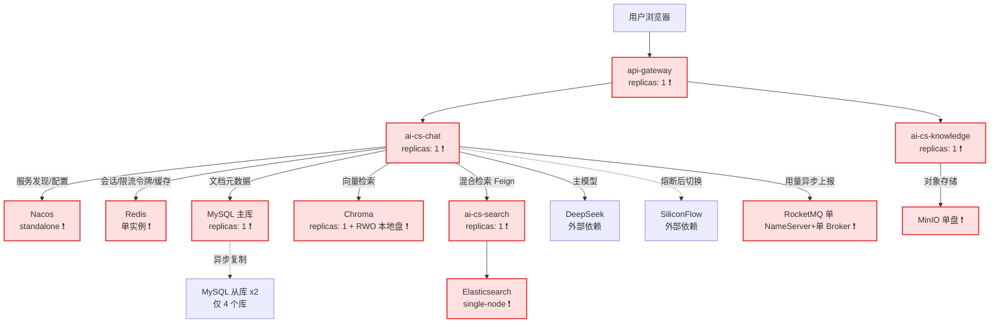
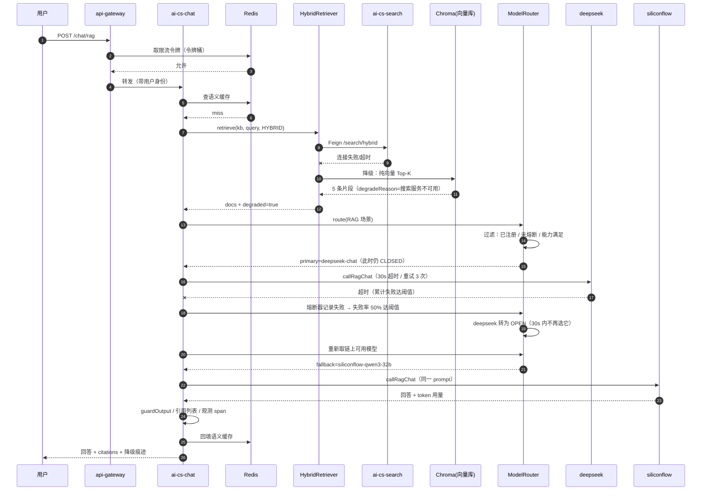

# 04 高可用架构模式：高可用不是"无限加副本"，而是消除单点 + 让故障局部化

> **一句话结论**：可用性是**乘出来的**——一条请求经过几个组件，就把它们的可用性相乘；所以真正的动作只有两个：找出链路上"只有一份"的组件（单点），用冗余给它加上第二份；把每个组件的故障关在自己的格子里（隔离），不让它顺着调用链放大成全站不可用。加副本只是冗余的一种实现，而且没有切换机制时，加副本的可用性收益是 **0**。
>
> **阅读前置**：读过本篇 `01-SLI-SLO与错误预算.md`（知道 99.9% 意味着什么、错误预算怎么算）；能读懂 YAML 编排文件与一段 Spring 配置类；知道 MySQL 主从、Redis 主从/哨兵、RocketMQ NameServer/Broker 这些名词的**位置**（不要求会配）。本篇不教你怎么装集群，只教你怎么**判断哪里有单点、代价是什么、先修哪个**。
>
> **证据基线**：B 级为主（本仓 `deploy/`、`deploy/k8s/`、`ai-cs-chat` 源码，行号当次 `read` 核对）+ C 级实算（node 脚本真实输出，原样贴出）+ A 级 1 处（`Resilience4JCircuitBreaker` 源码摘录）。所有"可用性百分比"都是**教学假设参数**下的算术结果，**不是**本仓实测值。预计阅读 45~60 分钟。

## 证据边界

先把"哪些话能说死、哪些只能说是目标"摆清楚，避免把学习环境的编排当成生产能力读：

| 主题 | 本仓状态 | 证据 | 本篇怎么处理 |
| --- | --- | --- | --- |
| MySQL 主从（一主两从） | ✅ 已入库（仅 K8s 清单 + compose 冗余版） | `deploy/k8s/mysql.yaml` L126/L210、`deploy/mysql/slave.cnf` L15-18 | 当真实基线讲，同时讲清 `replicate-do-db` 只覆盖 4 个库的代价 |
| Redis 三节点 | ⚠️ 半落地：三个容器 = 三台独立单机 | `deploy/docker-compose/docker-compose-master-slave.yml` L92/L111/L130 挂同一份 conf，`deploy/redis/redis.conf` 全文无 `replicaof` | 当**反例**讲：为什么"三个节点"不等于"高可用" |
| Chroma 向量库 | ⚠️ 单副本 StatefulSet（数据在本地盘） | `deploy/k8s/chroma.yaml` L33、L69-77 | 当单点讲；高可用方案标为**未落地** |
| Nacos | ❌ 仅 `MODE: standalone` 单节点 | `deploy/k8s/nacos.yaml` L40/L58；客户端 `NACOS_ADDR` 单地址 | 当单点讲；集群化标**未落地** |
| RocketMQ | ❌ 单 NameServer + 单 Broker | `deploy/k8s/rocketmq.yaml` L37/L103 | 当单点讲；Dledger 主从标**未落地** |
| MinIO | ❌ 单节点单盘 | `deploy/k8s/minio.yaml` L39 | 当单点讲；纠删码集群标**未落地** |
| LLM 多供应商路由 | ✅ 已入库（配置 + 代码都在） | `tools/nacos-config/ai-cs-chat.yml` L47-116、`ModelHealthRegistry.java` | 当**已实现的 AI 链路高可用**讲 |
| 跨可用区 / 单元化 | ❌ 无（单机 compose / 单集群） | 无对应目录或配置 | 只讲原理与代价，明确标**未落地** |
| 演练与故障注入 | ❌ 无脚本、无开关表 | 仓库内无 chaos 相关文件 | 不给"演练结果"，只给演练方法 |

## 0. 先看现象

三个真实现象，都是"看起来有冗余、实际没有"的那种。

**现象一：19 个 K8s 工作负载里，18 个是单副本。**

```powershell
PS> cd D:\Projects\Persion\ai-customer-service
PS> Select-String -Path deploy\k8s\*.yaml,deploy\k8s\services\*.yaml -Pattern '^\s*replicas:\s*\d+' |
      ForEach-Object { "{0}:{1}: {2}" -f $_.Filename, $_.LineNumber, $_.Line.Trim() }
```

```text
chroma.yaml:33: replicas: 1                   # 单副本：学习环境，数据一致性简单
elasticsearch.yaml:40: replicas: 1                   # 单节点（通过环境变量 discovery.type 声明）
minio.yaml:39: replicas: 1                   # 单节点单盘模式（学习环境）
mysql.yaml:126: replicas: 1                   # 主库只能 1 个
mysql.yaml:210: replicas: 2                    # 2 个从库副本：Pod 名为 mysql-slave-0 / mysql-slave-1
nacos.yaml:40: replicas: 1                   # 单副本（生产建议 3 副本集群，学习环境 1 个够用）
neo4j.yaml:34: replicas: 1                   # 单副本（社区版本身也不支持集群）
redis.yaml:101: replicas: 1                   # 单副本（Redis 主从/哨兵可在学习进阶后扩展）
rocketmq.yaml:37: replicas: 1                   # 单副本 NameServer（生产建议 ≥2 保证可用性）
rocketmq.yaml:103: replicas: 1                   # 单 Broker（生产环境通常主从/多副本）
sentinel-dashboard.yaml:32: replicas: 1                   # 控制台单副本即可（只看监控、下发规则）
xxl-job.yaml:32: replicas: 1                   # 单副本（admin 数据在 MySQL，多副本需注意调度一致性）
ai-chat-service.yaml:36: replicas: 1                   # 单副本
api-gateway.yaml:38: replicas: 1                   # 单副本（学习环境）
knowledge-service.yaml:36: replicas: 1                   # 单副本
message-service.yaml:36: replicas: 1                   # 单副本
notify-service.yaml:36: replicas: 1                   # 单副本
product-service.yaml:25: replicas: 2                   # 2 副本（唯一一个多副本的业务服务，可体验负载均衡）
search-service.yaml:36: replicas: 1                   # 单副本
user-service.yaml:35: replicas: 1                   # 单副本
```

20 行声明里 19 行是 `replicas: 1`，只有 `mysql.yaml:210`（从库）与 `product-service.yaml:25`（商品服务）是 2。注意这些注释本身就是作者的自白：`redis.yaml:101` 写着"主从/哨兵可在学习进阶后扩展"——**注释里的"可以扩展"意味着现在没有扩展**。

**现象二：所谓"三个 Redis 节点"挂的是同一份配置文件。**

```powershell
PS> Select-String -Path deploy\docker-compose\docker-compose-master-slave.yml -Pattern 'redis-node|redis.conf|image: redis'
```

```text
83: redis-node1:
84: image: redis:7
85: container_name: aics-redis-node1
91: - redis-node1-data:/data
92: - ./deploy/redis/redis.conf:/usr/local/etc/redis/redis.conf
93: command: redis-server /usr/local/etc/redis/redis.conf
102: redis-node2:
103: image: redis:7
104: container_name: aics-redis-node2
110: - redis-node2-data:/data
111: - ./deploy/redis/redis.conf:/usr/local/etc/redis/redis.conf
112: command: redis-server /usr/local/etc/redis/redis.conf
121: redis-node3:
122: image: redis:7
123: container_name: aics-redis-node3
129: - redis-node3-data:/data
130: - ./deploy/redis/redis.conf:/usr/local/etc/redis/redis.conf
131: command: redis-server /usr/local/etc/redis/redis.conf
```

三行 `92 / 111 / 130` 指向**同一个** `deploy/redis/redis.conf`，而且每个容器各有自己的 `*-data` 数据卷（`286-288` 行）。再查这份 conf 里到底有没有主从/集群关键字：

```powershell
PS> Select-String -Path deploy\redis\redis.conf -Pattern 'replicaof|sentinel|cluster-enabled|min-replicas|requirepass'
```

```text
deploy\redis\redis.conf:11:# requirepass aics_redis_2024
```

只命中一行，而且是被 `#` 注释掉的密码行。`replicaof`（从库指向主库）、`sentinel`（哨兵）、`cluster-enabled`（集群模式）、`min-replicas-to-write`（防脑裂）**一个都没有**。这不是命令写错了——没有输出正是结论：**三个节点各存各的数据、各接各的客户端，是三台互不相关的单机**。

**现象三：主从有了，但从库只复制 4 个库。**

```powershell
PS> Select-String -Path deploy\mysql\slave.cnf -Pattern 'replicate-do-db'
```

```text
15: replicate-do-db=user_db
16: replicate-do-db=knowledge_db
17: replicate-do-db=chat_db
18: replicate-do-db=nacos_config
```

`replicate-do-db` 是"只复制列出的库"的白名单。白名单里是 `user_db / knowledge_db / chat_db / nacos_config` 四个——`order_db`、`product_db`、`pay_db` 都不在。于是从库对订单类数据是**空的**：主库挂了切到从库，读订单会读到"数据不存在"，而不是"服务变慢"。

这些现象指向同一件事：**这套编排里绝大多数组件只有一份，唯一做了复制的 MySQL 也只复制了一部分库；"三个 Redis 节点"是"三个进程"而不是"三个副本"。** 判断高可用不能数容器个数，要数"请求链路上每个组件有几份、坏了谁接、数据在不在"。

## 1. 整体地图

一条 AI 客服请求（RAG 对话）要穿过多少东西？把"能被多副本替换的"和"只有一份的"分开画：



> **读图说明**：红色（❗）是"只有一份"的组件，虚线是"降级/复制"关系，不是主链路。读这张图只需问三个问题：①从用户到回答，最长的红色路径有几跳（这里是 用户→gateway→chat→Chroma 四跳，任一坏掉都没有第二份顶上）；②哪些虚线真的存在（MySQL 复制存在但不全，LLM 切换存在且已验证在代码里，其余虚线都是"可以以后做"）；③哪两个红色组件串在一起时后果最重（`Redis` + `gateway`——网关的分布式限流令牌桶就放在 Redis 里，Redis 一挂，限流这条防线跟着挂）。

组件、责任与参与方对照：

| 组件 | 在本仓的位置 | 它负责什么 | 可用性上扮演的角色 | 参与方（坏了谁受影响） |
| --- | --- | --- | --- | --- |
| api-gateway | `ai-cs-gateway/`，`deploy/k8s/services/api-gateway.yaml` L38 | 路由、鉴权、Redis 令牌桶限流 | **入口单点**：它挂 = 全站不可用 | 全部前端请求 |
| ai-cs-chat | `ai-cs-chat/`，`ai-chat-service.yaml` L36 | RAG、LLM 调用、模型路由、降级 | 核心业务单点 | 对话类功能 |
| Nacos | `deploy/k8s/nacos.yaml` L40/L58 | 服务发现 + 配置中心 | **元数据单点**：挂了新实例找不到彼此 | 所有服务的注册与配置刷新 |
| Redis | `deploy/k8s/redis.yaml` L101 | 会话、语义缓存、分布式锁、限流令牌桶 | 状态单点：无副本、无哨兵 | 登录态、限流、缓存命中率 |
| MySQL | `deploy/k8s/mysql.yaml` L126（主）/L210（从） | 业务数据持久化 | 唯一有冗余的存储，但只覆盖 4 库 | 写入全站；订单类读取无副本 |
| Chroma | `deploy/k8s/chroma.yaml` L33 | 向量库（RAG 检索底座） | 单副本 + 本地盘 = 数据也单点 | RAG 回答全挂 |
| Elasticsearch | `deploy/docker-compose/docker-compose-all.yml` L90 | 全文检索、混合检索的 BM25 侧 | 单节点 | 混合检索降级为纯向量 |
| RocketMQ | `deploy/k8s/rocketmq.yaml` L37/L103 | 异步消息、CDC 增量 | 单 NameServer + 单 Broker | 消息积压、知识增量同步停滞 |
| MinIO | `deploy/k8s/minio.yaml` L39 | 文档/图片对象存储 | 单盘，无纠删码 | 上传/下载失败 |
| XXL-Job admin | `deploy/k8s/xxl-job.yaml` L32 | 集中调度（默认关闭） | 单副本 + 默认不启用 | 定时任务回落到 `@Scheduled` |

## 2. 关键概念与关键要素

术语先解释，后面不再重复：**可用性**＝(总时间−不可用时间)/总时间；**MTTR**＝平均修复时间（故障到恢复）；**MTBF**＝平均无故障间隔；**RTO**＝业务能容忍的最长中断时间；**RPO**＝业务能容忍的最大数据丢失量；**单点（SPOF, Single Point of Failure）**＝没有第二份替代、坏了就直接不可用的组件；**故障隔离（舱壁）**＝把资源切成独立格子，一个格子打满不影响其他格子（源自船体水密舱）。

| 名称 | 位置（本仓） | 作用 | 关键参数 / 记法 |
| --- | --- | --- | --- |
| 串联可用性 | 概念（本篇 §3.1 实算） | 一条请求经过 n 个组件的总可用性 | `A_total = a1 × a2 × … × an`：**串联只会变差** |
| 并联可用性 | 概念（本篇 §3.1 实算） | k 个副本 + 切换后的可用性 | `A = 1 − (1 − a)^k`：**前提是"能切"** |
| 主备（active-standby） | `deploy/k8s/mysql.yaml` L126/L210 | 一份工作、一份待命，故障时提升 | 切换时间 = RTO 大头；备库平时不承担读 |
| 双活（active-active） | 未落地 | 两份都在服务，任一挂掉另一半承接 | 需要无状态或双向同步；写冲突是主要代价 |
| 多副本（replication） | MySQL 从库、K8s `replicas` | 同一份数据的多份拷贝 | 复制延迟 = 读到旧数据的概率 |
| 单元化（cell/unit） | 未落地 | 按用户/租户分单元，故障止于一个单元 | 单元路由 + 单元内自包含；扩容=加单元 |
| 熔断器 | `ai-cs-chat/src/main/java/com/aics/chat/modelrouter/ModelHealthRegistry.java` L18-43 | 连续失败后快速失败，避免拖垮调用方 | 窗口 10 次 / 失败率 50% / 打开 30s / 半开放 3 次 |
| 舱壁（线程池隔离） | `ai-cs-chat/src/main/java/com/aics/chat/config/ObservabilityExecutorConfig.java` L27-59 | 旁路任务用独立线程池，不占 Tomcat 线程 | `usageExecutor` 1/4/队列 1000；`evalExecutor` 1/2/队列 500 |
| 限流 | `ai-cs-chat/src/main/java/com/aics/chat/config/SentinelRules.java` L21/L24 | 保护下游（LLM 并发有限） | `chat-send` 10 QPS、`chat-rag` 5 QPS、WarmUp 10s |
| 读写分离 | `deploy/mysql/slave.cnf` L11-12 | 读走从库，写走主库 | `read-only=1` + `super-read-only=0`（**注意后者**） |
| fail-open / fail-closed | `QuotaService.java` L72-79（open）、`ContentSafetyService.java` L58-67（可配） | 依赖坏了是"放行"还是"拒绝" | 计量类放行、安全类默认拦截 |
| 有损服务（graceful degradation） | 若干处，见 §3.6 | 关掉非核心能力，保住核心链路 | 先关"锦上添花"，不关"必须正确" |

## 3. 原理与证据逐段精读

### 3.1 可用性是乘出来的：串联相乘、并联冗余、单点封顶

**在干什么。** 把"一条请求经过的组件"当成一条串联电路：每个组件的可用性 `a` 相乘得总可用性。下面这段 node 脚本把三种算术都跑一遍（脚本是我为写这篇现写的，放在 `learning-docs/tools/tmp/`）：

```javascript
// learning-docs/tools/tmp/ha-availability-calc.mjs（节选：核心三行算术）
const series = (a, n) => Math.pow(a, n);            // 串联：n 个组件各 a
const parallel = (a, k) => 1 - Math.pow(1 - a, k);  // 并联：k 个副本各 a
const YEAR_MIN = 365 * 24 * 60;                     // 年停机预算口径：525600 分钟
```

真实运行与输出（C 级，`node` 24.16.0 本机实跑）：

```powershell
PS> node learning-docs\tools\tmp\ha-availability-calc.mjs
```

```text
=== 表1 串联相乘：一条请求经过 n 个组件，每个 a ===
 n       a=0.9990       a=0.9995       a=0.9999
 1      99.90000%      99.95000%      99.99000%
 2      99.80010%      99.90003%      99.98000%
 3      99.70030%      99.85007%      99.97000%
 4      99.60060%      99.80015%      99.96001%
 5      99.50100%      99.75025%      99.95001%
 6      99.40150%      99.70037%      99.94001%
 7      99.30210%      99.65052%      99.93002%

=== 表2 年停机预算（分钟/年，按 525600 分钟口径）===
 99.00000% 年度不可用       5256 分钟 ≈     87.6 小时
 99.90000% 年度不可用      525.6 分钟 ≈     8.76 小时
 99.95000% 年度不可用      262.8 分钟 ≈     4.38 小时
 99.99000% 年度不可用      52.56 分钟 ≈     0.88 小时
 99.99900% 年度不可用       5.26 分钟 ≈     0.09 小时

=== 表3 并联冗余：k 个副本（前提：有健康检查+切换）===
a=99.00000% k=1 并联后  99.0000000%
a=99.00000% k=2 并联后  99.9900000%
a=99.00000% k=3 并联后  99.9999000%
a=99.90000% k=1 并联后  99.9000000%
a=99.90000% k=2 并联后  99.9999000%
a=99.90000% k=3 并联后  99.9999999%

=== 表4 共享单点封顶：应用层 3 副本 + 1 个 MySQL 单点 ===
应用层 3 副本并联 = 99.99990%
再串联 1 个 MySQL 单点(0.99) = 98.99990%  <- 被下游单点封顶
MySQL 换成 2 副本(0.9999) = 99.98990%
```

**为什么这么设计（数学为什么长这样）。** 串联相乘的前提是"任一环节坏掉整条请求就失败"——这正是同步调用链的现实：gateway 活着、chat 活着，但 Chroma 挂了，RAG 请求照样 500。并联公式 `1−(1−a)^k` 的前提是"**k 份互相独立，且有东西负责把流量挪到活着的那份**"：副本各自坏的时机不相关，于是"全坏"的概率是各份故障率的乘积。表4 是整篇最重要的一行：应用层 3 副本把 **0.99 抬到 99.9999%**，但只要后面还串着一个 0.99 的单点 MySQL，总可用性就掉回 **98.99%**——**下游单点会把你上游所有的冗余努力一笔抹平**。

**换写法会怎样。** ①若有人按"平均可用性"算（把 0.99 与 0.9999 相加除以 2 得 99.5%），会把一个"实际 98.99%"的系统写成"99.5%"，SLO 一立就永远达不成；②若把"三个 Redis 容器"当作并联算（表6 末尾那行），会算出 99.9999999% 的假数字——因为**没有 `replicaof`、没有哨兵，客户端只会连一个地址，故障时没有任何东西能切**，真实可用性就是那一台的可用性。并联公式里的"k"不是"进程数"，是"**能自动接管的独立副本数**"。

**常见坑。** ①把 `restart: always`（`docker-compose-all.yml` L12 等）当高可用：它只能让**同一个**容器重启，重启期间（镜像拉取、JVM 启动 10~30s）业务是断的，而且它救不了"宿主机宕机"；②把"定时任务多副本"当冗余：`ai-cs-order/src/main/java/com/aics/order/task/OrderTimeoutScheduler.java` L29 的 `@Scheduled` 是**每个实例都会跑**（同类注释 `OrderTimeoutScheduler.java` L32 与 `XxlJobConfig.java` L16 都点明了这点），多加副本等于同一份扫描跑 N 遍，靠幂等兜住而不是靠调度协调；③忘记算"依赖的依赖"：chat 的可用性包含 LLM 供应商的可用性，而供应商是**外部系统**，你唯一能做的是多供应商 + 熔断切换（`ModelRouter`），不是给它加副本。

### 3.2 单点识别方法：画出每个请求经过的所有组件，看哪个只有一份

**在干什么。** 单点不是靠"经验感觉"找，而是靠**逐条链路点名**。方法四步：①选一条业务链路（例如"发一条 RAG 对话"）；②从入口到出口列出所有参与组件，包括中间件、外部 API、配置中心；③对每个组件问"它有第二份吗？坏了谁接？数据在不在第二份上？"；④把三个问题里任一答"没有"的组件记成单点，并标注**故障表现**（是报错、变慢，还是静默变错）。

本仓的实测答案（每一行都是当次核对的真实路径与行号）：

| 组件 | 真实位置（路径:行） | 有几份 | 坏了谁接 | 数据在第二份上吗 | 故障表现 |
| --- | --- | --- | --- | --- | --- |
| api-gateway | `ai-cs-gateway/`；`deploy/k8s/services/api-gateway.yaml` L38 | 1 | 无（K8s 会重启同一 Pod） | — | 全站 502/超时 |
| ai-cs-chat | `deploy/k8s/services/ai-chat-service.yaml` L36 | 1 | 无 | — | 对话、RAG 全挂 |
| ai-cs-knowledge / search / message / notify / user | `deploy/k8s/services/knowledge-service.yaml` L36、`search-service.yaml` L36、`message-service.yaml` L36、`notify-service.yaml` L36、`user-service.yaml` L35 | 各 1 | 无 | — | 对应功能不可用 |
| product-service | `deploy/k8s/services/product-service.yaml` L25 | **2** | K8s Service 轮询 | 无状态，不需要 | 单 Pod 故障时流量自动转向另一份 |
| MySQL 主库 | `deploy/k8s/mysql.yaml` L126 | 1 | 手工/半自动提升从库 | 从库有，但**仅 4 个库** | 写入全失败；切换后部分库数据缺失 |
| MySQL 从库 | `deploy/k8s/mysql.yaml` L210 | 2 | — | 是 | 只读副本，可承接读 |
| Redis | `deploy/k8s/redis.yaml` L101（`cluster-enabled no` 见 L26） | 1 | 无（无哨兵） | 无 | 会话丢失、限流令牌桶失败、缓存穿透回源 |
| Chroma | `deploy/k8s/chroma.yaml` L33 + `volumeClaimTemplates` L69-77（`ReadWriteOnce` + `local-path`） | 1 | 无 | 无（数据在单 Pod 本地盘） | RAG 检索抛错 → 前端收到"AI服务调用失败" |
| Nacos | `deploy/k8s/nacos.yaml` L40（`MODE: standalone` L58-59） | 1 | 无 | 是（元数据在 MySQL `nacos_config`） | 新实例无法注册、`@RefreshScope` 不生效；已运行实例靠本地缓存继续跑 |
| Elasticsearch | `deploy/docker-compose/docker-compose-all.yml` L90（`discovery.type: single-node`） | 1 | 无 | 无 | 混合检索降级纯向量（见 `HybridRetriever.java` L208-211） |
| RocketMQ NameServer / Broker | `deploy/k8s/rocketmq.yaml` L37 / L103 | 各 1 | 无（无 slave、无 Dledger） | 无 | 消息发送失败、知识增量同步停滞 |
| MinIO | `deploy/k8s/minio.yaml` L39（单节点单盘） | 1 | 无 | 无 | 文档上传/下载失败 |
| 可观测性栈 | `deploy/docker-compose/docker-compose-observability.yml` L19（prometheus）/ L32（grafana）/ L45（tempo） | 各 1 | 无 | — | 看板消失（不影响业务，影响你排障） |

结论一句话：**这份清单里只有 `product-service` 的 2 副本与 MySQL 的两台从库算得上"有第二份"；而且 MySQL 那份只覆盖 4 个库（`deploy/mysql/slave.cnf` L15-18）。** 其余全部是单点。

**为什么这么设计（为什么学习仓就该这样）。** 单点是**成本**问题：每个冗余都要额外的机器、额外的数据一致性代价、额外的切换逻辑和演练。学习环境把"单点清单"显式暴露出来（很多 YAML 甚至用注释写"生产建议 3 副本"），本身就是可持续的教学设计：让你先看清结构，再谈改造。反过来说，一个从不在文档里写"这是单点"的系统，才是危险的系统——因为没人知道它的可用性上限在哪。

**换写法会怎样。** 若按"目录分类"来盘（"中间件都算基础层、业务都算应用层"），你会漏掉**跨层单点**：网关的限流依赖 Redis（`ai-cs-gateway/src/main/java/com/aics/gateway/config/RateLimitProperties.java` L24-28 注释说明"已由 RequestRateLimiter（Redis 分布式令牌桶）替代，Redis 不可用时改回 `enabled=true` 兜底"）——Redis 挂掉时，限流这条防线一起挂，这是"中间件单点"传染到"入口防线"的典型。按链路点名才能发现这类耦合。

**常见坑。** ①**只数 Pod 不数数据**：`chroma.yaml` 有探针（L52/L58）、有 PVC，看起来挺"生产"，但 `replicas: 1` + `ReadWriteOnce` + `local-path` 意味着数据就绑在这一个节点上，Pod 漂移都困难；②**把"外部依赖"排除在链外**：LLM 供应商不在你的集群里，但它在你链路上，且它挂的时候你的 chat 服务 CPU 是闲的、日志里一堆超时；③**忽略控制面单点**：Nacos 挂了，运行中的实例靠本地缓存还能跑一阵，但**扩缩容与配置下发全停**——这类"半坏"最容易在故障时误判成"应用有 bug"。

### 3.3 冗余四模式与它们的数据一致性代价

**在干什么。** 冗余不是一种技术，是四种不同的"多一份"，代价完全不同：

| 模式 | 怎么工作 | 切换/RTO | 数据一致性代价 | 本仓对应（已落地/未落地） | 什么时候选它 |
| --- | --- | --- | --- | --- | --- |
| 主备 | 一份干活，一份待命；故障时提升备 | 秒级~分钟级（人工或半自动） | 异步复制 → **RPO>0**，可能丢最后一批写入 | ✅ MySQL 一主两从（`deploy/k8s/mysql.yaml` L126/L210）；❌ 无自动选主、无 MHA/Orchestrator | 中小规模、能接受"丢几秒数据" |
| 双活 | 两份同时服务，任一挂掉另一半承接 | 秒级（负载均衡自动摘除） | 需要无共享状态，或双向同步（写冲突要业务消解） | ⚠️ 仅"无状态服务多副本"这一层（`product-service.yaml` L25 的 2 副本）；有状态双活 ❌ 未落地 | 读多写少、无状态优先 |
| 多副本（复制） | 同一份数据 N 份拷贝，读可分散 | 从库可读，主库挂了要提升 | 复制延迟 → 可能读到旧值；`replicate-do-db` 这类白名单会造成**部分数据无副本** | ✅ MySQL 从库 2 个；❌ Redis 无（`deploy/redis/redis.conf` 无 `replicaof`）；❌ Chroma 无 | 读扩展 + 备份兼得 |
| 单元化 | 按用户/租户切单元，单元内自包含 | 故障止于单元 | 跨单元查询/统计变难，需要单元路由与数据路由 | ❌ 全仓未落地 | 规模大、要"故障爆炸半径"可控 |

**为什么这么设计（为什么"便宜的那一档"总是先被选）。** 主备是最容易做对的：只需要复制 + 一个"什么时候切"的决定，业务代码零改动。双活要求"任意时刻两份都能算对"，一旦涉及写就变成分布式一致性问题（谁赢？冲突怎么合并？），复杂度陡增。单元化则是把"故障半径"当成一等公民——它往往出现在单体已经撑不住、又不愿意全量重写的阶段。

**换写法会怎样。** 若把"多副本"当成"高可用"的通用答案：MySQL 从库确实提升了读能力与备份能力，但**它没有自动提升主库**——主库挂了，写请求并不会自动流向从库（`deploy/mysql/slave.cnf` L11 `read-only=1` 就是刻意让从库拒绝写）。这就是"有冗余 ≠ 有高可用"的最典型形态：多了一份数据，少了一个"能切的开关"。K8s 层面也一样：`mysql.yaml` L126 注释写着"主库只能 1 个"，因为它是有状态主库，`replicas: 2` 会变成两个互相不认识的主。

**常见坑。** ①**从库只复制了 4 个库**（`deploy/mysql/slave.cnf` L15-18）：真正切换时，`order_db/product_db/pay_db` 在从库上是空的，读请求会得到"查不到"而不是"稍后再试"——这是**静默数据错误**，比 500 更难查；②**`read-only=1` 配 `super-read-only=0`**（同文件 L11-12）：普通账号写不进从库，但 `SUPER` 权限账号仍可写，运维脚本或 root 连接一旦写进从库就制造了"两边数据都不一样"的分叉；③**镜像 `latest` 做冗余**：`deploy/k8s/minio.yaml` L45 之类用 `minio/minio:latest`，两个副本各自 pull 到不同版本时，切换行为不一致——冗余系统必须**版本可复现**。

### 3.4 故障隔离：让故障停在格子里（线程池隔离 / 舱壁 / 熔断 / 限流 / 读写分离 / 跨可用区）

**在干什么。** 隔离的目标不是"不出故障"，而是"出了故障只坏一格"。本仓有四处真实实现，另一处（跨可用区）明确没做。

**（1）线程池隔离（舱壁）。** `ai-cs-chat/src/main/java/com/aics/chat/config/ObservabilityExecutorConfig.java` L27-40 给"模型用量上报"单独一个线程池：core 1、max 4、队列 1000（L31-34），类注释 L10-17 直说了理由——"不占 Tomcat 工作线程（默认 200）/ 故障隔离 / 削峰"。**为什么这么设计**：用量上报是旁路任务（写 `llm_trace`、`model_usage` 表），它依赖 Feign 落库；若与业务共用 Tomcat 线程，message 服务一慢，200 个线程会被旁路任务占满，**观测把业务"观测死"**。**换写法会怎样**：直接同步落库，则 chat 的 P99 完全取决于 MySQL/Feign 的尾延迟；用 `CompletableFuture` 默认线程池（`ForkJoinPool.commonPool`）则与全 JVM 其他异步任务互相干扰，故障半径不受控。**坑**：`AbortPolicy`（L33 注释）在队列满时**抛异常**——必须由提交方捕获，否则线程池满会变成业务异常。

**（2）熔断器，而且必须"按依赖隔离"。** `ai-cs-chat/src/main/java/com/aics/chat/modelrouter/ModelHealthRegistry.java` L18-21：

```java
public CircuitBreaker breaker(String modelId) {
    // 设计要点：熔断器按 modelId 隔离——若共享一个熔断器，主模型故障会连累备用模型，路由降级就失去意义
    return breakers.computeIfAbsent(modelId, id -> circuitBreakerRegistry.circuitBreaker(id, config()));
}
```

**为什么这么设计**：这是整篇最容易被忽略的一点——**熔断器的作用域决定降级能不能生效**。如果 deepseek 与 siliconflow 共用一个熔断器，主模型失败 5 次打开熔断，备用模型连试的机会都没有，路由表写了等于没写。`isAvailable`（L23-31）只把 `OPEN` 的模型剔除，`CLOSED`/`HALF_OPEN` 都放行（注释 L28 说明 HALF_OPEN 要放行才能完成恢复探测）。参数在 `config()` L34-43：COUNT_BASED、窗口 10、最少 3 次调用、失败率 50%、打开 30s、半开允许 3 次。

**（3）装饰顺序决定语义（A 级证据）。** 熔断、舱壁、超时三者叠在一起时，谁包谁很关键。`learning-docs/24-源码分析/assets/source/Resilience4JCircuitBreaker.java.md` 里 Spring Cloud 的封装是这样的：

```java
// (src: Resilience4JCircuitBreaker.java.md#L113-L140)
public <T> T run(Supplier<T> toRun, Function<@Nullable Throwable, T> fallback) {
    Optional<TimeLimiter> timeLimiter = loadTimeLimiter();
    CircuitBreaker defaultCircuitBreaker = registry.circuitBreaker(this.id, this.circuitBreakerConfig, tags);
    if (bulkheadProvider != null) {
        if (executorService != null) {
            Supplier<Future<T>> futureSupplier = () -> executorService.submit(toRun::get);
            Callable<T> timeLimitedCall = timeLimiter
                .map(tl -> TimeLimiter.decorateFutureSupplier(tl, futureSupplier))
                .orElse(() -> futureSupplier.get().get());
            Callable<T> bulkheadCall = bulkheadProvider.decorateCallable(this.groupName, tags, timeLimitedCall);
            Callable<T> circuitBreakerCall = io.github.resilience4j.circuitbreaker.CircuitBreaker
                .decorateCallable(defaultCircuitBreaker, bulkheadCall);
            return getAndApplyFallback(circuitBreakerCall, fallback);
        }
    }
    /* ... */
}
```

以及兜底的落点 [[源码:Resilience4JCircuitBreaker.java.md#L143-L159]]：`getAndApplyFallback` 是 `try { supplier.get() } catch (Throwable t) { return fallback.apply(t) }`——**任何 Throwable 都进 fallback**。**为什么这么设计**：装饰顺序是 `超时 ⊂ 舱壁 ⊂ 熔断`，即熔断最外层。**换写法会怎样**：顺序反过来（熔断在里、舱壁在外）时，舱壁拒绝的请求不会被熔断器看到，熔断器会以为下游一直健康——一个真在过载的下游永远不会被熔断器保护，同时舱壁拒绝率 100% 却"指标正常"。**坑**：本仓用的是注解式（`ai-cs-chat/src/main/resources/application.yml` L109-114 的 `circuitbreaker.instances.chatService`）与编程式（`ModelHealthRegistry`）两条路并存——注解式按 **bean/方法** 命名熔断器，编程式按 **modelId** 命名，排查时用错名字会看到"某熔断器从不打开"的假象。

**（4）限流：把"过载"变成"少服务一部分人"。** `SentinelRules.java` L21/L24 定阈值：`chat-send` 10 QPS、`chat-rag` 5 QPS；L27/L30 用 WarmUp（预热 10s），避免冷启动就被打满。真实覆盖范围要**自己数**：全仓 `@SentinelResource` 只有 1 处，即 `ai-cs-chat/src/main/java/com/aics/chat/controller/ChatController.java` L79。**坑**：看到"Sentinel + 两个阈值"就以为全站被限流保护，实际上只有 `chat-send` 这一个同步接口挂了注解，流式接口与网关侧都靠别的机制（网关是 Redis 令牌桶，`replicate` 见 `RateLimitProperties.java` L42-46 的 `replenishRate`/`burstCapacity`）。

**（5）读写分离。** 从库 `read-only=1`（`deploy/mysql/slave.cnf` L11）迫使读流量分流，这是"用冗余换读容量"的标准姿势。它的**代价**是"读到自己刚写的值"可能失败（复制延迟），于是需要"写后读走主库"的一致性策略。本仓没有这类路由代码（没有 ShardingSphere/动态数据源），所以读写分离只到"有两个从库"这一步。

**（6）跨可用区 / 跨机房：明确未落地。** 全部编排是单机 compose（`deploy/docker-compose/docker-compose-all.yml`）或单集群 K8s（`deploy/k8s/`），没有 nodeSelector/拓扑分布约束/多集群方案。**不给它编造演练结果**：本机没有第二台宿主机、没有可用的跨 AZ 环境，所以"跨 AZ 能把可用性抬到多少"只能写方法（把每跳的 `a` 换成实测值再乘，见 §3.1），不能写数字。

**常见坑（汇总三层隔离手段）。** ①**把"隔离"当成"增加容量"**：线程池隔离（`ai-cs-chat/src/main/java/com/aics/chat/config/ObservabilityExecutorConfig.java` L27-40，core 1 / max 4 / queue 1000、AbortPolicy、`waitForTasksToCompleteOnShutdown(true)` L37）保护的是"其它接口不被拖死"，它不提升吞吐；队列 1000 在持续过载时只是把拒绝往后推，而 `waitForTasksToCompleteOnShutdown(true)` 会让优雅停机一直等队列排空——**停机变慢是这套配置的已知代价**。②**舱壁开太多**：每加一个独立线程池就多一批几乎闲置的线程，线程总数反而更容易把容器顶到内存/句柄上限。③**两套限流/熔断并存时搞错层**：本仓既有 Resilience4j（`ai-cs-chat/src/main/resources/application.yml` L109-114）又有 Sentinel（`SentinelRules.java` L21/L24），先确认是哪一层在拒绝，否则会调错参数（例如熔断 OPEN 却去调 QPS 阈值）。

### 3.5 有状态服务的难点：能复制的只有"无状态"，其余都在跟数据一致性打仗

**在干什么。** 无状态服务加副本是"复制进程"；有状态服务加副本是"复制数据"，后者要面对复制延迟、选主、脑裂、数据分片。本仓的有状态组件逐个看：

**（1）Redis：三个容器 ≠ 一个主从。** `deploy/docker-compose/docker-compose-master-slave.yml` L83-138 起了三个 `redis:7`，但 L92/L111/L130 挂同一份 `deploy/redis/redis.conf`，且该文件里没有 `replicaof`、没有 `sentinel`、没有 `cluster-enabled`（§0 现象二的实测输出）。K8s 清单同样只有单实例：`deploy/k8s/redis.yaml` L101 `replicas: 1`，ConfigMap 里 `cluster-enabled no`（L26）、`maxmemory 256mb`（L42）。**代价**：一旦要做主从/哨兵（Redis Sentinel 负责监控与提升，Redis Cluster 负责分片），数据模型会变——哨兵的读仍然只从主库（除非显式 `READONLY`），集群模式下**多 key 操作与事务受 slot 限制**，`SCAN`/`KEYS` 的用法也要改。**坑**：`deploy/redis/redis.conf` L11 的 `requirepass` 是被注释掉的——没有密码的 Redis 在"多节点互联"场景里更危险，一旦真做哨兵/集群，认证与 `protected-mode` 必须一起配。

**（2）Chroma：单副本 + 本地盘 = 数据和进程一起单点。** `deploy/k8s/chroma.yaml` L33 `replicas: 1`，注释"单副本：学习环境，数据一致性简单"；L69-77 的 `volumeClaimTemplates` 是 `ReadWriteOnce` + `storageClassName: local-path`。**为什么这么设计**：向量库的"多副本"不是简单加 `replicas`——本地盘 `RWO` 卷只能挂一个 Pod，加副本也各自是空库。真要高可用，得先解决**数据放在共享存储或远端**（Chroma 单机版对此支持有限），这一段本仓**未落地**，只能写目标态。**坑**：`readinessProbe`/`livenessProbe`（L52/L58）探的是 `/api/v1/heartbeat`，它只证明"进程活着"，不证明"collection 里有数据"；探针通过而检索为空的故障，会被误判为"RAG 效果差"。

**（3）MySQL：唯一有冗余的存储，但白名单毁了它的一半价值。** 主库 `deploy/k8s/mysql.yaml` L126，从库 L210 `replicas: 2`（Pod 名 `mysql-slave-0/1`）；复制范围由 `replicate-do-db` 白名单控制，只覆盖 4 个库（`deploy/mysql/slave.cnf` L15-18）。这种"部分复制"在切换时是**静默数据错误**（§3.3 坑①）。另外 `master.cnf` 里没有 `gtid_mode`、没有半同步复制（`rpl_semi_sync_master_enabled`）——意味着切换时要自己算 binlog 位点（`MASTER_LOG_FILE` + `MASTER_LOG_POS`），这也是本仓"自动选主未落地"的技术根因之一。

**（4）RocketMQ / MinIO / Nacos：三个"结构上单点、学习环境够用"的组件。** RocketMQ 单 NameServer（`rocketmq.yaml` L37，注释"生产建议 ≥2"）+ 单 Broker（L103，`command` L115 不带 `-c broker.conf`，也不带 slave 相关参数）；MinIO 单节点单盘（`minio.yaml` L39）；Nacos `MODE: standalone`（`nacos.yaml` L58-59）+ `replicas: 1`（L40）。**它们的共性难点**是"元数据/存储层必须一起改"：Nacos 集群化要求**统一 MySQL 元数据 + 一致的 `NACOS_SERVERS` 列表 + 每个节点独立 `server.port`/`raft` 状态**；RocketMQ 高可用要么主从同步（`brokerId=1` + `slaveReadEnable`），要么 Dledger 三副本（要奇数节点 + 独立存储）；MinIO 的纠删码模式要求至少 4 个盘/节点。**坑**：Nacos 客户端写的是单地址 `server-addr: ${NACOS_ADDR:127.0.0.1:8848}`（例如 `ai-cs-chat/src/main/resources/application.yml` L19、`ai-cs-gateway/src/main/resources/application.yml` L20 等 25 处），**服务端做成集群而客户端只写一个地址**，等于还留着一个客户端侧单点——正确写法是逗号分隔多地址或走 VIP/DNS。

**换写法会怎样。** 三种常见"改了反而更差"的做法：①**把 Redis 配成三个容器就当高可用**——可用性会算出 `99.9999%` 这种假数字（§3.1 表4 的并联公式前提是"有健康检查 + 能切换"，本仓两者都没有），真实值仍是单机；②**给 Chroma 直接 `replicas: 3` 而不换存储**——三份空库各自独立，写入只落一份、检索按 Service 负载均衡命中率掉到约 1/3，比单副本更差；③**把 `replicate-do-db` 直接删成全量复制**——复制量与写放大上升，但至少消除了"切过去少 4 个库"的静默错误，这是"先正确、再优化"的典型取舍（本仓属**未落地**，改动需实测复制延迟，本篇不给数字）。

**常见坑。** ①**用探针判断"数据可用"**：`deploy/k8s/chroma.yaml` L52/L58 探的是 `/api/v1/heartbeat`，只证明进程活着；②**把"重启"当"恢复"**：本地盘 `ReadWriteOnce` + `storageClassName: local-path`（同文件 L73-74）在 Pod 漂到别的节点后挂的是空卷——StatefulSet 保证"同名 Pod"，不保证"同一块盘"；③**只验证复制状态不验证数据面**：`Slave_IO_Running=Yes` 与"从库真有这份数据"是两件事（§0 现象三）。

### 3.6 降级与有损服务：先关哪个、后关哪个

**在干什么。** 降级是"主动放弃一部分能力，换取核心链路活着"。它必须提前定好**顺序**，故障现场再开会讨论就晚了。本仓已实现的降级点，按"放弃什么"分类：

| 降级点 | 真实位置 | 依赖挂了之后的行为 | 属于哪一档 |
| --- | --- | --- | --- |
| 混合检索 → 纯向量 | `ai-cs-chat/src/main/java/com/aics/chat/rag/retrieve/HybridRetriever.java` L208-211（catch 后 `vector(..., "搜索服务不可用")`）、L182-183（空结果同样降级） | ES/search 服务不可用 → 只用 Chroma 向量检索，回答仍在 | **关增强、保核心** |
| 增强检索 → 纯向量（第二道） | `ai-cs-chat/src/main/java/com/aics/chat/service/impl/ChatServiceImpl.java` L954-960（warn "RAG增强检索失败，降级纯向量"） | 改写/HyDE/多路召回失败 → 回退到基础向量检索 | 关增强、保核心 |
| Rerank 失败 → 相似度排序 | `ai-cs-chat/src/main/java/com/aics/chat/service/KnowledgeBaseService.java` L236-253 | 精排服务挂了 → 保留召回结果，按向量相似度取 Top-N | 关精排、保召回 |
| 配额校验 fail-open | `ai-cs-chat/src/main/java/com/aics/chat/observability/QuotaService.java` L72-79 | 计量存储不可用 → 判定"未超额"放行（注释明写 fail-open） | 宁可超支，不可中断 |
| 幂等校验 fail-open | `ai-cs-common/src/main/java/com/aics/common/idempotent/IdempotentAspect.java` L58-65 | Redis `setIfAbsent` 异常 → warn 后 `proceed()` 放行 | 宁可重复，不可拒绝 |
| 语义缓存 → 本地一级缓存 | `ai-cs-chat/src/main/java/com/aics/chat/cache/VectorCacheStore.java` L74-75 | Redis 不可用 → 只用 L1（进程内）缓存 | 关共享缓存、保命 |
| 对话历史 → 空历史 | `ai-cs-chat/src/main/java/com/aics/chat/service/impl/ChatHistoryServiceImpl.java` L85-101 | message 服务不可用 → 以空历史继续对话（上下文会缺失） | 保可用性，损体验 |
| 视觉理解 → 纯文本 | `ai-cs-chat/src/main/java/com/aics/chat/service/impl/VisionModelClient.java` L153-155 / L238-239、`VisionChatServiceImpl.java` L169-177 | 视觉模型超时/失败 → `fallbackDescribe` 返回 null → 有文字则走纯文本对话 | 关多模态、保对话 |
| 内容安全 → 可配 BLOCK/ALLOW | `ai-cs-chat/src/main/java/com/aics/chat/security/ContentSafetyService.java` L58-67 | 审核服务不可用 → 按 `aics.security.content-fail-mode` 选择拦截或放行，并记 DEGRADE 审计 | **安全类必须显式选**，不能默认放行 |
| 模型全部失败 → 兜底文案 | `ai-cs-chat/src/main/java/com/aics/chat/service/impl/ResilientAiService.java` L448-451 | fallback 链全挂 → 返回固定文案而非 500 | 保"有回话" |
| 流式软错误标记 | `ai-cs-chat/src/main/java/com/aics/chat/service/impl/ChatServiceImpl.java` L650-690 | SSE 中途降级 → 以 `[ERROR]` 软错误告知前端（L672 warn "SSE流式降级"） | 保连接、告知 |

**必须先说清一条"没有实现"的**：常被当成 RAG 高可用标配的"**检索不可用就直答（无知识库兜底）**"，在本仓**不存在**。证据链：`ChatServiceImpl.java` L945-946 纯向量路径直接调 `knowledgeBaseService.search`，L975-981 捕获异常后 `observation.error(e)` 并 **原样 rethrow**，最终被外层 L482-484 翻译成 `BusinessException(ResultCode.CHAT_AI_SERVICE_UNAVAILABLE, "AI服务调用失败: ...")`。也就是说：**Hybrid/改写挂了能降级到纯向量；Chroma 或 embedding 整体挂了就是报错**。想做"直答"，要新增一个明确的开关（例如 `aics.rag.degrade-mode=direct-answer`）并在 prompt 里去掉"必须基于资料"的约束——这是**目标态**，本篇不给它写成已有能力。

**为什么这么设计（顺序背后的原则）。** 三条原则：①**先关"增强"，后关"核心"**——混合检索、改写、Rerank 都是"让答案更准"，关掉只是变差；检索本身是"答案有没有依据"，关掉就变成另一个产品（直答）。②**计量与幂等可以 fail-open，安全不能默认 fail-open**——`QuotaService` 放行最坏是多花钱，`ContentSafetyService` 放行最坏是合规事故，所以后者必须由配置显式选择并留审计。③**降级必须留痕**：每一处降级都写了 `warn` 日志或 DEGRADE 事件，因为"静默降级"会在事后变成"效果莫名变差"的黑箱。

**换写法会怎样。** 若把降级做成"catch 后返回空字符串"：用户看到空白回答，客服系统会当成"AI 没答"，转人工率飙升，而你监控里全是 200——最坏的一种"看起来没坏"。若把配额做成 fail-closed：一次计量库抖动就让全员无法使用 AI（这在 B 端是重大事故）。

**常见坑。** ①**降级没有出口**：降级后没有"恢复探测"，一次抖动就永久降级（本仓靠熔断器的 HALF_OPEN 解决，`ModelHealthRegistry.java` L23-31）；②**降级把错误也吃了**：`HybridRetriever` 的 catch(Exception) 会把"参数写错"一起降级，日志里只剩一句 warn，需要在日志里保留 `mode` 与 `err`（L210 已带）；③**把"降级"当"修复"**：`ChatHistoryServiceImpl` 的"空历史"在长对话场景下会让模型忘掉上下文，是体验损坏而非等价替代。

### 3.7 AI 链路的高可用：多供应商路由、检索降级、缓存兜底

**在干什么。** AI 链路的单点和传统系统不一样：**最脆弱的一跳通常不在你的集群里**，而在外部 LLM API（限流、超时、区域性故障都你不可控）。所以 AI 高可用的第一优先级是"**同一个能力有第二个供应商**"，而不是"多开两个 chat Pod"。

**（1）多供应商路由已落地为配置。** `tools/nacos-config/ai-cs-chat.yml` L47-116 定义了 3 个模型与 9 个场景链：

```yaml
# tools/nacos-config/ai-cs-chat.yml#L51-L84（节选）
models:
  - id: deepseek-chat
    provider: deepseek
    priority: 100
    tier: standard
    capabilities: [tool-calling]
    timeout-ms: 30000
  - id: siliconflow-qwen3-32b
    provider: siliconflow
    priority: 90
    tier: standard
    timeout-ms: 30000
  - id: siliconflow-qwen3-8b
    provider: siliconflow
    priority: 80
    tier: cheap
    capabilities: []
    timeout-ms: 15000
```

场景链在 L85-113：`chat/rag/agent/nl2sql/judge` 都是 `primary: deepseek-chat` + `fallbacks: [siliconflow-qwen3-32b]`；`intent` 用 `siliconflow-qwen3-8b` 起，fallbacks 里**显式带 `deepseek-chat` 兜底**（L107，注释："siliconflow 间歇性连接重置时保证意图识别可用"）；配额超限时切便宜档（L114-116 `quota.over-limit-fallback-tier: cheap`）。**这就是"两个供应商、跨厂商"的真实冗余**：deepseek 挂 → siliconflow 接；两者都挂 → 兜底文案（`ResilientAiService.java` L448-451）。

**（2）路由是确定性的，不是"随机重试"。** `ai-cs-chat/src/main/java/com/aics/chat/modelrouter/ModelRouter.java` L29/L37 的逻辑是：按场景链顺序，先过滤掉"未注册 / 熔断 OPEN / 能力不满足"的模型，再取链上第一个——**同一输入总走同一条链**，可复现、可解释。L46/L67/L74 处理配额超限时的"全局扫描 cheap 档"，且便宜档也要过能力与健康过滤（不会为了省钱把 tool-calling 场景丢给不支持工具的模型）。

**（3）一次调用只路由一次；流式不中途换模型。** `ai-cs-chat/src/main/java/com/aics/chat/service/impl/ResilientAiService.java` L50/L60 与 L258：非流式走 fallback 链逐模型降级（L188-235），而流式**只取主模型、途中不换**——因为换了会把两段 token 拼在一起，前端看到重复或乱序内容。**为什么这么设计**：流式已经吐出半个答案再换模型，用户看到的是一段"前言不搭后语"的内容，体验损坏比报错更糟。**换写法会怎样**：在流中切换模型等于把"可用性"换成了"内容污染"，在客服场景会直接制造错误承诺。

**（4）检索侧的降级链：** 增强检索（改写/HyDE/混合）→ 纯向量（§3.6 表格前两行）→ 检索报错（未落地直答）。**这条链的"长度"就是 RAG 的可用性**：链子上每多一环，就多一个可能失败的点（`retrieveRagDocs` 的 L948-960 正是为此存在）。

**（5）缓存兜底。** `ai-cs-chat/src/main/java/com/aics/chat/cache/VectorCacheStore.java` L74-75：Redis 挂了退到进程内 L1 缓存；`ChatServiceImpl.java` L425-433 命中缓存时直接返回并记 answer span（不触发在线评估，避免评估集被缓存污染）。**为什么这么设计**：客服场景重复问题占比高，命中的缓存请求**根本不进 LLM**——这是唯一一种"故障时反而更省"的降级。

**常见坑。** ①**熔断器共享**（§3.4 第 2 点）：主备模型共用一个熔断器，路由表变成装饰品；②**只配 `primary` 不配 `fallbacks`**：YAML 里少写一行，故障时就是 100% 不可用，而代码看起来"支持路由"；③**把 `@RefreshScope` 当万能**：`ModelRouterProperties.java` L21-22 靠 `@RefreshScope` + `@ConfigurationProperties` 才能让路由改动免重启生效，全仓 `@RefreshScope` 只有 2 处——其余配置类改完仍要重启，在线切供应商时别假设"改了就生效"。

## 4. 一次完整执行时序：主模型不可用 + 搜索服务挂掉 + 检索正常

把 §3.7 的三条降级路径放进同一条时间线。假定用户问了一个需要知识库的问题，此刻 deepseek 正在超时、`ai-cs-search` 已宕、Chroma 与 Redis 正常：



> **读图说明**：竖着看四段。①`1-5` 是入口与缓存，注意第 3 步**限流依赖 Redis**——Redis 挂掉时这里就先坏，而不是等到第 24 步；②`6-11` 是检索降级：搜索服务失败**不抛给用户**，`HybridRetriever.hybrid()` 的 catch（`HybridRetriever.java` L208-211）把结果换成纯向量，返回时带 `degradeReason`；③`12-18` 是模型路由与熔断：关键在**第 16 步熔断器记住了"deepseek 坏了"**，第 18 步才可能选到备用模型——如果两个模型共用一个熔断器，第 18 步根本没有候选；④`19-24` 是收尾。读这张图要盯的不是"最终成功"，而是**中间有三处静默降级**（限流放行前若 Redis 异常、检索降级、模型切换），它们都只留日志不留错误码。

**每一步该怎么判读（排障时对照日志）**：

| 步 | 判据 | 正常 | 异常长什么样 | 该看哪里 |
| --- | --- | --- | --- | --- |
| 3 | 网关限流是否放行 | 200，`X-RateLimit-*` 有值 | 429 大量出现 | Redis 连通性、令牌桶配置（`RateLimitProperties.java` L42-46） |
| 4-5 | 缓存是否命中 | `RAG对话命中缓存: sessionId=...` | 命中率骤降 | `VectorCacheStore.java` L74-75 是否已退 L1 |
| 6-7 | 混合检索是否发出 | 无异常日志 | `混合检索失败，降级纯向量` | `HybridRetriever.java` L210 的 `err=` 字段 |
| 8-11 | 向量检索是否返回 | `知识库[..]宽召回完成: 命中N条` | 抛异常 → 直接 500 | `KnowledgeBaseService.java` L277 |
| 15 | 主模型调用 | 有 token 用量落库 | `TimeoutException` / `ResourceAccessException` | `application.yml` L87-91 的 retry-exceptions |
| 16-17 | 熔断器是否打开 | 无 | 报错率上升但**没有**熔断日志 | 熔断器名是否与 `modelId` 一致（§3.4 坑） |
| 19 | 是否用了备用模型 | 用量表里出现 siliconflow 模型 | 用量表只有 deepseek 且失败率高 | `ResilientAiService.java` L188-235 链遍历 |
| 24 | 兜底文案是否触发 | 用户看到正常回答 | `fallbackText(scenario)` 的固定文案 | `ResilientAiService.java` L448-451 |

## 5. 设计取舍

**取舍表：** 每一行都是"想拿到这个，得先付出那个"。本仓当前的选择用 ✅ 标出。

| 决策点 | 选项 A | 选项 B | 本仓现状 | 代价 / 收益 |
| --- | --- | --- | --- | --- |
| 冗余深度 | 只做无状态多副本 | 连有状态一起做 HA | ✅ B 只做了 MySQL 从库与 `product-service` 2 副本 | 收益：零业务改动；代价：有状态组件仍是单点 |
| 数据复制范围 | 全库复制 | 白名单只复制需要的库 | ✅ 白名单 4 库（`slave.cnf` L15-18） | 收益：从库省空间、少无关流量；代价：切换后部分库"静默为空" |
| 切换方式 | 自动选主（Orchestrator/MHA） | 手工脚本 + 人工判断 | ✅ 手工（无选主组件） | 收益：简单可控、不会误切；代价：RTO 取决于人 |
| Redis 拓扑 | 哨兵/集群 | 单实例 | ✅ 单实例（`redis.yaml` L101） | 收益：运维零复杂度；代价：状态类能力全押一台 |
| 降级默认值 | fail-closed（拒绝） | fail-open（放行） | ✅ 混合：计量/幂等 open，安全可配 | 收益：核心链路不因旁路故障中断；代价：有超支与重复风险 |
| 模型数量 | 单供应商单模型 | 多供应商多档位 | ✅ 双供应商三模型（`ai-cs-chat.yml` L51-84） | 收益：跨厂商冗余；代价：prompt 兼容性、评测口径要分模型 |
| 流式降级 | 中途换模型续写 | 不换模型，失败即报错/软错误 | ✅ 不换（`ResilientAiService.java` L258） | 收益：不污染内容；代价：流式不可用性高于非流式 |
| 限流位置 | 网关统一 + 服务自保 | 只在服务内 | ✅ 两者都有，但服务内只有 1 处注解 | 收益：入口挡住大部分；代价：保护面窄（§3.4 第 4 点） |
| 观测栈 HA | Prometheus 双活 + 远程存储 | 单实例够用 | ✅ 单实例（`docker-compose-observability.yml` L19） | 收益：省资源；代价：排障时"看板也没了" |

**可扩展点清单**（按"性价比 / 风险"排序的改造候选，全部为**未落地**，只写方法不写数字）：

1. **Nacos 客户端多地址**：把 25 处 `${NACOS_ADDR:127.0.0.1:8848}` 改成支持逗号分隔，服务端再集群化——客户端侧单点是最便宜的修复。
2. **Redis 真主从 + 哨兵**：先补 `replicaof`/`requirepass`（`deploy/redis/redis.conf` L11 现在是注释），再引入 sentinel；同时把 `VectorCacheStore` 的 L1 兜底当"哨兵切换期间的缓冲"。
3. **MySQL 复制范围对齐**：把 `replicate-do-db` 白名单改成全库（或 `replicate-wild-do-table`），并开 `gtid_mode=ON`——这是"自动选主"的前置条件。
4. **Chroma 数据外置**：把 `local-path` + `RWO`（`chroma.yaml` L69-77）换成网络存储，再谈多副本；否则 `replicas: 2` 只是两个空库。
5. **RocketMQ Broker 主从/Dledger**：`rocketmq.yaml` L115 的启动命令需要补 `brokerId`/`-c broker.conf`，并把 NameServer 提到 2 个。
6. **告警落地**：`deploy/observability/prometheus.yml` 全 24 行没有 `rule_files`、没有 alerting——没有告警，再高的可用性也只能靠人盯着。
7. **降级开关表**：目前降级点散落在代码里，没有集中开关与预案文档；建议把 §3.6 那张表变成 Nacos 上的开关清单。
8. **演练脚本**：用 `docker compose stop redis` / `kubectl scale deploy ai-chat --replicas=0` 做故障注入，验证"日志里出现哪一行才算降级成功"。

## 6. 踩坑与调试手法

七条。前四条是**本机可跑的静态核对**（命令都实跑过），后三条是**需要环境才能跑的运行时核对**（本机没起服务，命令与判读方法给出，输出不虚构）。

### 6.1 把"容器全 Up"当成高可用

```powershell
PS> cd D:\Projects\Persion\ai-customer-service
PS> Select-String -Path deploy\k8s\*.yaml,deploy\k8s\services\*.yaml -Pattern '^\s*replicas:\s*\d+' |
      Group-Object { $_.Line.Trim() } | Select-Object Name, Count
```

```text
Name                                                                    Count
----                                                                    -----
replicas: 1                   # 单副本：学习环境，数据一致性简单                1
replicas: 1                   # 单节点（通过环境变量 discovery.type 声明）      1
...
replicas: 2                    # 2 个从库副本：Pod 名为 mysql-slave-0 / mysql-slave-1   1
replicas: 2                   # 2 副本（唯一一个多副本的业务服务，可体验负载均衡）      1
```

| 判读项 | 怎么读 | 结论 |
| --- | --- | --- |
| `replicas: 1` 的条数 | ≥90% 就是 1 | 大多数组件没有第二份 |
| `replicas: 2` 的两处 | 是否为**同一份数据**的副本 | MySQL 从库是复制副本；product 是无状态副本，语义不同 |

**误判风险**：`docker compose ps` 全绿、`kubectl get pods` 全 `Running` 只证明"进程起来了"，不证明"有冗余"。**把这一条当结论去汇报"我们已经高可用"，是这类文章最常见的错误**。

### 6.2 把"三个 Redis 容器"当成 Redis 集群

```powershell
PS> Select-String -Path deploy\redis\redis.conf -Pattern 'replicaof|sentinel|cluster-enabled|min-replicas'
PS> Select-String -Path deploy\docker-compose\docker-compose-master-slave.yml -Pattern 'redis.conf' | Measure-Object | Select-Object -ExpandProperty Count
```

```text
3
```

第一条命令**没有任何输出**——这不是命令写错，而是"这份配置里根本没有主从/集群相关指令"。第二条输出 `3`：三个节点共用同一份配置。

| 判读项 | 怎么读 | 结论 |
| --- | --- | --- |
| `replicaof` 是否出现 | 没有 = 没有任何节点从属关系 | 三台独立单机 |
| 配置挂载次数 | 3 次挂同一路径 | 没有"角色差异"的配置，就不可能形成主从 |
| 数据卷 | `redis-node1-data`/`2`/`3`（L286-288） | 三份互不相同的数据集，冗余度 0 |

**误判风险**：`redis-cli -p 6380 info replication` 输出 `role:master` 而你以为"应该是 slave"——但如果你连的是 node2，它**本来就该**是 master（独立单机）。正确判据：三个端口的 `role` **全都是 master** 才证明"没有主从"。

### 6.3 只看到从库 `SQL/IO 线程双 Yes`，就以为"全库都同步了"

需要环境（本机未起 MySQL，命令与判读给出，输出不虚构）：

```bash
mysql -h127.0.0.1 -P3307 -uroot -p -e "SHOW SLAVE STATUS\G" | grep -E "Slave_IO_Running|Slave_SQL_Running|Seconds_Behind_Master|Replicate_Do_DB"
mysql -h127.0.0.1 -P3307 -uroot -p -e "SHOW DATABASES"
```

| 判读项 | 正常 | 异常 | 说明 |
| --- | --- | --- | --- |
| `Slave_IO_Running` | Yes | Connecting/No | 网络与权限问题 |
| `Slave_SQL_Running` | Yes | No | 通常是主键冲突（从库被写脏） |
| `Seconds_Behind_Master` | 0~几秒 | 持续增大 | 大事务/从库磁盘慢 |
| `Replicate_Do_DB` | 应为空（全库） | 只有 4 个库 | **本仓真实值**：`user_db,knowledge_db,chat_db,nacos_config` |
| `SHOW DATABASES` | 与主库一致 | 少了 `order_db/product_db/pay_db` | 白名单的直接后果 |

**误判风险**：双 `Yes` + `Seconds_Behind_Master=0` 只说明"**白名单内的库**同步正常"。这是最危险的组合——监控全绿，切换即数据缺失。判据必须加一条：把主库 `SHOW DATABASES` 与从库对比，**差集必须为空**。

### 6.4 从库 `read-only=1` 就以为"从库绝对写不进"

```powershell
PS> Select-String -Path deploy\mysql\slave.cnf -Pattern 'read-only|super-read-only|server-id' |
      ForEach-Object { "{0}: {1}" -f $_.LineNumber, $_.Line.Trim() }
```

```text
4: server-id=2
11: read-only=1
12: super-read-only=0
```

| 判读项 | 含义 |
| --- | --- |
| `read-only=1` | 普通账号不能写（从库保护） |
| `super-read-only=0` | **拥有 SUPER 权限的账号仍可写**（root、部分运维脚本） |

**误判风险**：以为"从库只读"就安全，结果运维用 root 在从库上执行了一次 DDL 或数据修复，主从复制直接 `SQL_Running=No`（主键冲突/表结构不一致）。要么改成 `super-read-only=1`，要么明令禁止 root 连从库。

### 6.5 看到熔断参数就以为"所有模型都被保护"

```powershell
PS> Select-String -Path ai-cs-chat\src\main\resources\application.yml -Pattern 'circuitbreaker|instances|name:' | Select-Object -First 12
PS> Select-String -Path (Get-ChildItem -Recurse -Filter *.java -Path ai-cs-chat) -Pattern 'circuitBreakerRegistry.circuitBreaker'
```

| 判读项 | 怎么读 | 结论 |
| --- | --- | --- |
| `circuitbreaker.instances` 下的名字 | `chatService` / `sseChatService` / `visionService` | 注解式只覆盖 3 个 bean 级熔断器 |
| 代码里的 `circuitBreaker(id, config())` | id 来自 `modelId` | 编程式按模型隔离，与上面是**两套命名空间** |
| 名字对不上会怎样 | 熔断器各建各的，互不影响 | 你会看到"某个熔断器的指标是空的" |

**误判风险**：在 Prometheus 面板里按 `resilience4j_circuitbreaker_state{name="chatService"}` 查，发现永远是 CLOSED，就断言"熔断没生效"——实际上模型路由那一路用的是 `deepseek-chat`/`siliconflow-qwen3-32b` 这些名字（`ModelHealthRegistry.java` L20）。查指标前先把名字来源确认清楚。

### 6.6 用日志区分"降级成功"与"真故障"

需要环境（日志是运行时产物，本机未起服务）。命令：

```powershell
PS> docker compose -f deploy\docker-compose\docker-compose-all.yml logs -f ai-chat |
      Select-String -Pattern '降级|熔断|fallback|AI服务调用失败'
```

| 日志片段（本仓真实字符串） | 含义 | 用户侧感受 |
| --- | --- | --- |
| `混合检索失败，降级纯向量: kb=..., err=...` | 增强检索降级（`HybridRetriever.java` L210） | 正常回答，召回质量略降 |
| `RAG增强检索失败，降级纯向量: mode=..., err=...` | 第二道降级（`ChatServiceImpl.java` L958） | 同上 |
| `SSE流式降级`（L672 附近的软错误检测） | 流式中途异常 | 前端收到 `[ERROR]` 标记 |
| `AI服务调用失败: ...` | 纯向量检索或全模型链都挂了（L482-484） | 明确的失败提示 |

**误判风险**：只看"有没有 500"会漏掉全部静默降级（前三行）；反过来，看到 `降级` 就以为"系统故障"也不对——降级是**设计内的成功路径**。判据：**出现降级日志但请求 200 = 系统在工作；出现 `AI服务调用失败` = 兜底耗尽**。

### 6.7 旁路线程池把业务拖死（队列满 → 抛异常）

```powershell
PS> Select-String -Path ai-cs-chat\src\main\java\com\aics\chat\config\ObservabilityExecutorConfig.java -Pattern 'setCorePoolSize|setMaxPoolSize|setQueueCapacity|AbortPolicy'
```

```text
31:        executor.setCorePoolSize(1);
32:        executor.setMaxPoolSize(4);
33:        // 队列 1000：削峰缓冲；拒绝策略默认 AbortPolicy，队列满时报错由调用方捕获告警
34:        executor.setQueueCapacity(1000);
```

| 判读项 | 怎么读 | 结论 |
| --- | --- | --- |
| max=4 / queue=1000 | 旁路任务吞吐上限约 4 并发 + 1000 排队 | 下游慢到 1000 条积压后开始拒绝 |
| 拒绝策略 | 默认 `AbortPolicy` → 抛 `RejectedExecutionException` | 必须由提交方 catch，否则变成业务异常 |
| 是否影响主链路 | 独立线程池、Tomcat 线程不参与 | 设计意图是"不影响"，但提交点若同步等待就会破功 |

**误判风险**：以为"独立线程池 = 绝对隔离"。真正破功的写法是在提交后 `future.get()` 同步等待（那就又变回串行）；本仓的 `ModelUsageRecorder`（`ai-cs-chat/src/main/java/com/aics/chat/observability/ModelUsageRecorder.java` L34-38 注入 `usageExecutor`）是纯异步提交，所以隔离有效——**评审这类代码时要盯"提交之后有没有 get()"**。

## 7. 版本差异

| 旧写法 | 当前基线（本仓） | 变化点 | 迁移动作 |
| --- | --- | --- | --- |
| 网关限流用本地内存滑动窗口 | Redis 分布式令牌桶（`RateLimitProperties.java` L24-28 注释说明已由 `RequestRateLimiter` 替代） | 内存配额不跨实例共享，多副本时形同虚设 | 多副本前必须切到 Redis 令牌桶；Redis 故障时用 `aics.gateway.rate-limit.enabled=true` 临时回落 |
| 熔断器按 bean/方法名共享 | 编程式按 `modelId` 隔离（`ModelHealthRegistry.java` L18-21） | 共享熔断器会让备用模型"陪葬" | 新接模型必须走 `breaker(modelId)`，不要再加共享实例 |
| Redis 连接 `spring.redis.*` | `spring.data.redis.*`（`ai-cs-chat/src/main/resources/application.yml` L55-60） | Spring Boot 3/4 前缀迁移 | 升级时改前缀，否则配置静默不生效 |
| RocketMQ 客户端硬编码 NameServer | `${ROCKETMQ_NAME_SERVER:127.0.0.1:9876}`（同文件 L67） | 支持环境变量注入 | 仍要支持逗号分隔多地址才谈得上 HA |
| Nacos 地址写死 127.0.0.1 | `${NACOS_ADDR:127.0.0.1:8848}`（`ai-cs-gateway/src/main/resources/application.yml` L20 等 25 处） | 可注入，但仍是**单地址** | 服务端集群化后必须改成多地址 |
| 定时任务全走 XXL-Job | XXL-Job 默认关闭（`ai-cs-order/src/main/resources/application.yml` L54 `${XXL_JOB_ENABLED:false}`）+ `@Scheduled` 兜底（`OrderTimeoutScheduler.java` L29） | 双通道：admin 调度 + 本地扫描 | 多副本部署时 `@Scheduled` 会**每实例各跑一遍**，必须保证幂等 |
| 单机 `docker-compose` 一把梭 | K8s 清单（`deploy/k8s/`）+ compose 多版本（`-all` / `-master-slave` / `-host1` / `-observability`） | 编排分层：单机 / 冗余 / 多机 / 观测 | 切换编排时先对齐"哪些组件有 replicas"，别混用两套配置 |
| MySQL 主从手工切换 | 仍是手工（无 Orchestrator/MHA，`master.cnf` 无 GTID、无半同步） | 未演进 | 要自动选主：先开 `gtid_mode=ON` + 半同步，再引入选主组件 |
| RocketMQ 4.x 主从（`brokerId=1`） | 5.x 单 Broker（`rocketmq.yaml` L115 无 slave 参数）；5.x 另有 Proxy 形态 | 5.x 推荐用 Dledger/Proxy 做高可用 | 未落地；升级时先定"主从还是 Dledger" |
| 观测栈 = 单机 prometheus + grafana | 同（`docker-compose-observability.yml` L19/L32/L45）+ Tempo `block_retention 24h` | 无 HA、无告警规则 | 生产化：Prometheus 远程写双份、加 `rule_files` |

## 8. 面试高频问与答

1. 你们系统的可用性是多少？这个数字是怎么算出来的（串联还是并联）？
2. 一条 RAG 请求经过哪些组件？其中哪几个是单点？你怎么证明？
3. 为什么"三个 Redis 容器"不等于高可用？主从、哨兵、集群三者的分工是什么？
4. 主从复制延迟会引发什么业务问题？"写后读"怎么保证？
5. `replicate-do-db` 白名单在故障切换时会造成什么后果？你会怎么发现？
6. 熔断器为什么要按依赖实例隔离？共享一个熔断器会发生什么？
7. 熔断、舱壁、超时三者叠加时装饰顺序会影响语义吗？举例说明。
8. fail-open 与 fail-closed 分别用在哪些场景？为什么配额可以放行而内容安全不能默认放行？
9. 有状态服务（Redis/Chroma/MySQL）做高可用，各自最难的一点是什么？
10. 双活和单元化的区别是什么？单元化能解决双活解决不了的什么问题？
11. 你的 RAG 在检索完全不可用时还有兜底吗？没有的话应该怎么设计"直答"模式？
12. LLM 供应商故障你怎么切？切换时如何避免把两段 token 拼成一句乱码？
13. 加了副本之后可用性反而没提升，可能是什么原因？
14. 你怎么验证"降级真的生效了"？日志里出现哪一行才算成功降级？
15. 如果只能做三件改造来提升这套系统的可用性，你选哪三件？为什么？

## 9. 动手练习

1. **画本仓的真实请求链路图**（不看本篇 §1）。从 `deploy/k8s/services/api-gateway.yaml` 出发，把 chat、Nacos、Redis、MySQL、Chroma、RocketMQ 都画上，给每个组件标"有几份 / 坏了谁接 / 数据在第二份上吗"。
   *验收标准*：能指出至少 10 个单点，且每个都写了真实路径 + 行号；能指出"Redis 是网关限流的依赖"这条跨层链路。
2. **跑一遍串联/并联实算，并替换成你自己的假设**。用 `learning-docs/tools/tmp/ha-availability-calc.mjs` 做模板（可改 `hop` 里的数值），算出"基线"与"把最差的一跳从 0.99 提到 0.999"的差值。
   *验收标准*：能说出"为什么提升最差的一跳收益最大"，并给出两次运行的真实输出对比（不许手算编数）。
3. **证明"三个 Redis 容器不是集群"**。只用仓库文件做证据（不许启动容器），给出至少两条互相印证的证据。
   *验收标准*：两条证据分别来自 `deploy/docker-compose/docker-compose-master-slave.yml` 与 `deploy/redis/redis.conf`，并能解释"为什么 `replicas` 数量不能证明冗余"。
4. **给 MySQL 从库做一次"切换前体检"**。写出一张检查表（复制状态、复制范围、GTID、是否可写、备份点），并用本仓 `deploy/mysql/*.cnf` 的真值填表。
   *验收标准*：明确写出"当前不满足自动切换条件"的具体两条（无 GTID、白名单只 4 库），且给出各自的修复动作。
5. **设计一个"检索不可用 → 直答"的降级开关**（只写设计，不改代码）。
   *验收标准*：写清开关名与取值（例如 `aics.rag.degrade-mode=direct-answer`）、触发判据（哪些异常算"检索不可用"）、prompt 侧要改什么（去掉"必须基于资料"）、以及如何避免"直答幻觉"被当成正常回答（必须带 `degraded=true` 落到响应体）。
6. **故障注入演练（需要 Docker 环境，本机未跑）**。按顺序执行：`docker compose -f deploy/docker-compose/docker-compose-all.yml stop redis` → 观察网关与 chat 日志 → 恢复。写出"预期看到哪几行日志"。
   *验收标准*：能预判三次降级（限流/缓存/会话历史）各自的日志特征，并说明"哪些请求会 500、哪些只是变慢"。
7. **列出降级开关表**。把 §3.6 的 11 个降级点整理成一张可配置的表（开关名、默认值、影响面、恢复条件）。
   *验收标准*：每行都有真实代码位置；明确指出目前哪些点**没有**开关（只能改代码）。

## 小结

- **可用性是乘出来的**：串联相乘、并联才相加；`a=0.999` 经过 5 跳就是 99.5%，而并联的收益依赖"能切"这个前提。
- **单点要按链路点名，不按目录分类**：本仓 20 个 `replicas` 声明里 19 个是 1，唯一的多副本业务服务是 `product-service`（`deploy/k8s/services/product-service.yaml` L25）。
- **有冗余 ≠ 有高可用**：MySQL 从库有 2 份数据，但没有自动选主；三个 Redis 容器各存各的数据，没有 `replicaof` —— 这两件事都是"数据多了一份、切换开关没装"。
- **白名单复制是静默故障源**：`deploy/mysql/slave.cnf` L15-18 只复制 4 个库，`order_db/product_db/pay_db` 在从库上不存在；监控全绿、切换即错。
- **隔离的价值在于"作用域"**：熔断器按 `modelId` 隔离（`ModelHealthRegistry.java` L18-21）才能让 fallback 生效；共享熔断器会让降级表变成装饰品。
- **降级要预先排序**：先关增强（混合检索、改写、Rerank），再关核心；计量/幂等 fail-open，安全必须显式配置。
- **AI 链路的高可用首先是"多供应商"**：`tools/nacos-config/ai-cs-chat.yml` L51-116 的双供应商路由是本仓落地最完整的一处高可用；而"检索不可用就直答"仍是**未落地的目标态**。
- **下一步最划算的一件事**：把 §5 的"可扩展点清单"第 1、3 条做掉（Nacos 客户端多地址 + MySQL 复制范围/GTID），因为它们都是"一行配置就能消掉一个单点"的类型。

## 自测题

**1. 一条请求经过 4 个组件，每个可用性都是 99.9%，总可用性是多少？如果每个组件改成 2 副本（每份仍 99.9%），总可用性又是多少？**

<details>
<summary>参考答案</summary>

串联：`0.999^4 ≈ 99.60060%`（本篇 §3.1 表1 第 4 行，node 实算输出）。每组件 2 副本并联：单组件 `1 − 0.001² = 99.9999%`，四跳串联 `0.999999^4 ≈ 99.9996%`。注意前提：并联要求"有健康检查 + 能切换"，没有切换机制时第二份不贡献任何可用性。

</details>

**2. 为什么"给应用层加到 3 副本"不能突破下游单点的可用性上限？**

<details>
<summary>参考答案</summary>

因为总可用性是乘法：`A_total = A_上游 × A_下游单点`。表4 的实算给出了答案：应用层 3 副本 `99.99990%`，再乘一个 `0.99` 的 MySQL 单点 → `98.99990%`。下游单点是乘数里的常数项，优化其他因子无法超过它——修单点比加副本划算。

</details>

**3. 判断一个组件是不是单点，要问哪三个问题？**

<details>
<summary>参考答案</summary>

①它有第二份吗（独立副本，而不是同一台机器上的多进程）？②坏了谁接（有自动切换/负载均衡，还是靠人工介入）？③数据在第二份上吗（复制是否真的覆盖了这份数据）？三问任一答"没有"就是单点。本仓的 Redis 三节点输在第②问，MySQL 从库输在第③问（只复制 4 个库）。

</details>

**4. 并联公式 `1−(1−a)^k` 成立的前提是什么？本仓的"三个 Redis 节点"为什么不能用它算？**

<details>
<summary>参考答案</summary>

前提是 k 份故障相互独立，**并且**有组件负责把流量挪到存活的那一份（健康检查 + 切换）。本仓三个 Redis 容器各挂自己的数据卷（`deploy/docker-compose/docker-compose-master-slave.yml` L286-288）、共用同一份没有 `replicaof` 的配置（`deploy/redis/redis.conf`），客户端只连一个地址——k 实际为 1，可用性就是单机的可用性。

</details>

**5. `replicate-do-db` 只配 4 个库，在"主库宕机、从库提升"时会看到什么现象？为什么这比 500 更危险？**

<details>
<summary>参考答案</summary>

现象：从库上 `order_db/product_db/pay_db` 根本不存在，读请求返回"查不到/表不存在"，而复制状态显示 `Slave_IO_Running=Yes`、`Slave_SQL_Running=Yes`、延迟 0——监控全绿。危险在于这是**静默数据错误**：用户看到"订单不存在"而非"服务异常"，可能引发重复下单、客服误判、数据被错误覆盖；500 会立刻被发现并触发重试，静默错误不会。

</details>

**6. `read-only=1` 与 `super-read-only=0` 同时存在时，从库能被写入吗？由谁写？**

<details>
<summary>参考答案</summary>

能。`read-only=1` 只拦普通账号；`super-read-only=0`（`deploy/mysql/slave.cnf` L11-12）意味着拥有 `SUPER` 权限的账号（典型是 root）仍可写。误写从库会直接破坏复制（主键冲突/结构不一致）导致 `Slave_SQL_Running=No`。建议改 `super-read-only=1`，并明令禁止 root 连从库。

</details>

**7. 熔断器按 bean 名共享与按 `modelId` 隔离，行为差异是什么？哪种能让 fallback 真正生效？**

<details>
<summary>参考答案</summary>

共享熔断器：主模型失败把熔断器打开，备用模型的请求在进入备用模型**之前**就被拒绝，fallback 链形同虚设。按 `modelId` 隔离（`ai-cs-chat/src/main/java/com/aics/chat/modelrouter/ModelHealthRegistry.java` L18-21）：每个模型有独立熔断器，deepseek OPEN 时 `ModelRouter` 只是把它从候选里剔除（`isAvailable` L23-31 只滤 OPEN），备用模型照常接单——这才是 fallback 生效的前提。

</details>

**8. 熔断、舱壁、超时三者叠加时，Spring Cloud 的 `Resilience4JCircuitBreaker.run()` 里哪一层在最外层？顺序错了会怎样？**

<details>
<summary>参考答案</summary>

熔断在最外层：`CircuitBreaker.decorateCallable(cb, bulkheadCall)`，而 `bulkheadCall` 包着 `timeLimitedCall`，即"熔断 → 舱壁 → 超时 → 业务"（`Resilience4JCircuitBreaker.java.md` L107-L133）。顺序错（熔断放里面）时，舱壁拒绝的请求不会被熔断器计数，一个真正过载的下游永远不会被熔断保护，而舱壁侧拒绝率可以到 100%——面板上"熔断器健康"，实际请求已经全被拒。

</details>

**9. 为什么配额校验可以 fail-open，而内容安全不能默认 fail-open？**

<details>
<summary>参考答案</summary>

两类依赖失败的后果不对称。配额校验失败：放行最坏是超支，拒绝则是"所有人都不能用 AI"，所以 `QuotaService.java` L72-79 fail-open 并在注释里写明理由。内容安全失败：放行最坏是合规/舆情事故，所以 `ContentSafetyService.java` L58-67 把 `aics.security.content-fail-mode` 交给运维显式选择（BLOCK/ALLOW），并记 DEGRADE 审计。原则是：**默认值必须是有责任人签字的显式选择，而不是悄悄放行**。

</details>

**10. 本仓的 RAG 在"Chroma 整体不可用"时会发生什么？给出代码依据，并说明"直答"为什么算未落地。**

<details>
<summary>参考答案</summary>

会报错，不会直答。依据：`ai-cs-chat/src/main/java/com/aics/chat/service/impl/ChatServiceImpl.java` L945-946 纯向量路径直接调 `knowledgeBaseService.search`；`retrieveRagDocs` L975-981 捕获异常后 `observation.error(e)` 再 `throw e`；外层 L482-484 转成 `BusinessException(CHAT_AI_SERVICE_UNAVAILABLE, "AI服务调用失败: ...")`。已实现的降级只有"混合/改写失败 → 纯向量"（`HybridRetriever.java` L208-211、`ChatServiceImpl.java` L954-960）。直答需要新增开关、改 prompt 约束、响应里加 `degraded` 标记，属目标态。

</details>

**11. 流式（SSE）请求在模型中途失败时，为什么不切换备用模型继续？**

<details>
<summary>参考答案</summary>

因为流式已经吐出部分 token，切换模型会把两个模型的文本拼在一起，出现重复、断层、语气突变；对客服场景来说这比直接失败更糟（可能给出前后矛盾的业务承诺）。所以 `ResilientAiService.java` L258 的设计是"流式只取主模型、中途不换"，失败时用 `[ERROR]` 软错误标记告知前端（`ChatServiceImpl.java` L650-690）。

</details>

**12. 网关的分布式限流依赖哪个中间件？它挂掉会连带什么失效？有现成兜底吗？**

<details>
<summary>参考答案</summary>

依赖 Redis：`RequestRateLimiter` 的分布式令牌桶（`ai-cs-gateway/src/main/java/com/aics/gateway/config/RateLimitProperties.java` L24-28、L42-46 的 `replenishRate`/`burstCapacity`）。Redis 挂掉时限流防线一起失效；兜底是把 `aics.gateway.rate-limit.enabled` 设为 `true` 回落到本地内存限流（注释明写"Redis 不可用时改回 true 兜底"），代价是配额不跨实例共享。

</details>

**13. 本篇用的 0.99 / 0.999 / 0.9999 为什么不能直接写进 SLO 文档？**

<details>
<summary>参考答案</summary>

因为它们是**教学假设参数**，不是本仓实测值。写进 SLO 等于承诺一个没测过的数字，第一次复盘就会被打脸。正确做法：用真实 SLI（请求成功率、P99 延迟）反推每个组件的实际可用性，或至少标注"假设值 / 待实测"并给出测量方法。

</details>

**14. Nacos 挂了，为什么"已经跑着的服务还能继续跑一阵"？这是好事还是坏事？**

<details>
<summary>参考答案</summary>

因为客户端会缓存已拉取的服务实例列表与配置快照，注册与刷新走不通，但存量调用仍可继续。它同时是好事（故障局部化，不做全站陪葬）和坏事（**半坏状态最难判断**：扩缩容、新实例注册、配置下发全停，而应用日志看起来正常）。判据：看 Nacos 客户端日志的注册失败重试，而不是看业务日志。

</details>

**15. `@Scheduled` 与 XXL-Job 在"多副本部署"下的差别是什么？为什么必须配业务幂等？**

<details>
<summary>参考答案</summary>

XXL-Job 由 admin 统一触发并按路由策略保证"一次任务只有一个执行器跑"，但本仓默认关闭（`ai-cs-order/src/main/resources/application.yml` L54 的 `${XXL_JOB_ENABLED:false}`）；一旦回落，`@Scheduled`（`ai-cs-order/src/main/java/com/aics/order/task/OrderTimeoutScheduler.java` L29）是**每个实例都跑**。所以多副本下同一份超时扫描会跑 N 遍，只能靠业务幂等（状态机 + 条件更新）兜住——"调度高可用"与"业务幂等"必须成对出现，缺一个就会重复关单或漏单。

</details>
