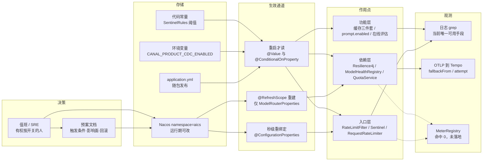
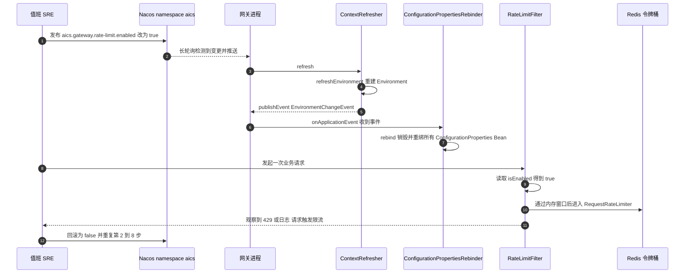

# 降级预案与开关治理：开关不是代码，是一次有代价的授权

> **一句话结论**：写一个 `if (enabled)` 只要 10 秒，难的是回答三个问题——谁有权按、按下之后系统具体变成什么样、凭什么判断可以按回来；本仓库有 12 条运行时 `enabled` 开关、25 个布尔字段、23 处条件装配，却有 0 份预案文档、0 条开关指标，所以这些开关事实上处于「谁都能改、改完没人验证、出事没人回滚」的状态。
> **阅读前置**：读过 [04-高可用架构模式](./04-高可用架构模式.md)（超时/重试/熔断/隔离的分工），知道 Nacos 是配置中心，知道 `@ConfigurationProperties` 与 `@Value` 取值时机不同；如果目标只是「把监控做起来」，先读 [01-SLI-SLO与错误预算](./01-SLI-SLO与错误预算.md)。
> **证据基线**：Spring Boot 4.2.0 / Spring Cloud 2026.0.0 / Spring Cloud Alibaba 2025.1.0.0 / Resilience4j 2.4.0 / Nacos 2.3 / JDK 17.0.19 / Node 24.16.0；证据 A 3 条（5 处锚点）· B 22 个文件 / 52 处引用 · C 13 组命令（pwsh 静态统计与真实 diff）；预计阅读 40 分钟。

## 证据边界

本篇讨论的「按开关」这件事，在本仓库冷热严重不均，先把边界钉死，避免把「有配置项」读成「有治理」。

| 类别 | 本仓状态 | 本篇怎么处理 |
|---|---|---|
| 开关本体（代码） | ✅ 大量：12 条运行时 `enabled:`、25 个 `boolean` 字段、23 处 `@ConditionalOnProperty` | 直接引行号，收敛成 §2 的清单表 |
| 热更新通道 | ⚠️ 只有 1 个类带 `@RefreshScope`（`ModelRouterProperties`），另有 1 个类监听刷新事件 | 每条开关标注「改完要不要重启」 |
| 开关清单 / 预案文档 | ❌ 全仓 `docs/` 搜「预案 / 开关表 / runbook」命中 0 | 给模板并明写「本仓没有」 |
| 开关观测（按了几次、生效没） | ❌ `MeterRegistry` / `Timer.builder` / `Counter.builder` 全仓命中 0；降级信息只进 trace 的高基数标签 | 给「只能 grep 日志」的现状 + 目标态 Counter |
| 配置单一来源 | ❌ git 侧 `tools/nacos-config/` 与本地 Nacos 已发布快照 `tools/nacos/data/` 漂移：`ai-cs-chat.yml` 9 行、`ai-cs-mq.yml` 21 行 | 贴真实 `Compare-Object` 输出 |
| 告警联动（降级要通知到人） | ❌ `deploy/observability/prometheus.yml` 无 `rule_files`、无 Alertmanager | 只讲「该告什么」，不讲路由配置 |
| 演练与过期清理 | ❌ 无演练脚本、无开关过期机制、无 owner 字段 | 给演练清单，明确标「本仓从未做过」 |
| 本机可执行性 | ✅ node 24.16.0 / pwsh / JDK 17.0.19；❌ 无 docker、不许联网、不许起服务 | C 级只做静态统计与 diff，运行期效果一律标「未本机实测」 |

---

## 0. 先看现象

### 现象一：在配置中心改完一个开关，服务行为没变

值班的标准动作是「改 Nacos → 等 5 秒 → 观察曲线」。在本仓库，这个动作对**大多数**开关是无效的：

```text
PS> $j = Get-ChildItem -Recurse -Include *.java | Where-Object { $_.FullName -notmatch '\\target\\|\\learning-docs\\|\\src\\test\\' }
PS> "带 @RefreshScope 的类: " + ($j | Select-String -Pattern '@RefreshScope' -List).Count
带 @RefreshScope 的类: 1
PS> "布尔型 @Value 注入: " + ($j | Select-String -Pattern '@Value\("\$\{[^}]*(true|false)[^}]*\}"\)').Count
布尔型 @Value 注入: 3
PS> "@ConditionalOnProperty 注解: " + ($j | Select-String -Pattern '@ConditionalOnProperty\(').Count
@ConditionalOnProperty 注解: 23
```

`@RefreshScope` 全仓只有 `ai-cs-chat/src/main/java/com/aics/chat/modelrouter/ModelRouterProperties.java#L21` 一处，而 `private boolean` 字段有 25 个、`@Value` 共 58 处。Spring 的规则很硬：`@Value` 注入的值是**启动期一次性**写进字段的，没有 `@RefreshScope` 就永远不会再看第二眼配置中心；`@ConditionalOnProperty` 更狠，它决定 Bean **要不要被创建**，配置改成 `true` 之后 Bean 不会自己冒出来。

于是「改了配置没反应」不是玄学，是机制：你以为在改开关，其实在改一个只有重启才会重读的字符串。

### 现象二：把 `enabled: false` 当成「限流已关闭」，其实它只关了一层

网关配置里写得很清楚：

```text
PS> Select-String -Path ai-cs-gateway\src\main\resources\application.yml -Pattern '^\s*enabled:|rate-limit:' | ForEach-Object { "$($_.LineNumber): $($_.Line.Trim())" }
36: rate-limit:
40: enabled: false
```

同一份文件的 L11-13 注释说「Redis 不可用时分布式限流失效，可临时把下方 `aics.gateway.rate-limit.enabled` 改回 true 切回本地内存限流兜底」。但真正消费这个布尔值的地方只有一处：

```text
PS> Select-String -Path ai-cs-gateway\src\main\java\com\aics\gateway\filter\RateLimitFilter.java -Pattern 'isEnabled' -Context 0,2 | ForEach-Object { "$($_.LineNumber): $($_.Line.Trim())" }
55: if (!properties.isEnabled()) {
56:     return chain.filter(exchange);
57: }
```

而 `ai-cs-gateway/src/main/java/com/aics/gateway/config/RouteConfig.java#L174-L187` 的 `addResilience(...)` 对**每一条**路由都无条件挂了 `.requestRateLimiter(...)`（L181-185）。也就是说：`rate-limit.enabled=false` 关掉的是内存版 `GlobalFilter`，Redis 分布式限流器照旧陪着每条路由跑。**同一个 key 名下藏着两个限流器，开关只管住其中一个**——这种「开关语义与直觉不符」，正是应急预案里最容易写错的那一行字。

### 现象三：没人说得清有几个开关，也查不出哪个已经死了

「你们有多少个开关」这个问题的答案，取决于统计口径，实测能从 86 滑到 12：

```text
PS> $y = Get-ChildItem -Recurse -File -Include *.yml,*.yaml | Where-Object { $_.FullName -notmatch '\\learning-docs\\|\\target\\|\\node_modules\\' }
PS> "yml 文件数: " + $y.Count + "，enabled: 行总数: " + ($y | Select-String -Pattern '^\s*enabled:').Count
yml 文件数: 94，enabled: 行总数: 86
PS> $y | ForEach-Object { $c = (Select-String -LiteralPath $_.FullName -Pattern '^\s*enabled:').Count; if ($c -gt 0) { "{0,-62}{1}" -f $_.FullName.Replace((Get-Location).Path + '\',''), $c } } | Sort-Object
.specify\extensions.yml                                              18
.specify\extensions\git\git-config.yml                               16
.specify\extensions\git\config-template.yml                          16
tools\nacos\data\tenant-config-data\aics\DEFAULT_GROUP\ai-cs-chat.yml 6
tools\nacos-config\ai-cs-chat.yml                                    6
ai-cs-order\src\test\resources\application.yml                       4
ai-cs-product\src\test\resources\application.yml                     4
ai-cs-chat\src\main\resources\application.yml                        4
ai-cs-order\src\main\resources\application.yml                       3
ai-cs-order\src\test\resources\application-test.yml                  3
ai-cs-search\src\main\resources\application.yml                      2
ai-cs-chat\src\main\resources\application-prompt.yml                 1
tools\seata\seata\conf\application.example.yml                       1
ai-cs-product\src\main\resources\application.yml                     1
ai-cs-gateway\src\main\resources\application.yml                     1
```

86 条里 50 条属于 `.specify` 工具链（跟业务无关），11 条在 `src\test`，真正的运行时开关只有 12 条。**「开关数量」这个数本身就该被审计**：数错了，预案里就会漏掉真正会被按的那一个。

已经死掉的开关也真实存在：`tools/nacos-config/ai-cs-pay.yml#L19` 写着 `sandbox: true`，Java 侧搜 `pay.sandbox` 命中 0——从来没有任何代码读过这个键。`docs/28-故障案例库.md#L171-L208` 把它记成案例 C3「pay.sandbox 死配置」，根因是「没有『配置键引用检查』这道门禁」。

> 这些现象指向同一件事：本仓库不缺开关，缺的是开关的**产权、语义与验证**——谁有权按、按了系统变成什么样、按完怎么确认生效、又凭什么按回来。

---

## 1. 整体地图



> **读图说明**：图分五列，从左到右是「谁决定 → 存在哪 → 怎么生效 → 打到哪一层 → 你怎么知道它生效了」。实线是本仓**已存在**的路径，虚线是**未落地**的路径（`MeterRegistry` 相关两条全部是虚线，因为全仓 0 命中）。读图时注意三个分叉点：① 存储列有四格，说明「开关」不只有配置文件一种形态——Sentinel 阈值在代码里，CDC 开关在环境变量里；② 生效通道列是整张图的瓶颈：只有 `@ConfigurationProperties` 这一格是秒级，其余两格都要重启；③ 作用点列的三层对应 §3.1 的降级三层，任何一条降级线都必须能落到这三层之一，否则说明你只是在改代码，不是在降级。

| 组件 | 在哪 | 职责 | 参与方 | 本仓状态 |
|---|---|---|---|---|
| 网关限流（内存版） | `ai-cs-gateway/src/main/java/com/aics/gateway/filter/RateLimitFilter.java#L55-L63` | 按可信用户 ID 做滑动窗口/令牌桶拦截，超限返回 429 | 值班、SRE | ✅ 有代码，`enabled: false` 默认关 |
| 网关限流（Redis 版） | `ai-cs-gateway/src/main/java/com/aics/gateway/config/RouteConfig.java#L181-L185` | 每条路由挂 RequestRateLimiter，每用户 5 令牌/秒、桶 10 | 平台、Redis 运维 | ✅ 一直生效，**不受开关控制** |
| Sentinel 流控 | `ai-cs-chat/src/main/java/com/aics/chat/config/SentinelFlowConfig.java#L27-L45` | chat-send 10 QPS、chat-rag 5 QPS，WarmUp 预热 10 秒 | chat 研发 | ⚠️ 规则注册了，但只有 1 个资源有注解埋点 |
| Resilience4j | `ai-cs-chat/src/main/resources/application.yml#L117-L159` | 三个实例的熔断：10 次滑窗、50% 阈值、OPEN 30 秒 | chat 研发 | ✅ |
| 模型级熔断 | `ai-cs-chat/src/main/java/com/aics/chat/modelrouter/ModelHealthRegistry.java#L18-L31` | 按 modelId 隔离熔断，路由时剔除 OPEN 模型 | chat 研发 | ✅ |
| 配额检查 | `ai-cs-chat/src/main/java/com/aics/chat/observability/QuotaService.java#L72-L79` | 超限拦截，检查异常时放行 | 运营（配额数据） | ⚠️ fail-open 且无降级计数 |
| 内容安全 | `ai-cs-chat/src/main/java/com/aics/chat/security/ContentSafetyService.java#L63-L71` | 审核服务不可用时按 `content-fail-mode` 决定放行或拦截 | 合规 | ✅ 默认 BLOCK（fail-closed） |
| 缓存三件套 | `ai-cs-chat/src/main/resources/application.yml#L177-L193` | 向量/语义/热问缓存的启用与容量 | chat 研发 | ✅ 默认全开 |
| 配置中心 | Nacos `namespace: aics`，导入见 `ai-cs-chat/src/main/resources/application.yml#L27-L31` | 承载 12 份 yml，秒级下发 | 平台 | ⚠️ 与 git 源文件漂移 |
| 开关观测 | 无 | 「按了几次、生效没」 | —— | ❌ `MeterRegistry` 命中 0 |
| 预案文档 | 无 | 触发条件、影响面、回滚 | —— | ❌ 全仓 0 命中 |

---

## 2. 关键概念与关键要素

术语先钉死，后面每一节都只用这些词。

| 名称 | 位置 / 出处 | 作用 | 关键参数 |
|---|---|---|---|
| 降级 | 本仓实现分散在 `VectorCacheStore`、`QuotaService`、`ContentSafetyService` | 下游不可用时用「次优结果」换取主链路可用 | 兜底值、降级触发条件 |
| 熔断（circuit breaker） | `ai-cs-chat/src/main/resources/application.yml#L117-L159` | 连续失败到阈值就停止调用，避免把线程耗在必然失败上 | 滑窗 10 次、最小调用 3 次、失败率 50%、OPEN 30 秒 |
| 入口限流（拒绝） | `RateLimitFilter`、Sentinel、RequestRateLimiter | 立刻返回 429，把「排队」换成「明确的拒绝」 | 5 令牌/秒、桶 10、chat-send 10 QPS |
| 开关（feature flag / toggle） | 12 条 yml `enabled:`、25 个布尔字段 | 不改代码就改变系统行为 | 默认值、生效通道 |
| 发布开关 | `aics.prompt.enabled`（`ai-cs-chat/src/main/resources/application-prompt.yml#L11`） | 新逻辑上线但先关着，出问题一键回退硬编码副本 | 存活期应为「几天」 |
| 业务开关（kill switch） | `aics.cdc.product.enabled`、`aics.vision.enabled`、`aics.pay.tx-notify.enabled` | 运营/合规要求随时关掉某个能力 | 影响面必须写进预案 |
| 实验开关 | `aics.model-router.models[*].enabled`、prompt 的 `rollout` | 只让一部分流量看到新策略 | 灰度比例、结论判据 |
| 熔断开关 | `aics.gateway.rate-limit.enabled`、Resilience4j 实例 | 人为把某个保护手段打开/关闭 | 与「熔断」不同：它是人按的，不是自动的 |
| 开关腐化 | `tools/nacos-config/ai-cs-pay.yml#L19` 的 `sandbox: true` | 开关失去消费方后仍留在配置里，形成「按了没用」的假象 | 引用数 = 0 |
| fail-open | `QuotaService.java#L72-L79` | 检查失败时放行（可用性优先） | 代价：超支、滥用 |
| fail-closed | `ContentSafetyService.java#L65-L71` | 检查失败时拦截（安全优先） | 代价：误伤正常请求 |
| 热更新（rebind） | `@ConfigurationProperties` + Nacos | 配置变更后自动重绑定，秒级生效 | 见 §3.3 |
| 配置漂移 | `tools/nacos-config/` vs `tools/nacos/data/` | git 里的「应为」与线上「实际」不一致 | 漂移行数 |
| 预案（runbook） | 未入库 | 把「谁按、按了变什么样、怎么回来」写成可执行步骤 | 6 个必备字段，见 §3.9 |

---

## 3. 原理与证据逐段精读

### 3.1 降级的三层：入口拒绝、功能裁剪、依赖兜底

- **在干什么**：把「系统不行了」这句话拆成三种可以**独立操作**的动作。入口层拒绝请求（立刻 429），功能层裁剪用户能做的事（少一个能力），依赖层用兜底值顶替下游（拿旧数据/默认值继续跑）。
- **为什么这么设计**：三层的代价差一个数量级——入口拒绝是「用户重试就好」，功能裁剪是「用户拿到次优结果」，依赖兜底是「用户拿到可能过期的数据」。混在一起讲，预案就会写成「系统降级」四个字，值班的人无法判断该按哪个。本仓三层各有代表：
  - **入口层**：`ai-cs-gateway/src/main/java/com/aics/gateway/filter/RateLimitFilter.java#L59-L62`（超限 429 且不转发下游）、`ai-cs-chat/src/main/java/com/aics/chat/config/SentinelRules.java#L15-L30`（`chat-send` 10 QPS、`chat-rag` 5 QPS、WarmUp 预热 10 秒）。
  - **功能层**：`ai-cs-chat/src/main/resources/application.yml#L177-L193` 的三个缓存开关、`ai-cs-chat/src/main/resources/application-prompt.yml#L11` 的 `prompt.enabled`（关闭后各服务回退硬编码副本）、`ai-cs-chat/src/main/java/com/aics/chat/observability/OnlineEvalProperties.java#L26`（默认 `false`）。
  - **依赖层**：`ai-cs-chat/src/main/java/com/aics/chat/cache/VectorCacheStore.java#L73-L77`（Redis 挂了降为 L1-only）、`ai-cs-chat/src/main/java/com/aics/chat/observability/QuotaService.java#L72-L79`（配额服务挂了按未超限放行）、`ai-cs-chat/src/main/java/com/aics/chat/modelrouter/ModelHealthRegistry.java#L18-L31`（按 modelId 隔离熔断）、`ai-cs-chat/src/main/java/com/aics/chat/service/impl/ResilientAiService.java#L451-L456`（所有模型都失败返回兜底文案）。
- **换成别的写法会怎样**：如果只有熔断这一层，下游 LLM 全挂时请求只能在连接池里排队，直到把 Web 容器线程耗光，连「退化成纯文本回复」都发不出去。入口层存在的意义是把「排队」换成「立刻明确的拒绝」——这也是为什么它必须排在认证之后、业务之前（`RateLimitFilter.java#L101-L106` 的 `getOrder()` 返回 `HIGHEST_PRECEDENCE + 150`，注释说明要大于 `AuthFilter` 的 100，否则客户端可以伪造 `X-User-Id` 刷出无限多个限流桶）。
- **常见坑**：把「配置项存在」当成「降级手段存在」。`SentinelRules.java#L18` 定义了 `RESOURCE_CHAT_RAG = "chat-rag"`，`SentinelFlowConfig.java#L36-L39` 也给它注册了规则，但全仓 `@SentinelResource` 注解只有一处：

```text
PS> $j = Get-ChildItem -Recurse -Include *.java | Where-Object { $_.FullName -notmatch '\\target\\|\\learning-docs\\|\\src\\test\\' }
PS> $j | Select-String -Pattern '@SentinelResource\(' | ForEach-Object { "$($_.Path.Replace((Get-Location).Path + '\',''))#$($_.LineNumber)" }
ai-cs-chat\src\main\java\com\aics\chat\controller\ChatController.java#79
```

  只有 `chat-send` 一个资源真的被埋点，`chat-rag` 的 5 QPS 规则**永远不会触发**——它在 Nacos 里、在代码里都「存在」，唯独不在请求路径上。这类「规则有、埋点无」的开关，比没有开关更危险，因为它会出现在预案里。

### 3.2 开关的四种分类与生命周期：开关是会腐化的

四类开关的目的不同，**该不该长期存在**也完全不同：

| 类型 | 要解决什么 | 合理寿命 | 本仓实例 | 到期该做什么 |
|---|---|---|---|---|
| 发布开关 | 新代码上线但先关着，出事立刻回退 | 小时级到几天 | `aics.prompt.enabled`（注释写「过渡期用」） | 稳定后删开关、删硬编码副本 |
| 熔断开关 | 下游抖动时止血，恢复后放回流量 | 永久（但要能自动恢复） | Resilience4j 三实例、网关 `cb-*` | 永远留着，靠 HALF_OPEN 自愈 |
| 业务开关 | 运营/合规要求随时关掉一个能力 | 永久 | `aics.cdc.product.enabled`、`aics.vision.enabled`、`aics.pay.tx-notify.enabled`、`aics.xxl-job.enabled` | 写进预案，配 owner |
| 实验开关 | 一部分流量走新策略，验证后全量或撤掉 | 一个实验周期 | `aics.model-router.models[*].enabled`、prompt 的 `rollout` | 必须有结论并删除失败分支 |

生命周期五个阶段：**创建（必须带 owner 与过期日）→ 灰度 → 全量 → 冻结 → 删除**。腐化发生在最后两段之间：代码早已全量、开关还留着，于是有一天有人按了它，把线上切回一年前的逻辑，而没有任何人记得它当初为什么存在。

本仓库已经有腐化的化石：`tools/nacos-config/ai-cs-pay.yml#L19` 的 `sandbox: true` 没有消费方；`tools/nacos-config/ai-cs-chat.yml.bak`（37 行）躺在配置目录里，随时可能被误当成有效配置；`ai-cs-order/src/main/resources/application.yml#L54` 的 `xxl-job.enabled` 与 `ai-cs-search/src/main/resources/application.yml#L54-L58` 的 `cdc.product.enabled` 都默认 `false`，且注释写明「基础设施部署后开启」——**它们不是开关，是待办事项，而待办事项没有 owner**。

下面这张表是本篇的核心交付物：把「事实上的开关」全部列出，并标出改完要不要重启。

| 开关 key | 默认值 | 存在哪 | 生效通道 | 谁在读 | 类型 |
|---|---|---|---|---|---|
| `aics.gateway.rate-limit.enabled` | `false` | `ai-cs-gateway/src/main/resources/application.yml#L40` | `@ConfigurationProperties` → 秒级重绑，**不用重启** | `RateLimitFilter.java#L55` | 熔断开关（只关内存版） |
| `aics.gateway.auth.api-keys` | `""`（关闭 API Key 认证） | `ai-cs-gateway/src/main/resources/application.yml#L53` | `@Value` + `@PostConstruct` 启动解析一次，**必须重启** | `AuthFilter.java#L56-L57`、L62-L80 | 业务开关（安全） |
| `aics.gateway.loadbalancer.algorithm` | `round-robin` | 同文件 L57 | `@ConditionalOnProperty` 决定 Bean 是否创建，**必须重启** | `LoadBalancerConfig.java#L44` | 发布开关 |
| `aics.pay.tx-notify.enabled` | `true` | 代码默认值，yml 里没有 | `@Value`，**必须重启** | `PayNotifyService.java#L29` | 业务开关（回退旧链路） |
| `aics.vision.enabled` | `true` | 代码默认值（product 侧）；Nacos `ai-cs-chat.yml` L43 另有一份（chat 侧） | product 侧构造器注入，**必须重启**；chat 侧走 `@ConfigurationProperties` | `SiliconFlowImageDescriptionService.java#L48` | 业务开关（**两个源，双写风险**） |
| `aics.cdc.product.enabled` | `false` | `ai-cs-search/src/main/resources/application.yml#L58`（`${CANAL_PRODUCT_CDC_ENABLED:false}`） | `@Value`，**必须重启**（且实际存在环境变量里） | `ProductCdcConsumer.java#L29` | 业务开关（待基础设施） |
| `aics.xxl-job.enabled` | `false` | `ai-cs-order/src/main/resources/application.yml#L54`（`${XXL_JOB_ENABLED:false}`） | `@ConditionalOnProperty`，**必须重启** | `XxlJobConfig.java#L23` | 业务开关（待基础设施） |
| `aics.chat.mongo-archive.enabled` | `false` | `ai-cs-chat/src/main/resources/application.yml#L176` | `@ConditionalOnProperty`，**必须重启** | `MongoChatHistoryArchiveService.java#L19` | 发布开关 |
| `aics.prompt.enabled` | `true` | `ai-cs-chat/src/main/resources/application-prompt.yml#L11` | 随 classpath 打包，**改值要重新构建** | prompt 服务 | 发布开关 |
| `aics.cache.vector.enabled` | `true` | `ai-cs-chat/src/main/resources/application.yml#L180` | `@ConfigurationProperties`，不用重启 | `VectorCacheStore` 等 | 功能开关 |
| `aics.cache.semantic.enabled` | `true` | 同文件 L185 | 同上 | 语义缓存 | 实验开关（阈值 0.92） |
| `aics.cache.hot-qa.enabled` | `true` | 同文件 L191 | 同上 | 热问缓存 | 功能开关 |
| `aics.eval.online.enabled` | `false` | 代码默认值（`OnlineEvalProperties.java#L26`），yml 里没有 | `@ConfigurationProperties`，**Nacos 加键即秒级生效** | 在线评估采样器 | 实验开关 |
| `aics.model-router.enabled` / `models[*].enabled` | `true` | `tools/nacos-config/ai-cs-chat.yml#L48`、L57/L68/L79 | `@RefreshScope` + `RefreshScopeRefreshedEvent` 重建客户端 | `ModelRouterProperties.java#L21`、`ChatModelRegistry.java#L39-L42` | 实验开关 |
| `aics.security.content-fail-mode` | `BLOCK` | 代码默认值（`SecurityProperties.java#L43`），yml 里没有 | `@ConfigurationProperties`，Nacos 加键即秒级 | `ContentSafetyService.java#L65` | 业务开关（安全） |
| `aics.agent.*`（13 个参数） | 见 `AgentProperties.java#L22-L62` | 全仓无 yml 键 | `@ConfigurationProperties`，加键即生效 | Agent 编排 | 功能开关（**从未被外部配置过**） |
| Sentinel 阈值（`chat-send` 10、`chat-rag` 5） | 代码常量 | `SentinelRules.java#L21-L30` | 代码注册，重启回到基线；Dashboard 推送是内存态 | `SentinelFlowConfig.java#L41` | 熔断开关 |

「改完要重启」的比例很清楚：上表 17 行里 7 行必须重启（`@Value` 4 个：`api-keys`、`tx-notify`、product 侧 `vision`、`cdc`；`@ConditionalOnProperty` 3 个：`loadbalancer`、`xxl-job`、`mongo-archive`），1 行要重新构建（classpath 里的 `aics.prompt.enabled`），另有 1 行是代码常量（Sentinel），只有 8 行能秒级生效。**如果预案默认「改配置就生效」，它在一半的开关上是错的。**

### 3.3 存储选择与一致性：谁保存、多久生效

| 存储 | 生效延迟 | 典型失效方式 | 本仓实例 |
|---|---|---|---|
| 代码常量 | 只有发版才变 | 止血要发版，事故期间等不起 | Sentinel 阈值（`SentinelRules.java#L21-L24`） |
| `application.yml`（随包） | 只有重启才变，可用 `${ENV:默认}` 被环境变量覆盖 | 改 yml 忘了重新打包，镜像里还是旧值 | `ai-cs-search/src/main/resources/application.yml#L54-L58` |
| Nacos（`namespace: aics`） | 秒级（长轮询推送） | 与 git 源文件漂移，见 §6.4 | 12 份 yml，导入行见 `ai-cs-chat/src/main/resources/application.yml#L27-L31` |
| 数据库 / 远程配置中心 | 毫秒级 | 需要一套读写与权限控制，本仓无 | 未落地 |

为什么 Nacos 能秒级，而 `@Value` 不能——这不是配置中心的功劳，是 Spring Cloud 的刷新链路：

```java
	public synchronized Set<String> refresh() {
		Set<String> keys = refreshEnvironment();
		this.scope.refreshAll();
		return keys;
	}

	public synchronized Set<String> refreshEnvironment() {
		Map<String, Object> before = getCurrentEnvironmentProperties();
		updateEnvironment();
		Set<String> keys = changes(before, getCurrentEnvironmentProperties()).keySet();
		this.context.publishEvent(new EnvironmentChangeEvent(this.context, keys));
		return keys;
	}
```

(src: ContextRefresher.java.md#L97-L109)

- **在干什么**：`refresh()` 做两件事——重建 `Environment`，然后发布 `EnvironmentChangeEvent`。前半段让新配置进入 `Environment`，后半段通知所有关心配置的人。
- **为什么这么设计**：把「配置变了」做成一个**事件**而不是一个方法调用，才能让刷新能力对业务代码零侵入。`ConfigurationPropertiesRebinder` 就是监听者：`onApplicationEvent(EnvironmentChangeEvent)` 一进来就 `rebind()`，遍历所有 `@ConfigurationProperties` Bean，`destroyBean` 之后重新 `initializeBean`（`[[源码:ConfigurationPropertiesRebinder.java.md#L237-L252]]`）。
- **换成别的写法会怎样**：如果不用事件而用「谁用谁自己拉」，每个开关都要写一遍拉取+赋值+重建逻辑，漏一处就是「改了没反应」。反过来，如果所有 Bean 都进 `RefreshScope`（`[[源码:RefreshScope.java.md#L167-L168]]` 的 `refreshAll()` 会 `destroy()` 整个作用域），那么每次推送都会重建全部 Bean——包括连接池、客户端、注册表，代价是请求抖动。本仓的做法正好说明了这个权衡：只有 `ModelRouterProperties` 进 `RefreshScope`（`ModelRouterProperties.java#L21`），而长生命周期的 `ChatModelRegistry` 用 `@EventListener(RefreshScopeRefreshedEvent.class)` 监听后自己 `rebuild()`，注释写明「注册表保持长生命周期单例，只换不可变 Map 快照；运行时健康状态不与 RefreshScope Bean 一起重建」（`ChatModelRegistry.java#L31-L42`）。
- **常见坑**：以为「配置中心推了」=「所有开关都变了」。四道墙会拦住你：① `@Value` 没有 `@RefreshScope`，字段永不重读；② `@ConditionalOnProperty` 是装配期判断，Bean 不会凭空出现；③ 配置键压根不存在（`aics.agent` 全仓无 yml 键，运行时值就是代码默认值）；④ 你改的是 git 仓库里的源文件，不是 Nacos 里的那份（§6.4 有真实漂移证据）。

一致性要求的判断标准只有一句：**这个开关错了，多久会造成不可接受的后果？** 安全开关（`api-keys`）错了 5 秒就是 5 秒的裸奔，所以它必须热更新——但它偏偏是 `@Value` + `@PostConstruct`，只能重启；而缓存开关错了只是命中率变化，反而被做成了可秒级重绑的 `@ConfigurationProperties`。**本仓当前的可刷新性排序，恰好与重要性排序相反。**

### 3.4 默认值设计：fail-open 还是 fail-closed，是一个业务判断

同一条代码路径上，「检查失败怎么办」有两种答案，本仓两种都存在，而且方向是刻意选的：

| 位置 | 失败时的行为 | 方向 | 选择理由 | 代价 |
|---|---|---|---|---|
| `ai-cs-chat/src/main/java/com/aics/chat/observability/QuotaService.java#L72-L79` | `catch` 打 `log.warn("配额检查失败，按未超限降级: ...")` 后返回 `notExceeded()` | **fail-open** | 配额是「省钱」手段，不是「正确性」手段；配额服务（Feign 到 user 服务）抖动时把全站对话拦掉，损失远大于超支 | 配额服务一挂，超额用户白嫖，且没有任何计数 |
| `ai-cs-chat/src/main/java/com/aics/chat/security/ContentSafetyService.java#L63-L71` | 按 `properties.getContentFailMode()` 决定 `block` 或 `pass`，默认 `BLOCK` | **fail-closed** | 内容安全是合规红线，宁可误伤不可漏放 | 审核服务不可用时正常用户也会被拦，需要人工兜底话术 |
| `ai-cs-gateway/src/main/java/com/aics/gateway/filter/AuthFilter.java#L56-L57` | `api-keys` 为空即关闭 API Key 认证 | **fail-open（危险）** | 本地开发方便 | 配置缺失时机器身份校验静默消失，只有 `log.info` 一行 |
| `ai-cs-gateway/src/main/java/com/aics/gateway/filter/AuthFilter.java#L48` | JWT 密钥带代码默认值 | **fail-open（危险）** | 保证本地能起来 | Nacos 缺 `aics.jwt.secret` 时用公开默认密钥，任何人都能签 token |
| `ai-cs-knowledge/src/main/java/com/aics/knowledge/service/KnowledgeVectorService.java#L88-L90` | `catch` 后 `return 0` | **假装成功（最坏）** | 不阻断文档入库 | 向量化失败与「文档本来就空」无法区分，指标永远漂亮 |

判断规则可以写成三行：**读路径 fail-open（可用性优先）、写路径 fail-closed（正确性优先）、安全与计费 fail-closed（钱和合规不能赌）**。`QuotaService` 是读路径所以 open 是对的，但它的 open 少了一个前提条件——必须能**事后发现**，而本仓连一个「降级发生了几次」的计数器都没有（§3.8）。

`ContentSafetyService` 值得单独看，因为它把「降级」做成了留痕动作：

```java
        } catch (Exception e) {
            log.warn("内容审核服务不可用，按配置降级: stage={}, failMode={}, err={}",
                    stage, properties.getContentFailMode(), e.getMessage());
            boolean block = "BLOCK".equalsIgnoreCase(properties.getContentFailMode());
            auditRecorder.record(SecurityEventType.CONTENT_REVIEW, "DEGRADE", null, "FAILOVER", text,
                    block ? "BLOCK" : "ALLOW", "审核服务不可用，按配置降级为" + (block ? "拦截" : "放行"));
            return block ? ContentReviewResult.block("FAILOVER", "审核服务不可用，已按配置拦截")
                    : ContentReviewResult.pass();
        }
```

  三个动作缺一不可：打日志（供 grep）、按配置决定方向（把选择权外置）、写审计（供事后追责）。这是本仓库里**唯一一处**把降级做成「可回溯事件」的写法，其余 24 处 `log.warn(...降级...)` 都只做了第一个动作。

### 3.5 谁有权按：开关是权限面，不是配置面

- **在干什么**：回答「谁能把这个键从 false 改成 true」。这问题在代码里没有答案，只在权限系统里有答案。
- **为什么这么重要**：改代码要过 PR、CI、灰度、回滚预案四道门；改开关只是一次点击。**开关把「发布权」下放给了所有能登录配置中心的人**——包括实习生的浏览器标签页。更麻烦的是它绕过了所有代码审查：一行 `enabled: true` 不会在 diff 里引起任何人注意。
- **本仓现状**：没有任何区分。`tools/nacos-config/aics-shared.yml` 里明文放着 `spring.ai.openai.api-key`、Redis 地址、`aics.jwt.secret`、DB 密码占位 `${DB_PASSWORD}`——也就是说「能改开关的人」与「能看到全部密钥的人」是同一批人，且没有变更审计，没有双人确认。
- **常见坑**：只按「危险程度」分级，忽略「影响面」。`aics.cache.semantic.enabled` 看着无害，但关掉它会让 RAG 命中率掉一个档；`aics.pay.tx-notify.enabled` 看着像个小优化，关掉它会让支付成功事件在 Feign 回查失败时直接丢失（`PayNotifyService.java#L57-L73` 的注释明写「回查期 Feign 失败即丢事件」）。分级标准应该是「按错之后多久、多少用户受影响」，而不是「这个键听起来吓不吓人」。

### 3.6 按了以后系统变成什么样：影响面必须可枚举

预案里最没用的一句话是「关闭该功能以降低负载」。值班的人需要知道的是**用户会看到什么**。本仓三个真实例子，三种完全不同的影响面形态：

| 开关 | 按下后用户看到什么 | 内部发生了什么 | 可观测信号 | 回滚代价 |
|---|---|---|---|---|
| `aics.pay.tx-notify.enabled: false` | 支付成功的订单可能**永远不变成已支付**（极端情况） | 从 RocketMQ 事务消息回退到「`markSuccess` + `confirmPay`」同步调用；回查期 Feign 失败即丢事件 | 只有 `log.warn("支付服务调用降级: cause={}")`，无计数器 | 高：已丢的事件要人工对账补单 |
| `aics.vision.enabled: false` | 商品没有图片描述（详情页空一块），不报错 | `visionModel` 为 null（`SiliconFlowImageDescriptionService.java#L56-L70`），`describe()` 直接 return null（L74-L78），调用方跳过 | `log.warn("商品图片视觉模型未启用或未配置 API Key，图片描述将返回 null")` | 低：改回来重启即可 |
| `aics.cdc.product.enabled: false` | 商品改价后搜索结果**长期不更新**（只有删改事件被忽略） | `ProductCdcConsumer.java#L34-L37` 直接 return，ES 索引停止同步 | 无（连日志都没有——这是最危险的一类） | 中：需要重建索引补数据 |

三者的差别不在「能不能关」，而在**用户是否察觉得到**。第三行最典型：开关关掉后系统一切正常、日志一切安静、监控一切绿色，只有搜索结果是旧的——而没有任何一处代码或监控会告诉你这件事。

### 3.7 怎么回来：回滚比按下更难

- **在干什么**：定义「什么条件下允许按回来」，以及「按回来需要多久」。
- **为什么难**：按下开关是 1 次点击 + 1 个理由；按回来要 1 次点击 + 1 个**解释**（为什么刚才的决定是错的）。没有预先写好的恢复判据，值班的人会倾向于「再等等看」，于是降级状态被永久化——这是降级最常见的真实死法。
- **三类回滚，代价完全不同**：
  1. **配置回滚**（秒级）：仅对 §3.2 表里「秒级重绑」的 6 行有效。
  2. **重启回滚**（分钟级，且会中断在途连接）：`@Value` 与 `@ConditionalOnProperty` 的 7 行都属于这类。注意 `server.shutdown: graceful` + `timeout-per-shutdown-phase: 30s`（`ai-cs-chat/src/main/resources/application.yml#L1-L7`）只能保证优雅结束，不能保证零中断。
  3. **数据回滚**（几乎不可能）：fail-open 期间放过的超额调用、丢掉的支付事件、漏掉的 CDC 事件，都不会因为开关按回来而回来。
- **本仓唯一「自动回来」的机制**是半开探测：`ai-cs-chat/src/main/java/com/aics/chat/modelrouter/ModelHealthRegistry.java#L23-L31` 的 `isAvailable()` 只剔除 `OPEN`，`CLOSED` 与 `HALF_OPEN` 都放行（注释写明「HALF_OPEN 也要放行以完成恢复探测」），配合 `waitDurationInOpenState(30s)` 与 `permittedNumberOfCallsInHalfOpenState(3)`，恢复是渐进的、不需要人参与。**凡是能自动恢复的，就不要设计成人按**——这是开关设计的第一原则。

### 3.8 开关的观测：按了几次、生效没

- **在干什么**：回答两个问题——「这个开关被按过吗」「按下去之后行为真的变了吗」。
- **本仓现状**：两个都答不了。全仓 668 个 Java 文件里 `MeterRegistry`、`Timer.builder`、`Counter.builder` 命中均为 0（命令见 [01-SLI-SLO与错误预算](./01-SLI-SLO与错误预算.md) §6）。能看到的只有 25 处 `log.warn(...降级...)`：

```text
PS> $j = Get-ChildItem -Recurse -Include *.java | Where-Object { $_.FullName -notmatch '\\target\\|\\learning-docs\\|\\src\\test\\' }
PS> ($j | Select-String -Pattern 'log\.warn\(".*降级').Count
25
```

  25 个降级点，0 个降级计数器。这意味着「AI 最近答得差」这类问题只能靠人翻日志，且日志是 `warn` 级、默认不进任何看板。
- **为什么这是致命的**：开关的价值在于「按了立刻有效果、效果立刻看得出」。中间那一秒没人看得见，开关就退化成了一次盲操作——而盲操作在事故中一定会被推迟，因为没人敢为看不见的效果担责。
- **最小补法**（目标态，代码示例，未落地）：

```java
// 目标态：给降级加一个低基数计数器（本仓尚未落地）
Counter degradeCounter = Counter.builder("aics_degrade_total")
        .description("降级发生次数")
        .tag("switch", "quota")        // 低基数：开关名
        .tag("outcome", "fail_open")   // 低基数：方向
        .register(meterRegistry);
degradeCounter.increment();
```

  为什么要强调「低基数」：`ResilientAiService.java#L474-L478` 把 `scenario`、`modelId`、`fallbackFrom`、`attempt` 全部放进了 `highCardinalityKeyValue`，注释明写「高基数只进 trace 不进 Prometheus」。这是对的——如果把这些维度做成指标 label，时间序列会按「用户数 × 模型数 × 尝试次数」爆炸。**降级计数的标签只能用开关名和结果方向，诊断细节留给 trace。**

### 3.9 降级预案文档的六个必备字段

预案（runbook）不是文档，是**值班时能照着做的一张卡**。少一个字段，出事时就会多花 20 分钟。

| 字段 | 必须回答 | 本仓现有素材 | 缺了会怎样 |
|---|---|---|---|
| 触发条件 | 看到什么数字/日志才允许按？谁确认？ | 无告警规则（`deploy/observability/prometheus.yml` 无 `rule_files`），只能靠人观察 | 按早了浪费一次停机，按晚了故障已扩散 |
| 影响面 | 用户会看到什么？哪些接口/功能受影响？ | §3.6 的表就是雏形 | 值班不敢按，或者按完才发现连带打挂了别的功能 |
| 操作步骤 | 精确到「改哪个键、改成什么值、在哪个环境」 | §3.2 的开关清单表 | 改错环境、改错键名（如把 `cdc.key` 改成 `cdc.product`） |
| 验证方法 | 按完之后用哪条命令/哪个页面确认生效 | 本仓只能 `grep` 日志，且 §3.8 表明没有计数器 | 「以为生效了」是降级事故最常见的一步 |
| 回滚方式 | 怎么按回来、多久生效、有没有数据损失 | §3.7 的三类回滚 | 降级状态被永久化 |
| 负责人 | 谁有权按、谁知道细节、几点找谁 | 无（配置项没有 owner 字段） | 半夜没人敢动，等到天亮 |

一份最小预案长这样（目标态模板，本仓未落地此文件）：

```markdown
### 开关：aics.cache.semantic.enabled
- 触发：RAG 首字节耗时 P95 连续 10 分钟 > 8s，且日志出现 `语义缓存` 相关超时
- 影响面：关闭后同类问题不再命中缓存，每次走完整 RAG（成本上升，答案可能变慢）
- 步骤：Nacos → ai-cs-chat.yml → aics.cache.semantic.enabled=false → 发布
- 验证：`@ConfigurationProperties` 秒级重绑，无需重启；观察 `log` 中缓存命中行数归零
- 回滚：改回 true 即生效；无数据损失
- 负责人：chat 值班（@xxx）；升级路径：SRE 值班
- 过期：长期保留（业务/实验开关），每季度复核一次是否仍需要
```

---

## 4. 一次完整执行时序

以「值班按网关开关切回内存限流兜底」为例。这条链路之所以值得逐帧看，是因为它是本仓**唯一一条完整的、从配置到行为的热更新链路**——同一套动作在其余的 `@Value` 开关上会在第 7 步断掉。



> **读图说明**：前 7 步是「配置生效」，后 5 步是「行为生效」，两段之间没有箭头连着——这是刻意的，因为中间隔着一个**下一个请求**。红线在 7 与 8 之间：所有「改了没用」的故障都发生在这一段的某一侧。第 4 步重建 `Environment` 是全部生效的物理基础，第 7 步 `rebind` 只会处理 `@ConfigurationProperties` Bean——`AuthFilter` 里那个 `@Value` 的 `api-keys` 不会出现在这条链路上，它在启动时就被 `@PostConstruct initApiKeys()` 解析成一张 Map 了（`ai-cs-gateway/src/main/java/com/aics/gateway/filter/AuthFilter.java#L62-L80`）。第 10 步也值得注意：内存窗口放行之后请求仍会进 Redis 令牌桶，所以按这个开关得到的是「两层限流叠加」，不是「从无到有」。

每步该怎么判读：

| 步 | 观察点 | 正常长相 | 异常长相与判读 |
|---|---|---|---|
| 1 | Nacos 控制台配置详情 | 显示新的值是 `true`，有历史版本可回滚 | 页面显示成功但「历史版本」没新增 → 你改的是另一个 namespace（本仓固定 `aics`） |
| 2 | 应用日志 `Refresh keys changed` | 出现变更的 key 列表 | 完全没有日志 → 客户端没连上配置中心，或改的是 git 里的源文件而不是 Nacos（§6.4） |
| 3-4 | 无直接日志 | 第 2 步的日志就来自这里 | —— |
| 5-7 | 日志中的 `ConfigurationPropertiesRebinder` 相关告警 | 无异常输出 | 出现 `Cannot rebind` → 该 Bean 有校验逻辑（如 `ModelRouterProperties.validate()` 的 fail-fast）把新值拒了，配置其实没生效 |
| 8 | 下一次请求 | 开关对应的行为立刻变化 | 行为不变 → 立即怀疑三件事：`@Value` 无 `@RefreshScope`、`@ConditionalOnProperty` 装配期已定、键名写错 |
| 9-10 | 业务日志 `请求触发限流: key=..., path=...`（`RateLimitFilter.java#L60`） | 命中上限时出现，带可信用户 ID 前缀 `u:` | 一直是 `ip:` 前缀 → 认证没通过，限流键退化，配额按 IP 算（NAT 后全公司共用一个桶） |
| 11 | 响应码 | 超限为 429 | 超限时返回 500/502 → 走的是 Redis 限流器抛错，不是内存限流拦截 |
| 12 | Nacos 历史版本 | 能一键回滚到上一版本 | 只能手改 → 预案里必须写「原值是多少」，否则回滚靠记忆 |

---

## 5. 设计取舍

| 取舍点 | 选项 A | 选项 B | 本仓建议 | 放弃的东西 |
|---|---|---|---|---|
| 开关粒度 | 一个总开关（`aics.degrade.enabled`） | 每个功能一个开关 | B，但每个开关必须写进清单表 | 总开关按下去等于全站降级，没人敢按；换来的是「知道到底关了什么」 |
| 存储位置 | 全放 Nacos（热改） | 危险的放代码常量（改要发版） | 混合：安全开关放代码常量或环境变量，业务开关放 Nacos | 热改的便利；换来的是「不会一次误点就把认证关掉」 |
| 默认值方向 | 一律 fail-open（可用性优先） | 一律 fail-closed（正确性优先） | 分路径：读 open、写 closed、安全与计费 closed | 「一条规则管所有」的简洁；换来的是可解释性 |
| 刷新方式 | 所有 Bean 进 `RefreshScope` | 只有配置 Bean 进，客户端自己监听重建 | B（`ChatModelRegistry` 就是这样做的） | 改完立刻全量生效的爽感；换来的是不会每次推送都重建连接池 |
| 谁能按 | 任何能登 Nacos 的人 | 分级 + 双人确认 + 审计 | B（本仓未落地） | 应急速度；换来的是「不会被顺手改掉」 |
| 观测成本 | 每个开关一个 Counter（低基数） | 只进 trace 高基数标签 | 两者都要：Counter 用于「有没有发生」，trace 用于「为什么」 | 指标里看不到诊断细节；换来的是时间序列不爆炸 |
| 过期清理 | 不清理，留着总有用 | 每个开关带 owner + 过期日，到期自动生成清理工单 | B（本仓未落地，`pay.sandbox` 就是没清理的尸体） | 一些「以后可能用得上」的开关；换来的是清单可信 |

可扩展点（每条都带验收判据，本仓均未落地）：

1. **开关清单文件**：在 `docs/` 下建 `开关清单.md`，字段取自 §3.2 的表（key / 默认值 / 存储 / 生效通道 / 类型 / owner / 过期日）。
   **验收判据**：清单里每一条都能用一条命令证明它被读过——例如 `Select-String -Pattern 'rate-limit'` 命中 `RateLimitProperties.java`；命中 0 的必须移入「待删除」区（`pay.sandbox` 属于此类）。
2. **配置键引用检查（CI 门禁）**：脚本提取 `tools/nacos-config/*.yml` 的叶子键，逐个在 `*.java` 里搜驼峰形式，输出「有键无引用」清单，非空则 CI 失败。
   **验收判据**：把 `pay.sandbox` 的键放回去，CI 必须红；删掉后必须绿。这是 `docs/28-故障案例库.md#L197-L201` 里给 C3 案例开的修复方案。
3. **降级计数器**：给 §3.8 的 25 个 `log.warn(...降级...)` 位置各加一个低基数 `Counter`（`switch` + `outcome` 两个 tag）。
   **验收判据**：`/actuator/prometheus` 能 grep 到 `aics_degrade_total`，且时间序列条数 ≤ 开关数 × 2（不随用户数增长）。
4. **一条降级告警**：`aics_degrade_total` 任意 `switch` 在 5 分钟内增量 > 0 即通知，不需要阈值调优——降级本身就不该是常态。
   **验收判据**：手工把 `HTTP` 依赖打断（本机可用「改错 Redis 端口」模拟），告警必须在 5 分钟内触发；注意本仓 `prometheus.yml` 没有 `rule_files`，这条要连带补规则文件。
5. **预案六字段模板落库**：按 §3.9 的模板为 12 条运行时开关各写一张卡。
   **验收判据**：随便抽一张，能让没参与过这个系统的人照着做且在 10 分钟内完成「改→验证→回滚」；卡里必须写明「改完要不要重启」。
6. **开关过期机制**：发布开关创建时必须在清单里填过期日，到期未删则 CI 警告。
   **验收判据**：`aics.prompt.enabled`（注释自称「过渡期用」）这类开关出现在过期清单里；连续两个迭代无人处理即升级为技术债条目。

---

## 6. 踩坑与调试手法

七条，都是在本仓库里能当场复现的。

### 6.1 以为改了 Nacos 就生效：`@Value` 没有 `@RefreshScope`

```powershell
PS> $j = Get-ChildItem -Recurse -Include *.java | Where-Object { $_.FullName -notmatch '\\target\\|\\learning-docs\\|\\src\\test\\' }
PS> $j | Select-String -Pattern '@RefreshScope' | ForEach-Object { "$($_.Path.Replace((Get-Location).Path + '\',''))#$($_.LineNumber)" }
ai-cs-chat\src\main\java\com\aics\chat\modelrouter\ModelRouterProperties.java#21
PS> $j | Select-String -Pattern '@Value\("\$\{[^}]*(true|false)[^}]*\}"\)' | ForEach-Object { "$($_.Path.Replace((Get-Location).Path + '\',''))#$($_.LineNumber): $($_.Line.Trim())" }
ai-cs-pay\src\main\java\com\aics\pay\service\PayNotifyService.java#29: @Value("${aics.pay.tx-notify.enabled:true}")
ai-cs-product\src\main\java\com\aics\product\service\impl\SiliconFlowImageDescriptionService.java#48: @Value("${aics.vision.enabled:true}") boolean enabled) {
ai-cs-search\src\main\java\com\aics\search\cdc\ProductCdcConsumer.java#29: @Value("${aics.cdc.product.enabled:false}")
```

| 判读 | 误判风险 |
|---|---|
| 三个布尔 `@Value` 全都不在 `@RefreshScope` 里 → 改这三个键**必须重启**，Nacos 推送对它们无效。`@RefreshScope` 只有 1 处，说明本仓的热更新能力集中在一个模型路由配置上，其余靠 `@ConfigurationProperties` 重绑，再其余靠重启 | 看到 Nacos 推送成功日志就宣布「已生效」。推送成功只代表 `Environment` 变了，不代表任何 Bean 重读了它；另一类反向误判是「加了 `@RefreshScope` 就万事大吉」——`@RefreshScope` 在下次访问该 Bean 时**重建实例**，如果别的类在启动时把它注入成了普通单例字段，拿到的仍是旧引用 |

### 6.2 开关写在配置里，代码从来不读

```powershell
PS> Select-String -Path tools\nacos-config\ai-cs-pay.yml -Pattern 'sandbox' | ForEach-Object { "$($_.LineNumber): $($_.Line.Trim())" }
19:   sandbox: true
PS> (Get-ChildItem -Recurse -Include *.java | Where-Object { $_.FullName -notmatch '\\target\\|\\learning-docs\\' } | Select-String -Pattern 'pay\.sandbox|isSandbox|getSandbox').Count
0
```

| 判读 | 误判风险 |
|---|---|
| 配置文件里有、Java 侧命中 0 → 这是一个死配置。它不会报错、不会告警，只会让「我们支持沙箱模式」这句话在文档里多活几年 | 用「配置中心里有这个键」推断「系统支持这个能力」。`docs/28-故障案例库.md#L186-L189` 记录的根因正是「没有『配置键引用检查』这道门禁」；反过来也要防误判：有些键是给框架读的（`spring.*`、`rocketmq.*`），Java 代码里永远搜不到，这类要靠白名单排除 |

### 6.3 把 `enabled: false` 当成「这个能力关了」

```powershell
PS> Select-String -Path ai-cs-gateway\src\main\java\com\aics\gateway\config\RouteConfig.java -Pattern 'requestRateLimiter|circuitBreaker|isEnabled' | ForEach-Object { "$($_.LineNumber): $($_.Line.Trim())" }
179: .circuitBreaker(c -> c.setName(cbName)
180: .setFallbackUri("forward:/gateway-fallback"))
181: .requestRateLimiter(c -> {
182: c.setRateLimiter(redisRateLimiter);
183: c.setKeyResolver(userKeyResolver);
```

| 判读 | 误判风险 |
|---|---|
| `addResilience(...)` 内部无条件挂 `requestRateLimiter`，`rate-limit.enabled` 只控制 `RateLimitFilter` 这个 `GlobalFilter`。所以「关掉限流」这个说法在本仓不成立：分布式限流永远在 | 读配置项名字就下结论（`rate-limit` 听起来统管全部限流）。验证方法只有一个：把 `enabled` 的读取点全部 grep 出来，看谁在用这个布尔值——`Select-String -Pattern 'isEnabled'` 在本模块只命中 `RateLimitFilter.java#L55` 一处 |

### 6.4 改了 git 里的配置，线上那份没动（配置漂移）

```powershell
PS> $pub = 'tools\nacos\data\tenant-config-data\aics\DEFAULT_GROUP'
PS> foreach ($f in Get-ChildItem tools\nacos-config -File -Filter *.yml) { $p = Join-Path $pub $f.Name; if (Test-Path $p) { $d = Compare-Object (Get-Content $f.FullName) (Get-Content $p); "{0,-20} 源={1,4}行  快照={2,4}行  漂移行={3}" -f $f.Name, (Get-Content $f.FullName).Count, (Get-Content $p).Count, $d.Count } }
ai-cs-chat.yml       源= 128行  快照= 127行  漂移行=9
ai-cs-gateway.yml    源=  13行  快照=  13行  漂移行=0
ai-cs-knowledge.yml  源=  17行  快照=  17行  漂移行=0
ai-cs-message.yml    源=  19行  快照=  19行  漂移行=0
ai-cs-mq.yml         源=  23行  快照=   2行  漂移行=21
ai-cs-notify.yml     源=   2行  快照=   2行  漂移行=0
ai-cs-order.yml      源=  24行  快照=  24行  漂移行=0
ai-cs-pay.yml        源=  26行  快照=  26行  漂移行=0
ai-cs-product.yml    源=  12行  快照=  12行  漂移行=0
ai-cs-search.yml     源=   9行  快照=   9行  漂移行=0
ai-cs-user.yml       源=   6行  快照=   6行  漂移行=0
aics-shared.yml      源=  37行  快照=  37行  漂移行=0
```

| 判读 | 误判风险 |
|---|---|
| 两份「配置」并存：`tools/nacos-config/` 是 git 里给人看的源文件，`tools/nacos/data/tenant-config-data/aics/DEFAULT_GROUP/` 是本地 Nacos 容器落盘的已发布快照。12 份里 2 份漂了：`ai-cs-mq.yml` 的快照只剩 2 行（`rocketmq.name-server`），源文件里的 `aics.mq.type`、datasource、producer group 全都不见了；`ai-cs-chat.yml` 的差异是 `model/temperature/max-tokens` 在源文件里挂在 `spring.ai.openai.chat` 下，快照里挂在 `spring.ai.openai.chat.options` 下——**结构不同意味着两份配置喂给 Spring AI 的结果不可能一样** | 把快照当成「线上事实」（它只是本地容器的一次落盘，不代表生产），或把源文件当成「已生效」（改完不同步就永远不生效）。正确姿势是「改源文件 + 同步到 Nacos + diff 归零」三步都做，而且要把 diff 做成 CI 检查；本条**未在本机启动 Nacos 验证运行时行为**（不许起服务），结论只到文件层面 |

### 6.5 降级发生了，但没人看得见

```powershell
PS> $j = Get-ChildItem -Recurse -Include *.java | Where-Object { $_.FullName -notmatch '\\target\\|\\learning-docs\\|\\src\\test\\' }
PS> "MeterRegistry: " + ($j | Select-String -Pattern 'MeterRegistry').Count + " / Counter.builder: " + ($j | Select-String -Pattern 'Counter\.builder').Count
MeterRegistry: 0 / Counter.builder: 0
PS> "log.warn 含「降级」: " + ($j | Select-String -Pattern 'log\.warn\(".*降级').Count
log.warn 含「降级」: 25
```

| 判读 | 误判风险 |
|---|---|
| 25 个降级点、0 个降级计数器 → 「系统现在处于降级状态吗」这个问题只能靠人 grep 日志，且 `warn` 级别默认不进看板。「降级生效」与「降级失效」在监控上长得一模一样 | 用「没有报错」推断「没有降级」。更隐蔽的一类：`KnowledgeVectorService.java#L88-L90` 的 `return 0` 让失败与「文档为空」不可区分，指标上的「向量化成功」永远漂亮——这类「假装成功」的降级连日志都只在 `error` 里出现一次，很容易被忽略 |

### 6.6 条件装配开关：配了值也不会生效

```powershell
PS> $j = Get-ChildItem -Recurse -Include *.java | Where-Object { $_.FullName -notmatch '\\target\\|\\learning-docs\\|\\src\\test\\' }
PS> ($j | Select-String -Pattern '@ConditionalOnProperty\(').Count
23
PS> Select-String -Path ai-cs-order\src\main\java\com\aics\order\task\XxlJobConfig.java -Pattern 'ConditionalOnProperty|class XxlJobConfig' | ForEach-Object { "$($_.LineNumber): $($_.Line.Trim())" }
23: @ConditionalOnProperty(name = "aics.xxl-job.enabled", havingValue = "true")
24: public class XxlJobConfig {
```

| 判读 | 误判风险 |
|---|---|
| 23 处条件装配里，只要 `havingValue` 不匹配，Bean 的整个配置类都不会被创建——`aics.xxl-job.enabled` 从 `false` 改成 `true` 后，`XxlJobConfig` 不会凭空出现，必须重启；同理 `MongoChatHistoryArchiveService.java#L19`、`LoadBalancerConfig.java#L44` | 把 `@ConditionalOnProperty` 当成普通布尔开关。另一个坑在语义：有些注解带 `matchIfMissing = true`（如 `IdempotentAutoConfiguration.java#L22`），意味着**键不存在时它是开着的**——「删掉配置」和「配置成 false」在行为上等价或不等价，取决于这一处是否写了 `matchIfMissing` |

### 6.7 Sentinel 的规则有三份来源，重启会回到代码基线

```powershell
PS> Select-String -Path ai-cs-chat\src\main\java\com\aics\chat\config\SentinelFlowConfig.java -Pattern 'loadRules|CHAT_SEND_QPS|WARM_UP|Dashboard' | ForEach-Object { "$($_.LineNumber): $($_.Line.Trim())" }
41: FlowRuleManager.loadRules(List.of(sendRule, ragRule));
PS> Select-String -Path ai-cs-chat\src\main\java\com\aics\chat\config\SentinelRules.java -Pattern 'QPS_THRESHOLD|WARM_UP|RESOURCE' | ForEach-Object { "$($_.LineNumber): $($_.Line.Trim())" }
15: public static final String RESOURCE_CHAT_SEND = "chat-send";
18: public static final String RESOURCE_CHAT_RAG = "chat-rag";
21: public static final int CHAT_SEND_QPS_THRESHOLD = 10;
24: public static final int CHAT_RAG_QPS_THRESHOLD = 5;
27: public static final int CONTROL_BEHAVIOR_WARM_UP = 1;
30: public static final int WARM_UP_PERIOD_SEC = 10;
```

| 判读 | 误判风险 |
|---|---|
| 规则来源有三种（`SentinelFlowConfig.java#L15-L17` 的 javadoc 自己写了）：代码注册（本类，随应用发布）、Dashboard 推送（内存态，重启即失）、Nacos 数据源持久化（需要额外引入 `sentinel-datasource-nacos`，本仓没有）。所以在本仓「在 Dashboard 上调阈值」是临时操作，重启即回到 10/5 | 在 Dashboard 调完即认为「长期有效」，事后重启又回到旧值，形成「同一故障反复出现」的假象；另一个误判是认为规则存在就会生效——`chat-rag` 的规则一直没有 `@SentinelResource` 埋点（§3.1），调它等于调空气 |

---

## 7. 版本差异

| 旧写法 | 当前基线 | 变化点 | 迁移动作 |
|---|---|---|---|
| 用 `@Value` + `@RefreshScope` 做开关热更新 | `@ConfigurationProperties` + `ConfigurationPropertiesRebinder` 自动重绑；本仓只有 `RateLimitProperties.java#L20-L28` 采用了这个写法 | `@Value` 字段必须自己进 `RefreshScope`，`@ConfigurationProperties` 不需要 | 开关类一律改 `@ConfigurationProperties`；已存在的 3 个布尔 `@Value` 要么改写法，要么在清单里标「必须重启」 |
| 认为「配置中心改了就生效」 | 生效通道分三种：秒级重绑 / 重启 / 构建期装配（23 处 `@ConditionalOnProperty`） | 条件装配决定 Bean 是否创建，与「值刷新」是两件事 | 清单表增加「生效通道」列（§3.2），预案里逐条写清 |
| 开关 = 一个 yml 里的 `enabled` | 开关有四种存储：yml、Nacos、环境变量（`CANAL_PRODUCT_CDC_ENABLED`）、代码常量（Sentinel 阈值） | 存环境变量的开关，改它等于重新部署 | 按存储归类，环境变量类纳入发布流程而非配置流程 |
| 限流开关关掉即无限流 | `rate-limit.enabled` 只控制内存版 `GlobalFilter`；Redis `RequestRateLimiter` 始终挂在每条路由上（`RouteConfig.java#L181-L185`） | 两套限流器并存，且开关只管一套 | 要么把开关语义改成「内存兜底层」并写进注释与预案，要么让开关同时控制两套 |
| 开关只有「开/关」两态 | 本仓已有三态语义：`content-fail-mode` 的 `BLOCK` / 放行、`model-router` 的 primary + fallback 链、prompt 的 `rollout.strategy=pinned` | 降级方向本身是可配置的，不只是「关掉」 | 预案里写「按下去之后方向是什么」，而不是笼统写「关闭」 |
| 降级靠 `catch` + 返回默认值，无需观测 | 本仓 25 处 `log.warn(...降级...)`、0 个 `Counter`；trace 侧只有高基数标签（`ResilientAiService.java#L474-L478`） | 降级从「隐式行为」变成「需要计数的事件」 | 补低基数 Counter；把 `fallbackFrom`/`attempt` 留在 trace 做诊断（§3.8） |
| Sentinel 规则写在 Dashboard 即可 | 规则随重启丢失；持久化需要 `sentinel-datasource-nacos`（本仓未引入） | 代码注册是唯一可靠来源 | 长期阈值写进 `SentinelRules.java` 并走发版；临时调参必须记在事故记录里 |
| 配额检查失败即拦截（想当然的安全做法） | `QuotaService.java#L72-L79` 明确 fail-open，注释写「按未超限降级」 | 方向是刻意选的：可用性优先 | 若要改成 fail-closed，必须先有「配额服务可用性」指标，否则会把配额服务的小抖动放大成全站不可用 |

---

## 8. 面试高频问与答（只列问题）

1. 降级和熔断的区别是什么？为什么降级必须分层（入口/功能/依赖），只做一层会怎样？
2. 开关分哪四类？发布开关和业务开关的合理寿命差别有多大，为什么？
3. 「开关腐化」是怎么发生的？你在项目里怎么发现一个开关已经死了？
4. `@ConfigurationProperties`、`@Value`、`@ConditionalOnProperty` 三者在「配置变了之后会怎样」上有什么区别？
5. Nacos 配置推送到应用之后，Spring Cloud 内部走了哪几步？`EnvironmentChangeEvent` 和 `RefreshScopeRefreshedEvent` 分别由谁触发、谁消费？
6. 为什么不应该把所有 Bean 都放进 `RefreshScope`？本仓库是怎么绕开这个代价的？
7. 开关的存储有哪几种选择？毫秒级和秒级的生效要求分别对应什么场景？
8. fail-open 和 fail-closed 各适合什么路径？配额检查和内容审核为什么方向相反？
9. 「安全的 fail-open」是什么？举一个本仓库里真实存在的、配置缺失即静默失效的例子。
10. 一份能用的降级预案至少要包含哪几个字段？少了「验证方法」会发生什么？
11. 开关按下去之后，你怎么证明它真的生效了？在没有指标的情况下怎么办？
12. 为什么开关必须能自动恢复（半开探测）而不能只靠人再按一次？
13. 一个团队有 50 个开关但没有清单，你会先做哪三件事？顺序为什么不能颠倒？
14. 怎么把「配置键没人读」这类腐化做进 CI 门禁？它和「代码覆盖率」是同一类检查吗？

---

## 9. 动手练习

1. **做一次开关全量盘点**：用一条命令列出所有 `src/main/resources` 下的 `enabled:` 行及其父键，与本文 §3.2 的清单表逐条对照，补上遗漏项。
   **验收标准**：得到 12 条运行时开关，且能对每条说出「存储在哪、改完要不要重启」；若结论与本篇不一致，以你的命令输出为准并说明原因。
2. **给一个开关补上热更新能力**：把 `ai-cs-search/src/main/java/com/aics/search/cdc/ProductCdcConsumer.java#L29` 的 `@Value` 改造成 `@ConfigurationProperties`（新建一个 `CdcProperties`），使其在 Nacos 改值后秒级生效。
   **验收标准**：改造后 `Select-String -Pattern '@Value' ProductCdcConsumer.java` 命中 0；`CdcProperties` 带 `@ConfigurationProperties(prefix = "aics.cdc.product")` 且默认值仍为 `false`；说明这样改之后「关闭 CDC」是否变成可热切换（需考虑 consumer 是否已注册到 broker）。
   **本条未本机实测**（需启动 Nacos 与 RocketMQ 才能验证刷新效果）。
3. **写配置键引用检查脚本**：在 `learning-docs/tools/tmp/` 下写一个 node 脚本，提取 `tools/nacos-config/*.yml` 的叶子键路径，转成驼峰后在 `ai-cs-*` 的 `*.java` 里搜索，输出「疑似无引用」清单。
   **验收标准**：脚本能把 `pay.sandbox` 判为「无引用」；把 `aics.jwt.secret` 判为「有引用」（`AuthFilter.java#L48`）；对 `spring.*` / `rocketmq.*` 等框架键有白名单，不产生噪声。
4. **给一个降级点补计数器**：选 `VectorCacheStore.java#L73-L77`，加一个 `Counter`（tag 为 `switch=vector_cache_l2`、`outcome=degrade`）。
   **验收标准**：代码能通过编译（`mvn -pl ai-cs-chat -am compile`，**本机未执行**）；`/actuator/prometheus` 输出里能 grep 到该指标名；说明为什么不能用 `err` 消息作为 tag（基数爆炸）。
5. **写一张完整预案卡**：为 `aics.cache.semantic.enabled` 按 §3.9 的六字段写一张卡，包含精确到「哪个文件的哪一行」的操作步骤。
   **验收标准**：卡里能回答「按完怎么验证」（本仓现实答案是：`@ConfigurationProperties` 秒级生效 + grep 日志里缓存命中行归零），并写明负责人角色而非人名以外无信息。
6. **做一次只读演练（纸面演练）**：不启动任何服务，按 §4 的时序逐帧写出「如果第 5 步的事件没被发出，你会怎么定位」。列出至少 3 个可执行命令。
   **验收标准**：三个命令分别对应「配置是否进了 `Environment`」（查 Nacos 版本/日志）、「Bean 是否重绑」（查 `ConfigurationPropertiesRebinder` 日志/actuator）、「行为是否变化」（查业务日志），且每个命令都写明预期输出与反例。

---

## 小结

- **开关的难点不在代码，在授权**：写 `if (enabled)` 是 10 秒的事；说清「谁有权按、按了变成什么样、凭什么叫回来」才是工程量。
- **降级必须分三层**：入口拒绝（429）、功能裁剪（少一个能力）、依赖兜底（拿默认值）。本仓三层都有代码，但入口层里 `chat-rag` 的 Sentinel 规则**没有埋点**，属于「规则存在、请求路径上没有」。
- **四类开关寿命不同**：发布开关该在几天内删掉，业务开关该永久保留并写进预案，实验开关必须有结论。`aics.prompt.enabled` 自称「过渡期用」，`pay.sandbox` 已经变成化石。
- **生效通道只有一条路是秒级的**：`@ConfigurationProperties` 重绑；`@Value`（3 个布尔）与 `@ConditionalOnProperty`（23 处）都要重启，`application-prompt.yml` 甚至要重新构建。
- **默认值方向是业务判断**：配额 fail-open（可用性优先）、内容审核 fail-closed（合规优先）、`api-keys` 空串关闭认证与 JWT 默认密钥是两处危险的 fail-open。
- **观测是当前最大的缺口**：25 个降级点、0 个计数器；`fallbackFrom`/`attempt` 只进 trace 高基数标签，指标层看不见降级。
- **配置有双份且已经漂移**：`tools/nacos-config/` 与 `tools/nacos/data/` 的 `ai-cs-mq.yml` 差 21 行、`ai-cs-chat.yml` 差 9 行，改哪份生效没人能说清。
- **下周就能做的第一件事**：跑一遍 §6.4 的 `Compare-Object` 与 §6.2 的 `pay.sandbox` 检查，把「本仓 12 条运行时 `enabled:` 开关、连同类里的布尔字段与条件装配共 17 处可控开关，其中 7 处改完必须重启、1 个死配置、2 份配置漂移」写进周会记录——先让开关清单可见，才有资格谈治理。

---

## 自测题

**Q1. 为什么说「降级的难点不在写 switch」？用本仓库的一个例子说明。**
<details><summary>参考答案</summary>

因为 switch 只解决「改不改得动」，不解决「该不该改、改完变什么样、怎么回来」。例子：`aics.pay.tx-notify.enabled` 默认 `true`（`ai-cs-pay/src/main/java/com/aics/pay/service/PayNotifyService.java#L29`），改成 `false` 就回退到旧 Feign 同步链路，而同文件 L57-L73 的注释写明「回查期 Feign 失败即丢事件」——这个开关不是降级开关，是「切回有缺陷的旧路径」。不知道这一点的人按下去，会以为自己在降级，实际在制造数据不一致。
</details>

**Q2. 写出本仓降级三层的各一个实例，并说明三层的代价差异。**
<details><summary>参考答案</summary>

入口层：`RateLimitFilter.java#L59-L62` 超限返回 429 不转发；功能层：`ai-cs-chat/src/main/resources/application.yml#L180` 的向量缓存开关（关掉只是命中率下降）；依赖层：`VectorCacheStore.java#L73-L77` Redis 挂了降为 L1-only。代价依次是「用户重试就好」→「结果变慢/变贵」→「可能拿到旧数据或默认值」，恢复速度也依次变慢。
</details>

**Q3. `@Value`、`@ConfigurationProperties`、`@ConditionalOnProperty` 在配置变更后的行为分别是什么？**
<details><summary>参考答案</summary>

`@Value`：启动期一次性注入，配置变更不重读，**必须重启**。`@ConfigurationProperties`：`ConfigurationPropertiesRebinder` 监听 `EnvironmentChangeEvent` 后 `rebind()`，销毁并重建绑定，**秒级生效**。`@ConditionalOnProperty`：装配期判断是否创建 Bean，值变更后 Bean 不会出现也 不会消失，**必须重启**。
</details>

**Q4. 本仓库有几个 `@RefreshScope`？这个数字说明了什么？**
<details><summary>参考答案</summary>

只有 1 个类：`ai-cs-chat/src/main/java/com/aics/chat/modelrouter/ModelRouterProperties.java#L21`。说明热更新能力高度集中在模型路由配置上，其余开关要么靠 `@ConfigurationProperties` 重绑，要么靠重启。这也解释了「在 Nacos 改了某个 `@Value` 开关却没反应」的现象。
</details>

**Q5. `ConfigurationPropertiesRebinder` 是怎么知道配置变了的？它做了什么？**
<details><summary>参考答案</summary>

`ContextRefresher.refresh()` 先 `refreshEnvironment()` 重建 `Environment`，然后 `publishEvent(new EnvironmentChangeEvent(...))`（`[[源码:ContextRefresher.java.md#L97-L109]]`）；`ConfigurationPropertiesRebinder.onApplicationEvent(EnvironmentChangeEvent)` 收到后调 `rebind()`，遍历所有 `@ConfigurationProperties` Bean 逐个 `destroyBean` + `initializeBean`（`[[源码:ConfigurationPropertiesRebinder.java.md#L237-L252]]`）。
</details>

**Q6. 为什么不能把所有 Bean 都放进 `RefreshScope`？本仓怎么权衡的？**
<details><summary>参考答案</summary>

`RefreshScope.refreshAll()` 会 `destroy()` 整个作用域，下次访问时全部重建——连接池、客户端、注册表都会重新创建，代价是请求抖动与瞬时不可用。本仓的做法是：只有 `ModelRouterProperties` 进 `RefreshScope`，长生命周期的 `ChatModelRegistry` 用 `@EventListener(RefreshScopeRefreshedEvent.class)` 监听后自己 `rebuild()`，只替换不可变 Map 快照，运行时健康状态不跟着重建（`ChatModelRegistry.java#L31-L42`）。
</details>

**Q7. 为什么本仓说「关掉限流」是个不成立的说法？**
<details><summary>参考答案</summary>

因为存在两套限流器：`aics.gateway.rate-limit.enabled=false` 只让 `RateLimitFilter.java#L55` 直接放行；而 `RouteConfig.java#L181-L185` 的 `addResilience(...)` 对每条路由无条件挂 `requestRateLimiter`，Redis 令牌桶（5 令牌/秒、桶 10）始终生效。开关只覆盖了内存版这一层。
</details>

**Q8. 开关按下去之后，值班人员怎么验证它生效了？在没有任何指标的情况下怎么办？**
<details><summary>参考答案</summary>

三层验证：① 配置层看 Nacos 版本历史与客户端 `Refresh keys changed` 日志；② Bean 层看有没有 `Cannot rebind` 之类的告警（`ModelRouterProperties.validate()` 会 fail-fast）；③ 行为层 grep 业务日志（如 `RateLimitFilter.java#L60` 的「请求触发限流」、`VectorCacheStore.java#L75` 的「降级 L1-only」）。没有指标时只能靠日志，这也是本篇主张补低基数 `Counter` 的原因。
</details>

**Q9. 配额检查为什么是 fail-open？如果改成 fail-closed 需要先补什么？**
<details><summary>参考答案</summary>

`QuotaService.java#L72-L79` 在 Feign 调用失败时 `log.warn("配额检查失败，按未超限降级")` 并返回 `notExceeded()`——配额是省钱手段，不是正确性手段，把它做成 fail-closed 会让配额服务的小抖动放大成全站不可用。要改成 fail-closed，必须先有「配额服务可用性/错误率」指标与告警，否则你无法区分「配额服务挂了」和「用户真超限了」。
</details>

**Q10. 本仓有两处危险的 fail-open 默认值，分别是什么？**
<details><summary>参考答案</summary>

① `ai-cs-gateway/src/main/java/com/aics/gateway/filter/AuthFilter.java#L56-L57` 的 `api-keys` 为空串即关闭 API Key 认证，只留一行 `log.info`；② 同文件 `#L48` 的 JWT 密钥带代码内默认值，Nacos 未配置 `aics.jwt.secret` 时用公开默认密钥，任何人都能签 token。
</details>

**Q11. 怎么证明一个配置项已经「死了」？本仓有没有实例？**
<details><summary>参考答案</summary>

先看键是否被读取：`tools/nacos-config/ai-cs-pay.yml#L19` 的 `sandbox: true` 在 Java 侧搜 `pay.sandbox` 命中 0，说明没有任何代码消费它。这正是 `docs/28-故障案例库.md#L171-L208`（案例 C3）记录的问题，根因是缺少「配置键引用检查」门禁。反向也要注意：`spring.*`、`rocketmq.*` 这类框架键本来就不会出现在业务 Java 代码里，需白名单排除。
</details>

**Q12. 为什么降级能力必须能自动恢复，而不是靠人再按一次？**
<details><summary>参考答案</summary>

因为按回来意味着要「解释刚才的决定是错的」，而这段时间里降级状态会被永久化。`ModelHealthRegistry.java#L23-L31` 给了正确姿势：`isAvailable()` 只剔 `OPEN`，`HALF_OPEN` 放行探测，配合 `waitDurationInOpenState(30s)` 与 `permittedNumberOfCallsInHalfOpenState(3)`，恢复是自动、渐进的。
</details>

**Q13. 一份降级预案如果没有「验证方法」字段，会出什么事故？**
<details><summary>参考答案</summary>

会出现「以为生效了」：本仓 7 个开关改完必须重启、6 个可秒级重绑，如果预案不写清通道，"改完没反应"就会被误判成"降级无效"，进而重复操作甚至在事故中改第二个开关，扩大影响面。验证方法必须写成可执行的命令或可观察的日志行，而不是「观察是否恢复」。
</details>

**Q14. 如果让你只做三件事让本仓的开关治理及格，顺序是什么？**
<details><summary>参考答案</summary>

① 开关清单（§3.2 表 + owner + 生效通道），因为没有清单时任何讨论都是在猜；② 配置键引用检查 CI 门禁，先消灭 `pay.sandbox` 这类死配置，让清单可信；③ 降级计数器 + 一条「降级发生即通知」的告警，让开关效果可见。顺序不能颠倒：没有清单会漏项，没有引用检查清单会掺假，没有观测则前两步都只是文档。
</details>

---

> 上一篇：[04-高可用架构模式](./04-高可用架构模式.md) ｜ 下一篇：[06-RCA根因分析与复盘](./06-RCA根因分析与复盘.md)
