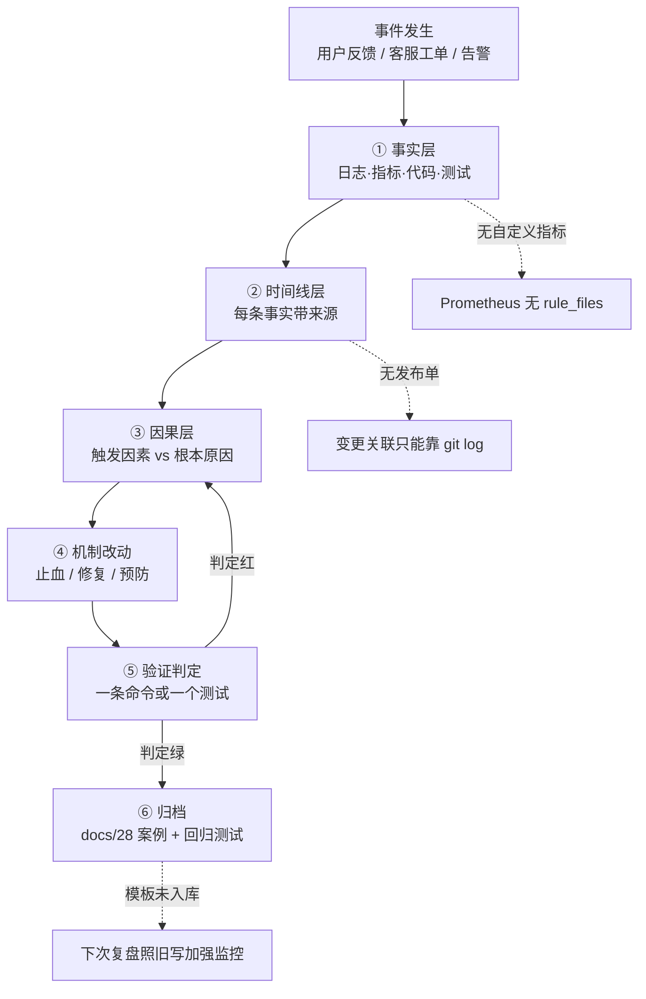
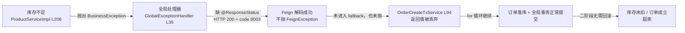
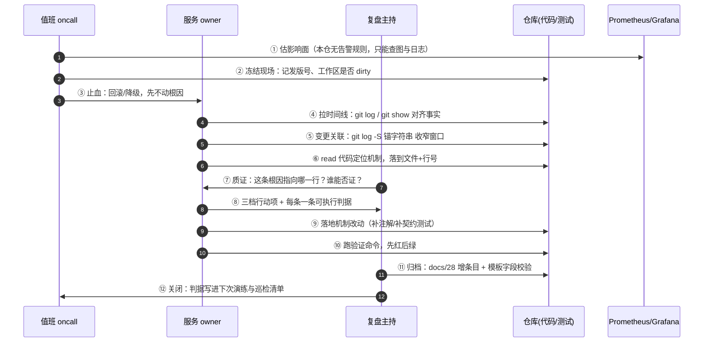

# RCA 根因分析与复盘：把「下次注意」改成一条能跑的命令

> **一句话结论**：复盘的合格产出不是一份说明文，而是一组能被一条命令或一个测试判定真假的机制改动；一旦开始问「谁没注意」，说明机制还没问到。
> **阅读前置**：建议先读 [01-SLI-SLO与错误预算](./01-SLI-SLO与错误预算.md)，建立「影响面用 SLI 量化」的口径；本文所有命令都能在本仓直接跑，不需要起服务、不需要联网。
> **证据基线**：JDK 17.0.19 · Spring Boot 4.2.0 · Spring Framework 7.1.0 · Spring Cloud 2026.0.0 · Spring Cloud Alibaba 2025.1.0.0 · Spring AI 2.1.0 · Seata 2.7.0 · MyBatis-Plus 3.0.5 · MySQL 8.0 · Redis 7.x；证据 A 2 条 · B 19 条 · C 11 组；预计阅读 45 分钟。

## 证据边界

| 类别 | 本仓状态 | 本篇怎么处理 |
| --- | --- | --- |
| 故障案例原始记录 | ✅ [28-故障案例库](../../docs/28-故障案例库.md)、[29-用户接口输入校验与E2E测试](../../docs/29-用户接口输入校验与E2E测试.md)、[30-Spring-AI-2.1升级实施与验证](../../docs/30-Spring-AI-2.1升级实施与验证.md) 三份真实文档 | 每处引用都写完整路径，结论只取自文档原文或当次 read 的代码 |
| 缺陷当前状态 | ✅ 案例库自带状态标记，代码里有修复现场 | 正文严格区分「已修复」「已确认未修」「潜在未触发」三态 |
| 复盘模板与字段校验器 | ⚠️ 本仓 `docs/` 下无复盘模板类工件，`learning-docs` 也还没有入库的校验脚本 | 本文给可复制模板 + node 校验器，脚本全文照登，工具本身尚未入库 |
| 生产故障现象、工单、发布单 | ❌ 无生产事故日志、无值班工单、无发布单 | 全文不写「某次线上故障」，凡现象均标注为「代码级可复现事实」 |
| 告警与自定义指标 | ❌ `deploy/observability/prometheus.yml` 无 `rule_files`，全仓无 `MeterRegistry` 埋点 | 「告警没触发」只能写成可验证缺口，不能写成结论 |

> 读这篇时请始终带着一个判断标准：**这句话能不能被一条命令证伪**。能被证伪的写进报告，不能证伪的写进「待验证」。

## 0. 先看现象

RCA（Root Cause Analysis，根因分析）的失败往往不是分析得不够深，而是**分析的落点选错了对象**——落在人身上，就得到「下次注意」；落在机制上，才得到「这条命令以后会红」。以下三个现象都能在本仓当场复现，且直接决定了复盘能写成什么样。

### 现象 1：11 个全局异常处理器，只有 1 个不带 HTTP 状态码

```powershell
node -e "const s=require('fs').readFileSync('ai-cs-common/src/main/java/com/aics/common/exception/GlobalExceptionHandler.java','utf8');const n=(s.match(/@ExceptionHandler\(/g)||[]).length,m=(s.match(/@ResponseStatus\(/g)||[]).length;console.log('@ExceptionHandler='+n+'  @ResponseStatus='+m);console.log(s.split('\n').slice(34,39).join('\n'))"
```

```text
@ExceptionHandler=11  @ResponseStatus=10
    @ExceptionHandler(BusinessException.class)
    public Result<Void> handleBusinessException(BusinessException e, HttpServletRequest request) {
        log.warn("业务异常 [{}] {}: code={}, msg={}", request.getMethod(), request.getRequestURI(), e.getCode(), e.getMessage());
        return Result.fail(e.getCode(), e.getMessage());
    }
```

**怎么读**：11 个 `@ExceptionHandler` 对应 10 个 `@ResponseStatus`，差的那一个就是 `BusinessException` 处理器——它把业务失败渲染成 **HTTP 200 + 响应体 `code=8003`**。同一个类里其余处理器（`ai-cs-common/src/main/java/com/aics/common/exception/GlobalExceptionHandler.java#L139-L144` 非法参数 400、`#L149-L154` 兜底 500）都成对出现，唯独 `#L32-L39` 单独缺状态码。这个不对称本身就是最强的定位线索：**它不是设计选择，是遗漏**。

### 现象 2：下单链路把「扣库存」的返回值直接扔掉

```powershell
node -e "const s=require('fs').readFileSync('ai-cs-order/src/main/java/com/aics/order/service/impl/OrderCreateTxService.java','utf8').split('\n');s.forEach((l,i)=>{if(/deductStock|GlobalTransactional|@Transactional\(/.test(l))console.log((i+1)+'| '+l.trim())})"
```

```text
19| import io.seata.spring.annotation.GlobalTransactional;
37| * <p><b>为什么单独拆一个类</b>：{@code @Transactional} 与 {@code @GlobalTransactional}
78| @GlobalTransactional(rollbackFor = Exception.class, name = "order-create")
79| @Transactional(rollbackFor = Exception.class)
94| productClient.deductStock(item.getProductId(), item.getQuantity());
```

**怎么读**：`OrderCreateTxService#L94` 拿到了 `Result<Void>` 却既不解包也不判断 `code`，而它外部套着 `@GlobalTransactional`（L78）。这意味着**全局事务能不能回滚，完全取决于「Feign 调用有没有抛异常」**——把所有回滚责任押在一个第三方调用的异常行为上，而不是押在显式判定上。这条链一旦断在第一环（见现象 1），后面每一步都会「一切正常」地走完。

### 现象 3：想引用「告警 3 分钟内触发」，全仓找不到一条告警规则

```powershell
$m=Get-ChildItem -Recurse -Path ai-cs-* -Include *.java | Select-String -Pattern 'MeterRegistry|Timer\.builder|Counter\.builder'; "meter_hits=" + $m.Count
$p=Select-String -Path deploy\observability\prometheus.yml -Pattern 'rule_files|alerting|alertmanager'; "alert_hits=" + $p.Count
```

```text
meter_hits=0
alert_hits=0
```

**怎么读**：`deploy/observability/prometheus.yml` 只有 24 行，全部内容是 `global`（L2-L4）与 `scrape_configs`（L6-L22，11 个 `static_configs` target），没有 `rule_files`、没有 `alertmanager`；Jaeger/Tempo 侧只做链路留存，Grafana 只画图。这不是「告警没响」，而是**「告警不存在」**：任何复盘里写「已确认告警在 X 分钟内触发」都是编造，正确写法是「本仓无告警规则，MTTD 无法测量」。

> 这些现象指向同一件事：本仓的**「异常 → HTTP 状态码」和「返回值 → 事务边界」两条约定，既没有被测试固定，也没有被指标守护**。所以复盘一写到这里就无话可说，只能退化成「下次注意」。

## 1. 整体地图

RCA 不是一个文档标题，而是一条六级流水线：事实 → 时间线 → 因果 → 机制改动 → 验证 → 归档。任何一级偷工，下一级就只能用形容词凑。



> **读图说明**：主链路的实线 `F -->|判定红| D` 是最容易被忽略的一条——**验证失败要回到因果层重写根因，而不是回到动作层换个说法**，把它画成回到 ④ 就会得出「行动项没执行到位」的错误结论（真实原因通常是根因写错了）。虚线 `B -.-> X` 指出本仓的结构性缺口：事实层缺指标，于是时间线只能靠日志和 git 记录重建，`G -.-> Z` 则说明归档这一级没有模板校验，复盘质量无法积累。

| 环节 | 责任主体 | 参与方 | 本仓落点 | 状态 |
| --- | --- | --- | --- | --- |
| ① 事实层 | 值班 oncall | 客服、服务 owner | 各服务日志；`deploy/observability/prometheus.yml` | ⚠️ 无自定义指标 |
| ② 时间线层 | 复盘主持人 | oncall、发布人 | `git log`（无发布单可对） | ⚠️ 来源靠自觉 |
| ③ 因果层 | 服务 owner | 架构、QA | 代码 + `docs/28-故障案例库.md` | ✅ 有真实案例 |
| ④ 机制改动 | 服务 owner | 架构 | 三档行动项表 | ⚠️ 无强制模板 |
| ⑤ 验证判定 | 服务 owner | QA | JUnit 测试 / 一行命令 | ✅ 有回归测试先例 |
| ⑥ 归档 | 复盘主持人 | 全员 | `docs/28-故障案例库.md` 增量条目 | ✅ 有既往条目 |

## 2. 关键概念与关键要素

术语先立，后面每节都靠这张表对齐。

| 名称 | 位置（本仓真实落点） | 作用 | 关键参数 |
| --- | --- | --- | --- |
| 触发因素（Trigger） | 复盘报告「触发」段；典型例：`git log` 里那一次提交 | 回答「这次为什么是现在炸」，用来定位变更窗口 | 提交号、发版时间、配置 diff |
| 根本原因（Root Cause） | 复盘报告「根因」段 | 回答「为什么这一点改动就能击穿系统」，落到代码/配置/契约 | 缺失的注解、被丢弃的返回值、未覆盖的分支 |
| 机制改动 | 行动项「修复/预防」档 | 把结论变成系统里长期存在的约束 | 类名 + 方法名 + 测试类名 |
| 可验证判据 | 行动项「验证方式」列 | 一条命令或一个测试即可判定真假 | 退出码 0/1、断言名、grep 命中数 |
| 止血（Mitigate） | 行动项第一档 | 恢复用户可用性，不改架构 | 分钟级、可回滚 |
| 修复（Fix） | 行动项第二档 | 消除本次机制缺陷 | 天级、带回归测试 |
| 预防（Prevent） | 行动项第三档 | 让同类缺陷下次必然被拦住 | 周级、含契约测试或告警规则 |
| 时间线（Timeline） | 复盘报告「时间线」表 | 把叙述改成带来源的事实序列 | 每条必须有「来源」列 |
| 变更关联（Change Correlation） | `git log -S` / `git diff` 命令 | 用「代码什么时候变的」收窄因果范围 | 文件路径、字符串、时间窗 |
| 5 Whys | 本文 §3.2 | 沿因果链连续追问五次「为什么」 | 追问对象必须是机制，不能是人 |
| 鱼骨图（Ishikawa） | 本文 §3.4 | 按类别穷举可能因素，防漏项 | 6M 分类：人/机/料/法/环/测 |
| 故障树（FTA） | 本文 §3.4 | 自顶向下按与/或门分解失效路径 | 顶事件、最小割集 |
| blameless | 本文 §3.7 | 对人不追责，对事实不放水 | 只允许「事实争论」，禁止「动机推测」 |
| MTTD / MTTR | 复用 [08-oncall手册与故障响应](./08-oncall手册与故障响应.md) 口径 | 发现时长 / 恢复时长 | 本仓无告警，MTTD 不可测 |

## 3. 原理与证据逐段精读

### 3.1 先把事实、时间线、因果链分成三张不同的表

**在干什么**：把一份混乱的复盘材料拆成三个互不污染的容器。事实表只放「有来源的断言」（哪条日志、哪次 read、哪条命令输出）；时间线表只放「发生顺序」；因果链表只放「A 导致 B」的箭头，每个箭头背后必须挂一条事实。

**为什么这么设计**：三者混在一起时，人会用叙述填补空白。「大约 10 点半左右开始的」一旦写进因果链，就再也没人能反驳它——因为它看起来像事实，其实是记忆。分开之后，任何箭头都能被要求出示来源，而来源缺失会立刻显形为空白格，而不是一句圆滑的过渡句。

**换成别的写法会怎样**：只写时间线（旧稿第四节的写法）会得到一个「顺序正确但因果为空」的故事——知道 10:12 报障、10:48 恢复，却不知道中间哪个机制失效，于是行动项只能写「加强巡检」。只写因果链不写时间线，则会漏掉「在故障窗口内还发布了别的东西」这类关键事实。

**常见坑**：把「用户描述」当事实。客服转述「用户说下单后库存没变」是线索不是事实；事实是那条 `select stock from product where id=?` 的输出。复盘报告里两者必须分栏，否则后面所有推论都建在传闻上。

### 3.2 5 Whys：什么时候问出机制，什么时候问出人

**在干什么**：5 Whys 是沿因果链连续追问「为什么」，每次追问都必须换到更靠下的机制层。它的价值不在「问五次」，而在**每一次追问都被迫给出一个可核对的对象**。

**为什么这么设计**：故障链通常是这样的形状——表层是用户可见现象，往下依次是触发变更、失效机制、缺失的守卫（测试/告警/契约）、以及组织层的默认假设。追问的本意是把落点从最上层挪到下面几层，因为**只有下面几层能被改动**。

**换成别的写法会怎样**：一旦某次追问找不到可核对的机制对象，追问就会退化成对意图的猜测，也就是「为什么他没注意到」。这是 5 Whys 最常见、也最致命的失效模式：

| 追问轮次 | 有效写法（问出机制） | 失效写法（问出人） |
| --- | --- | --- |
| 第 1 问 | 为什么订单创建了库存没扣？因为 product 返回 HTTP 200 而 body 里 `code=8003` | 为什么订单创建了库存没扣？因为测试没测好 |
| 第 2 问 | 为什么库存不足会是 200？因为 `handleBusinessException` 缺 `@ResponseStatus` | 为什么测试没测好？因为开发不细心 |
| 第 3 问 | 为什么缺注解没被发现？11 个处理器里 10 个有、1 个没有，无契约测试约束这个对称性 | 为什么开发不细心？因为排期太紧 |
| 第 4 问 | 为什么调用方没兜底？`OrderCreateTxService#L94` 丢弃了 `Result`，把回滚责任押在 Feign 抛异常上 | 为什么排期太紧？因为需求变更 |
| 第 5 问 | 为什么押在异常上？`ProductClientFallbackFactory` 的红线只覆盖「调用异常」，没覆盖「业务拒绝」 | 为什么需求变更？因为产品拍脑袋 |

右列每一行都以「因为某人」结尾，左列每一行都以「因为某个机制」结尾。**判断标准很简单：如果这一轮的回答无法落到一个文件名+行号、或一个配置键上，就说明这一轮无效，应该换问法而不是继续往下问。**

**常见坑**：把「问不出机制」误当成「分析得不够深」，于是再加两轮追问，最终得到「因为团队缺少敬畏心」——这句话听起来比「因为缺 `@ResponseStatus`」更深刻，但它不可执行、不可验证、不可归档，属于复盘里的伪深刻。

### 3.3 触发因素 vs 根本原因：那一次变更 vs 为什么这一点能击穿

**在干什么**：把「这一次为什么炸」和「为什么这么小的一点改动就能炸穿」分成两个字段。

**为什么这么设计**：触发因素是**一次性的**（某次提交、某个配置改成 true、某天流量翻倍），它天然会消失——回滚即好。根本原因是**长期存在的**，它不会因为回滚而消失，只是重新潜伏。如果只写触发，行动项必然是「回滚 + 下次小心」；只有写根因，行动项才可能是「补一条契约测试」。

**换成别的写法会怎样**：拿本仓真实案例对着看。`docs/28-故障案例库.md` 的 C1 是「订单创建事务失效」，`git log` 能定位到引入 `@Transactional` 自调用的那次提交（触发），但根因是「注解的作用域依赖调用路径」这一机制，与提交无关——所以它的修复不是在提交上回滚，而是新增 `ai-cs-order/src/main/java/com/aics/order/service/impl/OrderCreateTxService.java` 把事务边界拆成独立 Bean，并配一条回归测试 `ai-cs-order/src/test/java/com/aics/order/service/impl/OrderCreateTxWiringTest.java#L71-L72`（断言「createOrder 应运行在事务中」）。**修复落在机制上，所以它到今天仍然成立；如果当时写的是「回滚该提交」，下一次有人再写自调用就还会炸。** 机制侧的证据在框架源码里：事务拦截发生在代理的调用链上（`[[源码:TransactionAspectSupport.java.md#L333-L357]]` 的 `invokeWithinTransaction`），所以「谁调用了这个方法」本身决定了注解是否生效——这正是自调用失效的原因，也是为什么修复动作是拆 Bean 而不是给注解换参数。

**常见坑**：把「根因」写成触发的同义词，例如把根因写成「11 月 26 日那次发版」。这种报告在复盘会上会得到「那以后发布要更谨慎」的结论，而真正该改的那行代码继续缺注解。

### 3.4 五种方法怎么选：不是信仰之争，是「你要哪一类证据」

| 方法 | 输入 | 输出形态 | 最擅长 | 明显不足 | 本仓适用场景 |
| --- | --- | --- | --- | --- | --- |
| 5 Whys | 一条已确认的失效路径 | 单链因果 | 快速到机制层，成本最低 | 只走一条链，容易漏并行因素 | 单点缺陷（如 §3.8 的 200 假成功） |
| 鱼骨图（Ishikawa） | 现象 + 6M 分类 | 多分支穷举 | 防漏项，适合多人共创 | 只列出可能因素，不判定哪条成立 | 复盘会前 10 分钟列候选假设 |
| 故障树（FTA） | 顶事件 + 与/或门 | 布尔分解 + 最小割集 | 严格证明「哪几条同时成立才失效」 | 建模成本高，需先把系统画对 | 跨服务链（order → product → DB → Seata） |
| 时间线法 | 各来源时间戳 | 带来源的事件序列 | 先对齐事实，消除记忆偏差 | 只给顺序，不给原因 | 每次复盘第一步（见 §4） |
| 变更关联法 | `git log` / 配置 diff / 发布记录 | 变更窗口与候选清单 | 把「原因」缩到「最近动过的东西」 | 静默缺陷（从未被改过的代码）完全无效 | 本仓无发布单，这是唯一可靠的窗口工具 |

**在干什么**：这五种方法不是替代关系，而是互补的四步：时间线法先对齐事实 → 鱼骨图穷举候选 → 故障树或 5 Whys 收敛到机制 → 变更关联法给机制定位到具体提交。

**为什么这么设计**：每一种方法都有盲区。只看时间线会得到「顺序对、原因空」；只做鱼骨图会得到一张「什么都可能」的清单；只做 5 Whys 会漏掉并行因素；只用变更关联法，遇到「代码从没改过但一直有缺陷」的情况（本仓 §3.9 的提权缺陷就属于此类）会一无所获。

**换成别的写法会怎样**：只用变更关联法找「最近改了什么」，遇到潜伏多年的缺陷时会得出「本次故障与最近变更无关，属偶发」的错误结论——而它其实稳定复现，只是没人试过。反过来，只用 5 Whys 而不看 `git log`，则容易漏掉「同一窗口内还改了别的」这种真正的触发。

**常见坑**：把方法当仪式。鱼骨图画得很漂亮却没有任何一条分支被证伪或证实，等于没做——**鱼骨图的产出必须包含「哪几条被排除、依据是什么」**，否则它只是一张装饰画。

### 3.5 行动项三档与可验证性：能被一条命令判定，才算行动项

**在干什么**：把行动项按「止血 / 修复 / 预防」分三档，并对每一条强制要求「验证方式」列。三档的时间尺度不同：止血按分钟计、修复按天计、预防按周计，混在一张表里会让紧急项被长期项拖死。

**为什么这么设计**：一档行动项只能解决一个问题。「回滚」解决用户可用性，「补注解」解决本次缺陷，「契约测试」解决同类缺陷下次还能被拦住。三档分开写，复盘会才敢对第一档说「今天就做」、对第三档说「下个迭代做完，做不完要解释」。

**换成别的写法会怎样**：把三档压成一张待办清单，结果永远是「止血项做完了，预防项无限延期」，因为止血项天然紧急、预防项天然不紧急。这与旧的「行动项四要素表」的差别不在于写得更细，而在于**档位把优先级从人的判断变成了结构**。

判据的严格程度决定复盘质量。本仓三份案例文档的实测对比如下（C 级命令，见下方代码块）：`docs/28-故障案例库.md` 里 `mvn ` 出现 0 次、`node ` 0 次，但测试类名 `OrderCreateTxWiringTest` 出现 2 次；`docs/29-用户接口输入校验与E2E测试.md` 里 `mvn ` 出现 5 次；`docs/30-Spring-AI-2.1升级实施与验证.md` 里 `mvn ` 出现 3 次。

```powershell
node -e "for(const f of ['docs/28-故障案例库.md','docs/29-用户接口输入校验与E2E测试.md','docs/30-Spring-AI-2.1升级实施与验证.md']){const t=require('fs').readFileSync(f,'utf8');console.log(f+' | mvn='+(t.split('mvn ').length-1)+' | 测试类名='+(t.split('WiringTest').length-1))}"
```

```text
docs/28-故障案例库.md | mvn=0 | 测试类名=2
docs/29-用户接口输入校验与E2E测试.md | mvn=5 | 测试类名=0
docs/30-Spring-AI-2.1升级实施与验证.md | mvn=3 | 测试类名=0
```

**怎么读**：28 号库用「测试类名」当判据（这已经比「加强测试」强得多，因为类名是可执行的：`mvn -pl ai-cs-order -Dtest=OrderCreateTxWiringTest test`），29/30 号文档直接给出 `mvn` 命令。**没有一条是不可执行的形容词**——这就是本仓已有的水准线，新写的复盘不应低于它。

**常见坑**：把「验证方式」写成「代码评审确认」「人工检查」。这类判据的判定者是人，判据本身不会红，于是它在下一个迭代就自然失效。可验证判据只有三种形态：**测试名**（能跑红跑绿）、**命令+期望输出**（退出码或计数）、**查询+阈值**（PromQL/SQL 计数，本仓暂无告警规则，这类只能标注未落地）。

### 3.6 证据链：日志、指标、代码、测试谁说了算

**在干什么**：给每类证据定「能证明什么、不能证明什么」，避免用弱证据支撑强结论。

**为什么这么设计**：RCA 最容易翻车的地方不是推理，而是把「愿意相信」当成「已经证明」。代码能证明「机制存在」，测试能证明「机制在特定输入下生效」，日志能证明「这一刻发生了什么」，指标能证明「影响面多大」。四者不能互相替代。

**换成别的写法会怎样**：拿指标证明机制，就会写出「错误率上升说明异常处理器有问题」——错误率只说明现象，不说明位置；拿代码证明影响面，就会写出「最多影响 37 单」这种没有查询支撑的数字（本仓 `docs/28-故障案例库.md` 明确没有生产数据，这类数字一律不允许出现）。

| 证据类型 | 能证明 | 不能证明 | 本仓可得性 |
| --- | --- | --- | --- |
| 代码（read 到的行） | 机制是否存在 | 是否被执行 | ✅ 全部可查 |
| 单元/集成测试 | 机制在给定输入下生效 | 生产输入分布 | ✅ 有 `OrderCreateTxWiringTest`、`UserApiEndToEndTest` |
| 应用日志 | 某次调用发生了什么 | 未打的日志 | ⚠️ 依赖日志埋点，本仓无统一 traceId 采集口径 |
| 指标 | 影响面、变化趋势 | 根因位置 | ❌ 无 `MeterRegistry`，Prometheus 无规则 |
| 变更记录 | 窗口内改了什么 | 从未改过的潜伏缺陷 | ⚠️ 仅 `git log`，无发布单 |

**常见坑**：用「日志里没看到异常」证明「没有异常发生」。本仓恰好有反例：`ai-cs-knowledge/src/main/java/com/aics/knowledge/service/KnowledgeVectorService.java#L69-L90` 在「内容为空」与「向量化异常」两种情况下都 `return 0`，异常被吞掉，日志不会红——沉默不等于正常。

### 3.7 会议纪律：对人不追责，但对事实严格

**在干什么**：blameless（不追责）约束的是**对动机的推测**，不是**对事实的核对**。复盘会上允许且必须追问「这条结论的来源是哪一行」，不允许追问「你当时为什么觉得没问题」。

**为什么这么设计**：把两者混为一谈的组织会走向两个极端。删除事实核对只留和气，会得到一份人人签字的空文档；保留追责氛围，则下一次没人敢如实说「我改了配置」——而恰恰是这句话最值钱。真正的 blameless 是**让说真话的成本为零，让说空话的成本很高**。

**换成别的写法会怎样**：旧稿把 blameless 解释成「不批评个人」，但没有给出反面约束，实操中很容易变成「谁都不许提谁的名字」，于是时间线里最关键的一行（谁在 10:20 改了配置）被抹掉，因果链直接断开。

**常见坑**：把「事实严格」执行成「语气严厉」。判据应该是可核对的：**每条时间线有来源列、每条根因能指到文件行号、每条行动项有验证方式**——三条不满足就不散会，与语气无关。另一个坑是用「流程没走」当结论：流程是否存在本身也要用证据核对，本仓 `deploy/k8s/services` 只有 8 份清单（`api-gateway.yaml` 等），缺 order/pay/mq 三个服务，这属于**清单缺失**这一事实，不是「流程执行不到位」这一评价。

### 3.8 RCA 示范 A：库存不足仍下单成功（本仓当前存在的潜在缺陷）

**事实（全部可当次核对）**：

1. product 侧扣库存失败会抛业务异常：`ai-cs-product/src/main/java/com/aics/product/service/impl/ProductServiceImpl.java#L200-L208`，库存不足时 `throw new BusinessException(ResultCode.PRODUCT_STOCK_INSUFFICIENT, "商品库存不足，当前库存: " + product.getStock())`；错误码定义在 `ai-cs-common/src/main/java/com/aics/common/result/ResultCode.java#L90-L92`（`PRODUCT_NOT_FOUND(8001)` / `PRODUCT_STOCK_INSUFFICIENT(8003, "商品库存不足")`）。
2. 该异常由全局处理器接管，但**没有状态码**：`ai-cs-common/src/main/java/com/aics/common/exception/GlobalExceptionHandler.java#L32-L39`。同一文件里其余 10 个处理器都写了 `@ResponseStatus`（例如 `#L139-L144` 非法参数 400、`#L149-L154` 兜底 500）。
3. 因此 product 的 HTTP 响应是 **200**，body 是 `{"code":8003,"message":"商品库存不足，当前库存: 1",...}`。框架侧的依据：MVC 是先把方法返回值交给 `HandlerMethodReturnValueHandler` 写完响应体，再按注解设置状态码（`[[源码:ServletInvocableHandlerMethod.java.md#L114-L125]]` 的 `invokeAndHandle` 在写完之后调 `setResponseStatus(webRequest)`，而 `setResponseStatus` 只在方法或类上找到 `@ResponseStatus` 时才改状态码，见同文件 `#L149` 起）；没有注解就沿用容器默认的 200。
4. order 侧调用方按「4xx 会抛异常」写的注释与降级红线：`ai-cs-order/src/main/java/com/aics/order/client/ProductClient.java#L31-L36` 明确写「库存不足返回 4xx → Feign 抛 FeignException」；`ai-cs-order/src/main/java/com/aics/order/client/fallback/ProductClientFallbackFactory.java#L15-L39` 规定 `deductStock` 必须「快速失败、绝不假成功」。
5. 但调用处丢弃返回值、不做 code 判定：`ai-cs-order/src/main/java/com/aics/order/service/impl/OrderCreateTxService.java#L93-L95`。

**因果链（每一环挂一条事实）**：



> **读图说明**：关键箭头是 `B -->|HTTP 200| C`——它把「业务失败」偷换成「调用成功」，后面每一环都无从察觉。如果看错成 `A --> D`（以为异常会一路抛到 order 侧），就会得出「Seata 没配好」的错误结论；实际 Seata 配置完好（`OrderCreateTxService#L78` 的 `@GlobalTransactional` 在位），失效点是**没有异常可回滚**。

**触发因素 vs 根本原因**：

| 项 | 内容 | 证据 |
| --- | --- | --- |
| 触发因素 | 某次把 product 扣库存失败从「抛 `RuntimeException`」改成「抛 `BusinessException`」；或任何走到库存不足的请求 | `git log -S"BusinessException" -- ai-cs-product/src/main/java/com/aics/product/service/impl/ProductServiceImpl.java` 可查改动历史 |
| 根本原因 | HTTP 状态码与业务码被混用：`BusinessException` 渲染成 200，而下游用 HTTP 状态判定成败；同时调用方丢弃返回值，把回滚责任押在第三方异常行为上 | `GlobalExceptionHandler#L32-L39`（缺状态码）+ `OrderCreateTxService#L94`（丢返回值） |
| 为什么没被发现 | ① 回归测试只测 fallback 本身（`ai-cs-order/src/test/java/com/aics/order/client/fallback/ProductClientFallbackFactoryTest.java#L21-L27` 直接 `new` 工厂调 `deductStock`），不经过 Feign 编解码，无法证明「HTTP 200 会不会触发 fallback」；② 无告警规则，超卖不会报警 | 两个文件都在仓内，可核对 |

**三档行动项（示范，尚未在仓内落地）**：

| 档位 | 行动项 | 判定方式 | 现状 |
| --- | --- | --- | --- |
| 止血 | product 侧临时让扣库存失败返回 4xx（`ResponseStatusException` 或 `@ResponseStatus` 补在业务处理器上） | `curl` 复现库存不足请求，观察 status 是否为 400 | 未落地 |
| 修复 | `GlobalExceptionHandler#L32-L39` 补 `@ResponseStatus`；`OrderCreateTxService#L94` 改为解包 `Result` 并在 `code != 200` 时抛 `BusinessException` | 新增契约测试断言：①业务异常 HTTP 状态非 200；②`code=8003` 时订单不落库 | 未落地 |
| 预防 | 加一条「异常处理器必须成对声明 `@ExceptionHandler`+`@ResponseStatus`」的反射扫描测试；Prometheus 增 `order_create_failed_total` 计数与规则 | `mvn -pl ai-cs-common -Dtest=GlobalExceptionHandlerContractTest test` 能跑红 | 未落地 |

**注意**：本条状态是「**潜在未触发**」——仓内没有生产事故记录证明它曾发生，本机也未起服务实测（本机只有 JDK 17 与 node，不跑 Spring 上下文）。它的证据强度来自代码本身，而不是来自某次故障。

### 3.9 RCA 示范 B：普通用户自助更新把自己改成 admin（已修复）

**事实**：

- 修复现场：`ai-cs-user/src/main/java/com/aics/user/service/impl/UserServiceImpl.java#L127-L141`，`updateUser` 先把 `username/password/status/role/deleted/createTime/updateTime` 全部置 `null` 再 `updateById`，并在 `#L130` 注明「通用资料更新不能批量绑定账号安全字段；角色/状态管理须由独立授权接口负责」。
- 回归测试：`ai-cs-user/src/test/java/com/aics/user/security/UserApiEndToEndTest.java#L90-L115`，用真实 MVC 全链路发一个夹带 `"role":"admin","status":0,"deleted":1` 的 `PUT /user`，断言 HTTP 200 且 `$.code=200`，同时断言库里的 `role` 仍是 `user`、`status` 仍是 1、`deleted` 仍是 0、`username` 与 `password` 未变。

**因果链**：请求体字段直接灌进实体 → `updateById` 按非空字段更新 → 客户端可控的安全字段（role/status/deleted）进入 UPDATE 语句 → 越权。这不是「校验缺失」一句话能概括的，机制是**实体直通 + 全字段更新**这一组合。

**触发 vs 根因**：触发是「接口接收了完整实体」这一设计（`docs/29-用户接口输入校验与E2E测试.md` 记录的第一类问题），根因是**写入路径缺少字段白名单**——只要还存在「实体直通 + `updateById`」的写法，下一次加字段就再中一次。

**为什么这条是真修好了**：因为判据是测试而不是承诺。`UserApiEndToEndTest` 走的是 MockMvc 全链路（含 Spring Security 过滤器链与真实 Mapper），断言的是数据库最终状态——用一个测试把「客户端不能自升权」这条规则钉死。**如果换成「代码评审加强关注权限字段」，这个缺陷今天还会在。**

### 3.10 RCA 示范 C/D/E：三条已确认未修的机制缺口

| 编号 | 事实（可核对） | 触发 vs 根因 | 三档行动项（示范） | 判据 |
| --- | --- | --- | --- | --- |
| C | `deploy/mysql/slave.cnf#L11-L18`：`read-only=1`，但 `replicate-do-db` 只有 `user_db`/`knowledge_db`/`chat_db`/`nacos_config`，缺订单与商品库 | 触发=新增库时没人改从库过滤器；根因=**复制拓扑靠手工枚举，新库默认不同步**，属「默认不安全」配置 | 修复：改成 `replicate-wild-do-table` 或显式全库同步；预防：加一条启动自检比对 `SHOW DATABASES` 与过滤器清单 | `mysql -e "SHOW SLAVE STATUS\G"` 观察 `Replicate_Do_DB` 与业务库清单差集；本机无 MySQL，**未实测** |
| D | `tools/nacos-config/ai-cs-pay.yml#L18-L19` 有 `sandbox: true`，但 `ai-cs-*/` 全量 java+yml 里 `sandbox` 命中 0 次 | 触发=从模板复制了配置项；根因=**配置项没有绑定类，写错了也没人报错**（Spring Boot 对未知键默认静默） | 修复：删死配置或补 `@ConfigurationProperties`；预防：加「yaml 顶层键必须在 `@ConfigurationProperties` 中出现」的扫描 | `grep -rn "sandbox" ai-cs-*/ \| wc -l` 期望 >0；当前为 0，`pwsh` 一行可复现 |
| E | `deploy/k8s/services` 只有 8 份清单（`ai-chat-service.yaml`、`api-gateway.yaml`、`knowledge-service.yaml`、`message-service.yaml`、`notify-service.yaml`、`product-service.yaml`、`search-service.yaml`、`user-service.yaml`），缺 order/pay/mq | 触发=逐服务补清单时漏了后加的模块；根因=**清单集合与服务集合没有一致性检查** | 预防：加一份「模块目录 vs k8s 清单」的比对脚本并接入 CI | `Get-ChildItem deploy/k8s/services -Filter *.yaml \| Measure-Object` 期望等于服务数；当前 8 |

三条缺口的共同点：**都不是某个人写错了某一行，而是「新增一个东西时，默认不会同步」。** 这类根因如果不写成脚本或测试，就一定会复发——因为它依赖人记得。

## 4. 一次完整执行时序

一次合格的复盘从发现到归档是 12 步，其中 **第 4~8 步（事实→因果）决定了这份复盘值不值钱**，而第 9~10 步决定了它会不会复发。



> **读图说明**：注意 ③ 与 ⑨ 是两条不同的路径——③ 走「回滚」回到旧状态，⑨ 走「改机制」进入新状态。把 ⑨ 画成 ③ 的下游（即「先回滚，有空再修」）是最常见的现实主义错误，结果是回滚成功、复盘关闭、缺陷复现时再来一轮。另一处关键是 ⑦ 由主持人发起的质证箭头：它不产生代码，但决定 ⑧ 会不会退化成「加强监控」。

| 步 | 观察点 | 正常长相 | 异常长相与判读 |
| --- | --- | --- | --- |
| ① | 影响面 | 有 SLI 曲线或错误预算消耗数据 | 只有「用户说很慢」→ 影响面不可量化，先别定级 |
| ② | 现场 | 记下发版号与 `git status` | 现场已被覆盖（服务重启、日志轮转）→ 只能靠 git 重建 |
| ③ | 止血 | 明确「改了哪个开关、几点生效、如何验证」 | 「先观察一下」→ 止血未执行，别进入复盘 |
| ④ | 时间线 | 每条带来源列 | 出现「大约/可能/记得」→ 退回事实层补证 |
| ⑤ | 变更窗口 | 窗口内有具体提交与文件 | 窗口内无变更 → 警惕「潜伏缺陷」，转查代码而非提交 |
| ⑥ | 机制落点 | 文件路径 + 行号 + 代码片段 | 只有「异常处理有问题」这种类别描述 → 根因未定位 |
| ⑦ | 质证 | 有人问「这条能否证伪」并给出命令 | 全员点头无异议 → 大概率是套话，主持人失职 |
| ⑧ | 行动项 | 三档齐全，每条有可执行判据 | 出现「加强/注意/避免」→ 该条作废重写 |
| ⑨ | 机制改动 | 改的是注解/契约/清单/规则 | 改的是注释或文档说明 → 属于「注解式修复」，不算落地 |
| ⑩ | 验证 | 先能复现红，再变绿 | 只跑一次绿就收工 → 无法排除「测试本来就不会红」 |
| ⑪ | 归档 | `docs/28-故障案例库.md` 多一条带状态的条目 | 只在群里同步 → 下一个人重新踩 |
| ⑫ | 关闭 | 判据进入演练/巡检清单 | 报告归档即失联 → 三个月后同类故障再来一次 |

## 5. 设计取舍

RCA 的每个选择都在拿「严谨」换「可持续」。以下取舍点建议在团队内先定规则，再谈个案。

| 取舍点 | 选项 A | 选项 B | 本仓建议 | 放弃的东西 |
| --- | --- | --- | --- | --- |
| 追问深度 | 固定问满 5 层 | 问到「能指到文件行号」即停 | 选 B，行号优先于层数 | 形式上的对称、可套用的模板感 |
| 行动项数量 | 尽量少（≤3 条） | 覆盖所有发现（可能 10+ 条） | 选 A，止血 1 + 修复 1 + 预防 1 | 记录次要发现的完整性（转进 issue 池） |
| 根因写多深 | 写到组织/流程层 | 写到代码与配置层 | 选 B，组织层放「讨论区」不入行动项 | 「深刻」的观感 |
| 是否强制测试 | 有测试才算修复 | 手工验证也算 | 选 A（本仓已有先例） | 紧急止血场景的灵活性（止血可放宽） |
| 复盘时限 | 48 小时内开 | 等证据齐全再开 | 选 A，材料不全就先开事实层 | 一次性拿到全部因果 |
| 模板严格度 | 自由格式 | 机器校验字段 | 选 B，机器能挡掉 80% 的空话 | 撰写自由度 |
| 可见范围 | 全员公开 | 仅相关方 | 选 A，但对事不对人 | 隐私与心理安全感需靠纪律补 |
| 工具形态 | 引入专业平台 | 复用 `docs/` + 脚本 | 选 B，本仓无平台预算 | 跨复盘的趋势分析能力 |

**可扩展点清单（每条都带验收判据）**：

1. 全局异常处理器契约测试：反射扫描 `GlobalExceptionHandler`，断言每个 `@ExceptionHandler` 方法都有 `@ResponseStatus`。判据：`mvn -pl ai-cs-common -Dtest=GlobalExceptionHandlerContractTest test` 能在当前代码上先跑红。
2. 返回值契约测试：断言 `OrderCreateTxService` 在 `deductStock` 返回 `code != 200` 时抛异常且订单不落库。判据：`mvn -pl ai-cs-order -Dtest=OrderCreateTxWiringTest test` 增加一条用例后由红转绿。
3. 告警规则入库：`deploy/observability/` 增 `rules/order.rules.yml` 并在 `prometheus.yml` 挂 `rule_files`。判据：`Select-String -Path deploy/observability/prometheus.yml -Pattern 'rule_files'` 命中 ≥1。
4. 业务指标埋点：在 `OrderCreateTxService` 增 `Counter` 与 `Timer`。判据：全仓 `MeterRegistry` 命中数从 0 变 >0（当前实测 0）。
5. 配置键绑定校验：扫描 `tools/nacos-config/*.yml` 顶层键是否都有 `@ConfigurationProperties` 承接。判据：`grep -rn "sandbox" ai-cs-*/` 命中数 >0（当前实测 0）。
6. 复盘模板入库并接 CI：把 §9 的模板与校验器放进 `learning-docs/tools/`，CI 里跑一遍。判据：`node tools/rca-check.mjs <报告>` 退出码为 0 或 1。

## 6. 踩坑与调试手法

### 6.1 坑：用「加强监控」当预防项

```powershell
node -e "const t=require('fs').readFileSync('docs/28-故障案例库.md','utf8');const m=t.match(/加强|提高意识|重视|避免|下次/g)||[];console.log('vague_hits='+m.length, [...new Set(m)])"
```

```text
vague_hits=2 [ '避免', '下次' ]
```

| 判读 | 说明 |
| --- | --- |
| 命中数为 0 | 该文档没有空话行动项，可以往下读 |
| 命中数 >0 | 逐条确认它出现在「行动项」还是「讨论区」；出现在行动项就必须重写成命令或测试名 |

**误判风险**：把「避免」这种词当成罪证。`docs/28` 里的 2 次命中都在说明性语句里，不在行动项表——**关键词扫描只用来筛候选，判定必须回到上下文**。

### 6.2 坑：只看时间线就下结论

```powershell
git log --oneline -5 -- ai-cs-common/src/main/java/com/aics/common/exception/GlobalExceptionHandler.java
```

```text
e5d4350 fix: 加固用户输入校验与资料更新授权边界
f1f5ba1 fix(chat): 修复 AI 对话接口参数反射、Embedding 配置与全局异常处理
39a8376 feat: AI客服平台完整项目 - 微服务架构 + 一键部署方案
```

| 判读 | 说明 |
| --- | --- |
| 时间线窗口内有提交 | 该提交是「触发因素」候选，不是根因 |
| 窗口内无提交 | 转「潜伏缺陷」假设，用 6.3 的方法继续 |

**误判风险**：看到 `e5d4350` 说「全局异常处理」，就断定这次故障由它引入。实际上这条提交加的是另外两个 400 处理器（见 6.3），**标题里的关键词不是根因**。

### 6.3 坑：把触发当根因（用提交统计反证）

```powershell
git show --stat --oneline e5d4350 -- ai-cs-common/src/main/java/com/aics/common/exception/GlobalExceptionHandler.java
```

```text
 .../common/exception/GlobalExceptionHandler.java   |  27 ++++
```

| 判读 | 说明 |
| --- | --- |
| 同一文件被改 +27 行 | 该提交碰过这个文件，必须看 diff 才能定性 |
| 只加不减 | 新增处理器；没删 `@ResponseStatus`，所以不是它移除了状态码 |

**误判风险**：把「改过这个文件」等同于「引入了这个缺陷」。真正的证据是 `git log -S"@ResponseStatus(HttpStatus.BAD_REQUEST)" -- <该文件>`：它能告诉你这个字符串在哪几次提交里数量发生过变化，从而把「改过」升级为「何时变成现在这样」。

### 6.4 坑：拿注释当机制（Feign 到底会不会抛）

```powershell
node -e "const s=require('fs').readFileSync('ai-cs-order/src/main/java/com/aics/order/client/ProductClient.java','utf8');console.log(s.split('\n').slice(30,36).join('\n'))"
```

```text
    /**
     * 实时扣减库存（商品服务 DB 原子扣减，库存不足返回 4xx → Feign 抛 FeignException）。
     * 在 Seata 全局事务内调用时，该请求成为 AT 分支事务。
     */
    @PutMapping("/{id}/stock/deduct")
    Result<Void> deductStock(@PathVariable("id") Long id, @RequestParam("quantity") int quantity);
```

| 判读 | 说明 |
| --- | --- |
| 注释写「4xx → 抛 FeignException」 | 这是在描述**期望**，前提是下游真的返回 4xx |
| 下游是否返回 4xx？ | 去查下游处理器：`GlobalExceptionHandler#L32-L39` 没有 `@ResponseStatus` → 返回 200 |

**误判风险**：默认 Feign 的错误解码只看 HTTP 状态码（本仓未自定义 `ErrorDecoder`，`learning-docs/24-源码分析/assets/source/FeignClientsConfiguration.java.md` 的摘录里没有该 bean）。这句话的正确性依赖外部框架默认行为，本机未起服务实测，属于「按框架语义推断」——**报告里必须这样标注，不能写成「已验证」**。

### 6.5 坑：以为单测能拦住事务失效

```powershell
(Get-ChildItem -Recurse -Path ai-cs-* -Include *.java | Select-String -Pattern '@InjectMocks').Count
```

```text
37
```

| 判读 | 说明 |
| --- | --- |
| 37 处 `@InjectMocks` | 它们注入的都是**裸对象**，没有 Spring 代理 |
| 因此 | 任何依赖代理的机制（`@Transactional`、`@GlobalTransactional`、`@CacheEvict`）在这些测试里**恒不生效**，测得越好越安全是错觉 |

**误判风险**：看到「测试全绿」就认为事务没问题。`docs/28` C1 的教训正是如此：只有把「代理是否生效」写成集成测试（`OrderCreateTxWiringTest`）才拦得住，普通单测结构上做不到。

### 6.6 坑：以为配置写了就生效

```powershell
(Get-ChildItem -Recurse -Path ai-cs-* -Include *.java,*.yml,*.yaml | Select-String -Pattern 'sandbox').Count
```

```text
0
```

| 判读 | 说明 |
| --- | --- |
| 配置在 `tools/nacos-config/ai-cs-pay.yml` 里写了 `sandbox: true`（L18-L19） | 有配置 |
| 代码里命中 0 次 | 没有任何绑定类读它 → 死配置；改它不会有任何行为变化 |

**误判风险**：把「配置中心里有这个键」当成「功能已开启」。Spring Boot 对未知配置键默认静默忽略，所以死配置既不会报错也不会生效——**必须用「代码里有没有引用」反查**。

### 6.7 坑：把 Mermaid/表格画得漂亮当分析完成

| 判读 | 说明 |
| --- | --- |
| 图上每个箭头都有行号或命令支撑 | 合格 |
| 图上出现「人为失误」「沟通不畅」节点 | 不合格：这两个节点无法被改动，也不能被验证 |

**误判风险**：把「图画得全」当成「分析得深」。判据是箭头背后的证据，不是图的美观度。用一条命令自查：每条箭头的说明里是否出现 `.java#L`、`.yml#L` 或一个测试类名。

## 7. 版本差异

| 旧写法 | 当前基线 | 变化点 | 迁移动作 |
| --- | --- | --- | --- |
| ASCII 鱼骨图 | Mermaid 流程图 / 故障树 | ASCII 大图在小屏与 Git 平台上无法阅读 | 改用 Mermaid，节点含 `()`/`[]`/`#` 时加引号，图后补读图说明 |
| 5 Whys 示例讲「Redis maxmemory 太小」 | 追问到「为什么这一点能击穿」并给出文件行号 | 旧稿结论停在配置层，缺「谁依赖它」这一环 | 每个根因补一行「证据：路径#行号」 |
| 行动项四要素（做什么/谁/何时/怎么验） | 三档（止血/修复/预防）+ 可执行判据 | 四要素不区分时间尺度，预防项永远延期 | 按 §9 模板改成 5 列表格 |
| 「验证方式：人工检查/代码评审」 | 测试名 / 命令+期望输出 / 查询+阈值 | 人工判据不会变红 | 逐条改写；改不出来的降级为「讨论区」 |
| 面试题带答案 | 只列问题 | 带答案会让人背结论而不是推过程 | 答案迁到 §自测题的折叠区 |
| 复盘报告模板（无字段校验） | 模板 + `rca-check.mjs` 机器校验 | 字段完整性靠人眼 | 复制 §9 脚本，纳入提交前检查 |
| `@SentinelResource` 计 1 处（旧简报口径） | 实测 2 处 | 口径不同会误导「只有一个限流点」的判断 | 引用计数时写清扫描范围：`ai-cs-*/**/*.java`，668 个文件 |
| `@RefreshScope` 计 2 处（旧简报口径） | 实测 3 处 | 同上 | 同上 |
| 无 `@ResponseStatus` 缺口的记录 | 已登记为潜在缺陷（§3.8） | 旧稿与案例库均未覆盖 | 补一条 `docs/28` 案例，状态标「潜在未触发」 |
| 「告警在 X 分钟内触发」式表述 | 明确写「本仓无告警规则，MTTD 不可测」 | 旧稿默认存在告警 | 时间线里凡涉告警，标「未落地」 |

## 8. 面试高频问与答

1. 你怎么判断一条根因「写到位了」？给出你的判据。
2. 触发因素和根本原因的区别是什么？举一个两者容易混淆的例子。
3. 5 Whys 什么时候会失效？你如何发现自己的追问已经跑偏？
4. 如果故障由「从未被改过的代码」引起，变更关联法还有用吗？你会怎么定位？
5. 为什么要求行动项能被一条命令判定？「人工复核」算不算可验证判据？
6. 止血和修复分两档的意义是什么？合并成一档会出什么问题？
7. blameless 具体约束了什么、又不约束什么？你如何防止它变成「谁都不提谁」？
8. 时间线为什么必须带来源列？没有来源的时间线会导致什么后果？
9. 一个缺陷被测试全绿「证明」不存在，你怎么反驳？
10. 分布式事务场景下，「没有异常抛出」为什么会导致不回滚？如何用测试固定这个契约？
11. 你如何向非技术同学解释「根因是缺一个注解」这种结论？
12. 复盘报告要不要公开？公开到什么程度？你如何平衡安全感与事实严格？
13. 你所在团队怎么防止「预防项」无限延期？有没有结构性办法？
14. 如果复盘会上两个人对事实有分歧（一个说 10:20 改了配置、一个说没改），你怎么办？

## 9. 动手练习

### 练习 1：把 §3.8 的因果链补成可执行判据

给「库存不足仍下单成功」写 3 条判据（分别对应三档），每条必须是一条命令或一个测试名，并说明「红是什么样」。
**验收标准**：三条都能在仓内执行；至少一条是 `mvn -pl ai-cs-order -Dtest=...`；不允许出现「检查返回值」这类无判据描述。

### 练习 2：用变更关联法给一条历史缺陷定位窗口

对 `ai-cs-user/src/main/java/com/aics/user/service/impl/UserServiceImpl.java` 跑 `git log --oneline -- <路径>` 与 `git log -S"setRole(null)" -- <路径>`，说明这条修复是被哪次提交引入的。
**验收标准**：给出两条命令的真实输出；说明「触发」与「根因」分别是什么；不能用提交标题代替分析。

### 练习 3：给 6.6 的死配置写一条 CI 检查

写一条命令，检查 `tools/nacos-config/*.yml` 里的顶层 `pay.sandbox` 是否在 Java 代码中被引用；命中 0 时退出码非 0。
**验收标准**：命令可复制执行；当前代码下退出码非 0（因为实测命中为 0）；命令里出现的路径与键名与本仓一致。

### 练习 4：在 `docs/28-故障案例库.md` 里补一条案例（只改自己新建的片段）

按「事实 / 触发 vs 根因 / 为什么没发现 / 三档行动项 / 判据」五段，给 §3.8 的潜在缺陷写一条案例，状态标「潜在未触发」。
**验收标准**：五段齐全；每个事实带路径+行号；不含任何生产影响数字；三档行动项每档至少一条且都有判据。

### 练习 5：用 §9 的模板写一份复盘并用校验器判定

下面这份模板是「能过机器校验」的最小骨架，字段与 `rca-check.mjs` 一一对应。请复制它，用一次真实回放（例如按 6.x 的手工排查过程）填满，再跑校验器。

```markdown
# RCA-YYYY-MM-DD 一句话结论

> 定级：P? ｜ 发现：YYYY-MM-DD HH:MM ｜ 恢复：YYYY-MM-DD HH:MM

## 1. 事实与影响

影响面：… ｜ 影响时长：… ｜ 数据后果：…

## 2. 时间线

| 时间 | 事件 | 来源 |
| --- | --- | --- |
| 10:12 | … | 客服工单 #4471 |
| 10:31 | … | 服务日志 grep 结果 |
| 10:34 | … | 本地复现命令输出 |

## 3. 触发因素

某次提交把 X 改成 Y（写清时间与提交号）。

## 4. 根本原因

因为 <机制：注解/配置/条件/返回值/代理/传播>，导致 <后果>，才 <现象>。

## 5. 为什么没被发现

测试为何没拦住（结构原因）+ 告警为何没拦住（口径原因）。

## 6. 行动项

| 档位 | 行动项 | Owner | 截止 | 验证方式 |
| --- | --- | --- | --- | --- |
| 止血 | … | @owner | 2026-12-01 | 复现命令输出 400 |
| 修复 | … | @owner | 2026-12-08 | mvn -pl ai-cs-xxx -Dtest=XxxTest |
| 预防 | 加契约测试/告警规则（机制类） | @owner | 2026-12-15 | node tools/rca-check.mjs 退出码 0 |

## 7. 验证证据

修复后哪条命令/测试从红变绿，贴输出。

## 8. 防复发三问

1. 为什么单测没发现？
2. 为什么告警没发现？
3. 为什么评审没发现？
```

**校验器（保存为 `tools/rca-check.mjs`，普通 node 可直接跑）**：

```javascript
#!/usr/bin/env node
// 复盘报告字段校验器：node rca-check.mjs <报告.md>
import { readFileSync } from 'node:fs';

const REQ = ['## 1. 事实与影响', '## 2. 时间线', '## 3. 触发因素', '## 4. 根本原因',
  '## 5. 为什么没被发现', '## 6. 行动项', '## 7. 验证证据', '## 8. 防复发三问'];
const MECH = /注解|配置|条件|返回值|默认|代理|传播|过滤器|白名单|超时|版本|依赖/;
const CAUSAL = /因为|由于|导致|于是|才/;
const NON_ACTION = /加强|提高意识|注意|重视|规范|下次|避免|关注|提升/;
const RUNNABLE = /(node |mvn |grep |pwsh |curl |select |[A-Za-z]+Test)/;
const TIERS = ['止血', '修复', '预防'];
const DAY = /\d{4}-\d{2}-\d{2}/;

const file = process.argv[2];
const lines = readFileSync(file, 'utf8').split('\n');
const at = (h) => lines.findIndex((l) => l.includes(h));
const body = (h) => {
  const s = at(h);
  if (s < 0) return '';
  const next = REQ.map(at).filter((n) => n > s).sort((a, b) => a - b)[0] ?? lines.length;
  return lines.slice(s + 1, next).join('\n');
};
const rows = (h) => body(h).split('\n')
  .filter((l) => l.trim().startsWith('|') && !/^\|[\s|:-]+\|$/.test(l.trim())).slice(1);
const cells = (r) => r.split('|').slice(1, -1).map((x) => x.trim());

const ok = [], fail = [];
REQ.forEach((h) => (at(h) >= 0 ? ok : fail).push(`章节 ${h}`));
const tl = rows('## 2. 时间线').filter((r) => cells(r).length >= 3 && cells(r).at(-1) !== '-');
tl.length >= 3 ? ok.push(`时间线 ${tl.length} 条均带来源列`) : fail.push('时间线不足 3 条带来源的条目');
body('## 3. 触发因素').trim().length >= 15 ? ok.push('触发因素已写') : fail.push('触发因素缺内容（须写清那一次变更）');
const root = body('## 4. 根本原因');
MECH.test(root) && CAUSAL.test(root) ? ok.push('根本原因含机制词与因果词')
  : fail.push('根本原因缺机制描述或缺因果词');
body('## 5. 为什么没被发现').trim().length >= 10 ? ok.push('未发现原因已写')
  : fail.push('"为什么没被发现"缺内容（测试/告警为何没拦住）');

const acts = rows('## 6. 行动项');
const tiers = new Set(acts.map((r) => cells(r)[0]));
TIERS.every((t) => tiers.has(t)) ? ok.push('三档齐全：止血/修复/预防')
  : fail.push(`行动项缺档位：${TIERS.filter((t) => !tiers.has(t)).join('/')}`);
let bad = 0;
acts.forEach((r, i) => {
  const c = cells(r), no = `行动项第 ${i + 1} 行`;
  if (!c[2] || c[2] === '-') fail.push(`${no} 缺 Owner`), bad++;
  if (!DAY.test(c[3] || '')) fail.push(`${no} 缺 YYYY-MM-DD 截止日期`), bad++;
  if (!RUNNABLE.test(c[4] || '')) fail.push(`${no} 验证方式不可执行`), bad++;
  if (NON_ACTION.test(r)) fail.push(`${no} 含不可验证措辞：${r.match(NON_ACTION)[0]}`), bad++;
});
if (acts.length && !bad) ok.push(`行动项 ${acts.length} 条均带 Owner/截止/可执行验证方式`);
if (!acts.length) fail.push('行动项表为空');
acts.filter((r) => cells(r)[0] === '预防' && !MECH.test(r))
  .forEach((r) => fail.push(`预防档未落到机制改动：${r.slice(0, 30).trim()}…`));

console.log(`校验文件：${file}`);
ok.forEach((x) => console.log(`  PASS  ${x}`));
fail.forEach((x) => console.log(`  FAIL  ${x}`));
console.log(`\n结果：${fail.length ? `FAIL（${fail.length} 项）` : 'PASS'}`);
process.exit(fail.length ? 1 : 0);
```

**本机真实运行结果（先跑残缺样例，再跑合格样例）。说明：校验器与两份样例是本机临时文件，交付时已清理，脚本全文见上一块，按本节模板自重一份「残样例 + 合格样例」即可逐字复现下面的输出**：

```powershell
node tools/tmp/rca-check.mjs tools/tmp/rca-sample-bad.md
node tools/tmp/rca-check.mjs tools/tmp/rca-sample-good.md
```

```text
校验文件：tools\tmp\rca-sample-bad.md
  PASS  章节 ## 1. 事实与影响
  ...
  FAIL  时间线不足 3 条带来源的条目
  FAIL  根本原因缺机制描述或缺因果词
  FAIL  行动项第 1 行 含不可验证措辞：加强
  FAIL  预防档未落到机制改动：| 预防 | 提高质量意识 | 全员 | 下次迭代 | 代码…
结果：FAIL（12 项）

校验文件：tools\tmp\rca-sample-good.md
  PASS  章节 ## 1. 事实与影响
  ...
  PASS  三档齐全：止血/修复/预防
  PASS  行动项 3 条均带 Owner/截止/可执行验证方式
结果：PASS
```

**验收标准**：你自己填的报告跑出 `结果：PASS` 且退出码 0；故意把某条行动项的「验证方式」改成「人工检查」后，必须跑出 `FAIL` 且退出码 1（证明校验器不是空跑）。

## 小结

- **复盘的产出物不是文档，是一条判据**：一句话能说清「哪个文件的哪一行、靠哪条命令能证明它已被修好」，否则这次复盘等于没做。
- **5 Whys 只对「机制链」有效**：一旦某一层的答案变成「人不够细心 / 需求太急 / 评审没看」，就说明追问已经脱离可改动对象，应立刻改为「这条改动为什么能击穿系统」。
- **触发因素回答「什么时候坏的」，根本原因回答「为什么这一点就能坏」**：前者能指到一次提交，后者必须指到一个机制（注解/配置/条件/返回值/代理/传播/默认值）。
- **五种方法论不是互斥选项，而是四个阶段**：变更关联法收窄窗口、时间线法对齐事实、5 Whys 或故障树推机制、鱼骨图只用来防遗漏。缺了「对齐事实」这一步，后面全是猜。
- **行动项分三档是因为时间尺度不同**：止血看分钟、修复看天、预防看周；三档合并的结果一定是预防项被无限延期。
- **可验证判据只有三种形态**：一个测试名、一条命令加期望输出、一个查询加阈值。「人工检查/代码评审/加强意识」都不是判据。
- **blameless 约束的是评价，不约束事实**：可以不说「谁的错」，但必须说清「几点的哪份配置是错的」，并且这条事实要有来源列。
- **下周就能做的第一件事**：把 §9 的模板与 `rca-check.mjs` 放进 `learning-docs/tools/`，然后拿 §3.8 那条「库存不足仍下单成功」的潜在缺陷当第一份报告填一遍——它现在没有判据，正好用来验证模板是不是真的能挡住空话。

## 自测题

**Q1. 一份合格的 RCA 最小产出是什么？为什么「写清楚原因」还不够？**

<details><summary>参考答案</summary>

最小产出是「一条可执行的判据」：哪个文件的哪一行存在什么机制缺口 + 哪条命令/哪个测试能证明它已被补上。

只写清原因不够，因为原因描述无法被证伪、也无法被关闭。判据要满足三点：能在本仓执行、能先跑红、能跑绿。`docs/28-故障案例库.md` 的 C1 就是范例——修复物是 `OrderCreateTxService` 拆 Bean 加上 `OrderCreateTxWiringTest`，而不是一句「注意自调用会失效」。

</details>

**Q2. 触发因素和根本原因怎么区分？各举一个本仓例子。**

<details><summary>参考答案</summary>

触发因素 = 那一次让它「此刻」发作的变更或事件；根本原因 = 为什么这么一点改动就能击穿系统。

例子一：`e5d4350`（加固用户输入校验）碰过 `ai-cs-common/src/main/java/com/aics/common/exception/GlobalExceptionHandler.java`，若把它当根因就错了——它只新增了处理器，没删 `@ResponseStatus`。真正的根因是「业务异常处理器自始缺少 `@ResponseStatus`，HTTP 恒 200，下游 Feign 因此不抛异常」。

例子二：`role=admin` 提权的触发是「E2E 测试里那封夹带 `role` 字段的报文」，根因是 `UserServiceImpl#updateUser` 曾把请求体里所有字段无条件绑定并 `updateById`。

</details>

**Q3. 你怎么判断一次 5 Whys 已经跑偏？给出可操作的信号。**

<details><summary>参考答案</summary>

三个信号同时出现任意一个就算跑偏：

1. 答案里出现人（「开发没注意」「评审没看」「需求太急」）——这类节点不可改动、不可验证。
2. 答案连续两层都在同一抽象层（都在讲流程，没有下探到代码/配置）。
3. 回答者开始用「可能/大概」而不是「在 X 文件第 N 行」。

纠正动作：不问「为什么」，改问「这一行如果换成另一种写法，现象会不会消失」。这个问题迫使回答落到机制上，例如「把 `return Result.fail(...)` 换成同时加 `@ResponseStatus(HttpStatus.BAD_REQUEST)`，HTTP 状态码就变了」。

</details>

**Q4. 五种方法论（5 Whys / 鱼骨图 / 故障树 / 时间线法 / 变更关联法）分别在什么场景用？**

<details><summary>参考答案</summary>

- 变更关联法：有明确「变坏时间点」时先用它收窄窗口（`git log -S`）。
- 时间线法：事实有分歧或涉及多方时先用它对齐事实，必须先于任何因果推断。
- 5 Whys：单链条、机制清晰的缺陷（一个注解、一个配置）。
- 故障树：多因素叠加、需要算「哪几条同时成立才发作」的场景；它天然支持「非」节点，适合排除法。
- 鱼骨图：只用来做「有没有漏掉某类因素」的检查表，不用于定根因（它不表达因果关系强弱）。

本仓现实：因为缺指标与告警，时间线法能拿到的事实主要是 git 与日志，因此「时间线 + 变更关联」是主力，5 Whys 用于单点缺陷，故障树只在多服务叠加故障时才用。

</details>

**Q5. 三档行动项（止血/修复/预防）各自的时间尺度与判据形态是什么？**

<details><summary>参考答案</summary>

- 止血：分钟到小时级。判据通常是「开关/回滚 + 一条验证命令的期望输出」，例如复现脚本输出 400 而不是 200。
- 修复：天级。判据通常是一个测试名，例如 `mvn -pl ai-cs-order -Dtest=OrderCreateTxWiringTest test`。
- 预防：周级。判据必须是机制类改动（新增契约测试、告警规则入库、配置键绑定扫描），而不是「下次注意」。

三档必须分开写，因为它们的截止日期、Owner、验证方式都不同；合并会掩盖「预防项一直没做」这个事实。

</details>

**Q6. 「人工复核」算不算可验证判据？如果领导只批人力不批代码改动，你怎么办？**

<details><summary>参考答案</summary>

不算。人工复核不可重复、无期望输出、无法在 CI 里跑，且没有人能证明「复核发生了」。

折中方案：把人工动作也变成可留痕的判据——给出检查清单文件路径 + 必须贴出的命令输出（例如把 `git log -S` 的输出贴进 PR 描述），或者先做「扫描脚本」这种低代码成本的机制改动（`node tools/rca-check.mjs` 就是一个纯脚本、不碰业务的例子）。

</details>

**Q7. 为什么时间线的每一行都必须带「来源」列？**

<details><summary>参考答案</summary>

因为时间线的用途是**对齐事实**，而不是讲故事。来源列把「我记得是 10:20」变成「10:20 这条来自客服工单 #4471 / 服务日志 grep 输出 / 本地复现」。

没有来源列会导致两种后果：一是两方各记一个时间时无法裁决，复盘会变成记忆之争；二是错误的因果方向被固化进报告，后续行动项全部打偏。

机器可查的判据就是 §9 校验器里那条：时间线表末列为空或为 `-` 的条目不计入「≥3 条」。

</details>

**Q8. 一个缺陷被「测试全绿」证明不存在，你怎么反驳？**

<details><summary>参考答案</summary>

先问测试是怎么构造对象的。本仓实测有 37 处 `@InjectMocks`，注入的是裸对象、没有 Spring 代理，因此依赖代理的机制（`@Transactional`、`@GlobalTransactional`、`@CacheEvict`）在这些测试里**结构上不可能生效**——测得再多也证明不了代理路径。

反驳的正确姿势是给出一条「能先跑红的测试」：`OrderCreateTxWiringTest#createOrder_shouldExecuteInsideTransaction` 走 Spring 上下文断言事务存在。同理，`ProductClientFallbackFactoryTest` 直接 `new` 工厂调降级方法，也证明不了「HTTP 200 会不会进 fallback」，因为绕过了 Feign 的错误解码。

</details>

**Q9. 「没有异常抛出」为什么会让分布式事务不回滚？把这条链说完整。**

<details><summary>参考答案</summary>

链条是：`ProductServiceImpl#deductStock` 库存不足时抛 `BusinessException` → `GlobalExceptionHandler#L32-L39` 捕获后 `return Result.fail(...)`，**没有 `@ResponseStatus`**，Spring MVC 默认 200 → 下游 HTTP 状态码是 200、响应体里是 `code=8003` → Feign 默认错误解码只看 HTTP 状态码，因此不抛 `FeignException` → `OrderCreateTxService#L93-L95` 的 `productClient.deductStock(...)` 正常返回，且返回值被丢弃 → 全局事务里没有异常传播 → Seata 认为分支成功，订单照常 `insert`。

关键在第二环：本仓 `ProductClient#L31-L36` 的 javadoc 写「库存不足返回 4xx → Feign 抛异常」，这个前提被异常处理器破坏了。该链路为本机静态推演，未起服务实测。

</details>

**Q10. 本仓没有告警规则，MTTD 怎么写？**

<details><summary>参考答案</summary>

如实写「不可测」并给出原因：`deploy/observability/prometheus.yml` 只有 `scrape_interval` 与 11 个 static target，`rule_files`/`alerting`/`alertmanager` 命中 0，全仓 `MeterRegistry`/`Timer.builder`/`Counter.builder` 命中 0——没有业务指标、没有告警规则，因此「发现耗时」只能来自人工渠道（工单、用户投诉、值班巡检）。

可写的替代口径：把 MTTD 拆成「首次可观测信号出现时间」与「人注意到的时间」，前者用日志时间戳可算，后者用值班记录。同时把「补指标 + 补规则」列进预防档，判据是一条能命中 `rule_files` 的命令。

</details>

**Q11. blameless 具体约束了什么？又明确不约束什么？**

<details><summary>参考答案</summary>

约束的是**评价与归因到人**：不追问「谁点的按钮」，不把「人不够细心」写进根因，不在会上追责。

不约束的是**事实的严格性**：必须精确到「几点、哪个文件、哪一行、哪次提交」，必须有人能说「这条我可以证伪」。本仓的例子：`deploy/k8s/services/` 只有 8 份清单、缺 order/pay/mq，这是事实陈述，不含任何评价；写它是为了推出「新增服务时清单不会自动同步」这条机制缺口。

一句话：blameless 保护的是人，不是结论。

</details>

**Q12. 复盘报告要不要公开？公开到什么程度？**

<details><summary>参考答案</summary>

建议默认公开（团队内可见），因为「别人踩过的坑」是唯一能规模化的收益；但与个人绑定的信息不公开：具体是谁操作、谁评审、谁值班。

可公开的部分：事实、时间线、根因机制、三档行动项与判据、状态。不可公开的部分：个人操作记录、绩效关联结论。

工程上更实际的做法是把它落到 `docs/28-故障案例库.md` 这类带状态列的案例库，让「已修复/已确认/潜在未触发」成为可查询字段——本仓已有这个结构，缺的是「每条都带判据」。

</details>

**Q13. 为什么要求预防项必须落到「机制改动」？「补文档」为什么不算？**

<details><summary>参考答案</summary>

因为文档不会在执行路径上产生阻力：它不阻止任何人再次写出同样的代码，也不在任何一步变红。机制改动则会在流水线、编译期或代码结构上拦住它——契约测试、注解校验、配置键扫描、清单完整性检查都属于这一类。

判据也很直接：机制改动可以被「删掉它，测试就红」验证；文档删掉不会有任何反应。§9 的校验器因此对「预防」档有一条规定：整行必须命中机制词（注解/配置/条件/返回值/默认/代理/传播/过滤/白名单/超时/版本/依赖），否则判 FAIL。

</details>

**Q14. 复盘会上两个人对同一事实说法相反（一个说改了配置、一个说没改），你当场怎么办？**

<details><summary>参考答案</summary>

不投票、不折中，先把它降级为「未确认事实」并指定一条能裁决的命令：

1. 配置中心历史版本（`tools/nacos-config/ai-cs-pay.yml` 这类文件的提交历史）——`git log -p -- <path>`。
2. 服务启动日志里的配置快照时间戳。
3. `git log --oneline -- <path>` 与该时段发版记录的交叉。

在这条命令跑出来之前，报告里该行的时间线「来源」列保持 `-`，因果推断不得引用它。这一步就是「对事实严格」的具体动作：允许不确定，但不允许把不确定写成结论。

</details>

> 上一篇：[05-降级预案与开关治理](./05-降级预案与开关治理.md) ｜ 下一篇：[07-告警治理](./07-告警治理.md)
