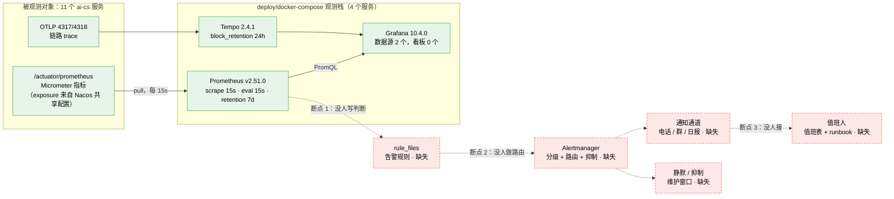
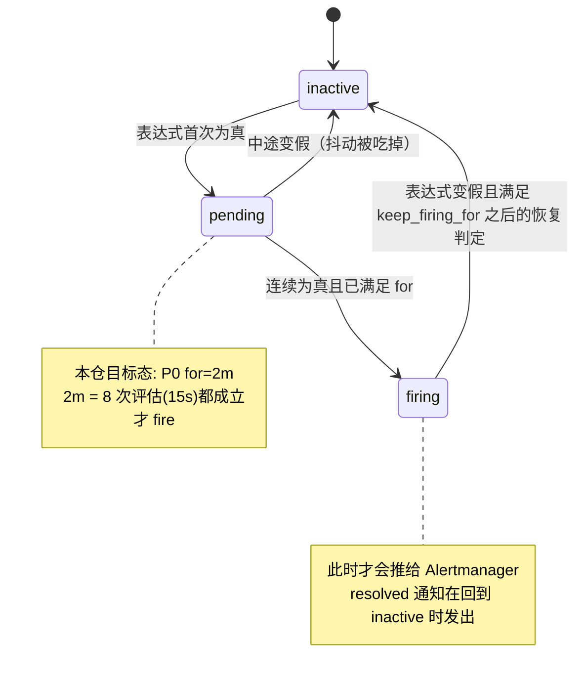
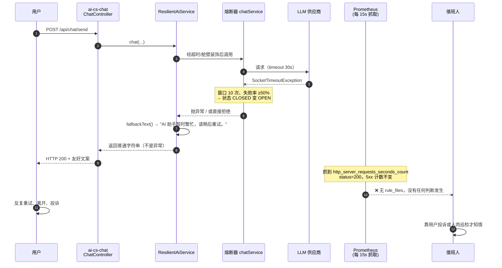
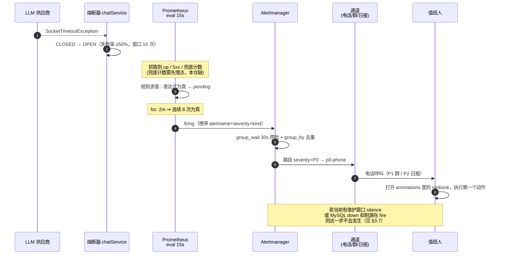

# 告警治理：收到就该动手，收不到就什么都没有

> **一句话结论**：告警的唯一验收标准是「收到就能动手」——不能动手的告警是噪声，比没有告警更糟，因为它会训练人忽略告警；而本仓库现在的处境更极端：**采集链路是通的，判断与通知这两段根本不存在**，所以「告警质量」在这里首先不是优化问题，而是从无到有的问题。
> **阅读前置**：要先读 [01-SLI-SLO与错误预算](./01-SLI-SLO与错误预算.md)（burn rate 的分子分母从那里来）、[05-降级预案与开关治理](./05-降级预案与开关治理.md)（熔断兜底为什么会让指标「看起来没事」）；知道 Prometheus 是 pull 模型、Grafana 只是查询前端即可。
> **证据基线**：Spring Boot 4.2.0 / micrometer-tracing 1.8.0 / OpenTelemetry 1.68.0 / Resilience4j 2.4.0 / Prometheus 2.51.0 / Grafana 10.4.0 / Tempo 2.4.1 / JDK 17.0.19 / Node 24.16.0；本机**无 promtool、无 amtool、无 Docker、不许联网**；证据 A 1 条（源码摘录锚点）· B 13 条（13 个真实文件、36 处行号引用）· C 3 组（2 个 node 静态自检脚本的真实输出 + pwsh 实测计数）；预计阅读 40 分钟。

## 证据边界

告警这条链路上，本仓库「有」和「没有」的差距极大，先把边界钉死，避免把「配了抓取」读成「有告警」。

| 类别 | 本仓状态 | 本篇怎么处理 |
|---|---|---|
| 指标采集（Prometheus 抓取） | ✅ 已入库：`deploy/observability/prometheus.yml` 24 行，11 个 target、`scrape_interval: 15s` | 直接引行号，逐段精读 |
| 告警规则（rule_files） | ❌ 未入库：该文件全文没有 `rule_files`，`deploy` 目录里 `alerting:` 零命中 | 只给目标态 YAML，明确标「未落地」 |
| Alertmanager（判断→路由） | ❌ 未入库：`deploy/docker-compose/docker-compose-observability.yml` 只有 prometheus/grafana/tempo/otel-collector 四个服务 | 讲清它该放在哪、路由怎么写，不假装已跑 |
| 通知通道（电话/群/日报） | ❌ 未入库：668 个 Java 文件里 `钉钉|企业微信|飞书|webhook|短信` 零命中 | 只给 webhook 接收端占位地址 |
| Grafana 看板 | ❌ 未入库：`provisioning` 下只有 `datasources/datasources.yaml`，无 dashboards、`deploy` 下无任何看板 JSON | 更正旧稿「Grafana 能看图」的说法 |
| 业务指标埋点 | ❌ 未入库：`MeterRegistry` / `Timer.builder` / `Counter.builder` 命中 0 | 讲清「没有分子就写不出规则」 |
| 值班表 / runbook | ❌ 未入库：见 [08-oncall手册与故障响应](./08-oncall手册与故障响应.md) 开头的自述 | 告警的「谁来动手」一律外链 08 篇 |
| 本机可执行性 | ✅ node 24.16.0 / pwsh / JDK 17.0.19；❌ 无 promtool、不许启动服务 | C 级只做**文本层**静态自检，并把「为什么不能代替 promtool」写清 |

> 全文一个原则：**凡是本仓没有的东西，一律写成「目标态 + 验收判据」，不写成「已实现」。**

---

## 0. 先看现象

### 现象一：想知道「昨晚 chat 到底挂没挂」，仓库里找不到任何会自动叫人的东西

把整份抓取配置读完，你会发现它只回答「抓谁」，不回答「抓到什么算坏」：

```yaml
# deploy/observability/prometheus.yml（全文 24 行，此处为 1-10 行）
# Prometheus 抓取配置：所有 ai-cs-* 服务统一暴露 /actuator/prometheus
global:
  scrape_interval: 15s
  evaluation_interval: 15s

scrape_configs:
  # 主机部署（tools/start-app.ps1）场景：服务全在 localhost
  - job_name: 'ai-cs-services'
    metrics_path: '/actuator/prometheus'
```

全文 24 行里没有 `rule_files:`，也没有 `alerting:`。再对整个 `deploy` 目录求证一遍：

```powershell
PS> Get-ChildItem -Recurse -File deploy | Select-String -Pattern 'alertmanager|rule_files|alerting:'
PS>
```

零命中。这不是「规则写错了」，是**规则这一层根本还没有**。`evaluation_interval: 15s` 在这里是个孤儿配置：没有规则文件，它每 15 秒评估的是一份空清单。

### 现象二：运维巡检脚本检查 12 个端口，监控栈一个都不在里面

`deploy/scripts/check-local.ps1` 是仓库里唯一「会主动判断好坏」的脚本，它的端口清单长这样：

```powershell
# deploy/scripts/check-local.ps1 L97-L110
$Ports = @(
    @{ Port = 3306;  Label = 'MySQL' }
    @{ Port = 6379;  Label = 'Redis' }
    @{ Port = 8848;  Label = 'Nacos HTTP' }
    @{ Port = 9200;  Label = 'Elasticsearch' }
    @{ Port = 9876;  Label = 'RocketMQ Namesrv' }
    @{ Port = 10911; Label = 'RocketMQ Broker' }
    @{ Port = 9000;  Label = 'MinIO API' }
    @{ Port = 27017; Label = 'MongoDB' }
    @{ Port = 8000;  Label = 'Chroma' }
    @{ Port = 7474;  Label = 'Neo4j HTTP' }
    @{ Port = 8099;  Label = 'XXL-Job Admin' }
    @{ Port = 8858;  Label = 'Sentinel Dashboard' }
)
```

9090（Prometheus）、3000（Grafana）、3200（Tempo）、4318（OTLP HTTP）一个都没有，容器清单（同文件 L82-L95）也止步于 `aics-sentinel-dashboard`。**连巡检脚本都不认为监控栈是被保障对象**——这是一条非常硬的旁证：监控在本项目里是「学习时开起来看一眼」的东西，不是「挂了要修」的东西。

### 现象三：真实缺陷是被人工点出来的，不是被信号叫出来的

仓库里最严重的一次权限缺陷，记录在 `docs/29-用户接口输入校验与E2E测试.md`：

```text
L43: 资料更新白名单：即使请求夹带 `role=admin/status=0/deleted=1`，数据库中的用户名、密码、角色、状态和删除标记保持不变。
L55: 6. E2E 复现普通用户在更新昵称时夹带 `role=admin` 后真实提权；通用资料更新现显式清除账号安全字段……
```

一次**真实提权**，靠人写 E2E 用例才被发现。`docs/28-故障案例库.md` 里的 C1~C4（事务自调用失效、从库复制过滤漏订单库、`pay.sandbox` 死配置、K8s 清单缺 3 个服务）同样全是「人发现了才写下来」。这四类故障里有三类**在指标上都会留下痕迹**（订单创建成功率、从库延迟、Pod 数不一致），但没有任何一条规则去盯。

### 这些现象的共性一句话

这些现象指向同一件事：**这条链路「采得到、存得下、查得出」，但「判断」和「叫人」两段是空的**——所以本仓库现在的告警能力不是「准不准」的问题，而是「有没有」的问题；也正因为如此，先做 3 条能动手的规则，收益远大于先把指标体系做完美。

---

## 1. 整体地图



**读图说明**：绿色是实现存在的一段，红色虚线是缺失的一段。左半边（绿）说明「数据从服务流到 Prometheus 再到 Grafana/Tempo」这条**查询链路是完整的**——这就是为什么很多人会误以为「我们有监控」；右半边（红）是「数据变成判断、判断变成动作」的三段，全部为空。图里刻意把 `SILENCE` 也标红：静默与抑制是 Alertmanager 的能力，没有 Alertmanager 就谈不上维护窗口，而「维护窗口」恰恰是防止告警疲劳的第一道闸。顺着箭头读，你可以看出**整篇要补的东西全部堆在红色区域**，而且顺序必须是 规则 → 路由 → 通道 → 人：缺 规则 时后面三项都没输入，缺 通道 时前面三项全白做。

| 组件 | 责任（一句话） | 本仓落点 | 状态 |
|---|---|---|---|
| Actuator `/actuator/prometheus` | 把 JVM/HTTP/连接池指标以 OpenMetrics 暴露 | `tools/nacos-config/aics-shared.yml` L26-L38 统一开 `exposure.include` | ✅ 有 |
| Prometheus | 定时抓取 + 存时序 + 按规则求值 | `deploy/observability/prometheus.yml`（抓取）、`deploy/docker-compose/docker-compose-observability.yml` L20-L31（容器） | ✅ 有（仅抓取） |
| 规则求值 | 把 PromQL 变成「有状态的事件」 | 无 | ❌ 缺 |
| Alertmanager | 去重/分组/抑制/静默/路由/重发 | 无 | ❌ 缺 |
| 通知通道 | 把事件送到人手上（电话/IM/日报） | 无（`webhook` 字样零命中） | ❌ 缺 |
| Grafana | 人主动去看（**不是告警**） | `deploy/observability/grafana/provisioning/datasources/datasources.yaml` | ⚠️ 只有数据源 |
| 值班与 runbook | 决定「谁来动手、按什么动」 | 无，见 [08-oncall手册与故障响应](./08-oncall手册与故障响应.md) | ❌ 缺 |

---

## 2. 关键概念与关键要素

| 名称 | 位置（本仓真实落点） | 作用 | 关键参数 |
|---|---|---|---|
| **scrape_interval** | `deploy/observability/prometheus.yml` L3 = `15s` | 多久拉一次指标（决定分母粒度） | 越小越贵；「瞬时告警」最多滞后一个间隔 |
| **evaluation_interval** | 同文件 L4 = `15s` | 多久**评估一次规则**（不是多久通知一次） | 与 `for` 共同决定「多久才真的 fire」 |
| **`for:`** | 规则字段（本仓无规则文件，目标态） | 持续满足多久才从 pending 变 firing | 抖动抑制的第一手段，比调阈值更有效 |
| **rule_files** | 目标态：`prometheus.yml` 顶层新段 | 告诉 Prometheus 去哪读规则 | 未配置 = 规则一条都不会加载 |
| **alerting / alertmanagers** | 目标态：`prometheus.yml` 顶层新段 | 告诉 Prometheus 把 firing 推给谁 | 未配置 = 规则能 fire 但发不出去 |
| **Alertmanager 路由 route** | 目标态：Alertmanager 配置 | 按 label 决定「谁收到、多快收到、多久重发」 | `group_by` / `group_wait` / `group_interval` / `repeat_interval` |
| **抑制 inhibition** | 目标态 | 上游坏了就压掉下游的衍生告警 | `source_matchers` / `target_matchers` / `equal` |
| **静默 silence** | 目标态 | 人为在时间窗口内屏蔽某批告警 | 起止时间 + matchers，**会过期，必须有人负责摘** |
| **burn rate（燃烧率）** | 概念来自 [01-SLI-SLO与错误预算](./01-SLI-SLO与错误预算.md) | 当前错误率是「可持续速率」的几倍 | 多窗口组合 14.4 / 6 / 3 |
| **exposure.include** | `tools/nacos-config/aics-shared.yml` L32 = `health,info,prometheus` | 决定 `/actuator/prometheus` 是否存在 | 全仓**唯一**一处；服务若读不到这份配置，指标端点直接 404 |
| **metrics.tags.application** | 同文件 L36-L38 | 给所有指标打 `application` 标签 | 多服务共用一个 job 时，靠它区分是谁 |
| **resilience4j 熔断参数** | `ai-cs-chat/src/main/resources/application.yml` L106-L148 | 熔断打开的判定口径 | `sliding-window-size: 10`、`failure-rate-threshold: 50`、`wait-duration-in-open-state: 30s` |

术语首现解释，避免后面靠猜：

- **症状告警（symptom alert）**：用户能感知到的坏结果，例如「某实例抓不到了」「5xx 占比飙升」「首字延迟变长」。判据是**不用懂内部结构就能判断严重程度**。
- **原因告警（cause alert）**：内部某个部件坏了，例如「熔断器打开」「线程池打满」「从库延迟」。它对定位极有价值，但**严重程度取决于它有没有变成症状**。
- **预算告警（budget alert）**：不问「现在坏没坏」，而问「按当前烧钱速度，这个月的可靠性预算会不会提前烧光」。它的时间尺度是小时到天，因此**天然不 P0**。
- **告警疲劳（alert fatigue）**：人对告警的响应概率随噪声上升而下降的现象。量化它的最小指标体系见 §3.4。

---

## 3. 原理与证据逐段精读

### 3.1 采集段：`exposure` 是总闸，`targets` 是名单，两者缺一就全盘皆错

**在干什么**：让 11 个服务各自的 `/actuator/prometheus` 存在，并让 Prometheus 按名单去拉。前者由 Nacos 共享配置统一打开，后者由抓取配置的 `static_configs` 列出。

```yaml
# tools/nacos-config/aics-shared.yml L26-L38（全仓唯一一处 exposure 配置）
# ===== 可观测性：Actuator 端点 + Prometheus 指标（所有服务统一暴露） =====
# 抓取端点：http://{host}:{port}/actuator/prometheus（见 deploy/observability/prometheus.yml）
management:
  endpoints:
    web:
      exposure:
        include: health,info,prometheus
  endpoint:
    health:
      show-details: never
  metrics:
    tags:
      application: ${spring.application.name}
```

**为什么这么设计**：Actuator 默认只暴露 `health`，`prometheus` 端点必须显式 `include`——这是安全默认值（指标里可能含内部拓扑信息）。把它放在 Nacos 共享配置里，是为了「改一处、全部服务生效」，而不是让 11 个 `application.yml` 各写一遍。`metrics.tags.application` 同理：`prometheus.yml` 里 11 个 target 共用同一个 `job_name: 'ai-cs-services'`，如果没有 `application` 标签，你抓到 11 份无法区分来源的序列，规则里连 `sum by (application)` 都写不出来。

**换写法会怎样**：如果只在各服务自己的 `application.yml` 写 `exposure.include`，一旦某个服务漏写，它在 Prometheus 里就会变成 `up=0` 或抓取 404——而 `up=0` 的告警会把「配置漏写」误报成「服务挂了」，把排查引到错误方向。反过来，如果把 11 个 target 拆成 11 个 job，`up` 会变成 11 条独立序列、11 个独立告警，grouping 的压缩比直接掉到 1:1（§3.6 会算这笔账）。

**常见坑**：`application.yml` 的本地配置里没有这份 `management` 段（已核对：全仓 `exposure` 只出现在 `tools/nacos-config/aics-shared.yml` 与其镜像 `tools/nacos/data/tenant-config-data/aics/DEFAULT_GROUP/aics-shared.yml`）。也就是说**服务如果脱离 Nacos 单机启动，`/actuator/prometheus` 大概率 404**，此时 Prometheus 的 `up` 仍是 1（HTTP 200 之外的状态也会被记为 up=0，但 404 具体表现为抓取失败），你会看到「服务明明在跑，指标却是空的」。§6.1 给定位命令。

### 3.2 `evaluation_interval` 是「判断频率」，不是「通知频率」

**在干什么**：`global` 段里 `scrape_interval: 15s`（拉数据）和 `evaluation_interval: 15s`（跑规则）是两个独立时钟。前者决定你**能看到多细**，后者决定你**多久判一次**。

**为什么这么设计**：抓取和判断分离，才能在一份数据上跑很多规则而不重复拉数据；也让「新加一条规则」不必改动抓取节奏。两者都设成 15s 是学习环境的省事选择——真实环境里 `evaluation_interval` 常常比 `scrape_interval` 大（例如抓 15s、判 1m），因为规则的表达式开销按规则条数×评估次数增长。

**换写法会怎样**：如果以为 `evaluation_interval: 15s` 就是「每 15 秒会通知一次」，你会把 `repeat_interval` 设成 `15s` 来「对齐」——结果是同一条故障每 15 秒推一次，一晚 5760 条，这是最典型的自造告警风暴。正确的心智模型是三层时钟：**抓取（15s）→ 评估（15s）+ `for`（去抖）→ 通知（`group_wait` / `group_interval` / `repeat_interval`）**。

**常见坑**：`evaluation_interval` 配了但没有 `rule_files`，它就是个空转的配置项。C 级算术给你一个量级感（`node` 实算，见 §3.9）：

```text
evaluation_interval=15s -> 每条规则每天评估 5760 次
若 repeat_interval=4h，则一条持续告警每天最多提醒 6 次
```

**判读**：5760 是**评估**次数，6 是**打扰人的**次数——两者差 960 倍。凡是把这两个数混为一谈的告警配置，都会在第一次真实故障时把人吵到关通知。

### 3.3 先告症状：三类告警的排序不是风格问题，是正确性问题

**在干什么**：把「坏结果」「坏部件」「坏趋势」分成三类，并规定**只有第一类可以叫醒人**。

| 类型 | 例子（本仓可写） | 判据 | 默认级别 | 为什么这么排 |
|---|---|---|---|---|
| **症状** | `up{job="ai-cs-services"} == 0`（实例抓不到）；5xx 占比超预算 | 用户已经受损，且不需要内部知识就能判严重度 | P0 | **唯一可以 P0 的类型**：它直接对应「用户现在是不是不能用」 |
| **原因** | 熔断器 `state="open"`、线程池队列满、从库延迟 | 部件坏了，但可能已被降级吸收 | P1/P2 | 原因告警可以是「同一个症状」的 5 个不同原因，全 P0 就是 5 倍噪声 |
| **预算** | 1h 窗口燃烧率 > 14.4 倍、7 天预算消耗 > 50% | 现在可能没坏，但趋势要求你排期 | P1/P2 | 它有「提前量」，本来就不该打断睡眠 |

**为什么这么设计**：一次真实故障里，「原因」通常有多个（LLM 超时 → 熔断打开 → 兜底 → 队列积压），而「症状」通常只有一个（用户用不了）。如果按原因分级，你会为一次故障收到 5 条 P0；如果按症状分级，你只收到 1 条，剩下的原因告警在抑制树（§3.7）里被压掉，故障恢复后再去面板上看。这就是「永远先告症状」的全部理由：**症状的数量天然被收敛，原因的数量天然发散**。

**换写法会怎样**：全按原因告警，最常见的后果是「告警全绿但用户在投诉」——因为所有原因都没触发，但它们的组合已经让用户不可用（典型是超时叠加：每个下游都只慢了一点，没有一条原因告警达标）。反过来，只告症状、完全不做原因告警，你会失去定位线索，排查时间变长——所以正确做法不是删掉原因告警，而是**给原因告警降级 + 让症状告警抑制它**。

**常见坑**：把「熔断器打开」当 P0。看本仓的熔断参数：`ai-cs-chat/src/main/resources/application.yml` L106-L148 三个实例（`chatService`/`sseChatService`/`visionService`）都是 `sliding-window-size: 10`、`failure-rate-threshold: 50`、`wait-duration-in-open-state: 30s`——**10 次调用里失败 50% 就打开，30 秒后自动进半开**。这种「30 秒自愈」的部件状态如果 P0 叫人，你会被它反复戳醒；它该是 P1 的定位线索，而不是叫醒人的理由。

### 3.4 本篇最反直觉的一段：本仓的 5xx 指标**不能**直接当告警分子

**在干什么**：这一节把「写一条 5xx 比例的告警」这个看似显然的动作，拆到本仓真实代码上，结论是：**你会漏报，而且漏得很彻底**。

先看熔断兜底的行为。Spring Cloud 熔断抽象的兜底只有一处落点——`getAndApplyFallback`，任何 `Throwable` 都吞进去交给 fallback：

```java
// 摘录自 learning-docs/24-源码分析/assets/source/Resilience4JCircuitBreaker.java.md（代码原行号 143-159）
private static <T> T getAndApplyFallback(Supplier<T> supplier, Function<@Nullable Throwable, T> fallback) {
    try {
        return supplier.get();
    }
    catch (Throwable t) {
        return fallback.apply(t);
    }
}
```

[[源码:Resilience4JCircuitBreaker.java.md#L143-L159]]

再看本仓给的 fallback 是什么——**一段普通字符串，不是异常**：

```java
// ai-cs-chat/src/main/java/com/aics/chat/service/impl/ResilientAiService.java L447-L456
/**
 * 兜底文案：所有模型都失败时的降级响应。
 * 学习点：SUMMARY 场景返回空串而非提示文案，因为摘要结果会直接拼入上下文，文案会污染后续对话
 */
private String fallbackText(ModelScenario scenario) {
    if (scenario == ModelScenario.SUMMARY) {
        return ""; // 摘要场景：返回空串，避免文案被拼入上下文污染后续对话
    }
    return "AI 助手暂时繁忙，请稍后重试。"; // 普通场景：返回友好提示文案给前端展示
}
```

**为什么这么设计**：从产品角度这是对的——用户看到的是一句友好提示，而不是 500 白页；从稳定性角度这也是对的——一次 LLM 超时不该让整个对话接口失败。**但这两个「对」叠在一起，把告警的分子吃掉了**：LLM 全挂时，chat 的请求仍然以正常业务响应返回（兜底文案），HTTP 层不是 5xx，`http_server_requests_seconds_count{status=~"5.."}` 一条都不会增加。

**换写法会怎样**：如果你的规则只盯 5xx 比例，那么「LLM 供应商挂了 20 分钟、所有用户都在收到『暂时繁忙』」这件事对告警系统是**完全隐形**的。这正是为什么要先告症状——症状要从**用户视角**定义（用户是否拿到了有效答案），而不是从**协议视角**定义（HTTP 是不是 200）。可行的两条补法：

1. **换分子**：给「兜底触发」埋一个计数器（本仓目前没有，`MeterRegistry` 命中 0），规则写 `rate(aics_chat_fallback_total[5m]) > 0`。
2. **换信号**：把熔断器状态作为原因告警补上（`state="open"` 持续 > 1m → P1），以它代替 5xx 去指认「LLM 侧坏了」。

**常见坑**：这条也解释了 `QuotaService` 为什么必须 fail-open，以及它为什么天然不可见。看代码：

```java
// ai-cs-chat/src/main/java/com/aics/chat/observability/QuotaService.java L72-L80
} catch (Exception e) {
    // 配额检查是成本治理而非安全门禁：宁可多花一点钱，
    // 也不能让配额服务抖动导致整个客服系统不可用
    log.warn("配额检查失败，按未超限降级: userId={}, scenario={}, err={}",
            userId, scenario, e.getMessage());
    return QuotaCheckResult.notExceeded();
}
```

配额检查失败 → 打一条 WARN → 当作没超限放行。**用户零感知，指标零变化，日志里只有一行 WARN**。「配额服务坏了」这件事在告警系统里同样隐形，而它的后果是成本失控。这类「被刻意设计成静默降级」的点，是告警设计里最容易被漏掉的：**降级越优雅，越需要专门为它配一条告警**，因为优雅降级的定义就是「不让问题可见」。

### 3.5 阈值告警 / 同环比 / 多窗口 burn rate：三者不是替代关系，是不同时间尺度

**在干什么**：三种把「一条曲线」变成「一个事件」的手段。

| 手段 | 表达式形态 | 强在哪 | 死在哪 | 本仓可用性 |
|---|---|---|---|---|
| **静态阈值** | `expr > 1000` | 简单、可解释、易审 | 阈值靠拍脑袋；业务量涨一倍就误报；对「缓慢劣化」无感 | ✅ 可立即用（`up`、内存、线程池） |
| **同环比** | `expr / expr offset 1d > 1.5` | 自适应业务周期（客服夜间低峰） | 昨天也坏时看不出；周同比要 7 天数据，**本仓 retention 只有 7d**（`docker-compose-observability.yml` L30 `--storage.tsdb.retention.time=7d`） | ⚠️ 勉强（最多日同比） |
| **多窗口 burn rate** | 长窗 + 短窗双条件 | 与 SLO 直接挂钩；既快又稳；两个告警消耗的预算是**算得出来的** | 需要 SLO 与错误预算存在，而本仓**没有 SLO 文档** | ❌ 需先补 SLO（见 01 篇） |

多窗口 burn rate 的经典三档，`node` 实算如下（预算按 30 天 99% 举例，**仅演示算术，不是本仓 SLO**）：

```text
5m + 1h 双窗口(长窗 1h): 阈值 14.4 x 0.01 = 0.1440 (即错误率 14.4%) | 以该速率持续 1h 消耗总预算 2.00%
30m + 6h 双窗口(长窗 6h): 阈值 6 x 0.01 = 0.0600 (即错误率 6.0%) | 以该速率持续 6h 消耗总预算 5.00%
2h + 1d 双窗口(长窗 1d): 阈值 3 x 0.01 = 0.0300 (即错误率 3.0%) | 以该速率持续 24h 消耗总预算 10.00%
```

**怎么读**：三行的「消耗总预算」分别是 2% / 5% / 10%——这是这套数字之所以长这样的唯一原因：**每一档都只想让一次真实故障消耗掉总预算的一个零头**，所以快档（1h 内烧 2%）可以 P0，慢档（一天烧 10%）只配 P1/P2。这也给了你一个判断「我的阈值是不是拍脑袋」的硬标准：**你能说出这条规则触发一次，最多允许烧掉多少预算吗？** 说不出来，就还是拍脑袋。

**换写法会怎样**：把三档压成一档静态阈值（例如「错误率 > 5% 报警」），会出现两种坏结果——短促尖峰（1 分钟 50% 错误）把人叫醒但实际只烧掉 0.03% 预算；而「每天稳定 4% 错误」这种真正烧预算的情形永远不触发。

**一条可以抄的完整规则（C 级：逐子句注释）**。下面这条就是 §6.2 自检脚本里被实际校验过的**同一段表达式**（脚本里的注释文字更短，因为它会先剥掉 `#` 之后的内容再校验括号与窗口，所以注释长短不影响判定）；`#` 是 PromQL 的注释符，`#` 之后到行尾不参与求值：

```promql
# AiCsHttp5xxBudgetBurn1h（P1）: 30 天 99% 预算下, 1 小时烧掉 2% 预算就通知
(
  sum(rate(http_server_requests_seconds_count{job="ai-cs-services",status=~"5.."}[5m]))   # 分子: 只用 job 圈定本仓 11 个 target 的 5xx 请求数
  / sum(rate(http_server_requests_seconds_count{job="ai-cs-services"}[5m]))               # 分母: 同一批 target 的全部请求数(含 2xx/3xx/4xx)
  > 14.4 * 0.01                                                                           # 14.4 倍速 x 1% 预算 = 错误率 14.4%(见上表)
)
and                                                                                       # and: 短窗与长窗必须同时成立, 任一不成立则不 fire
(
  sum(rate(http_server_requests_seconds_count{job="ai-cs-services",status=~"5.."}[1h]))   # 长窗分子: 1h 内的 5xx(平滑掉尖峰)
  / sum(rate(http_server_requests_seconds_count{job="ai-cs-services"}[1h]))
  > 14.4 * 0.01                                                                           # 长窗阈值与短窗相同, 变的是时间尺度
)
```

**怎么读**：沿求值顺序读四件事——① `sum(...)` 先把 11 个 `instance` 聚合掉，否则每个实例各报一条（§3.11 的身份问题）；② `rate(...[5m])` 的 `[5m]` 是**区间选择器**，必须在方括号里，写成 `rate(x, 5m)` 是错的，`[5m]` 在 15s 抓取下等于 20 个样本（脚本第 2 段实算）；③ `> 14.4 * 0.01` 而不是直接写 `0.144`，是为了让「倍速 × 预算」的意图留在表达式里、可被 review；④ 外层 `and` 是集合运算，两侧结果按 label 集合取交集，所以两侧的 `sum()` 必须**聚合到同一组 label**（这里都是空 label 集合，聚成全站一个值），否则交集为空、规则永远不 fire——这是双窗口规则最常见的写错方式。

**本仓警告**：这条规则在本仓**目前不能用**，因为分子 `status=~"5.."` 会被熔断兜底吃掉（§3.4 已用源码证明）。它的价值是结构示范：把分子换成 `aics_chat_fallback_total`（需先埋点）后，其余子句一字不改即可上线。

**常见坑**：长窗超过 retention。本仓 Prometheus `retention 7d`（`docker-compose-observability.yml` L30），任何「30 天预算」类表达式都**拿不到 30 天原始数据**；Tempo 的 `block_retention: 24h`（`deploy/observability/tempo.yaml` L19）更狠，链路只留一天，出事后第二天再查就没了。要在 7d 保留期上做 30 天预算，必须加 recording rule 把「预算累计」落成一条长期序列（目标态，本仓未落地）。

### 3.6 分级与路由：级别不是标签，是「打扰方式」的编码

**在干什么**：把「严重度」翻译成「用什么手段、多久重发、谁收到」。

| 级别 | 判据 | 打扰方式 | `group_wait` | `repeat_interval` | 响应要求 |
|---|---|---|---|---|---|
| **P0** | 用户已全面不可用，且无自动恢复可能 | **电话/短信**（能穿透睡眠） | 10s（要快） | 30m（没响应就再推） | 立即，5~15 分钟内必须有动作 |
| **P1** | 用户部分受损或有自动降级兜着 | **IM 群**（工作时间 5 分钟内看到） | 30s | 4h | 当班处理，超时升级 |
| **P2** | 无用户影响 / 趋势类 | **日报/工单**（不打扰） | 5m | 24h | 排期处理 |
| **Info** | 纯记录 | 只入库，不通知 | — | — | 无人 |

**为什么这么设计**：`group_wait` 和 `repeat_interval` 是为级别服务的两个旋钮——P0 要「快而勤」，P1 要「合并后一次说清」，P2 要「安静地进日报」。级别的真正含义不是「严重程度形容词」，而是**这套骚扰参数**。这也解释了为什么「所有告警都 P1」等于「所有告警都没有级别」。

**换写法会怎样**：全用 IM 群（没有电话通道），P0 在深夜就退化成 P2——没人看群。反过来全用电话，P2 的趋势告警会把人叫到麻木，然后 P0 也被忽略，这就是「狼来了」的工程版。

**常见坑**：路由里引用了不存在的 receiver 名字。这类错误在 `promtool`/`amtool` 会直接报，但本机两者都没有（实测 `promtool -> NOT FOUND`、`amtool -> NOT FOUND`），所以本仓写路由时用 C 级静态自检顶一部分：§3.9 的自检脚本会逐个核对 `receiver:` 引用的名字是否在 `receivers:` 里定义，以及 P0/P1/P2 是否**每一级都有落点**（有产出无去处 = 断链）。

### 3.7 静默与抑制：让「已知的坏」不打扰，但别让「未知的坏」也被吞掉

**在干什么**：两个方向相反的动作。

| 机制 | 谁发起 | 作用范围 | 生命周期 | 典型用途 |
|---|---|---|---|---|
| **抑制 inhibition** | 规则（自动） | 一组 matcher 之间 | 持续生效，随源告警消失自动解除 | 上游坏了，压掉下游衍生的 N 条 |
| **静默 silence** | 人（手动） | 一组 matcher | **有起止时间，会过期** | 计划内维护、演练、已知在修 |

**抑制树怎么画**：一次「MySQL 主库宕机」会同时点亮：11 个服务的 5xx 告警、连接池耗尽告警、订单创建失败告警…… 树是这样的：

```text
MySQL down（source，P0 症状）
 ├─ 抑制 → 所有 instance 的 5xx 告警（下游衍生）
 ├─ 抑制 → 连接池耗尽告警（下游衍生）
 └─ 抑制 → 订单创建失败率告警（下游衍生）

LLM 供应商超时（source，原因告警 P1）
 ├─ 抑制 → chat 熔断打开告警（同一个根的衍生）
 └─ 抑制 → 兜底触发量告警（同一个根的衍生）
```

**读图说明**：抑制的语义是「只要 source 还在 fire，就**不要**通知 target」——注意它不删除 target，恢复后仍能在面板上看到那段历史。`equal` 字段决定「按哪个 label 对齐」（例如按 `instance` 对齐，则只有同一个实例的下游告警被压）。这张树的意义是：故障时你只收到**一个** P0（「MySQL down」），而不是 15 条「XX 失败」，从而能一眼看出根在哪。

**静默的正确姿势**：维护窗口前先算好**这一次维护会让哪些规则满足条件**，把这些规则静默掉，而不是「把整个群静音」。并且必须配一条「静默到期提醒」——否则最常见的事故是：静默设了 7 天，第 2 天出真故障，没人收到告警。

**静默与抑制的区别一句话**：抑制是「因为 A 坏了，所以 B 的告警没有信息量」；静默是「我知道现在会坏，别吵我」。前者是逻辑，后者是人的承诺。

**常见坑**：用静默代替修复。维护窗口结束忘了摘，或把静默时长设成「一周」，等于给自己装了个哑巴——而**哑巴比没有告警更危险**。

### 3.8 告警内容模板：四段式，缺一段就等于把排查成本转给被叫醒的人

**在干什么**：把一条告警写成「不用查文档就能动手」的四段话。

| 段落 | 回答的问题 | 落在哪个字段 | 反例 |
|---|---|---|---|
| **是什么** | 哪个规则、哪条曲线、多严重 | `annotations.summary`（模板变量 `{{ $labels.instance }}`） | 「CPU 高」（哪个服务？多高？） |
| **影响谁** | 用户受损面：全站/单实例/某个场景 | `labels.impact` + `annotations.description` | 「实例挂了一个」（用户有感知吗？） |
| **看哪里** | 立刻要打开的 1~2 个链接 | `annotations.dashboard` / `annotations.trace_query` | 「去看 Grafana」（看哪个面板？本仓连看板都没有） |
| **先做什么** | 第一条命令或第一个决定 | `annotations.runbook` | 「联系运维」（联系谁？） |

可直接套用的最小模板（**目标态**，本仓未落地）：

```yaml
# 告警内容模板（四段式）— 目标态，未落地
- alert: AiCsServiceDown
  expr: up{job="ai-cs-services"} == 0
  for: 2m
  labels:
    severity: P0
    impact: "该实例的全部用户请求已不可用"
  annotations:
    summary: "{{ $labels.application }} ({{ $labels.instance }}) 已 2 分钟抓不到"
    description: "症状告警：Prometheus 连续 2 分钟抓不到 /actuator/prometheus。可能原因：进程退出、
      网络不通、或 exposure.include 被覆盖（见 tools/nacos-config/aics-shared.yml L28-L32）。"
    dashboard: "http://127.0.0.1:3000/explore?query=up{job=\"ai-cs-services\"}"
    runbook: "deploy/scripts/check-local.ps1 先跑一遍端口层，再看容器是否重启"
```

**为什么这么设计**：告警内容的质量直接决定「可行动率」（§3.9 的指标）。凌晨三点被叫醒的人不会去读文档，他只会读告警正文。四段式是**把人脑的第一次决策路径写进载荷**：判断严重度（是什么）→ 判断要不要现在动手（影响谁）→ 定位（看哪里）→ 执行（先做什么）。

**换写法会怎样**：只给 `summary` 一条「服务异常」，被叫醒的人第一步是打开电脑翻面板——这段时间就是**你的 MTTR 里最贵的一段**，而它是纯人工成本，与故障难度无关。

**常见坑**：`annotations` 里塞了高基数字段（用户 ID、请求 ID）。Alertmanager 会把 label 组合作为分组键，高基数直接导致「每条告警都是独立一组」→ grouping 失效 → 一次故障几十条。**规则：能进 label 的只有低基数维度（application、instance、severity、kind），高基数的东西进日志和 trace，不进告警。**

### 3.9 质量指标与疲劳量化：没有这四个数，你无法判断告警系统在变好还是变坏

**在干什么**：把「告警准不准」变成可计算量。

| 指标 | 定义 | 怎么算（本仓可执行路径） | 健康线（经验，非本仓实测） |
|---|---|---|---|
| **准确率 / 精确率** | 触发中真的需要动手的比例 | 人工标注最近 N 条告警 | 越高越好；< 50% 说明噪声为主 |
| **召回** | 真实故障中被告警提前发现的占比 | 用 `docs/28-故障案例库.md` 的 C1~C4 回放 | 这是最容易被忽略的一维 |
| **可行动率** | 收到后能立刻做某个动作的比例 | 逐条问「这条告警我的第一个动作是什么」 | 答不出的就该删 |
| **重复率** | 同一根因产生的告警条数 / 根因数 | group 前后对比条数 | 接近 1 才好 |
| **疲劳度（代理指标）** | 每人每班被打扰次数 | 通知条数 ÷ 值班人数 | 半夜被叫醒 > 1 次/周就要动手治理 |

C 级算术（`node` 实算，纯算术不是生产数据）：

```text
prometheus.yml 里 static target = 11 个；逐个发通知 = 11 条/轮
加 group_by: [alertname, severity] 后同一轮 = 1 条（压缩比 11:1）
evaluation_interval=15s -> 每条规则每天评估 5760 次
若 repeat_interval=4h，则一条持续告警每天最多提醒 6 次
准确率 = 真实故障触发数 / 总触发数（未接生产告警，只给公式不给数字）
```

**怎么读**：`11:1` 这个压缩比是 `group_by` 的全部价值——注意本仓 `prometheus.yml` 的 11 个 target 共用同一个 `job`，一旦某台宿主机网络抖动导致 11 个 target 同时 `up=0`，不做分组就是 11 条通知，做了分组就是 1 条「11 个实例都挂了」。最后一行是**拒绝编造**：本仓从未接入过真实告警，任何准确率/召回数字都只能是编的，所以这里只留公式。

**换写法会怎样**：只看「告警条数」这一个数字，你会把「合并成一条」误读成「问题变少了」。必须同时看「打扰次数」和「召回」——条数下降但召回也下降，说明你把该报的也关掉了。

**常见坑**：拿评估次数当告警次数（见 §3.2），于是把疲劳度算大了 960 倍，然后得出「必须把阈值调高」的错误结论。

### 3.10 告警是个状态机：`inactive → pending → firing` 三段各有各的坑

**在干什么**：一条规则被求值后并不是「布尔值」，而是一个有状态的对象。



**读图说明**：三个状态的语义分别是「没发生」「像要发生」「已确认」。关键在于 `pending → inactive` 这条边：它是**免费的去抖**——表达式在 `for` 期间掉下去一次，计时就清零重来，不需要你写任何额外逻辑。按本仓 `evaluation_interval: 15s` 算，P0 的 `for: 2m` 意味着要连续 8 次评估都为真（§6.2 的算术就是这么来的），所以 **`for` 必须显著大于 `evaluation_interval`，否则它等于没设**。

**为什么这么设计**：把「发现」和「确认」拆成两个状态，才能同时满足两个矛盾需求——想快（短 `for`）和想稳（不被尖峰骗）。如果没有 pending 这一层，任何一次单点抖动都会直接变成一条 P0 电话。

**换写法会怎样**：把去抖放在表达式里写（例如 `avg_over_time(...[5m]) > x`），看起来等价，但代价是把「时间窗」和「判定阈值」搅在一起：窗口拉长会同时钝化上升沿和下降沿，恢复通知也会晚 5 分钟——而 `for` 只影响上升沿，下降沿仍是即时的。**去抖用 `for`，平滑用区间函数，两者不要互相替代。**

**常见坑**：以为 `firing` 就等于「有人收到」。`firing` 只是「Prometheus 认为该通知」，真正的发送在 Alertmanager（`group_wait` 还要再攒一次），再到通道（电话可能还要 30 秒才接通）。**从「指标变坏」到「人被叫醒」是一条四段串联的链路，任何一段缺失都会让前面全白做**——这正是本仓的现状。

### 3.11 label 设计：告警的「身份」由 label 组合决定，写错就无法去重

**在干什么**：Alertmanager 用 `(alertname + 全部 label)` 作为一条告警的身份，`group_by` 决定哪些身份被合并成一条通知。

**为什么这么设计**：身份必须**稳定且低基数**，否则同一个故障每来一次都是新告警（去重失效），或者每个用户都变成一条告警（分组失效）。

**换写法会怎样**：把 `userId`、`traceId`、`conversationId` 放进 label，一条规则就能在高峰期产出成千上万条「不同」的告警，Alertmanager 的分组表会爆，通知里全是无法阅读的长串。

**常见坑**：本仓有一个**正确示范**——`tools/nacos-config/aics-shared.yml` L36-L38 用 `metrics.tags.application: ${spring.application.name}` 给所有指标打上低基数的 `application` 标签。这条配置的价值在告警阶段才显现：11 个 target 共用一个 `job` 时，`sum by (application)` 与 `group_by [application]` 都能正常工作。反面写法是给每个服务单独一个 job 名（`job="chat"`、`job="order"`……），那么「11 个实例里挂 1 个」这种判断就得写 11 条规则。

---

## 4. 一次完整执行时序

### 4.1 现状：一次没有告警参与的故障

下面这张图走的是一条**本仓库真实可能发生、但当前不会产生任何告警**的故障：LLM 供应商侧超时 → 熔断 → 兜底 → 用户收到「暂时繁忙」。它同时画了「应有的链路」（虚线）与「实际发生的链路」（实线）。



**读图说明**：编号 1~7 是**真实发生的**请求路径；8~9 是降级兜底把异常变成文案；10 是 Prometheus 的抓取（它抓到了数据，但抓到的是「一切正常」的 200）；11 是断点——没有规则文件，所以这条数据不会被任何 expression 读到；12~13 是人肉发现。**整张图里没有任何一步会主动叫人**，这就是「采集链路通、告警链路空」的精确形状。注意第 5 步的 `Note`：熔断状态（CLOSED→OPEN）是一个真实发生的状态迁移，它在**当前本仓很可能连指标都没有**（`ai-cs-chat/pom.xml` L119-L131 只引了 `resilience4j-spring-boot4` 与 `resilience4j-timelimiter`，未见 resilience4j 的 micrometer 桥），所以「盯熔断状态」这条规则上线前必须先确认指标是否存在，命令见 §6.3。

| 步骤 | 该看什么 | 怎么判读 |
|---|---|---|
| 3~5 | 应用日志里的 `SocketTimeoutException` 与熔断事件 | 有超时但熔断未打开 → 窗口内失败次数不足（本仓窗口只有 10 次） |
| 6~7 | 响应体是否为兜底文案 | 是兜底文案 → 这是「症状已发生」，不是「没事」 |
| 10 | `http_server_requests_seconds_count{status="200"}` 在涨 | 200 在涨 **不代表** 成功；要结合兜底计数（本仓没有该计数） |
| 11 | `prometheus.yml` 是否有 `rule_files` | 无 → 这一步永久缺失，任何面板都不会变色 |
| 12~13 | 值班人是否收到通知 | 没收到 = 不是「告警没触发」，而是「根本没有告警」 |

### 4.2 目标态：同一个故障在装上「规则 + Alertmanager」之后该长什么样

**这一节全部是目标态，本仓库当前不存在**（`rule_files` 与 Alertmanager 都未入库）。它的作用是给出验收基准：将来接入后，拿这张图逐步对齐，缺哪一步就是缺哪里。



**读图说明**：第 1~2 步与 §4.1 完全相同——**故障的物理过程不因告警而改变**，变的只是「谁会在第几步知道」。第 3 步是新加的一层：Prometheus 只有在有规则文件时才会求值，而 `for: 2m` 把「第 4 步首次为真」和「第 5 步真正推送」拉开 8 次评估（§6.2 用 node 实算了 15s × 8 = 120s）。第 6~8 步是 Alertmanager 的三件事：攒批、分组、路由，缺任何一件都会变成「fire 了但没人收到」。第 9 步是唯一真正解决故障的一步——**前面 8 步全部是「让第 9 步发生得更早」的服务设施**。

| 步骤 | 该怎么判读 |
|---|---|
| 3 | 抓到的必须包含「故障的信号」。若只有 200 计数（本仓现状），那么无论后 8 步做得多好，都不会 fire |
| 4~5 | `for` 太短 → 抖动即 P0；太长 → 恢复时用户已经走完。P0 建议 2m，P2 建议 10m 起 |
| 6 | `group_wait` 是「用延迟换聚合」。P0 用 10~30s，P2 可以 5m |
| 7 | 路由错的表现是「有 fire、无通知」，自查方法是 receiver 交叉引用（§6.7 的第 4 段自检） |
| 8 | 通道是否真的通，只能靠定期**合成告警**验证（未本机实测，本仓无通道可测） |
| 9 | 验收告警写得好不好的唯一标准：**值班人不查文档就能说出第一个命令** |

---

## 5. 设计取舍

| 取舍点 | 选项 A | 选项 B | 本仓推荐与理由 |
|---|---|---|---|
| **症状 vs 原因** | 只告症状（噪声最低，定位线索少） | 症状 + 原因（线索全，噪声高） | **B，但原因告警全部降级并由症状抑制**：本仓熔断 30 秒自愈，原因告警若 P0 会反复吵人 |
| **阈值 vs burn rate** | 静态阈值（今天就能用） | 多窗口 burn rate（需先有 SLO） | **先 A 后 B**：本仓无 SLO 文档（01 篇已核），硬上 burn rate 只会得到一组没人信的数字 |
| **5xx 当分子 vs 换分子** | 直接用 5xx（零成本） | 埋「兜底触发」计数（需改代码） | **A 起步 + B 补洞**：`ResilientAiService#L451-L456` 已证明 5xx 会漏报降级型故障 |
| **P0 通道** | 电话（必达、成本高） | IM 群（免费、可忽略） | **P0 必须能穿透睡眠**，否则级别形同虚设；学习项目可用「手机强提醒 + 电话占位 webhook」过渡 |
| **抑制 vs 静默** | 抑制（自动、逻辑化） | 静默（手动、会过期） | **抑制为主、静默为辅**：静默必须配到期提醒，否则等于自毁告警 |
| **规则放 Prometheus 还是 Grafana** | Prometheus `rule_files`（原生、无状态） | Grafana 告警（UI 好改、状态在 Grafana） | **Prometheus**：告警状态必须与数据同源，本仓 Prometheus 已是唯一数据源 |
| **`group_by` 粒度** | 只按 `alertname`（最粗） | 加 `instance`（细） | **粗粒度优先**：11 个 target 共用一个 job 时，粗粒度天然把「一台挂了」和「全挂了」分开看 |
| **`for:` 时长** | 短（发现快、易抖动） | 长（稳、发现慢） | **按级别分档**：P0 `2m`、P1 `5m`、P2 `10m`，并且必须 > `2 × scrape_interval`（本仓 15s → 至少 30s 才有 2 个样本） |

### 可扩展点清单（每条带验收判据）

1. **补 3 条告警规则**（症状 / 预算或趋势 / 原因）→ 验收：`promtool check rules` 通过（本机无 promtool 时用 §3.9 的 node 自检 + 人工复核），且 `curl http://127.0.0.1:9090/api/v1/rules` 能看到 `health: ok`。
2. **接入 Alertmanager 并做 3 级路由** → 验收：手工 `curl -X POST` 一条伪造告警到 `9093/api/v2/alerts`，P0 走电话占位、P1 走群、P2 只进日报，三者在 4 组自检输出里「有产出且有去处」。
3. **一份四段式告警模板 + 每规则一条 runbook 链接** → 验收：随便抽一条告警，被叫醒的人能在 60 秒内说出「第一个命令是什么」。
4. **抑制树**：MySQL down / LLM 超时 / 宿主机网络 三个 source → 验收：模拟 source 告警后，其下游 target 的通知条数为 0，且 target 仍可见于面板。
5. **维护窗口流程**（静默 + 到期提醒）→ 验收：静默创建后有一条「到期前 30 分钟」提醒；到期后告警自动恢复通知。
6. **补埋点**：`aics_chat_fallback_total`、配额 fail-open 计数 → 验收：`/actuator/prometheus` 里能 grep 到该指标，且它的增长能触发一条 P1 规则。

---

## 6. 踩坑与调试手法

### 6.1 服务明明在跑，Prometheus 里却全是 `up=0`

```powershell
# 1) 先确认指标端点自身是否存在（未本机实测：需服务已启动）
PS> curl.exe -s -o NUL -w "%{http_code}`n" http://127.0.0.1:8083/actuator/prometheus
HTTP_CODE_HERE

# 2) 再确认 exposure 配置在仓库里的分布（本机实测，可复现）
PS> Get-ChildItem -Recurse -File -Include *.yml,*.yaml -Path ai-cs-*,tools |
      Select-String -Pattern 'exposure' | ForEach-Object { "$($_.Path):$($_.LineNumber)" }
（本机实测输出为 3 条：tools/nacos-conf 下的注释示例、tools/nacos-config/aics-shared.yml:31、
 以及 tools/nacos/data/tenant-config-data/aics/DEFAULT_GROUP/aics-shared.yml:31）
```

| 现象 | 判读 | 误判风险 |
|---|---|---|
| `curl` 返回 404 | 服务没加载 `aics-shared.yml`（Nacos 未起或命名空间不对）→ `prometheus` 端点未暴露 | 容易误判成「服务挂了」：**404 不是 500**，进程是活的 |
| `curl` 返回 200 但正文没有 `http_server_requests` | 注册表没生效（缺 `micrometer-registry-prometheus`） | 本仓各服务 pom 已引（如 `ai-cs-chat/pom.xml` L219-L222），所以更可能是「请求还没进来过」 |
| Prometheus 显示 `up=0` 且 error 是 `connection refused` | 是真的没起 / 端口不对 | `host.docker.internal` 在 Linux 宿主机需 `extra_hosts`（`prometheus.yml` L23-L24 已注明），否则容器内解析不到宿主 |

### 6.2 想知道「我的规则/指标名到底对不对」，但本机没有 promtool

```powershell
PS> foreach($t in 'promtool','amtool','prometheus'){
      $c = Get-Command $t -ErrorAction SilentlyContinue
      if($c){"$t -> $($c.Source)"} else {"$t -> NOT FOUND"}
    }
promtool -> NOT FOUND
amtool -> NOT FOUND
prometheus -> NOT FOUND
```

| 现象 | 判读 | 误判风险 |
|---|---|---|
| 三个都 NOT FOUND | 本机无法做官方语法/语义校验，只能做文本层自检（§3.9 两个脚本） | **最大误判**：把「node 自检 ALL PASS」当成「规则没问题」——它只查括号/窗口/字段齐全，不查 PromQL 语义 |
| 你在别的机器有 promtool | 用 `promtool check rules <file>` 与 `amtool check-config <file>` 做终审 | 只在本机没有，不等于项目不需要这一步；上线前必须补 |

真实的自检输出（可复现，见 §6 末尾「复现方式」）：

```text
=== 1) expr 文本层自检 ===
rule                         parens   braces   windows                  verdict
AiCsServiceDown              0        0        -                        PASS
AiCsHttp5xxBudgetBurn1h      0        0        [5m],[5m],[1h],[1h]      PASS
AiCsJvmHeapWillExhaust       0        0        [30m]                    PASS
AiCsChatCircuitBreakerOpen   0        0        -                        PASS
```

**怎么读**：`parens`/`braces` 为 0 表示括号闭合；`windows` 列出现的 `[5m]` 是 `rate()` 的区间，被单独换算成「样本数」校验过（300s ÷ 15s = 20 个样本、3600s ÷ 15s = 240 个样本，均满足 `rate()` 至少 2 个点的要求）。`AiCsServiceDown` 与 `AiCsChatCircuitBreakerOpen` 没有窗口是**正确**的——`up` 和 gauge 型状态不需要区间函数。第二行有四个窗口，是因为 §3.5 那条规则有短窗（5m）两个、长窗（1h）两个：脚本先用 `strip()` 剥掉 `#` 注释再数括号与窗口，所以注释里写中文不影响判定，但**注释里的括号必须成对**（这条约束是本机自检能查出的少数真问题之一）。

### 6.3 熔断明明打开了，5xx 却没涨

```powershell
# 指标层：抓取后确认熔断指标是否存在（未本机实测：需 Prometheus 已抓过一次）
PS> curl.exe -s "http://127.0.0.1:9090/api/v1/label/__name__/values" | Select-String 'resilience4j'

# 依赖层：确认是否引入了 resilience4j 的 micrometer 桥（本机实测，可复现）
PS> Select-String -Path ai-cs-chat\pom.xml -Pattern 'resilience4j' | ForEach-Object { "$($_.LineNumber): $($_.Line.Trim())" }
119: <!-- Resilience4j 弹性容错 -->
121: <groupId>io.github.resilience4j</groupId>
122: <artifactId>resilience4j-spring-boot4</artifactId>
129: <groupId>io.github.resilience4j</groupId>
130: <artifactId>resilience4j-timelimiter</artifactId>
```

| 现象 | 判读 | 误判风险 |
|---|---|---|
| 第一条命令无输出 | `resilience4j_*` 指标不存在 → 「盯熔断状态」这条规则**写不出来** | 别急着写规则：先补依赖或改用别的信号，否则会得到一条永远不 fire 的规则（最危险的一种「告警」） |
| 5xx 曲线平得像没故障 | 兜底把错误吃掉了（§3.4 已证） | **最常见误判**：把「5xx 没涨」读成「服务健康」，实际是用户全在收兜底文案 |
| 熔断计数在涨但用户无感 | 降级生效了，属于「设计内」 | 这类不该 P0；它该是 P1 线索，且应被「LLM 超时」这类 source 告警抑制 |

### 6.4 规则文件改了却没生效（三类典型）

```powershell
# 1) 确认 prometheus.yml 里到底有没有 rule_files（本机实测，可复现）
PS> Select-String -Path deploy\observability\prometheus.yml -Pattern 'rule_files|alerting|alertmanagers'
PS>

# 2) 确认 compose 有没有把规则文件挂进容器（本机实测：只挂了一份配置，无规则目录）
PS> Select-String -Path deploy\docker-compose\docker-compose-observability.yml -Pattern 'volumes:|\.yml:|\.yaml:' -Context 0,0
```

| 现象 | 判读 | 误判风险 |
|---|---|---|
| 第 1 条命令零输出 | 规则从未被加载，问题不在语法 | 90% 的人会先去改 PromQL，白花时间 |
| 容器里看不到规则目录 | 即使写了 `rule_files`，容器内路径也不存在 → 启动报错或规则为空 | 挂载路径要写**容器内**路径，别照抄宿主路径 |
| 改了规则但面板没变 | Prometheus 需要 reload（`POST /-/reload` 或重启） | 本仓 compose 的 `command` 段（L28-L30）没开 `--web.enable-lifecycle`，**reload API 默认不可用** |

### 6.5 静默/维护窗口把告警「吃掉」了

```powershell
# 目标态：查询当前生效的静默（未本机实测：需 Alertmanager 在运行）
PS> curl.exe -s http://127.0.0.1:9093/api/v2/silences | Select-String 'endsAt|matchers|status'
```

| 现象 | 判读 | 误判风险 |
|---|---|---|
| 有 silence 且 `endsAt` 是过去很久 | 静默过期未摘（或被反复续期） | 这类「消失的告警」最难查：看起来一切正常 |
| 故障期间无任何通知 | 先查静默，再查抑制树 | 顺序很重要：**先查静默（人为）再查抑制（逻辑）**，否则会去改一条没错的 rule |

### 6.6 保留期与「长窗口」不匹配

```powershell
PS> Select-String -Path deploy\docker-compose\docker-compose-observability.yml -Pattern 'retention'
30:      - --storage.tsdb.retention.time=7d
PS> Select-String -Path deploy\observability\tempo.yaml -Pattern 'block_retention'
19:    block_retention: 24h
```

| 现象 | 判读 | 误判风险 |
|---|---|---|
| 30 天窗口表达式返回空 | retention 只有 7d，数据被删了 | 误判成「服务这段时间没数据」——其实是自己删的 |
| 昨天的事故今天查不到 trace | Tempo 只留 24h | 别把「查不到」当「没发生」；要留证据必须在故障当天导出 |

### 6.7 复现方式（本篇所有 C 级输出的来源）

```powershell
cd D:\Projects\Persion\ai-customer-service\learning-docs
node tools\tmp\alert-expr-selfcheck-203.mjs      # expr 文本层自检 + 阈值算术
node tools\tmp\alert-config-selfcheck-203.mjs    # 规则字段 + 路由交叉引用自检
```

第二个脚本的真实输出（节选，含一条刻意保留的「断链」判据）：

```text
=== 4) receiver 交叉引用（route 引用的名字必须在 receivers 里定义）===
  已定义 receivers: p0-phone, p1-im, p2-daily
  route -> p2-daily   OK
  route -> p0-phone   OK
  route -> p1-im      OK
=== 5) 分级覆盖检查（P0/P1/P2 是否都有落点）===
  P0: rule 里产出=Y  route 里有去处=Y  OK
  P1: rule 里产出=Y  route 里有去处=Y  OK
  P2: rule 里产出=Y  route 里有去处=Y  OK
=== 6) 结论 ===
ALL PASS：结构与引用自洽（真实语法仍需 promtool check rules / amtool check-config）
```

**怎么读**：第 4 段防的是「路由指向不存在的 receiver」——上线后表现为「规则在 fire、但没有任何人收到」，是最难自查的一类错；第 5 段防的是「某一级没有去处」（例如定义了 P2 但所有 route 都只覆盖 P0/P1，P2 就掉进默认 receiver，容易静默丢失）。

---

## 7. 版本差异

| 项 | 旧写法 / 旧认知 | 当前基线（本仓实测） | 变化点 | 迁移动作 |
|---|---|---|---|---|
| Prometheus 保留期行号 | 旧稿写作 `docker-compose-observability.yml` L19-L68 / L30 附近含糊引用 | **L30** = `--storage.tsdb.retention.time=7d`（全文 73 行） | 行号漂移 | 引用时带具体行号，并说明「7d < 30d 预算窗口」 |
| Grafana 能力 | 旧稿称「Grafana 能看图，只是收不到告警」 | `provisioning` 下**只有** `datasources/datasources.yaml`，无 dashboards 目录、`deploy` 下无看板 JSON | 真实情况更差：**连图都要手写 Explore 查询** | 表述改为「能查不能看」；看板是独立待办 |
| Alertmanager 匹配语法 | `match:` / `match_re:`（旧版） | Alertmanager 0.22+ 统一为 `matchers: ['severity="P0"']` | `match`/`match_re` 已废弃 | 新配置一律用 `matchers`，字符串内用 `=`/`=~` |
| 规则文件声明 | 只讲「加 rule_files」 | 还需确认容器内路径与 `--web.enable-lifecycle`（本仓 `command` 段 L28-L30 未开） | reload API 默认关闭 | 挂载规则目录 + 显式开 lifecycle 才可用 `POST /-/reload` |
| Micrometer 版本注释 | `ai-cs-chat/pom.xml` L156 注释写「micrometer-tracing 1.2.x / opentelemetry 1.31.x」 | 实际由 Spring Boot BOM 管理，01 篇基线为 micrometer-tracing 1.8.0 / OTel 1.68.0 | 注释陈旧（未本机跑 `mvn dependency:tree`，按禁止事项不执行） | 注释改为「版本由 BOM 管理」，别再抄具体号 |
| Resilience4j starter | `resilience4j-spring-boot2/3` | `ai-cs-chat/pom.xml` L122 = `resilience4j-spring-boot4` | 随 Spring Boot 4 升级 | 配置前缀不变，但**熔断指标需 resilience4j 的 micrometer 桥**（本仓 pom 未见，需实测确认） |
| 追踪保留期 | 「链路可回溯」的默认假设 | `deploy/observability/tempo.yaml` L19 = `block_retention: 24h` | 只能回溯一天 | 「事后复盘」必须在故障当天导出 trace |

---

## 8. 面试高频问与答

> 只列问题。每题都应当能对着本篇的某一节讲出「机制 + 本仓证据 + 一个反面写法」。

1. 为什么说「不能动手的告警比没有告警更糟」？请用告警疲劳的机制解释，并举一个你亲手删过告警的例子。
2. 症状告警、原因告警、预算告警各自的判据是什么？为什么只有症状告警可以 P0？
3. 一次故障里「原因」通常有多个而「症状」通常只有一个，这个不对称怎么影响你的告警设计？
4. 阈值告警、同环比、多窗口 burn rate 分别死在哪？给定一个日周期明显的业务，你会怎么选？
5. 多窗口 burn rate 里 14.4 / 6 / 3 这三个数是怎么来的？它们分别对应多少预算消耗？
6. `evaluation_interval`、`for`、`repeat_interval` 三者各自控制什么？如果把它们混为一谈会造出什么事故？
7. 抑制（inhibition）和静默（silence）在语义上有什么本质区别？为什么静默比抑制更危险？
8. 你的某个服务上了熔断兜底，返回友好文案而不是 500。这对「5xx 比例」这类告警意味着什么？你会怎么补？
9. 告警内容里为什么不能放用户 ID / 请求 ID？它会怎么破坏 Alertmanager 的分组？
10. 只有 Prometheus 和 Grafana、没有 Alertmanager，能不能做告警？能做到哪一步、缺哪一步？
11. 你会用哪四个指标衡量告警系统的质量？在没有生产数据的情况下怎么估？
12. 维护窗口应该用静默还是抑制？静默到期忘了摘，你会加什么机制兜住？

---

## 9. 动手练习

| # | 练习 | 验收标准 |
|---|---|---|
| 1 | 把 `deploy/observability/prometheus.yml` 抄进一份新文件，补上 `rule_files` 与 `alerting` 两段（指向目标态文件），并写明容器内挂载路径 | 能逐行解释每个字段；能说出本仓 `command` 段缺 `--web.enable-lifecycle` 会导致 reload 不可用 |
| 2 | 写 3 条规则：`up==0`（P0）、5xx 多窗口 burn（P1）、堆内存斜率（P2），每条的 `for` 按级别分档 | 跑 `node tools/tmp/alert-expr-selfcheck-203.mjs` 全 PASS；每条能说出「触发一次最多允许烧多少预算」 |
| 3 | 写一份 3 级路由（P0 电话占位 / P1 群 / P2 日报），并做 receiver 交叉引用自检 | 跑 `node tools/tmp/alert-config-selfcheck-203.mjs` 全 PASS；把某个 receiver 名字故意改错，脚本必须报 UNRESOLVED |
| 4 | 画一张本仓的抑制树：MySQL down、LLM 超时、宿主机网络 三个 source，各自压掉哪些 target | 能解释 `equal` 字段用法；能说出「为什么 target 被抑制时不删除只静音通知」 |
| 5 | 给 `AiCsServiceDown` 写四段式 `annotations`（是什么/影响谁/看哪里/先做什么），runbook 指向真实存在的仓库脚本 | 抽一条给同学看，对方能在 60 秒内说出第一个命令 |
| 6 | 用 `docs/28-故障案例库.md` 的 C1~C4 做一次「召回回放」：每类故障如果只装 3 条规则，哪条能提前发现？ | 给出结论表，并明确写出「哪几类在现有指标下根本无法告警」（例如 C2 从库延迟需 `SHOW SLAVE STATUS` 才有数据） |
| 7 | 量化一次「告警疲劳」：假设 11 个 target 全部抖动 1 次/小时、`repeat_interval=4h`，算一天通知条数；再算加 `group_by` 之后 | 给出两个数字与压缩比，并说明为什么「条数下降」不等于「质量提升」 |

---

## 小结

- **告警的唯一标准是「收到就能动手」**：写不出第一个动作的告警就该删，而不是调阈值。
- **先告症状，后告原因**：症状数量随故障收敛，原因数量随故障发散；原因告警一律降级，并由症状告警抑制。
- **本仓的真实断点不在「准不准」而在「有没有」**：`prometheus.yml` 24 行只有抓取、没有 `rule_files`；compose 里没有 Alertmanager；全仓没有通知通道代码；`provisioning` 里没有看板。
- **Grafana 不等于告警**：它只是「人主动去看」的前端；本仓甚至没有预置看板，只有两个数据源（`datasources.yaml` 16 行）。
- **降级越优雅，越需要专门告警**：`ResilientAiService#L451-L456` 的兜底文案让故障变成 HTTP 200，`QuotaService#L72-L80` 的 fail-open 让配额故障只剩一行 WARN——这两处是本仓 5xx 类告警的**结构性盲区**。
- **静默是人的承诺，抑制是系统的逻辑**：静默必须配到期提醒，否则等于给告警装了个哑巴。
- **保留期会悄悄毁掉长窗口**：Prometheus 7d、Tempo 24h，任何 30 天预算类判断都必须先有 recording rule 落盘。
- **下一步先做这三件事**：① 补 `rule_files` + 3 条规则（`up==0` / 5xx burn / 堆斜率）；② 加一个 Alertmanager 容器 + P0/P1/P2 三级路由；③ 落地一份四段式模板，并让每条规则都带一个真实存在的 runbook 链接——三件事全部做完，「收到就该动手」才有物理基础。

---

## 自测题

**Q1. 为什么「不能动手的告警」比「没有告警」更糟？**
<details><summary>参考答案</summary>

因为没有告警时，人的默认假设是「没人管，我得自己看」；而有噪声告警时，人的默认假设变成「有人管，响了会通知我」。噪声训练出的是**忽略反射**——真正该响的那条也会被同样忽略。工程上这叫告警疲劳（alert fatigue），它的可观测代理指标是「单位时间内每人被打扰次数」和「收到后 5 分钟内采取动作的比例」。所以删一条不可行动的告警，收益是**提升剩余告警的信噪比**，不是「少了一个保护」。

</details>

**Q2. 症状/原因/预算三类告警的判据分别是什么？**
<details><summary>参考答案</summary>

- 症状：不用懂内部结构就能判断用户是否受损（`up==0`、5xx 占比、首字延迟）。
- 原因：内部部件状态异常（熔断 `state="open"`、线程池满、从库延迟），严重度取决于它是否已经变成症状。
- 预算：按当前速率，可靠性预算会不会提前烧光（burn rate、7 天预算消耗）。
**只有症状可以 P0**，因为 P0 的定义是「现在就叫醒人」，而只有症状直接回答了「用户现在是不是不能用」。

</details>

**Q3. 多窗口 burn rate 里 14.4 / 6 / 3 是怎么来的？**
<details><summary>参考答案</summary>

它们来自「一次告警最多允许消耗多少预算」这个约束。以 30 天周期、预算 B 为例：燃烧率 r 持续 t 小时，消耗的预算比例是 `r × t / (30×24)`。
- 1h 窗口取 `r=14.4` → 消耗 2%（快，够 P0 的反应时间）
- 6h 窗口取 `r=6` → 消耗 5%
- 24h 窗口取 `r=3` → 消耗 10%
（本篇用 node 实算验证过：2.00% / 5.00% / 10.00%。）短窗与长窗必须**同时**满足才 fire，短窗负责「够了就快」，长窗负责「别被尖峰骗」。

</details>

**Q4. `evaluation_interval`、`for`、`repeat_interval` 有什么区别？**
<details><summary>参考答案</summary>

- `evaluation_interval`：Prometheus 多久算一次规则（本仓 15s，每天 5760 次/规则）。
- `for`：条件持续满足多久才从 pending 变 firing（去抖）。
- `repeat_interval`：已经在 fire 的告警，Alertmanager 多久再提醒一次（本仓目标态建议 4h；P0 可 30m）。
把三者混为一谈的典型事故是「把 repeat 设成 15s 求对齐」，结果同一条故障一晚推 5760 条。

</details>

**Q5. 只有 Prometheus + Grafana，没有 Alertmanager，能告警吗？**
<details><summary>参考答案</summary>

只能做到「规则能 fire、但没人被通知」。Prometheus 的规则求值会产出 `ALERTS` 序列（可以在面板上看到红色），但通知、分组、抑制、静默、重发全靠 Alertmanager。本仓更极端：连 `rule_files` 都没有，所以连 `ALERTS` 序列都不存在——**断点在「判断」之前**，不是「通知」之前。

</details>

**Q6. 为什么本仓的 5xx 指标不适合当唯一告警分子？**
<details><summary>参考答案</summary>

因为熔断兜底把异常变成了**正常响应**。`Resilience4JCircuitBreaker.java.md#L143-L159` 的 `getAndApplyFallback` 吞掉任何 `Throwable` 交给 fallback，而本仓的 fallback（`ai-cs-chat/src/main/java/com/aics/chat/service/impl/ResilientAiService.java` L451-L456）返回的是普通字符串「AI 助手暂时繁忙，请稍后重试。」——请求以 200 完成，`http_server_requests_seconds_count{status=~"5.."}` 不增长。补法有二：埋一个「兜底触发」计数器换分子；或用熔断 `state="open"` 作为原因告警替代（需先确认 `resilience4j_*` 指标存在，本仓 pom 未见 micrometer 桥）。

</details>

**Q7. 抑制和静默的本质区别？**
<details><summary>参考答案</summary>

抑制是**规则化的因果推断**：只要 source 告警在 fire，target 的告警就没有信息量（同一个根），系统自动压制，source 恢复后自动解除。静默是**人的承诺**：在指定时间窗内屏蔽匹配的告警。区别有三点：发起者（系统 vs 人）、生命周期（动态 vs 固定过期）、危险度（静默更危险，因为过期忘了摘就永久哑火）。所以静默必须配「到期前提醒」。

</details>

**Q8. 为什么告警 label 里不能放用户 ID / 请求 ID？**
<details><summary>参考答案</summary>

Alertmanager 用 label 组合做分组键。高基数字段会让每条告警都落进独立分组，grouping 的压缩比从 N:1 掉到 1:1，等于没有分组；同时每条通知体积暴涨。规则是：label 只放低基数维度（application / instance / severity / kind），高基数信息放日志与 trace，在 `annotations` 里给查询链接。

</details>

**Q9. `group_wait` / `group_interval` / `repeat_interval` 各自解决什么问题？**
<details><summary>参考答案</summary>

- `group_wait`：首次通知前等多久，攒够同组告警一起发（P0 要短：10s）。
- `group_interval`：同一组有新告警加入时，多久再发一次更新。
- `repeat_interval`：内容没变时，多久提醒一次（P0 30m / P1 4h / P2 24h）。
它们共同决定「打扰曲线」，是分级落地的具体旋钮。

</details>

**Q10. 本项目告警能力的三个最小缺口是什么？**
<details><summary>参考答案</summary>

① 判断层：`deploy/observability/prometheus.yml`（24 行）没有 `rule_files`；② 路由层：`deploy/docker-compose/docker-compose-observability.yml`（73 行）只有 prometheus/grafana/tempo/otel-collector，没有 Alertmanager；③ 通道层：668 个 Java 文件里 `钉钉|企业微信|飞书|webhook|短信` 零命中。对应的最小落地是「3 条规则 + 1 条三级路由 + 1 份四段式模板」。

</details>

**Q11. 为什么说保留期会毁掉长窗口告警？**
<details><summary>参考答案</summary>

表达式只在「有数据」的范围里算。本仓 Prometheus `retention=7d`（`docker-compose-observability.yml` L30），Tempo `block_retention=24h`（`deploy/observability/tempo.yaml` L19）。所以 30 天预算类表达式会返回空（被误判成「没故障」）、昨天的事故今天查不到 trace。解法是把长周期量用 recording rule 落成一条长期序列（或接受「只能做 7 天内的判断」并写清限制）。

</details>

**Q12. 怎么防止「静默忘了摘」？**
<details><summary>参考答案</summary>

三道闸：① 静默创建时强制填 `endsAt`，并禁止「一周以上」的长时间静默（超过要审批）；② 建一条「静默即将到期」的元告警（到期前 30 分钟提醒创建者）；③ 值班交接单里单列「当前生效静默」一栏（交接单模板见 [08-oncall手册与故障响应](./08-oncall手册与故障响应.md)）。核心思想：静默是有主人的对象，不是一次性操作。

</details>

**Q13. 为什么先做 3 条规则，而不是先把指标埋点做全？**
<details><summary>参考答案</summary>

因为告警的价值在「闭环」而不在「覆盖」。3 条规则 + 1 条路由 + 1 份模板就能把「采集→判断→路由→通知→动手」整条链路打通，之后每加一条规则都是边际收益；反过来先做指标，链路仍然断着，指标只会增加「看着挺全但没人收」的错觉。顺序上还要注意：规则 → 路由 → 通道 → 值班，缺前一项时后一项没有输入。

</details>

**Q14. 一条规则「在 fire」，是否等于「有人被通知」？把两段之间的坑说清楚。**
<details><summary>参考答案</summary>

不等于。fire 只是 Prometheus 的状态机走到第三段（§3.10），之后还要经过 Alertmanager 的 `group_wait` 攒批、`group_by` 分组、路由匹配到某个 receiver，最后才由通道真正发出。任何一段缺失都会表现为「规则在 fire、没人收到」：没配 `alerting`/Alertmanager 时 fire 只写进 `ALERTS` 序列；路由指向不存在的 receiver 时告警被丢弃（本篇 C 级脚本第 4 段专门查这个）；receiver 指向的 webhook 不通时是通道侧失败。所以验收一条告警，必须以「值班人手机/群里出现通知」为终点，而不是以「Prometheus 页面变红」为终点。
</details>

**Q15. 为什么本仓连「告警准不准」都无法评估？要评估最先缺什么？**
<details><summary>参考答案</summary>

评估准确率需要「规则 fire 的时间段」与「人工确认是否真的故障」两张表对账。本仓连第一张表都没有：`deploy/observability/prometheus.yml` 24 行没有 `rule_files`，所以 `ALERTS` 序列不存在，fire 记录为零——分母为零，任何比率都算不出来。最先缺的不是指标而是**判断层**：补上规则文件 + Alertmanager 之后，才有 `ALERTS`（规则侧）与通知记录（通道侧）可以对账；同期还要有 [08-oncall手册与故障响应](./08-oncall手册与故障响应.md) 里的值班记录作为「是否真实故障」的标注来源。三者到齐，准确率/召回才可测。
</details>
