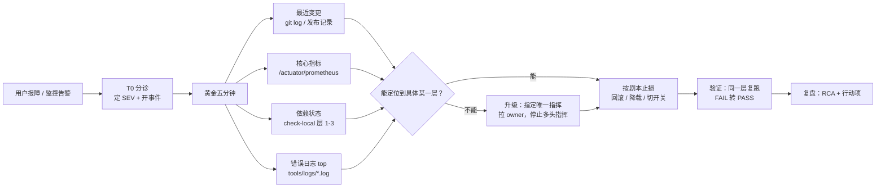
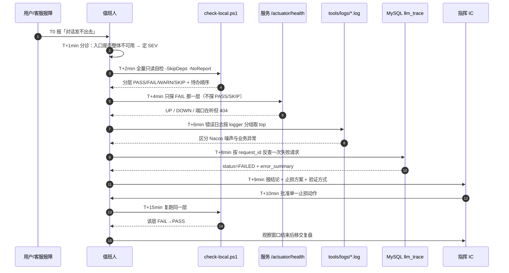

# oncall 手册与故障响应：凌晨三点能不能照着它止损，是唯一的验收标准

> **一句话结论**：oncall 的核心不是「谁值班」，而是「值班的人凌晨三点、脑子只有 30% 清醒时，能不能照着文档在 10 分钟内止损」；本仓库已经具备三块硬底料（`deploy/scripts/check-local.ps1` 七层只读自检、12 份 `tools/logs/*.log` 真实运行日志、`chat_db` 的 `llm_trace`/`model_usage` 五张表），却缺三样东西（告警规则 0 条、值班与交接记录 0 份、按中间件拆分的止损剧本 0 篇），所以本篇把「顺序 + 判据 + 命令」写成可执行骨架，而不是写一份值班表。
> **阅读前置**：读过 [03-故障演练与混沌工程](./03-故障演练与混沌工程.md)（知道演练和真实故障的区别）、[05-降级预案与开关治理](./05-降级预案与开关治理.md)（知道哪些开关真能按）、[06-RCA根因分析与复盘](./06-RCA根因分析与复盘.md)（知道复盘怎么写）；会看 Spring Boot 的 `/actuator/health` 输出与 PowerShell 管道即可，不需要 K8s 基础。
> **证据基线**：Spring Boot 4.2.0 / Spring Cloud 2026.0.0 / Spring Cloud Alibaba 2025.1.0.0 / Resilience4j 2.4.0 / Nacos 2.3 / JDK 17.0.19 / Node 24.16.0；证据 A 2 个文件（`RedisRateLimiter.java.md`、`HealthEndpointSupport.java.md`，3 处锚点）· B 26 个本仓文件 / 74 处路径引用 · C 5 组本机实测命令（含 1 次 `check-local.ps1` 全量只读运行：耗时 7.9 秒、`exit 1`）；预计阅读 45 分钟。

## 证据边界

oncall 这件事在本仓库「工具不少、制度为零」，先把边界钉死，避免把「有脚本」读成「有 oncall 能力」。

| 类别 | 本仓状态 | 本篇怎么处理 |
|---|---|---|
| 只读自检脚本 | ✅ `deploy/scripts/check-local.ps1` 821 行，7 层检查，`exit 1` 可接 CI | 逐层引行号，写成 §3.1 的骨架 |
| 运行期日志 | ✅ `tools/logs/` 下 12 个服务 `.out.log` / `.err.log` / `.pid`（启动脚本 `tools/lib/common.ps1#L135-L144` 重定向产生） | 给「错误日志 top」的真实统计命令 |
| AI 调用链数据 | ✅ `deploy/mysql/llm-observability-init.sql#L12-L26` 的 `llm_trace`（`status`/`error_summary`/`total_duration_ms`）与 `model_usage#L29-L49` | 给「按 request_id 反查一次失败」的 SQL |
| 健康与指标端点 | ✅ 11 个服务 `/actuator/health`；⚠️ `/actuator/prometheus` 依赖 Nacos 配置 `tools/nacos-config/aics-shared.yml#L28-L32` 的 `exposure.include` | 明确「health 一定在，prometheus 不一定在」 |
| 告警（自动发现） | ❌ `deploy/observability/prometheus.yml` 全 24 行只有 `scrape_interval` 与 11 个 static target，无 `rule_files`、无 Alertmanager、无告警规则 | 只讲「人报障」路径，描清「告警自动发现」是目标态 |
| 值班表 / 交接单 / 升级联系人 | ❌ 全仓无值班表、无交接单模板、无 on-call 轮转记录 | 给模板并明写「本仓不存在」 |
| 预案文档 / 开关表 | ❌ 无 runbook 目录、无开关清单、`@RefreshScope` 仅 1 个类 | 剧本以「命令 + 判据」形式给出，标注真跑/未跑 |
| 定时调度兜底 | ⚠️ XXL-Job 默认关闭；真实 `@Scheduled` 注解仅 1 处（`ai-cs-order/src/main/java/com/aics/order/task/OrderTimeoutScheduler.java#L29`） | 剧本里不假设有集中调度平台 |
| 本机可执行性 | ✅ pwsh / JDK 17.0.19 / node 24.16.0；❌ 无 docker、不许联网、不许起服务 | C 级只做只读探测与日志统计，运行期效果一律标「未本机实测」 |

---

## 0. 先看现象

### 现象一：端口在听，服务却没有起来——8080 上坐的是另一个项目的 Tomcat

值班第一反应通常是「`curl` 一下网关，通不通」。本篇写作时在本机实测，得到的是一组非常容易误判的结果：

```text
PS> Get-NetTCPConnection -State Listen -ErrorAction SilentlyContinue |
    Where-Object { $_.LocalPort -in 6379,8080,5173 } |
    ForEach-Object { $p = Get-Process -Id $_.OwningProcess -ErrorAction SilentlyContinue; "{0}  PID={1}  proc={2}" -f $_.LocalPort, $_.OwningProcess, $p.ProcessName }
8080  PID=10504  proc=java
6379  PID=9112  proc=redis-server

PS> try { Invoke-WebRequest -Uri 'http://127.0.0.1:8080/actuator/health' -TimeoutSec 3 -UseBasicParsing } catch { "探测失败: " + $_.Exception.Message }
探测失败: 远程服务器返回错误: (404) 未找到。

PS> (Get-CimInstance Win32_Process -Filter "ProcessId=10504").CommandLine.Substring(0,120)
"D:\DevTools\jdk\jdk1.8\jre\bin\java.exe"  -Djava.util.logging.config.file="D:\Projects\AsiaInfo\YunNan\AssetCentre\.tomcat-customeraccount\conf\logging.properties"
```

三个事实叠起来才成立：**端口在听**、**`/actuator/health` 返回 404 而不是连接拒绝**、**占用者是 JDK 1.8 的另一个项目**。这三个事实分别对应三种完全不同的处理动作：端口在听说明不了任何事情；404 说明「有 HTTP 服务，但它不是我们的应用」；JDK 1.8 + 别人的 Tomcat 目录说明「ai-cs-gateway 根本没启动，先解决端口占用」。

同样的幻觉出现在启动脚本这一侧：`tools/lib/common.ps1#L149-L152` 的判断是

```text
147:     $name = $svc.name
148:     $port = $svc.port
149:     if (Test-PortListening $port) {
150:         Write-Host "  [Skip] $name already running on $port"
151:         return
152:     }
```

只要端口在听就打印 `[Skip] ... already running`。而 `tools/logs/start-all.latest.out.log` 尾部留下的正是这排结论：

```text
  ai-cs-product    8088  UP
  ai-cs-pay        8089  UP
  ai-cs-mq         8090  UP
  ai-cs-gateway    8080  UP
  frontend         5173  UP
```

`UP` 这个词在这里的语义只是「TCP 能连上」，它并不等于「我们的进程活着、依赖健全」。

### 现象二：全量自检 `exit 1`，23 条 FAIL 里只有 1 条是根因

值班第二个动作是「跑一遍自检」。本机真实运行 `deploy/scripts/check-local.ps1`（跳过依赖层、不写报告）的结果：

```text
PS> & .\deploy/scripts/check-local.ps1 -SkipDeps -NoReport
--- [1] 容器运行态（docker compose） ---
  [SKIP] 全部容器                           Docker 不可用，跳过
--- [2] 端口连通性（127.0.0.1） ---
  [FAIL] MySQL :3306                    TCP 不可达
  [PASS] Redis :6379                    TCP 可达
  [FAIL] Nacos HTTP :8848               TCP 不可达
  ...（其余 10 个端口同形，略）
--- [3] 中间件协议态（真实接口探活） ---
  [SKIP] Nacos 就绪                       端口 8848 未监听，已在上层报失败
  ...（5 条 SKIP，同一原因）
--- [4] 微服务健康（127.0.0.1:8080-8090 /actuator/health） ---
  [FAIL] API 网关 (8080)                  端口已监听但健康接口无响应
  [FAIL] 用户服务 (8081)                    端口未监听（服务未启动）
  ...（8081-8090 共 10 条同形）
--- [5] 注册与路由 ---
  [SKIP] Nacos 服务注册                     端口 8848 未监听，已在上层报失败
  [FAIL] 网关入口                           端口已监听但健康接口不可用
  [WARN] 前端页面                           5173 无响应

 结果: PASS=1  FAIL=23  WARN=1  SKIP=10
 耗时: 7.9 秒
 结论: 存在 23 项失败，见下方待办
EXIT=1
```

关键在于 `SKIP=10` 这个数字：脚本在 `deploy/scripts/check-local.ps1#L146-L151` 里定义了 `Add-PortDown`，端口不通时把下游各层收敛成 `SKIP`，并写清理由「端口 8848 未监听，已在上层报失败」。而 `exit 1` 的判据只看 `failCount`（同文件 `#L820-L821`）。所以：

- **SKIP 不是通过**，它表示「这一层压根没被验证」；一次断网式故障会让 10 项检查集体变 SKIP，看起来"没红几条"。
- 23 条 FAIL 的真实根因往往只有 1~2 个：要么基础设施没起（3306/8848 一挂，下游 11 个服务健康必然 FAIL），要么服务进程没起。

### 现象三：日志里 ERROR 一大片，真正该动手的是 0 条

值班第三个动作是「翻日志」。本机对 `tools/logs/*.out.log` 做真实统计：

```text
PS> Get-ChildItem tools\logs\*.out.log | ForEach-Object { $c = (Select-String -LiteralPath $_.FullName -Pattern '\sERROR\s').Count; "{0,-32} ERROR={1}" -f $_.Name, $c }
ai-cs-chat.out.log               ERROR=2
ai-cs-gateway.out.log            ERROR=0
ai-cs-knowledge.out.log          ERROR=0
ai-cs-message.out.log            ERROR=0
ai-cs-mq.out.log                 ERROR=0
ai-cs-notify.out.log             ERROR=7
ai-cs-order.out.log              ERROR=2
ai-cs-pay.out.log                ERROR=0
ai-cs-product.out.log            ERROR=30
ai-cs-search.out.log             ERROR=0
ai-cs-user.out.log               ERROR=7
frontend.out.log                 ERROR=0
start-all.latest.out.log         ERROR=0

PS> ... 按 logger 名分组后 TOP5：
  17  c.a.n.c.remote.client.grpc.GrpcClient
   7  com.alibaba.nacos.common.remote.client
   4  c.a.n.client.config.impl.ClientWorker
   2  i.s.c.r.n.AbstractNettyRemotingClient
   1  o.a.c.c.C.[.[.[/].[dispatcherServlet]
```

前两名（17 + 7 条）全是 Nacos 长连接重连噪声：它们集中出现在同一秒级窗口（`2026-08-31T08:26:03` ~ `08:26:09`），线程名是 `[remote.worker.0]` / `[127.0.0.1-xxxxx]`，伴随的 WARN 是 `Grpc connection disconnect, mark to redo`。真正指向业务异常的只有最后一条 `o.a.c.c.C.[.[.[/].[dispatcherServlet]`（Servlet 处理请求抛异常）。

**这些现象指向同一件事**：本仓库不缺「能查的东西」——自检脚本、分层健康、服务日志、`llm_trace` 调用链都在——缺的是「查的顺序与判据」。没有顺序，值班的人会先被噪声淹没（现象三），再被端口幻觉误导（现象一），最后在"大家一起看"的会诊里耗掉 30 分钟。本篇就是把顺序、判据、命令固化成一张七层作业单 + 六个可照抄的剧本。

---

## 1. 整体地图



> **读图说明**：最关键的不是四个并列的窗口，而是 `D` 这个判定节点的两条出边。第一条容易看错的是 `C3 → D`：`check-local` 的输出里有 `PASS/FAIL/WARN/SKIP` 四种状态，如果把 `SKIP`（这一层没被验证）当成 `PASS`，你就会自信地走「能定位」这条边，然后对着一个根本没被检查过的层级做止损动作——现象二里那 10 条 SKIP 就是陷阱。第二条容易看错的是 `F → E`：升级的目的是**获得一个能拍板的人**，不是「多叫几个人一起看」；如果看错成后者，就会退化成多头指挥（§3.5 讲这个问题）。

| 组件 / 资产 | 在哪 | 职责（oncall 视角） | 参与方 | 本仓状态 |
|---|---|---|---|---|
| 只读自检 | `deploy/scripts/check-local.ps1`（821 行，7 层） | 一次拿到全局，替代"逐个 curl" | 值班人、CI | ✅ 可用，`exit 0/1` |
| 分层健康 | 11 个服务 `/actuator/health` | 判「进程活着」与「依赖健全」两件事 | 值班人 | ✅ 有；⚠️ `show-details: never` 只见 UP/DOWN |
| 指标 | `/actuator/prometheus` + `deploy/observability/prometheus.yml` | 趋势与拐点（15s 一个点） | 值班人、SRE | ⚠️ 端点依赖 Nacos 配置；❌ 无告警规则 |
| 链路与调用记录 | `chat_db.llm_trace` / `model_usage` | 回答「这一次请求为什么失败/花了多少」 | 值班人、研发 | ✅ 表结构与写链路都有 |
| 日志 | `tools/logs/<service>.out.log`、`.err.log`、`.pid` | 错误 top、启动失败原因 | 值班人 | ✅ 12 份真实日志 |
| 变更来源 | `git log --oneline` + 发布脚本 | 「最近变更」窗口 | 值班人、发布人 | ✅ git；⚠️ 无发布事件流 |
| 配置中心 | Nacos `8848`，命名空间 `aics` | 配置是否发布、服务是否注册 | 值班人 | ✅ 有；⚠️ 无变更审计要求 |
| 指挥与沟通 | 事件群 / 电话 | 单点指挥、对外口径 | IC、客服、商务 | ❌ 无群、无模板、无口径文档 |

---

## 2. 关键概念与关键要素

| 名称 | 位置（本仓锚点） | 作用 | 关键参数 / 判据 |
|---|---|---|---|
| SEV 分级 | 本仓无（`docs/` 无预案文档） | 决定「叫谁、多快叫、能不能对外说」 | 判据见 §3.2：用户可见面 × 是否 15 分钟内可自愈 |
| 止损（mitigation） | 剧本见 §3.6~§3.11 | 先让用户可用，再找根因 | 完成标志：同一层复跑由 FAIL 转 PASS |
| 升级（escalation） | 本仓无联系人表 | 把「排查」换成「拍板」 | 超时即升：SEV2 15 分钟无进展必须升级 |
| 指挥（IC） | 本仓无角色定义 | 唯一决策者，避免多头指挥 | 一个事件一个 IC，技术动作由他派单 |
| 黄金五分钟 | `git log` + `/actuator/prometheus` + `check-local` + 日志 top | 用 5 分钟框出故障面 | 四个窗口必须都看，缺一个就会误判 |
| runbook | 本篇 §3 + §6 | 把「经验」变成「可照抄的命令」 | 四段式：症状 → 判据 → 动作 → 验证 |
| 交接单 | 本仓无模板（本篇 §3.5 给模板） | 值班换人不丢上下文 | 必含：进行中事件、观察窗口、待验证项 |
| MTTD / MTTR | `llm_trace.total_duration_ms`、日志时间戳 | 发现时长 / 恢复时长 | 本仓无自动统计，只能人工比对时间戳 |
| 复盘（blameless） | [06-RCA根因分析与复盘](./06-RCA根因分析与复盘.md) | 输出行动项而不是输出责任人 | 行动项必须有 owner 与截止时间 |
| 演练（game day） | [03-故障演练与混沌工程](./03-故障演练与混沌工程.md) | 把剧本从「纸面」变成「肌肉记忆」 | 验收：新人独立跑通剧本且不查人 |
| 变更关联 | `git log --oneline -5`、`tools/*.ps1` 启动脚本 | 「最近变更」是最高性价比线索 | 故障时间点往前 2 小时内的变更优先怀疑 |
| 判据（criterion） | `deploy/scripts/check-local.ps1` 各层 Detail 字段 | 把「感觉慢」变成「可判定」 | 判据必须能被一条命令复现 |

---

## 3. 原理与证据逐段精读

### 3.1 为什么第一动作是「跑一条只读脚本」而不是「逐个 curl」

**在干什么**：`deploy/scripts/check-local.ps1` 把 11 个服务、12 个端口、12 个容器、4 类中间件协议探活串成 7 层，每层输出 `PASS/FAIL/WARN/SKIP`，最后打印「待办（按此顺序处理）」并给出退出码。它的分层顺序是：`[0]` 前置依赖（JDK/Maven/node/Docker）→ `[1]` 容器运行态 → `[2]` 端口连通性 → `[3]` 中间件协议态 → `[4]` 微服务健康 → `[5]` 注册与路由 → `[6]` 汇总。

**为什么这么设计**：故障排查的成本大头不是"看"，而是"决定下一步看什么"。脚本用固定分层把决策预算压到零：层的顺序就是排查顺序（下层不通过，上层的红点全是噪声），并且每层只回答一个是非问题。三处设计细节值得抄进自己的 runbook：

1. `Add-PortDown`（`deploy/scripts/check-local.ps1#L146-L151`）：端口不通时，下游层直接记 `SKIP` 并写明「已在上层报失败」，**避免同一根因被重复计数**。没有这一步，3306 挂掉会产生 20 多条 FAIL，人就会被假象带偏。
2. `Test-TcpPortBatch`（`#L162-L204`）：一次发起全部 `BeginConnect`、共享同一个 deadline。脚本注释里写了实测数据——本机 23 个端口逐个探约 46 秒，批量探测约等于单次超时。这就是「为什么不能写 `foreach { Test-NetConnection }`」的量化理由。
3. `Test-PortOpen`（`#L206-L211`）：对「没被批量探过的端口」返回 `$true`（按"未知"处理），而不是 `$false`。宁可多跑一次真探测，也不能因为缓存缺失把「没查」误报成「不通」。

**换写法会怎样**：如果值班人手动 `curl` 一遍 8080→8090，最典型的两种写法都会误导人——在 PowerShell 里写 `curl http://...` 实际调用的是 `Invoke-WebRequest` 的别名（脚本 `#L213-L233` 的注释专门强调这点，所以它用 `Invoke-WebRequest` 显式调用）；写 `Test-NetConnection` 则只测 TCP，不测 HTTP 语义，于是「端口在听但服务 404」这种现象一永远发现不了。

**常见坑**：把 `-SkipDeps` 当成"快速模式"长期使用。`[0]` 层存在的意义是拦住「JDK 版本不对导致编译产物跑不起来」「`JAVA_HOME` 指向 8 而 `PATH` 指向 17」这类高频环境问题，跳过它之后，后面的 FAIL 会被误读成代码问题。

### 3.2 故障分级：分级不是为了贴标签，是为了分配「注意力预算」

**在干什么**：把进来的故障按「影响面 × 可自愈性 × 时间敏感度」映射到 4 个级别，每个级别绑定固定的响应节奏与升级路径。

**为什么这么设计**：凌晨三点的值班人最缺的不是技术，是**取舍**。分级表真正锁定的东西是三个数：多久必须响应、多久没进展必须升级、多久同步一次。本仓库没有现成的分级文档（`docs/` 下无预案），所以下面这张表是本篇给出的可执行基线，判据全部落在可观测事实上：

| 级别 | 判据（任一条成立） | 响应 | 升级 | 对外 |
|---|---|---|---|---|
| SEV1 | 网关入口整体不可用（`/actuator/health` 连不通或全站 5xx）；或对话主链路 100% 失败 | 5 分钟内响应，立即拉 IC | 无进展 15 分钟升到研发负责人 | 需对外口径，客服侧同步 |
| SEV2 | 单服务不可用（如 8083 全 FAIL）、或某类请求持续 429/500 | 10 分钟响应 | 30 分钟无进展升级 | 视影响面，准备口径 |
| SEV3 | 非核心能力受损（知识库增量不同步、报表缺数、通知延迟） | 30 分钟响应 | 下个工作日跟进 | 不对外，内部同步 |
| SEV4 | 单用户/单请求问题，有可用 workaround | 当日处理 | 不需要 | 不对外 |

**换写法会怎样**：如果按「谁先发现谁处理」组织，SEV1 会被一个不熟悉 chat 链路的人拖住；如果按「按服务归属」组织，跨服务故障（网关 + Nacos）会出现两条独立排查线，最后结论互相矛盾。分级 + 单 IC 就是为了消掉这两种失效。

**常见坑**：把「用户喊得很凶」当成 SEV1。分级只能看客观判据（入口是否可用、失败率是否全量），情绪不是判据；反过来，也不能把「监控没告警」当没事——本仓库**没有任何告警规则**，`deploy/observability/prometheus.yml` 只有抓取配置，所以在这个项目里"没人喊"基本等于"没人知道"。

### 3.3 黄金五分钟：四个窗口，一个都不能少

**在干什么**：T0 到 T+5 分钟内，只做四件事，每件事都用命令拿事实，不做推理。

**为什么这么设计**：故障初期最大的浪费是"猜"。四个窗口分别封住四类猜测：

| 窗口 | 命令（本仓真实存在） | 判读要点 | 不看会怎样 |
|---|---|---|---|
| 最近变更 | `git log --oneline -5` / `git status --short` | 故障前 2 小时内的提交、配置发布、重启 | 会花 20 分钟怀疑一个没动过的模块 |
| 核心指标 | `Invoke-WebRequest http://127.0.0.1:8080/actuator/prometheus` | 有没有 `http_server_requests_seconds_count`、`jvm_*` 序列；拐点时间 | 无趋势依据，只能凭"感觉慢" |
| 依赖状态 | `& .\deploy\scripts\check-local.ps1 -SkipDeps` | 层 `[2]/[3]` 是否 PASS；`SKIP` 一律视为未验证 | 会在应用层查一个 DB 层的问题 |
| 错误日志 top | 见 §6 第 5 条的分组命令 | logger 名与线程名，而不是 ERROR 条数 | 被 Nacos 重连噪声淹没（现象三） |

**换写法会怎样**：很多团队把这四件事写成"看板巡检"，但本仓库的看板是空的——`MeterRegistry` / `Timer.builder` / `Counter.builder` 全仓命中 0，也就是说**没有任何自定义业务指标**，只有 Spring Boot 自动装配的 HTTP/JVM 指标。想加"对话成功率"这种指标，今天只能靠 `llm_trace` 表算：`SELECT status, COUNT(*) FROM chat_db.llm_trace WHERE create_time >= NOW() - INTERVAL 10 MINUTE GROUP BY status;`（未本机实测，因本机 MySQL 容器未运行，无法执行；该表结构见 `deploy/mysql/llm-observability-init.sql#L12-L26`）。

**常见坑**：把 `tools/logs/*.out.log` 当成唯一真相。这些日志是 `tools/lib/common.ps1#L135-L144` 的 `Start-Proc` 用 `-RedirectStandardOutput` 产生的，只覆盖"用启动脚本拉起的进程"；容器里的服务、手工 `java -jar` 起的服务都不在这里，`tools/start-chat-jar.ps1#L1-L10` 就另写了 `ai-cs-chat.jar.out.log`。

### 3.4 runbook 的四段式：症状 → 判据 → 动作 → 验证

**在干什么**：把一个故障场景写成固定四段，每一段都必须能被"照着敲"。拒绝写「检查数据库是否正常」这种没有命令的句子。

**为什么这么设计**：凌晨三点的阅读带宽极低，任何需要"理解"的句子都会导致偏差。四段式对应四个决策：**我遇到的是不是这个病**（症状）→ **凭什么确认**（判据）→ **按什么顺序动**（动作）→ **怎么知道好了**（验证）。第四段最常被漏掉，而它恰恰是止损动作的关闭条件：没有验证，止损就会变成"再试一次"的循环。

**换写法会怎样**：只写症状不写判据，会导致"像什么就按什么治"（把 DB 连接耗尽当成 Redis 抖动，因为两者都表现为超时）；只写动作不写验证，会导致值班人不敢停手，一路把降级压到最低。

**常见坑**：把「重启一下就好」写进 runbook。重启是有代价的动作（会话丢失、SSE 连接中断、`shutdown: graceful` 30 秒等待期），必须写明前置判据和后置验证。本仓库的优雅停机在 11 个模块统一配置（例如 `ai-cs-chat/src/main/resources/application.yml#L2` 的 `shutdown: graceful` 与 `#L7` 的 `timeout-per-shutdown-phase: 30s`），细节见 [06-优雅停机与零丢失滚动更新](../07-运维部署/06-优雅停机与零丢失滚动更新.md)。

### 3.5 指挥与沟通：一个人喊，其他人执行

**在干什么**：事件开始后 3 分钟内指定唯一 IC（Incident Commander），由他负责三件事：对外口径、对内同步频率、把技术动作派成"工单"。

**为什么这么设计**：多头指挥的破坏力在于「同时改两处」——一个人重启 chat，一个人改 Nacos 配置，第三个人回滚网关，最后没人知道是哪个动作让系统恢复的，复盘也失去依据。本仓库的现实是**所有重要开关都在 Nacos 配置中心**（`tools/nacos-config/aics-shared.yml`、各模块 `application.yml#L16-L31` 的 `spring.config.import`），改配置不需要发布、不需要审批，所以"同时改"的风险特别高。

**换写法会怎样**：如果让「最懂的人」兼任 IC，他一定会同时看日志、改配置、回消息，结果三件事都做到 60%。正确做法是让不写代码的人做 IC（值班组长、SRE），技术执行者只报「我准备执行 X，验证方式是 Y，预计 Z 分钟」。

**常见坑**：把「同频」做成刷屏。内部同步建议固定节奏：SEV1 每 15 分钟一条（做了什么、当前状态、下一步、需要谁），SEV2 每 30 分钟一条，其它只在状态变化时发。对外口径只讲三件事：影响范围、当前进展、用户该怎么做；不讲根因、不讲内部组件名、不给恢复时间承诺。

### 3.6 剧本一：数据库连接耗尽

**在干什么**：识别"所有访问 DB 的服务同时变慢/超时"这一类故障，并把它与其他超时区分开。

**为什么这么设计**：本仓库的连接池参数非常集中且很小——`tools/nacos-config/ai-cs-message.yml#L6-L12` 等处写的是 `hikari.maximum-pool-size: 10`、`connection-timeout: 30000`；MySQL 侧 `deploy/mysql/master.cnf#L24-L26` 是 `max-connections=500`、`wait-timeout=28800`。10 个连接 × 若某个查询变慢，池子几十秒就满，`connection-timeout` 30 秒到点后**报的是"连接池获取超时"，不是"SQL 慢"**——这就是误判的来源。同上文件的慢查询日志（`master.cnf#L29-L31`，`long-query-time=2`）就是为此存在的。

**动作**（每条命令真实存在，未本机实测——本机 MySQL 容器未运行）：

```text
# 1) 是否是连接池满：看 error log 里有没有 HikariPool 等待超时
PS> Select-String -LiteralPath tools\logs\ai-cs-message.err.log -Pattern 'HikariPool|Connection is not available|connection-timeout' -Context 0,1

# 2) 服务侧健康（若 UP 但 DB 慢，health 可能仍是 UP，取决于 health 是否含 db indicator）
PS> (Invoke-WebRequest http://127.0.0.1:8085/actuator/health -TimeoutSec 3 -UseBasicParsing).Content

# 3) DB 侧连接数（容器在跑时；本机无 docker 时会直接报 command not found）
PS> docker exec aics-mysql mysql -uroot -proot -e "SHOW STATUS LIKE 'Threads_connected'; SHOW VARIABLES LIKE 'max_connections';"
```

**判据与验证**：判据是「连接池等待超时」出现在 ≥1 个服务的 error log，且 `Threads_connected` 接近 `max_connections`（500）。验证是同一服务的 error log 不再新增该类记录，且 `check-local.ps1` 层 `[2]` 的 3306 由 FAIL 转 PASS 后，层 `[4]` 的对应服务转 PASS。

**换写法会怎样**：直接把 `maximum-pool-size` 从 10 调到 100 是常见错误——MySQL 侧 `max-connections=500` 是**所有服务共享**的上限（10 个连 DB 的服务都已按 10 配置），单方面调大会把压力推给数据库，表现为"应用好了，DB 崩了"。

**常见坑**：忽略 `deploy/scripts/check-local.ps1#L444-L585` 里对 MySQL 的探活方式是 `mysqladmin ping -h localhost -uroot -proot --silent`——`ping` 只证明"服务在监听并回了 OK"，**不证明业务连接可用**（连接数打满时 `ping` 仍可能成功）。

### 3.7 剧本二：Redis 抖动（本仓库最危险的一种，因为它「静默」）

**在干什么**：判断 Redis 出问题时系统具体退化成了什么样。本仓库有两处强依赖 Redis，且两处的失败策略完全不同：

1. **网关分布式限流**（`RequestRateLimiter`，Redis + Lua 令牌桶）。A 级证据：`learning-docs/24-源码分析/assets/source/RedisRateLimiter.java.md#L175-L182` 显示 key 前缀是 `request_rate_limiter.{routeId.id}.`，令牌桶需要两个 key；同文件 `#L286-L288` 的错误分支是

```text
271 | 			return flux.onErrorResume(throwable -> {
272 | 				log.error("Error calling rate limiter lua", throwable);
273 | 				return Flux.just(Arrays.asList(1L, -1L));
```

而"是否放行"由 `allowed = results.get(0) == 1L` 决定（同文件 `#L278`），这里返回的是 `[1L, -1L]`——**Redis 挂了，限流器判定为"放行"**，只在日志里留一行 `Error calling rate limiter lua`。

2. **对话侧缓存与会话**（`ai-cs-chat/src/main/resources/application.yml#L56-L63` 的 Redis 与 MongoDB 配置；`aics-shared.yml#L5-L12` 显式把 Redis 指向 `123.60.31.79` 且注释说明"不要写空串 password"）。

**为什么这么设计**：限流是"保护下游"的机制，当保护者自己故障时，选择放行（fail-open）还是拒绝（fail-closed）是产品决策：拒绝意味着 Redis 一抖，全站 429，这是更大的故障；放行意味着短时间失去保护。本仓库选的是放行（Resilience4j 的配额检查也是同一取向，见 `ai-cs-chat/src/main/java/com/aics/chat/observability/QuotaService.java#L72-L80` 的 `fail-open` 注释）。

**换写法会怎样**：如果值班人按"Redis 挂了应该看到 429 变多"的直觉去排查，会得出"限流正常"的错误结论。正确判据是 **429 反而变少 + 日志出现 `Error calling rate limiter lua` + 上游压力上升**。

**动作与验证**（本机有真实 Redis 在 6379，可复现一条只读探测）：

```text
PS> $c = New-Object System.Net.Sockets.TcpClient('127.0.0.1',6379); $s = $c.GetStream()
PS> $b = [Text.Encoding]::ASCII.GetBytes("PING`r`n"); $s.Write($b,0,$b.Length); $s.Flush(); Start-Sleep -Milliseconds 300
PS> $buf = New-Object byte[] 64; $n = $s.Read($buf,0,64); [Text.Encoding]::ASCII.GetString($buf,0,$n).Trim(); $c.Close()
+PONG
```

得到 `+PONG` 只说明"Redis 进程在"，不说明"它还能跑 Lua"。真正的判据是网关日志里 `Error calling rate limiter lua` 的条数趋势，以及网关配置里那个**确实存在**的兜底开关：`ai-cs-gateway/src/main/resources/application.yml#L36-L40` 的 `aics.gateway.rate-limit.enabled: false`（注释写的是「Redis 不可用时改回 true 切回本地内存限流兜底」）。注意 §3.1 的教训：这个开关只关掉内存版 `GlobalFilter`，Redis 分布式限流仍挂在每条路由上——按开关前必须重读 [05-降级预案与开关治理](./05-降级预案与开关治理.md) 的"两个限流器"那一段。

**常见坑**：`aics-shared.yml` 里 Redis 是**远程地址**（`123.60.31.79`）且**无密码**，而各服务 `application.yml` 的默认值是 `127.0.0.1`。值班时若不确认"当前生效的是哪一份配置"，就会对着本机 Redis 做排查，而真正在用的是一台远程实例。

### 3.8 剧本三：MQ 积压与「看起来没积压」

**在干什么**：判断 RocketMQ 消费端是否落后，以及落后之后业务上丢了什么。

**为什么这么设计**：本仓库的 MQ 有两个消费者和一个生产者（`ai-cs-chat/src/main/resources/application.yml#L66-L69` 的 `chat-producer-group`；`ai-cs-knowledge/src/main/java/com/aics/knowledge/mq/KnowledgeSyncConsumer.java#L34-L38` 的 `knowledge-sync-group`，topic 为 `knowledge-doc-sync-topic`）。RocketMQ 的"积压"在 broker 上体现为消费位点差，客户端上体现为"日志里没有消费记录"。这条链路有一个**必须先知道的设计缺陷**：

```text
73:         } catch (Exception e) {
74:             log.error("知识文档同步消息消费失败: action={}, documentId={}, err={}",
75:                     action, message.getDocumentId(), e.getMessage());
76:             // 不抛异常（RocketMQ 默认重试 16 次后进入死信队列），避免阻塞后续消息消费
77:         }
```

`KnowledgeSyncConsumer` 把异常 catch 住且**不再抛出**（同文件 `#L73-L77`）。对 RocketMQ 来说这条消息是"消费成功"，于是注释里说的"重试 16 次后进死信队列"**不会发生**——它连一次都不会重试。再叠加 `ai-cs-knowledge/src/main/java/com/aics/knowledge/service/KnowledgeVectorService.java#L88-L91` 的失败分支：

```text
88:         } catch (Exception e) {
89:             log.error("文档向量化失败: id={}, err={}", doc.getId(), e.getMessage());
90:             return 0;
91:         }
```

`vectorize` 失败返回 0，消费者拿到 0 只打一条 `log.warn("向量化无内容/失败: ...")`（`KnowledgeSyncConsumer.java#L69-L71`）就结束。结论：**向量库不可用时，消息既不重试也不进死信，向量永久缺失，只留下一条 WARN**。

**动作与验证**（命令真实存在；本机未实测，因为 `tools/rocketmq` 的 NameServer 未启动、且不允许起服务）：

```text
# 消费位点与积压（mqadmin 由 tools/rocketmq/bin 提供）
PS> & .\tools\rocketmq\bin\mqadmin.cmd consumerProgress -n 127.0.0.1:9876 -g knowledge-sync-group

# 客户端侧：这条链路今天到底消费了几条、失败了几条
PS> Select-String -LiteralPath tools\logs\ai-cs-knowledge.out.log -Pattern '消费知识文档同步消息|向量化完成|向量化无内容/失败|消费失败' |
    Group-Object { ($_.Line -split ':')[1] } | Sort-Object Count -Descending
```

**验证**：修好 Chroma 后，用**同一批 documentId** 重新投递（或手工触发）一次同步，然后确认 `向量化完成` 的条数覆盖失败批次的条数。仅看"消费位点不积压"是不够的——按上面的缺陷，位点会一直很漂亮地往前跑。

**常见坑**：把"消费位点没有 lag"当成"消息处理成功"。在这条链路上，lag 正常 + 一条 WARN = 已经丢数据。

### 3.9 剧本四：模型 429（供应商限流）

**在干什么**：区分「供应商返回 429」与「我们自己限流 429」，两者的动作完全相反。

**为什么这么设计**：本仓库有三层限流/容错，配置都写死在代码与 yml 里：

1. 网关 `RateLimitFilter` 返回的 429 是**我们自己的**：`ai-cs-gateway/src/main/java/com/aics/gateway/filter/RateLimitFilter.java#L92-L97`（body 为 `{"code":429,"message":"请求过于频繁，请稍后再试"...}`）。
2. chat 的 Sentinel 流控只挂在**一个**入口：`ai-cs-chat/src/main/java/com/aics/chat/controller/ChatController.java#L79`（`@SentinelResource(value = SentinelRules.RESOURCE_CHAT_SEND, blockHandler = "chatSendBlocked")`），命中时 `#L103` 返回业务码 `TOO_MANY_REQUESTS`，日志是 `对话接口触发Sentinel流控: resource=..., rule=...`。
3. Resilience4j 的重试只覆盖网络类异常：`ai-cs-chat/src/main/resources/application.yml#L95-L99` 的 `retry-exceptions` 是 `SocketTimeoutException` / `ConnectException` / `ResourceAccessException` / `TimeoutException`——**HTTP 429 不在其中，因此不会被重试**；而熔断器（同文件 `#L114-L130`，10 次窗口 / 50% 失败率 / 30 秒半开）的 `record-exceptions` 同样不含 429 对应的异常类型，因此 429 也不会触发熔断计数。

**换写法会怎样**：如果以为"有重试就一定会自动扛过 429"，会得出"限流是供应商的问题，我们没责任"的结论，然后既不降载也不改路由，直到供应商把配额彻底用尽。反过来，如果把 429 当成"我们自己的限流在保护"，就会去调 Nacos 里的 Sentinel 规则——本仓库根本没有集中规则源（全仓只有 1 处 `@SentinelResource`，`SentinelFlowConfig` 承载流控规则），改了也没用。

**判据**：网关 429 → `tools/logs/ai-cs-gateway.out.log` 里有 `RateLimitFilter` 相关记录，且前端统一收到 `code:429`；供应商 429 → `tools/logs/ai-cs-chat.out.log` 里出现模型调用异常的 logger，且 `llm_trace` 里 `status='FAILED'` 的 `error_summary` 含 429/rate limit 字样（查询见 §3.11）。**未本机实测**：真实 429 需要联网调用供应商，本环境不允许联网。

**常见坑**：`ai-cs-chat/src/main/resources/application.yml#L12-L15` 排除了 `OpenAiEmbeddingAutoConfiguration` 与 `DataSourceAutoConfiguration`，说明 chat 侧不直接连 DB/内部做 embedding。值班时若看到 chat 报"数据源"相关异常，说明配置被改坏了（chat 本来就不该有 DataSource），这是一个非常有用的"不该出现的异常"判据。

### 3.10 剧本五：向量库（Chroma）不可用

**在干什么**：识别 RAG 检索质量下降——**这类故障几乎不会让接口报错**，只会让回答变差。

**为什么这么设计**：`ai-cs-chat/src/main/resources/application.yml#L45-L52` 把 Chroma 指向 `${CHROMA_PORT:8000}` 且 `initialize-schema: false`（不在启动时建集合）；知识侧写向量走 `KnowledgeVectorService#L69-L92`，读侧走 RAG 检索。写入侧的失败被吞（§3.8），读取侧的失败在业务上通常表现为"检索为空 → 回答没有引用"。

**判据**（`check-local.ps1#L444-L585` 已经给了现成的判据链）：层 `[2]` 的 `Chroma :8000 TCP 不可达`，或层 `[3]` 的 `Chroma 向量库` 探测失败——脚本先探 `/api/v2/heartbeat`，失败再回落 `/api/v1/heartbeat` 并给 `WARN`「仅探测到 v1」，因为版本混用会让客户端行为不一致。业务侧判据是 `llm_trace` 里 `scenario='rag'` 的请求 `spans_json` 中检索结果为空。

**动作与验证**：先确认 8000 是否可达（`check-local` 层 2/3），再确认 embedding 供应商是否可用（`aics-shared.yml#L21-L24` 的 `aics.embedding` 指向硅基流动 `BAAI/bge-m3`——**向量库不可用与 embedding 供应商不可用经常被混为一谈，因为两者都表现为"向量化失败"**）。验证方式：取一条已知文档，走一次增量同步，日志出现 `向量化完成: ... chunks=N`（`KnowledgeSyncConsumer.java#L67-L68`）且 N>0。

**常见坑**：Chroma 8000 端口与"旧稿里的 py-chat 8000"是同一个端口号，但含义完全不同（见 §7）。值班时按端口号认服务，会把向量库当成对话服务。

### 3.11 剧本六：发布回滚

**在干什么**：把"发布导致"的故障用最短路径退回上一个已知良好版本，并且能证明退回去了。

**为什么这么设计**：本仓库的发布路径有三条，回滚动作各不相同：

| 路径 | 部署物 | 回滚动作 | 本仓证据 |
|---|---|---|---|
| 本机/开发 | Maven 进程或 fat jar | `tools/stop-all.ps1` 停 → `tools/start-app.ps1 -SkipBuild -Service ai-cs-chat` 单服务起 | `tools/stop-all.ps1#L15-L26`、`tools/start-app.ps1#L37-L45` |
| 单机 Docker | 镜像 tar | 重新 `docker load` 上一版 tar + 重启容器 | `deploy/scripts/deploy.sh#L34-L43`（只 load 7 个服务） |
| K8s | manifest + 镜像 | `kubectl rollout undo` / 换镜像 tag | `deploy/k8s/services`（仅 8 份 manifest，缺 order/pay/mq，见 `docs/28-故障案例库.md` 的 C4） |

`tools/stop-all.ps1` 有两个细节必须知道：它是**按端口杀进程**（`#L18-L26` 杀掉 8848/9848/9876/10911/8080-8090/5173 上监听的进程，`Stop-Process -Force`），所以**会误杀占用这些端口的其他程序**（现象一里那个 AsiaInfo Tomcat 就在 8080 上）；它**不会停 docker 容器**（脚本里没有任何 `docker` 调用），MySQL/Redis/ES 保持运行。

**判据**：回滚前必须固定三件事——故障开始时间、上一个良好版本号（`git log --oneline -1 <tag>` 或镜像 tag）、以及"回滚后用哪条命令验证"。**验证**必须与故障判据同层：如果故障表现是 8083 的 health FAIL，验证就是 `check-local.ps1 -SkipDeps` 里 8083 由 FAIL 转 PASS，而不是"前端能打开"。

**换写法会怎样**：用 `stop-all` + `start-app` 全量重启做回滚，会把"单服务故障"放大成"全站中断 3-5 分钟"（每个 Java 服务冷启动 30-60 秒，脚本 `Wait-Port` 上限 180 秒，见 `tools/start-app.ps1#L41`）。正确做法是只重启出问题的那个服务。

**常见坑**：`stop-all.ps1` 之后忘了 `.pid` 文件——脚本 `#L42` 会删掉 `tools/logs/*.pid`，于是你手里唯一的"哪个进程是哪个服务"的线索没了；重启顺序也必须遵守依赖（先 infra，再 gateway，再业务），否则服务会因 Nacos 未就绪而启动失败。

---

### 3.12 值班轮转与交接：把「口头交代」换成一张单

**在干什么**：把值班从"某个人随时在线"变成"有主岗、有备岗、有交接物"的轮转制度。本仓库没有任何值班表、交接单模板或轮转记录（`docs/` 与 `learning-docs/` 均无），所以以下是**给出制度，而不是记录现状**。

**为什么这么设计**：oncall 失效最常见的原因不是技术，而是**上下文丢失**——上一班已经做过一次临时降级（比如把 `aics.gateway.rate-limit.enabled` 改回 `true` 走本地内存限流），下一班不知道，于是把"限流粒度变粗"当成新故障再排查一遍。交接单的唯一使命是消除这类"第二次发现"。

轮转的最小可用规则（三条即可，多了执行不了）：

1. **主备双岗**：主岗负责响应，备岗只在主岗 15 分钟无响应时接手，避免"两个人都以为对方在处理"。
2. **一周一轮**，换班时间放在工作日上午（不要放在周五晚），换班必须**当面或语音**过一遍交接单。
3. **谁止损谁记录**：执行过任何变更（重启、改 Nacos 配置、停容器）的人，必须在交接单里写"改了什么、怎么改回来"。

交接单模板（可直接复制进事件群或工单系统，字段全部是"能被下一个人验证"的形式）：

```text
【值班交接单】2026-xx-xx 09:00  A 班 → B 班
1. 进行中事件：SEV2 / chat 8083 偶发 500 / IC=张三 / 已持续 40 分钟
2. 已执行动作：10:20 重启 ai-cs-chat（tools\start-app.ps1 -SkipBuild -Service ai-cs-chat）→ 500 下降但未消失
3. 当前临时状态（重要）：Nacos ai-cs-chat.yml 的 retry.max-attempts 由 3 改为 1（未回滚）
4. 待验证项：& .\deploy\scripts\check-local.ps1 -SkipDeps  → 层[4] 8083 应为 PASS；llm_trace 近 10 分钟 FAILED 应为 0
5. 观察窗口：至 11:30，之后如无复发则回滚第 3 项
6. 未闭环行动项：MQ 消费失败计数缺失（owner=李四，截止 xx-xx）
7. 下次同步：10:30 在「事件群」发一条进展
```

**换写法会怎样**：如果交接只靠"有事群里喊"，第 3 项（临时状态）必然丢失，而它恰恰是最危险的：临时降级看起来"系统正常"，实际保护能力已经降级。**把降级态写进交接单，是让"临时"有保质期的唯一办法**。

**常见坑**：只在换班时写、事件进行中不更新。正确做法是**每次状态变化就更新一次**（止损动作、升级、观察窗延长），否则交接单会变成一份"昨天的事实"，而不是"此刻的事实"。

### 3.13 演练与新人上手：剧本不演练就等于没有

**在干什么**：用三类低风险演练，把 §3.6~§3.11 的剧本从"纸面"变成"肌肉记忆"。

**为什么这么设计**：真实故障里最贵的成本是"第一次见"。演练的价值不是验证系统，而是验证**人和文档**：文档里的命令能不能照抄、判据能不能在 10 分钟内拿到、验证段是不是真的可执行。

| 演练类型 | 做法 | 风险 | 验收标准 |
|---|---|---|---|
| 只读走查（无需故障） | 新人拿本篇，在一台"半坏"机器上跑 `check-local.ps1 -SkipDeps`，说出每层 PASS/FAIL/SKIP 的含义 | 无 | 15 分钟内能定位到层 `[2]` 或 `[3]` 的根因，不需要问人 |
| 单服务重启演练 | `tools/start-app.ps1 -SkipBuild -Service ai-cs-user`（幂等，已在跑会 `[Skip]`）观察 8081 由 DOWN→UP 的耗时 | 低（单服务） | 能报出"冷启动实际耗时"与"恢复判据是哪条命令" |
| 全链路回滚演练 | `tools/stop-all.ps1` → `tools/start-infra.ps1` → `tools/start-app.ps1 -SkipBuild` | 中（全站中断） | 能在演练记录里写清每一步耗时与依赖顺序（infra → gateway → 业务） |

**换写法会怎样**：只做"桌面推演"（大家坐着讨论"如果 Redis 挂了怎么办"），会漏掉所有环境相关的坑——比如 `stop-all.ps1` 按端口杀进程会误伤、`check-local.ps1` 在无 docker 环境下层 `[1]` 全 SKIP、PowerShell 里 `curl` 不是 curl。这些只有真敲一遍才会暴露。

**新人上手路径（3 天，可验收）**：

1. 第 1 天：读本篇 + 在**健康**环境跑一次 `check-local.ps1`，把 7 层输出抄成表格（对应 §9 练习 1）。
2. 第 2 天：按 §6 的七条踩坑各复现一次（端口幻觉、`curl` 别名、SKIP 误读、无 docker、日志噪声、JDK 不一致、批量探测）。
3. 第 3 天：盲测——由老同学故意制造 1 个单点故障（关掉一个中间件容器或停一个服务），新人限时 15 分钟给出"根因 + 止损动作 + 验证命令"。

**常见坑**：演练后不写记录。**本仓库当前 0 份演练记录**（无 `docs/演练/`、无 game day 产物），所以"我们做过演练"这句话在这里没有证据；每次演练至少要留下一行：日期、演练类型、耗时、暴露的文档缺陷、修复 PR。

---

## 4. 一次完整执行时序（以「用户说对话全挂」为例）



> **读图说明**：注意第 4 步和第 5 步之间的箭头方向——值班人先拿"分层地图"再决定"探哪个"，而不是拿到报障就直奔 chat 日志。看错这条顺序（直接看 chat 日志），会得到"chat 里全是 Nacos 重连错误"的错误结论，因为现象三已经证明：日志里 24 条 ERROR 有 24 条和业务无关。第二个关键箭头是第 12 步：验证必须回到第 3 步**同一份脚本的同一层**，否则"好了"没有参照物。

| 步骤 | 你在看什么 | 正判据 | 看错了会怎样 |
|---|---|---|---|
| 2 | 用户描述 + 入口是否整体不可用 | 全员/全端不可用 = SEV1；单人 = SEV4 | 把单用户问题升成 SEV1，团队被无谓叫起 |
| 3 | 层 `[0]`~`[5]` 的状态分布 | `[2]`/`[3]` 先看，`[4]` 的红点多数是下游派生 | 直接从 `[4]` 11 条 FAIL 开始逐个查，花 30 分钟 |
| 4 | health body | `{"status":"UP"}` 才叫健康；404 ≠ 连接拒绝 | 把别人的服务当自己的（现象一） |
| 5 | logger 名 + 线程名 | 业务异常 logger（如 `o.a.c.c.C...dispatcherServlet`）优先 | 被 `GrpcClient` 噪声带走 |
| 6 | `llm_trace.status` / `error_summary` | `FAILED` 的记录数与 `error_summary` 内容 | 只有"失败率"没有"失败原因"，无法定位 |
| 7 | 方案 + 验证方式 | 一次只动一处，且能回滚 | 同时改两处，复盘时归因不了 |
| 12 | 同一层复跑 | FAIL→PASS | 用"前端能打开"当验收，掩盖后端依赖仍坏 |

`llm_trace` 反查用的 SQL（表结构见 `deploy/mysql/llm-observability-init.sql#L12-L26`，`status` 在 `#L17`、`error_summary` 在 `#L20`；**未本机实测**，本机 MySQL 容器未运行）：

```sql
-- 最近 10 分钟失败请求的分布与原因
SELECT status, COUNT(*) AS cnt
FROM chat_db.llm_trace
WHERE create_time >= NOW() - INTERVAL 10 MINUTE
GROUP BY status;

-- 取一条失败样本，拿到 request_id 再反查用量与费用
SELECT request_id, scenario, total_duration_ms, error_summary, create_time
FROM chat_db.llm_trace
WHERE status = 'FAILED'
ORDER BY create_time DESC
LIMIT 5;
```

---

## 5. 设计取舍

| 取舍点 | 本仓现状 | 代价 | 更优做法 | 什么时候必须换 |
|---|---|---|---|---|
| 发现方式 | 靠人报障（无告警规则、无 Alertmanager） | MTTD 完全取决于用户耐心 | 至少先有"入口 5xx + health DOWN"两条规则 | 一旦有对外承诺可用性 |
| 判据载体 | 一个 PowerShell 脚本（821 行） | 跨平台差（Linux 侧另有 `deploy/scripts/verify-deploy.sh`，仅覆盖 3 主机 7 服务） | 脚本 + 统一 `/health` 契约 | 值班人不用 Windows |
| 健康语义 | `show-details: never`（`aics-shared.yml#L33-L35`） | 只能看 UP/DOWN，看不到哪个组件坏 | 内网开 `when-authorized` + 鉴权 | SEV1 排障频繁时 |
| 业务指标 | 0 个自定义指标（`MeterRegistry` 全仓 0 命中） | 只能靠 `llm_trace` 事后算 | 至少给对话成功率/429 数落一个 Counter | 要写 SLO（见 [01-SLI-SLO与错误预算](./01-SLI-SLO与错误预算.md)） |
| 失败策略 | 大量 fail-open（限流、配额） | Redis/配额服务故障时"静默降级"，不报警 | fail-open 必须配一条"降级计数器" | 出现"限流失效导致被打挂" |
| 消费可靠性 | 异常被 catch 且不重抛（`KnowledgeSyncConsumer.java#L73-L77`） | 消息丢失无感知 | 重抛 + 死信 + 补偿任务 | 知识库数据不一致被用户发现 |
| 剧本载体 | 无（本篇是首份） | 知识在个人脑子里 | 每篇剧本配"演练记录" | 值班轮转超过 2 人 |

可扩展点清单（按性价比排序，全部为**未落地**）：

1. 把 `check-local.ps1` 的 `Add-Result` 结果同时输出一份 JSON，供 CI/告警消费（当前只写 Markdown 报告 `#L767`）。
2. 给网关 429、chat 熔断打开、`QuotaService` fail-open、MQ 消费失败各加一个 `Counter`（当前 0 个）。
3. `prometheus.yml` 补 `rule_files` 与两条最小规则：入口 5xx 比率、`up == 0`。
4. `KnowledgeSyncConsumer` 改为重抛 + 死信订阅 + 定时对账（`llm_trace` 无关，属知识侧）。
5. 值班交接单模板落到 `docs/` 并纳入 PR 检查（当前不存在）。
6. 把 §3.6~§3.11 六个剧本各自做成 1 页，配"演练记录"字段。

---

## 6. 踩坑与调试手法

### 6.1 坑一：端口在听 = 服务健康（错得最贵）

```text
PS> Get-NetTCPConnection -State Listen | Where-Object { $_.LocalPort -in 8080,6379 } |
    ForEach-Object { $p = Get-Process -Id $_.OwningProcess -ErrorAction SilentlyContinue; "{0} PID={1} {2}" -f $_.LocalPort,$_.OwningProcess,$p.ProcessName }
8080 PID=10504 java
6379 PID=9112 redis-server
PS> try { Invoke-WebRequest 'http://127.0.0.1:8080/actuator/health' -TimeoutSec 3 -UseBasicParsing } catch { $_.Exception.Message }
远程服务器返回错误: (404) 未找到。
```

| 判读 | 含义 | 下一步 |
|---|---|---|
| 连接被拒绝（`无法连接到远程服务器`） | 没有进程在听 | 启动服务 |
| 200 + `{"status":"UP"}` | 我们的服务健康 | 往下查业务 |
| 404 / 其它路径 404 | 有 HTTP 服务，但不是我们的应用 | 查占用者身份再决定 |

**误判风险**：`tools/lib/common.ps1#L149-L152` 与 `check-local.ps1#L605-L612` 用的是两套判据——前者只看端口（会打印 `already running`），后者还会看 health（会报 `端口已监听但健康接口无响应`）。只看启动脚本的 `UP` 汇总，等于放弃了第二套判据。

### 6.2 坑二：在 PowerShell 里写 `curl`

```text
PS> (Get-Command curl).Source
C:\Windows\System32\WindowsPowerShell\v1.0\... （实际是 Invoke-WebRequest 的别名）
PS> curl -s http://127.0.0.1:8080/actuator/health
（会报参数解析错误：找不到与参数名称“s”匹配的参数）
```

**判读**：在 PowerShell 里，`curl` 是 `Invoke-WebRequest` 的别名，`-s` / `-o` / `-w` 全部无效。`deploy/scripts/check-local.ps1#L216` 的注释专门写明这一点，并统一改用 `Invoke-WebRequest -UseBasicParsing`。要真 curl 就写 `curl.exe`（`tools/start-infra.ps1#L44` 发布 Nacos 配置时就是这么用的）。

**误判风险**：命令报错被当成"服务 500"，或者 `--data-urlencode` 之类的参数被 PowerShell 吃掉，导致你以为配置发布成功了。

### 6.3 坑三：把 `SKIP` 当成 `PASS`

```text
PS> & .\deploy\scripts\check-local.ps1 -SkipDeps -NoReport | Select-String -Pattern '结果:'
 结果: PASS=1  FAIL=23  WARN=1  SKIP=10
```

**判读**：`SKIP` 由 `Add-PortDown`（`#L146-L151`）产生，含义是"上游没通，这一层没验证"。`exit 1` 只看 `failCount`（`#L820-L821`），所以 SKIP 不影响退出码——它既不算失败也不算通过。

**误判风险**：在无 Docker 的机器上，层 `[1]` 全部是 `SKIP`（`#L377` 的 `Docker 不可用，跳过`），此时"容器都在跑"这件事**一次都没被验证过**。汇报时说"自检基本通过"，等于骗自己。

### 6.4 坑四：Docker 不可用时的连锁失真

```text
PS> (Get-Command docker -ErrorAction SilentlyContinue) -eq $null
True
```

**判读**：本机（写这篇时）没有 docker。于是 `check-local.ps1` 的层 `[1]` 全 SKIP、层 `[3]` 中依赖 `docker exec` 的 Redis/MySQL/namesrv 协议探活全部退化为 SKIP（`#L444-L585` 逻辑：需要 Docker 且端口已监听，否则 SKIP）。**能拿到的真实信息只剩 TCP 层和 HTTP 层**。

**误判风险**：把"协议没探"读成"协议正常"。此时应当明确声明证据强度："只验证了 TCP 可达，未验证 Redis 能执行 Lua / MySQL 能鉴权"。

### 6.5 坑五：把 Nacos 重连噪声当业务故障

```text
PS> Get-ChildItem tools\logs\*.out.log | Select-String -Pattern '\sERROR\s' |
    Where-Object { $_.Line -notmatch 'GrpcClient|nacos.common' } |
    ForEach-Object { "{0}:{1}: {2}" -f $_.Filename, $_.LineNumber, $_.Line.Trim().Substring(0,80) }
ai-cs-notify.out.log:131: 2026-08-31T08:26:03.837+08:00 ERROR 56788 --- [ai-cs-notify] [listener.task-0] c.a.n.client...
ai-cs-order.out.log:1266: 2026-08-31T08:26:02.424+08:00 ERROR 19564 --- [ai-cs-order] [listener.task-0] c.a.n.client...
ai-cs-product.out.log:709: 2026-08-31T08:47:27.047+08:00 ERROR 27932 --- [ai-cs-product] [ctor_RMROLE_1_1] i.s.c.r.n.Ab...
```

**判读**：用负向过滤（`-notmatch`）把已知噪声排除后，剩下的才是候选。上面三条里前两条仍是 Nacos 配置监听失败（`Execute listen config change error`），第三条 `i.s.c.r.n.AbstractNettyRemotingClient` 是 Seata 的通信客户端（`RMROLE`/`TMROLE` 线程名），错误内容只有一个 `0318` 码。

**误判风险**：直接用 `Select-String 'ERROR'` 的全量结果做判断，会把 24 条噪声当故障；反过来，如果你的过滤规则写死了 `nacos`，也可能把真正的"配置拉取失败导致服务用错配置"漏掉——所以过滤后必须抽 1~2 条看完整堆栈。

### 6.6 坑六：`JAVA_HOME` 与 `PATH` 不一致

```text
PS> $env:JAVA_HOME; (java -version 2>&1)[0]; (mvn -v 2>&1 | Select-String 'Java version')
D:\DevTools\jdk\jdk17.0.19
java version "1.8.0_xxx"
Java version: 1.8.0_xxx
```

**判读**：三处输出必须一致（都是 17）。不一致时，`mvn` 会用 PATH 上的 JDK 编译，而服务用 `JAVA_HOME` 的 JDK 运行，出现"编译通过但运行报 `UnsupportedClassVersionError`"。`tools/lib/common.ps1#L163-L180` 的做法是显式解析 `$jdk17` 并把它写回 `$env:JAVA_HOME` 与 `$env:Path` 的最前面——这才是稳的写法。

**误判风险**：把 `UnsupportedClassVersionError` 当成"Spring Boot 版本不兼容"，去改 `pom.xml`。`deploy/scripts/check-local.ps1#L274-L364` 的层 `[0]` 就是专门拦这个的，别跳过。

### 6.7 坑七：批量探测与逐个探测的时间差

```text
PS> ...（check-local 层 [2] 一次探 12 个端口）
 耗时: 7.9 秒
```

**判读**：全量自检（跳依赖层）在本机 7.9 秒跑完，其中层 `[2]` 的 12 个端口是批量共享 deadline 的（`Test-TcpPortBatch`，`#L162-L204`）。脚本注释给出的实测对比是"23 个端口逐个探约 46 秒"。所以"自检慢"通常不是脚本问题，而是某个 HTTP 探测在等超时（`-TimeoutSec` 默认 3 秒/项）。

**误判风险**：手工写 `foreach ($p in 8080..8090) { Test-NetConnection }` 兜圈子，10 分钟才拿到本该 8 秒拿到的结论；或者因为"太慢"而不愿意在故障时跑自检。

---

## 7. 版本差异

旧稿（本文件上一版，184 行）是纯方法论 + 一张手抄作业单，与当前的代码/脚本基线已经脱节。逐条对齐：

| 旧写法 | 当前基线 | 变化点 | 迁移动作 |
|---|---|---|---|
| 第 0 步 `curl 8080/8000` 当作"复现对话" | 对话接口是 `POST http://127.0.0.1:8083/chat/send`（`ai-cs-chat/src/main/java/com/aics/chat/controller/ChatController.java#L51`、`#L78`）；8000 是 Chroma 端口（`check-local.ps1#L97-L110`） | 端口语义全变：8000 从"py-chat"变成向量库 | 冒烟改打 8083，并带 `sessionId`/`message` 参数 |
| 逐个 `curl` 每个端口做探活 | `check-local.ps1` 七层批量探测，层 `[2]` 共享 deadline | 从"11 次往返"变成"1 次批量" | 值班第一动作改为跑脚本 |
| `docker ps` 作为第一判据 | 本机可能无 docker，层 `[1]` 直接 SKIP | 判据依赖环境，不能作第一判据 | 第一判据改为脚本分层输出；docker 只在有此能力时用 |
| 只探 broker 10911 判 MQ 正常 | 需同时看 namesrv 9876 与 broker 10911/10909，且要看消费位点 | 端口通 ≠ 消费正常 | 补 `mqadmin consumerProgress` |
| 把 XXL-Job 当主调度，巡检看 admin | XXL-Job 默认关闭（`XXL_JOB_ENABLED:false`）；真实 `@Scheduled` 仅 1 处（`ai-cs-order/src/main/java/com/aics/order/task/OrderTimeoutScheduler.java#L29`） | 调度退化为进程内兜底 | 巡检改为看订单超时扫描日志，不看 admin 控制台 |
| 只写"health 返回 200 即正常" | `/actuator/health` 需 `body.status='UP'`；404/端口在听都不算 | 判据从 HTTP 状态码变成 JSON 语义 | 用 `Invoke-WebRequest` 取 body 再判 `status` |
| 事后跟进只写"补充监控" | `prometheus.yml` 无 `rule_files`、`MeterRegistry` 0 命中 | 现状是"有指标端点、无指标定义、无告警" | 行动项要具体到"加哪个 Counter / 哪条 rule" |

---

## 8. 面试高频问与答（只列问题）

1. 你怎么定义 SEV1？判据是主观感受还是可观测事实？
2. 凌晨三点被告警叫醒，你的前三个命令是什么，为什么是这个顺序？
3. oncall 手册里为什么"验证"这一段比"动作"更重要？
4. 端口在监听、`curl` 返回 404，你怎么判断这是不是你的服务？
5. 你们的 Redis 挂了，用户侧看到的是什么？限流是 fail-open 还是 fail-closed，为什么？
6. 消息消费位点没有 lag，但数据丢了，可能是什么原因？
7. 熔断器的 `record-exceptions` 里没有 429，意味着什么？
8. 一个 Java 服务的 `connection-timeout` 是 30 秒，你怎么区分"连接池打满"和"SQL 慢"？
9. 发布回滚时你怎么保证只回滚了出问题的那个服务？
10. 交接单里必须写哪几项，为什么"待验证项"不能省？
11. 复盘时如何避免变成追责会？行动项怎么写才可关闭？
12. 没有告警规则的项目，怎么在没有监控的情况下把 oncall 做起来？
13. 你怎么衡量 oncall 的改进有没有效果（不看主观感受）？

---

## 9. 动手练习

| # | 练习 | 验收标准 |
|---|---|---|
| 1 | 在本机跑一遍 `& .\deploy\scripts\check-local.ps1 -SkipDeps -NoReport`，把 7 层的 PASS/FAIL/WARN/SKIP 数量抄进交接单 | 输出与你抄的数字完全一致；能指出哪几条 FAIL 是同一根因的派生 |
| 2 | 构造"端口在听但不是我们服务"的场景（用任意 HTTP 服务占住 8080），然后判断它是不是 ai-cs-gateway | 能给出三层证据：端口/PID/进程命令行 + health 响应码 + 结论 |
| 3 | 从 `tools/logs/*.out.log` 里统计"排除 Nacos 噪声后的真异常" | 给出命令与条数，并能对上至少 1 条完整堆栈 |
| 4 | 为 §3.8 的 MQ 剧本写一份"验证清单"，说明在 Chroma 恢复后如何证明向量补齐 | 清单里所有命令真实存在；包含"用同一批 documentId 重投"和"chunks>0 的日志证据" |
| 5 | 把 §3.6~§3.11 六个剧本各压成 1 页四段式（症状/判据/动作/验证） | 每页都至少含 1 条可执行命令，且判据不含"感觉/大概" |
| 6 | 设计一次新人演练：只给他本篇 + 一台故障机器，限时 15 分钟找到根因 | 新人能独立跑通自检并定位到层 `[2]` 或 `[3]`，全程不需要问人 |
| 7 | 给 `QuotaService#L72-L80` 的 fail-open 补一条"降级次数"埋点方案 | 方案里写清指标名、标签、判据阈值，并说明为什么现在只能 grep 日志 |

---

## 小结

- oncall 的产物不是值班表，而是**一张能被照着敲的作业单**：症状 → 判据 → 动作 → 验证，四段缺一不可。
- 第一动作是跑 `deploy/scripts/check-local.ps1`（7 层、只读、`exit 0/1`），不是逐个 `curl`；分层的意义是把"下一步看什么"这个决策成本压到零。
- `SKIP` 不是通过，`端口在听`不是健康，`启动脚本打印 UP` 也不是健康——本机实测 8080 上坐的是另一个项目的 Tomcat（PID 10504，health 返回 404）。
- 日志要先分组再判断：本机 12 份日志里 48 条 ERROR，TOP2 logger 全是 Nacos 重连噪声（17 + 7 条），业务异常只有个位数。
- 本仓库的失败策略普遍是 fail-open（Redis 限流 `[1L,-1L]`、配额 `notExceeded`），所以"降级中"看起来风平浪静——**必须靠计数器/日志而不是靠症状发现**，而当前 `MeterRegistry` 全仓 0 命中。
- 最大的静默风险在知识侧：`KnowledgeSyncConsumer` catch 后不重抛、`vectorize` 失败 `return 0`，向量库抖动会**永久丢向量且位点不积压**。
- 落地顺序建议：先补两条最小告警规则（入口 5xx、`up==0`）→ 再补 4 个 Counter（429/熔断/配额降级/MQ 消费失败）→ 然后把 §3.6~§3.11 做成 6 页剧本 + 每季度一次演练；这三步之前，任何"oncall 手册"都只是聊天记录。

---

## 自测题

**1. 为什么说"端口在监听"不能作为服务健康的判据？给出至少两层反例。**

<details><summary>参考答案</summary>

第一，端口可能被**别的进程**占用：本机实测 8080 上是某 JDK 1.8 项目的 Tomcat（PID 10504），`/actuator/health` 返回 404 而不是连接拒绝，说明"有 HTTP 服务但不是我们的应用"。第二，即便是我们的进程，端口能听也只代表 Tomcat/Netty 的 accept 队列在工作，Spring 上下文可能还没就绪（冷启动 30-60 秒，`check-local.ps1#L605-L612` 的 hint 就是这条），依赖（MySQL/Redis/Nacos）可能全挂而 health 仍可能是 UP（取决于 health 是否包含这些 indicator）。

</details>

**2. `check-local.ps1` 里 `Add-PortDown` 解决了什么问题？如果去掉它会发生什么？**

<details><summary>参考答案</summary>

它把"上游端口不通"造成的下游失败收敛成 `SKIP`（`#L146-L151`），避免同一根因在多层被重复计数。去掉后，一个 3306 挂掉会让层 `[4]` 的 11 个服务健康全部 FAIL、层 `[5]` 的注册与路由也 FAIL，值班人看到 20+ 条红点，容易误判为"11 个服务一起坏了"，从而并行派单、浪费时间。

</details>

**3. 自检报告显示 `PASS=1 FAIL=23 WARN=1 SKIP=10` 且 `exit 1`，你的前两个动作是什么？**

<details><summary>参考答案</summary>

第一，按层看分布：先看层 `[2]`（端口）和层 `[3]`（中间件协议），因为它们是下层的因；层 `[4]` 的 11 条 FAIL 绝大多数是派生。第二，读"待办（按此顺序处理）"——脚本已经按层顺序排好 hint。然后才是针对根因（如基础设施未启动）做动作，而不是逐个去启服务。

</details>

**4. 日志里有 24 条 ERROR，怎么在 30 秒内判断哪些需要动手？**

<details><summary>参考答案</summary>

按 logger 名 + 线程名分组，而不是只看条数。用 `Select-String '\sERROR\s'` 后按 `\]\s+(\S+)\s+:` 提取 logger 再 `Group-Object`：本机 TOP2 是 `c.a.n.c.remote.client.grpc.GrpcClient`(17) 与 `com.alibaba.nacos.common.remote.client`(7)，都是 Nacos 长连接重连噪声（集中出现在同一秒级窗口，伴随 `Grpc connection disconnect, mark to redo`）。剩下 `o.a.c.c...dispatcherServlet` 这类才是业务异常。挑 1 条看完整堆栈确认。

</details>

**5. Redis 挂掉时，本仓库的网关限流会发生什么？依据在哪？**

<details><summary>参考答案</summary>

限流会**静默放行**：`learning-docs/24-源码分析/assets/source/RedisRateLimiter.java.md#L286-L288` 的 `onErrorResume` 在 Redis 调用异常时返回 `Arrays.asList(1L, -1L)`，而 `#L278` 判定 `allowed = results.get(0) == 1L`，1L 即放行；只在日志里留 `Error calling rate limiter lua`。所以症状是"429 变少、上游压力变大"，不是"429 变多"。

</details>

**6. 你在网关日志里看到大量 429，怎么判断是自己限流还是供应商限流？**

<details><summary>参考答案</summary>

看 429 的产生位置与 body。自己限流：`ai-cs-gateway/src/main/java/com/aics/gateway/filter/RateLimitFilter.java#L92-L97` 返回统一 body `{"code":429,"message":"请求过于频繁，请稍后再试",...}`；chat 的 Sentinel 流控命中会打 `对话接口触发Sentinel流控: resource=..., rule=...`（`ChatController.java#L100-L104`）。供应商 429 只会出现在 chat 侧的模型调用异常日志与 `llm_trace.error_summary` 里，网关不会有对应的限流记录。

</details>

**7. 为什么说本仓库的"重试 16 次进死信"对知识同步链路是假的？**

<details><summary>参考答案</summary>

因为 `KnowledgeSyncConsumer#L73-L77` 把异常 catch 住且**不重抛**，RocketMQ 认为消费成功，不会进入重试与死信流程。注释里写的"默认重试 16 次后进入死信队列"与实际行为相反。叠加 `KnowledgeVectorService#L88-L91` 失败 `return 0`，最终结果是一条 WARN 后消息被 ACK，数据永久缺失。

</details>

**8. 一个 Java 服务报"连接超时"，怎么区分连接池打满与网络/DB 慢？**

<details><summary>参考答案</summary>

看异常类型与文案：Hikari 池满报的是获取连接超时（`Connection is not available, request timed out after 30000ms`，对应 `hikari.connection-timeout: 30000`，见 `tools/nacos-config/ai-cs-message.yml#L6-L12`）；DB 侧慢查询则报驱动层超时或读到慢查询日志（`deploy/mysql/master.cnf#L29-L31`，`long-query-time=2`）。再用 `SHOW STATUS LIKE 'Threads_connected'` 对 `max_connections=500`（`master.cnf#L24`）看水位。

</details>

**9. 发布回滚时，`tools/stop-all.ps1` 有哪些副作用必须提前知道？**

<details><summary>参考答案</summary>

两个：①它是**按端口杀进程**（`#L15-L26`，含 8848/9848/9876/10911/8080-8090/5173，`Stop-Process -Force`），会误杀任何占用这些端口的其他程序（本机 8080 上就有别的项目的 Tomcat）；②它**不停止 docker 容器**（脚本无 docker 调用），MySQL/Redis/ES 继续运行，所以"停了所有服务"不等于"环境干净"。另外它会删除 `tools/logs/*.pid`（`#L42`），进程与服务名的对应关系随之丢失。

</details>

**10. 为什么验证"故障已恢复"必须用与发现故障同一层的判据？**

<details><summary>参考答案</summary>

因为不同层代表不同的观测面。发现是"8083 health FAIL"，验证就必须是 8083 health 转 PASS（`check-local.ps1 -SkipDeps` 复跑）；如果改用"前端能打开"作为验证，前端可能走缓存或降级路径，后端的依赖仍坏。同层判据让"恢复"可复现、可归档，也是复盘时间线的依据。

</details>

**11. 本仓库没有任何告警规则，怎么在没有自动发现的情况下组织 oncall？**

<details><summary>参考答案</summary>

承认 MTTD 依赖人报障，所以把成本压在"响应"上：①把 `check-local.ps1` 变成常驻定时任务（它 `exit 1` 可接 CI/计划任务），失败时发消息；②给最关键的两条加最小规则（入口 5xx 比率、`up==0`），`prometheus.yml` 目前只有抓取配置，需要补 `rule_files`；③把六个剧本写成 1 页，保证"被叫醒后 10 分钟能止损"。这三件事都**当前未落地**，属于行动项。

</details>

**12. 交接单至少包含哪几项？为什么"待验证项"不能省？**

<details><summary>参考答案</summary>

进行中事件（含 SEV、IC）、已执行的止损动作与时间、观察窗口剩余时长、待验证项（哪条命令、期望什么输出）、下一次同步时间、未闭环行动项与 owner。"待验证项"不能省，是因为止损动作后系统常处于"临时降级态"（如限流改成本地内存、配额 fail-open），不验证就等于把临时状态固化，下一班次会误以为这是正常基线。

</details>

**13. 复盘行动项怎么写才关闭得掉？**

<details><summary>参考答案</summary>

每条行动项必须是"可观测的变更"，而不是"加强/优化"这种动词：写清改哪个文件/哪条配置、改成什么、用什么命令或指标验证、owner 与截止时间。例如"在 `KnowledgeSyncConsumer#L73-L77` 改为重抛异常并订阅死信，验收：人为制造 embedding 失败后能在死信里查到该 documentId"。

</details>
