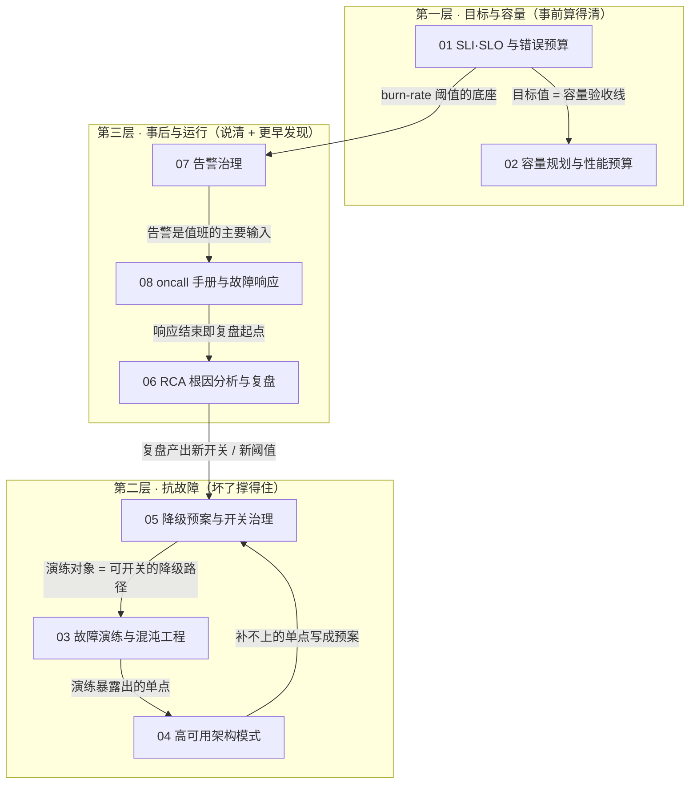

# 13 稳定性工程（模块入口）

> **一句话结论**：稳定性工程不是"让系统不坏"（做不到），而是三件事各有一套判据——**事前算得清**（目标与容量能复算）、**事中看得见**（坏在哪一步、谁该动手，几分钟内能指认）、**事后说得明**（复盘落成一条能被证伪的机制改动）；本仓库目前只修好了"看得见"的**传输通道**（Prometheus 抓 11 个 target、Tempo 存 24 小时 trace），三套判据本身几乎为零，这个落差就是本模块全部内容的起点。
> **阅读前置**：能读 Spring Boot 的 `application.yml`；知道 Micrometer / Actuator 会把指标暴露在 `/actuator/prometheus`；知道 Resilience4j 的熔断器在做什么（不熟先读 [05-降级预案与开关治理](./05-降级预案与开关治理.md)）；会跑只读的 pwsh 命令。不需要会搭集群，本模块不教装机。
> **证据基线**：仓库 `main`（ai-customer-service 1.0.0-SNAPSHOT，JDK 17 / Spring Boot 4.2.0 / Spring Cloud 2026.0.0 / Spring Cloud Alibaba 2025.1.0.0 / Resilience4j 2.4.0 / Prometheus 2.51.0 / Grafana 10.4.0 / Tempo 2.4.1）；B 级引用均为当次 `read` 核对的完整路径与行号，C 级为本机 `pwsh` 真实输出（2026-11-27 采集，未起服务、未联网、未用 docker）；预计阅读 35~45 分钟。

## 证据边界

本模块八篇讨论的能力在本仓库冷热严重不均，先把"能说死"和"只能当目标"分开，避免把有配置文件读成有治理。

| 类别 | 本仓状态 | 本模块怎么处理 |
| --- | --- | --- |
| 指标传输通道 | ✅ 已入库：`deploy/observability/prometheus.yml` 全文 24 行，`scrape_interval: 15s`，11 个 `static_configs` target（8080~8090） | 当真实基线讲，直接引行号 |
| 链路追踪 | ✅ 已入库：Micrometer Tracing 1.8.0 + OpenTelemetry 1.68.0 → OTLP → Tempo，`deploy/observability/tempo.yaml` 的 `block_retention: 24h` | 当"事后能还原现场"的现有资产讲，同时说清"只留 24 小时"的代价 |
| 业务自定义指标 | ❌ 未入库：668 个 Java 文件里 `MeterRegistry` / `Timer.builder` / `Counter.builder` 命中 0 | 反复标注"首 token 时延、AI 回答质量无指标"，只给最小补法 |
| 告警规则 / 路由 | ❌ 未入库：`prometheus.yml` 无 `rule_files`、无 `alerting`；`deploy/docker-compose/docker-compose-observability.yml` 只有 4 个服务，无 alertmanager；全仓 `alertmanager` 命中 0 | 只讲规则怎么算、怎么判读，接入方案一律标"未落地" |
| 看板 | ⚠️ 半落地：Grafana 10.4.0 已装，`deploy/observability/grafana/provisioning/datasources/datasources.yaml` 只装配了 Prometheus + Tempo 两个数据源，**没有任何 dashboard json** | 当"面板要自己搭"讲，不假装打开就有图 |
| SLO / 错误预算 | ❌ 未入库：`SLO`（大小写敏感）在 `docs/`、`deploy/`、`tools/` 命中 0 | 明确写"本仓没有 SLO 文档"，不虚构目标值 |
| 容量实测 | ⚠️ 半落地：`docs/27-性能基线报告.md` 静态基线已完成，第六章标题就是"实测结果记录表（待回填）" | 只当"换算链的输入"，不当"实测数据" |
| 演练 / 值班 / 复盘流程 | ❌ 全未入库：`chaos` / `ChaosBlade` / `toxiproxy` 命中 0；`runbook` / `值班` 命中 0；无演练记录、无复盘模板入库 | 全部标为待建设项，给模板与判据 |
| 本机可执行性 | ✅ node 24.16.0 / pwsh / JDK 17.0.19；❌ 无 docker、不许联网、不许起服务、单命令 30 秒 | C 级只做静态统计与纯算术；要跑服务的命令统一标"未本机实测，给命令与判读方法" |

---

## 1. 定位：稳定性工程只解决三个问题

判断一段稳定性工作有没有价值，只要问它落在下面哪一格。落不进任何一格的动作，通常是"看起来很努力"。

| 问题 | 问的到底是什么 | 合格的判据形态 | 本模块篇目 |
| --- | --- | --- | --- |
| **事前算得清** | 我的目标是多少？这个业务量要多少资源？ | 一个能被第二个人重算的公式 + 一条**否决过发布**的阈值 | 01、02 |
| **事中看得见** | 现在坏到哪一步？该谁动手、按哪个开关？ | 一条指标 / 一条日志关键字 / 一句降级文案 / 一条能叫醒人的告警 | 03、04、05、07、08 |
| **事后说得明** | 为什么会坏？哪条机制变了、以后哪条命令会红？ | 一份带时间点证据的时间线 + 一组能证伪的改动 | 06（输入来自 03 的演练记录） |

三格之间是**单向依赖**，不是并列关系：没有 01 的阈值，07 的告警只能拍脑袋定数字；没有 05 的开关，03 的演练找不到可注入的点；没有 07 的叫醒机制，08 的值班只能等用户投诉；没有 08 的响应记录，06 的复盘只能靠回忆。这也是本模块为什么把 8 篇排成三层而不是 8 个并列专题。

### 1.1 和"只会写功能"的差别

| 场景 | 只会写功能 | 懂稳定性工程 | 差距落在哪一格 |
| --- | --- | --- | --- |
| 被问"系统可用性多少" | "挺稳定的" | 给出 SLI 分子分母 + 目标值 + 本月预算余额 | 事前算得清 |
| 流量翻倍 | "应该能扛吧" | 从 QPS 推到实例数，指出先崩的是哪个依赖 | 事前算得清 |
| 半夜被告警吵醒 | 慌乱重启 | 按 runbook 逐层排除，先看"是进程没起还是依赖不通" | 事中看得见 |
| 出了一次 P1 | "下次注意" | 时间线 + 5Why + 行动项闭环，产出一条新测试或新告警 | 事后说得明 |
| Redis 挂了 | 整站不可用 | 知道哪些路径可降级（本仓 `VectorCacheStore` 就是现成正例） | 事中看得见 |

### 1.2 三格最常被弄错的样子

| 弄错方式 | 表面症状 | 为什么错 | 正确做法 |
| --- | --- | --- | --- |
| 把"高可用"当成稳定性全部 | 一谈稳定性就是加副本、上双活 | 高可用只覆盖第二层；没有目标和判据时，"双活"也说不清到底达没达标 | 回到 01，先把 SLI 分子分母与目标值写出来 |
| 先买工具，后定判据 | 装了混沌工具，却不知道该验什么 | 工具只提供"注入手段"，判据必须由降级文案、日志关键字、恢复时间盒事先定义 | 03 篇：判据先写在纸上，再挑工具 |
| 用日志代替指标 | "日志里有 warn，说明降级生效了" | 日志不可聚合、不可告警、不可统计次数；本仓降级信息基本只进日志 | 每类降级至少配 1 个 `Counter`，让"降了几次"可查 |
| 复盘只写结论 | 报告三页全是"加强意识、下次注意" | 不可证伪的结论，下次一定重犯 | 06 篇：每条改动必须挂一条命令或一条测试 |

### 1.3 术语先解释（后面正文一律用这几个词）

| 术语 | 一句话职责 | 本仓对应物 |
| --- | --- | --- |
| **SLI**（Service Level Indicator，服务水平指标） | 用一条可测量的比例描述"服务好不好"，如"成功请求数 / 总请求数" | 框架自动给的 `http_server_requests_seconds_count`，无业务埋点 |
| **SLO**（Service Level Objective，目标值） | 给 SLI 定的目标与时间窗，如"30 天内 99.9% 成功" | 无（全仓命中 0） |
| **SLA**（Service Level Agreement，对外承诺） | 带赔付条款的合同级承诺，比 SLO 松 | 无（学习项目无客户） |
| **错误预算**（error budget） | `1 − SLO` 允许的失败量，用来回答"这个月还能不能发版" | 无账本 |
| **burn rate**（预算燃烧速率） | 当前错误率消耗预算的速度，>1 表示比计划烧得快 | 无（没有记录规则可算） |
| **降级**（degrade / fallback） | 依赖坏了走次优路径，而不是把错误抛给用户 | `VectorCacheStore` L2 失败降级 L1-only |
| **熔断**（circuit breaker） | 连续失败到阈值就停止调用，给下游恢复窗口 | Resilience4j `chatService`：窗口 10 次 / 失败率 50% / 打开 30s |
| **fail-open / fail-closed** | 旁路检查自己故障时，放行还是拦截 | `QuotaService` 选 fail-open（放行） |
| **RCA**（Root Cause Analysis，根因分析） | 把故障追到机制层，产出可验证改动 | `docs/28-故障案例库.md` 的 C1~C4 是素材，不是流程 |
| **oncall / runbook** | 值班轮转表 + 现场按单操作的作业手册 | 无（`runbook` / `值班` 命中 0） |

---

## 2. 模块地图：三层，一条闭环



> **读图说明**：全图只有两条箭头真正决定读法。第一条是右下角的 `A06 -->|复盘产出新开关 / 新阈值| A05`——它把三层连成闭环，意思是**复盘的验收物不是报告，而是"05 里多了一条开关"或"07 里多了一条阈值"**；缺了这条箭头，前面所有内容都退化成一次性文档。第二条是 `A01 -->|burn-rate 阈值的底座| A07`——没有 SLO，07 的告警数字就没有算法依据，只能凭经验写 `>50%`。常见误读是把 `A03 → A04` 理解成"先演练再上架构"：本仓的真实顺序相反，架构假设（哪几个是单点、加副本有没有用）必须先写清，演练只负责**证伪**这些假设；反过来读会让你以为多跑几次 `kill -9` 就能提升可用性。

### 2.1 三层各自回答哪一格

| 层 | 回答第 1 节的哪一格 | 篇目 | 读完能做到（可验证） |
| --- | --- | --- | --- |
| 第一层 目标与容量 | 事前算得清 | 01、02 | 能写出 chat SSE 接口的 SLI 分子分母，并把"QPS × 单请求内存"算成实例数 |
| 第二层 抗故障 | 事中看得见（前半） | 03、04、05 | 能列出本仓 3 个单点及其代价；能写出 1 条带判据的演练脚本；能给每个开关标 owner |
| 第三层 事后与运行 | 事中看得见（后半）+ 事后说得明 | 06、07、08 | 能用 4 页模板写一份 RCA，并把它落成 1 条测试或 1 条告警 |

### 2.2 推荐顺序（以及为什么不是 01→02→03…）

**01 → 02 → 05 → 03 → 04 → 07 → 08 → 06**，四条理由：

1. **先有阈值和开关**（01、05），演练才有"什么叫恢复""往哪里注入"两件事可谈；没有降级路径的演练只能 `kill -9` 一个进程，然后看着它重启。
2. **03 之后才是 04**：演练的价值是暴露"加副本没用"的那类单点（本仓 Redis 三个容器挂同一份配置、无 `replicaof`，就是这类），架构改造由演练结果驱动才不浪费。
3. **07、08 在 04 之后**：告警要按"症状"打，症状清单来自你确认过的架构边界；先配告警再改架构，规则会全部作废。
4. **06 放最后不是因为不重要**，而是因为它的输入最全——它要消费 01 的 SLI 口径、03 的演练记录、08 的响应时间线。但如果你只有 2 天，请直接跳到 [§5 路线 A](#5-两条路线2-天补一次复盘4-周建一套体系)，从复盘倒着补，这是投入产出比最高的一条路。

---

## 3. 八篇各解决一个问题

| 篇 | 解决什么问题 | 本项目对应资产 / 缺口 | 证据类型 |
| --- | --- | --- | --- |
| [01 SLI·SLO 与错误预算](./01-SLI-SLO与错误预算.md) | 把"该不该发布"从会议嗓门换成查表 | 资产：`deploy/observability/prometheus.yml#L1-L24` 能抓 11 个服务；缺口：`MeterRegistry` 命中 0、无 `rule_files`、无 SLO 文档 | A 2 / B 20 / C 1（node 实算） |
| [02 容量规划与性能预算](./02-容量规划与性能预算.md) | 把"业务量 → 资源量"写成一条可复算的换算链 | 资产：7 份 compose 声明的资源账（13.5 GiB 堆）、`scripts/loadtest/k6/sse-chat.js`；缺口：容器 `mem_limit=0`、`docs/27-性能基线报告.md#L196` 实测表待回填 | B 为主 + C（node 实算 compose 账本） |
| [03 故障演练与混沌工程](./03-故障演练与混沌工程.md) | 演练的产出是"判据 + 账本"，不是"没出事" | 资产：可注入的降级路径（`VectorCacheStore`、Resilience4j 实例）；缺口：`chaos` 全仓命中 0、无演练记录、无判据 | B + C（pwsh 静态统计实测） |
| [04 高可用架构模式](./04-高可用架构模式.md) | 可用性是乘出来的，动作只有两个：去单点、做隔离 | 资产：MySQL 一主两从（compose + K8s）；缺口：20 份 K8s 工作负载里 18 份 `replicas: 1`，Nacos/ES/MQ 全单点 | B 为主 + C（可用性乘算）+ A 1（Resilience4J 源码） |
| [05 降级预案与开关治理](./05-降级预案与开关治理.md) | 开关不是代码，是一次有代价的授权（谁按、变成什么样、凭什么按回来） | 资产：12 条运行时 `enabled`、25 个布尔字段、23 处 `@ConditionalOnProperty`；缺口：无开关表、无预案文档、无开关指标 | A 3（5 处锚点）/ B 22 文件 / C 13 组 |
| [06 RCA 根因分析与复盘](./06-RCA根因分析与复盘.md) | 把"下次注意"改成一条能跑的命令 | 资产：`docs/28-故障案例库.md`、`docs/29-用户接口输入校验与E2E测试.md`、`docs/30-Spring-AI-2.1升级实施与验证.md` 三份真实记录；缺口：无复盘模板入库、无工单/发布单 | A 2 / B 19 / C 11 组 |
| [07 告警治理](./07-告警治理.md) | 什么时候叫人、叫谁、怎么不被吵死 | 资产：11 个 target 的抓取已就绪，SLI 数据现成；缺口：无规则文件、无 Alertmanager、无通知渠道 | B（现状盘点）+ 目标态 YAML（明确标未落地） |
| [08 oncall 手册与故障响应](./08-oncall手册与故障响应.md) | 让响应不依赖英雄：轮转 + 分级 + runbook | 资产：端口与排查命令取自真实编排（8080~8090，含 `ai-cs-py-chat/app/main.py` 的 8000）；缺口：无轮转表、无 runbook、无升级路径 | B（端口/命令来源可核对）+ 模板 |

> 读这张表的方式：**"资产"列决定你能从哪开始动手，"缺口"列决定你面试时能诚实说什么**。凡缺口写"无"的行，都不允许在简历或复盘里写成"已实现"。

---

## 4. 本项目稳定性现状评分表

评级只看**判据是否存在**，不看代码量多少。一个写了 500 行熔断配置但没人能判定"什么时候该熔断"的系统，评级不会高于 L1。

| 级别 | 定义 | 判定特征 |
| --- | --- | --- |
| **L0 无** | 连素材都没有，或只有传输通道 | 搜不到文档/配置，或只有框架默认行为 |
| **L1 有料无判据** | 有代码、有配置，但没有成文判据与账本 | 能跑，但"好不好"没人能回答 |
| **L2 有判据无闭环** | 判据成文且被执行过一次 | 有文档 + 一次真实执行记录 |
| **L3 闭环可审计** | 有账本 + 到期复审 + 与告警联动 | 依赖项变了会自动提醒人 |

| 能力 | 评级 | 证据（完整路径 + 行号） | 缺口 → 到下一级的最小动作 |
| --- | --- | --- | --- |
| **SLO / 错误预算** | **L0** | `deploy/observability/prometheus.yml#L1-L24`（11 target / 15s，供数通）；`SLO` 大小写敏感在 `docs`、`deploy`、`tools` 命中 0（§7 命令） | 给 gateway 与 chat SSE 各写一条 SLI 分子分母，再加一条记录规则把"已消耗预算"算出来 |
| **容量基线** | **L1** | `docs/27-性能基线报告.md#L196`（"实测结果记录表（待回填）"）；`deploy/mysql/master.cnf#L24`（`max-connections=500`）；`scripts/loadtest/k6/gateway-rate-limit.js` | 把 27 篇的静态基线跑成实测（需 docker + k6，非本机可做）；给每个服务补 `mem_limit` 与水位线 |
| **故障演练** | **L0** | `chaos` / `ChaosBlade` / `toxiproxy` 在业务/部署代码中命中 0；`learning-docs` 内无任何演练记录文件 | 做 1 次手动演练（注入点用现有开关），留下"日志有一条 + 文案有一句 + 恢复在时间盒内"三段记录 |
| **高可用** | **L1** | `deploy/docker-compose/docker-compose-master-slave.yml#L8`（master）、`#L32`、`#L57`（两个从库）；`deploy/mysql/slave.cnf#L15-L18`（`replicate-do-db` 只覆盖 4 个库，`order_db` 不在内）；`deploy/k8s/nacos.yaml#L40`（`replicas: 1`）；`deploy/redis/redis.conf` 全文 39 行无 `replicaof` | MySQL 侧已真冗余，其余仍是单点：给 Nacos/ES/MQ 定一份"挂了损失什么"的代价表，再决定补哪个 |
| **降级开关** | **L1** | `ai-cs-chat/src/main/java/com/aics/chat/cache/VectorCacheStore.java#L73-L77`（L2 失败降级 L1-only）；`ai-cs-chat/src/main/resources/application.yml#L114-L130`（COUNT_BASED 10 / 50% / 30s）；`ai-cs-chat/src/main/java/com/aics/chat/observability/QuotaService.java#L72-L79`（fail-open）；`ai-cs-gateway/src/main/resources/application.yml#L36-L49`（分布式令牌桶，`enabled: false` 的本地兜底） | 开关本体齐全但治理为零：无开关表、无 owner、无"按下之后变成什么样"的描述；先做一张表 + 一条开关指标 |
| **RCA / 复盘** | **L1** | `docs/28-故障案例库.md#L23`（C1 事务注解自调用失效）、`#L127`（C2 复制过滤漏订单库）、`#L171`（C3 `pay.sandbox` 死配置）、`#L212`（C4 K8s 清单缺 3 个服务）；`docs/29-用户接口输入校验与E2E测试.md#L55`（夹带 `role=admin` 提权，已修） | 素材是顶级的（都是代码级可复现事实），缺的是"流程"：无模板、无 24 小时内产出的机制改动清单 |
| **告警** | **L0** | `prometheus.yml` 24 行内 `rule_files` / `alerting` / `alertmanager` 三个词命中 0；`deploy/docker-compose/docker-compose-observability.yml#L19-L68` 只有 prometheus/grafana/tempo/otel-collector 四个服务；`deploy/observability/grafana/provisioning/datasources/datasources.yaml#L4-L16` 只有两个数据源、无看板 | 三件事依次做：规则文件 → Alertmanager 服务 → 至少 3 条"症状型"告警（服务 down / 5xx 比例 / 连接池饱和），并写明每条告警的"我现在该干什么" |
| **oncall / runbook** | **L0** | `runbook` / `值班` 两个词在 `docs`、`deploy`、`tools` 命中 0（§7 命令） | 一张轮转表 + 一份端口级 runbook + 一次"虚拟值班"巡检记录（一个人按单走一遍，记录卡在哪） |

### 4.1 三格评级怎么自己复核（本机真实输出）

评级不是观点，是命令能验的东西。下面三段都在无 docker、不联网、不启服务的条件下跑完（2026-11-27 采集）。

**（1）单点密度：K8s 上还有几个"只有一份"的工作负载**

```pwsh
cd D:\Projects\Persion\ai-customer-service
$r = Select-String -Path deploy\k8s\*.yaml,deploy\k8s\services\*.yaml -Pattern '^\s*replicas:\s*(\d+)'
"k8s_replicas_decl=" + $r.Count
"k8s_single_copy=" + (($r | Where-Object { $_.Matches[0].Groups[1].Value -eq '1' }).Count)
"k8s_multi_copy=" + (($r | Where-Object { $_.Matches[0].Groups[1].Value -ne '1' }).Count)
```

```text
k8s_replicas_decl=20
k8s_single_copy=18
k8s_multi_copy=2
```

**怎么读**：20 份工作负载声明里 18 份是单副本，只有 `deploy/k8s/mysql.yaml#L210`（两个从库）和 `deploy/k8s/services/product-service.yaml#L25`（商品服务）是多副本。所以"高可用 L1"不是谦虚，是算术：**业务服务里只有 product 一份体验了负载均衡，其余挂一个 Pod 就断一条链路**。

**（2）Redis 三个容器是不是真的主从**

```pwsh
cd D:\Projects\Persion\ai-customer-service
"redis_conf_lines=" + (Get-Content deploy\redis\redis.conf).Count
"redis_replica_lines=" + (Select-String -Path deploy\redis\redis.conf -Pattern 'replicaof|slaveof' | Measure-Object).Count
```

```text
redis_conf_lines=39
redis_replica_lines=0
```

**怎么读**：`deploy/docker-compose/docker-compose-master-slave.yml#L83`、`#L102`、`#L121` 起了三个 Redis 容器（`redis-node1/2/3`），但配置文件 39 行里没有任何 `replicaof`——**三个容器是三台互不相识的单机**，"多节点"没有变成"高可用"。这正是 04 篇用来反驳"加机器就是高可用"的现场证据。

**（3）热更新与定时任务的真实覆盖面**

```pwsh
cd D:\Projects\Persion\ai-customer-service
$j = Get-ChildItem -Recurse -File -Filter *.java -Path (Get-ChildItem -Directory -Filter 'ai-cs-*').FullName |
     Where-Object { $_.FullName -notmatch '\\target\\' }
"refresh_scope_lines=" + ($j | Select-String -Pattern '@RefreshScope' | Measure-Object).Count
"refresh_scope_classes=" + (($j | Select-String -Pattern '@RefreshScope' | ForEach-Object { $_.Path } | Sort-Object -Unique).Count)
"sentinel_resource_lines=" + ($j | Select-String -Pattern '@SentinelResource' | Measure-Object).Count
"xxljob=" + ($j | Select-String -Pattern '@XxlJob' | Measure-Object).Count
"scheduled=" + ($j | Select-String -Pattern '@Scheduled' | Measure-Object).Count
```

```text
refresh_scope_lines=3
refresh_scope_classes=2
sentinel_resource_lines=2
xxljob=1
scheduled=6
```

**怎么读**：`@RefreshScope` 只有 2 个类（`ai-cs-chat/src/main/java/com/aics/chat/modelrouter/ModelRouterProperties.java`、`ai-cs-gateway/src/main/java/com/aics/gateway/config/RateLimitProperties.java`）——**"改 Nacos 立即生效"这件事，只对这两个类的字段成立**，其余开关改完要重启（05 篇整篇讲这个代价）。`@SentinelResource` 命中 2 行，其中 1 行是 `ai-cs-chat/src/main/java/com/aics/chat/config/SentinelRules.java#L6` 的 import，真实使用只有 `ai-cs-chat/src/main/java/com/aics/chat/controller/ChatController.java#L79` 一处，所以"熔断降级"在本仓主要靠 Resilience4j 的注解与配置，不靠 Sentinel。`@XxlJob` 只有 1 个（`ai-cs-order/src/main/java/com/aics/order/task/OrderTimeoutScanJob.java#L27`），且 `ai-cs-order/src/main/resources/application.yml#L54` 是 `enabled: ${XXL_JOB_ENABLED:false}`——**默认关闭**，6 处 `@Scheduled` 才是实际在跑的调度。

**怎么用这张表**：每周只挑**评级最低且你能在本机验证**的一行做动作。当前唯一能在无 docker 环境下真实推进的是"降级开关 L1→L2"（开关表 + owner 全靠读代码就能写）和"告警 L0→L1"（规则 YAML 可以先写、写成文本再由 `promtool check rules` 验证，后者需 docker，未本机实测）。SLO 那一行不要在没指标的地方硬定数字——那是本模块最容易被写成假话的一格。

---

## 5. 两条路线：2 天补一次复盘，4 周建一套体系

### 5.1 路线 A：一次故障的复盘闭环（2 天，倒着补）

适合"马上要面试 / 马上要交一份稳定性改进方案"的读者。不用等 docker，全部基于仓库真实记录。样本取 `docs/28-故障案例库.md#L23` 的 C1（自调用导致事务注解失效）。

| 时段 | 动作 | 产出 | 验收标准 |
| --- | --- | --- | --- |
| D1 上午 1h | 从案例库抄出时间线原料 | 一条按时间排列的表：触发 / 发现 / 止血 / 恢复 / 定级 | 每个时间点都挂着证据来源（代码行、测试名、文档行），不出现"大概下午" |
| D1 上午 1h | 用 01 篇口径量化影响面 | 一句话：失败请求数 / 总请求数，并注数据来源指标名 | 出现 `http_server_requests_seconds_count` 这类具体指标；若没数据就写"未实测" |
| D1 下午 1.5h | 5Why 追到机制（06 篇） | 5 层 why，最底层必须是机制名 | 最底层能映射到具体类或配置，不能是"人没注意" |
| D1 下午 1.5h | 定 3 条改动 | 修复 / 防复发 / 可检出，各 1 条 | 至少 1 条是"以后会自动红"的测试或命令 |
| D2 上午 2h | 把改动变成能跑的验证 | 1 条测试或 1 条 grep 命令 + 期望输出 | 本机 30 秒内跑完，红/绿可区分 |
| D2 下午 1h | 归档 + 交叉检查 | 一份 4 页 RCA（字段用 06 篇模板）+ 3 条改动状态表 | 每条改动有 owner 与期限；报告里没有一处"下次注意" |
| D2 收尾 0.5h | 写结论句 | "这类问题以后怎么被更早发现" | 答案必须是一条命令或一条告警；写成"流程加强"即视为未完成 |

### 5.2 路线 B：体系建设（4 周，按 §2.2 顺序）

| 周 | 主题 | 篇目 | 产出物 | 周验收 |
| --- | --- | --- | --- | --- |
| W1 | 目标与容量 | 01、02 | 一页 SLO 表（只写 2 个接口）+ 一条"业务量 → 实例数"换算脚本 | 第二个人改一个输入能重算出结果，且过程可复述 |
| W2 | 单点与开关 | 04、05 | 单点清单（含"挂了损失什么"）+ 开关表（12 条 + owner + 生效方式） | 每条开关都能回答"按下去系统具体变成什么样" |
| W3 | 演练与告警 | 03、07 | 1 份演练手册（判据 + 时间盒）+ 3 条告警规则 + Alertmanager 服务骨架 | 规则 YAML 能过 `promtool check rules`（需 docker，**未本机实测**，命令见 07 篇） |
| W4 | 响应与复盘 | 08、06 | runbook 一页 + 轮转表 + 一次桌面演练记录 | 一个没参与过的人照 runbook 在 10 分钟内能定位到"哪个端口没起来" |

### 5.3 什么不算完成（三条最常见的自欺）

| 看起来完成了 | 实际没完成 | 判据 |
| --- | --- | --- |
| 写了一份 SLO 文档 | SLO 从未否决过一次发布 | 文档里有"本月预算耗尽 → 冻结发布"的执行记录，才算 |
| 加了 10 条告警规则 | 规则从没触发过，也没人验证过它会不会触发 | 至少手动构造一次失败路径，看到告警真的到达通知渠道 |
| 有一份演练报告 | 报告里只有结论"系统正常"，没有判据 | 报告里必须有"哪一行日志、哪一句降级文案、多少秒内恢复" |

---

## 6. 依赖关系：先读什么，别在本模块找什么

| 关系 | 文档 | 为什么 |
| --- | --- | --- |
| **前置** | [07-运维部署/04-Prometheus可观测性](../07-运维部署/04-Prometheus可观测性.md) | 本模块所有"看得见"都依赖采集侧；那边没起，这边全是空谈 |
| **前置** | [07-运维部署/06-优雅停机与零丢失滚动更新](../07-运维部署/06-优雅停机与零丢失滚动更新.md) | "事中"最高频的故障就是一次发布，停机语义直接决定损失大小 |
| **前置** | [07-运维部署/05-XXL-Job分布式调度](../07-运维部署/05-XXL-Job分布式调度.md) | 定时任务静默失败是本仓真实缺陷面（`XXL_JOB_ENABLED` 默认 `false`），属"看得见"的盲区 |
| 相关 | [12-性能工程](../12-性能工程/README.md) | 容量的"实测"部分在那边做，本模块只消费结论（SLI 分子分母、预算线） |
| 相关 | [08-测试/05-性能压测实战-k6与JMeter](../08-测试/05-性能压测实战-k6与JMeter.md) | SLI 要有数据，得先有压测；`scripts/loadtest/k6/` 下的两份脚本是现成输入 |
| 相关 | [09-安全与设计模式/02-接口安全与限流策略](../09-安全与设计模式/02-接口安全与限流策略.md) | 429 是"预期内拒绝"，算进 5xx 错误率会让 SLO 永久假红 |
| 相关 | [02-Spring微服务/08-Feign熔断与降级语义](../02-Spring微服务/08-Feign熔断与降级语义.md) | 熔断器语义属框架层，本模块只谈"什么时候该熔、熔了给用户看什么" |
| **上游入口** | [00-学习路线总览/README.md](../00-学习路线总览/README.md) | 定位本模块在 13 个阶段里的位置与三条读者路线 |
| 下游 | [19-求职与面试总纲](../19-求职与面试总纲/README.md)、[20-生产实践](../20-生产实践/README.md) | 本模块的案例与口径是"讲一次线上故障"这类题的骨架 |

### 6.1 边界分工：这些问题别在本模块找答案

| 你的问题 | 去哪 | 本模块只负责 |
| --- | --- | --- |
| Prometheus 怎么采集、Tempo 怎么查链路 | [07-运维部署/04-Prometheus可观测性](../07-运维部署/04-Prometheus可观测性.md) | 指标够不够用来判 SLO、告警规则怎么写 |
| Sentinel / Resilience4j 的 API 怎么用 | [04-中间件/06-Sentinel限流与熔断降级](../04-中间件/06-Sentinel限流与熔断降级.md)、[02-Spring微服务/08-Feign熔断与降级语义](../02-Spring微服务/08-Feign熔断与降级语义.md) | 策略与预案：谁有权按、按了变成什么样 |
| MySQL 主从原理、复制延迟怎么产生 | [03-数据库与ORM/05-MySQL锁机制与主从复制读写分离](../03-数据库与ORM/05-MySQL锁机制与主从复制读写分离.md) | 切换路径、延迟对可用性的实际影响 |
| 限流算法怎么实现（令牌桶/滑动窗口） | [11-数据结构与算法/10-限流算法-四大算法与网关实现](../11-数据结构与算法/10-限流算法-四大算法与网关实现.md) | 网关限流参数如何成为 SLO 的设计素材 |
| 日志怎么聚合检索 | [07-运维部署/07-Loki日志聚合](../07-运维部署/07-Loki日志聚合.md) | 该在日志里留哪几个关键字，演练时怎么靠它判读 |

### 6.2 三类读者各走一条路（同一套材料，顺序不同）

| 你是谁 | 建议路径 | 预计 | 走完手上有什么 |
| --- | --- | --- | --- |
| 后端开发，只要"线上出问题我能定位" | [07-运维部署/04-Prometheus可观测性](../07-运维部署/04-Prometheus可观测性.md) → [05-降级预案与开关治理](05-降级预案与开关治理.md) → [03-故障演练与混沌工程](03-故障演练与混沌工程.md) → [08-oncall手册与故障响应](08-oncall手册与故障响应.md) | 3 天 | 一张背得下来的排查单：端口、日志关键字、`shutdown: graceful` 语义（`ai-cs-gateway/src/main/resources/application.yml#L2`） |
| 要面试"讲一次线上故障" | [06-RCA根因分析与复盘](06-RCA根因分析与复盘.md) → [05-降级预案与开关治理](05-降级预案与开关治理.md) → [01-SLI-SLO与错误预算](01-SLI-SLO与错误预算.md) | 2 天 | 一份 4 页 RCA + 3 条可证伪改动 + 会被追问的 10 个问题（06 篇结尾） |
| 负责稳定性建设、要带队伍 | [01-SLI-SLO与错误预算](01-SLI-SLO与错误预算.md) → [02-容量规划与性能预算](02-容量规划与性能预算.md) → [04-高可用架构模式](04-高可用架构模式.md) → [07-告警治理](07-告警治理.md) → [08-oncall手册与故障响应](08-oncall手册与故障响应.md) → [06-RCA根因分析与复盘](06-RCA根因分析与复盘.md) | 4 周 | §5.2 的四周产出物：目标线、容量表、单点清单、告警规则、值班表、复盘模板 |

**注意第三行和第一行的区别**：`01 → 04` 是"先定判据，再改架构"；反过来先加副本，你会发现没有一条 SLO 能证明加副本有用。这不是顺序洁癖——本仓 20 份 K8s 工作负载声明里 18 份单副本（§4.1），先加副本等于把 18 个判断一次性做掉，却没有任何判据告诉你先加哪个。

---

## 7. 检查点清单：12 条自己就能验的成年礼

前 3 条是"能不能读懂本仓现状"，后 9 条是"能不能做出东西"。每条都给了命令或判据，全部可在无 docker、不联网、不启服务的条件下完成（C 级）。

### 7.1 一条命令摸清底（本机真实输出）

```pwsh
cd D:\Projects\Persion\ai-customer-service
$j = Get-ChildItem -Recurse -File -Filter *.java -Path (Get-ChildItem -Directory -Filter 'ai-cs-*').FullName |
     Where-Object { $_.FullName -notmatch '\\target\\' }
"java_files=" + $j.Count
"meter_hits=" + ($j | Select-String -Pattern 'MeterRegistry|Timer\.builder|Counter\.builder' | Measure-Object).Count
"alert_rule_hits=" + (Select-String -Path deploy\observability\prometheus.yml -Pattern 'rule_files|alerting|alertmanager' | Measure-Object).Count
"prometheus_lines=" + (Get-Content deploy\observability\prometheus.yml).Count
"alertmanager_in_repo=" + ((Get-ChildItem -Recurse -File -Path deploy,tools,docs | Select-String -Pattern 'alertmanager' | Measure-Object).Count)
"slo_docs=" + ((Get-ChildItem -Recurse -File -Include *.md,*.yml,*.yaml -Path docs,deploy,tools | Select-String -Pattern 'SLO' -CaseSensitive | Measure-Object).Count)
"chaos_hits=" + ((Get-ChildItem -Recurse -File -Include *.java,*.yml,*.yaml,*.ps1,*.sh -Path . |
     Where-Object { $_.FullName -notmatch 'node_modules|\\target\\|\\\.git\\|learning-docs' } |
     Select-String -Pattern 'chaos|ChaosBlade|toxiproxy' | Measure-Object).Count)
"runbook_or_shift=" + ((Get-ChildItem -Recurse -File -Include *.md -Path docs,deploy,tools | Select-String -Pattern 'runbook|值班' | Measure-Object).Count)
"grafana_dashboard_files=" + ((Get-ChildItem -Recurse -File deploy\observability\grafana | Where-Object { $_.Name -match 'dashboard|\.json' } | Measure-Object).Count)
```

真实输出（2026-11-27，本机 node/pwsh，约 3 秒）：

```text
java_files=668
meter_hits=0
alert_rule_hits=0
prometheus_lines=24
alertmanager_in_repo=0
slo_docs=0
chaos_hits=0
runbook_or_shift=0
grafana_dashboard_files=0
```

**怎么读**：九个数里七个 0。这些 0 不是"没配好"，而是"这一层不存在"——没有埋点指标、没有告警规则、没有告警路由、没有看板、没有演练、没有 runbook、没有 SLO 文档。唯一两个非 0 是 `java_files=668` 与 `prometheus_lines=24`，它们说明**底座是齐的**：服务会暴露指标、Prometheus 会抓。缺口全部落在"判据"和"账本"上，这正是本模块八篇要补的部分。任何人跟你说这套系统"稳定性已经做完了"，让他跑这九行。

### 7.2 检查点表

| # | 检查点 | 怎么验 | 通过标准 |
| --- | --- | --- | --- |
| 1 | 能背出 11 个 target 的端口与用途 | 读 `deploy/observability/prometheus.yml#L11-L22` | 能说出 8080=gateway、8083=chat、8087=order，且知道没有 8091+ |
| 2 | 知道为什么 `/actuator/health` 帮不上判断 | 读 `tools/nacos-config/aics-shared.yml#L28-L35`（`show-details: never`） | 能解释"只返回 UP/DOWN，看不出是哪个组件挂了"，并说出改成 `always` 的代价 |
| 3 | 能说明 Tempo 只留 24 小时的后果 | 读 `deploy/observability/tempo.yaml#L19` | 能说出"昨天的事故今天查不到链路，只能靠日志与复盘记录" |
| 4 | 能给 chat SSE 接口写出 SLI 分子分母 | 结合 01 篇 + `ai-cs-chat/src/main/resources/application.yml#L80-L83`（`sseChatService` 60s） | 分子分母可测、超时口径明确（60s 超时算失败还是成功，必须有答案） |
| 5 | 能指出 3 个单点并给出代价 | 读 `deploy/k8s/nacos.yaml#L40`、`deploy/redis/redis.conf`（无 `replicaof`）、`deploy/k8s/rocketmq.yaml#L35`（`replicas: 1`） | 每个单点都写出"挂了哪条链路不可用"，而不是只写"有风险" |
| 6 | 能解释"改了配置没反应"的机制 | 全仓 `@RefreshScope` 命中 3 行、2 个类（`ModelRouterProperties`、`RateLimitProperties`） | 能说清 `@Value` 是启动期一次性注入、`@ConditionalOnProperty` 决定 Bean 是否存在 |
| 7 | 能说清熔断参数与"什么时候该熔"的区别 | 读 `ai-cs-chat/src/main/resources/application.yml#L114-L130` | 参数背对（10 / 50% / 30s），且能说出这组数是为 LLM 长尾延迟选的，不是通用默认值 |
| 8 | 能画出一次降级的完整判读链 | 读 `VectorCacheStore.java#L73-L77` | 能说出"日志出现 `降级 L1-only` → 检索仍可用但变慢 → 该告警但不该 Page" |
| 9 | 能用 06 篇模板写出 C1 的 5Why | 读 `docs/28-故障案例库.md#L23-L60` | 最底层落到机制（自调用绕过代理），不是"没测到" |
| 10 | 能给一条告警写出"我现在该干什么" | 自己写 1 条 PromQL 规则 | 超过一句动作即不合格（"看一眼"算不合格） |
| 11 | 能列出演练必须留下的三段记录 | 03 篇手册 | 现象（哪条日志）/ 恢复（多少秒）/ 验证（哪条命令回绿），三段齐 |
| 12 | 能说清"本模块哪些是目标态" | 读本文 §8 | 能逐条说出五个"无"及各自证据，不把目标态讲成已实现 |

---

## 8. 诚实清单：本模块"没有"的东西

这一节是本模块存在的前提。把预想当现状，是稳定性写作里最贵的错误。

**五条硬结论（都能被 §7.1 的命令复核）：**

1. **本项目没有 SLO，也没有错误预算**——`SLO` 大小写敏感在 `docs`、`deploy`、`tools` 命中 0；有的只是能算出 SLI 的抓取通道。
2. **本项目没有告警规则，也没有 Alertmanager**——`deploy/observability/prometheus.yml` 全文 24 行，无 `rule_files`、无 `alerting`；`deploy/docker-compose/docker-compose-observability.yml#L19-L68` 只有 4 个服务；全仓 `alertmanager` 命中 0。
3. **本项目没有做过任何故障演练**——`chaos` / `ChaosBlade` / `toxiproxy` 命中 0，也没有一份演练记录文件。讲演练的那篇文章本身，就是唯一与"演练"相关的东西。
4. **本项目没有值班表，也没有 runbook**——`runbook` / `值班` 在 `docs`、`deploy`、`tools` 命中 0。
5. **本项目没有业务自定义指标**——668 个 Java 文件里 `MeterRegistry` / `Timer.builder` / `Counter.builder` 命中 0，`/actuator/prometheus` 上只有框架自动指标。

| 项 | 现状证据 | 本模块怎么处理 | 什么时候可以改口 |
| --- | --- | --- | --- |
| SLO / 错误预算 | 全仓命中 0；`deploy/observability/prometheus.yml#L1-L24` 只有抓取配置 | 01 篇只教"怎么定"，明写"本仓没有" | 跑 §7.1 后 `slo_docs` 不再为 0，且有一条 SLO 真的否决过一次发布 |
| 告警规则 / 路由 | 24 行无 `rule_files`；compose 无 alertmanager；`grafana/provisioning` 只有数据源 | 07 篇给规则写法，接入方案标"未落地" | `prometheus.yml` 出现 `rule_files`，且有一条告警真的打到人 |
| 演练 | `chaos_hits=0`，无演练记录 | 03 篇给可执行演练项与判据，标"从未执行" | 有两段以上"现象 / 恢复 / 验证"三段记录 |
| oncall / runbook | `runbook_or_shift=0` | 08 篇给模板与端口作业单，标"未启用" | 有一份按单走完的巡检记录 |
| 容量实测 | `docs/27-性能基线报告.md#L196` 标题即"待回填" | 02 篇把静态基线当输入，实测结果一律不编 | 27 篇第六章的表格被真实数字填满 |
| 业务指标 | `meter_hits=0` | 只讲"该埋哪几个"（首 token、RAG 命中、AI 评分） | 出现第一个 `Counter.builder` 并能在 Prometheus 里查到 |
| 看板 | `grafana_dashboard_files=0`，只有 2 个数据源 | 不假装"打开 Grafana 就有图" | `grafana/provisioning` 下出现 dashboards 目录 |

**写简历 / 汇报的三条红线：**

- 不写"可用性达到 99.95%"——本仓没有任何按 SLI 口径统计的实测值，只有 K8s 上 18/20 个单副本工作负载。
- 不写"告警 3 分钟内响应"——没有告警规则、没有路由、没有通知渠道。
- 不写"完成 N 次故障演练"——演练次数为 0，可写的是"设计了 N 个演练项与判据（未执行）"。

**可以诚实写的是**：`deploy/observability/prometheus.yml` 已按 15s 抓取 11 个服务；MySQL 已是一主两从且 `replicate-do-db` 只覆盖 4 个库（`order_db` 未覆盖，见 `docs/28-故障案例库.md#L127` 的 C2）；chat 侧有 COUNT_BASED 熔断（10 次 / 50% / 30s）、`QuotaService` 显式选 fail-open、`VectorCacheStore` 在 Redis 故障时降级 L1-only——这些是**代码级可核对的降级与容错事实**，比任何数字都经得起追问。

---

> 返回 [学习路线总览](../00-学习路线总览/README.md) ｜ 下一篇从 [01 SLI·SLO 与错误预算](./01-SLI-SLO与错误预算.md) 开始
