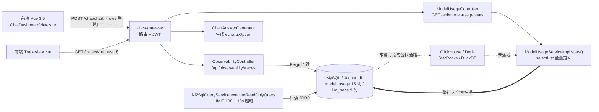
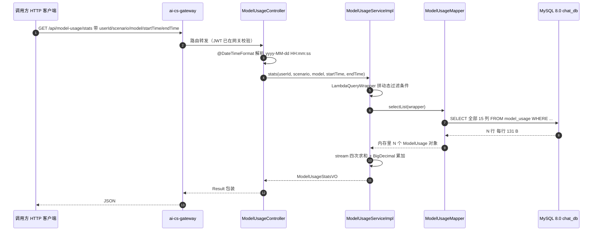

# 01. OLAP 与列式存储原理：列存快在「少读列 + 按列压缩」，不在「列」这个布局本身

> **一句话结论**：列式存储的性能优势全部来自两个可度量的量——**这次查询扫了多少字节**、**每个字节能压掉多少**；「列」只是让这两件事同时成立的组织方式，它本身没有魔法。反过来说：当你把 20 列全读出来时，列存相对行存的优势只剩 1.1 倍（本篇 C-1 实算）。
> **阅读前置**：会写带 `WHERE` / `GROUP BY` 的 SQL；知道 InnoDB 把一行数据放在 16 KiB 的页里、二级索引要走回表；看得懂 Java `Stream` 求和。不需要装过 ClickHouse。
> **证据基线**：JDK 17 / Spring Boot 4.2.0 / Spring Framework 7.1.0 / MyBatis 3.6.0 / MyBatis-Plus 3.0.5 / MySQL 8.0 / Vue 3.5；证据 **A 2 条 · B 14 条 · C 4 组**；预计阅读 **50 分钟**。

## 证据边界

本篇有一个必须先说清楚的前提：**这个仓库里没有任何列式存储引擎**。所以「列存有多快」这件事，本篇只能给你可复算的模型算术，不能给你引擎实测；而「你的项目到底该不该上列存」这个问题，本篇能给真实代码与真实行号。

| 类别 | 本仓状态 | 本篇怎么处理 |
| --- | --- | --- |
| 行存引擎（MySQL 8.0 InnoDB） | ✅ 真实在用，`deploy/mysql/llm-observability-init.sql` 建了 5 张观测表 | 用真实列宽做 C 级算术，指出行存的 IO 放大点 |
| 列存引擎（ClickHouse / Doris / StarRocks / DuckDB） | ❌ 未入库：全仓 `clickhouse` 只在 `ai-cs-order/eff-order.xml` 命中 2 行，且那是 Maven 依赖清单 dump，不是依赖声明 | 只做原理讲解 + 引擎家族对照表，**明确标注未落地** |
| 分析类统计接口 | ⚠️ 半落地：接口在（`/api/model-usage/stats`、`/online-records/stats`），实现是「`selectList` 全量拉回 + JVM 内存聚合」，**没有一条 SQL `GROUP BY`** | 用真实行号讲清现状与崩溃阈值 |
| 可视化（ECharts） | ⚠️ 半落地：`ChatDashboardView.vue` 真实存在，`dist/assets/charts-*.js` 实测 1003 KiB；但它入参的 `rows` 是**用户手填 JSON**，不是从库里查出来的 | 讲清「图表渲染」与「数据分析」是两件事 |
| 引擎内部实现（granule 大小、SIMD 指令、压缩算法默认值） | ❌ 本仓不可核 | 只作外部知识陈述并标注「本仓无可核证据」 |
| 性能数字（吞吐、延迟、压缩后大小） | ❌ 无 | **不写任何引擎实测数字**；只写可复算的模型算术，并标明「模型算术，非实测」 |

## 0. 先看现象

### 现象一：一搜 `clickhouse`，全仓只剩两行「别人的依赖清单」

```powershell
Get-ChildItem -Recurse -File -Include *.java,*.xml,*.yml,*.yaml,*.sql,*.ts,*.vue |
  Where-Object { $_.FullName -notmatch '\\(target|node_modules|\.m2|learning-docs)\\' } |
  Select-String -Pattern 'clickhouse|ClickHouse|OLAP' |
  ForEach-Object { $_.Path.Replace((Get-Location).Path + '\','') + ':' + $_.LineNumber }
```

```text
ai-cs-order\eff-order.xml:8369
ai-cs-order\eff-order.xml:9589
```

`eff-order.xml` 不是本项目写的配置，而是一份 Maven 依赖清单的导出物（里面连 `pulsar-io-jdbc-clickhouse`、`testcontainers-clickhouse` 这种从没用过的 artifactId 都在）。也就是说：**代码、配置、部署编排里，一条 ClickHouse 都没有**。

判读：如果按「这个项目用了 OLAP」的前提去读代码，你会一直找不到对应实现，然后把「没实现」误读成「我没找到」。

### 现象二：两个「统计」接口，一次 SQL 聚合都没有

```powershell
Get-ChildItem ai-cs-message\src\main\java\com\aics\message\service\impl\*.java |
  Select-String -Pattern 'selectList\(' | Measure-Object | Select-Object -ExpandProperty Count
Get-ChildItem -Recurse -File -Include *.java,*.xml |
  Where-Object { $_.FullName -notmatch '\\(target|node_modules|learning-docs)\\' } |
  Select-String -Pattern 'GROUP BY|group by'
```

```text
7
ai-cs-chat\src\main\java\com\aics\chat\nl2sql\Nl2SqlQueryService.java:161  + "注意：必须根据用户问题中的业务含义选择正确的database，并编写合法SELECT语句（可带WHERE/ORDER BY/GROUP BY聚合）")
ai-cs-chat\src\main\java\com\aics\chat\security\SqlGuard.java:230  * 遍历 SELECT 语法树收集被引用的列（含 SELECT 列表/WHERE/HAVING/GROUP BY/ORDER BY/JOIN ON
ai-cs-message\src\main\java\com\aics\message\mapper\ModelUsageMapper.java:16  * <h3>【设计原理】为什么统计不写 GROUP BY 自定义 SQL</h3>
ai-cs-message\src\main\java\com\aics\message\service\ModelUsageService.java:19  * <h3>【设计原理】为什么统计选择"内存聚合"而非 SQL GROUP BY</h3>
```

`service/impl/` 下 7 处 `selectList`；`GROUP BY` 的 4 处命中全是**注释和给模型看的提示词**，一处真正的聚合 SQL 都没有。统计是靠这条代码完成的：

```java
// ai-cs-message/src/main/java/com/aics/message/service/impl/ModelUsageServiceImpl.java L98
List<ModelUsage> records = modelUsageMapper.selectList(wrapper);
```

`model_usage` 是 15 列的表（`deploy/mysql/llm-observability-init.sql` L29-L49），这里把**命中条件的全部行、全部 15 列**一次性拉进 JVM 堆，然后在 `Stream` 里做四次求和。前面那 4 条 jd 注释还解释了为什么这么写（可 mock、可单测、量级可控）——理由是自洽的，但它把「IO 放大」和「堆占用」两个风险换成了「可测试性」。

判读：这说明「本项目用什么做 OLAP」这个问题，答案是「用 MySQL 拉全量 + Java 内存聚合」，而不是「用 MySQL 的聚合能力」。这两者的崩溃阈值差着一个数量级。

### 现象三：图表是真的，数据链是断的

```powershell
Get-ChildItem ai-cs-frontend\dist\assets\*.js | Where-Object { $_.Name -match 'chart' } |
  Select-Object Name, @{n='KiB';e={[math]::Round($_.Length/1KB,0)}}
Get-ChildItem -Recurse -File -Include *.vue,*.ts,*.js -Path ai-cs-frontend\src |
  Select-String -Pattern '/stats|model-usage|online-records'
```

```text
Name                KiB
----                ---
charts-DTbrIw2f.js 1003
```

```text
（第二条命令：0 行输出）
```

ECharts 打包产物 1003 KiB，说明图表库是真接进来的；但前端源码里**没有任何一处调用 `/stats`**。再翻 `ChatDashboardView.vue` L50-L58，`rows` 的来源是：

```javascript
// ai-cs-frontend/src/views/ChatDashboardView.vue L51-L58
function loadSample() {
  question.value = '各分类销量分布'
  rowsText.value = JSON.stringify([
    { category: '手机', sales: 1200 },
    { category: '平板', sales: 800 },
    { category: '笔记本', sales: 650 },
    { category: '耳机', sales: 420 },
  ])
}
```

手填的 4 行示例数据。前端把 `{ question, rows }` POST 到 `/chat/chart`，后端 `ChartAnswerGenerator` 返回「自然语言结论 + echartsOption」，前端只负责 `setOption`（同文件 L95-L96）。整条链上，**「从数据库取数」这一环是缺的**。

这些现象指向同一件事：**这个项目还没有「数据分析」这条链路——它有的是「统计接口（全量拉取后内存聚合）」和「图表渲染器（喂什么画什么）」，两者之间没有连起来。所以本篇要讲的不是「怎么上 ClickHouse」，而是「在决定上列存之前，先算清楚你到底读了多少字节」。**

## 1. 整体地图



> **读图说明**：图里只有三条实线是**真的跑得通**的（`/chat/chart` 渲染、`/traces/{requestId}` 回读、`/stats` 全量聚合）。看清两个容易被读错的箭头：①`MS ==> DB` 这条**粗箭头不是「更快的通路」**，它的含义是「这条边上发生的是整行全表扫描，是本篇要量化的 IO 放大源头」；②最右侧 `OLAP` 节点连出来的是**虚线**，代表「本仓不存在」——如果你把这条虚线当成已实现，就会得出「项目已经在用列存做分析」的错误结论，而实测是全仓 0 命中。第三点：`NQ`（NL2SQL）虽然能真的查库，但它的出口是把最多 100 行 JSON 交给大模型，**并不接到 `CG` 上**——图里没有 `NQ --> CG` 这条边，正是现状。

| 组件 | 责任 | 参与方 | 本篇涉及 |
| --- | --- | --- | --- |
| `model_usage` 表（15 列） | 存每次模型调用的 token 与费用 | message 服务写入，chat 服务经 Feign 上报 | 行存 IO 放大、压缩率的主战场 |
| `ModelUsageServiceImpl.stats()` | 按 user/scenario/model/时间段过滤后聚合 | 运维/运营（无前端调用方） | `selectList` 全量拉回的崩溃阈值 |
| `Nl2SqlQueryService` | 把只读 SQL 交给 MySQL，最多回 100 行 | Agent 链路（`@Tool`） | 谓词下推 / LIMIT 下推 / 只读边界的真实做法 |
| `ChartAnswerGenerator` + `ChatDashboardView.vue` | 数据行 → 结论 + ECharts option | 运营 | 「图表 ≠ 分析」的分界线 |
| ClickHouse 等列存引擎 | 本篇讲解对象 | 无（未落地） | 原理、家族对照、迁移判据 |

## 2. 关键概念与关键要素

| 名称 | 位置（本仓/外部） | 作用 | 关键参数 |
| --- | --- | --- | --- |
| 行存（row store） | 本仓全部业务表（InnoDB） | 一条记录的所有列连续存放，按主键取整行最快 | InnoDB 页 16 KiB；行头 5+6+7 B；页内槽位 2 B/行 |
| 列存（column store） | 本仓无 | 同一列的值连续存放，只读被引用的列 | row group / granule / block 大小 |
| granule（颗粒） | ClickHouse 内部 | 压缩、索引、向量化的最小处理单元 | 8192 行/颗粒（外部知识，本仓无可核证据） |
| row group | Parquet 文件内部 | 一组的列块集合，组内按列连续 | 默认 128 MiB（外部知识） |
| 字典编码 | 列存/Parquet | 把低基数字符串换成整数 ID，再按位宽打包 | 基数决定位宽：`ceil(log2(基数))` |
| RLE（游程编码） | 列存 | 连续重复值压成「(值, 重复次数)」 | run 长度、是否排序聚集 |
| 位图（bitmap） | 列存 / ES / 索引 | 布尔型或超低基数列存 1 bit/行，过滤变位运算 | 1 bit/行 |
| Delta / 差分编码 | 时序列、自增主键 | 只存相邻差值，单调列几乎归零 | 差分阶数 |
| 向量化执行 | 引擎执行器 | 一批值（1024~8192）一起算，消除逐行函数调用与分支 | batch size；SIMD 位宽 |
| 谓词下推（predicate pushdown） | 引擎 + 优化器 | 把 `WHERE` 推到存储层，少读少解码 | `rows_examined` / `rows_read` |
| 分区裁剪（partition pruning） | 引擎分区 / MySQL 分区表 | 只打开命中的分区目录 | `PARTITION BY RANGE` 的边界 |
| 星型模型 | 数仓建模 | 事实表 + 若干维表，靠 join 还原维度名 | 维表基数、join 键 |
| 宽表（反范式） | 本仓 `model_usage` 就是宽表 | 维度名直接冗余进事实表，省掉 join | 列数（15）、冗余列（scenario/provider/model） |
| OLAP 引擎家族 | 外部 | ClickHouse / Doris / StarRocks / DuckDB / ES 聚合 / PG 列存扩展 | 副本数、分区键、排序键 |

## 3. 原理与证据逐段精读

### 3.1 行存：一条记录必须整条读

**在干什么**：InnoDB 把一张表的所有列「按行」塞进 16 KiB 的页里。你写 `SELECT total_tokens FROM model_usage WHERE scenario='chat'`，引擎为了拿到 `total_tokens`，必须把**整条记录**从页里读出来再解出那一列——因为一行里的列是字节紧挨着的，没有「第 3 列单独在哪」这回事。这就是行存的 IO 放大：**你要 4 字节，它给你 131 字节。**

**为什么这么设计**：因为 OLTP 的访问模式是「按主键取一整条」。下单要查订单的金额、状态、用户、地址；登录要查用户的密码哈希、状态、角色。这些字段几乎总是一起要的。把一行放一起，一次页读（16 KiB 里能放 70 多行，命中同页就免二次 IO）就把业务对象拼完整了。写入同理：`INSERT` 只要往页尾追加一条记录，`UPDATE` 改一行也只脏一个页。

**换写法会怎样**：如果 MySQL 改成长这样的列存，上面那些「按主键取整行」的查询就要读 N 个列块、再拼装成一行，单条事务延迟会恶化——这正是 OLAP 引擎不能直接替代 OLTP 数据库的原因（它们连事务和行级更新都基本不做）。

**常见坑**：把「行存的 IO 放大」当成「MySQL 慢」。它慢的往往不是引擎，而是**你让它读的字节数**。`SELECT *` 在 15 列的表上，即使你只用 2 列，也会把 131 B/行全部读进缓冲池和网络包。先用下面这段脚本把「每张表到底几列」数出来（列数决定行宽，行宽决定放大倍数）：

```powershell
node -e @'
const fs=require('fs');
const t=fs.readFileSync('deploy/mysql/llm-observability-init.sql','utf8');
let cur=null; const out={};
t.split('\n').forEach(l=>{
  const m=l.match(/CREATE TABLE IF NOT EXISTS (\w+)/); if(m){cur=m[1];out[cur]=0;return;}
  if(cur && /^\s{4}\w+\s+(BIGINT|INT|VARCHAR|DECIMAL|TINYINT|DATETIME|TEXT)\b/.test(l)) out[cur]++;
});
Object.entries(out).forEach(([k,v])=>console.log(k.padEnd(20)+' '+v+' 列'));
'@
```

```text
llm_trace            9 列
model_usage          15 列
model_usage_quota    9 列
online_eval_record   10 列
user_feedback        8 列
```

**怎么读**：`model_usage` 的 15 列按类型累加出 131 B 的行宽（3.6 的 C-2 就是这么来的）；其中 `scenario`(7 B)、`provider`(12 B)、`model`(17 B) 三列合计 36 B，装的却只是「chat / deepseek / deepseek-chat」这类高度重复的短字符串——**这 36 B 就是 3.3 节 18~48 倍压缩率的原料**。反例是 `llm_trace` 的 `spans_json`（`TEXT`）：它让 9 列的表比 15 列的表更危险。

### 3.2 列存：把一列连续放，只为「少读字节」

**在干什么**：列存把同一列的所有值写成连续的一段（列块）。查 2 列就只打开 2 个列块，另外 18 列一个字节都不读。C-1 用本仓真实列宽把这个差距算出来（**模型算术，不是引擎实测**）：

```powershell
node -e @'
// 20 列模型：payload = model_usage 15 列平均占用 + 5 个补充列
const cols=[8,38,8,8,7,12,17,4,4,4,6,1,9,0,5, 40,8,20,3,2];
const PAYLOAD=cols.reduce((a,b)=>a+b,0);
const ROWHDR=18, SLOT=2, PAGE=16384;
const rowBytes=PAYLOAD+ROWHDR+SLOT;
const fmt=n=>n.toLocaleString('en-US');
const gb=n=>(n/1024/1024/1024).toFixed(2)+' GiB';
console.log('[假设] 列数='+cols.length+' payload='+PAYLOAD+' B/行, 行头='+ROWHDR+' B, 页槽位='+SLOT+' B, 页='+PAGE+' B');
console.log('[行存] 单行占用='+rowBytes+' B (全部列挤在同一条记录里)');
const N=10000000;
const rowTotal=Math.ceil(N*rowBytes/PAGE)*PAGE;
const col2=N*(8+6), col20=N*PAYLOAD;
console.log('');
console.log('N='+fmt(N)+' 行');
console.log('行存全表 = '+fmt(rowTotal)+' B ('+gb(rowTotal)+')');
console.log('列存 只读2列(id 8B + estimated_cost 6B = 14B) = '+fmt(col2)+' B ('+(col2/1024/1024).toFixed(1)+' MiB)');
console.log('列存 读全'+cols.length+'列('+PAYLOAD+'B) = '+fmt(col20)+' B ('+(col20/1024/1024).toFixed(1)+' MiB)');
console.log('读2列放大 = '+(rowTotal/col2).toFixed(1)+'x ; 读全列放大 = '+(rowTotal/col20).toFixed(2)+'x');
console.log('');
console.log('| 行数 | 行存全表扫 | 列存读2列 | 放大倍数 |');
console.log('| --- | --- | --- | --- |');
[100000,1000000,10000000,100000000].forEach(n=>{
  const p=Math.ceil(n*rowBytes/PAGE)*PAGE, c=n*14;
  console.log('| '+fmt(n)+' | '+gb(p)+' | '+(c/1024/1024).toFixed(1)+' MiB | '+(p/c).toFixed(1)+'x |');
});
'@
```

```text
[假设] 列数=20 payload=204 B/行, 行头=18 B, 页槽位=2 B, 页=16384 B
[行存] 单行占用=224 B (全部列挤在同一条记录里)

N=10,000,000 行
行存全表 = 2,240,004,096 B (2.09 GiB)
列存 只读2列(id 8B + estimated_cost 6B = 14B) = 140,000,000 B (133.5 MiB)
列存 读全20列(204B) = 2,040,000,000 B (1945.5 MiB)
读2列放大 = 16.0x ; 读全列放大 = 1.10x

| 行数 | 行存全表扫 | 列存读2列 | 放大倍数 |
| --- | --- | --- | --- |
| 100,000 | 0.02 GiB | 1.3 MiB | 16.0x |
| 1,000,000 | 0.21 GiB | 13.4 MiB | 16.0x |
| 10,000,000 | 2.09 GiB | 133.5 MiB | 16.0x |
| 100,000,000 | 20.86 GiB | 1335.1 MiB | 16.0x |
```

**怎么读这张表**：最关键的一行是 `读全列放大 = 1.10x`。**读满 20 列时，列存比行存只省 10%**——省的只是行头和页槽位。16 倍的优势完全来自「只读 2 列 / 共 20 列」这个比值（16.0 ≈ 224 ÷ 14）。所以「列存快」这句话的完整版是：**列存快在「投影列数远小于总列数」的查询上**。`SELECT *` 是列存唯一无法加速的形态，甚至更慢（要拼行）。

**为什么这么设计**：因为 OLAP 的查询天然是「宽表 + 窄投影」：一张 50 列的行为日志表，报表只关心 `dt`、`user_id`、`amount` 三列，却要扫几亿行。把 3 列连续放，扫描量直接降一个数量级。

**换写法会怎样**：把这张表建成 MySQL 的**覆盖索引**也能达到类似效果——把 `(scenario, create_time, total_tokens, estimated_cost)` 建成一个联合索引，查询只走索引不回表，扫的就是「窄投影」。这就是「没有列存引擎也能少读字节」的本仓做法，代价是索引本身要占空间、写入变慢。

**常见坑**：只算「列数比」不算「页比」。行存的真实读取粒度是 16 KiB 页，不是 224 字节行。10 万行的小表，行存一页能装 73 行，扫完只要 0.02 GiB，**这点量根本不需要任何优化**——很多「上 OLAP」的冲动就死在这一步没算。

### 3.3 压缩：加速器来自「同质性」，不是「列」这个布局

**在干什么**：列存把同一列的 1000 万个值放在一起，于是这一列往往只有很少的几种值、或者是单调递增的。字典编码、RLE、位图、Delta 都是吃这个特性的。C-3 拿 `model_usage` 的真实 15 列算一遍（**理论下界估算，不含块头/校验和，非引擎实测**）：

```powershell
node -e @'
// 列级编码理论下界估算（不含块头/校验和）：编码后 = ceil(log2(基数))/8 字节；fixed = 固定位数
const N=10000000;
const rows=[
 ['id',8,10000000,'Delta 递增 + 位压缩',17],
 ['request_id',38,10000000,'字典失效, 只剩通用 lz4(按 1.3x 估)',29*8],
 ['user_id',8,10000,'字典 + bitpacking',0],
 ['session_id',8,2000000,'字典 + bitpacking',0],
 ['scenario',7,7,'字典 + bitpacking',0],
 ['provider',12,4,'字典 + bitpacking',0],
 ['model',17,10,'字典 + bitpacking',0],
 ['input_tokens',4,3000,'位压缩',12],
 ['output_tokens',4,800,'位压缩',10],
 ['total_tokens',4,3000,'位压缩',12],
 ['estimated_cost',6,5000,'DECIMAL 转整数分 + 位压缩',14],
 ['estimated',1,2,'bitmap',1],
 ['status',9,2,'bitmap',1],
 ['error_summary',0,1,'全 NULL, 只存 NULL 位图',0],
 ['create_time',5,10000000,'Delta 单调 + 位压缩',14]
];
const bits=n=>n<=1?0:Math.ceil(Math.log2(n));
let raw=0, enc=0;
console.log('| 列 | 原始 B/行 | 基数 | 编码 | 编码后 B/行 | 压缩比 |');
console.log('| --- | --- | --- | --- | --- | --- |');
rows.forEach(([name,rb,card,how,fixed])=>{
  const eb=fixed?fixed/8:bits(card)/8;
  raw+=rb; enc+=eb;
  const c=card>=1000000?(card/1000000)+'M':''+card;
  console.log('| '+name+' | '+rb+' | '+c+' | '+how+' | '+eb.toFixed(2)+' | '+(rb===0||eb===0?'-':(rb/eb).toFixed(1)+'x')+' |');
});
console.log('| **合计** | **'+raw+'** | | | **'+enc.toFixed(2)+'** | **'+(raw/enc).toFixed(1)+'x** |');
console.log('');
console.log('10,000,000 行: 原始 '+(N*raw/1048576).toFixed(0)+' MiB -> 编码后 '+(N*enc/1048576).toFixed(0)+' MiB');
const lowRaw=7+12+17+9+1, lowEnc=(3+2+4+1+1)/8;
console.log('只看低基数列(scenario/provider/model/status/estimated): '+lowRaw+' B/行 -> '+lowEnc.toFixed(2)+' B/行 = '+(lowRaw/lowEnc).toFixed(1)+'x');
console.log('高基数列(request_id): 38 B/行 -> 29 B/行 = 1.3x (字典编码在这里失效)');
console.log('扣掉 request_id: '+(raw-38)+' B/行 -> '+(enc-29).toFixed(2)+' B/行 = '+((raw-38)/(enc-29)).toFixed(1)+'x ; 算上它整表只有 '+(raw/enc).toFixed(1)+'x');
console.log('');
console.log('[等值过滤代价] scenario 全文 '+(N*7/1048576).toFixed(1)+' MiB 逐行比较; 换成 bitmap 只需 '+(N/8/1024).toFixed(0)+' KiB 位图 + 一次按位与');
'@
```

```text
| 列 | 原始 B/行 | 基数 | 编码 | 编码后 B/行 | 压缩比 |
| --- | --- | --- | --- | --- | --- |
| id | 8 | 10M | Delta 递增 + 位压缩 | 2.13 | 3.8x |
| request_id | 38 | 10M | 字典失效, 只剩通用 lz4(按 1.3x 估) | 29.00 | 1.3x |
| user_id | 8 | 10000 | 字典 + bitpacking | 1.75 | 4.6x |
| session_id | 8 | 2M | 字典 + bitpacking | 2.63 | 3.0x |
| scenario | 7 | 7 | 字典 + bitpacking | 0.38 | 18.7x |
| provider | 12 | 4 | 字典 + bitpacking | 0.25 | 48.0x |
| model | 17 | 10 | 字典 + bitpacking | 0.50 | 34.0x |
| input_tokens | 4 | 3000 | 位压缩 | 1.50 | 2.7x |
| output_tokens | 4 | 800 | 位压缩 | 1.25 | 3.2x |
| total_tokens | 4 | 3000 | 位压缩 | 1.50 | 2.7x |
| estimated_cost | 6 | 5000 | DECIMAL 转整数分 + 位压缩 | 1.75 | 3.4x |
| estimated | 1 | 2 | bitmap | 0.13 | 8.0x |
| status | 9 | 2 | bitmap | 0.13 | 72.0x |
| error_summary | 0 | 1 | 全 NULL, 只存 NULL 位图 | 0.00 | - |
| create_time | 5 | 10M | Delta 单调 + 位压缩 | 1.75 | 2.9x |
| **合计** | **131** | | | **44.63** | **2.9x** |

10,000,000 行: 原始 1249 MiB -> 编码后 426 MiB
只看低基数列(scenario/provider/model/status/estimated): 46 B/行 -> 1.38 B/行 = 33.5x
高基数列(request_id): 38 B/行 -> 29 B/行 = 1.3x (字典编码在这里失效)
扣掉 request_id: 93 B/行 -> 15.63 B/行 = 6.0x ; 算上它整表只有 2.9x

[等值过滤代价] scenario 全文 66.8 MiB 逐行比较; 换成 bitmap 只需 1221 KiB 位图 + 一次按位与
```

**怎么读这张表**：三行数字构成一个完整的因果链。
1. `scenario` 只有 7 种取值 → 位宽 3 bit → **18.7 倍**。`status` 只有 2 种 → 1 bit → **72 倍**。这两个数字好看，是因为**值重复**，不是因为这俩值「在列里」。
2. `request_id` 是 UUID，1000 万行几乎各不相同 → 字典编码彻底失效，只剩通用压缩 → **1.3 倍**。字典编码不会因为「列存」就自动生效，它需要**低基数**。
3. 于是整表压缩比只有 **2.9 倍**（131 → 44.63 B/行）；把 `request_id` 这个高基数列扣掉是 6.0 倍。**「列存能压 10 倍」这种说法，隐含了「你的列都是低基数或有序的」这个前提。**

**为什么这么设计**：字典编码本质是「把重复的字符串去重，只存一次，行里存下标」，位图本质是「把布尔判断变成 1 bit」，Delta 是「把单调序列变成增量」。它们都要求一件事：**同一列的值要挨着放**。行存里 `scenario` 的下一个值属于下一行，中间夹着 14 个别的列，压缩器根本看不到重复模式。

**换写法会怎样**：MySQL 的行存也能压缩（`ROW_FORMAT=COMPRESSED`），但压缩单位是**页**（16 KiB，里面混着 70 多行的所有列），压缩率远不如「一整列 1000 万个相同的字符串」。同时它每次读页都要解压整页——压缩省了磁盘，却把 CPU 花在了你根本不读的列上。

**常见坑**：
- 把高基数列（UUID、trace_id、url）当压缩红利算进容量规划，实际压不动（上表 `request_id` 就是反例）。
- 以为 `status` 只有两个值就能白拿 72 倍：现实里它会破坏排序局部性——如果数据按 `create_time` 排序而 `status` 随机抖动，RLE 完全失效，只剩 1 bit 位图那部分收益。
- 忽略「**排序键 = 压缩率**」：列存引擎都让你指定排序键（ClickHouse 的 `ORDER BY`、Parquet 的 sort column），本质是**主动制造同质性**。选错排序键，压缩率和使用体验都会掉一个档。

### 3.4 向量化执行与 SIMD：为什么按列循环快

**在干什么**：传统执行器是「火山模型」——`next()` 一次返回一行，上层算子循环调下层算子的 `next()`，每行都走一次虚函数调用、一次分支判断。向量化执行改成「一次拿 1024~8192 个值」，对这些值做同一个循环体。编译器可以把这层循环自动向量化成 SIMD 指令（一条指令算 4/8/16 个值），分支预测也友好得多。

**为什么这么设计**：因为按列存放天然就是「同类型值的数组」，一个 `int[]` 上跑求和循环是 CPU 最喜欢的形态；而行存要把 15 个不同类型的字段交错解出来，类型不一致就没法向量化。**注意这仍是 3.2 的推论，不是新魔法**：向量化加速的是「CPU 处理每字节的代价」，前提依然是「这一批字节值得被读进来」。

**换写法会怎样**：Java 侧有一条近似的路——`int[]` / `long[]` 上的循环会被 JIT 自动向量化，但 `List<Integer>` 不会（要走装箱对象）。所以「把 `List<ModelUsage>` 换成 `long[]` 再求和」在纯计算层面确实更快，可它省的是 CPU，省不了 3.1 的 IO。

**常见坑**：以为「上了向量化引擎，慢查询就快了」。如果瓶颈是 IO 放大（读了 20 列只要 2 列）或者网络（拉了 100 万行进 JVM），向量化一点忙都帮不上——它只让 CPU 更快地空转。

**本仓的现实**：没有向量化引擎。但 `ModelUsageServiceImpl` 里那四次 `stream().mapToLong().sum()` 是标量循环 + 装箱，10 万行以上就该怀疑它——见 3.6 的堆估算。

### 3.5 谓词下推与分区裁剪：省的是 IO，不是 CPU

**在干什么**：
- **谓词下推**：把 `WHERE scenario='chat'` 推到存储层，让存储层在解压/返回之前就过滤掉不匹配的数据块。列存引擎靠「块级 min/max 元数据」跳过大块数据（这叫 zone map / min-max 索引）。
- **分区裁剪**：表按 `create_time` 月分区，查 3 月的数据就只打开 3 月那个目录，另外 11 个月一个字节都不读。

**为什么这么设计**：这两件事的共同目标是**减少读入的字节数**——和 3.2 是同一个目标，只是手段从「少读列」换成「少读行组」。

**换写法会怎样**：MySQL 里的等价物是**索引**和**分区表**。本仓 `model_usage` 的三个联合索引就是「裁剪」的第一层：

```sql
-- deploy/mysql/llm-observability-init.sql L46-L48
KEY idx_user_time (user_id, create_time),
KEY idx_scenario_time (scenario, create_time),
KEY idx_model_time (model, create_time)
```

这三个索引的列顺序是「过滤列在前 + 时间在后」，正好对上 `stats()` 的四种查询形态（按 user、按 scenario、按 model、组合时间范围）。**但注意：索引只裁掉了「找哪些行」，没裁掉「读哪些列」**——找到行之后仍要回表读整行 15 列。这就是 3.1 所说的行存放大点，也是列存真正补上的那一半。

**常见坑**：把 `rows_examined`（扫了多少行）当成 `bytes_read`（读了多少字节）。两者在现代磁盘上不是一个量级的成本；一个扫 100 万行但每行 8 字节的查询，可能比扫 1 万行但每行 2 KiB 的查询快 100 倍。

**本仓的一个真实例子**：`Nl2SqlQueryService` 对 SQL 做了七道闸（只读、白名单、AST 校验、**强制 LIMIT 100**、10 秒超时），本质是「让模型只能下推一个极小的结果集」：

```java
// ai-cs-chat/src/main/java/com/aics/chat/nl2sql/Nl2SqlQueryService.java L195-L199
String finalSql = enforceLimit(sql);
long start = System.currentTimeMillis();
try {
    List<Map<String, Object>> rows = jdbc.query(finalSql,
            ps -> ps.setQueryTimeout(QUERY_TIMEOUT_SECONDS),
```

这里的 `LIMIT 100` 是**行数下推**，不是谓词下推：它保证返回给大模型的行数可控（100 行 × 若干列），但 `WHERE` 之后实际要扫多少行，仍然取决于表上有没有合适索引、以及模型写出来的 SQL 长什么样。**LIMIT 同时是「防拖库」和「防把 MySQL 打爆」的两用闸门**，这个设计值得抄。

### 3.6 本项目现实：这两个统计接口能撑到多大数据量

**在干什么**：C-2 用 `llm-observability-init.sql` 里的真实列宽，算三件事——行存 vs 列存的空间差、`stats()` 需要读的列占比、以及 `selectList` 全量拉回后堆里会多出多少对象。

```powershell
node -e @'
// 真实列宽来源：deploy/mysql/llm-observability-init.sql L29-L49（model_usage 15 列）
const MU={id:8,request_id:38,user_id:8,session_id:8,scenario:7,provider:12,model:17,
  input_tokens:4,output_tokens:4,total_tokens:4,estimated_cost:6,estimated:1,
  status:9,error_summary:0,create_time:5};           // varchar = 内容 + 2B 长度
const sum=o=>Object.values(o).reduce((a,b)=>a+b,0);
const PAY=sum(MU);
// stats() 真正需要的列：user_id/scenario/model/create_time 过滤 + tokens/cost 求和
const NEED=['user_id','scenario','model','create_time','input_tokens','output_tokens','total_tokens','estimated_cost'];
const needB=NEED.reduce((a,k)=>a+MU[k],0);
const fmt=n=>n.toLocaleString('en-US');
console.log('model_usage 15 列 payload = '+PAY+' B/行');
console.log('stats() 需要的 '+NEED.length+' 列 = '+needB+' B ('+(needB/PAY*100).toFixed(0)+'% 的行宽)');
console.log('-> 行存仍要按整行('+PAY+' B)从磁盘读进缓冲池，列存只读那 '+needB+' B');
console.log('');
console.log('| 累计行数 | 行存读(整行) | 列存读('+NEED.length+'列) | 省掉 |');
console.log('| --- | --- | --- | --- |');
[100000,1000000,10000000].forEach(n=>{
  const a=n*(PAY+20), b=n*needB;
  console.log('| '+fmt(n)+' | '+(a/1024/1024).toFixed(1)+' MiB | '+(b/1024/1024).toFixed(1)+' MiB | '+(100-b/a*100).toFixed(0)+'% |');
});
console.log('');
console.log('[量级推算] 每日 1 万条(model_usage 量级直接取自 ModelUsageMapper.java L20-L21 的假设)');
[10000,50000].forEach(perDay=>{
  console.log('  '+fmt(perDay)+' 条/天 -> 一年 '+fmt(perDay*365)+' 行, 攒到 1000 万行需 '+(1e7/(perDay*365)).toFixed(1)+' 年');
});
console.log('');
console.log('[selectList 堆占用] ModelUsageServiceImpl.java L98 全量拉回后每行一个 Java 对象');
[120,200,400].forEach(b=>{
  console.log('  '+b+' B/行: 10 万行='+(1e5*b/1024/1024).toFixed(1)+' MiB, 100 万行='+(1e6*b/1024/1024).toFixed(0)+' MiB, 1000 万行='+(1e7*b/1024/1024).toFixed(0)+' MiB');
});
console.log('');
console.log('[TEXT 列的杀伤力] llm_trace.spans_json(TEXT) 若平均 2 KiB/行');
const spans=2048;
[10000,100000].forEach(n=>console.log('  '+fmt(n)+' 行 = '+(n*spans/1024/1024).toFixed(0)+' MiB 纯 JSON 字节(还没算 String 对象开销)'));
'@
```

```text
model_usage 15 列 payload = 131 B/行
stats() 需要的 8 列 = 55 B (42% 的行宽)
-> 行存仍要按整行(131 B)从磁盘读进缓冲池，列存只读那 55 B

| 累计行数 | 行存读(整行) | 列存读(8列) | 省掉 |
| --- | --- | --- | --- |
| 100,000 | 14.4 MiB | 5.2 MiB | 64% |
| 1,000,000 | 144.0 MiB | 52.5 MiB | 64% |
| 10,000,000 | 1440.0 MiB | 524.5 MiB | 64% |

[量级推算] 每日 1 万条(model_usage 量级直接取自 ModelUsageMapper.java L20-L21 的假设)
  10,000 条/天 -> 一年 3,650,000 行, 攒到 1000 万行需 2.7 年
  50,000 条/天 -> 一年 18,250,000 行, 攒到 1000 万行需 0.5 年

[selectList 堆占用] ModelUsageServiceImpl.java L98 全量拉回后每行一个 Java 对象
  120 B/行: 10 万行=11.4 MiB, 100 万行=114 MiB, 1000 万行=1144 MiB
  200 B/行: 10 万行=19.1 MiB, 100 万行=191 MiB, 1000 万行=1907 MiB
  400 B/行: 10 万行=38.1 MiB, 100 万行=381 MiB, 1000 万行=3815 MiB

[TEXT 列的杀伤力] llm_trace.spans_json(TEXT) 若平均 2 KiB/行
  10,000 行 = 20 MiB 纯 JSON 字节(还没算 String 对象开销)
  100,000 行 = 195 MiB 纯 JSON 字节(还没算 String 对象开销)
```

**怎么读这张表**：
1. `stats()` 只要 8 列（42% 的行宽），列存能省 64% 的读字节——**这是列存在本仓唯一说得上的收益点**，而且是在 1000 万行这个量级上才值得讨论（1000 万行行存 1.4 GiB，读一遍要秒级）。
2. 按 `ModelUsageMapper` 自己写的量级假设（天级万条以内），一年才 365 万行、**2.7 年才攒到 1000 万行**。也就是说：**这个表在可预见的时间里，离「需要列存」还有 2 年以上**。
3. 真正先出问题的地方不是磁盘，是**堆**。`selectList` 一次拉回 100 万行，按 200 B/行的对象开销就是 191 MiB 的活跃对象——`-Xmx1g` 的服务，两次并发统计就能把自己 GC 到超时。**行数才是这条代码的崩溃变量，不是表的大小。**
4. `spans_json` 是 `TEXT`：哪怕只有 1 万行，也可能带 20 MiB 的 JSON 字符串进堆。**一个带 TEXT 列的表，永远不要 `selectList` 全量**——这也是 `LlmTraceServiceImpl` 只做分页（`pageTraces`）的原因：它在 L90-L106 全程用 `selectPage`，从不全量拉取。

**A 级证据：`selectList` 为什么必然在堆里堆出 N 个对象**（MyBatis 3.6.0）。`BaseExecutor.query(...)` 的返回类型就是 `List<E>`——它在 `queryFromDatabase(...)` 里把结果集逐行映射成对象、累加进 List，然后直接 `return list`；同一个 List 还会被塞进一级缓存（`localCache.putObject(key, list)`，参 `[[源码:BaseExecutor.java.md#L339-L348]]`）。所以「一次拉回 N 行」是框架签名决定的，不是 `ModelUsageServiceImpl` 的随意选择：

```java (src: BaseExecutor.java.md#L143-L176)
  public <E> List<E> query(MappedStatement ms, Object parameter, RowBounds rowBounds, ResultHandler resultHandler,
      CacheKey key, BoundSql boundSql) throws SQLException {
    ErrorContext.instance().resource(ms.getResource()).activity("executing a query").object(ms.getId());
    if (closed) {
      throw new ExecutorException("Executor was closed.");
    }
    if (queryStack == 0 && ms.isFlushCacheRequired()) {
      clearLocalCache();
    }
    List<E> list;
    try {
      queryStack++;
      list = resultHandler == null ? (List<E>) localCache.getObject(key) : null;
      if (list != null) {
        handleLocallyCachedOutputParameters(ms, key, parameter, boundSql);
      } else {
        list = queryFromDatabase(ms, parameter, rowBounds, resultHandler, key, boundSql);
      }
    } finally {
      queryStack--;
    }
    if (queryStack == 0) {
      for (DeferredLoad deferredLoad : deferredLoads) {
        deferredLoad.load();
      }
      // issue #601
      deferredLoads.clear();
      if (configuration.getLocalCacheScope() == LocalCacheScope.STATEMENT) {
        // issue #482
        clearLocalCache();
      }
    }
    return list;
  }
```

同一层里还有另一个入口，返回的是**游标**而不是 List（参 `[[源码:BaseExecutor.java.md#L179-L182]]`）：

```java (src: BaseExecutor.java.md#L179-L182)
  @Override
  public <E> Cursor<E> queryCursor(MappedStatement ms, Object parameter, RowBounds rowBounds) throws SQLException {
    BoundSql boundSql = ms.getBoundSql(parameter);
    return doQueryCursor(ms, parameter, rowBounds, boundSql);
  }
```

读法：前一段里 `list = queryFromDatabase(...)` 紧接 `return list`，证明语义是「**先全部物化，再交给调用方**」——这正是 3.6 堆占用表的来源；后一段证明框架确实提供了流式通道。结论：**要压掉堆占用，必须换 API（`Cursor` / 分页），在拿到 `List` 之后用 `stream()` 只是换了个遍历方式，内存早就付过了。**

**为什么这么设计（为什么当前这样也可接受）**：`ModelUsageMapper` 的 javadoc 把理由写得很直白——「聚合逻辑写在 Service 层肉眼可见、可单测、可加缓存，而自定义 SQL 里的 SUM/COUNT 无法被 Mockito 覆盖」（L19-L20），「用量明细按 userId/scenario/model/时间过滤后量级可控（天级万条以内），内存聚合的额外开销可忽略」（L20-L21），「若未来数据量爆炸，再演进为 SQL 聚合或离线数仓，接口签名不变」（L22）。这是一个**明确标了退出条件的取舍**，比悄悄写一条 `GROUP BY` 更值得学。

**换写法会怎样**：把 L98 之后换成 SQL 聚合，一条语句就能做完全部工作，返回 1 行：

```sql
SELECT COUNT(*) AS call_count,
       COALESCE(SUM(input_tokens),0)  AS input_tokens,
       COALESCE(SUM(output_tokens),0) AS output_tokens,
       COALESCE(SUM(total_tokens),0)  AS total_tokens,
       COALESCE(SUM(estimated_cost),0) AS estimated_cost
FROM model_usage
WHERE user_id = ? AND scenario = ? AND create_time >= ? AND create_time <= ?;
```

代价是：`ModelUsageMapper` 要开一个方法（打破「零方法接口」），`ModelUsageServiceTest` 里原本能断言的求和逻辑变成「验证 mapper 被调用了一次」——**测试强度换执行效率**。这条 SQL 也能吃 `idx_user_time` 索引，但**仍要回表读整行**（因为要取 5 列而索引里没全），所以它省的是「网络 + 堆」，省的 IO 有限——对比 C-2 表里 64% 的差距，说明**只换 SQL 不换引擎，拿不到列存的那部分收益**。

**常见坑**：以为「改成 SQL 聚合就一劳永逸」。真实崩溃点会从「JVM OOM」平移成「MySQL 慢查询 + 缓冲池污染」：一条扫 1000 万行的 `GROUP BY` 会把 InnoDB 的 buffer pool 洗一遍，把 OLTP 的热数据挤出内存。**分析查询打业务库的真实代价，往往不是这条查询慢，而是同时段别人变慢。**

### 3.7 星型模型 vs 宽表：为什么 OLAP 都爱「一张大宽表」

**在干什么**：星型模型是「事实表（用户 id、商品 id、金额、时间）+ 维表（用户维、商品维）」，靠 join 还原名字。宽表是反着来——把维度的名字直接冗余进事实表，查询不用 join。

**为什么这么设计**：因为列存里 **join 极贵**。两张按不同键排序的列存表做 join，要么把一边全量载入内存做 hash、要么重排数据（shuffle）。而宽表的代价只是「多存几个重复字符串」——而重复字符串恰好是 3.3 里字典编码吃掉的那部分（`scenario` 18.7 倍、`provider` 48 倍）。**用冗余换掉 join，是列存世界里最划算的一笔交易。**

**本仓的例子**：`model_usage` 就是一张宽表——它把 `scenario`、`provider`、`model` 这些本该放维表的值直接写进事实表（`llm-observability-init.sql` L34-L36）。代价是三者各占 7/12/17 字节，收益是 `stats()` 一条 SQL 就能出结果，不需要 join 三张维度表。

**换写法会怎样**：如果做成星型（`model_usage` + `dim_model`），`stats()` 要 join；在 MySQL 上这是好事（B+ 树 join 很成熟，维表小、能全进内存），在列存上则是要小心的事。**所以模型选择取决于引擎，不是取决于「数仓教科书都这么教」。**

**常见坑**：在 MySQL 上照搬列存世界的宽表教条，把表建到 60 列宽、每列都冗余——行存下每行变成 1 KiB，一个页只能放 16 行，缓冲池命中率暴跌。**宽度是行存的敌人，是列存的朋友。**

## 4. 一次完整执行时序

这是 `/api/model-usage/stats` 的真实链路（代码路径逐行核对过；注意：**前端目前没有调用方**，实测 `ai-cs-frontend/src` 全目录 0 处 `/stats`，这条链路由运维/测试手调 HTTP 触发）。



> **读图说明**：整张图只有**一个**要盯的箭头——第 7 步 `M->>D` 与第 8 步 `D-->>M` 这一对。它的字样是「全部 15 列」，而不是「需要的 8 列」，也不是「聚合后的 1 行」；第 9 步把 N 行变成 N 个 Java 对象，是内存成本的产生点。**如果读错成「MySQL 帮我聚合好了」，后面所有关于容量和崩溃的判断都会错**——你会以为成本在数据库侧，于是去加索引、加从库，而真正的瓶颈在应用堆与网络。另外第 3 步的 `@DateTimeFormat` 不是装饰：不写它，`yyyy-MM-dd HH:mm:ss` 格式会直接 400（`ModelUsageController.java` L70-L74 的注释解释了这个坑）。

| 步 | 观察点 | 正常长相 | 异常长相与判读 |
| --- | --- | --- | --- |
| 1-2 | 网关日志 | 一条 access log，200 | 401/403：JWT 未带；404：路由没配到 message 服务 |
| 3 | 入参解析 | `startTime=2026-11-01 00:00:00` 正常解析 | 400 `Failed to convert`：客户端传了 ISO 格式或漏了注解 |
| 4-6 | Controller/Service | `stats(...)` 入参五元组齐全 | 五个参数全 null：等于全表，最危险的一种调用 |
| 7 | SQL 执行 | `WHERE user_id=? AND create_time BETWEEN ?`，走 `idx_user_time` | `type=ALL` / `rows` 接近表总行数：过滤条件没命中索引 |
| 8-9 | 返回行数 | 结果集行数 = 该用户该时段调用次数 | 返回行数达百万级：这就是 OOM 前兆，`selectList` 无上限 |
| 10 | 内存聚合 | 4 次求和 + BigDecimal 累加，毫秒级 | 这里停顿数秒甚至 Full GC：行数远超「天级万条」的设计假设 |
| 11-13 | 响应 | 一个 `ModelUsageStatsVO`（5 个数字） | 响应体带明细数组：说明改错了 DTO，把明细透出去了 |

## 5. 设计取舍

| 取舍点 | 选项 A | 选项 B | 本仓现状 / 建议 | 放弃的东西 |
| --- | --- | --- | --- | --- |
| 统计在哪算 | MySQL `GROUP BY` | 拉回 JVM 内存聚合 | 现为 B（`ModelUsageServiceImpl` L98）；行数 < 10 万可留，超了就换 A | 选 A 放弃「Mapper 零方法、纯 Mockito 可测」 |
| 分析库选型 | 继续 MySQL | 上 ClickHouse/Doris | 现在**不需要**新引擎：2.7 年才 1000 万行（C-2） | 上新引擎要放弃「一个数据库、一套备份、一个 DBA」 |
| 表的宽度 | 宽表（15 列冗余 scenario/provider/model） | 星型（拆维表） | MySQL 行存下，宽表 + 覆盖索引是合理解；列存下才无脑宽表 | 宽表放弃「维度口径统一的单一事实源」 |
| 压缩预期 | 按「列存 10 倍」做容量规划 | 按高基数列反例算 2.9 倍 | 按 C-3 的 2.9 倍算，别用 10 倍 | 低估容量会逼你提前扩容 |
| NL2SQL 的边界 | 让模型自由查 | 强制 LIMIT 100 + 10s 超时 + 白名单 | 现为 B，且账号是 `root`（见 6.5） | 放弃「一次拉全量做复杂分析」的能力 |
| 可视化取数 | 前端手填 rows（现状） | 后端直出 echartsOption | 现状是「渲染器」，缺「取数」一环 | 手填方案放弃「数据实时性」 |

**可扩展点清单**（每条给验收判据）：

1. **给 `stats()` 加行数上限**：`wrapper.last("LIMIT 100000")` 或先 `selectCount` 判阈值。验收判据：构造 20 万行数据调用 `/stats`，返回明确错误码而不是 OOM；日志里能查到「行数超限」。
2. **把聚合下沉成一条 SQL**：按 3.6 给出的 SQL 新增 Mapper 方法。验收判据：`ModelUsageServiceTest` 里能用 `verify(mapper).sumByCondition(...)` 断言；`EXPLAIN` 显示 `idx_user_time` 被使用且 `Using index` 或行数受控。
3. **补一条「按天聚合」的物化表**：`model_usage_daily(dt, scenario, model, call_count, tokens, cost)`，由定时任务汇总。验收判据：看板查询不再扫明细表；日汇总任务漏跑能被对账发现（`SUM(每日)` 与 `SUM(明细)` 一致）。
4. **给 `llm_trace` 加列存式排序键的等价物**：MySQL 上就是用 `(scenario, create_time)` 覆盖索引替代 `TEXT` 列扫描。验收判据：统计某场景耗时时 `EXPLAIN` 不再 `Using filesort`，且不回表。
5. **NL2SQL 换成只读账号**：把 `tools/nacos-config/ai-cs-chat.yml` L29 的 `username: root` 改为只读账号。验收判据：用该账号执行 `UPDATE` 报 `Access denied`（不是被 SqlGuard 拦），说明权限层面也堵住了。
6. **给「分析查询」加独立连接池限额**：不让 NL2SQL 抢业务连接。验收判据：压测时业务接口 P99 不受 NL2SQL 并发影响；连接池监控能看到两个池各自的使用率。

## 6. 踩坑与调试手法

### 6.1 用 `SELECT *` 去验证「列存是不是更快」

**术语先对齐**：下面这条命令是本篇第 4 组 C 级实算（**C-4**）。它和 3.2 的 C-1 是同一个行宽模型（20 列、行头 18 B、页槽位 2 B），只是把「投影列数」当成变量扫 2/5/8/20 四档，用来看放大倍数怎么衰减。**模型算术，不是引擎实测。**

```powershell
node -e @'
const cols=[8,38,8,8,7,12,17,4,4,4,6,1,9,0,5,40,8,20,3,2];
const P=cols.reduce((a,b)=>a+b,0), ROW=P+18+2;
[2,5,8,20].forEach(k=>{
  const proj=cols.slice(0,k).reduce((a,b)=>a+b,0);
  console.log('读 '+k+' 列: 行存 '+(ROW)+' B/行 vs 列存 '+proj+' B/行 -> 放大 '+(ROW/proj).toFixed(1)+'x');
});
'@
```

```text
读 2 列: 行存 224 B/行 vs 列存 46 B/行 -> 放大 4.9x
读 5 列: 行存 224 B/行 vs 列存 69 B/行 -> 放大 3.2x
读 8 列: 行存 224 B/行 vs 列存 102 B/行 -> 放大 2.2x
读 20 列: 行存 224 B/行 vs 列存 204 B/行 -> 放大 1.1x
```

| 判读 | 误判风险 |
| --- | --- |
| 放大倍数随投影列数单调下降，20 列时只剩 1.1 倍 | 拿 `SELECT *` 的 A/B 测试结果去论证「列存没用」——你测的恰恰是列存唯一失效的形态 |
| 你要论证收益，必须先说清「典型查询读几列」 | 把「读 2 列」的 4.9 倍当成所有查询的收益，容量规划会乐观近 5 倍 |

### 6.2 只数行数不算字节，把 `rows` 当成本

```powershell
(Get-Content deploy\mysql\llm-observability-init.sql -Encoding UTF8) |
  Select-String -Pattern '^\s+(request_id|spans_json|error_summary|answer_digest)' |
  ForEach-Object { ($_.Line.Trim() -split '\s+')[0..1] -join ' ' }
```

```text
request_id VARCHAR(64)
spans_json TEXT
error_summary VARCHAR(1024)
request_id VARCHAR(64)
error_summary VARCHAR(1024)
request_id VARCHAR(64)
answer_digest VARCHAR(2048)
error_summary VARCHAR(1024)
request_id VARCHAR(64)
```

| 判读 | 误判风险 |
| --- | --- |
| 同一张表里既有 `BIGINT`（8 B）也有 `TEXT`（可达 64 KiB），一行可能 20 B 也可能 20 KiB | 用「行数」估容量：1 万行 `llm_trace` 可能是 20 MiB，也可能是 600 MiB |
| `TEXT` / `VARCHAR(2048)` 列是容量与堆的双重炸弹 | 以为「只有 1 万行，随便查」——`spans_json` 平均 2 KiB 就是 20 MiB 字符串（见 3.6 实测） |

### 6.3 在高基数列上指望字典编码

```powershell
node -e @'
const cases=[['scenario',7],['provider',4],['model',10],['user_id',10000],['request_id',10000000]];
cases.forEach(([n,c])=>{
  const bits=c<=1?0:Math.ceil(Math.log2(c));
  console.log(n.padEnd(12)+' 基数='+String(c).padStart(8)+' -> 位宽 '+String(bits).padStart(2)+' bit = '+(bits/8).toFixed(2)+' B/行');
});
'@
```

```text
scenario     基数=       7 -> 位宽  3 bit = 0.38 B/行
provider     基数=       4 -> 位宽  2 bit = 0.25 B/行
model        基数=      10 -> 位宽  4 bit = 0.50 B/行
user_id      基数=   10000 -> 位宽 14 bit = 1.75 B/行
request_id   基数=10000000 -> 位宽 24 bit = 3.00 B/行
```

| 判读 | 误判风险 |
| --- | --- |
| 位宽只涨到 3 B（24 bit），但原始是 38 B 的 UUID 字符串 → 实际只靠通用压缩拿到 1.3 倍 | 只看「24 bit 很小」就以为 UUID 也能压：字典本身要存 1000 万个 UUID，字典体积 = 原始体积 |
| 字典编码的收益上限 = 基数低到什么程度 | 把 `trace_id` / `url` / `session_id` 算进压缩红利 |

### 6.4 以为 MyBatis-Plus 的分页插件会保护 `selectList`

```powershell
Get-ChildItem ai-cs-message\src\main\java\com\aics\message\service\impl\*.java |
  Select-String -Pattern 'selectList\(|selectPage\(|selectCount\(' |
  ForEach-Object { $_.Filename + ':' + $_.LineNumber + '  ' + $_.Line.Trim() }
```

```text
AgentTraceServiceImpl.java:248  List<AgentStep> steps = agentStepMapper.selectList(wrapper);
LlmTraceServiceImpl.java:102  Page<LlmTrace> result = llmTraceMapper.selectPage(pageParam, wrapper);
MessageServiceImpl.java:104  return chatMessageMapper.selectList(wrapper);
MessageServiceImpl.java:138  return chatSessionMapper.selectList(wrapper);
ModelUsageServiceImpl.java:98  List<ModelUsage> records = modelUsageMapper.selectList(wrapper);
OnlineEvalServiceImpl.java:82  List<OnlineEvalRecord> evals = onlineEvalRecordMapper.selectList(evalWrapper);
OnlineEvalServiceImpl.java:101  List<UserFeedback> feedbacks = userFeedbackMapper.selectList(feedbackWrapper);
OnlineEvalServiceImpl.java:150  return userFeedbackMapper.selectList(wrapper).stream()
SecurityEventServiceImpl.java:42  if (securityEventMapper.selectCount(wrapper) > 0) {
```

| 判读 | 误判风险 |
| --- | --- |
| 9 行输出里 **7 行 `selectList`、1 行 `selectPage`、1 行 `selectCount`**——分页插件对那 7 行完全不生效 | 以为「配了分页插件就等于都有分页」，实际只有显式传 `Page` 参数的那一处（`LlmTraceServiceImpl.java` L102）才生成 `LIMIT` |
| `selectList` 的结果集没有上限，唯一的上限是你自己写的 `wrapper` 条件 | 五个查询参数全传 null 就等于全表；测试时没人这么传，线上一个手抖的看板请求就会 |

### 6.5 「只读数据源」的账号是 `root`

```powershell
Get-Content tools\nacos-config\ai-cs-chat.yml -Encoding UTF8 | Select-Object -Skip 26 -First 11
```

```text
  # AI NL2SQL: read-only data sources for the executeReadOnlyQuery tool
  nl2sql:
    username: root
    password: ${DB_PASSWORD}
    urls:
      user: jdbc:mysql://123.60.31.79:3306/user_db?useUnicode=true&characterEncoding=utf-8&useSSL=false&serverTimezone=Asia/Shanghai&allowPublicKeyRetrieval=true
      product: jdbc:mysql://123.60.31.79:3306/product_db?useUnicode=true&characterEncoding=utf-8&useSSL=false&serverTimezone=Asia/Shanghai&allowPublicKeyRetrieval=true
      order: jdbc:mysql://123.60.31.79:3306/ai_customer_service?useUnicode=true&characterEncoding=utf-8&useSSL=false&serverTimezone=Asia/Shanghai&allowPublicKeyRetrieval=true
      chat: jdbc:mysql://123.60.31.79:3306/chat_db?useUnicode=true&characterEncoding=utf-8&useSSL=false&serverTimezone=Asia/Shanghai&allowPublicKeyRetrieval=true
      knowledge: jdbc:mysql://123.60.31.79:3306/knowledge_db?useUnicode=true&characterEncoding=utf-8&useSSL=false&serverTimezone=Asia/Shanghai&allowPublicKeyRetrieval=true
```

| 判读 | 误判风险 |
| --- | --- |
| 注释写「read-only data sources」，但账号是 `root`；只读性来自 `Nl2SqlDataSourceConfig.java` L41 拼在 JDBC URL 上的 `readOnly=true`（驱动提示）+ `SqlGuard` 正则/AST 白名单，**不是数据库权限** | 以为「只读数据源」= 数据库层面拒写，于是不再审计模型生成的 SQL；驱动侧 `readOnly` 只是会话提示，真正兜底的是应用层校验 |
| 要验证权限层是否真的只读，需要执行（**本机无 MySQL 客户端，未实测**）：`mysql -h123.60.31.79 -uroot -p -e "SHOW GRANTS FOR CURRENT_USER();"` | 看到 `readOnly=true` 就认为万事大吉；实际上所有 5 个库都能被同一个账号读写 |

### 6.6 把 `EXPLAIN` 的 `rows` 当成读取字节数

```powershell
Select-String -Path deploy\mysql\llm-observability-init.sql -Pattern '^CREATE TABLE|^\s+KEY|^\s+PRIMARY KEY|^\s+UNIQUE KEY' |
  ForEach-Object { $_.LineNumber.ToString().PadLeft(3) + ' | ' + $_.Line.Trim() }
```

```text
 12 | CREATE TABLE IF NOT EXISTS llm_trace (
 22 | PRIMARY KEY (request_id),
 23 | KEY idx_user_id (user_id),
 24 | KEY idx_scenario (scenario),
 25 | KEY idx_create_time (create_time),
 29 | CREATE TABLE IF NOT EXISTS model_usage (
 45 | PRIMARY KEY (id),
 46 | KEY idx_user_time (user_id, create_time),
 47 | KEY idx_scenario_time (scenario, create_time),
 48 | KEY idx_model_time (model, create_time),
 52 | CREATE TABLE IF NOT EXISTS model_usage_quota (
 62 | PRIMARY KEY (id),
 63 | UNIQUE KEY uk_user_scenario (user_id, scenario),
 67 | CREATE TABLE IF NOT EXISTS online_eval_record (
 78 | PRIMARY KEY (id),
 79 | KEY idx_request_id (request_id),
 80 | KEY idx_create_time (create_time),
 84 | CREATE TABLE IF NOT EXISTS user_feedback (
 93 | PRIMARY KEY (id),
 94 | KEY idx_request_id (request_id),
 95 | KEY idx_create_time (create_time),
```

| 判读 | 误判风险 |
| --- | --- |
| `model_usage` 有 3 个联合索引，都以「过滤列 + create_time」组合，正好覆盖 `stats()` 的四种过滤形态；`llm_trace` 只有单列索引，做「按场景 + 时间段」统计会退化成回表 + filesort | 看 `EXPLAIN` 显示 `rows=1000` 就以为只读了 1000 行：`rows` 是**估算的行数**，读的字节是 `行数 × 整行宽度`，而整行宽度里可能有一列是 `TEXT` |
| 索引裁的是「哪些行」，不裁「哪些列」，回表必然读整行 15 列 | 以为加了索引就等价于列存的收益，于是在 15 列宽表上反复加索引、缓冲池越洗越冷 |

### 6.7 用一个「分析查询」把业务库的缓冲池洗掉

```powershell
Get-ChildItem -Recurse -File -Include *.java -Path ai-cs-chat |
  Select-String -Pattern 'QUERY_TIMEOUT_SECONDS|MAX_ROWS' |
  ForEach-Object { $_.Filename + ':' + $_.LineNumber + '  ' + $_.Line.Trim() }
```

```text
Nl2SqlQueryService.java:93  private static final int MAX_ROWS = 100;
Nl2SqlQueryService.java:96  private static final int QUERY_TIMEOUT_SECONDS = 10;
Nl2SqlQueryService.java:199  ps -> ps.setQueryTimeout(QUERY_TIMEOUT_SECONDS),
Nl2SqlQueryService.java:208  List<Map<String, Object>> result = rows.size() > MAX_ROWS ? new ArrayList<>(rows.subList(0, MAX_ROWS)) : rows;
Nl2SqlQueryService.java:224  return sqlGuard.enforceLimit(sql, MAX_ROWS);
```

| 判读 | 误判风险 |
| --- | --- |
| 真正的保险是 `setQueryTimeout(10)`（第 199 行）；`MAX_ROWS` 有两处用途——第 224 行让 `SqlGuard` 把 `LIMIT 100` **改写进 SQL**，第 208 行再对返回行做一次截断，但**两处都不限制扫描行数** | 以为「最多返回 100 行所以不会伤库」：一条 `SELECT COUNT(*) FROM orders` 只返回 1 行，却可能扫千万行、占满 buffer pool 十秒 |
| 10 秒超时是应用侧的止损，不是数据库侧的保护；同一实例上的业务查询照样会被挤 | 压测只压 NL2SQL 接口本身，不观察同时段业务接口的 P99 |
| 更细一层：第 208 行的截断发生在 `jdbc.query(...)`（第 198 行）**已经把全量结果集物化成 `List<Map>` 之后**——它只减少「回给模型的行数」，救不了内存；真正防拖库的是第 195 行把 `LIMIT` **重写进 SQL** | 以为两道保护是叠加的：其实第 208 行只是兜底展示层，一旦 `SqlGuard.enforceLimit` 没改写成功（例如语句已带 `LIMIT 100000`、或非 SELECT 分支），内存就全额付账 |

## 7. 版本差异

| 旧写法（本目录旧稿） | 当前基线 | 变化点 | 迁移动作 |
| --- | --- | --- | --- |
| 「`model_usage` 有 12 列」 | **15 列**（`deploy/mysql/llm-observability-init.sql` L29-L49） | 旧稿按 12 列估算行宽，实际 15 列 = 131 B/行 | 一切按列宽推算的数字都要按 131 B/行 重算 |
| 用「12 列 / 1 亿行」的假想表讲 IO 放大 | 用真实 15 列（实测 131 B/行）+ C-1/C-2 可复算脚本 | 数字从「假设」变成「可验证」 | 引用 3.2 / 3.6 的命令，别抄旧稿的示例数 |
| 「统计分析走 `GROUP BY` 聚合」 | **全仓 0 条聚合 SQL**，实施是 `selectList` + JVM 内存聚合（`ModelUsageServiceImpl.java` L98） | 旧稿把「应该这样」写成了「已经这样」 | 讲统计先讲 `selectList` 的风险，再讲 SQL 聚合的演进路径 |
| 「未来把明细批量同步进 ClickHouse」 | **未落地**：全仓 `clickhouse` 命中 2 行且都在 `ai-cs-order/eff-order.xml` 依赖清单里 | 目标态被误写成趋势描述 | 任何 OLAP 引擎相关内容一律标注「未落地」 |
| 「OLAP 不用 B+ 树，用稀疏索引 + 8192 行 granule」 | 本仓 MySQL 8.0 仍是 B+ 树 + 联合二级索引（`idx_user_time` 等 3 个） | 旧稿只讲了列存引擎，没讲「不用换引擎也能少读」的等价手段 | 补覆盖索引这条主线，granule 8192 标注为外部知识、本仓不可核 |
| 面试题 7 问带答案 | 本文 14 问只列问题 | 规范要求只列问题 | 答案改为自测题里的折叠区 |
| 不提高基数列的压缩失败案例 | C-3 实测 `request_id` 只有 1.3 倍，整表从 6.0 倍降到 2.9 倍 | 补充反例 | 容量规划按 2.9 倍算 |
| 「ES 聚合」列为 OLAP 家族一员 | 本仓 ES 8.12 只做检索：`ai-cs-search` 全模块 `Aggregation` 命中 **0** | 家族对照表要标清「本仓未用聚合」 | 提到 ES 聚合时说明是可选能力 |

## 8. 面试高频问与答（只列问题）

1. 列式存储为什么在分析查询上快？请把原因拆成「少读」和「少占」两件事分别说。
2. 什么情况下列存反而不比行存快？请给出一个具体查询形态。
3. 行存里一条记录 224 字节，你只查 2 列共 14 字节，为什么数据库仍要读 224 字节？这个放大在什么层次发生（磁盘 / 页 / 行 / 网络）？
4. 字典编码、RLE、位图各自的适用前提是什么？哪一种在 UUID 列上会彻底失效，为什么？
5. 为什么说「列存的压缩率来自数据同质性」？排序键的选择如何影响压缩率？
6. granule（或 row group）是什么？为什么列存引擎需要它，而 InnoDB 用页？
7. 向量化执行解决了什么问题？它能不能解决 IO 放大的问题？为什么？
8. 谓词下推和分区裁剪分别省的是什么？MySQL 里对应的手段是什么？加索引能不能替代列存的「少读列」收益？
9. 星型模型和宽表各适合什么引擎？为什么列存偏爱宽表，而 MySQL 上一张 60 列的宽表反而是灾难？
10. `EXPLAIN` 的 `rows` 和真实读取字节数是什么关系？什么时候用它判断容量会得出错误结论？
11. 你的统计接口用 `selectList` 全量拉回后内存聚合，什么量级会崩？崩的时候先出现什么现象（OOM / Full GC / 超时）？
12. 为什么 `LIMIT 100` 不能防止一条分析 SQL 打爆数据库？真正该做的两道防线是什么？
13. ClickHouse、Doris、StarRocks、DuckDB、ES 聚合、PG 列存扩展，分别在什么场景下选？各自的「不适用场景」是什么？
14. 你怎么判断一个业务「需不需要 OLAP」？请给出你的量化判据，而不是「数据量大了就上」。

## 9. 动手练习

1. **跑通 C-1 并改假设**：把 `cols` 数组改成 8 列（各 20 B），重跑 3.2 的脚本。
   **验收标准**：能写出公式「放大倍数 ≈ 总列宽 ÷ 投影列宽」，并解释为什么行存侧要加 18 B 行头 + 2 B 页槽位。
2. **数清本仓的聚合现状**：跑 6.4 的 `selectList|selectPage|selectCount` 命令。
   **验收标准**：能指出「7 处 `selectList`、1 处 `selectPage`」，并说明分页插件为什么对 `selectList` 无效（要提到「只有传 `Page` 参数才生成 `LIMIT`」）。
3. **把 `stats()` 改成一条 SQL（只写不提交）**：在草稿里写出 `ModelUsageMapper` 的新方法与对应 SQL。
   **验收标准**：写出 3.6 的 5 个聚合列 + `WHERE` 四条件；说明这条 SQL 能命中 `idx_user_time` 但仍需回表；说明测试强度从「断言求和」降到「验证调用」的代价。
4. **算你自己的业务量**：把 C-2 里的「每日 1 万条」换成你手上业务接口的真实日调用量。
   **验收标准**：给出「攒到 1000 万行需要几年」的结论，并对照 3.6 的堆占用表给出「哪一年会撞上 `-Xmx`」的预测。
5. **给 `model_usage` 设计列存 schema**：假设要迁到列存引擎，写 partition key 与 sort key。
   **验收标准**：分区键用时间（按月）、排序键用 `(scenario, model, create_time)`，并说明「排序键让 `scenario`/`model` 更聚集 → 字典编码位宽更小、zone map 更有效」。
6. **补一条对账查询**：假设上了「按天汇总表」，写出核对 SQL。
   **验收标准**：给出 `SELECT` 比较 `SUM(model_usage_daily.call_count)` 与 `COUNT(*) FROM model_usage`（按同一时间段），并说明为什么这类对账必须带 `create_time` 边界、不能用 `CURRENT_DATE`。

## 小结

- **列存快的两个来源是「少读字节」和「按列压缩」**，`列` 只是让这两件事成立的组织方式；布局本身不产生性能。
- C-1 实测：读 2 列时行存放大 16 倍，**读满 20 列时只剩 1.1 倍**——列存唯一无法加速的形态就是「全列扫描」。
- C-3 实测：`scenario` 压 18.7 倍、`status` 压 72 倍，但高基数的 `request_id` 只有 1.3 倍，**整表压缩比只有 2.9 倍**。压缩红利属于低基数与有序数据，不属于「列」。
- 行存的放大发生在「页 → 行 → 列」这条链路上：索引能裁掉「哪些行」，**裁不掉「哪些列」**，所以「加索引」拿不到列存的那一半收益。
- 本仓现实是 `selectList` 全量拉回 + JVM 内存聚合（`ModelUsageServiceImpl.java` L98），**全仓 0 条聚合 SQL**；崩溃变量是行数（100 万行 ≈ 190 MiB 堆），不是表大小。
- 按 `ModelUsageMapper` 自己写的「天级万条」假设，**2.7 年才攒到 1000 万行**——所以「本项目需要 OLAP」这个结论，现在没有数据支撑。
- `LIMIT 100` 截的是返回行数，不是扫描行数；真正护住数据库的是 `setQueryTimeout(10)` + 只读账号（而现在账号是 `root`）。
- **下周就能做的第一件事**：把 3.6 那条聚合 SQL 加进 `ModelUsageMapper`，用 `verify(mapper)` 写一个契约测试，然后跑一次真实数据量的 `EXPLAIN` ——这是这个仓库里唯一能立刻降低「分析查询打爆业务库」风险的动作，不需要任何新引擎。

## 自测题

**Q1：列式存储为什么在分析查询上快？**
<details><summary>参考答案</summary>

两个正交的原因：①**少读字节**——同一列连续存放，查询只引用 2 列就只读 2 个列块，行存则必须整行读入（本仓 `model_usage` 131 B/行，只要 8 列共 55 B）；②**少占字节**——同列数据同质（低基数、单调），字典/RLE/位图/Delta 才能生效，压缩后本地 IO 与内存带宽一起降。C-1 显示②之外的部分只能解释到 1.1 倍（读满 20 列时），所以「少读」是主因。
</details>

**Q2：什么情况下列存不比行存快？**
<details><summary>参考答案</summary>

投影列接近总列宽时（本仓 20 列模型下 1.10 倍），`SELECT *` 或宽表全列导出就是这种形态；此外「按主键取单条记录」时列存要打开 N 个列块再拼行，反而比行存慢；高频点更新的 OLTP 负载列存基本不做行级更新。
</details>

**Q3：只查 14 字节为什么要读 224 字节？放大在哪一层？**
<details><summary>参考答案</summary>

放大发生在三个层次：磁盘/页层——InnoDB 按 16 KiB 页读，页内是完整行；行层——列在行内紧邻存放，取一列必须解出整行；网络/JVM 层——`selectList` 把整行 15 列反序列化成对象。三者叠加才是 C-1 的 16 倍。优化手段要对应层次选：覆盖索引治行层，列存治页层与网络层。
</details>

**Q4：字典编码在 UUID 列上为什么失效？**
<details><summary>参考答案</summary>

字典编码的收益来自「基数远小于行数」：字典存 K 个不同值，行里存 `ceil(log2 K)` 位下标。UUID 的基数 ≈ 行数（1000 万行几乎全不同），字典体积就等于原始体积，还多了一次查表。C-3 里 `request_id` 因此只有 1.3 倍（靠通用压缩）。
</details>

**Q5：排序键为什么影响压缩率？**
<details><summary>参考答案</summary>

排序把同值聚在一起：①RLE 需要连续重复才有效；②Delta 编码要求单调；③zone map（块级 min/max）要求值域局部收敛，排序后每个块的值域很窄，才能整块跳过。所以列存引擎都要求显式声明 `ORDER BY` / sort key，选错等于放弃压缩和跳块。
</details>

**Q6：granule / row group 与 InnoDB 页的区别？**
<details><summary>参考答案</summary>

InnoDB 页（16 KiB）是「读写与缓冲的最小单位」，里面混着一行行的全部列；granule/row group 是「压缩、索引、向量化的最小单位」，里面是**按列分开的连续值**。前者为「取整行」服务，后者为「扫一列」服务。（granule 默认 8192 行属外部知识，本仓无列存引擎可核。）
</details>

**Q7：向量化能解决 IO 放大吗？**
<details><summary>参考答案</summary>

不能。向量化优化的是「每字节的 CPU 成本」（消除虚函数调用、让 SIMD 批处理），IO 放大是「读了多少字节」的问题；如果读的是 20 列却只用 2 列，向量化只会让 CPU 更快地处理无用数据。Java 里 `int[]` 循环能被 JIT 向量化，`List<Integer>` 不行（装箱）。
</details>

**Q8：谓词下推 / 分区裁剪省什么？MySQL 里对应什么？**
<details><summary>参考答案</summary>

省的都是 **IO**（读入的字节数）。MySQL 的对应物是联合索引（决定读哪些行）与分区表（决定打开哪些分区）。但二者都**不能省列**：找到行之后仍要回表读整行，这正是列存补上的那一半，所以「加索引」不能替代列存的收益。
</details>

**Q9：为什么列存爱宽表、MySQL 怕宽表？**
<details><summary>参考答案</summary>

列存里 join 成本高（要 hash 或重排），而冗余的维度字符串恰好被字典编码吃掉（本仓 `provider` 48 倍、`model` 34 倍），所以「冗余换 join」划算。行存里行宽直接决定「一页能放几行」：60 列 × 1 KiB 的行，16 KiB 页只放 16 行，缓冲池命中率暴跌。
</details>

**Q10：`EXPLAIN` 的 `rows` 能用来估容量吗？**
<details><summary>参考答案</summary>

不能直接估字节。`rows` 是**优化器估算的行数**，真实代价是「行数 × 整行字节」；而整行字节里可能有 `TEXT` 列（`llm_trace.spans_json`、`online_eval_record.answer_digest`）。所以 `rows=1000` 可能读 20 KiB 也可能读 20 MiB。容量要看「行数 × 列宽」。
</details>

**Q11：`selectList` 内存聚合到什么量级会崩？**
<details><summary>参考答案</summary>

按 C-2 的模型：200 B/行对象开销，10 万行 19 MiB、100 万行 191 MiB、1000 万行 1907 MiB。`-Xmx1g` 的服务在 100 万行量级就会出现频繁 Full GC / 超时，1000 万行直接 OOM。崩溃变量是「命中条件的行数」，不是表总行数，所以五个过滤参数全传 null 最危险。
</details>

**Q12：`LIMIT 100` 能防住一条分析 SQL 打爆数据库吗？**
<details><summary>参考答案</summary>

不能。`LIMIT 100` 只截断**返回行数**（`Nl2SqlQueryService.java` L208），扫描行数不受限制，例如 `SELECT COUNT(*) FROM orders` 返回 1 行却可能扫千万行并占用 buffer pool。真正的两道防线是 `ps.setQueryTimeout(10)`（L199）与数据库侧的只读/资源限制账号；现状账号是 `root`，所以权限层并未兜底。
</details>

**Q13：ClickHouse / Doris / StarRocks / DuckDB / ES 聚合 / PG 列存扩展怎么选？**
<details><summary>参考答案</summary>

按「数据量 × 并发 × 是否需要 join × 运维成本」选：单机派生数据/几十 GB 以下优先 DuckDB（零运维，`Parquet` 直读）；海量宽表高吞吐低 join 用 ClickHouse（但 join 与点更新弱）；需要实时更新与多表 join、要兼容 MySQL 协议用 Doris/StarRocks；已有 ES 且只做检索聚合、不想引入新组件可用 ES 聚合（但聚合内存与精度有坑，本仓 `ai-cs-search` 0 处 `Aggregation`）；已在 PG 生态可用列存扩展，代价是运维复杂度。共同点：**都带来一套新的备份、监控、SQL 方言**，这是最容易被低估的成本。
</details>

**Q14：怎么判断一个业务需不需要 OLAP？**
<details><summary>参考答案</summary>

三个量化问题：①**数据量与增长**——按当前日增，几年能到千万行（本仓 2.7 年）；②**查询形态**——是「宽表扫少量列聚合」还是「按主键取整行」（后者列存帮不上）；③**延迟要求与并发**——报表能否容忍分钟级、能否放进物化表/日汇总。若「数据量不到千万、查询是点查、能接受准实时」，答案是不需要新引擎：先加索引、加日汇总表、把 `selectList` 改成 SQL 聚合。**列存不是目标，「少读字节」才是目标。**
</details>

**Q15：这个仓库里「分析能力」的真实边界是什么？**
<details><summary>参考答案</summary>

三条通路：①统计接口（`/api/model-usage/stats`、`/online-records/stats`）真实可用但**无前端调用方**，实现是全量 `selectList` + 内存聚合；②NL2SQL 的 `executeReadOnlyQuery` 给大模型查库（最多 100 行、10 秒超时），但输出不进图表；③`/chat/chart` 把「问题 + 手填 rows」转成 `echartsOption`，前端只渲染（`ChatDashboardView.vue` 的 `loadSample()` 是 4 行硬编码样例）。**「数据库 → 图表」这一环是缺的**，所以不能宣称「已有 BI 看板」。
</details>
