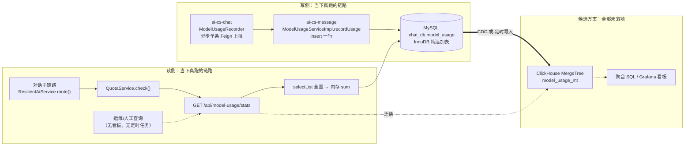
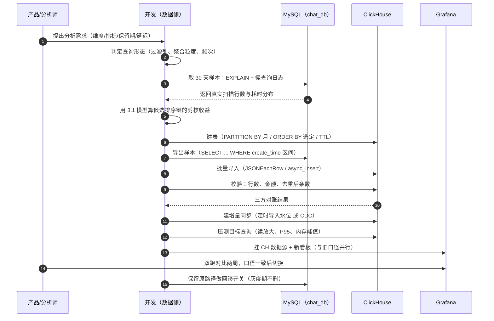

# 02. ClickHouse 实战：把分析从 MySQL 迁过去，到底要动哪些东西

> **一句话结论**：本项目现在缺的不是 ClickHouse 这个引擎，而是"值得迁的分析查询"——全仓 0 依赖、0 编排、0 条 GROUP BY SQL，唯一像分析的接口是把明细全量拉回 JVM 求和，且它挂在对话主链路上；所以顺序必须是"先判定哪条查询该迁 → 再定排序键 → 最后才谈建表与同步"。
>
> **阅读前置**：读过本篇的 [01-OLAP与列式存储原理.md](01-OLAP与列式存储原理.md)（列存 / 排序 / 压缩为什么快），并且知道 MySQL 的 B+ 树二级索引怎么走范围扫描。本篇不解释"列存为什么快"，只解释"本项目要迁，会缺哪几块"。
>
> **证据基线**：本仓 `main` 分支当前快照 + 本机 node 24.16.0 实算（A 级源码摘录 0 条、B 级真实文件 26 处、C 级可复现命令 6 条）。ClickHouse 相关命令**未在本机执行**（本机无 docker、无 CH 实例），一律标注"未本机实测，给命令与判读"。预计阅读 32 分钟。

## 证据边界

| 类别 | 本仓状态 | 本篇怎么处理 |
|---|---|---|
| ClickHouse 依赖与编排 | 13 个 `pom.xml` 中 `clickhouse` 命中 **0**；全仓 1015 个代码/配置文件仅 2 处命中，都在 `ai-cs-order/eff-order.xml`（Maven effective-pom 快照里的传递依赖）；compose 与 k8s 清单均无 ClickHouse | 第 0 节给扫描命令与真实输出；全部结论按"未落地"写，不用将来时冒充已实现 |
| 分析型查询 | 全仓 **0 条 GROUP BY SQL**；`ModelUsageServiceImpl.stats()` 用 `selectList` 全量查出后内存聚合 | 第 3.5 节逐条登记现有查询并给"迁 / 不迁"判定表 |
| 排序键与容量 | 无 CH 实例，**无任何吞吐、延迟、压缩比实测** | 第 3.1 节用纯算术模型（node 实算输出）说明排序键影响哪一维；规模档位是**假设值**，明确标注，不当测量值 |
| 成本 | 模型单价在本仓真实存在（元/百万 Token）；机器单价、存储单价**未在本仓出现，不编** | 第 3.8 节只给公式 + 真实单价算出的单次调用成本 |
| 数据同步 | Canal 只到"半条腿"：有 binlog 配置与复制账号、有一个消费者类，但 compose 里没有 canal server | 第 3.7 节给两条同步路线与判定 |

## 0. 先看现象

### 现象一：全仓扫一遍，ClickHouse 只有两处"别人的痕迹"

在仓库里跑一遍全仓扫描（脚本只读，不写任何文件）：

```javascript
// learning-docs/tools/tmp/ch-03-scan.mjs —— 本篇实跑脚本，可原样另存后执行
import { readFileSync, readdirSync, statSync } from 'node:fs';
import { join, extname, relative } from 'node:path';

const root = 'D:/Projects/Persion/ai-customer-service';
const exts = new Set(['.java', '.yml', '.yaml', '.xml', '.sql', '.vue', '.ts', '.js', '.properties', '.sh', '.ps1']);
const skip = /(node_modules|\\target\\|\/target\/|learning-docs|\\docs\\|\/docs\/|\.git)/;
let files = 0; const hits = [];
function walk(dir) {
  for (const e of readdirSync(dir)) {
    const p = join(dir, e);
    let st; try { st = statSync(p); } catch { continue; }
    if (st.isDirectory()) { if (!skip.test(p.replace(/\//g, '\\'))) walk(p); continue; }
    if (!exts.has(extname(p))) continue;
    files++;
    readFileSync(p, 'utf8').split('\n').forEach((l, i) => {
      if (/clickhouse/i.test(l)) hits.push({ f: relative(root, p).replace(/\\/g, '/'), n: i + 1, t: l.trim().slice(0, 80) });
    });
  }
}
walk(root);
console.log('扫描代码/配置文件数 =', files);
console.log('ClickHouse 命中行数 =', hits.length);
for (const h of hits) console.log(h.f + ':' + h.n + '  ' + h.t);
```

```powershell
# 工作目录：D:\Projects\Persion\ai-customer-service\learning-docs
node tools\tmp\ch-03-scan.mjs
```

```text
扫描代码/配置文件数 = 1015
ClickHouse 命中行数 = 2
ai-cs-order/eff-order.xml:8369  <artifactId>pulsar-io-jdbc-clickhouse</artifactId>
ai-cs-order/eff-order.xml:9589  <artifactId>testcontainers-clickhouse</artifactId>
```

**怎么读**：1015 个文件里 2 处命中，而且都在同一个文件 `ai-cs-order/eff-order.xml`——这是 `mvn help:effective-pom` 生成的**依赖树快照**，那两条 `artifactId` 是别人（Pulsar IO 连接器、Testcontainers）的传递依赖，不是本项目声明。也就是说：没有 CH 驱动、没有 CH 客户端代码、没有 DDL。再对照编排：`deploy/docker-compose/docker-compose-all.yml` 里 14 个服务（L9 mysql、L33 redis、L52 nacos、L82 elasticsearch、L107 rocketmq-namesrv、L126 rocketmq-broker、L144 minio、L166 api-gateway……）没有 clickhouse；`deploy/k8s/` 下有 mysql / redis / nacos / elasticsearch / minio / neo4j / chroma / rocketmq / xxl-job / sentinel-dashboard 十份清单，也没有 `clickhouse.yaml`；`deploy/observability/grafana/provisioning/datasources/datasources.yaml`（16 行）只挂了 Prometheus 与 Tempo 两个数据源，没有 CH 插件。**结论不是"漏了一个服务"，而是这条技术选型从未进入实施阶段。**

### 现象二：唯一的"分析"入口，是把明细全量读回 JVM 再求和

```javascript
// learning-docs/tools/tmp/ch-05-evidence.mjs —— 打印关键行，只读
import { readFileSync } from 'node:fs';
const show = (f, re) => {
  console.log('--- ' + f);
  readFileSync('D:/Projects/Persion/ai-customer-service/' + f, 'utf8').split(/\r?\n/)
    .forEach((s, i) => { if (re.test(s)) console.log(String(i + 1).padStart(4) + ': ' + s.trim()); });
};
show('ai-cs-message/src/main/java/com/aics/message/service/impl/ModelUsageServiceImpl.java',
  /selectList|records\.size|mapToLong|filter\(|reduce\(|内存聚合/);
show('ai-cs-chat/src/main/java/com/aics/chat/observability/QuotaService.java',
  /FeignClient|getStats|windowStart|catch|isExceeded/);
```

```powershell
node tools\tmp\ch-05-evidence.mjs
```

```text
--- ai-cs-message/src/main/java/com/aics/message/service/impl/ModelUsageServiceImpl.java
  26: *     <li>统计使用 {@link LambdaQueryWrapper} 过滤 + {@code selectList} 全量查出后内存聚合
  86: * 按条件统计模型用量：过滤后全量查出，内存聚合调用次数/Token 求和/费用求和。
  97: // 2. 全量查出后在内存聚合（数据量级可控；不写自定义 SQL，保证 Mapper 可 mock）
  98: List<ModelUsage> records = modelUsageMapper.selectList(wrapper);
 100: vo.setCallCount((long) records.size());
 101: // 各 Token 维度用 mapToLong(...).sum()：null 显式按 0 计入，避免 NPE 打断整条聚合流
 103: .mapToLong(u -> u.getInputTokens() == null ? 0L : u.getInputTokens()).sum());
 105: .mapToLong(u -> u.getOutputTokens() == null ? 0L : u.getOutputTokens()).sum());
 107: .mapToLong(u -> u.getTotalTokens() == null ? 0L : u.getTotalTokens()).sum());
 109: // reduce(BigDecimal.ZERO, BigDecimal::add) 保证空列表也返回 0 而非 null
 112: .filter(Objects::nonNull)
 113: .reduce(BigDecimal.ZERO, BigDecimal::add));
--- ai-cs-chat/src/main/java/com/aics/chat/observability/QuotaService.java
   6: import com.aics.chat.feign.ModelUsageFeignClient;
  29: private final ModelUsageFeignClient modelUsageFeignClient;
  46: Result<ModelUsageQuotaVO> quotaResult = modelUsageFeignClient.getQuota(userId, scenario);
  52: LocalDateTime windowStart = windowStart(quota.getWindowType());
  53: Result<ModelUsageStatsVO> statsResult = modelUsageFeignClient.getStats(
  54: userId, scenario, null, windowStart, LocalDateTime.now());
  72: } catch (Exception e) {
  84: private LocalDateTime windowStart(String windowType) {
```

**怎么读**：L98 那一行是"把过滤后的**所有明细行**读成 `List<ModelUsage>`"，L100～L113 的 `size()` / `mapToLong().sum()` / `reduce()` 全在 JVM 堆里做。真正要命的是它被谁调用：`ai-cs-chat/src/main/java/com/aics/chat/observability/QuotaService.java:46-54` 先用 Feign 查配额配置，再用 Feign 打这条 `stats` 接口拿"当前窗口累计用量"——而 `QuotaService.check()` 又是 `ai-cs-chat/src/main/java/com/aics/chat/service/impl/ResilientAiService.java:419-420` 里每次对话路由决策都要走的一步（短路求值：配额开关关掉才跳过）。顺带注意 L418 的注释写着"查 Redis"，实际实现是 Feign 调 MySQL 明细表——**注释比代码更乐观，这是后面第 7 节要讲的版本差异**。

### 现象三：表上建了 3 个复合索引，却没有一条 GROUP BY

```powershell
Select-String -Path ai-cs-message\src\main\java\com\aics\message\mapper\*.java -Pattern 'GROUP BY|@Select|@Update' |
  ForEach-Object { "$($_.Filename):$($_.LineNumber): $($_.Line.Trim())" }
Get-ChildItem -Recurse ai-cs-message\src\main\resources -Include *.xml | ForEach-Object { $_.FullName }
```

```text
ModelUsageMapper.java:16: * <h3>【设计原理】为什么统计不写 GROUP BY 自定义 SQL</h3>
ChatMessageMapper.java:35: @Select("SELECT * FROM chat_message WHERE session_key = #{sessionKey} " +
（Get-ChildItem 无输出：ai-cs-message/src/main/resources 下 0 个 Mapper XML）
```

**怎么读**：`ai-cs-message` 的 13 个 Mapper 全部是"零方法、只 `extends BaseMapper<>`"；唯一一条 `@Select` 在 `ai-cs-message/src/main/java/com/aics/message/mapper/ChatMessageMapper.java:35`，是明细查询不是聚合；没有 Mapper XML。而 DDL 侧却很"分析型"——`deploy/mysql/llm-observability-init.sql:46-48` 给 `model_usage` 建了 `idx_user_time(user_id, create_time)`、`idx_scenario_time(scenario, create_time)`、`idx_model_time(model, create_time)` 三个复合索引，明显是照着"按人 / 按场景 / 按模型 + 时间范围"的聚合查询设计的。**索引先建好了，聚合 SQL 一条没写**——这是典型的"照着 OLAP 想象设计 OLTP 表"。

这些现象指向同一件事：**本项目现在没有"分析查询"这个需求实体，只有"一条被主链路复用的用量查询"。**在没有把查询形态（过滤列、聚合粒度、频次、延迟要求）钉死之前迁 ClickHouse，只是把内存里的 `sum()` 搬到另一台机器上重写一遍，还会额外背上同步、去重、运维三份成本。

## 1. 整体地图



**读图说明**：实线 = 代码里今天真的在跑的调用；细虚线 = 存在但没有自动化的旁路（人工查询）；粗箭头 `==>` = **完全未落地**的设想链路（同步、CH 建表、看板）。顺着图从右往左读最容易误判的两个点：（1）`QuotaService` 看起来"在读 Redis"（它的注释也这么写），实际走的是 `stats` 这条 MySQL 明细路径，所以图里把 `check()` 直接连到 `/stats`；（2）CH 那一格不是在描述现状，它把三件事（引擎、同步、看板）压缩成一条虚线，真做起来是三个独立工程，缺一个都跑不通。

| 组件 | 位置 | 责任 | 参与方 | 本仓状态 |
|---|---|---|---|---|
| `ModelUsageRecorder` | `ai-cs-chat/src/main/java/com/aics/chat/observability/ModelUsageRecorder.java:106-114` | 每次 LLM 调用后把 token/费用估算异步上报 | chat 服务内部，`executorSize` 默认 2 的线程池 | 已落地（`aics.usage.enabled` 默认 true） |
| `POST /api/model-usage/records` | `ai-cs-message/src/main/java/com/aics/message/controller/ModelUsageController.java:47-52` | 落一条计量明细 | chat 服务（Feign） | 已落地 |
| `ModelUsageServiceImpl.recordUsage` | `ai-cs-message/src/main/java/com/aics/message/service/impl/ModelUsageServiceImpl.java:45-83` | 补 `total_tokens` 兜底后单行 insert | message 服务 | 已落地，**逐条写** |
| `GET /api/model-usage/stats` | `ai-cs-message/src/main/java/com/aics/message/controller/ModelUsageController.java:65-77` | 按 userId/scenario/model/时间范围出汇总 | QuotaService（热路径）+ 人工 | 已落地，**内存聚合** |
| `QuotaService.check` | `ai-cs-chat/src/main/java/com/aics/chat/observability/QuotaService.java:38-81` | 判断本窗口是否超额，失败 fail-open | 每次对话路由 | 已落地 |
| `model_usage` 表 | `deploy/mysql/llm-observability-init.sql:29-49` | 明细存储，3 个复合二级索引 | MySQL | 已落地 |
| ClickHouse 集群 | 无 | 分析引擎 | — | **未落地**（0 依赖 / 0 清单 / 0 代码） |
| 同步链路（CDC / 定时导入） | 无（Canal 只有半条腿，见 3.7） | 把明细搬进 CH | — | **未落地** |
| Grafana CH 数据源 | `deploy/observability/grafana/provisioning/datasources/datasources.yaml:4-16` | 画图 | Grafana 10.4.0 | **未落地**（只有 Prometheus + Tempo） |

## 2. 关键概念与关键要素

先说清三组词，本篇后面全靠它们：**part**（一次写入在磁盘上落成的一块不可变数据，CH 靠合并把小块合成大块）；**granule**（颗粒，MergeTree 稀疏索引的最小单位，默认每 8192 行一个索引项）；**跳数索引**（data skipping index，给 granule 打"这段数据里某列的 min/max 或集合"，查询时整段跳过）。

| 名称 | 位置 | 作用 | 关键参数 / 默认值 |
|---|---|---|---|
| MergeTree | CH 侧（本篇目标引擎） | 列存 + 按 `ORDER BY` 物理排序 + 后台合并的主引擎 | `ORDER BY` 必填；`index_granularity` 默认 8192 |
| 分区键 `PARTITION BY` | CH 侧 | 把数据切成独立目录，支持整块丢弃（`DROP PARTITION`）与 TTL | 常用 `toYYYYMM(create_time)`；分区不是越细越好 |
| 排序键 `ORDER BY` | CH 侧 | **唯一**决定稀疏索引与数据物理顺序的东西 | 前列放"最常等值过滤"的列，再放时间 |
| 主键 `PRIMARY KEY` | CH 侧 | 生成稀疏索引；必须是 `ORDER BY` 的前缀 | 默认等于 `ORDER BY` |
| granule | CH 侧 | 索引剪枝的最小单位 | 8192 行 × 行宽 ≈ 1 MiB（见 3.2 实算） |
| 跳数索引 | CH 侧 | 给非排序键列加 minmax / set / bloom_filter / ngrambf_v1 | `INDEX idx (col) TYPE minmax GRANULARITY 4` |
| `TTL` | CH 侧 | 过期数据自动删除 / 降冷 | `TTL create_time + INTERVAL 90 DAY DELETE` |
| ReplacingMergeTree | CH 侧 | 合并时按排序键去重（保留 version 最大者） | 去重**只在合并时**发生，查询要 `FINAL` 或 `argMax` |
| AggregatingMergeTree + `-State/-Merge` | CH 侧 | 按排序键预聚合，配合物化视图做增量汇总 | `sumState` / `sumMerge`，`uniqState` / `uniqMerge` |
| 物化视图 | CH 侧 | 写入时触发、把结果写进目标表（本质是 INSERT 触发器） | 目标表 + `TO` 子句；刷新式 MV 属较新特性 |
| Mutation（`ALTER ... UPDATE/DELETE`） | CH 侧 | 唯一的重写式更新机制（`ALTER ... UPDATE`） | 异步重写 part，代价与数据量成正比 |
| `async_insert` | CH 侧 | 把小 INSERT 攒批落盘，避免 parts 爆炸 | `async_insert=1`、`wait_for_async_insert=1` |
| `system.parts` / `system.merges` | CH 侧 | 观察 part 数与合并进度 | `parts_to_throw_insert` 默认 300（每分区） |
| 本仓写入形态对照 | `ai-cs-message/src/main/java/com/aics/message/service/impl/ModelUsageServiceImpl.java:81` | 逐条 `insert`，无批量 | 迁 CH 前必须改成攒批 |
| 本仓查询形态对照 | `ai-cs-message/src/main/java/com/aics/message/service/impl/ModelUsageServiceImpl.java:98` | 全量 `selectList` + 内存聚合 | 迁 CH 的核心收益点 |
| 本仓幂等键 | `deploy/mysql/llm-observability-init.sql:12-26`（`llm_trace.request_id` 主键） | 请求级去重 | `model_usage` 无唯一键，纯追加 |

## 3. 原理与证据逐段精读

### 3.1 为什么"排序键决定一切"：先想清楚查询，再谈引擎

- **在干什么**：`ORDER BY` 不是索引声明，而是**数据的物理落盘顺序**。CH 按照这个顺序写 part，然后每 8192 行抽一条索引项（记该段首行的排序键值）。查询落在哪一段区间，就只读那几段。所以排序键同时决定了三件事：能剪掉多少数据、压缩率有多高（同列相邻值越相似压得越狠）、以及哪些查询天生拿不到剪枝。
- **为什么这么设计**：列存 + 顺序扫描的假设是"每次查询扫很大比例的数据"。既然要扫，不如把"最常一起过滤的列"排在一起，让扫描范围可以成段跳过；同时放弃"任意列都能走索引"的幻想（那是 B+ 树的活）。
- **换成别的写法会怎样**：如果把 `request_id`（每个值都不同）放进排序键前列，数据按随机 UUID 排序 → 任何业务过滤都拿不到剪枝，且高基数列相邻值毫无相似性、压缩率骤降。如果把排序列改成十几个、想把"什么查询都快"都占住，等价于什么都没排。
- **常见坑**：拿 MySQL 的 `KEY idx_user_time(user_id, create_time)` 直接翻译成 CH 排序键。MySQL 的复合索引是"辅助结构"，可以有 5 个互不干扰；CH 只有**一个**物理顺序，多个候选排序键必须做取舍。

下面这张表是**纯算术模型**（不是测量值）：固定 `index_granularity = 8192`、按月分区（31 天）、查询"最近 7 天 + 指定 scenario"，`scenario` 基数按 5 估（chat/rag/agent/vision/nl2sql），单月分区行数取三档假设规模。

```javascript
// learning-docs/tools/tmp/ch-02-sortkey.mjs —— 本篇实跑脚本
const G = 8192, DAYS = 31, WIN = 7, SCEN = 5;
const pad = (s, n) => String(s).padEnd(n);
for (const N of [200000, 2000000, 20000000]) {          // 假设：单月分区行数（非本机实测）
  const total = Math.ceil(N / G), perDay = N / DAYS;
  console.log('=== 单月分区 N = ' + N.toLocaleString('en-US') + ' 行, 全表 granule = ' + total + ' ===');
  console.log(pad('ORDER BY 前缀', 30) + pad('命中行', 12) + pad('扫 granule', 12) + '读放大占比');
  for (const [key, hit] of [
    ['create_time, scenario, model', Math.round(perDay * WIN)],
    ['scenario, create_time, model', Math.round(perDay * WIN / SCEN)],
    ['request_id (唯一键/无排序语义)', N],
  ]) {
    const gran = Math.min(total, Math.ceil(hit / G));
    console.log(pad(key, 30) + pad(hit.toLocaleString('en-US'), 12) + pad(gran, 12) + (gran / total * 100).toFixed(1) + '%');
  }
}
```

```powershell
node tools\tmp\ch-02-sortkey.mjs
```

```text
=== 单月分区 N = 200,000 行, 全表 granule = 25 ===
ORDER BY 前缀                   命中行         扫 granule    读放大占比
create_time, scenario, model  45,161      6           24.0%
scenario, create_time, model  9,032       2           8.0%
request_id (唯一键/无排序语义)        200,000     25          100.0%

=== 单月分区 N = 2,000,000 行, 全表 granule = 245 ===
ORDER BY 前缀                   命中行         扫 granule    读放大占比
create_time, scenario, model  451,613     56          22.9%
scenario, create_time, model  90,323      12          4.9%
request_id (唯一键/无排序语义)        2,000,000   245         100.0%

=== 单月分区 N = 20,000,000 行, 全表 granule = 2442 ===
ORDER BY 前缀                   命中行         扫 granule    读放大占比
create_time, scenario, model  4,516,129   552         22.6%
scenario, create_time, model  903,226     111         4.5%
request_id (唯一键/无排序语义)        20,000,000  2442        100.0%
```

**怎么读这张表**：三档规模下"读放大占比"几乎不变（22.6% / 4.5% / 100%），说明这个比例由**排序键选择**决定，跟数据量无关——数据量只影响绝对量。`(scenario, create_time, model)` 比 `(create_time, scenario, model)` 少扫约 5 倍，原因不是"scenario 更值钱"，而是**查询里 scenario 是等值条件、时间只是范围**：等值条件放在排序键最前面，能一次定位到一整片连续区间；放在后面，就只能靠时间范围先圈一大片、再逐行比对 scenario。反过来，如果产品问的是"全站近 30 天趋势"（没有 scenario 条件），这个优势立刻消失，反而时间前置更优。**这就是"排序键必须先知道查询模式"的全部含义**——同一张表没有两全解，只能选主查询。规模档位是假设值，不当测量值用；把脚本里的 `N` / `SCEN` / `WIN` 换成你的真实值即可重算。

### 3.2 granule：剪枝的粒度与跳数索引的边界

- **在干什么**：granule 是稀疏索引的一项覆盖的行数。索引只记"这段 8192 行的首行排序键值"，所以剪枝的最小单位就是 8192 行，而不是 1 行。
- **为什么这么设计**：索引全部常驻内存。8192 行一个索引项，一亿行只要约 12 万个条目，几 MB 就能放下，这是"用几十 MB 换掉 99% 的 IO"的取舍；如果用 1 行 1 项的稠密索引，就退化成 B+ 树的形态，列存顺序扫描的优势也没了。
- **换成别的写法会怎样**：把 `index_granularity` 调小（比如 1024）能剪得更细，但索引体积涨 8 倍、内存与点查开销一起涨；调大则相反。
- **常见坑**：以为给了某列建了 minmax 跳数索引，就等于"这列也能剪枝"。granule 里只要出现过一个不同的值，min/max 就没法跳。

```javascript
// learning-docs/tools/tmp/ch-04-skipindex.mjs —— 本篇实跑脚本
const G = 8192;
for (const [col, C] of Object.entries({ scenario: 5, model: 3, provider: 2 })) {
  const pMissing = Math.exp(G * Math.log((C - 1) / C));   // 一个 granule 里完全没有某取值的概率
  console.log(col.padEnd(10), '基数 ' + C, '| 一个 granule 内期望出现取值数 =', (C * (1 - pMissing)).toFixed(4),
    '| min/max 覆盖全部取值的概率 =', (1 - pMissing).toFixed(6));
}
```

```powershell
node tools\tmp\ch-04-skipindex.mjs
```

```text
granule 行数 = 8192  (index_granularity 默认值)
scenario   基数 5 | 一个 granule 内期望出现取值数 = 5.0000 | min/max 覆盖全部取值的概率 = 1.000000
model      基数 3 | 一个 granule 内期望出现取值数 = 3.0000 | min/max 覆盖全部取值的概率 = 1.000000
provider   基数 2 | 一个 granule 内期望出现取值数 = 2.0000 | min/max 覆盖全部取值的概率 = 1.000000
按列排序后单个 granule 内取值数 = 1（min=max），minmax 索引退化为无用，因为排序本身已经完成剪枝
```

**怎么读**：8192 行里塞 5 个低基数值，每个 granule 几乎必然覆盖全部取值（概率 ≈ 1），所以给 `scenario` 建 minmax 跳数索引的收益是 **0**——这正是"低基数列不用建跳数索引、要么放排序键、要么用 `LowCardinality` 编码"的算术依据。跳数索引真正有用的是**高基数列上的范围条件**（比如 `user_id` 的 minmax、`error_summary` 的 tokenbf）。另外注意最后一行：一旦某列进了排序键且是前缀，granule 内该列取值唯一，此时再建 minmax 完全多余。

### 3.3 分区键只负责"整块丢"，不负责剪枝

- **在干什么**：`PARTITION BY` 把数据切成互不重叠的目录，每个目录里是一批 part。查询带分区键条件时，CH 直接跳过整个目录；`DROP PARTITION` 与 `TTL` 也是按目录操作的。
- **为什么这么设计**：数据生命周期管理（保留 90 天）与分析查询是两种需求。分区让"删除历史"从"删几亿行"变成"删几个目录"，成本从 O(数据量) 变成 O(目录数)。剪枝那部分只是附带的。
- **换成别的写法会怎样**：按月分区 vs 按天分区是典型取舍。按天分区若日均只写几万行，一个月就是 30 个目录 × 每目录若干 part，part 总数与合并压力都上升；按月分区则目录少、单目录大，但"删掉某一天"做不了。
- **常见坑**：按 `toDate(create_time)` 建上千个分区（历史累积几年），结果是 part 元数据膨胀、`system.parts` 查询变慢、启动加载变慢；以及把分区键写成高基数列（如 `user_id`）——那是灾难。

> 未本机实测（无 CH 实例）。判读方法：`SELECT partition, count() FROM system.parts WHERE active AND table='model_usage_mt' GROUP BY partition` 应看到"分区数 ≈ 月份数"；若每个分区有几十个 part，看 `system.merges` 是否在追赶。

### 3.4 写入模型：批量、去重与物化视图

- **在干什么**：CH 的写入单位是 part（一次 INSERT 一个 part，或一次批量攒出来的一个 part）。part 不可变，靠后台合并（merge）收敛。所以"怎么攒批"和"怎么去重"是写入模型的两根柱子。
- **为什么这么设计**：不可变 part 让顺序读没有任何锁与随机写，代价是更新/deleted 只能靠重写（mutation）或合并时去重（ReplacingMergeTree）。
- **换成别的写法会怎样**：本项目现在的写入是**一条一条**：`ModelUsageRecorder` 每次 LLM 调用异步 Feign 上报（`ai-cs-chat/src/main/java/com/aics/chat/observability/ModelUsageRecorder.java:106-114`），`recordUsage` 单行 `insert`（`ai-cs-message/src/main/java/com/aics/message/service/impl/ModelUsageServiceImpl.java:81`）。这套写法直接照搬到 CH，第一次压测就会撞 `Too many parts`。可选的三条路：客户端攒批（应用侧 buffer + 定时 flush）、服务端 `async_insert=1`、或者干脆走「MySQL 明细 → 定时/CDC 批量导入 CH」不让业务直写。
- **常见坑**：以为 `ReplacingMergeTree` 会实时去重。它只在合并时按排序键保留 version 最大的一行，**没合并之前重复行仍在**，查询要么 `FINAL`（读放大）要么用 `argMax(col, version) GROUP BY key`。本项目的 `model_usage` 根本没有唯一键（`deploy/mysql/llm-observability-init.sql:29-49`：只有自增 `id` 主键），幂等键在另一张表的 `llm_trace.request_id`；也就是说**迁移时你会需要一次"按什么去重"的决策，而 MySQL 现状并没有给你答案**。

### 3.5 现有查询清单与"迁 / 不迁"判定

先把本仓真实存在的、能被称作"分析"的入口全列出来（都在 B 级证据里核过），再逐条判定。判定用的四个问题：**过滤列有哪几个？聚合粒度多粗？返回多少行？多久调一次？**

| 查询 | 真实位置 | 形态 | 频次/延迟要求 | 适合 CH？ | 判定 |
|---|---|---|---|---|---|
| 配额窗口用量 | `ai-cs-chat/src/main/java/com/aics/chat/observability/QuotaService.java:46-54` → `GET /stats` | 单用户 + 单场景 + 本日/本周/本月，返回 1 行 | **每次对话一次**，要求毫秒级 | ❌ | **不迁**。这是点查 + 强一致计数，应改 Redis 计数器（见 3.6） |
| 用量统计 /stats | `ai-cs-message/src/main/java/com/aics/message/controller/ModelUsageController.java:65-77` + `ModelUsageServiceImpl.java:89-116` | 多条件范围 + 5 个聚合值，返回 1 行 | 低频（人工/看板） | ✅ | **该迁**，但前提是先把 `selectList` 改成聚合 SQL |
| llm_trace 分页与详情 | `ai-cs-message/src/main/java/com/aics/message/service/impl/LlmTraceServiceImpl.java:77-106` | 主键点查 + 按时间倒序翻页 | 低频，返回几十行 | ❌ | **不迁**。大 `OFFSET` 在 CH 更慢；点查是 MySQL 强项 |
| 在线评估统计 | `ai-cs-message/src/main/java/com/aics/message/service/impl/OnlineEvalServiceImpl.java:77-117` | 两次 `selectList` 全量 + 内存 `count` | 低频 | ✅ | **该迁**（与 /stats 同类，可合并成一张"评估+反馈"宽表） |
| 语义缓存/热门问答统计 | `ai-cs-chat/src/main/java/com/aics/chat/controller/CacheStatsController.java:36-54` | 读 Redis 条目数与 Top-N | 低频 | — | **与 CH 无关**，不迁 |
| 前端问数图表 | `ai-cs-frontend/src/views/ChatDashboardView.vue:72-96`（`POST /chart`） | 由后端生成 echartsOption，前端只渲染 | 按需 | ✅ 未来 | **最适合 CH**，但必须先有 `LIMIT`、超时、`max_memory_usage` 三道保护 |
| 日/月汇总对账 | 见 [08-数据质量与对账.md](08-数据质量与对账.md) | 按天/按模型聚合 | 定时 | ✅ | **最适合 CH + 物化视图**，属于迁移第一顺位 |

**怎么读这张表**：7 条里只有 4 条（含 2 条尚未存在的）适合 CH，而**最热的那一条恰恰是最不该迁的**。这说明"迁 ClickHouse"在本项目不是"数据库升级"，而是"把一条被主链路复用的接口重新拆成两条：热路径改成内存计数器，冷路径改成列存聚合"。

### 3.6 不适合的场景：高频点查、频繁更新、事务

- **在干什么**：把"CH 不适合什么"讲清楚，比讲"CH 适合什么"更能防止误用。
- **为什么这么设计**：CH 的索引按 granule 组织，最小读单位是 8192 行；没有行级锁、没有二级索引随机定位、没有跨行事务；更新只能是异步 mutation（重写整个 part）。
- **换成别的写法会怎样**：把 `QuotaService.check()` 的读取改成打 CH：
  - 每次对话都要算"本日该用户该场景累计 token"，这是**单点、强一致、低延迟**语义；
  - CH 的 `GROUP BY` 即使只命中一个 granule 也要扫 8192 行、经过向量化执行与合并去重（若用 Replacing）才出一行；
  - 写入到可读之间还有 part 提交与（可能的）异步写入延迟 → 计数天然滞后，配额就可能被突破；
  - 更关键的是 `QuotaService` 现在是 **fail-open**（`ai-cs-chat/src/main/java/com/aics/chat/observability/QuotaService.java:72-80` catch 住异常按未超额处理，设计意图是"宁可多花一点钱"）。换成 CH 后 fail-open 的概率会更高（分析库更容易超时），等于配额形同虚设。
  正确答案是：**热路径用 Redis 计数器（INCRBY + TTL 对齐窗口）**，CH 只做"事后分析"，两者数据来源不同、精度要求不同。
- **常见坑**：把 `model_usage_quota` 这类"配置表 + upsert"迁到 CH。CH 没有 upsert（`ALTER UPDATE` 是重写），配置表应留在 MySQL 或进 Redis。

| 场景 | 为什么不适合 | 本项目里的具体例子 |
|---|---|---|
| 高频点查（单行/单用户，毫秒级） | 最小读粒度 8192 行；无二级索引定位 | `QuotaService.check()` 热路径 |
| 频繁更新/删除单行 | mutation 重写 part，代价与分区数据量成正比 | `model_usage_quota` 配额变更；`user_feedback` 修改 |
| 事务 / 强一致 | 无跨行事务，无唯一约束回滚 | `llm_trace.request_id` 幂等靠"先查后插"，迁 CH 需换 `ReplacingMergeTree` |
| 极低数据量（万行级） | 收益为 0，只剩运维成本 | 现阶段全部 5 张表都可能是这个量级 |
| 大 OFFSET 翻页 | 顺序扫描后丢弃，越翻越慢 | `LlmTraceServiceImpl.pageTraces()` 深翻页 |
| 单条实时写入 | part 爆炸 | `ModelUsageServiceImpl.recordUsage()` 逐条 insert |

### 3.7 与 MySQL 的数据同步：CDC 还是定时导入

- **在干什么**：把 `model_usage` / `llm_trace` 的增量持续搬进 CH，让分析侧不落在业务库上。
- **为什么这么设计**：分析需求是 T+0 还是 T+1 决定了同步方式。CDC（Change Data Capture，订阅 binlog 拿变更流）追求分钟级，定时导入（`WHERE create_time > 上次水位` 后批量拉）追求简单。
- **换成别的写法会怎样**：本仓的 CDC **只到半条腿**，而且不覆盖 CH 场景：
  - `deploy/mysql/mysql.cnf:23` 已开 binlog ROW + FULL（Canal 前置条件）；
  - `deploy/mysql/canal-init.sql:1-4` 建了 `canal` 复制账号（只给 `SELECT, REPLICATION SLAVE, REPLICATION CLIENT`）；
  - `ai-cs-search/src/main/java/com/aics/search/cdc/ProductCdcConsumer.java:24-33` 有一个消费 `CanalChangeEvent` 的 RocketMQ 监听器；
  - 但 `ai-cs-search/src/main/resources/application.yml:54-58` 里 `CANAL_PRODUCT_CDC_ENABLED:false` 默认关闭；根 `docker-compose.yml` 的 13 个服务（mysql L11、redis L37、nacos L56、elasticsearch L86、rocketmq L110/L128、minio L151、mongodb L174、chroma L194、neo4j L211、xxl-job L235、sentinel L259、kafka L279/L322）**没有 canal server**。
  也就是说：binlog 开了、账号建了、消费者写了，**生产者（canal server）没部署**——链路断在中间。
- **常见坑**：以为 CDC 一定是"实时且准确"。CDC 会重放、会乱序、会重复投递（`ProductCdcConsumer` 自己的注释就写了"DELETE 反复执行时 documentMissing 忽略，最终一致性由定时对账兜底"）；把这些语义搬到 CH，重复行要靠 `ReplacingMergeTree` + `FINAL` 处理，否则金额会翻倍。

| 方案 | 延迟 | 改动面 | 风险 | 本仓可行性 |
|---|---|---|---|---|
| 定时导入（`WHERE create_time > 水位`） | 分钟~小时 | 一个定时任务 + 一个导入脚本 | 水位列必须有索引且单调；漏记录难发现 | ✅ 最省事，先用它验证价值 |
| CDC（Canal → MQ → CH） | 秒级 | 需要部署 canal server + 消费端写 CH + 去重策略 | 断点、重复投递、顺序、幂等 | ⚠️ 半条腿，缺 canal server |
| 双写（业务同时写 MySQL 与 CH） | 实时 | 改业务代码 | 一致性、失败重试、写放大 | ❌ 不建议，违反"分析不侵入业务" |
| MySQL 表引擎 / 联邦查询 | 实时（读时拉） | 极低 | 全表拉取，CH 侧无法剪枝，生产禁用 | ❌ 只适合内部试点 |

### 3.8 查询语法差异与成本评估

**语法差异**（都是迁移时真会踩到的）：

| 维度 | MySQL（现状写法） | ClickHouse | 迁移注意 |
|---|---|---|---|
| GROUP BY | 宽松模式允许选非聚合列 | 严格模式，非聚合列必须 `any()` / `argMax()` / 进 `GROUP BY` | `SELECT user_id, scenario, sum(...) GROUP BY user_id` 在 CH 里合法，但 `SELECT model, sum(...) GROUP BY user_id` 不合法 |
| 精确去重计数 | `COUNT(DISTINCT x)` | `uniqExact(x)`（精确、慢） / `uniq(x)`（HLL 近似、快） | 报表要"可对账"就用 `uniqExact`；趋势图上 `uniq` 误差通常可接受（误差率未本机实测） |
| 分位数 | 无原生，靠排序子查询 | `quantile(0.95)(total_duration_ms)`、`quantiles(0.5,0.9,0.99)(...)` | P95 延迟直接可算，替代"拉全量到 JVM 排序" |
| 去重后读 | — | `... FINAL` 或 `argMax(col, ver)` | `FINAL` 是读放大，宽表慎用 |
| 分页 | `LIMIT off, n` 通常可接受 | 大 OFFSET 代价高 | 改成游标（`WHERE create_time < 上次`） |
| 时间函数 | `DATE_FORMAT`、`CURDATE()` | `toStartOfDay`、`toYYYYMM`、`now()` | 时区是 `DateTime` vs `DateTime('Asia/Shanghai')` |

把现在那条内存聚合改写成 CH 聚合 SQL（**语法正确，未在本机执行**）：

```sql
-- 与 ModelUsageServiceImpl.stats() 等价的聚合：把 JVM 里的 3 次 mapToLong + 1 次 reduce 交给引擎
SELECT
    count()                            AS call_count,
    sum(input_tokens)                  AS input_tokens,
    sum(output_tokens)                 AS output_tokens,
    sum(total_tokens)                  AS total_tokens,
    sum(estimated_cost)                AS estimated_cost,
    uniqExact(request_id)              AS distinct_requests,
    quantile(0.95)(total_tokens)       AS p95_tokens
FROM model_usage_mt
WHERE create_time >= toDateTime('2026-11-01 00:00:00')
  AND create_time <  toDateTime('2026-12-01 00:00:00')
  AND scenario = 'chat'
  AND user_id  = 10001;
```

**怎么读**：这条 SQL 在 MySQL 侧今天会选中 `idx_user_time(user_id, create_time)`（`deploy/mysql/llm-observability-init.sql:46`），拿到的仍是**明细行**，然后全部序列化成 `ModelUsage` 对象塞进 JVM；在 CH 侧则是"扫该用户该时间窗的 granule → 向量化求和 → 返回 1 行"。差别不在 SQL 长短，而在**返回给应用的数据量**：前者与应用侧行数成正比，后者恒为 1 行。

**成本评估**（只给公式与真实单价，机器单价不编）：

- 存储侧：本篇 3.1 的脚本顺带算了行宽——把 `deploy/mysql/llm-observability-init.sql:29-49` 的列映射成 CH 类型后，`request_id String(36) + 2×Int64 + 3×LowCardinality + 3×Int32 + Decimal(12,6)=16B + UInt8 + DateTime(4)` 合计 **127 B/行（未压缩上界估算）**；20 万行/月 ≈ 24.2 MiB/月，200 万行/月 ≈ 242 MiB/月。实际压缩比**本机未实测**，只能给判读方法：导入后 `SELECT sum(bytes_on_disk) FROM system.parts WHERE table='model_usage_mt'` 对比原始字节。
- 计算侧：本仓真实单价在 `tools/nacos-config/ai-cs-chat.yml:118-128`（单位：元/百万 Token）：`deepseek-chat` 2.0/8.0、`siliconflow-qwen3-32b` 1.0/2.0、`siliconflow-qwen3-8b` 0.2/0.6。按 1200 输入 + 400 输出算单次调用成本：deepseek-chat 0.0056 元、qwen3-32b 0.0020 元、qwen3-8b 0.00048 元（脚本实算）。**注意量级**：一万次调用也就 4.8~56 元，而一台带副本的 CH 节点月成本远高于此——所以**用 ClickHouse 省钱的动机在本项目不成立**，动机只能是"分析查询能力"（P95、多维下钻、保留期更长）。
- 运维侧：常驻组件 +1（CH 节点）、依赖 +1（Keeper/ZooKeeper 做副本协调）、值班手册 +1、备份策略 +1。这部分没有数字，只有"谁来扛"的问题。

## 4. 一次完整执行时序：从"要不要迁"到"敢切读"



**读图说明**：这不是"部署图"，是"决策图"——真正决定成败的是 2、3、5 步（判定、取样本、算排序键），这三步做错，后面建表导入全白干。图上每次都写"并行/双跑"而不是"切换"，因为分析口径出错不会报错，只会安静地给出错数字。

各步判读要点：

| 步 | 判读 | 出问题时的信号 |
|---|---|---|
| 1 需求 | 维度、指标、保留期、可接受延迟四项缺一不可 | 只给"想看个报表"= 需求未定，回到第 3.5 节判定表 |
| 3 取样本 | `EXPLAIN` 的 `rows` 是**估算**，别当扫描行数 | 估算与 `Handler_read_*` 差一个数量级 → 统计信息过期 |
| 5 算排序键 | 拿真实过滤列跑 3.1 模型，看读放大占比 | 主查询的读放大 > 50% → 排序键选错，别急着建表 |
| 7 导入 | 校验必须**三方对账**：MySQL `COUNT(*)`、CH `count()`、金额 `sum` | 行数差 > 0 且金额差 = 0，通常是重复导入而非漏数 |
| 8 校验 | 金额用 `Decimal` 比较，不要用 float（见 6.7） | 差异在 1e-9 量级 → 浮点累加误差，不是数据错 |
| 12 双跑 | 两个口径同时存在，逐日比对 | 差异出现"阶梯状"，通常是时区/窗口边界（见 6.6） |
| 13 回滚 | 灰度期新旧两条读路径都要能一键切回 | 只留新路径 = 没有回滚点 |

## 5. 设计取舍

| 维度 | 选项 A | 选项 B | 本项目该怎么选 | 理由（证据） |
|---|---|---|---|---|
| 是否引入 CH | 不引入，先把 MySQL 聚合 SQL 写好 | 引入 CH | **先 A**：`ai-cs-message` 现在 0 条 GROUP BY，把 `selectList` 换成一条聚合 SQL 就能消掉主要瓶颈，且不动基础设施 | `ModelUsageServiceImpl.java:98`；`ModelUsageMapper.java:28` 零方法 |
| 数据形态 | 明细表（宽表逐行） | 预聚合表（按天/按模型） | 先明细 + **一个**物化视图出日汇总，别一上来建三张 | 3.5 表里"日/月汇总对账"是首选迁移对象 |
| 排序键 | `(create_time, scenario, model)` | `(scenario, create_time, model)` | 取决于主查询：现有 `/stats` 与配额查询**都带 scenario** → 选 B；若未来主看板是"全站趋势" → 选 A | 3.1 实算：8.0% vs 24.0% 读放大 |
| 分区粒度 | 按月 `toYYYYMM` | 按天 `toDate` | 按月；保留期用 `TTL` 而不是手工 `DROP PARTITION` 扫全表 | 3.3 |
| 去重策略 | 不处理（接受重复） | `ReplacingMergeTree(ver)` + 查询时 `argMax` | 选 B，但 version 用 `create_time`；**不要指望 `FINAL` 免费** | `model_usage` 无唯一键（`deploy/mysql/llm-observability-init.sql:29-49`），而 `llm_trace.request_id` 是幂等键（同文件 L12-26） |
| 同步方式 | 定时导入 | CDC | 先定时导入（水位列 = `create_time`，正好有二级索引）；CDC 等 canal server 真正部署再说 | `deploy/mysql/mysql.cnf:23`、`ai-cs-search/src/main/resources/application.yml:54-58`、根 `docker-compose.yml` 无 canal 服务 |
| 查询入口 | 改造现有 `/stats` | 新增只读分析接口 | 新增只读接口（`/api/model-usage/analytics`），旧接口留给热路径 | 热路径与冷分析混在一个接口，是现状最大的结构问题（3.6） |
| 部署形态 | 单机 | 副本 | 学习/试点单机；一旦被看板依赖就必须副本 | 单机故障 = 看板全黑，无副本时 RTO 为"人工重建" |
| 热路径计数 | 留在 MySQL 明细 | 搬 Redis 计数器 | **搬 Redis**（与迁不迁 CH 无关，独立收益） | `QuotaService.java:72-80` fail-open 说明它已经不稳 |

**可扩展点清单**（想加功能时按这个顺序想）：

1. **日汇总物化视图**：`AggregatingMergeTree` 目标表 + `sumState/uniqState`，把"按天按模型"的报表从全表扫变成扫几百行。
2. **`system.query_log` 自省**：把 CH 自己的慢查询接进现有 Prometheus 体系（`deploy/observability/prometheus.yml` 已有 11 个 static target，可加 exporter），先有观测再调优。
3. **保留期分层**：`TTL create_time + INTERVAL 90 DAY DELETE`，更久的数据 `TTL ... TO VOLUME 'cold'`。
4. **NL2SQL 图表接 CH**：`ai-cs-frontend/src/views/ChatDashboardView.vue` 的图表能力已有，缺的是"给生成的 SQL 加 `LIMIT`、超时、`max_memory_usage`"这一层护栏。
5. **对账任务**：把 CH 的日汇总与 MySQL 的明细每天对一次（见 [08-数据质量与对账.md](08-数据质量与对账.md)），否则分析库会安静漂移。

## 6. 踩坑与调试手法

> 本节 6.1~6.6 的 CH 命令**未在本机执行**（本机无 docker、无 CH 实例），只提供完整命令与判读方法；6.7 的浮点误差是 node 实算输出。

### 6.1 排序键选错，建完表才发现扫全表

```sql
-- 在 CH 上验证剪枝是否生效（EXPLAIN 的 Granules 行是关键）
EXPLAIN indexes = 1
SELECT count(), sum(total_tokens)
FROM model_usage_mt
WHERE create_time >= now() - INTERVAL 7 DAY AND scenario = 'chat';
```

| 判读 | 误判风险 |
|---|---|
| 输出里 `Granules: 111/2442` 这类行说明剪枝生效；`2442/2442` 就是没剪 | 只看 `EXPLAIN` 第一段 `ReadFromMergeTree` 容易漏掉 Granules 行；另外样本数据太少（< 8192 行 × 2）时 granule 数为 1，**剪枝永远显示 100%，无法验证** |
| 若 `scenario` 前置后仍扫全表，检查是否写成 `scenario LIKE 'chat%'` | `LIKE` 前缀能剪枝、`%chat` 不能；把 `LIKE` 当 `=` 用会得出"排序键没用"的错误结论 |

### 6.2 分区建太细，part 数量爆炸

```sql
SELECT partition, count() AS parts, sum(rows) AS rows
FROM system.parts WHERE active AND table = 'model_usage_mt'
GROUP BY partition ORDER BY parts DESC LIMIT 10;

SELECT name, value FROM system.merge_tree_settings WHERE name LIKE 'parts_to_%';
```

| 判读 | 误判风险 |
|---|---|
| 单分区 parts 数长期 > 50 就要看合并是否跟不上；逼近 `parts_to_throw_insert`（默认 300）会拒写 | 刚导入时 parts 多是正常的（后台在合并），**立刻下结论会导致误调大阈值**，正确做法是看 `system.merges` 有没有在跑 |
| `parts_to_delay_insert` 先触发（写入变慢）再看 throw | 只盯着 throw 阈值，会漏掉"已经变慢但没报错"的阶段 |

### 6.3 逐条 INSERT 撞 `Too many parts`

```sql
-- 观察写入节奏：小 part 占比高说明在单行写
SELECT count() AS parts, avg(rows) AS avg_rows, max(modification_time) AS last_write
FROM system.parts WHERE active AND table = 'model_usage_mt';
```

| 判读 | 误判风险 |
|---|---|
| `avg_rows` 只有个位数 = 单行写，必须改攒批或 `async_insert` | 用了 `async_insert` 后 part 会变大，但**延迟也变大**，别把"延迟变大"误判成"写入变慢" |
| `async_insert=1` 时建议配 `wait_for_async_insert=1` | 配 0 = 丢数据不报错，这是最危险的组合 |

### 6.4 以为 ReplacingMergeTree 会自动去重

```sql
SELECT count() AS raw, uniqExact(request_id) AS dedup FROM model_usage_mt;
SELECT count() AS after_final FROM model_usage_mt FINAL;
SELECT sum(estimated_cost) AS s1 FROM model_usage_mt;
SELECT sum(estimated_cost) AS s2 FROM model_usage_mt FINAL;
```

| 判读 | 误判风险 |
|---|---|
| `raw > dedup` 且 `s1 != s2` → 重复行真实存在，报表金额被放大 | 只在**同一分区内**去重；跨分区的重复（同一 request 跨月）`FINAL` 也去不掉 |
| `FINAL` 前后相同不代表没问题，可能只是还没导入重复数据 | 未合并前 `FINAL` 结果正确但慢；用 `FINAL` 做压测基准会**高估**日常延迟 |

### 6.5 给低基数列建跳数索引，收益为 0

```sql
-- 建索引前后对比剪枝
ALTER TABLE model_usage_mt ADD INDEX idx_scenario scenario TYPE minmax GRANULARITY 4;
EXPLAIN indexes = 1 SELECT count() FROM model_usage_mt WHERE scenario = 'chat';
ALTER TABLE model_usage_mt MATERIALIZE INDEX idx_scenario;
```

| 判读 | 误判风险 |
|---|---|
| Granules 前后完全一致 = 索引无效（见 3.2 实算：8192 行内 5 个取值必然全出现） | 忘了 `MATERIALIZE INDEX` 就 `EXPLAIN`，新索引只对新 part 生效，**旧 part 上看不到效果**，容易误判"索引没用" |
| 真正该建跳数索引的是高基数列的范围条件（如 `user_id` minmax） | 给 `user_id` 建 set 索引在千万级基数下体积巨大，得不偿失 |

### 6.6 时区与窗口边界：金额差一点、日切差一天

```sql
SELECT timezone(), version();
SELECT toDate(create_time) AS d, count() FROM model_usage_mt GROUP BY d ORDER BY d DESC LIMIT 3;
```

| 判读 | 误判风险 |
|---|---|
| `DateTime` 不带时区 = 按服务器时区解释；`DateTime('Asia/Shanghai')` 才固定 | MySQL 侧 `DATETIME`（无时区）与 CH `DateTime`（有时区解释）混用，边界那小时的数据会重复或漏 |
| 配额窗口起点由 `QuotaService.windowStart()`（`ai-cs-chat/src/main/java/com/aics/chat/observability/QuotaService.java:84-91`）算，日/周/月三种对齐方式不同 | 用"最近 24 小时"去核对"自然日"窗口，会得出"数据对不上"的错误结论 |

### 6.7 用 float 累加金额，误差虽小但对账会报错

```powershell
node -e "let f=0;for(let i=0;i<10000;i++)f+=0.0056;console.log('float 逐次累加 =',f);console.log('精确值 =',(0.0056*10000).toFixed(10));console.log('差额 =',(f-0.0056*10000).toFixed(15));"
```

```text
float 逐次累加 = 56.000000000007546
精确值 = 56.0000000000
差额 = 0.000000000007546
```

| 判读 | 误判风险 |
|---|---|
| 一万次调用就差了 7.5e-12 元；量级再大、再乘上单价，差异会浮到第 6 位小数（`DECIMAL(12,6)` 的最后一位） | 把这种尾差当成"数据错乱"去排查，会浪费一整天；正确做法是**对账阈值按 1e-6 设**，而不是要求 0 差 |
| CH 里金额用 `Decimal(12,6)`（不要 `Float64`），求和用 `sum()` | 用 `Float64` 建表后即使 SQL 里 `toDecimal128` 也救不回已经损失的精度 |

## 7. 版本差异

| 旧写法 | 当前基线 | 变化点 | 迁移动作 |
|---|---|---|---|
| 把 MySQL 的 3 个复合索引照抄成 CH 排序键 | 只有 1 个物理排序键 | CH 无"辅助索引"概念，多列索引要靠跳数索引补 | 先跑 3.1 模型选 1 个；剩下的列上用 minmax 跳数索引（并接受其局限） |
| 分区目录按 `yyyymmdd` 命名做人工清理 | `system.parts.partition`（分区键求值结果，如 `202611`）+ `TTL` | 老教程教你 `ALTER TABLE ... DROP PARTITION` 手工清 | 用 `TTL create_time + INTERVAL n DAY DELETE` 声明式管理；`DROP PARTITION` 只做应急 |
| 用 MySQL 表引擎做"实时联邦查询" | 生产不推荐；用导入或 CDC | MySQL 引擎读时全表拉，CH 侧零剪枝 | 试点可用，上线前必须换掉 |
| 单行 INSERT 直写 | 攒批 / `async_insert=1`（配 `wait_for_async_insert=1`） | 早期版本只能应用侧攒批 | 本项目写入是逐条（`ModelUsageServiceImpl.java:81`），迁移前必须改 |
| 物化视图只能写 `TO` 目标表 + `-State/-Merge` | 仍有 `TO` 形态，另新增"刷新式 MV"（较新版本，行为与 `TO` 形态不同） | 两套语义容易混 | 只用 `TO` + `AggregatingMergeTree`，刷新式 MV 先在测试环境验证再谈 |
| `QuotaService` 注释说"查 Redis" | 实际 Feign 调 `/api/model-usage/stats` 走 MySQL 明细 | 注释与实现不一致（`QuotaService.java:46-54` vs `ResilientAiService.java:418`） | 要么改注释，要么真把计数搬 Redis；**别让下一个人照着注释做容量规划** |
| 旧稿（本篇 349 行版本）把"迁 CH"写成"建表 + 导入就完事" | 本篇基线：需求判定 → 排序键 → 建表 → 同步 → 对账 → 切读 | 缺的是"判定"和"回滚"两段 | 按第 3.5 节判定表逐条过一遍再动手 |

> 版本基准：CH 侧以你部署实例的 `SELECT version()` 与 `system.settings` / `system.merge_tree_settings` 为准（本机无实例，未核对具体版本行为）；项目侧基线为本仓当前 `main` 快照。

## 8. 面试高频问与答

1. MergeTree 的 `ORDER BY`、`PRIMARY KEY`、`PARTITION BY` 三者分别控制什么？为什么 `PRIMARY KEY` 必须是 `ORDER BY` 的前缀？
2. 什么是 granule？`index_granularity` 调小会带来什么代价？
3. 低基数列（如 `scenario`）应该放排序键、建跳数索引，还是用 `LowCardinality`？为什么？
4. `ReplacingMergeTree` 去重发生在什么时候？为什么查询要加 `FINAL`，代价是什么？
5. 为什么"单条 INSERT"在 ClickHouse 上会导致 `Too many parts`？`async_insert` 解决了什么、又引入了什么？
6. `AggregatingMergeTree` 里的 `-State` / `-Merge` 是什么意思？物化视图为什么必须配它们？
7. 什么查询不该迁到 ClickHouse？请结合"高频点查 / 频繁更新 / 事务"各举一例。
8. `uniq` 与 `uniqExact` 的差别？报表能不能用 `uniq`？
9. 分区键按天还是按月？分得太细会怎样？
10. CH 的更新（`ALTER ... UPDATE`）为什么慢？mutation 的代价与什么成正比？
11. 副本是怎么实现的？为什么需要 Keeper/ZooKeeper，单机能不能跑？
12. CDC 同步到 CH 时如何保证幂等？Canal 重复投递你会怎么处理？
13. 你如何验证一个排序键选得对还是错？（要求给出可执行手段，而不是"跑跑看"）
14. 引入 CH 的成本项有哪些？什么情况下结论应该是"不引入"？

## 9. 动手练习

1. **重算排序键模型**：把 `learning-docs/tools/tmp/ch-02-sortkey.mjs` 里的 `N`、`SCEN`、`WIN` 换成你能自证的数字（比如从 `deploy/mysql/llm-observability-init.sql` 的表结构 + 自己的调用量预估推出来），跑出三档规模表并给出结论。
   **验收标准**：能一句话说清"主查询带不带 `scenario` 等值条件"，并指出现有 `/stats` 与 `QuotaService` 的调用各自带哪些过滤列（行号可查）。
2. **写最小 CH DDL**：按 `deploy/mysql/llm-observability-init.sql:29-49` 的列，写一份 `model_usage_mt` 的 MergeTree DDL，含 `PARTITION BY toYYYYMM(create_time)`、选定 `ORDER BY`、`TTL`。
   **验收标准**：列类型全部有 CH 对应物（金额 `Decimal(12,6)`、`scenario` 等用 `LowCardinality(String)`），并逐列写一句"为什么用这个类型"。
3. **补齐"迁 / 不迁"判定表**：把第 3.5 节的 7 条查询逐条补上"过滤列 / 聚合粒度 / 返回行数 / 调用频次"四列。
   **验收标准**：至少一条的判定是"不迁"，且理由能落到具体代码行（如 `QuotaService.java:46-54` 在热路径上）。
4. **写校验查询**：设计导入后的一次性三方对账（MySQL 行数与金额 / CH 行数与金额 / 去重后条数）。
   **验收标准**：给出两条 SQL（MySQL + CH 各一）与"什么差异算通过、什么算失败"的判据，且金额比较用 `Decimal` 不用 float（参考 6.7）。
5. **算一次真实成本**：用 `tools/nacos-config/ai-cs-chat.yml:118-128` 的真实单价，算你预估的月调用量下的 LLM 侧花费。
   **验收标准**：写出公式（输入 token/1e6 × 输入单价 + 输出 token/1e6 × 输出单价），并回答"这笔钱是否支撑得起一台 CH 节点"，结论必须带"机器单价需你司采购价，本篇不编"。
6. **设计热路径改造方案（只写方案，不改别人文件）**：把 `QuotaService.check()` 从"Feign 调 `/stats` 全量聚合"改成 Redis 计数器。
   **验收标准**：说明键设计（用户 + 场景 + 窗口类型）、TTL 如何与 `windowStart()` 对齐（`ai-cs-chat/src/main/java/com/aics/chat/observability/QuotaService.java:84-91`）、失败时 fail-open 还是 fail-close 以及理由。

## 附录：最小落地清单（compose + DDL + 导入 + 校验）

> **本节全部未本机实测**：本机只有 node 24.16.0 / pwsh / JDK 17.0.19，没有 docker，也没有 CH 实例，因此下面四步**没有一条被真正执行过**，镜像版本、参数名、输出格式都以你部署的实例为准。给出这份清单的目的不是"照抄即用"，而是把"迁 CH 到底要改几个文件"具体化：你会看到**新增 1 个 compose 服务、1 张表、1 个导入脚本、2 条校验 SQL**，此外还要动同步任务和读接口——量级不大，但每一处都要有人认领。

**第 1 步：起一个单机实例（不要直接加进现有编排，先单独起、单独验）**

```yaml
# 试点用最小 compose 片段（文件名自取，例如 clickhouse-pilot.yml；不要改 deploy/docker-compose/ 下已有清单）
services:
  clickhouse:
    image: clickhouse/clickhouse-server:24.8   # 版本按你司基线替换，本篇未拉取镜像验证
    container_name: aics-clickhouse-pilot
    ports:
      - "8123:8123"   # HTTP 接口，clickhouse-client --host 与 JDBC 都走它
      - "9000:9000"   # 原生 TCP 协议
    ulimits:
      nofile: { soft: 262144, hard: 262144 }   # 小写 nofile 不够时合并会报 too many open files
    environment:
      CLICKHOUSE_DB: aics_olap
      CLICKHOUSE_USER: aics
      CLICKHOUSE_PASSWORD: change-me            # 不要用默认 default 空密码
    volumes:
      - ch-data:/var/lib/clickhouse
volumes:
  ch-data:
```

**第 2 步：建表（排序键取 3.1 的结论：主查询带 `scenario` / `user_id` 等值条件 + 时间范围）**

```sql
CREATE TABLE aics_olap.model_usage_mt
(
    request_id      String,
    user_id         Int64,
    session_id      Nullable(Int64),
    scenario        LowCardinality(String),   -- 基数约 5~7，字典编码
    provider        LowCardinality(String),
    model           LowCardinality(String),
    input_tokens    Int32,
    output_tokens   Int32,
    total_tokens    Int32,
    estimated_cost  Decimal(12,6),            -- 金额绝不 Float64，见 6.7
    estimated       UInt8,
    status          LowCardinality(String),
    error_summary   String,
    create_time     DateTime
)
ENGINE = ReplacingMergeTree(create_time)      -- 重复导入靠合并去重，查询用 argMax 或 FINAL
PARTITION BY toYYYYMM(create_time)
ORDER BY (scenario, create_time, user_id)     -- 等值列在前、时间在中、高基数列在后
TTL create_time + INTERVAL 180 DAY DELETE
SETTINGS index_granularity = 8192;
```

**第 3 步：导入（先全量一次，验证通路；再谈增量）**

```powershell
# 3.1 从 MySQL 导出为 JSONEachRow（列名必须与 CH 列名一致，时区按 UTC 对齐）
mysql -h 127.0.0.1 -u root -p chat_db -N -e "SELECT request_id,user_id,session_id,scenario,provider,model,input_tokens,output_tokens,total_tokens,estimated_cost,estimated,status,IFNULL(error_summary,''),DATE_FORMAT(create_time,'%Y-%m-%d %H:%i:%s') FROM model_usage WHERE create_time >= '2026-11-01' AND create_time < '2026-12-01'" > out.tsv

# 3.2 导入（TSV 比 JSON 省一半带宽；失败会返回非 0 退出码与行号）
clickhouse-client --host 127.0.0.1 --query "INSERT INTO aics_olap.model_usage_mt FORMAT TSV" < out.tsv

# 3.3 观察落盘结果（预期：parts 数在随后几分钟里被合并收敛）
clickhouse-client --host 127.0.0.1 --query "SELECT count() AS parts, sum(rows) AS rows, sum(bytes_on_disk)/1024/1024 AS mib FROM system.parts WHERE active AND table='model_usage_mt'"
```

**第 4 步：校验（三方对账，金额用 Decimal 比，不用 float）**

```sql
-- 4.1 行数对账：MySQL 侧同一区间的 count 应等于这里的 count()
SELECT count() AS ch_rows, uniqExact(request_id) AS dedup_rows,
       sum(total_tokens) AS tokens, sum(estimated_cost) AS cost
FROM aics_olap.model_usage_mt
WHERE create_time >= toDateTime('2026-11-01 00:00:00')
  AND create_time <  toDateTime('2026-12-01 00:00:00');

-- 4.2 与 MySQL 逐日对比（差异日通常是时区或窗口边界问题，见 6.6）
SELECT toDate(create_time) AS d, count() AS c, sum(estimated_cost) AS cost
FROM aics_olap.model_usage_mt
GROUP BY d ORDER BY d;
```

**四步的失败预期与判读**：

| 步 | 典型失败 | 怎么读 |
|---|---|---|
| 1 起服务 | 端口 8123 被占、`nofile` 太小 | `docker compose logs` 里出现 `Address already in use` / `Too many open files`；与业务无关，先修环境 |
| 2 建表 | `ORDER BY` 用了 `Nullable` 列 | CH 不允许 `Nullable` 进排序键；把可能为空的列改成 `DEFAULT` 值（本文把 `session_id` 放进去前必须处理） |
| 3 导入 | 行数与导出不符、`Cannot parse` | TSV 的 `NULL` 与空串混淆最常见；`input_format_null_as_null` 与 `IFNULL` 要配套 |
| 4 校验 | 金额差在 1e-6 量级 | 先查是不是浮点/单位（元 vs 分），再查 `TImeZone`；不要直接改数 |
| 全程 | 以为"导入成功 = 迁移完成" | 导入只是第 3 步；第 3.5 节的判定表里 7 条查询只迁 4 条，读接口改造才是主工作量 |

## 小结

- 本仓对 ClickHouse 的"支持"是 0 依赖、0 编排、0 客户端代码——1015 个文件里只有 2 处传递依赖痕迹（`ai-cs-order/eff-order.xml`），迁 CH 属于**从零开始**的工程，不是"补个服务"。
- 全仓 0 条 GROUP BY SQL：唯一像分析的 `/api/model-usage/stats` 是 `selectList` 全量 + 内存 `sum`（`ModelUsageServiceImpl.java:98-113`），而它被对话主链路复用（`ResilientAiService.java:419-420`）。
- 排序键是**唯一**决定剪枝的东西；同一张表只有一种物理顺序，所以"先定查询模式"不是流程建议，是物理约束。算术模型显示 `(scenario, create_time, model)` 对带等值条件的查询读放大约 4.5~8%，`(create_time, ...)` 约 23%，而对"无 scenario 条件的趋势查询"结论正好相反。
- granule（默认 8192 行 ≈ 1 MiB）既是剪枝粒度，也是"低基数列建 minmax 索引无收益"的算术原因（8192 行内 5 个取值几乎必然全出现）。
- 不该迁的三类很具体：配额热路径（点查 + 强一致 + fail-open，`QuotaService.java:72-80`）、`model_usage_quota` 这类 upsert 配置表、`llm_trace` 的深翻页点查。
- 同步是第二道坎：Canal 只有"半条腿"（binlog 与复制账号齐了、消费者写了、**canal server 没部署**，且开关默认 false），所以第一版应当用定时导入（水位列 `create_time` 正好有二级索引）。
- 成本上"省机器钱"在本项目不成立：一万次 deepseek-chat 调用约 56 元（真实单价实算），远低于一台带副本的 CH 节点月成本；引入 CH 的正当理由只能是分析能力（P95、多维下钻、更长保留期）。
- **下周就能做的第一件事**：不动基础设施，把 `ModelUsageServiceImpl.stats()` 的 `selectList` + 内存聚合换成一条 `GROUP BY` SQL（`ModelUsageMapper` 加一个 `@Select`），先在 MySQL 上量出真实收益——如果这一步就解决了问题，CH 的迁移决策可以往后放一年。

## 自测题

<details>
<summary>参考答案（Q1）</summary>

**Q1：`ORDER BY` 与 `PRIMARY KEY` 在 MergeTree 里是什么关系？**

`ORDER BY` 定义数据物理落盘顺序，`PRIMARY KEY` 定义稀疏索引的键；后者必须是前者的前缀，不写时默认等于 `ORDER BY`。所以"改主键"不能改变数据顺序，只能让索引用在排序键的一段前缀上——这也是为什么篇中说排序键一旦定错，加索引救不回来。
</details>

<details>
<summary>参考答案（Q2）</summary>

**Q2：为什么"低基数列建 minmax 跳数索引"收益为 0？**

因为 granule 默认装 8192 行，5 个取值的列在这 8192 行里几乎必然全部出现，min/max 覆盖全集 → 没有任何 granule 能被跳过。3.2 的实算给出概率 ≈ 1.000000。正确做法：把该列放进 `ORDER BY` 前缀（排序本身即剪枝），并用 `LowCardinality(String)` 降存储。
</details>

<details>
<summary>参考答案（Q3）</summary>

**Q3：排序键该怎么选？**

按"主查询的过滤形态"选：等值条件多的列放前面，时间列放其后（用于范围与分区/TTL 配合）。必须先列出主查询清单（本仓：`/stats` 与 `QuotaService` 都带 `scenario` + `user_id` + 时间窗），再用 3.1 的读放大模型比较候选。没有"通用最优排序键"。
</details>

<details>
<summary>参考答案（Q4）</summary>

**Q4：为什么不建议把 `QuotaService` 的读取迁到 ClickHouse？**

它是高频点查（每次对话一次）、要求强一致与低延迟、并且已经建立在 fail-open 语义上（`QuotaService.java:72-80`）。CH 最小读粒度 8192 行、写入到可读有滞后、分析库更易超时 → 配额会被静默突破。正解是 Redis 计数器（`INCRBY` + 窗口 TTL），CH 只做事后分析。
</details>

<details>
<summary>参考答案（Q5）</summary>

**Q5：`Too many parts` 是怎么来的？**

每次 INSERT（或每次小批量）生成一个 part，part 不可变，靠后台合并收敛。写入频率高于合并速度时，单分区 part 数会累积；触及 `parts_to_delay_insert` 先变慢，触及 `parts_to_throw_insert`（默认 300/分区）直接拒写。本项目 `recordUsage` 是逐条 insert（`ModelUsageServiceImpl.java:81`），照搬必炸。解决：应用侧攒批、`async_insert=1` + `wait_for_async_insert=1`，或改为"MySQL 明细 → 批量导入 CH"。
</details>

<details>
<summary>参考答案（Q6）</summary>

**Q6：`ReplacingMergeTree` 真的会自动去重吗？**

只在**合并时**、且只在**同一分区内**去重，保留 version 最大的一行。合并前重复行仍在磁盘上，所以查询结果可能重复；要精确就去 `FINAL`（读放大）或用 `argMax(col, ver) GROUP BY key`。跨分区（同一 request 跨月）的重复 `FINAL` 也去不掉。
</details>

<details>
<summary>参考答案（Q7）</summary>

**Q7：`-State` / `-Merge` 是什么？**

`AggregatingMergeTree` 存的是"聚合中间态"而不是最终值：写入时用 `sumState/uniqState` 生成状态，查询时用 `sumMerge/uniqMerge` 把状态合并成结果。物化视图本质是 INSERT 触发器，只能用状态函数把增量写进目标表，所以必须成对使用；直接写终值会导致后续增量无法正确合并。
</details>

<details>
<summary>参考答案（Q8）</summary>

**Q8：`uniq` 与 `uniqExact` 怎么选？**

`uniq` 是 HLL 近似，内存小、快，适合趋势图与量级判断；`uniqExact` 精确但内存与耗时随基数上升，适合要对账的报表。本篇不给误差数字（未实测），只给原则：**出现在对账/结算口径里的必须 `uniqExact`**。
</details>

<details>
<summary>参考答案（Q9）</summary>

**Q9：分区键按天还是按月？**

看数据量与保留策略：按月 → 目录少、合并压力小、能整月丢弃；按天 → 能精确删某天、但日均写入小的表会积出大量小 part。本仓的"日汇总"需求应当用物化视图或 `toStartOfDay` 聚合实现，而不是把明细按天分区。
</details>

<details>
<summary>参考答案（Q10）</summary>

**Q10：CH 的更新为什么慢？**

`ALTER ... UPDATE/DELETE` 是 mutation：异步重写受影响的整个 part（不是原地改行），代价与"该 part 的数据量"成正比，且期间占磁盘与 IO。所以"频繁更新单行"的表（如 `model_usage_quota` 这种 upsert 配置表）不能放 CH，应留 MySQL/Redis。
</details>

<details>
<summary>参考答案（Q11）</summary>

**Q11：本仓要迁 CH，同步该怎么起步？**

第一版用**定时导入**：以 `create_time` 为水位（`deploy/mysql/llm-observability-init.sql:46-48` 正好有 `(user_id, create_time)` 等复合索引支撑范围扫描），定时批量拉取并 JSONEachRow 导入。CDC 需要 canal server，而本仓只有 binlog 配置、复制账号、消费者类，`ai-cs-search/src/main/resources/application.yml:54-58` 开关默认 false、根 compose 里没有 canal 服务——属"半条腿"，不能作为第一版依赖。
</details>

<details>
<summary>参考答案（Q12）</summary>

**Q12：怎么验证排序键选得对？**

三段证据链：① 用真实过滤列跑读放大模型（本篇 3.1 脚本）先算理论收益；② 在 CH 上用 `EXPLAIN indexes = 1` 看 `Granules: 命中/总数`，注意样本必须足够大（≥ 2 个 granule，否则永远 100%）；③ 用 `system.query_log` 看真实查询的 `read_rows / result_rows` 比值。只有 ②③ 同时改善才算选对，单看 `EXPLAIN` 的第一段会误判。
</details>

<details>
<summary>参考答案（Q13）</summary>

**Q13：引入 CH 的成本项有哪些？什么情况下结论应是"不引入"？**

成本：新增节点（含磁盘）、副本需要 Keeper、同步链路（CDC 需 canal/消费者）、口径对账、值班与备份、团队学习成本。不引入的判据：① 现有查询用一条 `GROUP BY` SQL 就能解决（本仓现状正是如此，0 条聚合 SQL）；② 数据量在百万行以内、保留期短；③ 最热的查询是点查或强一致计数（本项目配额路径）；④ 引入动机是"省机器钱"——一万次 deepseek-chat 调用约 56 元（真实单价实算），省不出节点成本。
</details>
