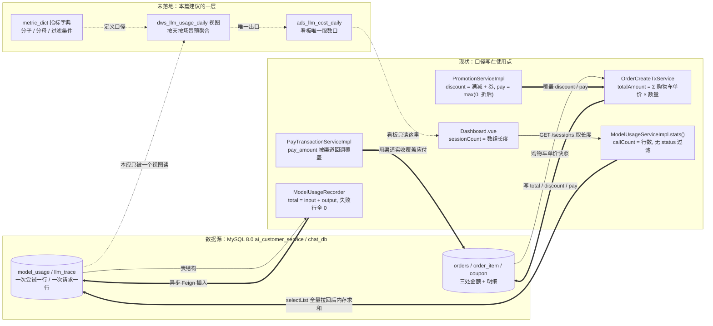
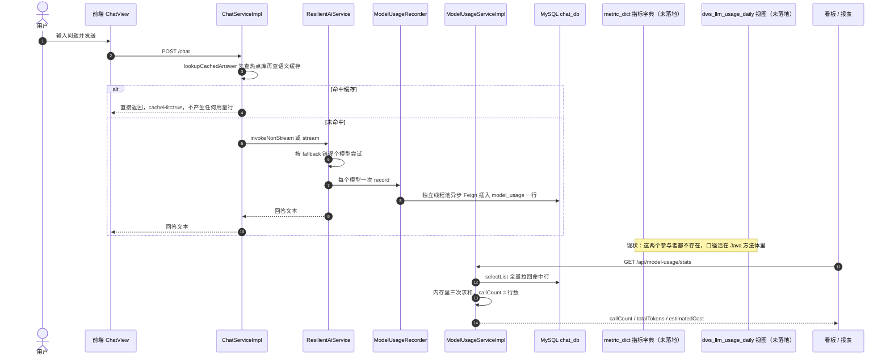

# 03. 数仓分层与指标口径：分层是手段，同一个指标只有一个口径才是目的

> **一句话结论**：ODS/DWD/DWS/ADS 的价值不在"把表切成四层"，而在于它逼你把每个指标的定义**只写得下一遍**、并且写在一个所有取数路径都必须经过的地方。本仓没有分层、没有指标层，于是同一件事——token 用量、成交额、会话数——在 Service、Feign 客户端、前端各算一遍；"两个看板两个数字"在这里不是手误，是结构性的必然。
> **阅读前置**：能读带 `WHERE` / `GROUP BY` 的 SQL；知道 MyBatis-Plus 的 `LambdaQueryWrapper` 只是拼 where 条件；看得懂 Java `Stream` 求和与 `BigDecimal.compareTo`。不需要装过 Hive / Spark / dbt / ClickHouse。
> **证据基线**：JDK 17 / Spring Boot 4.2.0 / Spring AI 2.1.0 / MyBatis-Plus / MySQL 8.0 / Vue 3；证据 **A 3 条 · B 16 条 · C 5 组**；预计阅读 **45 分钟**。

## 证据边界

本篇讨论的"数仓分层"，在本仓库里**一行物理实现都没有**。所以先说清楚哪些是能核对的、哪些是模型算术、哪些只是目标态。

| 类别 | 本仓状态 | 本篇怎么处理 |
| --- | --- | --- |
| 数仓分层物理表（ODS/DWD/DWS/ADS/DIM/FACT） | ❌ 不存在：全仓 `CREATE TABLE` 命中 `ods_/dwd_/dws_/ads_/dim_/fact_` 前缀 = 0 | 只讲四层职责与"跨层引用"错误的判据，并给出可执行的最小落地 DDL（明确标注未落地） |
| 视图 / 物化视图 | ❌ 不存在：`CREATE VIEW`、`MATERIALIZED VIEW` 命中 0 | 最小方案用一个 MySQL 视图承载 DWS，DDL 给出但不假装已建 |
| 指标字典表 | ❌ 不存在：代码侧 `metric_dict|指标字典` 命中 0 | 给出表结构与"口径必须写进表里"的验收判据 |
| 真实业务数据 | ✅ 有：`deploy/mysql/demo-data.sql` 里有 6 行 orders、9 行 order_item、3 条满减规则、5 张券 | 用它做 C-2 真实对账（账实一致 / 三口径差异 / 恒等式破裂反例） |
| LLM 用量表 | ⚠️ 半落地：表结构真实（`deploy/mysql/llm-observability-init.sql`），但全仓 SQL 无一条 `INSERT INTO model_usage`，本机查不到真实用量行 | C-1 用"按代码路径构造的样本"做算术，**明确标为模型演算，非线上实测** |
| 指标层取数接口 | ⚠️ 半落地：`/api/model-usage/stats` 存在，但实现在 JVM 内存里 `selectList` 全量拉回后求和，没有一条 `GROUP BY` | 用它讲清"没有 DWS 时口径写在哪" |
| OLAP 引擎实测（吞吐、延迟、压缩比） | ❌ 无：ClickHouse 在代码侧命中 0 | **不写任何引擎实测数字**；需要实测的段落给命令与判读方法并说明为何没测 |

> 本篇所有"真实输出"都是本机 `node 24.16.0` 与 `pwsh` 跑出来的，命令可直接复制复现；单条命令都在 30 秒内跑完，不启服务、不联网、不连库。

## 0. 先看现象

### 现象一：同一件事"token 用量"，在 32 处代码里各算一遍

```powershell
Get-ChildItem -Recurse -File -Include *.java | Where-Object { $_.FullName -like '*\src\main\*' } |
  Select-String -Pattern 'getTotalTokens|setTotalTokens|totalTokens' |
  Group-Object Path | ForEach-Object { "{0,3}  {1}" -f $_.Count, $_.Name.Replace("$PWD\","") }
```

```text
  1  ai-cs-chat\src\main\java\com\aics\chat\dto\ModelUsageDTO.java
  1  ai-cs-chat\src\main\java\com\aics\chat\dto\ModelUsageStatsVO.java
  1  ai-cs-chat\src\main\java\com\aics\chat\observability\ModelUsageRecorder.java
  1  ai-cs-chat\src\main\java\com\aics\chat\observability\QuotaService.java
  2  ai-cs-chat\src\main\java\com\aics\chat\rag\eval\LlmJudgeService.java
  1  ai-cs-chat\src\main\java\com\aics\chat\rag\eval\RagAnswerJudge.java
  3  ai-cs-chat\src\main\java\com\aics\chat\rag\eval\RagEvalCaseResult.java
  2  ai-cs-chat\src\main\java\com\aics\chat\rag\eval\RagEvalServiceImpl.java
  8  ai-cs-chat\src\main\java\com\aics\chat\service\impl\ResilientAiService.java
  4  ai-cs-chat\src\main\java\com\aics\chat\service\impl\VisionModelClient.java
  2  ai-cs-message\src\main\java\com\aics\message\controller\ModelUsageController.java
  4  ai-cs-message\src\main\java\com\aics\message\dto\ModelUsageDTO.java
  2  ai-cs-message\src\main\java\com\aics\message\entity\ModelUsage.java
 10  ai-cs-message\src\main\java\com\aics\message\service\impl\ModelUsageServiceImpl.java
```

判读：32 处命中里，真正"决定这个数字怎么算"的是三处：写入侧的 `ModelUsageRecorder`、查询侧的 `ModelUsageServiceImpl.stats()`、以及配额侧的 `QuotaService`（它直接把 `stats.getTotalTokens()` 当已用量，`ai-cs-chat/src/main/java/com/aics/chat/observability/QuotaService.java` L57）。三处各有一份对"用量"的理解，谁也不是权威。

### 现象二：全仓 0 张分层表、0 个视图、0 个指标字典

```powershell
"分层表(ods_/dwd_/dws_/ads_/dim_/fact_) = " + (Get-ChildItem -Recurse -File -Include *.sql |
  Select-String -Pattern 'CREATE TABLE[^(]*\b(ods_|dwd_|dws_|ads_|dim_|fact_)').Count
"视图(VIEW/MATERIALIZED VIEW) = " + (Get-ChildItem -Recurse -File -Include *.sql,*.java |
  Select-String -Pattern 'MATERIALIZED VIEW|CREATE VIEW').Count
"code-side metric_dict/指标字典 = " + (Select-String -Path 'ai-cs-*','deploy' -Include *.java,*.sql,*.yml `
  -Pattern 'metric_dict|指标字典' -List -ErrorAction SilentlyContinue).Count
"code-side clickhouse = " + (Select-String -Path 'ai-cs-*','deploy' -Include *.java,*.sql,*.yml `
  -Pattern 'clickhouse' -List -ErrorAction SilentlyContinue).Count
```

```text
分层表(ods_/dwd_/dws_/ads_/dim_/fact_) = 0
视图(VIEW/MATERIALIZED VIEW) = 0
code-side metric_dict/指标字典 = 0
code-side clickhouse = 0
```

判读：`deploy/mysql/` 下有 19 个建表脚本，全是业务表（orders、model_usage、product……），没有一张分析层表；也没有一个视图把"用量"凝固成一层。统计口径目前唯一的载体是 Java 方法体。

### 现象三：同一个"会话数"，前后端各有一个定义

```powershell
Select-String -Path ai-cs-frontend\src\views\Dashboard.vue -Pattern 'sessionCount|/sessions' |
  ForEach-Object { "Dashboard.vue:$($_.LineNumber): $($_.Line.Trim())" }
Select-String -Path ai-cs-message\src\main\java\com\aics\message\controller\MessageController.java -Pattern 'sessions' |
  ForEach-Object { "MessageController.java:$($_.LineNumber): $($_.Line.Trim())" }
```

```text
Dashboard.vue:109: const sessionCount = ref('-')
Dashboard.vue:146: async function loadSessions() {
Dashboard.vue:149: const { data } = await messageApi.get('/sessions', { params: { userId: uid } })
Dashboard.vue:150: if (data.code === 200) sessionCount.value = (data.data || []).length
MessageController.java:115: @GetMapping("/sessions")
MessageController.java:116: public Result<List<ChatSession>> getUserSessions(@RequestParam("userId") Long userId) {
MessageController.java:117: List<ChatSession> sessions = messageService.getUserSessions(userId);
MessageController.java:118: return Result.success(sessions);
```

判读：后端 `ai-cs-message/src/main/java/com/aics/message/service/impl/MessageServiceImpl.java` L133-138 的 `getUserSessions` 是一条 `eq(userId)` + `orderByDesc(updateTime)` 的 `selectList`，无分页、无状态过滤；前端 `ai-cs-frontend/src/views/Dashboard.vue` L149-150 把返回数组的 `.length` 直接当"对话会话数"。这个指标今天只在一个页面出现，所以还没打架；一旦第二个页面改用"有消息的会话数"或"近 7 天活跃会话数"，两个数字就必然对不上，而且没人能说出谁对。

> 这些现象指向同一件事：**这个仓库把"指标怎么算"写在取数的地方，而不是写在数据的地方**。取数点有几个，口径就有几份；取数点随页面增长，口径就随页面分裂。分层（ODS/DWD/DWS/ADS）之所以有用，是因为它把"取数点"从 N 个页面收敛到 1 个 ADS 表，从而让口径有地方可写、有地方可改、有地方可审。

## 1. 整体地图

下图左半边是**今天真实存在的链路**（实线），右半边是**本篇要论证、但本仓未落地的那一层**（虚线）。粗箭头表示"这一步会改变数字本身"。



> **读图说明**：最容易读错的是 `REC ==> USA` 和 `PAY ==> ORD` 这两条粗箭头。第一条告诉你 `model_usage` 的"一行"是**一次模型尝试**，不是"一次用户提问"——所以拿行数当调用次数，天生会对不上请求数。第二条告诉你 `pay_amount` 这个字段有**两个写入者**：下单时是应付额，支付回调后可能被渠道实收覆盖（`ai-cs-pay/src/main/java/com/aics/pay/service/impl/PayTransactionServiceImpl.java` L62-63 用回调 `amount` 覆盖），于是"应付金额"和"实收金额"共用了一列，任何跨表求和都在悄悄混口径。另一处易错：`FEV --> MUI` 这条边在代码里**并不存在**——前端全目录没有任何一处调用 `/stats`，所以看板上的"会话数"和"模型用量"至今没有共同的取数层。

| 组件 | 责任 | 参与方 | 本仓状态 |
| --- | --- | --- | --- |
| `orders` / `order_item` | 保存成交金额与明细快照 | 下单事务、支付回调、对账 | ✅ 真实（`deploy/mysql/order-init.sql`） |
| `PromotionServiceImpl` | 算出满减、券、应付额 | 下单、购物车预览 | ✅ 真实，`ai-cs-order/src/main/java/com/aics/order/service/impl/PromotionServiceImpl.java` |
| `model_usage` | 记录每次模型尝试的 token 与估算费用 | 写入 `ModelUsageRecorder`、读取 `ModelUsageServiceImpl` | ✅ 表真实、⚠️ 无种子数据 |
| `llm_trace` | 记录每次 HTTP 请求的追踪（`request_id` 主键） | `TraceInterceptor` 拦截 `/chat/**`、`/agent/**` | ✅ 真实 |
| `metric_dict`（指标字典） | 一句话写死每个指标的分子/分母/过滤条件 | 数据分析、后端、产品 | ❌ 未落地 |
| `dws_*` 视图 | 把"用量"预聚合成天数×场景 | BI、看板 | ❌ 未落地 |
| `ads_*` 表 | 看板唯一取数出口 | 前端、导出 | ❌ 未落地 |

## 2. 关键概念与关键要素

| 名称 | 位置（本仓真实落点） | 作用 | 关键参数 |
| --- | --- | --- | --- |
| **ODS**（贴源层） | 无。最接近的是 `deploy/mysql/llm-observability-init.sql` 里的 `model_usage` 原始表 | 原样落地源系统数据，只加技术字段（抽取时间、批次号），**不改语义** | 分区键（通常按抽取日）、批次号、是否只追加 |
| **DWD**（明细层） | 无 | 清洗、统一字段名与单位、把维度外键化；一行 = 一个业务事件 | 粒度声明、主键、去重规则、状态枚举映射 |
| **DWS**（汇总层） | 无。建议形态见 3.4 的 `dws_llm_usage_daily` 视图 | **只做确定性聚合**（sum/count/max），不引入解释 | 统计周期（天/小时）、维度组合、是否包含失败 |
| **ADS**（应用层） | 无。最接近的是 `/api/model-usage/stats` 这个接口 | 面向一个具体看板，口径唯一负责人 | 指标 ID、口径版本、数据截止时间 |
| **星型模型** | 无。`orders` 与 `order_item` 是最接近的"事实 + 退化维度"雏形 | 一个事实表 + 若干维表，维表不嵌套 | 维表键、是否退化 |
| **雪花模型** | 无 | 维表再规范化（品类挂到三级分类表），省空间但多 join | 规范化层级 |
| **退化维度** | ✅ 真实：`order_no` 直接放在 `orders` 与 `order_item`（`deploy/mysql/order-init.sql` L49-61 的 `order_no` 冗余列） | 把"订单号"这种没有自身属性的维度直接塞进事实表，避免建空维表 | 冗余列、是否建索引 |
| **SCD2**（缓慢变化维第二类） | ⚠️ 手工版：`order_item.product_price` 是"成交单价快照"（`deploy/mysql/order-init.sql` L55） | 维属变化时保留历史版本，事实行永远挂当时的版本 | 生效起止时间、当前行标记 |
| **事务事实表** | ✅ `orders`：一行 = 一次下单 | 记录事件本身，可累加 | 事件时间、可加性 |
| **周期快照事实表** | ❌ 无 | 每天/每周期拍一张全量状态快照，用于算存量 | 快照粒度、是否幂等重跑 |
| **累积快照事实表** | ❌ 无 | 一行跟着流程推进被反复更新（下单→支付→发货→退款） | 各阶段时间戳列 |
| **原子指标** | ✅ 真实：`total_tokens` 这一列（`deploy/mysql/llm-observability-init.sql` L39） | 不可再拆的业务度量 + 默认聚合方式 | 聚合函数（sum）、单位（token） |
| **派生指标** | ⚠️ 半落地：`estimated_cost`（L40）由 token × 单价算得 | 原子指标 + 修饰词（时间/维度） | 单价表、精度（`DECIMAL(12,6)`） |
| **复合指标** | ⚠️ 半落地：`ModelUsageServiceImpl.stats()` 里的 `callCount` / `totalTokens` / `estimatedCost` 并列输出 | 多个派生指标再做运算（如"单次调用平均成本"） | 分子、分母、过滤条件 |
| **口径三件套** | ❌ 无载体 | 分子、分母、过滤条件——三者齐了才算定义完一个指标 | 见 3.4 |
| **数据血缘** | ❌ 无系统化实现；只能靠 `Select-String` 做列级 grep | 改一个字段能列出受影响的下游 | 表级/列级/任务级 |
| **指标字典表** | ❌ 未落地（代码侧命中 0） | 把口径写成数据而不是注释 | 指标 ID、口径版本、负责人 |

## 3. 原理与证据逐段精读

### 3.1 四层的铁律：每层只允许做一件事

- **在干什么**：ODS 只做"原样搬"，DWD 只做"清洗 + 维度外键化"，DWS 只做"确定性聚合"，ADS 只做"给一个看板交付一个口径"。每层的输入必须是**上一层**，跨层引用（比如 ADS 直接读 ODS，或 DWD 直接读业务库）是分层体系里最贵的错误。
- **为什么这么设计**：因为"口径写错"要能被定位。如果 ADS 直连 ODS，那么当两个看板数字不同时，你既不知道是清洗逻辑不一致还是聚合条件不一致；分层把"可能的错因"限制在两两相邻的一层之间，把 N² 的排查面压成 N。
- **换成别的写法会怎样**：不走分层、直接在 Service 里算，就是本仓现状——`ModelUsageServiceImpl.stats()` 一个方法同时承担了清洗（null→0）、聚合（三次 `mapToLong` 求和）、口径（要不要过滤失败行，它选择"不过滤"）三件事。结果改一处就得读全方法，评审时也很难只对着"口径"这一栏讨论。
- **常见坑**：把"分层"当成目的，建了四层表却没人写口径文档——表分层了，口径还在人的脑子里。本篇的主题就是这一句：**分层是手段，口径统一才是目的**。

跨层引用在本仓的"影子"，可以按下面这张表自查：

| 错误形态 | 长什么样 | 后果 | 本仓对应（真实） |
| --- | --- | --- | --- |
| 穿透取数 | ADS 直接查业务库表 | 业务表改列，看板静默错 | 没有 ADS，所以表现为"每个 Service 自己查" |
| 跨层回写 | DWD 更新业务库字段 | 生产库被分析任务拖垮 | 无（暂无分析任务），但 `PaySchemaInitializer` 里的 `CREATE TABLE` 已经是"代码兼管 DDL"的同类风险 |
| 同层互相读 | DWS_A 读 DWS_B 再聚合 | 口径藏在两张表的和图里 | 无 |

### 3.2 维度建模：星型、雪花、退化维度与缓慢变化维

- **在干什么**：把"事实"（可度量的业务事件）与"维度"（描述事实的角度）分开建表。星型 = 维表只有一层；雪花 = 维表再规范化；退化维度 = 没有自身属性的维度（订单号、票据号）直接放事实表；SCD2 = 维度变化时新增版本行，事实表永远指向"当时那一版"。
- **为什么这么设计**：事实表只管"加"，维表只管"切"。只要维度版本稳定，"按渠道汇总金额"和"按商品汇总金额"这两个指标才可能来自同一份事实。
- **换成别的写法会怎样**：不建维表、把维度名字直接写进事实表（宽表化到了一切），改动商品名就等于改写历史统计。本仓 `order_item.product_name` / `product_price` 就是这么干的（`deploy/mysql/order-init.sql` L54-55 两列的注释直接写着"快照"）——这是**手工版 SCD2**：它保住了历史，代价是没有任何一处记录"这一版从什么时候生效到什么时候"。
- **常见坑**：以为"快照了就完事"。快照只解决了"事实不被改写"，没解决"维度自身的分析需求"（比如"这个商品改过几次价、每次多久"）。要回答这个，必须有独立的 `dim_product` 表 + 生效区间。

### 3.3 事实表的三种粒度：本仓三张表正好是三个粒度

| 粒度 | 定义 | 本仓真实载体 | 粒度声明 | 误用后果 |
| --- | --- | --- | --- | --- |
| 事务粒度 | 一行 = 一个业务事件，可加 | `orders`（一行一次下单）、`model_usage`（一行**一次模型尝试**） | `orders` 主键 `id`、`model_usage` 主键 `id` | 把 `model_usage` 行数当"调用次数" → 一次请求有 fallback 时会算成 2 次 |
| 周期快照 | 一行 = 某周期末的存量状态 | ❌ 无 | — | 没有它，"当前待支付订单数"只能实时扫全表 |
| 累积快照 | 一行 = 一个实体的全生命周期，随阶段推进被更新 | ⚠️ 近似：`orders` 用 `status` + `pay_time` + `cancel_time` 三个列表达阶段（`deploy/mysql/order-init.sql` L35-38） | 无阶段时间戳完整性约束 | 少了"退款完成时间"，退款时长类指标就算不出来 |

判据很简单：**先问"这一行代表什么"，再问"能不能加"**。`orders` 的行能加（成交额求和有意义），`orders` 的"待支付订单数"不能跨周期加（那是快照），`model_usage` 的行能加但**不能当请求数**。

### 3.4 指标口径三件套：分子、分母、过滤条件

这是本篇的核心。一个指标没写全这三样，就不算定义完：

1. **分子**：算什么（`SUM(total_tokens)` 还是 `COUNT(*)`）；
2. **分母**：除以什么（行数？成功行数？用户请求数？）；
3. **过滤条件**：哪些行算、哪些不算（`status='SUCCESS'`？含不含缓存命中？含不含 `estimated=1` 的估算行？）。

本仓最典型的一条，是"每次 LLM 调用的平均 token"。它的三种合规写法，在同一批请求上可以差出一个看板的量级。下面这段是本机实算（样本按本仓代码路径构造，见代码里的三处真实依据）：

```powershell
node -e @'
// 口径实验 C-1：同一个指标「平均每次 LLM 调用的 token」的三种算法
// 样本按本仓代码路径构造（非线上数据）：失败行 token=0、缓存命中不产生 model_usage 行
const rows = [];
for (let i = 0; i < 760; i++) rows.push({ st: 'SUCCESS', inp: 900, out: 300 });
for (let i = 0; i < 40; i++) { rows.push({ st: 'FAILED', inp: 0, out: 0 }); rows.push({ st: 'SUCCESS', inp: 900, out: 300 }); }
for (let i = 0; i < 20; i++) rows.push({ st: 'FAILED', inp: 0, out: 0 });
const requests = 1000, hits = 180;
const tok = r => r.inp + r.out;
const all = rows.reduce((s, r) => s + tok(r), 0);
const ok = rows.filter(r => r.st === 'SUCCESS');
const okSum = ok.reduce((s, r) => s + tok(r), 0);
const A = all / rows.length;
const B = okSum / ok.length;
const C = okSum / requests;
const d = (x, y) => ((x - y) / y * 100).toFixed(1) + '%';
console.log('model_usage 行数 =', rows.length, '| SUCCESS 行 =', ok.length, '| 用户请求 =', requests, '| 缓存命中 =', hits);
console.log('口径A 每次尝试平均 token（含失败行做分母）=', A.toFixed(1));
console.log('口径B 每次成功调用平均 token =', B.toFixed(1));
console.log('口径C 每个用户请求平均 token（含命中请求做分母）=', C.toFixed(1));
console.log('A vs B =', d(A, B), '| C vs B =', d(C, B), '| B vs C =', d(B, C), '| 极差/最小值 =', d(Math.max(A, B, C), Math.min(A, B, C)));
'@
```

```text
model_usage 行数 = 860 | SUCCESS 行 = 800 | 用户请求 = 1000 | 缓存命中 = 180
口径A 每次尝试平均 token（含失败行做分母）= 1116.3
口径B 每次成功调用平均 token = 1200.0
口径C 每个用户请求平均 token（含命中请求做分母）= 960.0
A vs B = -7.0% | C vs B = -20.0% | B vs C = 25.0% | 极差/最小值 = 25.0%
```

怎么读：同一个"平均每次调用花多少 token"，可以是 1116.3（分母 = 所有尝试行）、1200.0（分母 = 成功行）、960.0（分母 = 用户请求数）。极差 25%，正好是"分母里有没有把 180 次缓存命中和 60 条失败行算进去"这一个决定。**这三个数字都不算错，错的是没写清楚是哪一个。**

样本的三个依据都是本仓代码里的真实现象，不是我想出来的：

- 失败行 token 一定是 0：`ai-cs-chat/src/main/java/com/aics/chat/observability/ModelUsageRecorder.java` L91-95 把 `null` 的 token 直接落成 0（`int in = inputTokens == null ? 0 : inputTokens`），而调用失败时传的正是两个 `null`（`ai-cs-chat/src/main/java/com/aics/chat/service/impl/ResilientAiService.java` L222-224）。
- 一次请求可能产生多行：`ResilientAiService` L194-232 的 `for (String modelId : chain)` 里，**每个模型一次 `record`**——这就是样本里"40 次首模型失败 + fallback 成功"贡献 2 行的依据。
- 缓存命中不产生任何行：`ai-cs-chat/src/main/java/com/aics/chat/service/impl/ChatServiceImpl.java` L424-427 命中后直接返回，根本不进 `ResilientAiService`，所以那 180 次请求在 `model_usage` 里是 0 行。

而现状里读这些数的接口，分母取的是最省事的那个：

```java
// ai-cs-message/src/main/java/com/aics/message/service/impl/ModelUsageServiceImpl.java L91-L100
LambdaQueryWrapper<ModelUsage> wrapper = new LambdaQueryWrapper<>();
wrapper.eq(userId != null, ModelUsage::getUserId, userId)
        .eq(scenario != null, ModelUsage::getScenario, scenario)
        .eq(model != null, ModelUsage::getModel, model)
        .ge(startTime != null, ModelUsage::getCreateTime, startTime)
        .le(endTime != null, ModelUsage::getCreateTime, endTime);
List<ModelUsage> records = modelUsageMapper.selectList(wrapper);
vo.setCallCount((long) records.size());
```

**在干什么**：把用户、场景、模型、时间窗四个过滤条件拼上，然后把命中的行**全部拉回 JVM**，用 `records.size()` 当"调用次数"、用三次 stream 求和当 token 和费用。
**为什么这么设计**：代码里的注释解释了——为了可 mock、可单测、量级可控。这个理由在"每人每天几百行"的量级下成立。
**换成别的写法会怎样**：写成一条 `GROUP BY`（或走 DWS 视图），`callCount` 就天然带上了 `COUNT(DISTINCT request_id)` 的选项，口径能在 SQL 里被评审；而现在口径藏在一个 Java 方法体里，只有读代码的人知道"失败行也算一次调用"。
**常见坑**：`wrapper` 里**没有 `status` 条件**，所以 `callCount` 语义是"尝试次数（含失败）"，而 `totalTokens` 语义是"成功的 token 加上失败行的 0"——同一行输出里混了两种粒度，看板把它们放在一起展示时，"平均每次调用 token"就自动变成了口径 A（1116.3），而业务方心里的分母很可能是口径 C 或 B。

### 3.5 原子指标只能定义一次：框架已经给了一份，我们又写了两份

Spring AI 的 `Usage` 接口把"token 用量"定义为三个只读值，其中 `totalTokens` 有默认实现：

```java (src: Usage.java.md#L56-L62)
	default Integer getTotalTokens() {
		Integer promptTokens = getPromptTokens();
		promptTokens = promptTokens != null ? promptTokens : 0;
		Integer completionTokens = getCompletionTokens();
		completionTokens = completionTokens != null ? completionTokens : 0;
		return promptTokens + completionTokens;
	}
```

- **在干什么**：把"总 token = 输入 + 输出，null 记 0"这条规则**写死在类型里**（`[[源码:Usage.java.md#L29-L46]]` 只有三个 getter，`[[源码:Usage.java.md#L56-L62]]` 是唯一的派生规则）。
- **为什么这么设计**：因为这是原子指标，它的派生规则一旦有两个版本，成本核算立刻分叉。放在接口默认方法里，任何 provider 实现都无法偷偷改口径。
- **换成别的写法会怎样**：本仓就换了个写法——`ModelUsageRecorder` L91-95 自己写了一遍 `in + out`，`ModelUsageServiceImpl` L60-69 在写库侧**又写了一遍**同样的兜底。同一规则三份实现（框架 + 2 处业务），改一处漏两处是时间问题。
- **常见坑**：以为"我用的是框架的 `getUsage()`，口径就自然一致了"。真相是框架只保证"接口语义"，一旦你在自己的 DTO 上重新组装一遍，就已经是第二份定义。

流式场景还有第二层陷阱：多轮/流式 chunk 的用量累加，框架用 `UsageAccumulator` 统一负责（`[[源码:UsageAccumulator.java.md#L83-L126]]`，`addRoundResponse` 累加、`applyAccumulatedUsage` 在末 chunk 修正）。本仓在 `ResilientAiService` L303-316 用 `AtomicReference` 自己抓末 chunk 的 usage——这在单轮单模型下等价，但一旦开了多轮工具调用，自己抓的数就会漏掉中间轮次，而框架的累加器不会。**这是"绕过框架口径"的代价：不是当场错，是在功能演进后错。**

派生/复合指标的同类问题在费用上：

```java
// ai-cs-chat/src/main/java/com/aics/chat/observability/ModelUsageRecorder.java L96-L100
// 学习点：pricingKey 与展示 model 分离——单价配置按内部模型 id（如 siliconflow-qwen3-32b），供应商展示名（如 Qwen/Qwen3-32B）变化不会导致费用查不到单价
dto.setEstimatedCost(estimateCost(pricingKey, in, out));
// estimated 标记：流式调用常取不到精确 usage，此时按估算记且打标，
// 统计时可按标记过滤，避免"估算当精确"误导成本决策
dto.setEstimated(inputTokens == null || outputTokens == null);
```

注释里已经写下了正确口径（"统计时可按标记过滤"），但**没有任何地方真的按它过滤**：`ModelUsageServiceImpl` L110-113 的费用求和是 `filter(Objects::nonNull).reduce(ZERO, BigDecimal::add)`，估算行和精确行混加。于是"这个月的 token 成本"这个复合指标，实际上是"部分精确 + 部分估算"的混合体，而指标名和看板上都没有这句话。**口径写进注释 = 没写**，这就是为什么要指标字典表。

### 3.6 口径冲突的真实代价：用真实种子数据算一遍

`deploy/mysql/demo-data.sql` 里有 6 行 orders、9 行 order_item、3 条满减规则、5 张券。这不是线上数据，但它是**仓库里真实存在的、可以被任何人复算的一批数**，正好用来演示"同一个'成交额'三种状态过滤"的价格。脚本直接解析该文件（不手抄数字）：

```powershell
node -e @'
const fs = require('fs');
const sql = fs.readFileSync('deploy/mysql/demo-data.sql', 'utf8');
const Q = String.fromCharCode(39);
const split = l => { const out = []; let cur = '', q = false;
  for (const ch of l) { if (ch === Q) q = !q; else if (ch === ',' && !q) { out.push(cur.trim()); cur = ''; } else cur += ch; }
  out.push(cur.trim()); return out; };
const block = tbl => { const i = sql.indexOf('INSERT INTO ai_customer_service.' + tbl);
  const j = sql.indexOf(';', i);
  return sql.slice(i, j).split(/\r?\n/).filter(l => /^\s*\(/.test(l))
    .map(l => split(l.trim().replace(/^\(/, '').replace(/\)[,;]?$/, ''))); };
const ord = block('orders').map(p => ({ id: +p[0], total: +p[3], dis: +p[4], pay: +p[5], st: p[10].replace(/[^A-Z_]/g, '') }));
const item = block('order_item').map(p => ({ oid: +p[1], sub: +p[7] }));
const sum = a => a.reduce((s, x) => s + x, 0);
const r2 = x => Math.round(x * 100) / 100;
console.log('orders 行 =', ord.length, '| order_item 行 =', item.length);
console.log('Σorders.total =', r2(sum(ord.map(o => o.total))), '| Σorder_item.subtotal =', r2(sum(item.map(i => i.sub))), '| Σorders.pay =', r2(sum(ord.map(o => o.pay))));
ord.forEach(o => console.log('  恒等式 order', o.id, o.st.padEnd(11), 'total', o.total, 'dis', o.dis, 'pay', o.pay, '=>', r2(o.total - o.dis) === o.pay ? 'OK' : 'BROKEN'));
ord.forEach(o => { const s = r2(sum(item.filter(i => i.oid === o.id).map(i => i.sub)));
  console.log('  明细回加 order', o.id, 'items', s, 'vs total', o.total, s === o.total ? 'OK' : 'MISMATCH'); });
const paySum = sum(ord.map(o => o.pay));
const A = sum(ord.filter(o => o.st === 'PAID').map(o => o.pay));
const B = sum(ord.filter(o => o.st !== 'CANCELLED').map(o => o.pay));
const C = sum(ord.map(o => o.total));
const pct = (x, y) => ((x - y) / y * 100).toFixed(1) + '%';
console.log('口径A 已支付成交额 (status=PAID, pay_amount)      =', A);
console.log('口径B 未取消成交额 (status<>CANCELLED, pay_amount) =', B, '| 相对口径A', pct(B, A));
console.log('口径C 全额原价     (全部 status, total_amount)    =', C, '| 相对口径A', pct(C, A));
console.log('优惠率 (Σtotal-Σpay)/Σtotal =', ((C - paySum) / C * 100).toFixed(1) + '%');
const pay2 = Math.max(100 - 10 - 120, 0);
console.log('截断反例: discount =', 10 + 120, 'pay_amount =', pay2, 'total - discount =', 100 - 130, '=>', (100 - 130) === pay2 ? 'OK' : 'BROKEN');
'@
```

```text
orders 行 = 6 | order_item 行 = 9
Σorders.total = 1878 | Σorder_item.subtotal = 1878 | Σorders.pay = 1608
  恒等式 order 1 PAID        total 527 dis 100 pay 427 => OK
  恒等式 order 2 CANCELLED   total 29 dis 0 pay 29 => OK
  恒等式 order 3 PENDING_PAY total 577 dis 100 pay 477 => OK
  恒等式 order 4 PAID        total 169 dis 20 pay 149 => OK
  恒等式 order 5 PENDING_PAY total 259 dis 0 pay 259 => OK
  恒等式 order 6 PAID        total 317 dis 50 pay 267 => OK
  明细回加 order 1 items 527 vs total 527 OK
  明细回加 order 2 items 29 vs total 29 OK
  明细回加 order 3 items 577 vs total 577 OK
  明细回加 order 4 items 169 vs total 169 OK
  明细回加 order 5 items 259 vs total 259 OK
  明细回加 order 6 items 317 vs total 317 OK
口径A 已支付成交额 (status=PAID, pay_amount)      = 843
口径B 未取消成交额 (status<>CANCELLED, pay_amount) = 1579 | 相对口径A 87.3%
口径C 全额原价     (全部 status, total_amount)    = 1878 | 相对口径A 122.8%
优惠率 (Σtotal-Σpay)/Σtotal = 14.4%
截断反例: discount = 10 + 120 pay_amount = 0 total - discount = -30 => BROKEN
```

怎么读这张表，四层意思：

1. **账现在是齐的**：6 单全部满足 `total - discount = pay`，9 行明细按单回加都等于主表 `total_amount`，`Σtotal` 与 `Σsubtotal` 都是 1878。也就是说"没有 DWS 层"今天还没造成对不上，是因为数据量小到可以人肉对账——`demo-data.sql` 的结尾注释甚至就写着人工核对用的 `SELECT COUNT(*)`。这是**运气，不是设计**。
2. **同一个"成交额"三个数**：843 / 1579 / 1878，差 87.3% 与 122.8%。三个都是"成交额"，差别只在过滤条件（`status='PAID'` / `status<>'CANCELLED'` / 不过滤）和分子列（`pay_amount` / `total_amount`）。这就是"两个看板两个数字"的全部机制——不需要任何人算错，只需要两个人各写一遍 where。
3. **明细表算不出"实收"**：`order_item` 只有 `product_price`、`quantity`、`subtotal`（`deploy/mysql/order-init.sql` L49-61），**没有任何优惠分摊列**；而下单时确实就是按原价写入的（`ai-cs-order/src/main/java/com/aics/order/service/impl/OrderCreateTxService.java` L126-128）。于是"各商品实际收了多少"这个指标，用现有数据算不出来，只能假设"按原价比例分摊"——而这个假设目前哪里都没写。这是最典型的"口径缺失但不报错"：`Σsubtotal` 永远等于 `total_amount`，看起来严丝合缝，实际少了一层优惠。
4. **恒等式会被 `max(0)` 打破**：`PromotionServiceImpl` L52-54 把优惠额记成"满减 + 券"，但应付额被 `.max(BigDecimal.ZERO)` 截断。上面最后一行就是反例：订单 100 元、满 100 减 10、券面额 120（券表 `amount` 与 `min_order_amount` 是两个独立字段，仓库里没有"券面额 ≤ 门槛"的校验，见 `deploy/mysql/order-init.sql` 的 `coupon` 建表段），算出来 `discount = 130 > total = 100`、`pay = 0`，恒等式变成 `-30 = 0`。任何"优惠率 = discount / total"的指标在这种单上会算出 130% 这种不可能的数。

顺带把支付侧的口径分裂点也钉住：`ai-cs-pay/src/main/java/com/aics/pay/service/impl/PayTransactionServiceImpl.java` L62-63 用渠道回调的 `amount` 覆盖 `pay_transaction.pay_amount`；而 `orders.pay_amount` 是下单时算出的应付额，`confirmPay` 会校验两者相等（`ai-cs-order/src/main/java/com/aics/order/service/impl/OrderServiceImpl.java` L137-143），不等就抛异常。所以：

- **权威口径**："这个订单应收多少" → `orders.pay_amount`（下单时唯一计算、支付时被校验）；
- **非权威但更真实**："这个订单实际收到多少" → `pay_transaction.pay_amount`（渠道说的）；
- **绝不能混用**："本月 GMV" 只能用其中一个，且必须在指标字典里写死用哪个、以及"不等时以谁为准"。

### 3.7 数据血缘与影响分析：改一个字段，要能列出下游

- **在干什么**：血缘回答"这个字段从哪来、到哪去"。表级血缘用于知道"改表结构会炸哪些任务"，列级血缘用于知道"改这个字段含义会错哪些指标"。
- **为什么这么设计**：因为口径错误往往不是算错，而是**语义悄悄变了**。`pay_amount` 从"应付"变成"渠道实收"，代码没报错、类型没变、测试全绿。
- **换成别的写法会怎样**：靠 `grep` 手工找下游，就是本仓现状。下面是真实的影响面清单（`setPayAmount` 全部写入点，已排除测试）：

```powershell
Get-ChildItem -Recurse -File -Include *.java | Where-Object { $_.FullName -notlike '*\src\test\*' } |
  Select-String -Pattern 'setPayAmount' |
  ForEach-Object { $_.Path.Replace("$PWD\","") + ":" + $_.LineNumber + "  " + $_.Line.Trim() }
```

```text
ai-cs-order\src\main\java\com\aics\order\controller\CartController.java:128  vo.setPayAmount(priceCalc.getPayAmount());
ai-cs-order\src\main\java\com\aics\order\service\impl\OrderCreateTxService.java:110  order.setPayAmount(priceCalc.getPayAmount());
ai-cs-order\src\main\java\com\aics\order\service\impl\OrderCreateTxService.java:152  vo.setPayAmount(priceCalc.getPayAmount());
ai-cs-order\src\main\java\com\aics\order\service\impl\OrderServiceImpl.java:276  vo.setPayAmount(order.getPayAmount());
ai-cs-order\src\main\java\com\aics\order\service\impl\PromotionServiceImpl.java:54  bo.setPayAmount(afterCoupon.max(BigDecimal.ZERO));
ai-cs-pay\src\main\java\com\aics\pay\client\OrderPayClient.java:52  vo.setPayAmount(new BigDecimal(String.valueOf(data.get("payAmount"))));
ai-cs-pay\src\main\java\com\aics\pay\service\impl\PayTransactionServiceImpl.java:38  tx.setPayAmount(payAmount);
ai-cs-pay\src\main\java\com\aics\pay\service\impl\PayTransactionServiceImpl.java:45  tx.setPayAmount(payAmount);
ai-cs-pay\src\main\java\com\aics\pay\service\impl\PayTransactionServiceImpl.java:63  tx.setPayAmount(amount);
```

怎么读这份清单：**9 个写入点里，只有 `PromotionServiceImpl` L54 是"算出来的"，其余 8 个都是搬运**。真正的口径源头只有一处——这条信息在做过血缘的工具里是一条边，在这里只能靠读 9 行代码得出。判读要点：如果一个字段的写入点数量 > 1 且其中有两个以上是"独立计算"，就必须建指标字典；如果全是搬运，只需要在该列的注释里写死"谁是权威源"。

**常见坑**：把"grep 到了所有调用点"当成血缘完整。`OrderPayClient` L52 那一行说明 `pay` 服务是通过 Feign 的 `Map<String,Object>` 取值——`get("payAmount")` 这种字符串键是**不存在于任何静态血缘里的下游**，改字段名编译器不会拦。

## 4. 一次完整执行时序

下面这条时序是"用户提一个问题 → 变成一个看板数字"的全过程。注意其中三个"（未落地）"的参与者：它们就是本篇主张要补的那一层。



> **读图说明**：唯一必须盯住的是第 7 步 `MR->>DB` 和第 15 步 `MU->>DB`——它们读写的"一行"含义不同：写入侧一行 = **一次模型尝试**，读取侧却把行数当"调用次数"（`records.size()`），两者之间没有任何一层去对齐语义。第二个易错点是 `alt 命中缓存` 分支：缓存命中在 `model_usage` 里留下的是**零行**，所以任何以 `model_usage` 为唯一数据源的"请求量"指标都会系统性偏低——偏低多少，取决于缓存命中率，而命中率本身在本仓没有数据源（`ai-cs-chat/src/main/java/com/aics/chat/controller/CacheStatsController.java` L36-54 只返回容量与 Top-N，没有命中次数）。

| 步 | 观察点 | 正常长相 | 异常长相与判读 |
| --- | --- | --- | --- |
| 3 | 是否命中缓存 | 命中则本次不调 LLM，`cacheHit=true` | 命中率很高但看板"调用量"曲线不动 → 说明看板分母用了 `model_usage` 行数，缺了缓存命中这一路 |
| 6 | fallback 链长度 | 通常 1 个模型成功 | 一次请求出现 2 行以上 → 是 fallback 不是重复上报，别急着删数据 |
| 7 | 写入是否成功 | 异步线程池落地，失败仅 `WARN` | 只有 `模型用量上报失败` 日志、库里没有行 → 计量已丢，且业务无感（这是设计取舍，见 5 节） |
| 8 | 失败行长相 | `status=FAILED`，token 全 0，`estimated=1` | 失败行 token 非 0 → 有人改过 null 兜底逻辑，口径已变 |
| 9 | 一次请求的行数 | 成功 1 行 | 成功 N 行且 `status` 全 SUCCESS → 走到了多模型并行或多轮工具调用，原有"行数=次数"假设失效 |
| 13 | 接口的过滤条件 | 带 `status`/`estimated` 过滤 | 只有 `userId/scenario/model/时间窗` → `callCount` 含失败，口径 A，见 3.4 |
| 15 | 聚合方式 | `GROUP BY` 或读 DWS | `selectList` 全量拉回 → 行数一多就 OOM，且口径不可评审 |

## 5. 设计取舍

| 取舍点 | 选项 A | 选项 B | 本仓现状 / 建议 | 放弃的东西 |
| --- | --- | --- | --- | --- |
| 口径写在哪 | 写在 Java 方法体（当前） | 写在 `metric_dict` 表 + DWS 视图 | 建议 B：先用视图固化，再把三件套写进字典表 | 写表会多一次改表+发布；写代码"改起来快"（也正是它坏得快的原因） |
| 失败行怎么处理 | 落库、token 记 0、`estimated=1`（当前） | 不落库，失败只进日志 | 保留 A：失败率本身是重要指标，删了就再也算不出来 | 保留 A 就要求所有查询显式过滤 `status`，否则分母被子虚增 |
| 缓存命中怎么进统计 | 不进 `model_usage`（当前） | 落一行 `status=CACHED, tokens=0` | 建议 B（或单独一张 `cache_hit_log`）：否则"请求量"永远缺一路 | 多写一次库；且要小心别再被"行数=调用次数"误用 |
| 明细要不要优惠分摊 | 不分摊，`subtotal` 记原价（当前） | 每个 `order_item` 加 `discount_share` 列 | 建议 B，但属破坏性变更，需与前端/对账同步 | 分摊要定义"按金额比例"还是"按件数"，一旦选错比不分摊更难纠 |
| 聚合在哪做 | JVM 内存求和（当前） | SQL `GROUP BY` / 视图 | 建议 B：先把口径挪进 SQL，才谈得上评审 | 内存聚合的可 mock 性（现在单测容易，改 SQL 后要 H2 或 Testcontainers） |
| 指标粒度选哪张表 | `model_usage`（尝试粒度） | `llm_trace`（请求粒度，`request_id` 主键） | **两个都要留，但"请求量"必须用 `llm_trace`** | 冗余存储；两表 join 才能算"每次请求的尝试数" |

**可扩展点清单**（每条给验收判据）：

1. 建 `metric_dict` 指标字典表（指标 ID、名称、分子、分母、过滤条件、单位、负责人、口径版本、更新时间）。**验收判据**：能从表里查出"平均每次调用 token"这一行，且它的分子分母过滤条件写全三个字段，不再需要读 Java 代码。
2. 建 `dws_llm_usage_daily` 视图（下方 DDL）。**验收判据**：`SELECT * FROM dws_llm_usage_daily` 的结果与 `ModelUsageServiceImpl.stats()` 在**同一时间窗**内的 `callCount`、`totalTokens` 完全一致；不一致就说明有一个口径是错的。
3. 给 `orders` 加"实收金额"独立列或在指标字典里写死"实收取 `pay_transaction`"。**验收判据**：任取一单，`orders.pay_amount` 与 `pay_transaction.pay_amount` 不等时，看板展示的解释文字与字典里写的一致。
4. 给 `order_item` 加 `discount_share`（可空，历史单留空并标注"按原价比例分摊"）。**验收判据**：`Σ(order_item.subtotal - discount_share) = orders.pay_amount` 对全部新单成立，且对历史单返回"已知缺口"而不是 0。
5. 缓存命中落一行 `status=CACHED` 或独立表。**验收判据**：`SUM(status='CACHED') + SUM(status='SUCCESS' 的首行数) = 请求总数`（误差 ≤ 采样丢失）。
6. 所有"次数"类指标一律用 `COUNT(DISTINCT request_id)` 而非 `COUNT(*)`，并在字典里注明。**验收判据**：在 fallback 发生的样本上，`COUNT(*)` 与 `COUNT(DISTINCT request_id)` 的差值 = fallback 次数，两者都能解释。

建议的最小 DWS（**未落地**，本仓 `CREATE VIEW` 命中 0）：

```sql
-- 未落地：本仓当前没有这张视图，这是建议形态，字段取自 deploy/mysql/llm-observability-init.sql L29-L49
CREATE OR REPLACE VIEW dws_llm_usage_daily AS
SELECT DATE(create_time)                                        AS stat_date,
       scenario,
       model,
       COUNT(*)                                                 AS attempts,
       COUNT(DISTINCT request_id)                               AS requests,
       SUM(CASE WHEN status = 'SUCCESS' THEN 1 ELSE 0 END)      AS ok_calls,
       SUM(CASE WHEN status <> 'SUCCESS' THEN 1 ELSE 0 END)     AS failed_calls,
       SUM(CASE WHEN status = 'SUCCESS' THEN input_tokens  ELSE 0 END) AS ok_input_tokens,
       SUM(CASE WHEN status = 'SUCCESS' THEN output_tokens ELSE 0 END) AS ok_output_tokens,
       SUM(CASE WHEN status = 'SUCCESS' AND estimated = 0 THEN estimated_cost ELSE 0 END) AS ok_exact_cost,
       SUM(CASE WHEN status = 'SUCCESS' AND estimated = 1 THEN estimated_cost ELSE 0 END) AS ok_estimated_cost
FROM model_usage
GROUP BY DATE(create_time), scenario, model;
```

这张视图的关键不在"聚合"，在于它把**四个口径问题一次性钉死在列名里**：`attempts` 与 `requests` 分列（回答"行数还是请求数"）、`ok_` 前缀（回答"含不含失败"）、`exact` / `estimated` 分列（回答"估算能不能和精确数混加"）。看板只能从这些列里挑，挑哪个必须在指标字典里写一行。

## 6. 踩坑与调试手法

### 6.1 把 `model_usage` 行数当"AI 调用次数"

```powershell
Select-String -Path ai-cs-message\src\main\java\com\aics\message\service\impl\ModelUsageServiceImpl.java `
  -Pattern 'setCallCount|selectList' | ForEach-Object { "  L$($_.LineNumber): $($_.Line.Trim())" }
```

```text
  L98: List<ModelUsage> records = modelUsageMapper.selectList(wrapper);
  L100: vo.setCallCount((long) records.size());
```

| 判读 | 误判风险 |
| --- | --- |
| `callCount` = 命中条件的**行数**，而行是"一次模型尝试"；有 fallback 时行数 > 请求数，有缓存命中时行数 < 请求数 | 看到行数比请求数多，容易误判成"重复上报 bug"去加去重；实际是 fallback 的正常产物 |

### 6.2 统计查询没有 `status` 过滤，失败行进分母

```powershell
Select-String -Path ai-cs-message\src\main\java\com\aics\message\service\impl\ModelUsageServiceImpl.java `
  -Pattern 'wrapper\.|\.eq\(|\.ge\(|\.le\(' | ForEach-Object { "  L$($_.LineNumber): $($_.Line.Trim())" }
```

```text
  L91: LambdaQueryWrapper<ModelUsage> wrapper = new LambdaQueryWrapper<>();
  L92: wrapper.eq(userId != null, ModelUsage::getUserId, userId)
  L93: .eq(scenario != null, ModelUsage::getScenario, scenario)
  L94: .eq(model != null, ModelUsage::getModel, model)
  L95: .ge(startTime != null, ModelUsage::getCreateTime, startTime)
  L96: .le(endTime != null, ModelUsage::getCreateTime, endTime);
```

| 判读 | 误判风险 |
| --- | --- |
| 五个条件里没有 `status`，也没有 `estimated`；所以 `callCount`（尝试数）、`totalTokens`（成功量+失败 0）、`estimatedCost`（估算+精确混加）是三种不同粒度的数并列在一行输出里 | 因为失败行 token 是 0，`totalTokens` 看起来完全正常，很容易让人以为"这张表已经排除失败了" |

### 6.3 前端把接口返回的数组长度当指标

```powershell
Select-String -Path ai-cs-frontend\src\views\Dashboard.vue -Pattern 'sessionCount =' |
  ForEach-Object { "  L$($_.LineNumber): $($_.Line.Trim())" }
```

```text
  L109: const sessionCount = ref('-')
  L150: if (data.code === 200) sessionCount.value = (data.data || []).length
```

| 判读 | 误判风险 |
| --- | --- |
| 指标定义在浏览器里，后端 `MessageController` L115-118 只是把 `List<ChatSession>` 原样返回；后端无分页、无状态过滤，所以"会话数"实际是"这个用户的所有会话行数"，包含一个消息都没有的空会话 | 数据量小时看不出问题；一旦给 `/sessions` 加分页（很自然的一步优化），前端这行会静默变成"最多 20 个会话"，而且不报错 |

### 6.4 明细表没有优惠分摊，品类实收算不出来

```powershell
Select-String -Path deploy\mysql\order-init.sql -Pattern 'product_price|subtotal|discount_share' |
  ForEach-Object { "  L$($_.LineNumber): $($_.Line.Trim())" }
```

```text
  L55:     `product_price` DECIMAL(10,2) NOT NULL COMMENT '成交单价快照',
  L57:     `subtotal` DECIMAL(10,2) NOT NULL COMMENT '小计金额',
```

| 判读 | 误判风险 |
| --- | --- |
| `order_item` 里没有任何优惠列，`subtotal` 就是原价×数量（`OrderCreateTxService` L126-128 写入时也是原价），所以"按商品统计实收"只能靠外部假设 | `Σsubtotal` 恰好等于 `orders.total_amount`（C-2 实算 9/9 一致），这个"对得上"极易被误读成"优惠已经分摊了"，其实只是因为它压根没参与分摊 |

### 6.5 优惠额被 `max(0)` 截断，恒等式会破

```powershell
Select-String -Path ai-cs-order\src\main\java\com\aics\order\service\impl\PromotionServiceImpl.java `
  -Pattern 'setDiscountAmount|setPayAmount|setCouponAmount|setFullReductionAmount' |
  ForEach-Object { "  L$($_.LineNumber): $($_.Line.Trim())" }
```

```text
  L52: bo.setDiscountAmount(fullReduction.add(couponAmount));
  L53: bo.setPayAmount(afterCoupon.max(BigDecimal.ZERO));
```

| 判读 | 误判风险 |
| --- | --- |
| 优惠额是"满减 + 券"的**无上限相加**，应付额却被夹到 ≥ 0；两者在"券面额 > 折后金额"时不再满足 `total - discount = pay`（C-2 反例：`-30 = 0`） | 正常单上看不出任何异常，只有极端券才会破；对账脚本若只校验"pay ≥ 0"会全绿 |

### 6.6 两个时钟源，"按天"统计口径会漂

```powershell
Select-String -Path ai-cs-order\src\main\java\com\aics\order\service\impl\PromotionServiceImpl.java `
  -Pattern 'LocalDateTime.now' | ForEach-Object { "  L$($_.LineNumber): $($_.Line.Trim())" }
Select-String -Path deploy\mysql\order-init.sql -Pattern 'create_time' |
  Select-Object -First 1 | ForEach-Object { "  L$($_.LineNumber): $($_.Line.Trim())" }
```

```text
  L89: LocalDateTime now = LocalDateTime.now();
  L39:     `create_time` DATETIME NOT NULL DEFAULT CURRENT_TIMESTAMP COMMENT '创建时间',
```

| 判读 | 误判风险 |
| --- | --- |
| 业务判断（满减规则是否在活动期）用 **JVM 时钟**，落库时间用 **MySQL 时钟**；`tools/nacos-config/aics-shared.yml` 里也没有 `serverTimezone` 配置，两边时区靠机器默认值对齐 | 单机开发时两边同机同时区，问题完全不可见；上线后应用容器与数据库不在同一时区，"按天"的销量/用量会整体平移若干小时，且每天的错位边界不同，看起来像"偶发数据对不上" |

## 7. 版本差异

| 旧写法 | 当前基线 | 变化点 | 迁移动作 |
| --- | --- | --- | --- |
| 旧稿称"本项目 MySQL 1 主 2 从" | 仓库里 `deploy/` 只有单机 MySQL 初始化脚本，未见主从编排 | 无主从事实支撑，属旧稿未经核实 | 删掉主从描述，只讲分层与口径；需要主从时另行落地再写 |
| 旧稿用 `…/controller/ModelUsageController.java:65` 这类省略号路径（目录被 `...` 省掉） | 必须写完整路径 + 当次核对行号 | 省略号无法核对，行号会漂 | 改成 `ai-cs-message/src/main/java/com/aics/message/controller/ModelUsageController.java` L64-L77 |
| 旧稿把"订单金额"当单一字段讨论 | `orders` 有 `total_amount` / `discount_amount` / `pay_amount` 三列，且 `pay_transaction.pay_amount` 会被回调覆盖 | 金额是"多处存、多处写" | 指标字典里写死"GMV 用哪列、实收用哪列" |
| 旧稿把 DWS/ADS 当"要建的 Hive 表" | 本仓无 Hive/无 ClickHouse（代码侧命中 0），MySQL 8 是唯一存储 | 落地形态变成"MySQL 视图 + 字典表" | 先建视图，不引入新引擎 |
| 旧稿说"已在技术缺口计划里立项 ClickHouse 用量分析" | 全仓代码侧 `clickhouse` 命中 0，`docs/` 里只有讨论 | 计划不等于落地 | 明确标注"未立项/未落地"，不给出任何引擎实测数字 |
| 旧稿给"退款率 12% vs 31%""GMV 涨 8%""时区差 3 小时"三个带数字的事故 | 本仓无演练/无实测数据 | 这些是旧稿举例，不是本项目事实 | 降级为"示例形态"，具体数字改用 `demo-data.sql` 的真实算术（843/1579/1878） |
| 旧稿的"口径七要素"平铺 | 收敛成三件套（分子/分母/过滤条件），其余六项作为补充 | 七项记不住、评审时对不齐 | 字典表字段按三件套设计，单位/去重/负值处理作为附加列 |
| 旧稿无"失败行/缓存命中"这类真实口径分叉 | `model_usage` 的 `status`、`estimated` 与缓存命中路径都在代码里 | 新增了本仓特有的两个口径陷阱 | 写进 3.4 与 6 节，作为本篇的核心证据 |

## 8. 面试高频问与答（只列问题）

1. 你说"分层是手段、口径统一是目的"，如果只让你做一件事，为什么不直接建 DWS 表？
2. ODS 层只加技术字段、不改语义，那源库字段名很烂怎么办？
3. 什么情况下你会允许 ADS 跨层直接读 ODS？代价是什么？
4. 星型模型和雪花模型，在 MySQL 里做和在大数据平台做，取舍会不一样吗？
5. 退化维度为什么叫"退化"？举一个你项目里的例子。
6. SCD2 需要哪几个字段？如果事实表忘了存版本键，事后能补救吗？
7. 事实表的三种粒度分别解决什么问题？"昨天待支付订单数"该用哪种？
8. 一个指标只写"GMV"三个字，你要追问哪几个问题才能开工？
9. 分子分母都对了，指标还是错的，最可能漏了什么？
10. 原子指标、派生指标、复合指标，边界在哪？"每次调用平均成本"属于哪一类？
11. 两个看板数字不一样，你的排查顺序是什么？先查数据还是先查口径？
12. 数据血缘的"列级"比"表级"贵在哪？什么规模才值得上工具？
13. 指标字典表里，你会放哪几个必填字段？为什么"负责人"是必填？
14. 缓存命中率高导致看板调用量偏低，你改数据还是改指标？各自的代价是什么？

## 9. 动手练习

1. **给"平均每次调用 token"写三条口径**：在 `metric_dict` 里（新建表，字段自定）插入三行，分别对应"分母=尝试行数""分母=成功行数""分母=用户请求数"，过滤条件写全。**验收标准**：不读任何 Java 代码，仅凭表里三行就能复算出 1116.3 / 1200.0 / 960.0 三个数（用本篇 C-1 的样本脚本验证）。
2. **写 `dws_llm_usage_daily` 视图并在 H2 上验证**：按 5 节的 DDL 建视图，造 5 行 `model_usage`（含 1 行 FAILED、1 行 `estimated=1`）。**验收标准**：`attempts`、`requests`、`ok_calls`、`failed_calls` 四个数与手算一致；`ok_exact_cost + ok_estimated_cost` 不等于总费用（证明你成功把估算和精确拆开了）。
3. **做一次真实对账**：用本篇 C-2 的脚本，另加一列"按 `order_item` 原价比例分摊后的商品实收"。**验收标准**：`Σ(subtotal × pay/total)` 对 6 单回加等于 1608（`Σorders.pay`），误差为 0 分；并在脚本里打印"这是假设，不是原始数据"。
4. **修一个口径漏洞**：给 `ModelUsageServiceImpl.stats()` 的 `wrapper` 加一个可选 `status` 参数（默认为 null 保持兼容），并在 `ModelUsageController` 暴露。**验收标准**：不带参数时返回值与改动前逐字段相同；带 `status=SUCCESS` 时 `callCount` 严格小于等于原值，差值等于 FAILED 行数。
5. **列出血缘清单**：对 `orders.pay_amount` 做一次列级 grep，输出"谁写、谁读、谁展示"三张清单。**验收标准**：写入点 ≥ 9 个、读取点单独列出、并指出 `OrderPayClient` 那种字符串键取值为什么逃得过编译器。
6. **拆掉一个双时钟源**：给 MySQL 连接串显式加 `serverTimezone=Asia/Shanghai`，或在应用侧统一用数据库时间。**验收标准**：能说清"按天统计"在改动前后可能差几个小时的边界情况，并给出一条能验证的 SQL（对同一批单在两种时区下 `GROUP BY DATE(create_time)` 结果不同的最小样例）。

## 小结

- 分层的收益不是"查得快"，而是**把口径的书写位置从 N 个取数点收敛到 1 个 ADS 表**；口径没统一，分四层也白分。
- 本仓的真实状态：0 张分层表、0 个视图、0 个指标字典，统计口径写死在 `ModelUsageServiceImpl`、`PromotionServiceImpl`、`Dashboard.vue` 三处不同的技术栈里。
- 同一个"平均每次调用 token"在三种合规口径下是 **1116.3 / 1200.0 / 960.0**，极差 25%；三个数都不算错，错的是没写清是哪一个。
- 同一批真实种子数据上，"成交额"按三种状态过滤是 **843 / 1579 / 1878**（+87.3% / +122.8%）；"两个看板两个数字"不需要任何人算错。
- 事实表粒度必须先声明：`model_usage` 一行 = 一次模型尝试，`llm_trace` 一行 = 一次请求；拿行数当请求数，在有 fallback 和缓存命中时会双向失真。
- 口径"写在注释里"等于没写：`ModelUsageRecorder` L98-99 明确写了"统计时可按 `estimated` 过滤"，但全仓没有一处照着做。
- 最小落地不是上引擎，而是**一张指标字典表 + 一个 DWS 视图**：视图负责把口径钉进列名，字典负责给人看。
- **下周就能做的第一件事**：把 `dws_llm_usage_daily` 视图建出来，然后跑一句 `SELECT SUM(attempts), SUM(requests), SUM(ok_calls) FROM dws_llm_usage_daily`，与 `/api/model-usage/stats` 在同一时间窗对比——两个数不一致的那一列，就是你们团队当前最贵的口径分歧。

## 自测题

**Q1：分层为什么不能只建 DWS，而不建指标字典？**

<details><summary>参考答案</summary>
DWS 只固化了"聚合结果"，不固化"这个聚合的口径"。视图列名可以写 `ok_calls`，但"含不含估算行""分母是请求还是尝试"这类问题仍在人脑里。指标字典的作用是把这三件套写成可查询的数据，让口径能被评审、被 diff、被指派负责人。两者是"计算层"和"定义层"的分工，缺定义层时视图会随需求随意加列，最终又变成多份口径。
</details>

**Q2：为什么 `model_usage` 的行数不能当"AI 调用次数"？**

<details><summary>参考答案</summary>
因为它的粒度是"一次模型尝试"：`ResilientAiService` L194-232 的 fallback 循环里每个模型都调一次 `record`，所以一次用户请求可能产生多行；反过来，缓存命中路径（`ChatServiceImpl` L424-427）根本不写行，一次请求可能是零行。双向失真，所以"请求次数"应该用 `llm_trace` 的 `request_id`（主键，天然幂等），或至少用 `COUNT(DISTINCT request_id)`。
</details>

**Q3：本仓的 `stats()` 接口里，`callCount`、`totalTokens`、`estimatedCost` 三个数的粒度一致吗？**

<details><summary>参考答案</summary>
不一致。`callCount = records.size()` 是"尝试数（含 FAILED）"；`totalTokens` 是成功 token 加失败行的 0，实际是"成功量"；`estimatedCost` 把 `estimated=1` 的估算行和精确行一起 reduce。三个数并列输出但不共享同一个分母/过滤条件，所以任何由它们相除得到的派生指标（比如平均成本）都会带一个说不清的口径。
</details>

**Q4：SCD2 和"字段快照"有什么区别？本仓属于哪种？**

<details><summary>参考答案</summary>
快照只保住"事实不被改写"——`order_item.product_price` 记下当时单价，商品后来改价不影响历史订单；但它不记录"这一版从何时到何时有效"，也没有维表的主键。SCD2 是维度表里的正式版本化：新增一行、带 `start_time`/`end_time`/当前行标记，事实表挂版本键。本仓是手工版快照（`deploy/mysql/order-init.sql` L55 的注释就写着"成交单价快照"），代价是无法回答"这个商品改过几次价"。
</details>

**Q5：`order_item` 没有优惠分摊列，会造成什么问题？为什么这个问题不容易被发现？**

<details><summary>参考答案</summary>
"按商品统计实收/毛利"算不出来，只能用"按原价比例分摊"这种未记录的假设。不容易被发现是因为 `Σsubtotal` 恰好等于 `orders.total_amount`（C-2 实测 9/9 一致），看起来完全对得上；但那只是因为明细压根没参与优惠，一致性是"两边都是原价"带来的，不是"分摊正确"带来的。
</details>

**Q6：C-2 里的"截断反例"暴露了什么口径缺陷？**

<details><summary>参考答案</summary>
`PromotionServiceImpl` L52 把优惠额记成满减+券的无上限相加，L53 却把应付额夹到 ≥ 0。当券面额大于折后金额时，`discount` 会超过 `total`，恒等式 `total - discount = pay` 破裂（反例里 `-30 = 0`）。于是"优惠率 = discount / total"这类指标会算出 >100% 的值。修法是让 discount 也夹在 total 以内，或在指标里改用 `discount = total - pay` 反推。
</details>

**Q7：为什么"口径写在注释里"等于没写？举本仓证据。**

<details><summary>参考答案</summary>
注释不会被执行、不会被查询、不会在改代码时被强制同步。本仓证据：`ModelUsageRecorder` L98-99 写着"统计时可按 `estimated` 标记过滤，避免把估算当精确"，但 `ModelUsageServiceImpl` 的费用求和是 `filter(Objects::nonNull).reduce(...)`，完全没有过滤 `estimated`。正确口径存在，但没有任何机制让它生效。
</details>

**Q8：如果只能加一个东西来治"两个看板两个数字"，你加什么？**

<details><summary>参考答案</summary>
加指标字典表（`metric_dict`），因为"两个数字"的本质是两个地方各写了一份 where，而字典是把"分子/分母/过滤条件/负责人"变成可 diff 的数据。视图只能覆盖已经被聚合到的指标，字典能覆盖"还没建视图但已经在被计算"的指标——本仓几乎全部指标都属于后者。
</details>

**Q9：`pay_amount` 有两个写入者，指标口径该怎么定？**

<details><summary>参考答案</summary>
先按语义拆成两个指标："应收金额"取 `orders.pay_amount`（下单时唯一计算，支付时被 `OrderServiceImpl` L137-143 校验）；"实收金额"取 `pay_transaction.pay_amount`（`PayTransactionServiceImpl` L62-63 被渠道回调覆盖）。两者不等时以"实收"为准但要落差异明细。绝不能在同一个指标里混用两列——这正是 3.6 里 843 / 1579 / 1878 三口径的成因之一。
</details>

**Q10：缓存命中率高会让哪个指标最失真？为什么？**

<details><summary>参考答案</summary>
以 `model_usage` 为唯一数据源的"请求量/调用量"类指标。因为命中缓存的请求不调 LLM，`ChatServiceImpl` L424-427 直接返回，不产生任何 `model_usage` 行；命中率越高，缺口越大。而本仓的命中率本身没有数据源（`CacheStatsController` L36-54 只返回容量与 Top-N），所以连"缺口有多大"都算不出来。修法是把命中落一行 `status=CACHED`，或独立记一张表。
</details>

**Q11：数据血缘里"列级"比"表级"贵在哪？本仓能做到什么程度？**

<details><summary>参考答案</summary>
表级只需解析 SQL 里的表名，列级要解析字段的读写、表达式、别名、跨语言传递（Java 里 `setXxx`、Feign 的 `Map` 字符串键）。本仓没有调度 DAG（XXL-Job 默认关闭、`@XxlJob` 只有 1 个），所以血缘只能靠 grep 做列级近似：本仓 `setPayAmount` 有 9 个写入点，其中 `OrderPayClient` L52 用 `data.get("payAmount")` 取值，这种字符串键是任何静态血缘都抓不到的下游——这就是列级血缘的成本所在。
</details>

**Q12：为什么说"现在的账是齐的"反而是风险信号？**

<details><summary>参考答案</summary>
因为 `demo-data.sql` 的 6 单全部满足恒等式、9 行明细全部回加一致，说明一致性目前靠"数据量小到可以人肉核对"在维持（该文件结尾的注释就是一堆人工 `SELECT COUNT(*)`）。一旦行数上千、一旦有人新增一个不走 `PromotionServiceImpl` 的写入点，这种"看起来总对"的假象会先破裂，而且没有 DWS 层可以帮你定位是哪一层的问题。
</details>
