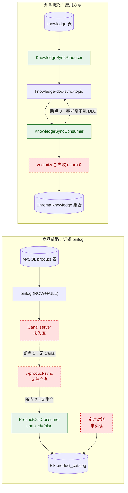
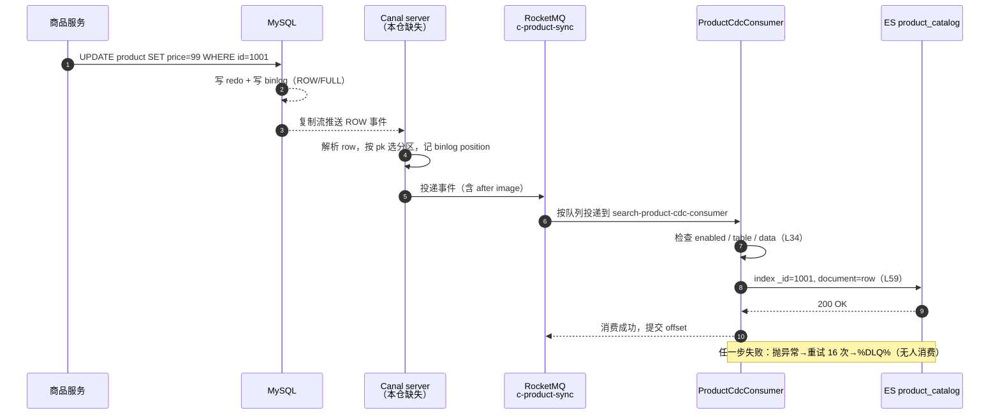

# CDC 与实时同步链路：从"抓到变更"到"可交付的一致性"

> **一句话结论**：CDC（Change Data Capture，变更数据捕获）的技术难点从来不是"能不能抓到变更"，而是把变更变成一份**有序、可重放、可对账**的交付契约；本仓库两端都只写了一半——商品侧有消费端没有生产端，知识库侧有生产端没有可靠性。
> **阅读前置**：读过 [MySQL 事务与三大日志](../03-数据库与ORM/06-事务进阶-MVCC实现与三大日志.md)（知道 redo/undo/binlog 的分工），用过 RocketMQ 的 `@RocketMQMessageListener`，能读懂 `docker-compose` 的挂载写法。
> **证据基线**：证据 A 1 条 · B 14 处（本仓真实文件，行号已当次核对）· C 5 组（本机 pwsh 实跑）；预计阅读 50~60 分钟。

## 证据边界

| 类别 | 本仓状态 | 本篇怎么处理 |
| --- | --- | --- |
| MySQL 端 binlog 配置（ROW / FULL / 保留期） | ✅ 有：`deploy/mysql/mysql.cnf` | 逐行精读，指出三份配置的漂移 |
| Canal 复制账号 | ✅ 有：`deploy/mysql/canal-init.sql` | 讲清 `REPLICATION SLAVE` 权限的最小集 |
| Canal server 本体 | ❌ 未入库 | 写成「目标态 + 验收判据」，不写成已实现 |
| 商品 CDC 生产端 | ❌ 无任何生产代码 | C 级实测证伪，见 §0 现象一 |
| 商品 CDC 消费端 | ⚠️ 有代码但默认关闭 | 精读 `ProductCdcConsumer`，指出 `enabled:false` |
| 知识库增量同步 | ⚠️ 有生产 + 消费，但两端都吞异常 | 精读，指出「注释承诺 ≠ 代码行为」 |
| 位点 / 版本号 / 对账任务 | ❌ 全仓无 | 写成「目标态 + 验收判据」 |
| 吞吐、延迟、积压量 | ❌ 未本机实测（不允许启动服务） | 只给命令与判读方法，不编造数字 |

凡是本仓没有的东西，一律写成「目标态 + 验收判据」，不写成「已实现」。

---

## 0. 先看现象

本节所有命令输出均为本机 pwsh 实跑（仓库根为工作目录）。日志行来自**源码中的字面量**——本机不允许启动服务，因此没有捕获真实运行日志，这一点先声明。

### 现象一：有一个消费者，但全仓库找不到生产者

我用一段脚本把所有 `@RocketMQMessageListener` 的 topic/消费组，与所有 `syncSend`/`convertAndSend` 的生产点对齐：

```powershell
# 脚本：learning-docs/tools/tmp/cdc-chain-audit.ps1（扫 ai-cs-* 的 main 源码，排除 target 与 test）
Set-Location D:\Projects\Persion\ai-customer-service
& .\learning-docs\tools\tmp\cdc-chain-audit.ps1
```

```text
topic                            producer(send site)            consumer(listener)
--------------------------------------------------------------------------------------------------------
%DLQ%work-order-consumer-group   (broker auto)                  WorkOrderDlqListener.java:33 [work-order-dlq-consumer-group]
chat-message-topic               ChatMessageProducer.java:39    ChatMessageConsumer.java:30 [chat-consumer-group]
c-product-sync                   (NONE)                         ProductCdcConsumer.java:23 [search-product-cdc-consumer]
knowledge-doc-sync-topic         KnowledgeSyncProducer.java:54  KnowledgeSyncConsumer.java:34 [knowledge-sync-group]
notify-topic                     OrderPaidEventListener.java:36 OrderNotifyConsumer.java:25 [notify-consumer-group]
order-timeout-topic              OrderCreateTxService.java:144  OrderTimeoutListener.java:18 [order-timeout-consumer-group]
pay-success-topic                PaySuccessMessageProducer.java:52 PaySuccessListener.java:27 [pay-success-consumer-group]
work-order-topic                 WorkOrderProducer.java:40      WorkOrderListener.java:33 [work-order-consumer-group]

produce-without-consume = []
consume-without-produce = [c-product-sync]
broker-generated-consumers = [%DLQ%work-order-consumer-group]
```

`c-product-sync` 这一行的右侧有监听器、左侧是 `(NONE)`。**怎么读**：这张表不是"消息队列清单"，而是"契约完整性清单"——`produce-without-consume = []` 说明没有孤立的发送方，但 `consume-without-produce = [c-product-sync]` 说明商品搜索索引这条 CDC 链路**只有半边**。

### 现象二：binlog 配置有三份，编排里却没有 Canal 服务

```powershell
# 脚本：learning-docs/tools/tmp/cdc-coverage.ps1（统计 deploy 与 Java 两侧的关键字覆盖）
& .\learning-docs\tools\tmp\cdc-coverage.ps1
```

```text
pattern              deploy  java    deploy hits
--------------------------------------------------------------------------------------------------------------
canal                4       5       deploy\mysql\canal-init.sql:1 | deploy\mysql\canal-init.sql:2 | deploy\mysql\canal-init.sql:3 | deploy\mysql\mysql.cnf:23
binlog-format        3       0       deploy\k8s\mysql.yaml:32 | deploy\mysql\master.cnf:8 | deploy\mysql\mysql.cnf:26
binlog-row-image     1       0       deploy\mysql\mysql.cnf:27
expire-logs-days     3       0       deploy\k8s\mysql.yaml:38 | deploy\mysql\master.cnf:11 | deploy\mysql\mysql.cnf:28
debezium             0       0
c-product-sync       0       1
ProductCdcConsumer   0       1

--- orchestration files and canal hits inside each ---
docker-compose.yml                             canal_hits=1
deploy\docker-compose\docker-compose-all.yml   canal_hits=0
deploy\docker-compose\docker-compose-host1.yml canal_hits=0
deploy\docker-compose\docker-compose-host2.yml canal_hits=0
deploy\docker-compose\docker-compose-host3.yml canal_hits=0
deploy\docker-compose\docker-compose-master-slave.yml canal_hits=0
deploy\docker-compose\docker-compose-observability.yml canal_hits=0

distinct services total=32
...（32 个服务名逐一列出）...
services matching canal=0
```

三个信号叠在一起：`binlog-format` 命中 3 处但**只有一处**（`deploy/mysql/mysql.cnf`）显式写了 `binlog-row-image`；`canal` 在 deploy 目录的 4 次命中全是**账号与注释**；32 个编排服务里 `services matching canal=0`。`docker-compose.yml` 唯一的 canal 命中是 L25 的 `- ./deploy/mysql/canal-init.sql:/docker-entrypoint-initdb.d/canal-init.sql`——那只是把建账号脚本塞进 MySQL 的初始化目录，**不是 Canal 服务**。

### 现象三：消费端注释写着"重试 16 次进死信"，代码却把异常吃了

`ai-cs-knowledge/src/main/java/com/aics/knowledge/mq/KnowledgeSyncConsumer.java` 第 27-28 行注释：

> 重试策略：消费异常被 catch 吞掉（不抛出），由 RocketMQ 默认重试 16 次后进入死信队列，避免单条消息阻塞后续消费

同一个文件第 73-77 行的真实代码：

`ai-cs-knowledge/src/main/java/com/aics/knowledge/mq/KnowledgeSyncConsumer.java` L73-L77：

```java
        } catch (Exception e) {
            log.error("知识文档同步消息消费失败: action={}, documentId={}, err={}",
                    message.getAction(), message.getDocumentId(), e.getMessage());
            // 不抛异常：避免单条消息阻塞后续消费（RocketMQ 默认重试 16 次后进入死信）
        }
```

**不抛出异常，RocketMQ 就认为这条消息消费成功**，永远不会重试，也永远进不了 `%DLQ%knowledge-sync-group`。注释描述的兜底能力在代码里不存在。更要命的是上游还有一层静默:向量化失败时 `KnowledgeVectorService` 直接 `return 0`（第 88-91 行），消费端只打一条 WARN 就算处理完。

### 这些现象的共性一句话

这些现象指向同一件事：**本仓库把 CDC 的"最后一公里"当成了 HTTP 调用——发一条消息、改一个文档、成功就完事；一旦涉及顺序、位点、重放、对账这些"消息丢了怎么办"的问题，两侧都退化成一行日志。**

---

## 1. 整体地图

本仓存在两条性质完全不同的"变更同步"链路：**订阅式 CDC（商品）** 与 **应用双写（知识库）**。图里红色节点是本仓缺失或未开启的部分。



> **读图说明**：关键看**三条虚线箭头**。第一条 `Canal -.-> Topic` 说明 binlog 已经就绪、复制账号已经建好，但中间那个"翻译官"根本不存在；第二条 `Topic -.-> Consumer` 说明即使有 Canal，本仓也没有任何代码往 `c-product-sync` 发消息。若只看右边的 `Consumer --> ES` 实线，会误以为"商品搜索同步已经做完了"——实际上它左边全断，`enabled` 还默认 `false`，这条实线一年也不会被点亮一次。第三条虚线是知识链路的自反馈：消费失败本应回到 topic 重试，但代码把异常吃掉，虚线断开。

### 组件、责任与参与方

| 组件 | 本仓位置 | 责任 | 参与方 | 落地状态 |
| --- | --- | --- | --- | --- |
| MySQL binlog | `deploy/mysql/mysql.cnf` L23-L28 | 记录每一行的前后镜像，是 CDC 的**唯一事实源** | DBA / 运维 | ✅ 已配置 |
| 复制账号 | `deploy/mysql/canal-init.sql` L2-L3 | 只授予 `SELECT`、`REPLICATION SLAVE`、`REPLICATION CLIENT` | DBA | ✅ 已配置 |
| Canal server | 无 | 订阅 binlog、解析成结构化事件、维护源端位点 | 中间件运维 | ❌ 未入库 |
| Canal → MQ 投递 | 无 | 决定分区键、消息格式、位点事务性 | 中间件开发 | ❌ 未入库 |
| `c-product-sync` topic | 无生产端 | 承载商品变更事件 | 商品服务 | ❌ 只有消费声明 |
| `ProductCdcConsumer` | `ai-cs-search/src/main/java/com/aics/search/cdc/ProductCdcConsumer.java` | 把事件翻译成 ES 的 index / delete | 搜索服务 | ⚠️ 代码在，开关默认关 |
| `product_catalog` 索引 | 无 mapping 创建代码 | 商品检索读模型 | 搜索服务 | ⚠️ 依赖 ES 动态映射 |
| 对账任务 | 无 | 发现"消息丢了"的唯一手段 | 数据工程 | ❌ 未实现 |
| `KnowledgeSyncProducer` | `ai-cs-knowledge/src/main/java/com/aics/knowledge/mq/KnowledgeSyncProducer.java` | DB 写后投递同步消息 | 知识库服务 | ⚠️ 失败只告警 |
| `KnowledgeSyncConsumer` | `ai-cs-knowledge/src/main/java/com/aics/knowledge/mq/KnowledgeSyncConsumer.java` | 删除/重建向量分块 | 知识库服务 | ⚠️ 异常被吞 |
| Chroma 集合 | `ai-cs-knowledge/src/main/resources/application.yml` L32-L46 | 向量检索读模型 | 知识库服务 | ✅ 已配置 |

---

## 2. 关键概念与关键要素

先统一术语，后文不再重复解释。

| 名称 | 位置 | 作用 | 关键参数 / 取值 |
| --- | --- | --- | --- |
| CDC | 概念 | 从数据库日志或触发器中捕获行级变更，供下游消费 | 三种实现：binlog 订阅 / 触发器 / 应用双写 |
| binlog | MySQL 服务端 | 记录所有改数据的逻辑日志，也是主从复制的载体 | `log-bin=mysql-bin`（`deploy/mysql/mysql.cnf` L25） |
| ROW 格式 | `deploy/mysql/mysql.cnf` L26 | binlog 记录"每行改前改后"，而非 SQL 文本 | `binlog-format=ROW` |
| row image | `deploy/mysql/mysql.cnf` L27 | 决定一行里记录**多少列** | `FULL` 全列 / `MINIMAL` 仅主键+改动列 |
| binlog 保留期 | `deploy/mysql/mysql.cnf` L28 | 超过保留期的 binlog 会被 purge，**位点续传的硬边界** | `expire-logs-days=7` |
| 位点（position） | 无（未落地） | 已处理事件的坐标，通常记 `(binlog 文件名, 偏移量)` 或 GTID 集合 | 本项目无任何位点存储 |
| GTID | MySQL 服务端 | 全局事务 ID 集合，比文件偏移更稳的位点表达 | 本仓配置未开启 |
| 分区键（partition key） | 无（未落地） | 决定消息落到哪个队列，**同一主键必须落同一队列** | 预期按 `product.id` 哈希 |
| 消费模式 | `@RocketMQMessageListener` | 同一队列内是否串行消费 | 全仓 `consumeMode` 命中 **0** 处，即默认 `CONCURRENTLY` |
| 幂等键 | `ai-cs-search/src/main/java/com/aics/search/cdc/ProductCdcConsumer.java` L59 | 让重放不产生副作用 | 用 `product.id` 作为 ES `_id`（天然幂等） |
| DLQ（死信队列） | 无消费者 | 重试耗尽后的最后容器，topic 名 `%DLQ%<消费组>` | 全仓仅 `%DLQ%work-order-consumer-group` 有人消费 |
| schema 漂移 | 概念 | 源表结构变了但下游读模型没跟上 | 新增列 / 改类型 / 删列 / 重命名 |
| 对账（reconciliation） | 无 | 用第三方视角验证"两边条数与内容一致"，是"没漏"的唯一证据 | 总量 / 分片 / 明细三层 |
| outbox 表 | 无（未落地） | 把"要发的消息"和业务数据写在同一事务，再异步补发 | 解决双写的原子性 |

---

## 3. 原理与证据逐段精读

### 3.1 三种 CDC 实现，本仓同时踩了两种

**在干什么**：把"数据库里某行变了"这件事告诉别的系统，有三条路。

1. **binlog 订阅**：伪装成从库读 binlog。本仓的设计态就是这条路——`deploy/mysql/mysql.cnf` L24 的注释写着"Canal 必需"，`deploy/mysql/canal-init.sql` L3 授了 `REPLICATION SLAVE, REPLICATION CLIENT`，但**没有 Canal 服务**。
2. **触发器**：在表上挂 `AFTER INSERT/UPDATE/DELETE` 触发器，往一张变更表里插一条。本仓 0 处。
3. **应用双写**：业务代码写完库，再调一次生产者发消息。本仓知识库侧就是这条路，见 `ai-cs-knowledge/src/main/java/com/aics/knowledge/service/impl/KnowledgeServiceImpl.java` L52-L60：

`ai-cs-knowledge/src/main/java/com/aics/knowledge/service/impl/KnowledgeServiceImpl.java` L52-L60：

```java
    public KnowledgeDocument createDocument(KnowledgeDocument document) {
        ...
        knowledgeMapper.insert(document);
        ...
        knowledgeSyncProducer.send("CREATE", document);
        ...
    }
```

**为什么这么设计**：三种方式的分界线其实是**"谁对变更负责"**。binlog 订阅把责任交给数据库日志——业务代码完全无感，新增一条写路径不需要改任何代码；应用双写把责任交给业务代码，因此**每加一个写入口就等于多一处会忘的地方**。

**换写法会怎样**：

| 方案 | 业务侵入 | 原子性 | 运维成本 | 适合 |
| --- | --- | --- | --- | --- |
| binlog 订阅 | 无 | 由日志保证"改了就一定有" | 要有 Canal/Debezium + 复制权限 + 位点存储 | 跨服务、跨存储的读模型同步 |
| 触发器 | 无（在 DB 层） | **最强**：触发器和业务在同一事务里 | 写放大、变更表膨胀、DDL 难管 | 同库内轻量审计、老库无法开 binlog |
| 应用双写 | 有 | **最弱**：两次独立写，除非用事务消息或 AFTER_COMMIT | 最省基础设施 | 事件本身带业务语义（如 `action=CREATE/UPDATE/DELETE`） |

**常见坑**：以为"应用双写 + try-catch 记个 warn"就等于最终一致。`KnowledgeServiceImpl` 类注释（第 30 行）明确写着"本类未显式声明 `@Transactional`，单次写操作依赖 MyBatis-Plus 默认行为"——**没有事务，就没有原子性，"双写"两次独立提交，中间任意一次失败都会留下不一致**。

**这里消息丢了会怎样**：DB 里文档创建成功、消息没发出去 → 用户上传了文档、库里有记录、列表能看见，但**永远搜不到**（向量库里没有分块）。而且这条丢失没有任何告警，只有一行 `log.warn("知识文档同步消息投递失败（不影响 DB 操作）…")`（`KnowledgeSyncProducer.java` L56-L58）。

### 3.2 binlog 为什么必须是 ROW，而且必须 FULL

**在干什么**：`binlog-format` 决定 binlog 里写什么。`STATEMENT` 写 SQL 原文（`UPDATE product SET stock=stock-1 WHERE id=1`），`ROW` 写"第 id=1 行的 stock 从 10 变成 9"。`binlog-row-image` 再决定 ROW 里带多少列。

`deploy/mysql/mysql.cnf` L23-L28：

`deploy/mysql/mysql.cnf` L23-L28：

```ini
# Binlog CDC（Canal 必需：ROW 记录每行变化，FULL 保留完整前后镜像）
server-id=1
log-bin=mysql-bin
binlog-format=ROW
binlog-row-image=FULL
expire-logs-days=7
```

**为什么这么设计**：

- **ROW 是 CDC 的前提**。`STATEMENT` 格式里下游只能拿到 SQL 文本，得自己解析 SQL、还得推断影响范围，遇到 `NOW()`、`UUID()`、`RAND()` 甚至无法复现结果。ROW 直接给出行级前后镜像，下游只需"按主键覆盖"。
- **FULL 是"整行覆盖"写法的前提**。看消费端的真实写法（`ai-cs-search/src/main/java/com/aics/search/cdc/ProductCdcConsumer.java` L59）：

`ai-cs-search/src/main/java/com/aics/search/cdc/ProductCdcConsumer.java` L59：

```java
        elasticsearchClient.index(i -> i.index(INDEX).id(docId).document(row));
```

`document(row)` 是把整个 `row` 当作文档全量写入——这是**覆盖语义**。如果 `binlog_row_image=MINIMAL`，UPDATE 事件只带主键和真正改动的列，那么一次"改价"会把 ES 文档覆盖成只剩 `{id, price}`，`name`、`description`、`image` 全部消失。

**换写法会怎样**：若因存储压力一定要用 `MINIMAL`，消费端就必须改成 ES 局部更新（`UpdateRequest.doc(...)`）+ 读旧文档合并，或者改成"事件里只带改动列，读模型按列增量维护"。复杂度和出错面立刻上一个量级，而省下的空间在商品这种宽表上并不显著。

**常见坑**：

1. `deploy/mysql/master.cnf` 只写了 `binlog-format=ROW`（L8），**没有** `binlog-row-image`，靠 MySQL 8.0 的默认值 `FULL` 兜着。默认值属于"隐式依赖"——换一个发行版（云厂商 RDS 的参数模板）就可能变，而它变了不会有任何报错，只会让下游文档字段悄悄变少。
2. `deploy/k8s/mysql.yaml` L25-L44 是第三份 binlog 配置（ConfigMap 内嵌），同样只有 `binlog-format=ROW`（L32）与 `expire-logs-days=7`（L38），没有 row image。**三份配置、一份显式、两份靠默认**，这就是下节要讲的漂移。
3. 以为 FULL 只影响 UPDATE。DELETE 事件在 FULL 下会带完整旧行（对下游很有用：可以拿到 `category_id` 做"从分类文档里移除"），MINIMAL 下只剩主键。

**这里消息丢了会怎样**：这一节丢的不是消息而是**列**。MINIMAL + 整行覆盖 = 文档被"部分删除"，而且 ES 不会报错，因为 `index` 请求完全合法。这类问题只能靠对账或人工发现。

### 3.3 全量 + 增量的切换点：为什么不能只用时间戳

**在干什么**：新建读模型时，历史数据要"全量灌一次"，之后靠增量追平。切换点（水位）选错了，中间那段时间的变更就永久丢失。

一个健壮的做法只有一种形状：


> **读图说明**：最关键的是**箭头 A → B 的顺序**：必须"先记位点，再开始快照"，而不是"先快照，再记当前时间"。反过来（先快照后取位点）会让两步之间产生的变更既不在快照里、也不在增量里，形成一段永久空洞。第二个关键是 B → C 的衔接：增量从 P0 开始，会把快照期间已经发生的变更**再放一遍**——所以快照和增量必然重叠，这不是 bug，而是靠幂等吸收。

**为什么不能用 `update_time` 当水位**。这是最常见的错误做法：`WHERE update_time > '快照开始时间'` 把"之后更新的行"捞出来补。它至少在四个地方漏：

1. **精度不够**。`deploy/mysql/product-init.sql` L34：`update_time DATETIME NOT NULL DEFAULT CURRENT_TIMESTAMP ON UPDATE CURRENT_TIMESTAMP`——`DATETIME` 是**秒级**，不是微秒级。同一秒内多次更新，"大于"还是"大于等于"总有一个错。
2. **`ON UPDATE` 会被显式赋值绕过**。业务里写 `UPDATE product SET update_time = '2020-01-01' ...`（数据修复、回滚脚本），这一行就永久掉出水位窗口。
3. **长事务的时间谎言**。事务 T1 在 10:00:00 开始、10:00:05 提交，行上的 `update_time` 是 10:00:00；如果水位取 10:00:03，这一行既不在快照里（快照读不到未提交数据）也不在增量里（`update_time < 水位`）——**永久丢失**。
4. **删除没有时间戳可依**。本仓是逻辑删除（`Product.java` L45-L46 的 `@TableLogic private Integer deleted`），删除表现为一次 UPDATE，还能靠 `update_time` 碰运气；真物理删除（`DELETE`）则直接从表里消失，`WHERE update_time > T` 永远查不到它，读模型里的旧文档会永远留着。

`binlog position`（或 GTID 集合）之所以对，是因为它表达的是**日志里的全序位置**，与业务时间、时区、事务长度都无关。

**换写法会怎样**：还有一种"改主键区间扫描 + 变更表"的方案：把快照切成 `id` 区间，同时用触发器记录变更，扫完某区间就把该区间变更清掉。可行，但需要触发器，且"清理变更表"这一步又引入新的竞态。位点方案没有这个问题。

**常见坑**：

- 用 `create_time` 而不是 `update_time` 当水位（只能捞新增，捞不到更新）。
- 快照开事务用 `REPEATABLE READ` 想拿"一致性快照"，结果快照跑了 20 分钟，undo 膨胀、主库 IO 打满——正确做法是大事务拆小、按主键分段，每段独立读。
- 以为"全量跑完再开增量"很安全：等全量跑完再记位点，中间几小时的变更全丢。必须**并行**跑，用位点重叠保证不漏。

**这里消息丢了会怎样**：这一段丢的是"时间窗"，量级是小时级。表现是读模型里有一批商品停留在某个历史状态——`price` 是旧的、已下架的还是 `status=1`。因为数据本身"长得像对的"，业务侧很难发现，只有对账能捞出来。

### 3.4 顺序与分区键：同一主键必须落同一分区

**在干什么**：MQ 的"有序"只在**队列内部**成立。RocketMQ 的 topic 由多个 message queue 组成，消息进哪个队列由生产者决定，消费端每个队列被一个或多个线程消费。

```text
同一 product.id 的连续事件：UPDATE price=100 → UPDATE price=50 → DELETE

若按轮询写入 3 个队列：
  queue-0: [price=100]
  queue-1: [price=50]
  queue-2: [DELETE]
三个队列并行消费 → ES 最终状态取决于谁最后落地
```

**为什么这么设计**：要严格顺序，只能"用并发换有序"——按主键哈希固定队列，牺牲的是**热点**（爆款商品的变更全压在一个队列上）。这也是电商 CDC 的经典取舍：宁可让某个队列慢，也不能让同一商品的状态错乱。

**本仓现状**：

- 生产者根本不存在（§0 现象一），所以分区键**无处落地**。
- 消费端 `ProductCdcConsumer` 的注解只有 `topic` 和 `consumerGroup`（L23），全仓 `consumeMode` 命中 **0** 处——意味着它默认是 `CONCURRENTLY`，即**同一个队列也会被多线程并发消费**。即使将来生产者按主键哈希了，消费端的默认模式仍会让同一商品的两条消息在两个线程里并发跑。

**换写法会怎样**：

| 方案 | 保序范围 | 代价 |
| --- | --- | --- |
| 单队列单线程 | 全 topic | 吞吐最差，完全不可扩展 |
| 按主键哈希 + `ORDERLY` 消费 | 单主键内严格有序 | 热点队列成为瓶颈；顺序消费失败会**阻塞队列** |
| 并发消费 + 版本号（后写覆盖） | 不保序，靠版本比较 | 需要事件里带单调递增版本（本仓事件信封没有） |

**常见坑**：

- 以为"发了顺序消息就万无一失"。顺序消息的语义是"同一队列内按发送顺序投递"，一旦消费者抛异常重试，会**卡住整个队列**直到成功或进 DLQ——这是特性，也是可用性风险，配合"没有 DLQ 消费者"就是永久卡死。
- 并发消费下重试会破坏顺序：第 5 条失败进重试，第 6、7 条已经处理完，第 5 条重试成功反而把旧值写回去。
- 用 `MessageQueueSelector` 按主键选队列，但忘了**同一张表的其它主键改到同一条记录**的情况（比如"把分类下所有商品下架"是一次批量 UPDATE，每个商品是独立事件，各自哈希，天然打散——这是对的，不要试图把它们绑在一起）。

**这里消息丢了会怎样**：乱序不会丢消息，但等价于"丢了最新的那次变更"。ES 里最终留下旧值，且**永远不会自愈**——除非该商品再被改一次。这类不一致在监控上完全不可见。

### 3.5 幂等与去重：按位点去重，而不是按内容去重

**在干什么**：CDC 链路是 at-least-once 的（位点定期批量提交、失败重试、快照重叠都会导致重复），所以要保证"同一条事件处理 1 次和处理 N 次的结果相同"。

ES 侧的天然幂等（`ProductCdcConsumer` 第 17-18 行注释写得很清楚）：

> 幂等策略：ES document id 固定为 product.id，同一条 INSERT/UPDATE 重放均是覆盖 upsert；DELETE 反复执行时 documentMissing 忽略。

对应代码 L53-L59：删除按 `_id` 删、写入按 `_id` 覆盖。**这是三档幂等里最强的一档：天然幂等**，不需要外部状态。

| 强度 | 做法 | 优点 | 代价 |
| --- | --- | --- | --- |
| 天然幂等 | 目标端按唯一 `_id` 覆盖 / 删除 | 无额外存储、无额外判断 | 只适用于"整体覆盖"语义，部分更新就会退化成非幂等 |
| 判重 | Redis `SET NX EX` 记录已处理的事件 key | 通用 | key 也会丢（Redis 过期/清库），要接受"过期后可重放" |
| 事务 | 本地表 `processed(offset)` 唯一键，与业务写同事务 | 最强 | 必须同库同事务，跨系统做不到 |

**去重键怎么选**——这是本节的核心结论：

1. **首选 binlog position**：`(serverId, binlogFile, offset)` 三元组在源库上全局唯一且单调。一条事件一个位点，重复投递时位点相同，天然可判重。
2. **次选版本号**：源表要有单调递增的 `version` 或 `update_time` 微秒级字段，且**必须由 DB 保证单调**。
3. **最差是"无键"**：只按 `(table, pk)` 去重，等于不知道这条事件是新的还是旧的，重放会把旧值写回去。

**本仓的硬伤**：事件信封里**没有任何位置或版本信息**。`ai-cs-search/src/main/java/com/aics/search/cdc/CanalChangeEvent.java` 全文只有四个字段：

`ai-cs-search/src/main/java/com/aics/search/cdc/CanalChangeEvent.java` L10-L15：

```java
public class CanalChangeEvent {
    private String database;
    private String table;
    private String type;
    private List<Map<String, Object>> data;
}
```

没有 position、没有 before/after 镜像、没有版本号、没有时间戳。所以本仓**只能**走"天然幂等"这一条路——而 `ProductCdcConsumerTest.java` 里只有两个测试（L26 `disabledShouldIgnoreEvent`、L34 `unrelatedTableShouldIgnoreEvent`），把"忽略"验证了，"DELETE→删文档、UPDATE→覆盖文档"这两个幂等契约**一个都没测**。

**常见坑**：

- 拿 `update_time` 当版本号。`product.update_time` 是秒级 `DATETIME`（`deploy/mysql/product-init.sql` L34），同一秒内的两次更新版本号相同，`if (newVer <= oldVer) skip` 会把后一次丢掉。
- 用 `"1".equals(String.valueOf(row.get("deleted")))` 判断删除（`ProductCdcConsumer.java` L51）。本仓 `deleted` 是 `Integer`（`ai-cs-product/src/main/java/com/aics/product/entity/Product.java` L45-L46）+ `TINYINT`（`deploy/mysql/product-init.sql` L35），序列化成 JSON 数字，`String.valueOf` 得到 `"1"`，**当前是对的**。但它对序列化格式是脆的：换成 `true`、`1.0`、`"Y"` 都会静默判错，而判错的后果是"该删的没删"。
- 逻辑删除让 `type == "DELETE"` 变成近似死代码：`@TableLogic` 下删商品是一条 `UPDATE product SET deleted=1`，事件类型是 `UPDATE`。真正起作用的是 L51 的第二个条件。读代码时若不注意这点，会以为删除路径根本没实现。

**这里消息丢了会怎样**：幂等做错时丢的是"更新的那一次"。表现是"改了价格但页面没变"，且要等下次有人改这个商品才自愈。

### 3.6 断点续传与位点管理：两级位点，一个硬边界

**在干什么**：链路上有两个位点，很多人只记得一个。

| 位点 | 谁维护 | 失效后果 | 本仓 |
| --- | --- | --- | --- |
| 源端位点（Canal 的 binlog position） | Canal server | Canal 重启后重放已投递的变更 → 下游收到重复 | ❌ 无 Canal |
| 投递位点（RocketMQ consumerOffset） | broker + 消费组 | 重启后重复消费或漏消费 | ✅ broker 维护，但重放能力无人验证 |

两级位点之间还有一个**窗口**：事件已经被 Canal 投到 broker、但还没被消费。这个窗口只要 broker 不丢消息就是安全的——所以"位点能不能续传"实际取决于两件事：**broker 的持久化**和**源端 binlog 还没被 purge**。

**`expire-logs-days=7` 就是那条硬边界**（`deploy/mysql/mysql.cnf` L28）。语义是：binlog 文件最多保留 7 天，之后被自动 purge。一旦 Canal（或任何 binlog 消费者）停机超过 7 天，它要读的那个 binlog 文件已经不在了——此时**任何位点都没用，只能重新全量**。

**为什么这么设计**：binlog 保留期是"存储成本 vs 恢复能力"的直接权衡。7 天意味着：任何下游组件故障，你要在 7 天内修好并追平，否则全量重建。

**换写法会怎样**：把保留期调到 30 天，磁盘涨；调到 1 天，一次周末故障就够触发全量。真正稳的做法是**保留期 ≥ 最坏故障恢复时间 × 2**，并且**把"全量重建"做成常规可演练的路径**而不是事故应急——这正是 [05-批处理与调度编排](05-批处理与调度编排.md) 里讲的"重建脚本要能随时跑"。

**常见坑**：

- 位点存内存（Canal 的 `memory` 模式）。进程重启位点归零，从当前 binlog 末尾开始——中间那段**永久丢失**，而且不报错。
- 位点存文件但没做备份。容器重建、挂载卷丢失，位点回到初始值，此时若 binlog 已 purge 就直接起不来。
- 消费位点回退（reset offset）之后忘了消费端可能不幂等，重放把新数据覆盖成旧数据。
- 以为"位点提交了 = 处理成功了"。RocketMQ 并发消费是**批量提交 offset**，一批里前面成功后面失败，offset 可能已经越过失败那条——所以消费端必须自己保证"失败要能重试到"，而不是依赖 offset 精确回退。

**这里消息丢了会怎样**：位点管理做错，丢的是**一整段连续区间**，不是单条。表现是"某天之后的数据全对、之前有一段空白"，或者"某几小时的数据是旧值"。这是 CDC 里最贵的一类故障，通常只能全量重建。

### 3.7 schema 漂移：新增列、改类型、删列

**在干什么**：源表 `product` 的结构变了，但下游是 Elasticsearch 的索引映射（mapping）。两者对"能不能变"的态度完全相反：MySQL 允许大部分 `ALTER`，ES 的已有字段类型**不可修改**。

本仓的处境更微妙——`product_catalog` 这个索引**没有 mapping 创建代码**（`SearchServiceImpl` 里的 `createEsIndexIfNeeded` 只建 `knowledge` 索引），完全依赖 ES 的**动态映射**：第一条文档进来时，ES 按 JSON 值推断字段类型。

| 变更 | 动态映射下的表现 | 风险 |
| --- | --- | --- |
| 新增列 | 首次出现时自动加字段 | 类型靠推断：`"123"` 推断成 `text`，后续若发数字 `123` 会 mapping 冲突，整条写失败 |
| 改类型 | ES 拒绝，写入报 `mapper_parsing_exception` | 只能新建索引 + reindex + 别名切换 |
| 删列 | 整行覆盖时该字段自然消失 | **反而自愈**（这正是 FULL + 整行覆盖的好处） |
| 重命名列 | 等于删旧 + 加新 | `ProductCdcConsumer` L44-L48 取 `id` 失败只 warn 就 return，主键列改名 = 全链路静默停摆 |

**为什么这么设计**：动态映射是"开发期零配置"的甜头，代价是"生产期不可控"。读模型这种长期存在的东西，必须有显式 mapping。

**换写法会怎样**：显式 mapping + 别名（`product_catalog_v1` → 别名 `product_catalog`）。改类型时新建 `v2`、reindex、原子切别名、回滚只切回 `v1`。代价是要多维护一份 mapping 文件，收益是"改类型不再是事故"。

**常见坑**：

- 认为"CDC 会自动跟上 schema 变化"。CDC 只搬数据，不搬语义；新列会自动出现（动态映射），但**分词的、类型的、格式的**变化不会自动正确。
- 在多实例滚动发布期间做 `ALTER TABLE`：老实例仍按旧列名读，新实例按新列名读，两者都"能跑"，只是数据各错一半。
- `ALTER TABLE ... ADD COLUMN` 这类 DDL 本身也会进 binlog（`QUERY` 事件）。下游若把 DDL 当数据事件处理会解析失败；正确做法是**忽略非 ROW 事件**并在告警里提示"源表结构变更了"。

**这里消息丢了会怎样**：schema 漂移丢的是**整条写入**（mapping 冲突时 ES 拒绝写）或**整个字段**（类型推断错）。前者会触发重试→16 次→进 DLQ→无人消费→永久缺失；后者静默。

### 3.8 失败重试与死信：不抛异常 = 没有重试

**在干什么**：RocketMQ 的消费失败语义只有一条：**抛异常 = 失败，返回正常 = 成功**。失败后按退避策略重试，默认最多 16 次，之后投到 `%DLQ%<consumerGroup>`。

本仓两个 CDC 消费端，正好是反面教材和半成品：

| 消费端 | 失败时行为 | 结果 |
| --- | --- | --- |
| `KnowledgeSyncConsumer` L73-L77 | `catch` 后**不抛**，只 `log.error` | 消息被确认成功，不重试、不进 DLQ、**永久丢失**（注释声称的 16 次重试不存在） |
| `KnowledgeVectorService` L88-L91 | `catch` 后 `return 0` | 向量化失败变成"成功但 0 分块"，上层只打 `log.warn("向量化无内容/失败…")` |
| `ProductCdcConsumer` L61-L64 | `throw new IllegalStateException(...)` | 重试 16 次后进 `%DLQ%search-product-cdc-consumer`，而**该 DLQ 无消费者** |

`ai-cs-search/src/main/java/com/aics/search/cdc/ProductCdcConsumer.java` L59-L64：

```java
        try {
            elasticsearchClient.index(i -> i.index(INDEX).id(docId).document(row));
        } catch (Exception e) {
            throw new IllegalStateException("CDC 商品索引同步失败: id=" + docId, e);
        }
```

这段是正确的写法：**写失败必须抛**，让 broker 重试。但重试耗尽之后的落点没人接——全仓只有 `%DLQ%work-order-consumer-group` 有消费者（`WorkOrderDlqListener.java:33`），两个 CDC 的 DLQ 都是"黑洞"。

**为什么这么设计**：重试解决"瞬时故障"（网络抖动、ES 短暂不可用），DLQ 解决"毒消息"（永远处理不了的数据）。两者是配套的：**没有 DLQ 消费者，重试就只是把失败延后 16 次**。

**换写法会怎样**：`KnowledgeSyncConsumer` 的正解是抛异常（让瞬时故障可重试），同时在 `KnowledgeVectorService` 里区分"内容为空"（业务态，返回 0 合理）与"Embedding 调用失败"（技术异常，必须抛）。现在这两者被同一个 `catch` 和一个 `return 0` 抹平了。

**常见坑**：

- 为了让"单条不阻塞后续消费"而吞异常。如果是并发消费，单条失败本来就不会阻塞其它消息，不需要靠吞异常来"保护"吞吐——这个想法在并发模式下完全是错的前提。
- 只给一部分消费组配 `maxReconsumeTimes`。本仓只有 3 处：`WorkOrderListener.java:36 = 3`、`OrderNotifyConsumer.java:30 = 3`、`PaySuccessListener.java:30 = 8`；两个 CDC 消费端**一个都没配**，走默认 16 次。
- 认为"进了 DLQ 就等于没丢"。DLQ 是队列，不是备份：无消费者、无告警、无工单，等于丢。

**这里消息丢了会怎样**：这一段丢的是**已知失败的那条**，而且日志是有的（`log.error` 里带了 `documentId`）。也就是说它是**唯一可被发现的丢失**——只要有人去看日志，或者有人给 `log.error` 挂告警。参考 [13-稳定性工程/07-告警治理](../13-稳定性工程/07-告警治理.md) 里"日志型证据必须转成指标"的结论。

### 3.9 对账与双写顺序：怎么知道"没漏"

**在干什么**：前面所有机制都是"尽量不丢"。**对账**是唯一能回答"到底有没有漏"的手段，因为它是从第三方视角独立数一遍。

| 层次 | 做法 | 能发现 | 成本 |
| --- | --- | --- | --- |
| 总量 | `SELECT COUNT(*) FROM product WHERE deleted=0` vs ES `_count` | 明显缺失 | 低（但不精确：软删、脏文档都会让两边不等） |
| 分片 | 按 `id % 64` 分桶，逐桶比 count | 定位到具体区间 | 中 |
| 明细 | 按 `id` 集合做差，或按 `update_time` 抽样核对 | 具体哪条错了 | 高 |

本仓的承诺与现实的差距：`ProductCdcConsumer.java` L17-L18 的类注释写着"Canal 事件的最终一致性由**定时对账**兜底"，但全仓**没有任何对账任务**——`@Scheduled` 的 6 处里没有对账，XXL-Job 默认 `XXL_JOB_ENABLED:false`。这句话是**注释里的目标态，不是代码里的现状**。

再看"双写顺序"这个更隐蔽的问题。`ai-cs-knowledge/src/main/java/com/aics/knowledge/service/impl/KnowledgeServiceImpl.java` L128-L144：

`ai-cs-knowledge/src/main/java/com/aics/knowledge/service/impl/KnowledgeServiceImpl.java` L128-L144：

```java
    /**
     * 投递 DELETE 同步消息 → 逻辑删除 DB 记录。
     * 先发消息再删 DB，确保消费者能拿到 documentId 完成向量清理。
     */
    public boolean deleteDocument(Long id) {
        KnowledgeDocument document = knowledgeMapper.selectById(id);
        if (document != null) {
            knowledgeSyncProducer.send("DELETE", document);
        }
        ...
        return knowledgeMapper.deleteById(id) > 0;
    }
```

**先删向量、再删库**。两种情况都会留下用户可见的错误：

- 消息发成功、`deleteById` 失败 → 向量没了、库里记录还在 → 文档列表里看得见、搜索搜不到。
- 消息发失败（只 warn）、`deleteById` 成功 → 库没了、向量还在 → 搜索能搜到已删除的文档，点开 404。

**为什么这么设计**：注释给的理由是"确保消费者能拿到 documentId"。这个理由成立——如果先删库再发消息，`selectById` 就拿不到内容了。但正确解法不是"调换顺序"，而是**把要发的内容在删除前取出来，然后用可靠投递**：

- 用 `@TransactionalEventListener(AFTER_COMMIT)` 把投递挂到事务提交之后。本仓**已经有这个样板**：`ai-cs-order/src/main/java/com/aics/order/event/OrderPaidEventListener.java` L30-L31 就是这么写的（`phase = TransactionPhase.AFTER_COMMIT`），注释 L18-L20 讲得很清楚："事务回滚时 listener 完全不执行——杜绝'订单未支付却推送支付成功'"。
- 框架层为什么能保证？`@TransactionalEventListener` 会把 listener 注册成一个事务同步回调，在事务完成后按 phase 分发。Spring Framework 7.1.0 的实现见 [[源码:TransactionalApplicationListenerSynchronization.java.md#L115-L126]]：`afterCompletion(int status)` 里先取 phase，只有 `AFTER_COMMIT && status == STATUS_COMMITTED` 才执行，回滚（`STATUS_ROLLED_BACK`）走另一个分支。
- 但 `AFTER_COMMIT` 仍有一个窗口：**事务提交成功、进程在发消息前崩溃** → 消息永远不会发出。所以严格方案还是要 **outbox 表**（本地消息表）：业务数据与"待发消息"同一事务落库，再由定时任务扫表补发。本仓无 outbox。

**换写法会怎样**：把 knowledge 侧改成"事务内写 outbox + 提交后异步发 + 定时补发"，能把这一类丢失压到"只可能重复，不可能丢"，配合消费端幂等即收敛。代价是要多一张表和一次扫描。

**常见坑**：

- 对账只比条数。软删、历史脏数据、索引别名指向错误都会让条数"看起来对"。
- 对账跑在业务库上，用 `SELECT *` 全表拉，把主库打慢——必须分片 + 只取 `id`、限制并发。
- 对账发现差异后**自动删除**读模型里的"多余"文档。如果对账本身有 bug（比如误把 `deleted=1` 判成应存在），会批量误删。第一版对账只应该**报差异**，人工确认后再补。

**这里消息丢了会怎样**：这正是本节的主题——**没有对账，你根本不知道丢了什么**。前面 8 节讲的所有机制都只能降低概率，只有对账能把"不知道丢了"变成"知道丢了几条、丢在哪"。

---

## 4. 一次完整执行时序

以"商家改商品价格"为例，走完设计态的商品 CDC 链路。第 3 步之后的每一步，本仓都缺一环。



> **读图说明**：两个箭头最容易被误读。第一处是 `DB-->>CANAL`——这是 MySQL **主动推送**的复制流，不是 Canal 轮询查表；所以 Canal 必须持有 `REPLICATION SLAVE` 权限（`deploy/mysql/canal-init.sql` L3），而且它看到的是**每个事务**，包括不经过商品服务的直接改库。第二处是 `CON->>CON: 检查 enabled`——这一行在真实代码里是一个**静默 return**（L34），不开日志的话，链路看似正常跑、实际什么都没做。看错这两个箭头，就会得出"有了 Canal 就自动同步了"和"消费没日志说明没消息"两个错误结论。

### 每一步该怎么判读

| 步 | 动作 | 该看什么 | 出错的典型表现 | 本仓状态 |
| --- | --- | --- | --- | --- |
| 1 | 业务改库 | 是否有事务、是否有 `update_time` 显式赋值 | 显式赋 `update_time` 会破坏"时间戳水位"（本仓不用时间戳，影响小） | ✅ |
| 2 | 写 binlog | `SHOW VARIABLES LIKE 'binlog_format'` / `'binlog_row_image'` | 值是 `STATEMENT` 或 `MINIMAL` → 下游字段缺失 | ✅ ROW+FULL |
| 3 | 复制流 | `SHOW PROCESSLIST` 是否有 `Binlog Dump` 线程 | 没有 Dump 线程 = 没有消费者 | ❌ 无 Canal，必然没有 |
| 4 | Canal 解析/存位点 | `meta.dat`（文件位点）或 ZooKeeper 状态 | 位点滞后持续增大 = 消费能力不足 | ❌ 未部署 |
| 5 | 投 MQ | 消息的 queue 是否按 pk 固定、payload 是否含 position | 无 position → 无法按位点去重 | ❌ 无生产者 |
| 6 | 消费投递 | 消费组堆积（diff 值） | 堆积持续增长 | ⚠️ 组存在，无消息 |
| 7 | 开关判断 | `aics.cdc.product.enabled` 实际取值 | `false` → 直接 return，**无日志** | ⚠️ 默认 false |
| 8 | 写 ES | `_id` 是否等于 pk、是否传 `refresh` | 不传 `refresh` → 写完立刻查可能查不到（近实时，默认 1s） | ⚠️ 不传 refresh |
| 9 | 提交 offset | 失败是否抛异常 | 吞异常 → offset 照常前进 → 静默丢 | ⚠️ 两消费端行为不一致 |

---

## 5. 设计取舍

CDC 链路上没有"全都要"的选项，每一条都是显式换来的。

| 取舍项 | 选项 A | 选项 B | 本仓选择 | 代价 / 待办 |
| --- | --- | --- | --- | --- |
| 捕获方式 | binlog 订阅（零侵入） | 应用双写（带业务语义） | 商品走 A（配置就绪、服务缺失）、知识库走 B | 两条链路各修各的，不能共用一套可靠性设施 |
| 快照与增量衔接 | 先记位点再快照（重叠一次） | 先快照再记位点（会漏一段） | 未落地 | 目标态选 A，并用幂等吸收重叠 |
| row image | FULL（整行覆盖，简单） | MINIMAL（省空间，需部分更新） | FULL（`mysql.cnf` L27 显式） | binlog 体积更大；消费端代码最简单 |
| 分区键 | 按 pk 哈希（保序） | 轮询/随机（吞吐高） | 未落地 | 目标态 A，配合 `ORDERLY` |
| 消费模式 | `CONCURRENTLY`（默认，吞吐高） | `ORDERLY`（保序，可能堵塞） | 默认并发（`consumeMode` 0 处配置） | 同一商品可能并发处理，需版本号兜底 |
| 幂等键 | 位点/版本号（精确） | `_id` 覆盖（天然） | `_id` 覆盖 | 无法区分新旧事件；改部分更新时会失效 |
| 删除语义 | 监听 DELETE 事件 | 监听 `deleted=1` 的 UPDATE | 后者（`@TableLogic`） | `type=="DELETE"` 分支近似死代码 |
| 失败处理 | 抛异常 + DLQ 消费者 + 告警 | 吞异常只记日志 | 两消费端相反 | 必须先统一为"抛异常"，再补 DLQ 消费 |
| 位点存储 | 文件/ZK（持久） | 内存（重启归零） | 无 | 有 Canal 之后必须选持久 |
| schema 变更 | 显式 mapping + 别名切换 | 动态映射自动吸收 | 动态映射 | 改类型时会炸；删列反而自愈 |
| 对账 | 定时三层对账 | 无（靠注释承诺） | 无 | 唯一能证明"没漏"的手段，优先级最高 |

### 可扩展点清单

按"投入产出比"从高到低排，每一条都能独立上线：

1. **补 DLQ 消费者 + 告警**。只需要一个 `@RocketMQMessageListener(topic="%DLQ%search-product-cdc-consumer")` + 一个 `@RocketMQMessageListener(topic="%DLQ%knowledge-sync-group")`，把死信落库或落文件。验收判据：人为构造一条必然失败的消息，能在 DLQ 落点查到它。
2. **统一"失败必须抛"**。把 `KnowledgeSyncConsumer` L73-L77 的 `catch` 改成记日志后重新抛出；把 `KnowledgeVectorService` L88-L91 的 `return 0` 拆成"内容为空返回 0 / 技术异常抛出"。验收判据：模拟 Embedding 异常，`%DLQ%knowledge-sync-group` 能看到消息。
3. **事件信封加 `position` 与 `updateTime`**。`CanalChangeEvent` 现在只有 4 个字段，加两个字段就能把"天然幂等"升级为"可判重幂等"。验收判据：重放同一段 binlog，消费端日志能输出"跳过已处理位点"。
4. **商品 CDC 生产端落地**。要么引入 Canal server + RocketMQ adapter（`deploy/docker-compose` 加服务），要么用应用双写 + outbox 先顶住。验收判据：`SHOW PROCESSLIST` 出现 `Binlog Dump` 线程，且 `c-product-sync` 有消费堆积可观测。
5. **定时对账任务**。复用现有 `@Scheduled`（6 处）或打�� XXL-Job（`XXL_JOB_ENABLED:false`）。第一版只报差异、不自动修。验收判据：手工删掉 ES 里一条文档，对账能在下一轮输出该 id。
6. **`product_catalog` 显式 mapping + 别名**。验收判据：`GET product_catalog/_mapping` 里字段类型与 `deploy/mysql/product-init.sql` 的列类型一一对应，且不是动态推断出来的。
7. **复用现成幂等骨架**。`ai-cs-common/src/main/java/com/aics/common/idempotent/IdempotentAspect.java` L21-L27 已经用 Redis `SET NX EX` 实现了"首次占位"且 **Redis 异常 fail-open**（L63），注释还点明"去重层是加速挡而非权威，权威在业务状态检查与 DB 唯一键"。消费端幂等可以直接借用这套思路，key 用 `(table, pk, position)`。
8. **补上幂等契约的测试**。`ProductCdcConsumerTest` 只测了"忽略"两个分支，`DELETE→删`、`UPDATE→覆盖` 完全没测。这是最低成本、最高收益的一条。

---

## 6. 踩坑与调试手法

以下每条都是"我在这份代码上真实会遇到的判断陷阱"，命令均为可在本机直接跑的只读命令。

### 坑 1：以为 binlog 配置生效了，其实挂载的是另一个文件

`deploy/docker-compose/docker-compose-host1.yml` L27 写的是 `- ./mysql/master.cnf:/etc/mysql/conf.d/master.cnf`。**compose 里的相对路径以 compose 文件所在目录为基准**，所以它找的是 `deploy/docker-compose/mysql/master.cnf`，而不是 `deploy/mysql/master.cnf`。

```powershell
Select-String -Path .\docker-compose.yml, .\deploy\docker-compose\docker-compose-all.yml, .\deploy\docker-compose\docker-compose-host1.yml -Pattern '\.cnf:' -Encoding UTF8 | ForEach-Object { "$($_.Filename):$($_.LineNumber) $($_.Line.Trim())" }
```

| 现象 | 判读 | 误判风险 |
| --- | --- | --- |
| host1 里挂 `./mysql/master.cnf`，该文件在其同级 `mysql/` 目录下不存在 | 挂载空目录/空文件，MySQL 用默认配置启动，`binlog-format` 可能回落到默认值 | 只看 `deploy/mysql/mysql.cnf` 内容，会得出"ROW+FULL 已生效"的错误结论——这是 [01-Docker容器化](../07-运维部署/01-Docker容器化.md) L365-L375 记录过的既有缺陷 |
| 同一份 `mysql.cnf` 还有 `lower-case-table-names=1`（L31） | 事件里 `table` 一定是小写，`ProductCdcConsumer` L34 用 `equalsIgnoreCase("product")` 正好正确 | 若有人改成大小写敏感比较，线上 Linux 会因大小写差异全量丢消息，而本地 Windows 开发环境根本复现不出来 |

### 坑 2：消费者没有任何日志，就以为"没有消息"

`ai-cs-search/src/main/java/com/aics/search/cdc/ProductCdcConsumer.java` L34：

```java
        if (!enabled || event == null || !"product".equalsIgnoreCase(event.getTable()) || event.getData() == null) {
            return;
        }
```

```powershell
Select-String -Path .\ai-cs-search\src\main\resources\application.yml -Pattern 'cdc|rocketmq|group' -Encoding UTF8 | ForEach-Object { "L$($_.LineNumber): $($_.Line.Trim())" }
```

```text
L21: group: DEFAULT_GROUP
L25: group: DEFAULT_GROUP
L48: # ===== RocketMQ（Canal CDC 商品变更） =====
L49: rocketmq:
L50: name-server: ${ROCKETMQ_NAME_SERVER:127.0.0.1:9876}
L52: group: search-product-cdc-consumer
L54: # ===== Canal CDC 商品同步（默认关闭，Canal 基础设施部署后开启） =====
L56: cdc:
L58: enabled: ${CANAL_PRODUCT_CDC_ENABLED:false}
```

| 现象 | 判读 | 误判风险 |
| --- | --- | --- |
| 消费端一条日志都没有，但 RocketMQ 控制台显示消费组在线 | `enabled` 默认 `false`（L58 的默认值），L34 直接 `return`，**连 DEBUG 都不打** | 会去查"是不是没消息""是不是路由错了"，实际是开关没开。正确动作是先确认 `CANAL_PRODUCT_CDC_ENABLED` 环境变量的实际取值 |

### 坑 3：看着注释以为有 16 次重试，其实连一次都不会有

```powershell
Select-String -Path .\ai-cs-knowledge\src\main\java\com\aics\knowledge\mq\KnowledgeSyncConsumer.java -Pattern 'catch|throw|重试|死信' -Encoding UTF8 | ForEach-Object { "L$($_.LineNumber): $($_.Line.Trim())" }
```

| 现象 | 判读 | 误判风险 |
| --- | --- | --- |
| `catch (Exception e)` 块内只有 `log.error`，**没有 `throw`** | 消息被确认成功，broker 不会重试，`%DLQ%knowledge-sync-group` 永远为空 | 只读文件头注释（L27-L28 明写"由 RocketMQ 默认重试 16 次后进入死信队列"）会得出完全相反的结论。**注释是最不可靠的证据**，必须看 `catch` 块里有没有 `throw` |

### 坑 4：`catch (Exception ignored)` 让"删干净了"和"ES 连不上"长得一样

```powershell
Select-String -Path .\ai-cs-search\src\main\java\com\aics\search\cdc\ProductCdcConsumer.java -Pattern 'ignored|catch' -Encoding UTF8 | ForEach-Object { "L$($_.LineNumber): $($_.Line.Trim())" }
```

| 现象 | 判读 | 误判风险 |
| --- | --- | --- |
| L54 `catch (Exception ignored)` 只包住 delete，注释写"重复 delete/doc 不存在保持幂等" | 意图是吞掉 404（document missing），但 `Exception` 也吞掉了连接超时、集群 yellow/red、权限错误 | 会误判为"删除已经完成"。正确做法是只忽略 404（`ElasticsearchException` 里判 status 404）、其它异常必须抛出 |

### 坑 5：想回退位点补数据，却不知道 binlog 已经没了

```powershell
Select-String -Path .\deploy\mysql\mysql.cnf -Pattern 'expire|log-bin|server-id|binlog' -Encoding UTF8 | ForEach-Object { "L$($_.LineNumber): $($_.Line.Trim())" }
```

```text
L23: # Binlog CDC（Canal 必需：ROW 记录每行变化，FULL 保留完整前后镜像）
L24: server-id=1
L25: log-bin=mysql-bin
L26: binlog-format=ROW
L27: binlog-row-image=FULL
L28: expire-logs-days=7
```

| 现象 | 判读 | 误判风险 |
| --- | --- | --- |
| `expire-logs-days=7` 在第 28 行，`binlog-row-image=FULL` 在 27 行 | 位点最早只能回到 7 天前；停机超过 7 天 → 目标 binlog 文件被 purge → 只能全量重建 | 会误以为"位点在就能重放"。位点只是坐标，文件被删了坐标就没有意义。另外 MySQL 8.0 已用 `binlog_expire_logs_seconds` 取代 `expire-logs-days`（旧参数仍兼容），检查时应两个都看 |

### 坑 6：用 PowerShell 数行数，引用出来的行号是错的

UTF-8 无 BOM 的中文 Java 文件在 Windows PowerShell 5.1 下会按 GBK 解码，双字节序列会吞掉后面的 `0x0A`，导致算出的行数比真实少。

```powershell
$p = '.\ai-cs-order\src\main\java\com\aics\order\service\impl\OrderCreateTxService.java'
Write-Output ("raw-no-enc lines   = " + (Get-Content $p -Raw).Split("`n").Count)
Write-Output ("raw-utf8   lines   = " + (Get-Content $p -Raw -Encoding UTF8).Split("`n").Count)
Write-Output ("getcontent-lines   = " + (Get-Content $p).Count)
Write-Output ("select-string line = " + (Select-String -Path $p -Pattern 'syncSend' -Encoding UTF8).LineNumber)
```

```text
raw-no-enc lines   = 152
raw-utf8   lines   = 166
getcontent-lines   = 151
select-string line = 144
```

| 现象 | 判读 | 误判风险 |
| --- | --- | --- |
| 同一文件四种数法得到 152 / 166 / 151，而真实行数是 165（`-Raw` 会多出末尾空元素） | **只信任 `Select-String` 的 `LineNumber`**，不要用"数行数"的方式推算位置 | 用 `(Get-Content $p).Count` 定位后会引用一个偏移 14 行的错误行号，写进文档就是编造行号 |

---

## 7. 版本差异

| 旧写法 | 当前基线 | 变化点 | 迁移动作 |
| --- | --- | --- | --- |
| 旧文档把 binlog 配置指向 `deploy/mysql/master.cnf` | 显式带 `ROW` + `FULL` + 7 天保留的是 `deploy/mysql/mysql.cnf` L23-L28 | `master.cnf` 只有 `binlog-format=ROW`（L8），**没有** `binlog-row-image`，靠默认值 | 讲 ROW/FULL 时必须引 `mysql.cnf`；`master.cnf` 只作为"主从编排用的另一份配置"提及 |
| 旧文档把 `ProductCdcConsumer` 的异常处理写成"`throw` 在 try 里、四步走" | 真实结构是 L43-L65：先判 `id`（L44-L48），再 `if (DELETE 或 deleted==1)` 走 delete（L51-L56），否则 `index`（L59），`throw` 在 **`catch` 内**（L61-L64） | 分支是"删除 or 覆盖"二选一，不是四个顺序步骤 | 引用代码时按 L43-L65 整体给，不要拆成"第一步/第二步" |
| 旧文档说"已知短板是没有版本比较" | 更前置的短板是 `aics.cdc.product.enabled` **默认 `false`**（`ai-cs-search/src/main/resources/application.yml` L54-L58）且**生产端不存在** | 没版本号是"第三条短板"，前两条会让链路压根不跑 | 排查顺序改成：开关 → 生产端 → 幂等键 |
| 旧文档未提知识库侧链路 | `KnowledgeSyncProducer` → `knowledge-doc-sync-topic` → `KnowledgeSyncConsumer` 是**真实在跑的应用双写**，且两端都吞异常 | 本仓有两条 CDC 性质不同的链路 | 新增独立小节讲应用双写，并引用 `OrderPaidEventListener` 作为 `AFTER_COMMIT` 对照样板 |
| MySQL 用 `expire_logs_days` 控制 binlog 保留 | MySQL 8.0 起改用 `binlog_expire_logs_seconds`，`expire-logs-days` 仍兼容但不再推荐 | 单位从"天"变"秒" | 检查脚本里两个都要 grep；`deploy/k8s/mysql.yaml` L38 与 `deploy/mysql/mysql.cnf` L28 目前都用旧参数 |
| MySQL 5.7 时代需要显式写 `binlog_format=ROW` | MySQL 8.0 默认已是 `ROW`，`binlog_row_image` 默认 `FULL` | 少了显式声明也能"碰巧对" | 仍然要显式写，否则换发行版/参数模板就静默变形（见 §3.2 坑 1） |
| `@TransactionalEventListener` 默认在 `AFTER_COMPLETION` 触发 | 要"提交后"语义必须显式写 `phase = TransactionPhase.AFTER_COMMIT` | 默认值会包含回滚场景 | `OrderPaidEventListener.java` L30 已显式写；新代码照抄 |
| RocketMQ 消费默认"并发 + 16 次重试 + DLQ" | 行为不变，但需要 `consumeMode` / `maxReconsumeTimes` 显式声明才可控 | 默认值在 CDC 场景下几乎总是错的 | 两个 CDC 消费端都要补 `consumeMode = ConsumeMode.ORDERLY`（若保序）与 `maxReconsumeTimes` |

## 8. 面试高频问与答

只看问题，答案自己先讲一遍，再对照 §3 对应小节。

1. CDC 有三种实现方式，各自解决了什么、代价是什么？为什么大型系统最终都选 binlog 订阅？
2. 为什么 CDC 必须用 binlog 的 ROW 格式？`STATEMENT` 格式下会出什么问题？
3. `binlog_row_image` 的 `FULL` 和 `MINIMAL` 有什么区别？如果下游是"整行覆盖"的写入方式，用 MINIMAL 会怎样？
4. 全量同步和增量同步的切换点怎么定？为什么不能用 `update_time > 快照开始时间` 这种水位？
5. 请解释"先记位点再快照"和"先快照再记位点"的区别，以及为什么前者必然产生重复、但重复是安全的。
6. 同一条记录连续发生 INSERT → UPDATE → DELETE，怎么保证下游看到的最终状态是"已删除"？
7. 分区键选错会出现什么现象？RocketMQ 和 Kafka 在保证同主键顺序上分别怎么做？
8. RocketMQ 顺序消费的代价是什么？为什么说"顺序消费 + 没有 DLQ 消费者"是一个危险的组合？
9. 消息重复投递时，你有哪三种幂等方案？分别适用于什么场景？去重 key 应该选什么？
10. 消费位点（consumerOffset）和 binlog 位点（position）是什么关系？为什么说"位点提交了"不等于"处理成功了"？
11. `expire-logs-days=7` 对 CDC 链路意味着什么？如果 Canal 停机 10 天，你怎么恢复？
12. 源表新增一列、改一个字段类型、删一列，对 ES 读模型分别有什么影响？动态映射在这里会帮倒忙吗？
13. 应用双写为什么不可靠？`@TransactionalEventListener(AFTER_COMMIT)` 能解决它的全部问题吗？outbox 表又解决了什么？
14. 一个跑了三个月的 CDC 链路，你怎么证明它"没有漏数据"？对账该分几层做？

## 9. 动手练习

| # | 练习 | 验收标准 |
| --- | --- | --- |
| 1 | 跑 `learning-docs/tools/tmp/cdc-chain-audit.ps1`（或自己写等价脚本），列出全仓所有 topic 的生产点与消费点 | 能准确说出哪些 topic 有消费无生产、哪些有生产无消费；能解释 `%DLQ%work-order-consumer-group` 为什么生产方是 `(broker auto)` |
| 2 | 通读 `deploy/mysql/mysql.cnf` L23-L29，把每一行的作用写成一列，再对比 `deploy/mysql/master.cnf` 与 `deploy/k8s/mysql.yaml` 里的同名配置 | 能指出三份配置的差异，并解释"配置在仓库里"与"配置在运行中的 MySQL 上生效"是两件事 |
| 3 | 给 `ProductCdcConsumerTest` 补两个测试：`updateShouldIndexWithPkAsId`（断言 `_id` 等于 `product.id`）、`deletedRowShouldDeleteByPk`（断言走 delete 分支） | `mvn -pl ai-cs-search test -Dtest=ProductCdcConsumerTest` 通过；两个测试在把实现改坏时会失败（先故意改坏验证一次） |
| 4 | 按 §5 可扩展点 2，把 `KnowledgeSyncConsumer` 的 `catch` 改成"记日志 + 重新抛出"，并给 `KnowledgeVectorService` 区分"内容为空"与"技术异常" | 写一个 Embedding 抛异常的测试，断言 `onMessage` 会向外抛；同时"内容为空"的用例仍然 `return 0` 且不抛 |
| 5 | 设计 `product_catalog` 的显式 mapping（`id` 用 `long`、`price` 用 `scaled_float`、`status` 用 `byte`），并写出"改 `price` 精度时的 reindex + 别名切换"步骤清单 | 提交 mapping JSON 与 5 步操作清单；能说明每一步失败后如何回滚 |
| 6 | 写出商品对账的 SQL：按 `id % 16` 分桶，输出每桶的"DB 有效条数"，并说明怎么和 ES 的 `_count` 对比、允许的最大差异来源是什么 | SQL 能跑通（在测试库上），能列出至少 3 个"合法差异"来源（软删、索引延迟、脏文档） |
| 7 | 面试自测：把 §8 的 14 个问题不看答案讲一遍，录音或写稿 | 其中至少 10 个能讲到"具体机制 + 本仓证据"两层，而不是只讲概念 |

## 小结

- CDC 的工程难点是**顺序、幂等、断点续传、schema 漂移**四件事；"能抓到变更"只是配好了 binlog 格式。
- ROW + FULL 不是可选优化，而是"下游整行覆盖"写法的前提；`ProductCdcConsumer` L59 的 `document(row)` 直接依赖它。
- 全量与增量的水位只能用 binlog position（或 GTID）；`update_time` 是秒级 `DATETIME`，再叠加长事务与显式赋值，必然漏。
- 同一主键必须落同一队列，且消费端要 `ORDERLY`；本仓 `consumeMode` 全仓 0 处配置，默认并发。
- 幂等优先靠"按 `_id` 覆盖"这种天然幂等；要升级成"可判重"就必须在事件里带 position 或版本号，而 `CanalChangeEvent` 现在只有 4 个字段。
- `expire-logs-days=7` 是位点续传的硬边界：停机超过 7 天，只能全量重建；所以"全量重建"要当常规能力演练。
- **本仓真正的短板不是"没做 Canal"，而是三处"承诺了但没兑现"**：`ProductCdcConsumer` 注释承诺的定时对账不存在、`KnowledgeSyncConsumer` 注释承诺的 16 次重试不存在、`c-product-sync` 有消费者却没有生产者。
- 下一个可执行动作：先补 §5 可扩展点 1 和 2（DLQ 消费者 + 失败必须抛），这两条不改架构、只改两个文件，却能把"静默丢失"变成"可观测的失败"。

## 自测题

**Q1. 为什么说 CDC 的第一步不是"配上 Canal"，而是先确认 `binlog_format` 和 `binlog_row_image`？**

<details>
<summary>参考答案</summary>

Canal/Debezium 这类工具只是"读 binlog 并解析"，它们能看到什么完全由 binlog 格式决定。`STATEMENT` 格式里只有 SQL 文本，下游无法可靠还原行级变更（`NOW()`、`RAND()` 不可复现）；`MINIMAL` 的 row image 只带主键和改动列，会让"整行覆盖"式写入把文档其它字段抹掉。本仓 `deploy/mysql/mysql.cnf` L26-L27 显式写了 `binlog-format=ROW` 与 `binlog-row-image=FULL`，而 `deploy/mysql/master.cnf` 只有 ROW、靠 MySQL 8.0 默认值补 FULL，属于隐式依赖。

</details>

**Q2. `ProductCdcConsumer` 为什么可以直接 `document(row)` 全量覆盖，而不需要读旧文档合并？**

<details>
<summary>参考答案</summary>

因为它依赖 `binlog_row_image=FULL`——UPDATE 事件里带的是**完整的新行**，不是只带改动列。所以把整个 `row` 当作 ES 文档写入，语义上等价于"把这一行最新状态同步过去"，天然幂等（`_id` 固定为 `product.id`）。如果改成 MINIMAL，`document(row)` 就会把没被改动的字段写没，必须改成 ES 局部更新。这个前提在 `deploy/mysql/mysql.cnf` L27 已经显式保证。

</details>

**Q3. 用 `WHERE update_time > '快照开始时间'` 补齐增量，会有哪几种漏数据的情况？**

<details>
<summary>参考答案</summary>

至少四种：①`product.update_time` 是秒级 `DATETIME`（`deploy/mysql/product-init.sql` L34），同一秒多次更新无法用严格大于区分；②业务或修数脚本显式给 `update_time` 赋值时，`ON UPDATE` 不生效，行会掉出窗口；③长事务在快照开始前开始、之后提交，其 `update_time` 落在窗口之前，快照读不到、增量也捞不到；④物理删除的行从表里消失，`update_time` 条件永远查不到它，读模型会永久残留。正确水位是 binlog position 或 GTID。

</details>

**Q4. "先记位点 P0，再开始全量快照"为什么必然产生重复？为什么这个重复是安全的？**

<details>
<summary>参考答案</summary>

因为从 P0 开始的增量会把"快照进行期间已经发生、且快照可能已经读到或没读到"的变更再投一次。重复不可避免，但只要消费端幂等就是无害的：本仓 ES 侧按 `product.id` 作为 `_id` 做覆盖写、按 `_id` 删除，同一条事件重放多次结果相同（`ProductCdcConsumer.java` L17-L18 注释 + L53-L59 代码）。若幂等不成立，这个重复就会变成数据错误，所以"位点方案"和"幂等方案"必须成对出现。

</details>

**Q5. 同一 product.id 的 UPDATE 和 DELETE 落到不同队列，会出什么问题？本仓的消费模式加剧了还是缓解了这个问题？**

<details>
<summary>参考答案</summary>

会出现最终状态错乱：DELETE 先落地、旧的 UPDATE 后落地，ES 里就留下一个"已删除商品的旧快照"，且不会再自愈。RocketMQ 只在单队列内保序，所以生产者必须按主键哈希选队列（或用 `sendOrderly` + hashKey）。本仓情况更糟：`consumeMode` 全仓 0 处配置，`ProductCdcConsumer` 走默认 `CONCURRENTLY`，即使同一队列也会被多线程并发消费，同一主键的两条消息仍可能乱序。要严格保序需要 `ConsumeMode.ORDERLY`，代价是失败重试会阻塞整个队列。

</details>

**Q6. 消息重复投递时，去重 key 应该选什么？为什么不能选 `update_time`？**

<details>
<summary>参考答案</summary>

首选 binlog position，即 `(serverId, binlogFile, offset)` 或 GTID 集合——它在源库上全局唯一且单调，同一条事件重发时 key 完全相同。次选是 DB 保证单调的 `version` 列。`update_time` 不合适：本仓它是秒级 `DATETIME`（`deploy/mysql/product-init.sql` L34），同一秒内两次更新版本号相同，`if (new <= old) skip` 会丢掉后一次；而且它可被显式赋值，不保证单调。本仓 `CanalChangeEvent` 只有 `database/table/type/data` 四个字段，**没有任何位置或版本信息**，所以只能靠 `_id` 天然幂等。

</details>

**Q7. `ProductCdcConsumer` 里的 `if ("DELETE".equalsIgnoreCase(type) || "1".equals(String.valueOf(row.get("deleted"))))` 中，哪个条件才是真正会命中的？**

<details>
<summary>参考答案</summary>

第二个。本仓商品是逻辑删除：`ai-cs-product/src/main/java/com/aics/product/entity/Product.java` L45-L46 用 `@TableLogic private Integer deleted`，DDL 里是 `TINYINT NOT NULL DEFAULT 0`（`deploy/mysql/product-init.sql` L35）。所以"删商品"实际执行的是 `UPDATE product SET deleted=1`，binlog 事件类型是 `UPDATE`，第一个条件几乎永远不成立。这也说明该判断依赖 JSON 序列化把 `1` 变成字符串 `"1"`——换序列化方式（布尔、`BigDecimal`）会静默判错。

</details>

**Q8. `KnowledgeSyncConsumer` 的注释说"重试 16 次后进入死信队列"，为什么这个说法在代码里不成立？**

<details>
<summary>参考答案</summary>

RocketMQ 的失败语义是"消费者抛异常 = 失败"。该文件 L73-L77 的 `catch` 块只打 `log.error`，**没有重新抛出**，broker 收到的是消费成功，于是既不会重试，也不会把消息投到 `%DLQ%knowledge-sync-group`。更上游还有一层静默：`KnowledgeVectorService` L88-L91 在向量化异常时 `return 0`，消费端只打一条 WARN 就当处理完。真实结果是一行 error 日志，然后消息永久消失。

</details>

**Q9. `KnowledgeServiceImpl.deleteDocument` 先发消息再删库，会留下哪两种用户可见的错误？正确做法是什么？**

<details>
<summary>参考答案</summary>

①消息发出、`deleteById` 失败：向量已删、库里记录还在——列表能看到文档但搜不到；②消息发送失败（`KnowledgeSyncProducer` L56-L58 只 warn）、`deleteById` 成功：库没了、向量还在——能搜到已删除文档，点开 404。根因是该类没有事务（L30 注释自陈"未显式声明 `@Transactional`"），两次写无法原子。正确做法是：删除前把内容取出，用 `@TransactionalEventListener(AFTER_COMMIT)` 把投递挂到提交后（本仓 `OrderPaidEventListener` L30 已是样板），并用 outbox 表兜住"提交成功但进程崩溃导致消息未发"的窗口。

</details>

**Q10. `@TransactionalEventListener` 的默认 phase 是什么？为什么 `OrderPaidEventListener` 要显式写 `AFTER_COMMIT`？**

<details>
<summary>参考答案</summary>

默认是 `AFTER_COMPLETION`，即"事务结束后"——**包括回滚**。`OrderPaidEventListener.java` L30 显式写 `phase = TransactionPhase.AFTER_COMMIT`，是为了只在提交成功时投递。框架层由事务同步回调实现：Spring Framework 7.1.0 的 `TransactionalApplicationListenerSynchronization` 在 `afterCompletion(int status)` 里先判断 `phase == AFTER_COMMIT && status == STATUS_COMMITTED` 才执行（见 [[源码:TransactionalApplicationListenerSynchronization.java.md#L115-L126]]）。这直接杜绝了"订单未支付却推送支付成功"。

</details>

**Q11. `expire-logs-days=7` 对一个 CDC 系统意味着什么？Canal 停机 10 天后你怎么恢复？**

<details>
<summary>参考答案</summary>

binlog 文件只保留 7 天，之后自动 purge。Canal 停机 10 天，它记录的位点指向的 binlog 文件已经不存在，**任何位点回退都不可能**，启动时会报找不到 binlog 文件。恢复路径只有全量重建：新建读模型索引 → 从 MySQL 按主键分片全量灌 → 记下新的位点 → 从新位点开始增量 → 对账校验 → 切别名。这也意味着"全量重建"必须是随时可执行的常规能力，而不是事故应急脚本；同时要评估"保留期 ≥ 最坏恢复时间 × 2"，本仓 7 天是当前基线（`deploy/mysql/mysql.cnf` L28）。

</details>

**Q12. 源表删掉一列，读模型会"残留"还是"自愈"？为什么这个答案取决于写入方式？**

<details>
<summary>参考答案</summary>

取决于写入语义。本仓用整行覆盖（`ProductCdcConsumer.java` L59 `document(row)`），源表删列后事件里不再带该字段，覆盖写会把 ES 文档整体替换掉 → 旧字段**自然消失，属于自愈**。如果写入方式是 ES 局部更新（`UpdateRequest.doc(...)`），旧字段不会被触及，就会永久残留，必须显式 `remove` 或用 `scripted_upsert`。所以"改列"这件事的安全性完全绑在写入语义上，二者必须一起设计。

</details>

**Q13. 你怎么证明一条跑了三个月的 CDC 链路"没有漏数据"？对账该分几层？**

<details>
<summary>参考答案</summary>

只能靠独立视角的对账，分三层：①总量——`SELECT COUNT(*) FROM product WHERE deleted=0` 与 ES `_count` 对比，能发现明显缺失但不精确（软删、脏文档、索引延迟都会造成合法差异）；②分片——按 `id % N` 分桶逐桶比 count，把差异定位到具体区间；③明细——按 `id` 集合做差集，或按 `update_time` 抽样逐条比对。本仓现状是"零对账"：`ProductCdcConsumer` L17-L18 注释承诺"Canal 事件的最终一致性由定时对账兜底"，但全仓没有对账任务（`@Scheduled` 6 处无对账、XXL-Job 默认关闭）。第一版对账只应报差异、不自动修，避免对账 bug 引发批量误删。

</details>

---

**下一篇**：[05-批处理与调度编排](05-批处理与调度编排.md)——对账任务、全量重建任务都需要一个能观测、能重跑、能限流的调度器。
**相关**：[11-CanalCDC商品索引同步](../04-中间件/11-CanalCDC商品索引同步.md)、[19-Debezium与Canal的CDC对比](../04-中间件/19-Debezium与Canal的CDC对比.md)、[08-RocketMQ事务消息与死信队列](../04-中间件/08-RocketMQ事务消息与死信队列.md)、[08-数据质量与对账](08-数据质量与对账.md)。
