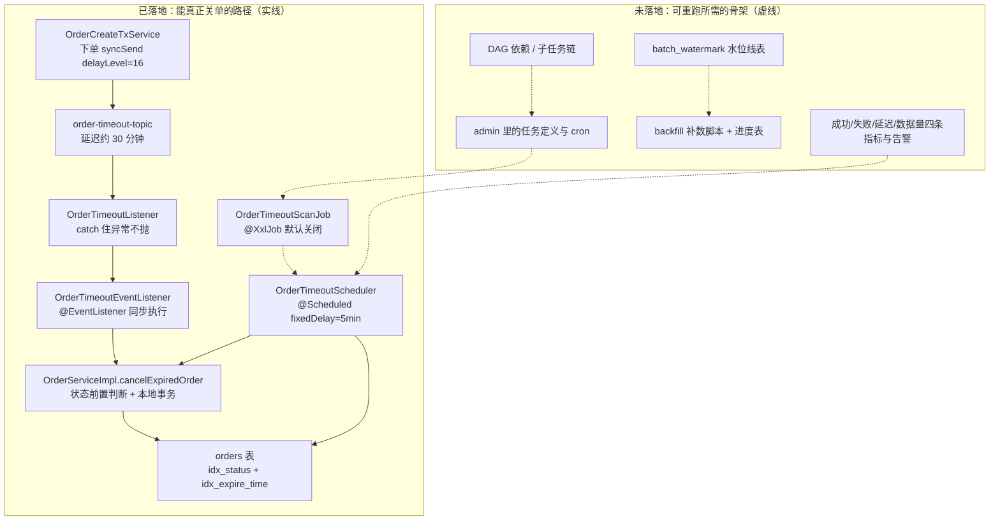
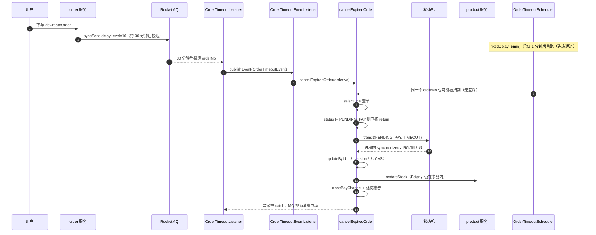

# 批处理与调度编排：任务必须可重跑且幂等

> **一句话结论**：调度系统的第一性原理不是「按时触发」，而是「同一个时间片跑第二遍不产生第二份副作用」。本项目现在有两套触发路径都能关单，却没有一条把幂等做在存储层，也没有任何补数入口——所以「补一次历史数据」这件事，目前等于「手动制造一次事故」。
> **阅读前置**：会读 Java/Spring（`@Scheduled`、`@Transactional`、条件装配）、能写基础 SQL 并看懂 `EXPLAIN`、能用 pwsh 跑命令；RocketMQ 延迟消息、Seata AT 只需知道「有这回事」，细节分别见 [04-中间件/02-RocketMQ消息队列](../04-中间件/02-RocketMQ消息队列.md)。只想学 XXL-Job 怎么配，先读 [07-运维部署/05-XXL-Job分布式调度](../07-运维部署/05-XXL-Job分布式调度.md)，本篇讲的是「配好之后怎么保证重跑不出事」。
> **证据基线**：仓库 `main` 当前工作区；B 级引用均为本篇写作时当次 `read` 核对的行号；C 级为本机实跑输出（node v24.16.0 / JDK 17.0.19 / pwsh 7 / 宿主时区 China Standard Time）；凡未本机实测的结论都写了「未实测」并给出复现命令。预计阅读 45 分钟。

## 证据边界

| 类别 | 本仓状态 | 本篇怎么处理 |
|---|---|---|
| XXL-Job 执行器接入 | ✅ `XxlJobConfig` + `OrderTimeoutScanJob` 真实存在 | §3.1/§3.4 逐行精读；解释「开关默认关」到底关掉了什么 |
| XXL-Job 任务 / 子任务 / DAG 配置 | ❌ `deploy/mysql/xxl-job-init.sql` 只有建表语句，0 条 `INSERT` | 不写成已落地；只在 §5 给「要补什么 + 验收判据」 |
| 补数（backfill）脚本或入口 | ❌ 全仓 0 命中（仅 10 处「回填」全是缓存回填） | §6 坑 6 给手搓姿势、限流与判读 |
| 幂等的存储层保证 | ⚠️ 有状态机 + 状态前置判断，但无 `@Version`、无唯一约束兜底 | §3.3/§3.4 明确指出并发重复副作用的真实缺口 |
| 调度监控（成/败/延迟/数据量） | ❌ Prometheus 无 `rule_files`，11 个抓取目标里没有 xxl-job-admin | §3.8 给「四条必须有」的指标与查询方法，标注未落地 |
| 时区 | ⚠️ 全仓无 `user.timezone`、无容器 `TZ`（除 MySQL） | §0 现象 3 用本机实跑输出证明差异，不靠嘴说 |

---

## 0. 先看现象

下面三个现象都不是「听说」，而是本机跑命令跑出来的。请跟着命令复现一遍，再往下读。

### 现象 1：全仓没有任何「补数」入口，只有 10 处「缓存回填」

```pwsh
# 在仓库根执行
$hit = Get-ChildItem -Recurse -File -Include *.java,*.sql,*.yml,*.ps1,*.sh,*.xml |
  Where-Object { $_.FullName -notmatch '\\target\\|\\learning-docs\\|\\docs\\|\\node_modules\\' } |
  Select-String -Pattern 'backfill|补数|补数据|回填|replay'
"命中数: " + @($hit).Count
$hit | ForEach-Object { $_.Path.Replace((Get-Location).Path + '\','') + '#' + $_.LineNumber }
```

真实输出（10 处全列，无删减）：

```text
命中数: 10
ai-cs-chat\src\main\java\com\aics\chat\cache\CachingEmbeddingModel.java#18
ai-cs-chat\src\main\java\com\aics\chat\cache\CachingEmbeddingModel.java#67
ai-cs-chat\src\main\java\com\aics\chat\cache\VectorCacheStore.java#29
ai-cs-chat\src\main\java\com\aics\chat\cache\VectorCacheStore.java#57
ai-cs-chat\src\main\java\com\aics\chat\service\impl\ChatServiceImpl.java#197
ai-cs-chat\src\main\java\com\aics\chat\service\impl\ChatServiceImpl.java#469
ai-cs-chat\src\main\java\com\aics\chat\service\impl\ChatServiceImpl.java#777
ai-cs-message\src\main\java\com\aics\message\service\impl\LlmTraceServiceImpl.java#101
ai-cs-order\src\main\java\com\aics\order\vo\EligibilityVO.java#23
ai-cs-search\src\main\java\com\aics\search\hybrid\RrfMerger.java#41
```

10 处命中全部是「把查询结果回填到对象/缓存」，没有一处是「把历史数据重算一遍」。也就是说：**某天发现 8 月 1 日的订单超时没生效、要把那一天的关联单补一遍时，这个仓库里没有任何现成的入口**，只能对着数据库手搓 SQL——而手搓 SQL 没有幂等、没有进度、没有限流，正是事故配方。

### 现象 2：唯一的定时任务，在大数据量下每轮预算根本不够

关单扫描的逻辑是「把 `status='PENDING_PAY'` 且 `expire_time<now()` 的订单全部查出来，然后串行一个个取消」。下面用 node 按真实 DDL 的行宽把代价算出来（脚本参数见 §3.5，全部假设逐条打印）：

```pwsh
cd D:\Projects\Persion\ai-customer-service\learning-docs
node tools\tmp\m05-scan-cost.mjs
```

真实输出（节选）：

```text
=== 执行计划 A：优化器选 idx_expire_time（expire_time < now() 是无下界范围） ===
命中行数 ≈ 表中除最近 30 分钟以外【全部】订单；每行都要回表取 16 列判 status。
100 万行: 索引顺序读 1250 页(19.5 MB) ≈ 39 ms + 回表 999000 次随机页读 ≈ 124.9 s ⇒ 合计 124.9 s；同时驻留 List<Order> ≈ 381.1 MB
1000 万行: 索引顺序读 12500 页(195.3 MB) ≈ 391 ms + 回表 9990000 次随机页读 ≈ 1248.8 s ⇒ 合计 1249.1 s；同时驻留 List<Order> ≈ 3810.9 MB
```

同一个脚本的场景 D 说明更狠的一件事——**不用等表变大，只要单笔关单慢一点，积压就再也追不回来**：

```text
=== 场景 D：支付渠道抖一下，backlog 就再也追不回来（模拟，假设同前） ===
日增 1000000 单，每窗口到账 3472 单，单笔 130ms ⇒ 每轮最多 2307 单
第 1 轮: 到账 +3472，处理 2307 ⇒ 积压 1165 单，清空需 151s（预算 300s）
第 3 轮: 到账 +3472，处理 2307 ⇒ 积压 3495 单，清空需 454s（预算 300s）
第 6 轮: 到账 +3472，处理 2307 ⇒ 积压 6990 单，清空需 909s（预算 300s）  ← 已经追不回来了
```

注意 `fixedDelay`（上一轮**结束**后再等 5 分钟）不会「跳过」也不会「报警」：它只是静静地每轮少处理一部分，积压单调上升。你唯一能察觉的，是用户投诉「我的单一直没取消」。

### 现象 3：时区没有一行显式设置，行为完全由宿主决定

```pwsh
cd D:\Projects\Persion\ai-customer-service\learning-docs\tools\tmp
Get-TimeZone | Select-Object Id, BaseUtcOffset
java m05-tz-probe.java                       # 本项目现在就是这样启动的
java "-Duser.timezone=UTC" m05-tz-probe.java # 模拟没设 TZ 的容器
```

真实输出（两次运行各 6 行，全列无删减；`LocalDateTime` 的墙钟值随运行时刻变化，差值才是重点）：

```text
Id            : China Standard Time
BaseUtcOffset : 08:00:00

user.timezone property : null
TimeZone.getDefault()  : Asia/Shanghai
ZoneId.systemDefault() : Asia/Shanghai
LocalDateTime.now()    : 2026-11-27T16:04:24.519167100  <- written into orders.expire_time
expire_time = now+30m  : 2026-11-27T16:34:24.529999800
Instant.now()          : 2026-11-27T08:04:24.529999800Z  <- absolute, timezone-free

user.timezone property : UTC
TimeZone.getDefault()  : UTC
ZoneId.systemDefault() : UTC
LocalDateTime.now()    : 2026-11-27T08:04:25.342756000  <- written into orders.expire_time
expire_time = now+30m  : 2026-11-27T08:34:25.350249100
Instant.now()          : 2026-11-27T08:04:25.350249100Z  <- absolute, timezone-free
```

同一个 `Instant`（绝对时刻完全一致），写进 `DATETIME` 列的 `LocalDateTime` 差了整整 8 小时。本项目**没有任何一行** `user.timezone` / `-Duser.timezone` / `TimeZone.setDefault`，`TZ` 只有 8 处且全部给的是 mysql 容器、没有一处给 Java 进程（§6 坑 5 的命令能证明）——所以「现在没出问题」是宿主的功劳，不是代码的功劳。同一份代码换到 UTC 容器里跑（`docker-compose.yml` 的 xxl-job-admin 就是没设 TZ 的），`expire_time` 会整整早 8 小时，**刚下的单立刻满足 `expire_time < now()`**。

> 这些现象指向同一件事：这套调度只有「触发」这一半，没有「可重跑」的那一半——依赖、重试、补数、监控、时区一个都没显式声明，于是每一次重跑都在同时赌幂等和赌运气。

---

## 1. 整体地图

一句话：**本项目有两条能关单的触发路径（MQ 延迟消息 + `@Scheduled` 兜底），第三条（XXL-Job）默认关闭；而「让它可重跑」所需的四件东西（任务定义、DAG、水位线、补数）全都还不在仓库里。**



> **读图说明**：看两根箭头就够了。第一根是 `A6 --> A5`：`@Scheduled` 通道**不经过 MQ**，直接调用 `cancelExpiredOrder`；第二根是 `A4 --> A5`：MQ 通道也调到同一个方法。这两根箭头汇到同一个方法，就是「同一条业务规则有两个互不知情的触发器」的结构性根源——如果你以为 `A3` 那条线有 MQ 重试帮忙兜底（图上看起来像），就会漏掉一个事实：`A3` 把异常 catch 掉了，MQ 侧看不到失败（§3.4 有原码）。看错这一点，你会把「没关掉的单」归因到 MQ，而真凶是扫表被拖死。

| 组件 | 在哪（完整路径） | 职责 | 参与方 | 本仓状态 |
|---|---|---|---|---|
| 下单发延迟消息 | `ai-cs-order/src/main/java/com/aics/order/service/impl/OrderCreateTxService.java#L143-L146` | 下单成功后投递 30 分钟延迟消息 | 用户、order、RocketMQ | ✅ 已落地（`delayLevel=16` 硬编码） |
| 超时消息消费者 | `ai-cs-order/src/main/java/com/aics/order/listener/OrderTimeoutListener.java#L26-L34` | 把消息转成领域事件 | RocketMQ、order | ✅ 已落地（异常被吞，见 §3.4） |
| 领域事件监听 | `ai-cs-order/src/main/java/com/aics/order/event/OrderTimeoutEventListener.java#L23-L27` | 同步调用关单 | Spring 事件、order | ✅ 已落地 |
| 关单事务 | `ai-cs-order/src/main/java/com/aics/order/service/impl/OrderServiceImpl.java#L166-L176` | 状态校验 + 取消 + 回补库存 + 关支付 | order、product、pay | ✅ 已落地（无 CAS） |
| 兜底扫描 | `ai-cs-order/src/main/java/com/aics/order/task/OrderTimeoutScheduler.java#L29-L53` | 每 5 分钟全量扫超时单 | 单机调度线程 | ✅ 已落地（无分页） |
| XXL-Job 执行器 | `ai-cs-order/src/main/java/com/aics/order/task/XxlJobConfig.java#L23-L44` | 内嵌执行器，等 admin 回调 | xxl-job-admin、order | ⚠️ 存在但默认关闭 |
| XXL-Job 任务体 | `ai-cs-order/src/main/java/com/aics/order/task/OrderTimeoutScanJob.java#L27-L32` | 只是转调 `scanExpiredOrders` | xxl-job-admin、order | ⚠️ 无 admin 侧任务定义 |
| admin 控制台 | `docker-compose.yml#L235-L257` | 触发调度、看执行日志 | 运维 | ⚠️ 未设时区，任务需手建 |
| 任务表结构 | `deploy/mysql/xxl-job-init.sql#L10-L35` | xxl_job_info 等表 DDL | — | ✅ 建表；❌ 0 条任务 INSERT |
| 指标抓取 | `deploy/observability/prometheus.yml` | 15s 抓 11 个 `/actuator/prometheus` | Prometheus | ⚠️ 无规则、不含 admin |

---

## 2. 关键概念与关键要素

一句话：先分清「触发」「依赖」「重试」「幂等」四个词各自解决什么问题，再看本仓每个词落在哪一行代码上。

| 名称 | 位置 / 出处 | 作用 | 关键参数 |
|---|---|---|---|
| 触发（trigger） | `OrderTimeoutScheduler.java#L29`、`OrderTimeoutScanJob.java#L27`、`OrderCreateTxService.java#L144` | 决定「什么时候跑」 | `fixedDelay`、`initialDelay`、cron、`delayLevel` |
| 依赖（dependency） | 本仓无（无 DAG 配置） | 决定「上游没好就不许跑」 | 上游完成标志 / 数据就绪条件 |
| 重试（retry） | `PaySuccessListener.java#L27-L31`（MQ 8 次）、`OrderTimeoutListener.java#L29-L33`（无重试） | 决定「失败了再来几次」 | `maxReconsumeTimes`、退避间隔、死信主题 |
| 幂等（idempotent） | `OrderServiceImpl.java#L171-L173`（状态前置判断） | 同一输入跑 N 次，结果一样 | 状态机当前态、唯一键、分区键 |
| 水位线（watermark） | 本仓无（`batch_watermark` 表未建） | 记「处理到哪了」，增量只扫新的 | `last_value`、安全滞后、失败不推进 |
| 分区覆盖（partition overwrite） | 本仓无 | 重算某个分区，整块替换，天然幂等 | 分区键（日期/租户） |
| upsert | 本仓有同类思想：`ProductCdcConsumer` 按主键写 ES | 主键冲突就覆盖，不产生第二份 | 唯一键 / `_id` |
| 先删后插（delete-then-insert） | 本仓无 | 同一事务内删旧插新，等价于覆盖 | 事务边界、删除条件 |
| 收敛型任务 | `OrderTimeoutScheduler.java#L17-L18` 类注释自述「兜底机制」 | 每轮重算「当前应有的状态」，不看历史 | 无（可重复执行） |
| 累加型任务 | 本仓无（如日汇总） | 每轮追加，重跑就会重复累加 | 必须靠水位线或分区覆盖 |
| 分片广播（sharding broadcast） | 仅 `XxlJobConfig.java#L15` 注释提及 | 多机并行跑同一任务的不同分片 | `shardIndex`、`shardTotal` |
| 路由策略 | `OrderTimeoutScanJob.java#L24-L25` 注释建议 `FIRST` | 多执行器里挑哪台跑 | FIRST / ROUND / CONSISTENT_HASH |
| 阻塞策略 | 同上，注释建议「丢弃后续调度」 | 上一次还没跑完又来一次时怎么办 | 单机串行 / 丢弃 / 覆盖 |
| `fixedDelay` vs `fixedRate` | `OrderTimeoutScheduler.java#L29` 用的是前者 | Delay：上轮**结束**后计时；Rate：按固定节拍 | 决定积压时会不会自我叠加 |
| 时钟漂移 | 本仓无 NTP 相关配置 | 多机时间不一致导致「依赖就绪」判断错 | 允许偏差阈值 |
| 时区（timezone） | 全仓 0 处显式设置；`docker-compose.yml#L19` 只有 MySQL 有 `TZ` | 决定 `LocalDateTime.now()` 的墙钟值与 cron 的解析基准 | `user.timezone`、容器 `TZ`、JDBC `serverTimezone` |

---

## 3. 原理与证据逐段精读

### 3.1 触发的三种形态，本仓各有一条，但只有一条真正在跑

**在干什么**：本项目用三种完全不同的机制表达「定时」——`@Scheduled`（进程内定时器）、`@XxlJob`（外部 admin 回调）、RocketMQ 延迟消息（Broker 定时投递）。

`ai-cs-order/src/main/java/com/aics/order/task/OrderTimeoutScheduler.java#L28-L45`

```java
    /** 每 5 分钟扫描一次，启动 1 分钟后首次执行 */
    @Scheduled(fixedDelay = 300000, initialDelay = 60000)
    /**
     * 定时扫描超时未支付订单并关闭。
     * <p><b>学习要点（技术：定时任务 + 状态补偿）</b>：@Scheduled 定时扫描 DB 兜底
     * 未被 RocketMQ 延迟消息关闭的订单；关闭需回滚库存并保证幂等（重复扫描不重复扣）。
     * 延迟消息与定时扫描双保险，防止单点失效。</p>
     */
    public void scanExpiredOrders() {
        log.info("定时任务：扫描超时未支付订单...");
        List<Order> expired = orderMapper.selectList(
                new LambdaQueryWrapper<Order>()
                        .eq(Order::getStatus, OrderStatus.PENDING_PAY.getCode())
                        .lt(Order::getExpireTime, LocalDateTime.now()));
        if (expired.isEmpty()) {
            log.info("定时任务：无超时订单");
            return;
        }
```

`ai-cs-order/src/main/java/com/aics/order/task/XxlJobConfig.java#L22-L24`（决定执行器是否存在的那一行）

```java
@Configuration
@ConditionalOnProperty(name = "aics.xxl-job.enabled", havingValue = "true")
public class XxlJobConfig {
```

`ai-cs-order/src/main/resources/application.yml#L51-L58`（默认值的真相）

```yaml
# ===== XXL-Job 执行器（默认关闭，本地无 admin 也能启动；见 learning-docs 07-运维部署） =====
aics:
  xxl-job:
    enabled: ${XXL_JOB_ENABLED:false}
    admin-addresses: ${XXL_JOB_ADMIN:http://127.0.0.1:8099/xxl-job-admin}
    access-token: default_token
    executor:
      port: 9999
```

**为什么这么设计**：`@Scheduled` 零依赖，进程活着自己就会跑，最适合「兜底」；XXL-Job 把触发时机、失败重试、分片、执行日志集中到 admin，多实例下靠路由策略保证只有一台执行——这正是 `XxlJobConfig` 类注释（`XxlJobConfig.java#L13-L19`）说的差别。但接入 admin 意味着「调度可用性」被绑到 admin 上，所以作者给了开关，默认走最土但最不会断的那条。

**换成别的写法会怎样**：如果只留 XXL-Job 一条通道，`XXL_JOB_ENABLED` 忘了设成 true（默认就是 false），关单能力直接归零，而且没有任何日志提示「你没开」——这是把可用性押在一个环境变量上。如果只留 `@Scheduled`，多副本部署时就是 N 台各扫一遍（重复触发），且看不到执行历史。

**常见坑**：① 以为 `@EnableScheduling` 加了就有任务——`ai-cs-chat/src/main/java/com/aics/chat/ChatApplication.java#L14` 也加了 `@EnableScheduling`，但 chat 模块 0 个 `@Scheduled`，是空注解；② 以为「两套都在跑，互为冗余」——默认配置下 XXL-Job 执行器根本不创建，`XxlJobConfig.java#L44` 那句「XXL-Job 执行器已启用」在启动日志里**不会**出现，这是最快的判读方法（见 §6 坑 1）。

### 3.2 依赖与 DAG：依赖要声明在数据上，不是声明在时钟上

**在干什么**：DAG（有向无环图）把一个作业拆成若干节点，用**边**声明「谁必须在谁之后」。本仓的现状是：0 个 DAG 配置——`deploy/mysql/xxl-job-init.sql` 里只有 `xxl_job_info` 的建表语句（`#L10`）和一条索引（`#L35`），**0 条 `INSERT`**，意思是所有任务都得运维在 admin 界面上手点。

**为什么这么设计**：把依赖写成「A 在 03:10 跑，B 在 03:20 跑」是用**时钟**近似依赖，只要 A 某天慢了 11 分钟，B 就在残缺数据上跑完了，而且跑得「成功」。真正的依赖应该声明成「B 需要 A 的 `2026-11-27` 分区就绪」。

**换成别的写法会怎样**：小规模、单任务时用时钟排期最省事；一旦有一条链（例如「订单明细 → 日汇总 → 指标宽表」），就必须有完成标志表或专用编排器（Airflow、DolphinScheduler、XXL-Job 的子任务）。本仓连中间表都没有（`14-数据工程与OLAP/03-数仓分层与指标口径.md` 标注为⚠️未落地），所以「依赖」这件事现在没有载体。

**常见坑**：把「上游未完成」当成「上游失败」——于是下游重试三次全失败，告警轰炸，其实只需要再等 3 分钟。判断依据必须是状态（就绪/未就绪），不是异常。

### 3.3 幂等批处理的四种写法，本仓一条都没做在存储层

**在干什么**：让「同一批数据跑第二遍」不产生第二份副作用。四种主流写法：

| 写法 | 机制 | 幂等靠什么 | 适用 | 本仓状况 |
|---|---|---|---|---|
| 按分区覆盖 | 重算某个分区，`REPLACE PARTITION` / 整块重写 | 分区键唯一 | 日/小时级汇总 | ❌ 无分区表、无汇总表 |
| 按主键 upsert | `INSERT ... ON DUPLICATE KEY UPDATE` / ES 按 `_id` 写 | 唯一键 | 明细同步 | ✅ 思想存在于 CDC 链路（`ai-cs-search/src/main/java/com/aics/search/cdc/ProductCdcConsumer.java`） |
| 先删后插 | 同事务内 `DELETE` 条件范围再 `INSERT` | 事务 + 删除条件 | 小批量重建 | ❌ 无 |
| 水位线增量 | 记录 `last_value`，只处理 `> last_value` 的新数据 | 水位线表 | 事件流/日志表 | ❌ 无 |

关单这里的「幂等」是第五种、最朴素的一种——**状态机幂等**：先查当前状态，不对就返回。

`ai-cs-order/src/main/java/com/aics/order/service/impl/OrderServiceImpl.java#L166-L176`

```java
    @Override
    @Transactional(rollbackFor = Exception.class)
    public void cancelExpiredOrder(String orderNo) {
        Order order = orderMapper.selectOne(
                new LambdaQueryWrapper<Order>().eq(Order::getOrderNo, orderNo));
        if (order == null || !OrderStatus.PENDING_PAY.getCode().equals(order.getStatus())) {
            return; // 已支付或已取消，忽略
        }
        doCancelOrder(order, OrderEvent.TIMEOUT);
        log.info("订单超时自动取消: orderNo={}", orderNo);
    }
```

**为什么这么设计**：这段代码要扛三种重复来源——MQ 至少一次投递、扫表每 5 分钟重扫、人工重推。用「读状态→判断→执行」是最直观的写法，绝大多数情况也真的够用。

**换成别的写法会怎样**：如果改成 `UPDATE orders SET status='CANCELLED' WHERE order_no=?`（不带状态条件），则重复执行会把已支付的单刷成已取消；如果改成带状态条件的 `UPDATE ... WHERE order_no=? AND status='PENDING_PAY'` 并检查受影响行数，就获得了**行级 CAS**，重复执行第二遍影响 0 行，天然幂等——这是本仓最该改的一行（§9 练习 1）。

**常见坑**：`selectOne` + `updateById` 是「先查后改」，两步之间没有锁、`Order` 实体也没有 `@Version` 字段（`ai-cs-order/src/main/java/com/aics/order/entity/Order.java#L16-L49`，16 个字段里没有任何版本列），因此**两个实例同时关同一单时，两边都读到 `PENDING_PAY`，两边都执行 `doCancelOrder`**，其中 `productClient.restoreStock` 会被调用两次——库存凭空多出来。这是「状态机幂等」在并发下的真实盲区，不是理论问题。

### 3.4 关单链路精读：一条规则，两条触发，一个被吞掉的异常

**在干什么**：把 `cancelExpiredOrder` 展开成实际副作用序列。

`ai-cs-order/src/main/java/com/aics/order/service/impl/OrderServiceImpl.java#L222-L235`

```java
    private void doCancelOrder(Order order, OrderEvent event) {
        order.setStatus(orderStateTransitionService.transit(order.getStatus(), event).getCode());
        order.setCancelTime(LocalDateTime.now());
        orderMapper.updateById(order);

        // 归还库存（实时回补商品服务 DB 库存）
        List<OrderItem> items = orderItemMapper.selectList(
                new LambdaQueryWrapper<OrderItem>().eq(OrderItem::getOrderNo, order.getOrderNo()));
        for (OrderItem item : items) {
            productClient.restoreStock(item.getProductId(), item.getQuantity());
        }

        // 通知支付服务关闭渠道订单（使二维码失效）
        closePayChannel(order);
```

状态迁移本身是加锁的，但锁的范围很说明问题——`ai-cs-order/src/main/java/com/aics/order/statemachine/OrderStateTransitionService.java#L21-L35`

```java
    public OrderStatus transit(String currentStatus, OrderEvent event) {
        OrderStatus current = parse(currentStatus);
        synchronized (orderStateMachine) {
            orderStateMachine.stop();
            orderStateMachine.getStateMachineAccessor().doWithAllRegions(access ->
                    access.resetStateMachine(new DefaultStateMachineContext<>(current, null, null, null)));
            orderStateMachine.start();
            boolean accepted = orderStateMachine.sendEvent(MessageBuilder.withPayload(event).build());
            if (!accepted) {
                throw new BusinessException(ResultCode.BAD_REQUEST,
                        "订单状态不允许迁移: " + current.getCode() + " --" + event + "--> ?");
            }
            return orderStateMachine.getState().getId();
        }
    }
```

`synchronized (orderStateMachine)` 是**进程内**锁。单机部署时它保证了「同一时刻只有一个线程在跑状态机」，多副本时两个进程各有一把锁，等于没有锁。

再看 MQ 那一侧的异常处理——`ai-cs-order/src/main/java/com/aics/order/listener/OrderTimeoutListener.java#L26-L34`

```java
    @Override
    public void onMessage(String orderNo) {
        log.info("收到订单超时消息，发布领域事件: orderNo={}", orderNo);
        try {
            eventPublisher.publishEvent(new OrderTimeoutEvent(orderNo));
        } catch (Exception e) {
            log.error("发布订单超时领域事件失败: orderNo={}", orderNo, e);
        }
    }
```

**为什么这么设计**：作者显然是想「别让一条坏消息把消费线程搞挂」，同时把状态机当成唯一真相来源——反正重复执行无害，失败了下轮扫表还会再来。这个推理在「扫表一定跑得动」的前提下是成立的。

**换成别的写法会怎样**：把 catch 去掉，让异常抛出到 RocketMQ，消费失败会按 `maxReconsumeTimes` 重试、耗尽后进死信主题（同一工程里 `ai-cs-order/src/main/java/com/aics/order/listener/PaySuccessListener.java#L27-L31` 就是这么配的，`maxReconsumeTimes = 8`）。代价是重试也会放大约束冲突类的错误日志。更精细的做法是把「发布事件」挪到事务提交后：Spring 提供 `TransactionalEventListener`（`[[源码:TransactionalEventListener.java.md#L74-L78]]`，默认 `AFTER_COMMIT`），把「事务成功后才触发下游」变成框架保证。

**常见坑**：catch 掉异常意味着**MQ 认为消费成功**，于是 `order-timeout-topic` 这条线上「重试」和「死信」形同不存在；一旦扫表因为 §3.5 的原因跑不动，这些单就真的没有第二次机会。这条链路最危险的地方不是「没重试」，而是「看起来有重试」。

### 3.5 为什么定时扫表在大数据量下会崩

**在干什么**：`selectList` 一次性把命中的订单全查进内存，然后串行处理。崩的方式有三种，按出现顺序：

**第一种：执行计划劣化，全表回表**。查询条件是 `status=? AND expire_time<now()`，`deploy/mysql/order-init.sql#L41-L45` 里只有单列索引：

```text
41: PRIMARY KEY (`id`),
42: UNIQUE KEY `uk_order_no` (`order_no`),
43: KEY `idx_user_id` (`user_id`),
44: KEY `idx_status` (`status`),
45: KEY `idx_expire_time` (`expire_time`)
```

`expire_time < now()` 是个**没有下界**的范围：所有历史订单的 `expire_time` 都小于 `now()`，所以一旦优化器选了 `idx_expire_time`，它扫的是「除最近 30 分钟外的全部行」，每行还要回表取 16 列来判断 `status`。估算结果（脚本 `learning-docs/tools/tmp/m05-scan-cost.mjs`，参数与假设全在脚本里）：

```text
100 万行: 索引顺序读 1250 页(19.5 MB) ≈ 39 ms + 回表 999000 次随机页读 ≈ 124.9 s ⇒ 合计 124.9 s；同时驻留 List<Order> ≈ 381.1 MB
1000 万行: 索引顺序读 12500 页(195.3 MB) ≈ 391 ms + 回表 9990000 次随机页读 ≈ 1248.8 s ⇒ 合计 1249.1 s；同时驻留 List<Order> ≈ 3810.9 MB
```

对照实验（同一脚本的「执行计划 C」）说明真正贵的是随机回表，不是读数据本身：

```text
100 万行: 顺序读 8265 页 ≈ 129.1 MB ⇒ 258 ms（顺序读便宜，随机回表贵）
1000 万行: 顺序读 82645 页 ≈ 1291.3 MB ⇒ 2.6 s（顺序读便宜，随机回表贵）
```

**第二种：结果集一次性进堆**。`selectList` 没有分页也没有 `limit`，命中的行会变成 `List<Order>` 常驻内存。上面对应的 381 MB / 3811 MB 只是 400 B/对象 的粗估（假设：16 个字段 + 对象头 + 引用），真实 JVM 里还要算上「一次性晋升老年代 → Full GC」的成本。

**第三种：吞吐上限低于到账速率**。串行 for 循环里每单要做：1 次状态机迁移 + 1 次 `updateById` + 1 次订单项查询 + N 次 Feign 回补库存 + 1 次 Feign 关支付（`OrderServiceImpl.java#L222-L247`）。以 65 ms/单（假设：3 次 DB 各 5 ms + 3 次 Feign 各 20 ms）算：

```text
单笔 65ms ⇒ 每轮 4615 单 ⇒ 临界日增 ≈ 132.9 万单/天（超过它 backlog 单调增长）
单笔 150ms ⇒ 每轮 2000 单 ⇒ 临界日增 ≈ 57.6 万单/天（超过它 backlog 单调增长）
单笔 300ms ⇒ 每轮 1000 单 ⇒ 临界日增 ≈ 28.8 万单/天（超过它 backlog 单调增长）
```

**为什么这么设计**：这是「最小可用兜底」的典型形状——先保证有兜底，再谈性能。类注释（`OrderTimeoutScheduler.java#L17-L18`）明说主路径是 MQ 延迟消息，扫表只是兜底，作者假设兜底很少真干活，所以按「一天可能扫到几十单」的心智写代码。

**换成别的写法会怎样**：① 加 `limit 500` + 循环到空（把「一次全查」变成「多轮小批」）；② 建 `(status, expire_time)` 联合索引让范围收窄、避免回表判 `status`；③ 用 `UPDATE ... WHERE status=? AND expire_time<? LIMIT 500` 直接改状态，只把改成功的 `order_no` 拿去回补库存；④ 分片：按 `user_id % N` 或 `id` 区间切。

**常见坑**：以为「有 `idx_status` 就会走 `idx_status`」。优化器按统计信息选，`status` 只有 5 个取值（`ai-cs-order/src/main/java/com/aics/order/enums/OrderStatus.java#L13-L17`），区分度极低，`PENDING_PAY` 占比高时优化器很可能改用 `idx_expire_time` 的范围扫——所以**上线前必须 `EXPLAIN` 一次**（§6 坑 4 给命令与判读）。

### 3.6 调度与业务解耦：业务表 → 中间表 → 汇总表

**在干什么**：让调度任务读的、写的都不是「正在被用户高频改写的业务表」。三层：业务表（`orders`，OLTP 高并发写）→ 中间表（按天快照/明细落地）→ 汇总表（按维度聚合，供看板）。

**为什么这么设计**：扫业务表有两个直接的坏处：① 你的扫描和用户的写抢同一批行与同一批索引页；② 业务表结构随需求变（改字段、改状态取值），你的统计口径跟着碎。中间表把「口径」和「存储」解耦，出问题可以只重跑中间表。

**换成别的写法会怎样**：本仓现在就是「直查业务表」——`14-数据工程与OLAP/03-数仓分层与指标口径.md` 与 `README.md` 都把数仓分层标为⚠️未落地，指标查询走的是业务库直查 + 内存聚合。数据量小时这是最优解（少一次同步、口径现算最新）；一旦要看「近 90 天支付成功率日趋势」并且要求秒级，就必须有中间表。

**常见坑**：中间表一旦引入，「它什么时候更新」就成了新的依赖问题——必须给中间表配「数据就绪」判断（行数 + 最大时间戳），否则下游会在半张表上算完并「成功」。这块的检查清单在 [08-数据质量与对账](./08-数据质量与对账.md)。

### 3.7 时区与时钟：一行都没写，行为全靠宿主

**在干什么**：`expire_time` 的值来自 `LocalDateTime.now()`（`OrderCreateTxService.java#L116`、`OrderTimeoutScheduler.java#L41` 的比较值同样是它），而 `LocalDateTime` **不带时区**——它只是「墙上时钟的读数」。

写库时 MyBatis 走 `LocalDateTimeTypeHandler`（`[[源码:LocalDateTimeTypeHandler.java.md#L32-L35]]`）：

```java (src: LocalDateTimeTypeHandler.java.md#L32-L35)
  public void setNonNullParameter(PreparedStatement ps, int i, LocalDateTime parameter, JdbcType jdbcType)
      throws SQLException {
    ps.setObject(i, parameter);
  }
```

`ps.setObject` 把「一个没有时区的读数」交给 JDBC 驱动，驱动再按连接属性（本项目 JDBC URL 带 `serverTimezone=Asia/Shanghai`）解释成 `DATETIME` 字面量。**链路上没有任何一环知道「这个读数是以哪个时区生成的」**——它们只能假设它和配置一致。

**为什么这么设计**：项目约定为「Java 容器不设 TZ，JVM 默认取宿主时区，靠 JDBC `serverTimezone` 兜住落库」——这条约定在 `15-计算机基础/07-字符编码与时区.md` 与 `01-Java基础/08-语言级细节与序列化.md` 里都有记录。本机宿主是 China Standard Time，所以默认启动时 `LocalDateTime.now()` 恰好是东八区墙钟，跟 `serverTimezone=Asia/Shanghai` 对得上，一切看起来正常。

**换成别的写法会怎样**：把容器搬到 UTC（或给 JVM 传 `-Duser.timezone=UTC`），同一份代码的 `LocalDateTime.now()` 立刻退 8 小时（§0 现象 3 的实跑输出）。于是：写入的 `expire_time` 比真实截止时间早 8 小时 → 用户下单后立刻满足 `expire_time < now()` → 扫表把刚下的单全取消。反过来，如果 JVM 是东八区而 DB 连接按 UTC 解释，则 `expire_time` 会晚 8 小时，订单该关不关。**cron 也一样**：`docker-compose.yml#L235-L257` 的 xxl-job-admin 没设 `TZ`，cron 按容器 JVM 默认时区解析，你写的「每天 02:00」可能落在北京时间 10:00。

**常见坑**：用「我这台机器上正常」来验证时区。宿主机是东八区，一切都对；换成容器/CI/海外节点，同一份代码行为就变了，而且**没有任何日志会告诉你**。

### 3.8 监控四问：成功、失败、延迟、数据量

**在干什么**：一条调度任务至少要能回答四个问题——这轮跑成功了吗？失败了几条？比预期晚了多久？处理的数据量是不是异常（0 条或暴涨）？

**为什么这么设计**：前两个回答「任务本身健康吗」，后两个回答「数据健康吗」。只有前两个，会出现「任务全绿、数据全空」——这是批处理最常见的假绿。所以数据量必须进告警条件：`count = 0` 也是异常，不只是 `失败数 > 0`。

**换成别的写法会怎样**：本仓现状是「靠日志肉眼看」：`OrderTimeoutScheduler.java#L37/L43/L48/L51` 打了四条 `log.info`，`deploy/observability/prometheus.yml` 只有 `scrape_interval: 15s` 与 11 个 static target（`host.docker.internal:8080` ~ `8090`，含 order 的 8087），**无 `rule_files`、无 alertmanager、不含 8099 的 xxl-job-admin**。也就是说：调度层的成/败/延迟/数据量四条，一条指标出口都没有。

**常见坑**：以为「Actuator 暴露了 `/actuator/prometheus` 就等于有监控」。暴露只是「有数可抓」，判断「这轮成功没成功」需要业务埋点——最少要在任务末尾打一条结构化日志或写一张 `job_run_log(job, run_at, status, affected_rows, cost_ms)`，否则 Prometheus 那边只有 JVM 指标，永远看不出调度挂了。

---

## 4. 一次完整执行时序

一句话：同一条「关单」规则，正常由 MQ 触发一次；MQ 那条线异常被吞掉之后，实际是靠 5 分钟扫表补上的——而两者之间没有任何互斥。



> **读图说明**：盯两处。第一处是第 8 步与第 9 步：`SC->>S` 和 `E->>S` 是两条**并行**入口，图上没有把它们串起来——因为代码里没有任何分布式互斥，两个实例同时执行时都读得到 `PENDING_PAY`。第二处是最后一步 `S-->>L: 异常被 catch`：这条回执是「成功」形状的，所以图上 MQ 侧不会出现重试箭头。看错这两处，你会得出「MQ 保证重试、扫表只兜底，所以不会漏单」的错误结论。

**每步该怎么判读**

| 步 | 观察点 | 正常长相 | 异常长相与判读 |
|---|---|---|---|
| 2 | 下单日志 `订单创建成功` | 有 `orderNo`、`payAmount` | 只有这句、后面没有 MQ 发送成功日志 → `syncSend` 抛错但被上层吞掉，查 RocketMQ Broker 是否可达 |
| 3 | 启动日志 `XXL-Job 执行器已启用: admin=…, port=9999` | 开启后每实例出现一次 | 完全没有这句 → `XXL_JOB_ENABLED` 仍是 false，只有扫表通道在工作 |
| 4-6 | `收到订单超时消息，发布领域事件: orderNo=…` | 下单后约 30 分钟出现一次 | 一条都没有 → `order-timeout-topic` 没消费（消费者组未启动/消息堆积） |
| 6-7 | `处理订单超时领域事件: orderNo=…` 紧随其后 | 与上一条同秒 | 只有上一条、没有这条 → 事件发布失败被 catch，看 `发布订单超时领域事件失败` 的堆栈 |
| 9 | `订单超时自动取消: orderNo=…` | 每个订单号出现**一次** | 同一 `orderNo` 出现两次 → 重复触发（多实例或双通道并发），检查 §6 坑 3 |
| 10 | 异常栈 `订单状态不允许迁移: CANCELLED --TIMEOUT--> ?` | 不该出现 | 频繁出现 → 说明「先查后改」的窗口被并发穿过，需要 CAS |
| 12 | `restoreStock` 的 Feign 调用耗时 | 稳定在毫秒级 | 变长 → 直接决定 §0 现象 2 的吞吐上限，进而决定积压是否单调增长 |
| 兜底 | `定时任务：扫描超时未支付订单...` 与紧邻的 `定时任务：无超时订单` | 每分钟级正常；两者成对出现 | 只有前一句、没有后一句也没有「已取消」，且间隔远超 5 分钟 → 本轮还在跑，backlog 正在堆积 |

---

## 5. 设计取舍

一句话：本项目在小规模下选了「最少件数」的方案（两条触发 + 状态判断），代价是把「可重跑」的责任全部推给了「重复执行恰好无害」这个未经并发验证的假设。

| 取舍点 | 方案 A | 方案 B | 本仓建议 | 放弃的东西 |
|---|---|---|---|---|
| 关单触发源 | MQ 延迟消息（精确、可扩展） | 定时扫表（简单、能兜底） | A 为主 + B 兜底，但 B 必须限流/分页 | 只有 A 时 MQ 故障即漏单；只有 B 时成本随表线性涨 |
| 幂等落点 | 状态机前置判断（现状） | 存储层 CAS / 唯一约束 | 立刻补 B：`UPDATE ... WHERE status='PENDING_PAY'` 看影响行数 | 选 A 要接受并发窗口；选 B 要接受多一次写判断 |
| 补数方式 | 手写一次性脚本 | 任务参数化 + 补数进度表 | B（可复用、可断点续跑） | 开发成本；脚本模式无进度、无法审计 |
| 增量推进 | 全量重扫（现状，收敛型任务确实能忍） | 水位线表 | 累加型任务必须 B；收敛型可留 A 但要有 `limit` | 水位线引入「安全滞后」与迟到数据的处理复杂度 |
| 多实例执行 | 每台都跑（`@Scheduled` 现状） | 分片广播 / 路由策略 | 超过 1 副本就必须 B | 分片带来「分片不均」与「重分片」运维成本 |
| 数据落点 | 直查业务表（现状） | 业务表 → 中间表 → 汇总表 | 报表需求出现前留 A，出现后立刻 B | 中间表带来同步延迟与「就绪判断」这个新依赖 |
| 时区 | 依赖宿主 / JDBC `serverTimezone`（现状） | 全链路显式声明 | 立刻 B：启动参数 `-Duser.timezone=Asia/Shanghai` + 容器 `TZ` | 显式声明后，历史数据里「按宿主解释」的旧值需要一次对账 |
| admin 可用性 | 内嵌执行器 + 独立 admin（现状） | 自研调度 / K8s CronJob | 数据量与任务数上来前留 A | A 把「调度可用性」绑到 admin，admin 挂了新任务不触发（已在跑的任务不受影响） |

**可扩展点清单**（每条都给了验收判据，判据必须能被命令验证）

1. **给 `orders` 加 `(status, expire_time)` 联合索引**
   **验收判据**：`EXPLAIN` 输出的 `key` 为 `idx_status_expire`，`rows` 数量级等于待取消单数量（而不是表行数），`Using index condition` 出现。
2. **扫描改「分页 + 批处理」**
   **验收判据**：`OrderTimeoutScheduler` 里不再出现无参数的 `selectList`；把 100 万行造的测试表跑一轮，`log.info` 里每批条数恒定，进程堆内存曲线平。
3. **关单改行级 CAS**
   **验收判据**：`doCancelOrder` 里出现带 `status='PENDING_PAY'` 条件的更新，并且 `productClient.restoreStock` 只在影响行数 = 1 时调用；构造两个线程同时关同一单，库存只回补一次。
4. **补数入口参数化**
   **验收判据**：存在一个可传 `--from --to --shard` 的入口（脚本或 XXL-Job 任务参数），执行记录写 `job_run_log`；同一区间连跑两次，业务表 `count(*)` 不变。
5. **调度四指标落库**
   **验收判据**：`job_run_log` 有 `status`、`affected_rows`、`cost_ms`、`window_start` 四列；`affected_rows = 0` 连续 3 轮触发告警（而不是只在异常时告警）。
6. **时区显式化**
   **验收判据**：`grep` 全仓能搜到 `-Duser.timezone` 与容器 `TZ`；`java -XshowSettings:properties -version` 输出 `user.timezone = Asia/Shanghai`；同一时刻写库的 `create_time` 与宿主 `Get-Date` 相差在秒级。

---

## 6. 踩坑与调试手法

每条都给完整命令 + 判读列 + 误判风险。标「未实测」的是需要活体服务/数据库的，本机禁止起服务，所以只给命令与判读方法。

### 坑 1：以为 MQ 那条线有重试兜底，其实异常被吞了

```pwsh
cd D:\Projects\Persion\ai-customer-service
Get-Content ai-cs-order\src\main\java\com\aics\order\listener\OrderTimeoutListener.java |
  Select-Object -Skip 25 -First 9
Get-ChildItem -Recurse -File -Filter *.java -Path ai-cs-order\src |
  Select-String -Pattern 'maxReconsumeTimes' |
  ForEach-Object { $_.Path + '#' + $_.LineNumber + ': ' + $_.Line.Trim() }
```

真实输出（两条命令的输出全列）：

```text
ai-cs-order\src\main\java\com\aics\order\listener\PaySuccessListener.java#16: *   <li>消费失败的兜底是 RocketMQ 重试（本组 maxReconsumeTimes=8，间隔递增），
ai-cs-order\src\main\java\com\aics\order\listener\PaySuccessListener.java#30: maxReconsumeTimes = 8
```

| 现象 | 判读 |
|---|---|
| 监听器里有 `try { ... } catch (Exception e) { log.error(...) }` | 异常不会抛给 MQ，**该消费者没有重试、没有死信** |
| 只有 `PaySuccessListener` 配了 `maxReconsumeTimes` | 工程里另一条消费链路配了重试，容易让人误以为「这个工程的 MQ 都配了重试」 |

**误判风险**：看到 `@RocketMQMessageListener` 就默认「有重试 8 次」——重试是**消费者组级别**配置，不是全局配置。要判读必须打开那个具体监听器的注解，看有没有 `maxReconsumeTimes`，再看方法体有没有 catch 掉。

### 坑 2：以为定时任务有 6 处，其实只有 1 处

```pwsh
cd D:\Projects\Persion\ai-customer-service
$files = Get-ChildItem -Recurse -File -Filter *.java |
  Where-Object { $_.FullName -notmatch '\\target\\|\\learning-docs\\' }
"java files: " + $files.Count
$files | Select-String -Pattern '@Scheduled\(|@XxlJob\(|@EnableScheduling' |
  ForEach-Object { $_.Path.Replace((Get-Location).Path + '\','') + '#' + $_.LineNumber + ': ' + $_.Line.Trim() }
```

真实输出：

```text
java files: 672
ai-cs-chat\src\main\java\com\aics\chat\ChatApplication.java#14: @EnableScheduling
ai-cs-order\src\main\java\com\aics\order\OrderApplication.java#16: @EnableScheduling
ai-cs-order\src\main\java\com\aics\order\task\OrderTimeoutScanJob.java#27: @XxlJob("orderTimeoutScanJob")
ai-cs-order\src\main\java\com\aics\order\task\OrderTimeoutScheduler.java#29: @Scheduled(fixedDelay = 300000, initialDelay = 60000)
```

| 现象 | 判读 |
|---|---|
| `@Scheduled(` 命中 1 处 | 全仓只有一个定时任务；「6 处」是过时口径（旧文档曾这样写，见 §7） |
| `@EnableScheduling` 2 处，其中 chat 模块没有 `@Scheduled` | 空注解：加了不会报错，也不会有任务，别据此推断「chat 有定时任务」 |

**误判风险**：把 `@EnableScheduling` 的命中数当成任务数（2 ≠ 1）；或者把 `target/` 目录里的编译产物算进去，导致数字虚高。命令里必须排除 `target`。

### 坑 3：多实例部署，`@Scheduled` 会按副本数成倍重复执行

```pwsh
# 判读依据：调度线程池有没有配（没配 = 单线程调度器）
cd D:\Projects\Persion\ai-customer-service
$f = Get-ChildItem -Recurse -File -Include *.yml,*.yaml,*.java |
  Where-Object { $_.FullName -notmatch '\\target\\|\\learning-docs\\' }
$f | Select-String -Pattern 'spring\.task\.scheduling|TimeZone\.setDefault|user\.timezone'
"(以上为空即代表全仓未配置)"
# 线上判读：统计「扫描」日志出现频次（未实测，需要活体服务日志）
# 期望：每实例 12 次/小时；N 个副本就是 12N 次/小时，日志里 orderNo 会出现 N 次「已取消」
```

真实输出：

```text
(以上为空即代表全仓未配置)
```

| 现象 | 判读 |
|---|---|
| 配置里没有 `spring.task.scheduling.pool.size` | 用的是框架默认调度器（单线程）；一旦再加第二个 `@Scheduled` 任务，两者会**互相排队** |
| 每小时「扫描超时未支付订单」日志条数 = 12 × 副本数 | 每个副本都在扫同一张表；重复触发已经发生，只是打在同一批已取消订单上「看起来无害」 |
| 同一 `orderNo` 出现两条 `订单超时自动取消` | 并发窗口被穿过（§3.3 的坑），库存可能被回补两次 |

**误判风险**：单机开发环境永远只有 1 份日志，看不到重复；必须去容器/多副本环境看。另一个反向误判：看到日志重复就断定「幂等坏了」——如果两条来自**不同** `orderNo`，那只是副本多，不是幂等坏。

### 坑 4：以为走了 `idx_status`，其实优化器选了 `idx_expire_time`（未实测）

```pwsh
# 需要活体 MySQL（本机禁止起服务，故未实测；实测命令如下）
mysql -h127.0.0.1 -P3306 -uroot -proot ai_customer_service -e @"
EXPLAIN SELECT * FROM orders
 WHERE status = 'PENDING_PAY' AND expire_time < NOW();
SHOW INDEX FROM orders;
"@
```

| 输出列 | 判读 |
|---|---|
| `key` | 选中的索引名。`idx_expire_time` 意味着按「除最近 30 分钟外全部订单」扫 |
| `rows` | 预估扫描行数。若接近总行数，说明范围没有下界，这就是 §3.5 第一种崩法 |
| `Extra` 含 `Using where` 而不含 `Using index condition` | `status` 是在回表后才过滤的，等于每行都要读整行 |
| `SHOW INDEX` 里没有 `(status, expire_time)` 组合 | 无法只靠索引完成过滤，必然回表 |

**误判风险**：用一条「`status` 选择性很高」的样例数据去 `EXPLAIN`，得到走 `idx_status` 的结论，然后在线上下结论「没问题」——线上 `PENDING_PAY` 占比可能完全不同。必须拿生产数据分布（或 `ANALYZE TABLE` 后的统计）来判。

### 坑 5：容器时区没设，`expire_time` 差 8 小时

```pwsh
cd D:\Projects\Persion\ai-customer-service
# 1) 全仓有没有显式设置时区
$f = Get-ChildItem -Recurse -File -Include *.yml,*.yaml,*.java,*.ps1,*.xml |
  Where-Object { $_.FullName -notmatch '\\target\\|\\learning-docs\\' }
"scanned: " + $f.Count
$f | Select-String -Pattern 'user\.timezone|TZ:' | ForEach-Object { $_.Path.Replace((Get-Location).Path + '\','') + '#' + $_.LineNumber + ': ' + $_.Line.Trim() }
```

真实输出（全列，无删减；8 处 `TZ` 全部落在 mysql 服务块下）：

```text
scanned: 922
deploy\docker-compose\docker-compose-all.yml#17: TZ: Asia/Shanghai
deploy\docker-compose\docker-compose-host1.yml#24: TZ: Asia/Shanghai
deploy\docker-compose\docker-compose-host2.yml#22: TZ: Asia/Shanghai
deploy\docker-compose\docker-compose-host3.yml#24: TZ: Asia/Shanghai
deploy\docker-compose\docker-compose-master-slave.yml#17: TZ: Asia/Shanghai
deploy\docker-compose\docker-compose-master-slave.yml#40: TZ: Asia/Shanghai
deploy\docker-compose\docker-compose-master-slave.yml#65: TZ: Asia/Shanghai
docker-compose.yml#19: TZ: Asia/Shanghai
```

| 现象 | 判读 |
|---|---|
| 8 处 `TZ` 全在 mysql / mysql-master / mysql-slave1 / mysql-slave2 服务块下 | Java 服务与 xxl-job-admin 的 JVM 时区**完全由宿主/镜像决定**；手上有 6 个 compose 文件、8 处 `TZ`，但没一处给 Java 进程 |
| `docker-compose.yml#L235-L257` 的 xxl-job-admin 无 `TZ`、`PARAMS` 里也没有 `-Duser.timezone` | admin 的 cron 按镜像默认时区解析，「02:00」可能不是北京时间 2 点 |
| `expire_time` 比 `create_time + 30min` 少 8 小时 | 写库时 JVM 与 JDBC `serverTimezone` 不一致，见坑 5 的修法 |

**误判风险**：用宿主机直接运行的日志来验证——宿主是东八区，一切正常。必须进容器看：`docker compose exec xxl-job-admin date`（未实测，本机禁止 docker）。

### 坑 6：要补历史数据时没有入口，只能手搓（并且一定不幂等）

```pwsh
# 先确认确实没有入口（真实输出见 §0 现象 1：10 处「回填」全是缓存回填）
# 手搓补数时的最小安全姿势：
#   1) 先选分区（按天），把该天的主键范围导出来
#   2) 分批（每批 500）执行，批间 sleep，避免把业务库打满
#   3) 每批前后各对一次账（该天待取消单数 / 已取消单数）
#   4) 把进度写进一张 backfill_progress 表，中断可续
mysql -h127.0.0.1 -uroot -proot ai_customer_service -e @"
SELECT DATE(create_time) d, COUNT(*) total,
       SUM(status='CANCELLED') cancelled
  FROM orders
 WHERE create_time >= '2026-11-01' AND create_time < '2026-11-02'
 GROUP BY DATE(create_time);
"@
```

| 现象 | 判读 |
|---|---|
| 该天 `cancelled` 明显少于 `total`，且这些单 `expire_time < NOW()` | 那天的超时关单大概率没跑，需要补 |
| 补完再跑一遍同样区间，`cancelled` 数量又变了 | 你的补数脚本不幂等（比如无条件 `restoreStock`），立刻停手 |

**误判风险**：把「未支付且未取消」直接当成「漏关」——用户可能只是下了一单还没到截止时间。判据必须带 `expire_time < NOW() - 安全滞后`（建议 5 分钟），否则你会把刚下的单关掉。

### 坑 7：任务「跑了」，但数据没变——没有数据量校验

```pwsh
cd D:\Projects\Persion\ai-customer-service
# 1) 有没有告警规则
Get-Content deploy\observability\prometheus.yml | Select-String -Pattern 'rule_files|alertmanager|xxl'
# 2) 抓了哪些目标
Get-Content deploy\observability\prometheus.yml | Select-String -Pattern 'host.docker.internal'
```

真实输出（全列，11 个抓取目标）：

```text
          - 'host.docker.internal:8080'   # gateway
          - 'host.docker.internal:8081'   # user
          - 'host.docker.internal:8082'   # knowledge
          - 'host.docker.internal:8083'   # chat
          - 'host.docker.internal:8084'   # search
          - 'host.docker.internal:8085'   # message
          - 'host.docker.internal:8086'   # notify
          - 'host.docker.internal:8087'   # order
          - 'host.docker.internal:8088'   # product
          - 'host.docker.internal:8089'   # pay
          - 'host.docker.internal:8090'   # mq
```

第一条命令无输出（无 `rule_files`、无 `alertmanager`、无 `xxl` 字样），第二条显示 11 个目标里不含 8099。

| 现象 | 判读 |
|---|---|
| `rule_files` 无命中 | 没有任何告警规则；「监控」目前等于「能画图」 |
| 目标列表里没有 8099 | xxl-job-admin 的调度指标（触发次数/失败次数）根本没被抓 |
| 任务日志有「扫描超时未支付订单」，但当天 `CANCELLED` 数没变 | 要么没有超时单（正常），要么 SQL 条件写错了（异常）。**必须**用「本轮命中条数」这个数字来区分，而不是靠猜 |

**误判风险**：拿「服务活着」当作「调度正常」。`/actuator/prometheus` 有数据只说明 JVM 活着，跟「这轮关单成功了几条」没有任何关系。

---

## 7. 版本差异

一句话：本篇对旧稿做了三处事实纠正，另外记录几处与当前基线的差异。

| 旧写法 | 当前基线 | 变化点 | 迁移动作 |
|---|---|---|---|
| 旧文档称「`@Scheduled` 有 6 处定时任务」 | 实测 **1** 处（`OrderTimeoutScheduler.java#L29`）；672 个 `.java` 中 `@Scheduled(` 仅 1 命中 | 旧口径来源不明（可能把 `@EnableScheduling`、`target/` 产物或历史版本算进来了） | 引用任何「N 处」之前先跑 §6 坑 2 的命令 |
| 旧文档称「XXL-Job 层另有失败重试配置」 | `deploy/mysql/xxl-job-init.sql` **0 条 `INSERT`**，仓库里没有任何任务定义 | 重试只能在 admin 界面手配，属**未落地**，且不会随代码评审被 review 到 | 把任务定义（cron、路由策略、重试次数）写进初始化 SQL 或配置仓库 |
| 旧文档称「双通道并发扫、重复触发均无副作用」 | `Order.java` 无 `@Version`，`doCancelOrder` 是「先查后改」+ 无条件 `updateById` | 并发下 `restoreStock` 会被调用两次，**不是无副作用** | 改行级 CAS（§9 练习 1），并把结论改写成「小概率重复回补库存」 |
| 旧文档默认「`@Scheduled` 与 XXL-Job 双通道都在跑」 | `aics.xxl-job.enabled: ${XXL_JOB_ENABLED:false}`（`application.yml#L51-L52`） | 默认只有一条通道；执行器 Bean 根本不创建 | 判读启动日志有没有「XXL-Job 执行器已启用」 |
| `delayLevel` 视为「30 分钟」的固定档位 | RocketMQ 的 `delayLevel` 是 1~18 的离散档位，`16` 对应约 30 min；本仓写死 `16`（`OrderCreateTxService.java#L144-L146`） | `order.timeout-minutes` 可配（`#L61-L62`，默认 30），但延迟消息档位不跟着变 | 把「截止时间」与「延迟时长」绑成同一个配置；5.x 的任意时刻定时消息能力本仓未使用 |
| `fixedRate` 与 `fixedDelay` 混用 | 本仓用 `fixedDelay`（`#L29`），语义是「上一轮**结束**后计时」 | 意味着本轮跑不完也不会叠加，但会静默降低频率 | 积压监控必须用「本轮处理条数 vs 到账条数」判，不能只看「有没有跑」 |
| 时区「Java 容器不设 TZ，靠 JDBC 兜住」的旧约定 | 约定仍在（全仓 0 处 `user.timezone`），但 xxl-job-admin 的 cron 也吃这个约定 | 影响面从「写库」扩大到「调度触发时刻」 | 显式加 `TZ` 与 `-Duser.timezone`，并对历史 `expire_time` 做一次抽检对账 |
| 单库直查即可满足看板 | 数仓分层仍标⚠️未落地（见 [03-数仓分层与指标口径](./03-数仓分层与指标口径.md)） | 「业务表 → 中间表 → 汇总表」还是目标态 | 需求来之前不要提前搭，先把 §5 可扩展点 5 的 `job_run_log` 落了 |

---

## 8. 面试高频问与答

> 只列问题。每题都能在本篇找到依据，建议先自己答一遍再回头对照。

1. 调度系统的「三要素」是什么？为什么说「重试」比「触发」更难做对？
2. 幂等和「去重」的区别是什么？为什么幂等必须在存储层兜底，只在代码里判断不够？
3. 幂等批处理有哪四种常见写法？各自适合什么样的任务？
4. 水位线（watermark）为什么必须留「安全滞后」？不留会怎样？
5. `>` 和 `>=` 在增量拉取里会造成什么后果？怎么设计才能两头都不出错？
6. 任务失败了，水位线该不该推进？给出你的规则和理由。
7. 增量任务重跑和全量任务重跑，风险差别在哪？为什么全量更容易出事？
8. DAG 里「上游未完成」和「上游失败」为什么不能当同一件事处理？
9. 补历史数据的正确姿势是什么？为什么必须分区化 + 限流化？
10. 分布式调度的四个经典坑（时钟、时区、重复触发、分片）分别怎么防？
11. `@Scheduled` 在多副本部署下会发生什么？`fixedDelay` 和 `fixedRate` 在这里怎么选？
12. 一个「定时扫表」的任务，从 10 万行到 1000 万行会依次在哪个环节崩？你怎么定位？
13. 调度任务的监控，为什么要监控「数据量」而不只是「成功/失败」？
14. 自动重试和人工重推各自的适用边界？什么时候必须人工介入？
15. 为什么说「调度与业务解耦」的落点是中间表而不是加索引？
16. 你怎么向面试官证明你项目里的定时任务真的幂等？（说出可验证的方法，而不是「我加了状态判断」）

---

## 9. 动手练习

1. **把关单改成行级 CAS**
   在 `doCancelOrder` 里用「带 `status='PENDING_PAY'` 条件的更新 + 检查影响行数」替换无条件 `updateById`，只在影响行数 = 1 时调用 `restoreStock`。
   **验收标准**：两个线程同时关同一单，`orders` 只变一次状态、`product` 库存只回补一次；写完的代码里 `selectOne` 之后不再存在「无条件的 `updateById(order)`」。

2. **给扫描加限流分页**
   把 `selectList` 换成「取 500 条 → 处理 → 再取」的循环，直到取空；顺带把 `SELECT *` 换成只查需要的列。
   **验收标准**：造一张 100 万行的本地测试表（可用 H2 造数脚本），跑一轮，日志里每批条数恒为 500，且堆占用不随表行数增长。

3. **补一个 `job_run_log` 表 + 任务收尾写一行**
   字段至少 `job_name`、`run_at`、`status`、`affected_rows`、`cost_ms`、`window_start`。
   **验收标准**：同一任务连跑两次，表里两行 `affected_rows` 都正确；构造一次「命中 0 条」，能通过 SQL 查出连续 3 轮为 0。

4. **复现「扫表为什么崩」的估算**
   复跑 `learning-docs/tools/tmp/m05-scan-cost.mjs`，把假设里的「日增单量」改成你自己的假设值，观察临界日增怎么变。
   **验收标准**：能说出「单笔关单耗时从 65 ms 涨到 150 ms，临界日增从约 133 万单降到约 58 万单」这个换算是怎么算出来的（公式：每轮预算 300 s ÷ 单笔耗时 × 288）。

5. **时区显式化并验证**
   给 order 服务的启动参数加 `-Duser.timezone=Asia/Shanghai`，给容器加 `TZ=Asia/Shanghai`。
   **验收标准**：`java -XshowSettings:properties -version` 显示 `user.timezone = Asia/Shanghai`；同一时刻写入的 `create_time` 与宿主 `Get-Date` 相差在秒级；`java "-Duser.timezone=UTC"` 的对照运行仍能复现 8 小时差。

6. **写一个「只读」的补数预演脚本**
   不改业务表：按天统计「应关未关」的单量，输出 CSV，并把进度写到临时表。
   **验收标准**：同一区间连跑两次输出完全一致；脚本只用 `SELECT`；输出包含 `expire_time < NOW() - INTERVAL 5 MINUTE` 这个安全滞后条件。

---

## 小结

- 调度系统的第一性原理是**可重跑**：先问「跑第二遍会怎样」，再问「什么时候跑」。
- 「触发」只是入口，真正决定成败的是**依赖（数据就绪）、重试（有上限、有死信）、幂等（落在存储层）**三件事。
- 幂等四种写法里，**按分区覆盖**和**行级 CAS** 是最省心的；「先查后改」在并发下一定会被穿透。
- 本仓现状：`@Scheduled` **1 处**（不是 6 处）、`@XxlJob` **1 处但默认关闭**、**无 DAG、无水位线、无补数入口、无告警规则**。
- 定时扫表在大数据量下会**依次在三处崩**：执行计划劣化（全表回表）→ 结果集一次性进堆 → 串行吞吐低于到账速率；最后一处最隐蔽，因为 `fixedDelay` 不报警。
- MQ 那条线看起来有重试，实际 `OrderTimeoutListener` 把异常 catch 掉了，**重试与死信形同不存在**；这也解释了为什么漏单要等用户投诉。
- 时区一行没写：`LocalDateTime.now()` 的读数完全取决于宿主，本机是东八区所以「看起来正常」，换容器就可能是 8 小时错位。
- **下周就能做的第一件事**：给 `orders` 建 `(status, expire_time)` 联合索引，把 `selectList` 改成分页 `limit 500`，再给 `doCancelOrder` 加上「带状态条件的更新」。这三件都是小改动，但它们把「补数据那天」从事故日变成例行操作。

---

## 自测题

<details>
<summary>1. 为什么说「幂等」是调度系统的第一原则，而不是「准时」？</summary>

**参考答案**：准时只影响延迟，幂等影响正确性。调度一定会有重跑场景：失败重试、补历史数据、多副本重复触发、人工重推。如果任务不幂等，每次重跑都会产生第二份副作用（重复扣款、重复回补库存、重复累加金额），而这类错误往往不可回滚。准时是体验问题，幂等是数据正确性问题。
</details>
<details>
<summary>2. 本项目的关单逻辑「先查状态再改」算不算幂等？哪里不安全？</summary>

**参考答案**：单线程串行执行时算幂等（第二次读到 `CANCELLED` 直接 return）。不安全在并发：`selectOne` 与 `updateById` 之间没有锁，`Order` 实体也没有 `@Version`，两个实例同时读到 `PENDING_PAY` 就会都执行 `doCancelOrder`，`restoreStock` 被调用两次。修法是行级 CAS：`UPDATE ... WHERE order_no=? AND status='PENDING_PAY'`，检查影响行数。
</details>
<details>
<summary>3. 幂等批处理四种写法各是什么？本仓分别对应什么？</summary>

**参考答案**：① 按分区覆盖（重算某天整块替换）——本仓无；② 按主键 upsert——本仓 CDC 链路有同类思想（`ProductCdcConsumer` 按主键写 ES），关单链路没有；③ 先删后插——本仓无；④ 水位线增量——本仓无。关单走的是第五种「状态机幂等」，属于弱保证（并发下有窗口）。
</details>
<details>
<summary>4. 水位线为什么必须留「安全滞后」？不留会怎样？</summary>

**参考答案**：数据落库时间不等于业务发生时间（时钟偏差、长事务、CDC 延迟）。如果上界取 `now()`，一条「业务时间早于 now 但落库晚于本轮查询」的记录会被静默跳过，且水位线已推进，永远补不回来。留 5 分钟滞后就是为了让这类迟到数据落进下一轮窗口。
</details>
<details>
<summary>5. 增量拉取用 `>` 还是 `>=`？各自的坑是什么？</summary>

**参考答案**：`>` 会漏掉「同一时间戳但上一轮没读全」的数据（例如同一毫秒多条记录）；`>=` 会重复处理上一轮的边界记录，所以必须配合幂等（upsert / 分区覆盖 / 去重表）。工程上通常选 `>=` + 幂等，因为重复可被幂等吸收，漏掉不可恢复。
</details>
<details>
<summary>6. 任务本轮失败了，水位线该不该推进？</summary>

**参考答案**：不该。水位线必须只在「本批全部成功」后推进，且推进要用乐观方式（`UPDATE ... WHERE last_value = 旧值`）避免并发覆盖。若失败也推进，那批数据就永久丢了；这正是「失败不推水位」这条铁律的由来。
</details>
<details>
<summary>7. 为什么 DAG 里「上游未完成」不能当「上游失败」处理？</summary>

**参考答案**：未完成是正常等待，失败是需要干预。如果混为一谈，下游会重试到耗尽、告警轰炸，而真正该做的是「等」。判据必须是状态（就绪 / 未就绪 / 失败），用完成标志表或数据就绪条件表达，而不是用「有没有抛异常」。
</details>
<details>
<summary>8. 补历史数据的四个原则是什么？</summary>

**参考答案**：分区化（按天/按租户切块，可断点续跑）、限流化（每批固定条数 + 批间 sleep，不把业务库打满）、幂等化（同一分区重跑结果一致）、可观测（进度表 + 每批前后对账）。补充实践：先在影子分区/影子表上跑通再切正式表。
</details>
<details>
<summary>9. 分布式调度的四个经典坑分别怎么防？</summary>

**参考答案**：① 时钟：所有节点 NTP 同步，依赖判断用「数据就绪」而非「指定时刻」；② 时区：JVM 显式 `-Duser.timezone`、容器显式 `TZ`、数据库连接显式 `serverTimezone`，三者一致；③ 重复触发：用 admin 的路由策略（FIRST）或分片广播 + 幂等兜底，不要让每个副本裸跑 `@Scheduled`；④ 分片：分片要基于稳定的键（`id % N`），并考虑重分片时的双写窗口。
</details>
<details>
<summary>10. 本项目 `@Scheduled` 在多副本下会发生什么？</summary>

**参考答案**：每个副本都会按自己的时钟跑一遍，频率 = 12 次/小时 × 副本数；日志里能看到同一任务被并行执行多份。由于没有 `spring.task.scheduling.pool.size` 配置，调度器还是单线程的，再加第二个任务就会互相排队。这也是 `XxlJobConfig` 类注释强调「admin 路由策略能保证多实例下不重复执行」的原因。
</details>
<details>
<summary>11. 一个「定时扫表」任务从 10 万行涨到 1000 万行，会依次在哪崩？</summary>

**参考答案**：① 执行计划劣化：`expire_time < now()` 没有下界，选了 `idx_expire_time` 就要对「除最近 30 分钟外全部行」逐行回表判断 `status`；② 结果集一次性进堆：无分页无 limit，`List<Order>` 常驻内存导致 Full GC；③ 串行吞吐低于到账速率：每单要 1 次状态机 + 多次 Feign，`fixedDelay` 不报警，积压单调增长。定位顺序：`EXPLAIN` → 堆/GC 曲线 → 「本轮处理条数 vs 到账条数」比值。
</details>
<details>
<summary>12. 为什么监控调度任务一定要看「数据量」？</summary>

**参考答案**：成功/失败只反映「任务有没有抛异常」，不反映「数据对不对」。查询条件写错、上游同步断了、日期口径漂了，任务都会「成功」地处理 0 条。所以必须把 `affected_rows` 进监控，并对「连续 N 轮为 0」告警；同时要对「数据量相对历史暴涨」告警（通常是重复触发或口径错）。
</details>
<details>
<summary>13. 自动重试和人工重推的边界在哪？</summary>

**参考答案**：可恢复的瞬时故障（网络抖动、锁冲突、下游短暂不可用）走自动重试，且必须有次数上限 + 退避 + 死信；不可恢复或原因未明的失败（数据质量、逻辑错误、约束冲突）必须停下来等人工，因为自动重试只会把错误放大成噪声。判据是「重试成功的概率是否随重试次数上升」。
</details>
<details>
<summary>14. 本项目时区「现在没问题」是为什么？换个环境会怎样？</summary>

**参考答案**：因为宿主是 China Standard Time，JVM 默认时区取到东八区，`LocalDateTime.now()` 的读数恰好与 JDBC `serverTimezone=Asia/Shanghai` 一致。换到 UTC 容器（如未设 `TZ` 的 xxl-job-admin 镜像），同一份代码的 `LocalDateTime.now()` 立刻退 8 小时：`expire_time` 比真实截止时间早 8 小时，扫表会把刚下的单立刻取消；cron 也会按 UTC 解析。
</details>
<details>
<summary>15. 怎么向别人证明一个定时任务真的幂等？</summary>

**参考答案**：不能靠「我加了状态判断」这种自述，要给可验证的东西：① 存储层有唯一的幂等依据（状态条件更新看影响行数、唯一键、分区键）；② 有一条「同区间连跑两次、业务表 `count(*)` 与关键金额不变」的验证记录；③ 有并发用例（两线程/两实例同时跑同一单，副作用只发生一次）。三条缺一条，就还是「假设幂等」。
</details>

---

> 上一篇：[04-CDC与实时同步链路](./04-CDC与实时同步链路.md) ｜ 下一篇：[06-BI看板与ECharts可视化](./06-BI看板与ECharts可视化.md)
