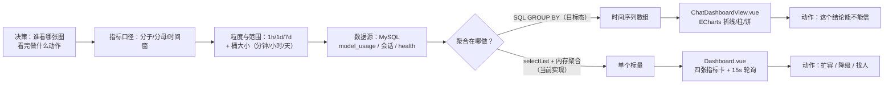
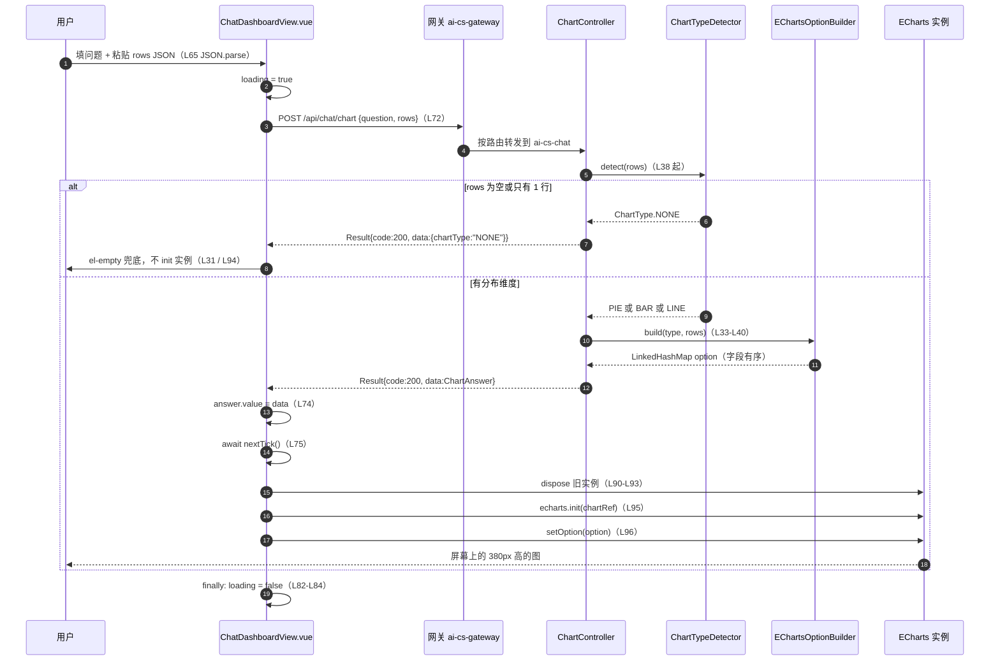

# BI 看板与 ECharts 可视化：先定决策，再定图表

> **一句话结论**：看板的产出不是一张图，而是一个能被指认的决定——「谁看到哪张图、据此做什么动作」；写不出这句话，折线还是饼图都不重要。
> **阅读前置**：读过 [01-OLAP与列式存储原理](./01-OLAP与列式存储原理.md) 与 [03-数仓分层与指标口径](./03-数仓分层与指标口径.md)（口径是看板的地基）；前端侧需要 [09-前端工程化：Vite构建与规范](../06-前端开发/09-前端工程化：Vite构建与规范.md) 里的打包与懒加载概念。
> **证据基线**：证据 A 0 条 · B 13 条（13 个本仓文件，行号当次核对）· C 6 组（node 24.16.0 + 仓库内 echarts 5.6.0，SSR/SVG 模拟渲染）；版本 ECharts 5.6.0 / Vue 3.5 / Vite 8 / JDK 17；预计阅读 35 分钟。

## 证据边界

| 类别 | 本仓状态（当次核对） | 本篇怎么处理 |
|---|---|---|
| A 级（框架源码摘录） | `learning-docs/24-源码分析/assets/source/` 里是 Spring、MyBatis、Spring Cloud Alibaba、Spring AI 的 `.java.md` 摘录，**没有 ECharts / zrender / Vue 源码** | 本篇 A 级为 0 条，不硬引；ECharts 的行为一律用 C 级实测说话 |
| B 级（本项目真实文件） | `ai-cs-frontend/src/views/ChatDashboardView.vue`（103 行）、`ai-cs-frontend/src/views/Dashboard.vue`（196 行）、`ai-cs-chat/src/main/java/com/aics/chat/nl2sql/chart/EChartsOptionBuilder.java`（135 行）、`ai-cs-chat/src/main/java/com/aics/chat/nl2sql/chart/ChartTypeDetector.java`（86 行）、`ai-cs-message/src/main/java/com/aics/message/service/impl/ModelUsageServiceImpl.java`（117 行）、`ai-cs-frontend/vite.config.js`（66 行）、`ai-cs-frontend/dist/`（上次构建产物） | 逐段精读，行号当次 `read` 核对 |
| C 级（本机可复现） | node 24.16.0 + 仓库内 echarts 5.6.0，用 **SSR / SVG 渲染器**在 node 里跑（无浏览器、无服务、无联网） | 所有耗时与体积数字都标「模拟」，脚本落在 `learning-docs/tools/tmp/bi-chart-cost-211.mjs` |
| 明确未落地 | 漏斗图 / 散点图 / 直方图、`dataZoom`、`sampling:'lttb'`、`resize` 监听、后端 `GROUP BY` 聚合下推、看板侧实时推送、看板配置化与保存视图、Grafana 看板 JSON | 写到哪就标到哪，不把「建议」写成「已实现」 |

---

## 0. 先看现象

### 现象 1：图出来了，但它不改变任何决定

打开 `/chat-dashboard`，点「填充示例」，输入框里出现四行数据（手机 1200 / 平板 800 / 笔记本 650 / 耳机 420，`ChatDashboardView.vue` L51-L59），点生成后屏幕上是这样：

```text
「各分类销量分布」
  结论：共 4 个分类，手机最高（1200）
  [ 一个半径 60% 的饼图，4 个扇区，没有图例、没有数值标签 ]
```

图确实画对了。但请回答三个问题：谁看这张图？看完做什么？如果手机从 1200 掉到 900，图上哪个像素会变？

一个都答不上来，因为这张图的全部信息已经写在上一行的 `el-alert` 里了（`ai-cs-frontend/src/views/ChatDashboardView.vue` L29：`<el-alert :title="answer.conclusion" ...>`）。**结论是后端算好的，图只是把结论又画了一遍**——这就是「图很漂亮但没人据此做决定」的最小样本：图不提供任何额外观测面（趋势、异常点、分布形状、对比基准），它只是一句中文结论的插图。

顺带看一眼这张饼图的实际配置（`ai-cs-chat/src/main/java/com/aics/chat/nl2sql/chart/EChartsOptionBuilder.java` L52-L59）：只有 `type` / `radius` / `data` / `tooltip` 四个字段，**没有 `legend`、没有 `label`、没有 `title`**。4 类还能靠鼠标悬停认出来；按 `ChartTypeDetector.java` L22 的阈值放大到 12 类，就变成一圈无法指认的色块（§3.2 有角度实算）。

### 现象 2：进一次图表页，先下 1 MB

`/chat-dashboard` 是一个懒加载路由（`ai-cs-frontend/src/router/index.js` L16）。它的 chunk 只有 2.4 KB，但 chunk 第一行就静态 import 了图表库：

```text
dist/assets/ChatDashboardView-CvDGLfAi.js
  第 1 行：import{...}from"./element-bl3CF7UA.js";import{r as m}from"./api-D8G56eA8.js";import{t as h}from"./charts-DTbrIw2f.js";
```

于是进入这个路由时，浏览器还要额外取 `charts-DTbrIw2f.js`——本机实测（node 读 `ai-cs-frontend/dist` 真实产物并 gzip 压缩）：

```text
dist/assets/charts-DTbrIw2f.js              raw=1003.0KB gzip=324.9KB
dist/assets/element-bl3CF7UA.js             raw=1093.1KB gzip=339.2KB
dist/assets/ChatDashboardView-CvDGLfAi.js   raw=    2.4KB gzip=  1.3KB
```

**请注意一个常被写错的细节**：`ai-cs-frontend/dist/index.html`（791 B）里的 `modulepreload` 只有 `rolldown-runtime` / `element` / `vue` 三个，**charts 不在首屏预加载列表里**。所以「1 MB 压首屏」这个说法在严格意义上是错的：它压的是**进入看板路由那一刻**；首页真正最重的是 Element Plus 那个 1093.1 KB。两者都该管，但优化的位置不同（§3.10）。

### 现象 3：想画「本周 AI 调用趋势」，画不出来

看板上最该有的东西是指标卡 + 趋势。本仓指标卡有（`ai-cs-frontend/src/views/Dashboard.vue` L112-L117 四张卡），趋势没有。原因不在前端，在接口：统计接口返回的是一个**点**，不是一个**序列**。

`ai-cs-message/src/main/java/com/aics/message/vo/ModelUsageStatsVO.java`（42 行）的全部字段：

```text
callCount / inputTokens / outputTokens / totalTokens / estimatedCost
```

五个标量，没有任何时间维度、没有数组。对应的 `stats(...)` 实现（`ai-cs-message/src/main/java/com/aics/message/service/impl/ModelUsageServiceImpl.java` L89-L116）把过滤后的记录**全量 select 出来在内存里求和**，没有 `GROUP BY`、没有时间桶参数。前端拿到这五个数，只能画指标卡；想画折线，唯一的办法是前端循环调用 `stats` 抢时间窗——那是拿数据库当时间序列库用。

更难看的一张卡在这里：`Dashboard.vue` L114。

```text
{ label: 'AI 模型', value: 'DeepSeek', icon: 'Cpu', color: '#67c23a' }
```

这是一个**永不变化的常量**，不是指标。它被摆在「微服务在线 / 对话会话 / 在线用户」中间，四张卡看起来一样重，读者会默认它也是实时测出来的。同类问题还有 L172-L177 的 `techs` 数组硬编码 `'Spring Boot 3.2.5'`、`'Spring Cloud 2023'`、`'Spring AI 1.1.4'`——而本项目基线已是 Spring Boot 4.2.0。看板在这一点上是**主动说谎**的：它展示的是写代码那天的认知，不是今天的运行状态。

这些现象指向同一件事：**看板缺的不是图表库，而是从「决定」倒推过来的指标口径、时间粒度和聚合位置**——图只是这条链路的最后一厘米，最后一厘米再漂亮也补不回前九十九厘米。

---

## 1. 整体地图



> **读图说明**：这张图刻意从右往左读——先问「要做什么动作」，才决定要不要序列、要不要粒度、聚合放在哪。中间那个菱形是全篇的分水岭：走 `GROUP BY` 分支才得到**时间序列**（能画趋势、能算环比），走 `selectList + 内存聚合` 分支只得到**一个标量**（只能画指标卡）。本仓当前代码（`ModelUsageServiceImpl.java` L98）走的是右分支，所以趋势图缺的不是前端能力而是数据形状。图里最下面两个节点是「动作」，任何一条链路的终点如果落不到动作上，这条链路就该删掉。

### 组件、责任与参与方

| 组件 | 位置（当次核对） | 责任 | 参与方 |
|---|---|---|---|
| 指标卡页 | `ai-cs-frontend/src/views/Dashboard.vue`（196 行） | 四张卡 + 技术栈列表；15s 轮询三个接口 | 值班人、演示者 |
| 图表页 | `ai-cs-frontend/src/views/ChatDashboardView.vue`（103 行） | 收问题 + rows JSON，调后端拿 option 再 `setOption` | 想「问一句话出图」的用户 |
| 图表网关接口 | `ai-cs-chat/src/main/java/com/aics/chat/nl2sql/chart/ChartController.java`（48 行） | `POST /chat/chart`，把问题与 rows 交给生成器 | chat 服务 |
| 图表类型判定 | `ai-cs-chat/src/main/java/com/aics/chat/nl2sql/chart/ChartTypeDetector.java`（86 行） | 纯函数：rows 长什么样 → PIE / BAR / LINE / NONE | chat 服务 |
| option 构建 | `ai-cs-chat/src/main/java/com/aics/chat/nl2sql/chart/EChartsOptionBuilder.java`（135 行） | 纯 Java 拼 ECharts option（不用 LLM） | chat 服务 |
| 用量统计接口 | `ai-cs-message/src/main/java/com/aics/message/controller/ModelUsageController.java`（78 行） | `GET /api/model-usage/stats`，五参数全可空 | message 服务 |
| 用量聚合实现 | `ai-cs-message/src/main/java/com/aics/message/service/impl/ModelUsageServiceImpl.java`（117 行） | 全量查出 + 内存求和（无 `GROUP BY`） | message 服务 |
| 缓存统计接口 | `ai-cs-chat/src/main/java/com/aics/chat/controller/CacheStatsController.java`（64 行） | `GET /chat/cache/stats`，语义缓存 + 热门问题 TopN | chat 服务 |
| 打包配置 | `ai-cs-frontend/vite.config.js`（66 行） | `manualChunks` 把 echarts/zrender 拆成 `charts` chunk | 前端工程师 |

---

## 2. 关键概念与关键要素

| 名称 | 位置 | 作用 | 关键参数 / 注意点 |
|---|---|---|---|
| 指标口径 | 文档层（[03-数仓分层与指标口径](./03-数仓分层与指标口径.md)） | 定义分子分母、去重规则、时区与截止点 | 同一个「调用量」按次/按会话/按 token 是三个数 |
| 维度（dimension） | 数据行里的分类列 | 决定「按什么拆」 | `ChartTypeDetector` 用「首个非数值 String 列」当维度（L64-L76） |
| 粒度（granularity） | 接口的时间桶参数（本仓**不存在**） | 把明细聚成点：1 分钟 / 1 小时 / 1 天 | 没有粒度参数，就拿不到序列（§0 现象 3） |
| 基数（cardinality） | `ChartTypeDetector.java` L22 `PIE_MAX_CATEGORIES = 12` | 决定折线还是饼、要不要 TopN | 基数 > 12 直接降级成柱状图，但没有 TopN 截断 |
| 降采样（downsampling） | 前端/后端均可（本仓均**未落地**） | 大点量时分出「形状」与「点数」 | 桶均值保均值、LTTB 保形状（§3.7 实测） |
| 聚合下推（pushdown） | `ModelUsageServiceImpl.java` L97-L98 的反面 | 让数据库只回聚合结果，不回明细 | `selectList` 全量 = 把聚合成本搬到 JVM 堆里 |
| `series.data` vs `dataset` | ECharts option 结构 | 前者是数组直给，后者是把表格数据源映射到 series | 本仓一律 `series.data`（`EChartsOptionBuilder.java` L55/L78） |
| `setOption` 的合并语义 | 前端调用点 `ChatDashboardView.vue` L96 | 默认**合并**到旧 option，不是替换 | 想替换要 `{ notMerge: true }`，或先 `dispose()`（本仓用后者） |
| `dispose()` / 实例复用 | `ChatDashboardView.vue` L90-L96 | 释放 canvas、事件、动画定时器 | 每次重建会丢掉 `dataZoom` 缩放态与动画连续性 |
| 轮询 / SSE / WebSocket | `Dashboard.vue` L156-L166；`ai-cs-frontend/src/utils/sseStream.js` | 三种「数据自己来找页面」的方式 | 看板只有轮询；SSE 只用在对话流（§3.8） |
| 首屏 preload | `ai-cs-frontend/dist/index.html`（791 B） | 决定哪些 chunk 与 HTML 一起抢带宽 | charts 不在其中，element 在 |

---

## 3. 原理与证据逐段精读

### 3.1 图表选型：先问「比较什么」，再问「用哪个图」

**在干什么**：把「我想让人看见什么关系」映射成一个坐标系。这张表是全篇最该背下来的东西：

| 你想让人看见的关系 | 该用的图 | 为什么 | 本仓是否具备 |
|---|---|---|---|
| 随时间怎么变（趋势） | 折线 | 人眼对斜率敏感，对面积/角度不敏感 | 有（`line()`，`EChartsOptionBuilder.java` L87-L94） |
| 由什么构成（结构/占比） | 堆叠柱（多组）、饼图（≤5 类单层） | 堆叠能同时看总量与构成，饼图只能看一层 | 部分：只有饼图，无堆叠 |
| 谁大谁小（对比） | 条形（横向）/ 柱状 | 长度是唯一能精确比较的视觉编码 | 有（`bar()`，L62-L85） |
| 怎么分布（分布形状） | 直方图 / 箱线图 | 需要**分箱**，不是把每个值排一排 | **未落地**：`List<Map<String,Object>>` 的结构不支持分箱聚合 |
| 两件事是否相关（相关） | 散点 | 需要两个数值列同时上图 | **未落地**（后端 `funnel|scatter` 全仓 0 命中） |
| 从哪一步流失（漏斗） | 漏斗 | 需要有序阶段 + 转化率 | **未落地** |
| 单值健康度（现状） | 指标卡 + 迷你趋势线 | 卡回答「现在多少」，趋势回答「这个数算好还是坏」 | 卡有（`Dashboard.vue` L112-L117），趋势没有 |

**为什么这么设计**：视觉编码的精度是有等级的经验事实：位置 > 长度 > 角度 > 面积 > 颜色深浅。所以「精确比较」交给位置/长度（折线、条形），「粗略感受」才交给角度/面积（饼图、气泡）。这不是审美问题，是**读数误差**问题。

**换写法会怎样**：把「六个品类的销量对比」画成饼图，读者只能判断「手机最大」，判断不出「平板比笔记本多 150 还是 500」；换成条形图，差值直接用长度差编码，不用读刻度。反过来，把「一天 288 个时间点的 CPU 曲线」画成柱状图，柱子互相遮挡，形状信息全丢。

**常见坑**：把「分布」当「对比」——把 5000 条用户消费额按顺序画成折线，看起来像心电图，实际什么也没说。分布要分箱（0-50、50-100…），本仓做不到，因为接口只回明细或单个标量。

### 3.2 `ChartTypeDetector`：判定顺序决定了你能画什么

**在干什么**：一个纯函数，输入 rows，输出四种类型之一。核心逻辑（`ai-cs-chat/src/main/java/com/aics/chat/nl2sql/chart/ChartTypeDetector.java` L27-L51）：

```java
    public static ChartType detect(List<Map<String, Object>> rows) {
        // 空数据或单行：没有分布维度，不生成图表
        if (rows == null || rows.isEmpty() || rows.size() < 2) {
            return ChartType.NONE;
        }
        Map<String, Object> first = rows.get(0);
        if (first == null || first.isEmpty()) {
            return ChartType.NONE;
        }
        // 1. 含时间列（date/time/month/月份等）-> 折线图看趋势
        if (hasTimeColumn(first)) {
            return ChartType.LINE;
        }
        // 2. 含分类列（非数值）-> 类别少用饼图看占比，多则柱状图
        String categoryKey = findCategoryColumn(rows);
        if (categoryKey != null) {
            Set<Object> distinct = new HashSet<>();
            for (Map<String, Object> row : rows) {
                distinct.add(row.get(categoryKey));
            }
            return distinct.size() <= PIE_MAX_CATEGORIES ? ChartType.PIE : ChartType.BAR;
        }
        // 3. 全数值列 -> 柱状图对比
        return ChartType.BAR;
    }
```

**为什么这么设计**：判定必须**确定性**，因为它要可单测、可回归（类注释 L17 写明「作为纯函数可独立单测，是『确定性逻辑不走 LLM』原则的示例」）。顺序也有讲究：先判时间（趋势最确定）→ 再判分类基数（决定饼/柱）→ 兜底柱状。任意一条改动都会批量影响所有问句的出图结果，所以它应该是**有测试保护的最保守的一块代码**。

**换写法会怎样**：若把判定交给 LLM（「你觉得该画什么图」），同一个问题两次可能得到折线和饼图两种答案，回归测试无法写，用户会觉得「系统在抽风」。若把阈值从 12 降到 5（更符合 §3.6 的可读性），代价是很多原本出饼图的问句改成柱状图——这正是**该做**的改动，但要先改测试再改常量。

**常见坑**（这一节最值钱的部分）：

1. **`hasTimeColumn` 只看列名关键字**（L53-L62：`time`/`date`/`month`/`日期`/`时间`/`月份`）。列名叫 `dt`、`week`、`create_at` 的时间列会被当成分类列，于是「按天趋势」被画成饼图。
2. **判了 LINE 也不代表画对了**：`line()` 复用的是 `bar()` 的 option，横轴是 `type: "category"`（§3.3），时间不均匀时会被等距展开。
3. **`PIE_MAX_CATEGORIES = 12` 是「画得出来」的阈值，不是「读得懂」的阈值**。本机实算（Zipf 长尾分布，饼图 360°，脚本见 §6.7）：

```text
  类别数= 3  最大扇区=196.4°  最小扇区=65.45°
  类别数= 5  最大扇区=157.7°  最小扇区=31.53°
  类别数= 8  最大扇区=132.5°  最小扇区=16.56°
  类别数=12  最大扇区=116.0°  最小扇区= 9.67°
  类别数=20  最大扇区=100.1°  最小扇区= 5.00°
```

一个 9.67° 的扇区放不下任何文字标签（只能引线外置），这就是「12 类饼图」的真实可读性；20 类时最小扇区 5°，已经退化成装饰。**结论：阈值 12 该降到 5~7，或改成「饼图 + 其他合并」+ 图例排序。**

### 3.3 `EChartsOptionBuilder`：option 由 Java 拼，不由 LLM 生成

**在干什么**：把 rows 拆成 ECharts 需要的两个数组（分类 names / 数值 values），填进一个 `LinkedHashMap`，由 Jackson 序列化成 JSON 给前端。类注释把理由写得很直白（`ai-cs-chat/src/main/java/com/aics/chat/nl2sql/chart/EChartsOptionBuilder.java` L13-L18）：

```text
 *   <li><b>为什么不用 LLM 生成 option</b>：ECharts 配置结构是确定的
 *       （series/xAxis/yAxis 等），LLM 可能输出非法 JSON 或错误字段名，
 *       纯 Java 构建零风险、可单测。</li>
```

折线是「柱状图换个 type」得来的（L87-L94）：

```java
    private static Map<String, Object> line(List<Map<String, Object>> rows) {
        Map<String, Object> option = bar(rows);
        @SuppressWarnings("unchecked")
        Map<String, Object> series = (Map<String, Object>) ((List<?>) option.get("series")).get(0);
        series.put("type", "line");
        series.put("smooth", true);
        return option;
    }
```

**为什么这么设计**：图表配置是**schema 问题**不是**语义问题**——`xAxis.type` 只能是有限枚举，让概率模型去猜一个确定性字段，收益为零、失败模式却是「前端静默画空白」（`setOption` 收到非法结构常常不报错，只是不画）。同时它把「图表能力」收敛到三个方法里，改一处就全站生效。

**换写法会怎样**：如果让 LLM 直出 option，你得为每一张图加一层 JSON Schema 校验 + 语义校验（`series.data.length` 是否等于 `xAxis.data.length`）+ 失败兜底，成本远高于三个 if。反过来，如果坚持「后端只给数据、前端拼 option」，则前端要长出一套「图表语义」逻辑，24 个 view 里会出现 24 份不同的坐标轴配置。

**常见坑**：

1. **`line()` 继承了 `bar()` 的 `xAxis.type = "category"`**（L71-L73）。时间轴用 category，意味着 ECharts 把每个点**等距**摆放：7 天里有 3 天没数据，图上完全看不出来缺口；1 月到 2 月的间隔和 1 月到 1 月+1 天的间隔一样宽。趋势图要用 `type: "time"` + `[timestamp, value]` 数据对。
2. **`smooth: true` 是善意的谎言**（L92）。平滑曲线在两个真实点之间画出不存在的中间值，读者会把这些像素当成数据。折线默认应该 `smooth: false`，噪声大的序列宁可加移动平均并在图例里写明。
3. **`numericValue` 解析失败返回 0**（L125-L134）。一条脏数据会把「0」画进趋势里，看起来像业务归零，实际是类型问题——0 和 null 在图上是两种完全不同的语义，这里被合并了。
4. **`pie()` 没有 `legend` / `label`**（L52-L59）。多于 4~5 类时用户只能靠悬停辨认，触屏设备直接不可用。

### 3.4 指标卡与趋势：卡回答「多少」，趋势回答「这算不算坏」

**在干什么**：`Dashboard.vue` 的四张卡是一套「当前值」快照（L112-L117）。真正的看板要把**卡 + 迷你趋势 + 基准**三件套绑在一起。

**为什么这么设计**：单值没有判断力。看到「在线用户 37」你无法决定要不要扩容；看到「在线用户 37，过去 1 小时从 12 涨到 37，昨天同时段是 15」你才有动作。所以指标卡的正确伴侣是**同比/环比**或**同窗口趋势线**，而不是旁边再摆三张同样静态的卡。

**换写法会怎样**：本仓 L114 的 `{ label: 'AI 模型', value: 'DeepSeek' }` 展示的就是「反面终点」——一张永远不动的卡。它比没有更糟，因为四张卡共享视觉权重，读者会默认它们都是测出来的。写死文案的正确归宿是副标题或「关于」页，不是指标卡位。

**常见坑**：

1. **卡的数量通胀**：一张屏放 8 张卡，等于没有重点。看板首页的卡应控制在 3~4 张，且每张都对应一个动作。
2. **卡没有时间戳**：`Dashboard.vue` L107 有 `lastUpdate`，但只显示在健康检查那一块；卡本身没有「数据截止 HH:mm:ss」。轮询 15s 的看板，用户看到的是「十几秒前的世界」，却不自知。
3. **卡的口径没写清**：`微服务在线` 卡是 `${UP 数}/${总数 || 9}`（L113），那个 `|| 9` 兜底意味着「后端没返回时显示 0/9」，与「9 个服务全挂」在视觉上无法区分。

### 3.5 实时的三种做法：轮询、SSE、WebSocket

**在干什么**：

| 方式 | 机制 | 谁发起 | 本仓现状 |
|---|---|---|---|
| 轮询（polling） | 定时器到点就发请求 | 浏览器 | **看板就是这个**：`Dashboard.vue` L156-L166，`setInterval(..., 15000)` 同时打 `/health`、`/online`、`/sessions` 三个接口 |
| SSE（Server-Sent Events） | 一次 HTTP 长连接，服务端单向推文本帧 | 浏览器发起、服务端持续写 | 前端有完整解析器（`ai-cs-frontend/src/utils/sseStream.js`，用 `fetch` + `ReadableStream`），并已在对话流里真实使用：`ai-cs-frontend/src/views/ChatView.vue` L393 的 `stream/sse` 与 L401 的 `response.body.getReader()` |
| WebSocket | 全双工长连接 | 浏览器 | 项目里有独立的通知服务（`ai-cs-notify`）承担实时推送，看板未接入 |

**为什么这么设计**：三者的选择取决于「谁的时间敏感」和「连接成本」：

- 看板数据变化是**分钟级**的，轮询完全够用，且实现成本最低（一个 `setInterval`）。代价是空转请求：三个人开着看板放一整天 = 3 × 5760 次/接口/天。
- SSE 适合「一次请求、持续接收」的**单向**流（token 流式输出就是典型），且能穿透大多数代理；但本仓的流式接口是 `POST + JSON body + Authorization`，而浏览器原生 `EventSource` 只支持 GET、不能加头，所以前端用 `fetch` + `ReadableStream` 手写了解析器（`ai-cs-frontend/src/utils/sseStream.js` L6-L8 的注释把这段理由写清了）。
- WebSocket 适合双向、低频消息但要求低延迟（在线状态、告警弹窗）。

**换写法会怎样**：把看板改成 SSE，收益是「数据一变就推」，成本是得在后端维护连接与心跳、在网关侧保证不缓冲（`ai-cs-frontend/vite.config.js` L29-L41 的开发代理已经为 SSE 关了缓冲），而且**看板的决策频率根本不需要秒级**——这是典型的「用错工具，还额外欠下一笔运维债」。

**常见坑**：

1. **`setInterval` 不看页面可见性**：`Dashboard.vue` L161-L165 没有 `document.visibilityState` 判断，切到后台标签页仍在每 15s 打三个接口。
2. **失败不退避**：接口挂了也照 15s 打一次，故障期间正好把网关打得更惨。
3. **轮询间隔小于后端缓存 TTL**：等于每次都在查同一个值。本仓 `CacheStatsController` 的 TopN 是实时算的，若被高频轮询会变成热点。
4. **把「实时」当「准确」**：SSE/WS 只是把数据更快送到眼前，口径错了只会更早地看到错数。

### 3.6 会说谎的图：三个高频手法

**在干什么**：识别并拆掉三类「技术上正确、结论上错误」的画法。

| 手法 | 怎么骗人 | 换写法 | 本仓风险点 |
|---|---|---|---|
| **双 Y 轴** | 两条量纲不同的曲线共处一图，通过调两个轴的范围让它们「看起来相关」 | 拆成两图，或归一化后明确标注「指数化」 | 后端 builder 不支持双轴（L62-L85 只造一个 `yAxis`），所以这是**未来加功能时最容易顺手犯的错** |
| **截断坐标轴** | Y 轴不从 0 开始，1% 的波动被画成 3 倍的起落 | 柱状图必须从 0 起；折线允许非 0 起点，但要在轴标题写明 | 本仓 `yAxis` 只有 `type: "value"`（L74-L75），ECharts 默认自动取范围 → **折线图默认就可能截断**，且没有任何标注 |
| **饼图超 5 类** | 小于 10° 的扇区无法辨认，读者只会记住最大的那块 | ≤5 类；或 TopN + 「其他」合并；或直接换堆叠条形 | 阈值是 12（`ChartTypeDetector.java` L22），§3.2 有角度实算 |
| （补充）**平滑曲线** | 在两个真实点之间画出不存在的插值 | `smooth: false` | L92 默认 `smooth: true` |
| （补充）**category 时间轴** | 缺失时段被抹平，不等间隔被画成等距 | `xAxis.type = "time"` | L72 用的是 `category` |

**为什么这么设计**（为什么大家还会这么画）：因为它是**省力且能过评审**的——图上去了、标题写了、颜色好看，评审不会去核对轴范围。防它的办法不是靠自觉，而是靠**规范 + 检查**：每个看板交付时必须能回答「Y 轴从几开始」「每根线什么单位」「数据缺口怎么表示」。

**换写法会怎样**：一张从 0 起的柱状图，可能让「我们这周增长 48%」变成一根几乎看不出差别的柱子——**那才是真的**，而且它会逼团队去做真正重要的比较（和上周、和去年同期比，而不是和零比）。

**常见坑**：把「截断轴」当成专业感；把「双轴让两条线交叉」当洞察；把「饼图颜色多」当成信息丰富。

### 3.7 数据量大：降采样与聚合下推，以及它们的代价

**在干什么**：当点数超过屏幕像素能表达的极限（一张 1200px 宽的图，横向最多约 1200 个可分辨位置），多出来的点不增加信息，只增加成本。两条路：**降采样**（保留点数、丢细节）和**聚合下推**（不让明细离开数据库）。

先看规模算术（本机 node 实算）：

```text
  1 小时     按 1 秒   =       60 点  → 可直接画
  1 天       按 1 分钟 =       24 点  → 可直接画
  1 天       按 1 秒   =     1440 点  → 建议 dataZoom
  7 天       按 1 小时 =      168 点  → 可直接画
  30 天      按 1 小时 =      720 点  → 可直接画
  30 天      按 5 分钟 =     8640 点  → 必须降采样/聚合下推
  365 天     按 1 小时 =     8760 点  → 必须降采样/聚合下推
  365 天     按 1 分钟 =   525600 点  → 必须降采样/聚合下推
```

再看 10 000 点的真实开销（同一份模拟时间序列，ECharts 5.6.0，node SSR/SVG）：

```text
=== 1) 同一个折线图，不同数据量下的 option 负载（原始 JSON / gzip） ===
  10 000 点（原始）   option JSON=   86.9KB  gzip=   25.1KB  series.data 项数=10000
  2 000 点（LTTB）    option JSON=   17.5KB  gzip=    6.5KB  series.data 项数=2000
  500 点（LTTB）      option JSON=    4.5KB  gzip=    1.7KB  series.data 项数=500
  500 点（桶均值）     option JSON=    5.7KB  gzip=    2.1KB  series.data 项数=500
  → 10 000 点降到 500 点，option 体积下降 94.9%

=== 2) setOption + 渲染耗时（node + echarts 5.6.0 SSR，SVG 渲染器；非浏览器 canvas） ===
  ← 下面是同一条命令其中一次运行的完整输出；连跑三次，10 000 点的中位数分别是 33.9 / 38.0 / 47.9 ms
  10 000 点（原始）   中位耗时=   38.0ms  最小=33.8ms  最大=83.7ms  svg≈  329.4KB
  2 000 点（LTTB）    中位耗时=   13.6ms  最小=13.3ms  最大=16.0ms  svg≈   83.9KB
  500 点（LTTB）      中位耗时=    6.6ms  最小=6.1ms  最大=7.6ms   svg≈   32.9KB
  500 点（桶均值）     中位耗时=    6.2ms  最小=6.0ms  最大=8.1ms  svg≈   32.8KB
```

**怎么读**：这组数字最反直觉的一点是——**10 000 点的传输体积只有 86.9 KB（gzip 后 25.1 KB），真正贵的是渲染：单次 34~48 ms（三次运行的中位数区间），是 500 点（6~7 ms）的 5~8 倍**。也就是说「大点量」的成本结构里，网络不是主要矛盾，主线程才是（浏览器里还要加上 canvas 绘制，通常比 SSR 更贵）。60fps 的预算是一帧 16.7 ms，一次 34 ms 起步的 `setOption` 已经掉帧；如果放在轮询里「每 15 秒刷一次」，用户会看到明显的一顿。**注意这类耗时数字每次跑都会抖**（同一命令三次就差 40%），所以本篇只给区间与量级，不把它当基准线。

代价也要量化。把 10 000 点降到 500 点，误差有多大（把 500 点线性插值回 10 000 点逐点比对，模拟数据集里第 7350 点埋了一个尖峰）：

```text
=== 4) 降采样到 500 点：重建误差（把 500 点线性插值回 10 000 点逐点比对） ===
  桶均值  MAE=76.65  RMSE=86.23  单点最大误差=956.0
       峰值 576（原始 1463）  谷值 424（原始 321）  均值偏差=0.00%  点数=500
  LTTB   MAE=62.59  RMSE=90.88  单点最大误差=867.2
       峰值 1463（原始 1463）  谷值 321（原始 321）  均值偏差=0.43%  点数=500
  原始序列：峰值=1463（第 7350 点），平均值=500.48
```

**怎么读**：两种算法的取舍在这组数里非常清楚——**桶均值把峰值从 1463 压到 576（吃掉 61% 的尖峰），但均值偏差 0.00%**；**LTTB 完整保住了 1463 这个峰（它就是这么设计的：优先保留三角形面积最大的点），代价是均值偏差 0.43%、RMSE 反而略高（90.88 vs 86.23）**。所以：

- 看「平均水位、成本总额」→ 桶均值（聚合值不失真）。
- 看「有没有尖峰、什么时候抖」→ LTTB（或 `sampling: 'lttb'`，ECharts 5 内置）。
- **没有一个降采样算法能同时保住形状和总量**——这就是为什么「聚合该在后端做」：后端 `GROUP BY` 出来的桶和是**真实的聚合值**，前端降采样永远只是**近似**。

**为什么本仓做不到聚合下推**：`ai-cs-message/src/main/java/com/aics/message/service/impl/ModelUsageServiceImpl.java` L97-L100：

```java
        // 2. 全量查出后在内存聚合（数据量级可控；不写自定义 SQL，保证 Mapper 可 mock）
        List<ModelUsage> records = modelUsageMapper.selectList(wrapper);
        ModelUsageStatsVO vo = new ModelUsageStatsVO();
        vo.setCallCount((long) records.size());
```

注释给的理据是**可测性**（Mapper 可 mock，不用写自定义 SQL）——这是一个真实且合理的工程权衡，但它有明确的天花板：`selectList` 把 N 行明细搬进 JVM 堆。按每天 1 万次调用算，一个月就是 30 万行；`stats` 又是 GET、可被反复调用，一旦接上「7 天趋势 + 每小时一个点」的需求，这个接口会被前端打 168 次、每次搬回整段明细。**升级路径很明确：加一个带 `GROUP BY DATE_FORMAT(create_time, ...)` 的自定义 Mapper 方法，返回 `List<{bucket, callCount, tokens, cost}>`，用 `@MybatisTest` 或 H2 集成测试代替 mock 单测。**

### 3.8 前端渲染性能：实例复用、`dataZoom`、别每帧 `setOption`

**在干什么**：本仓的渲染只有 10 行（`ai-cs-frontend/src/views/ChatDashboardView.vue` L87-L97）：

```javascript
/** 用后端返回的 ECharts option 渲染图表；NONE 类型不渲染 */
function renderChart(data) {
  // 复用实例前先销毁，避免多次 setOption 叠加状态
  if (chartInstance) {
    chartInstance.dispose()
    chartInstance = null
  }
  if (!chartRef.value || data.chartType === 'NONE') return
  chartInstance = echarts.init(chartRef.value)
  chartInstance.setOption(data.echartsOption || {})
}
```

**为什么这么设计**：注释说的其实是**怕**——怕多次 `setOption` 把旧 option 合并进来（ECharts 默认 merge 语义），于是选择「销毁重建」，一步到位保证每次都是干净状态。对一个「点一次生成、看一张图」的演示页，这个选择是对的：简单、无状态泄漏、卸载时 `onBeforeUnmount` 再 `dispose`（L100-L102）。

**换写法会怎样**：一旦图表要**更新**（轮询、实时、切换指标），销毁重建的代价就暴露了：`dataZoom` 的缩放位置回到默认、动画每次从头播、鼠标悬停的 tooltip 状态丢失、canvas 重新分配。正确写法是复用实例 + 显式替换：`chartInstance.setOption(option, { notMerge: true })`，再在容器尺寸变化时调用 `chartInstance.resize()`。

**这里必须诚实交代一个测不出来的项**：我用 node SSR 测了「复用 vs 重建」（500 点，20 次更新）：

```text
=== 3) 实例复用 vs 每次 dispose+init（500 点数据更新 20 次） ===
  复用同一实例：20 次更新平均=6.4ms  首次=5.6ms
  dispose+init   ：20 次更新平均=6.2ms  首次=5.8ms
  ← 连跑三次的平均值对是 6.4/6.2、6.0/5.3、5.3/5.5 ms，方向都不稳定
```

**两次几乎一样，甚至重建更快一点**。原因是 SSR/SVG 模式下每次 `renderToSVGString()` 本来就要重造整棵 SVG 树，`init` 的固定开销被摊掉了；而浏览器 canvas 模式下重建要重新申请绘图上下文、重绑事件与动画时钟。**结论：这一项在本机无法证明（三次运行连谁快谁慢都不固定），必须用浏览器 DevTools Performance 面板在真实页面上对比（步骤见 §6.4），不要把「node 里没差异」当成「复用没意义」。**

**常见坑**：

1. **没有 `resize` 监听**：全前端 `resize` 关键词 0 命中（§6.2 有命令）。侧边栏折叠、窗口缩放后图表仍按旧宽度绘制，视觉上「图偏左一半」。
2. **没有 `dataZoom`**：本仓 0 命中。1000 点以上的图不给缩放，用户只能看总体形状，问不出「周二下午那段到底怎么了」。
3. **没有 `sampling`**：0 命中。ECharts 5 自带 `series.sampling = 'lttb'`，加一行就能在客户端降采样；本仓既没开，也没在后端降——两头都空着。
4. **`import * as echarts`（L39）全量引入**：这是 1003.0 KB chunk 的直接来源（§3.9）。按需引入（`echarts/core` + 只 `use` 需要的图表与组件）能显著缩小体积——具体能降到多少必须改完重新 `npm run build` 看 `dist` 实测，本篇不编数字。

### 3.9 拆包与「首屏」：charts 1 MB 到底压在哪里

**在干什么**：`ai-cs-frontend/vite.config.js` L49-L62 把第三方库按包名切成 `charts` / `element` / `vue` 三块：

```javascript
    chunkSizeWarningLimit: 800,
    rollupOptions: {
      output: {
        manualChunks(id) {
          // Vite 8（rolldown）只接受函数形式；写成对象会报
          // Invalid type: Expected Function but received Object
          if (id.includes('echarts') || id.includes('zrender')) return 'charts'
          if (id.includes('element-plus')) return 'element'
          if (/node_modules[\\/]vue/.test(id)) return 'vue'
        },
      },
    },
```

**为什么这么设计**：把变化频率不同的库分开，让浏览器长期缓存 `charts`（版本不变就不用重下），只重新下载业务代码。这是**缓存粒度**优化，不是**首屏体积**优化——很多人把它们混为一谈。

**换写法会怎样 / 真实影响在哪**：`ai-cs-frontend/dist/index.html`（791 B）只预加载 `rolldown-runtime`、`element`、`vue` 和三份 CSS；`charts` 不预加载，但要等用户进入 `/chat-dashboard` 时随路由 chunk 静态 import 一起下载（§0 现象 2 的实测）。所以：

| 场景 | 是否会取 charts（1003.0 KB / gzip 324.9 KB） | 结论 |
|---|---|---|
| 打开首页 `/`（Dashboard.vue，纯指标卡） | 不会 | 首页首屏不背这个包 |
| 打开 `/chat-dashboard` | **会**，且在 `init` 之前 | 路由级白屏风险，慢网下几百毫秒到数秒 |
| 已访问过再看其它页 | 不会（已缓存） | 缓存粒度设计的收益 |

**常见坑**：把 `manualChunks` 当性能药；忽略 `element` chunk 1093.1 KB 才是首屏最大的那块；只看 raw 体积不看 gzip（1003.0 → 324.9 KB，差 3 倍）。

### 3.10 这张图该不该这么画：逐段点评（本篇的核心判断练习）

| 代码位置 | 现状 | 该不该这么画 | 理由与改法 |
|---|---|---|---|
| `ChatDashboardView.vue` L30-L31 | `v-if="chartType !== 'NONE'"` 才渲染 div，否则 `el-empty` | **该**，写法正确 | 先判断后渲染，避免对不存在的容器 `init`（ECharts 会警告 width/height 为 0） |
| `ChatDashboardView.vue` L65 | `JSON.parse(rowsText.value)` 解析用户粘贴的 rows | **勉强**，缺校验 | 只捕获语法错误；`[{"category":"手机"}]`（缺数值列）会让后端 `numericValue` 返回 0，画出全 0 的图而不报错 |
| `ChatDashboardView.vue` L72-L73 | `chatApi.post('/chart')` 后判 `code === 200` | **该** | 但 `catch` 只弹一句 `图表服务不可用`（L81），没有区分 4xx（请求不对）与 5xx（服务端错），用户拿不到可行动信息 |
| `ChatDashboardView.vue` L75 | `await nextTick()` 再渲染 | **该**，这是必要的一步 | `v-if` 刚变为真时 DOM 还没挂载，不 `nextTick` 会 `init` 到 `null` 容器 |
| `ChatDashboardView.vue` L90-L93 | 每次先 `dispose()` | **不该**（若要更新） | 见 §3.8：丢缩放态与动画；演示场景可接受，接轮询时必须改 |
| `EChartsOptionBuilder.java` L92 | `smooth: true` | **不该**默认开 | 平滑曲线画出不存在的中间值（§3.6） |
| `EChartsOptionBuilder.java` L71-L73 | 时间趋势也用 `xAxis.type = "category"` | **不该** | 缺失时段被抹平、间隔被等距化；应为 `time` + `[ts, v]` |
| `EChartsOptionBuilder.java` L52-L59 | 饼图无 `legend`/`label` | **不该** | 4 类以上不可辨认，12 类完全不可用 |
| `ChartTypeDetector.java` L22 | 饼图阈值 12 | **不该** | 应 5~7 或 TopN+其他（§3.2 角度实算） |
| `ChartTypeDetector.java` L29-L31 | `rows.size() < 2` → `NONE` | **该** | 单行没有分布维度，拒绝画图比画一个点诚实 |
| `Dashboard.vue` L114 | 硬编码「AI 模型 = DeepSeek」 | **不该** | 常量冒充指标（§3.4） |
| `Dashboard.vue` L161-L165 | 15s 轮询三接口，无可见性判断 | **勉强** | 加 `visibilityState` 判断与失败退避（§3.5） |
| `ModelUsageServiceImpl.java` L98 | 全量 `selectList` 内存聚合 | **不该**（若要看板趋势） | 聚合下推 + 时间桶参数（§3.7） |

---

## 4. 一次完整执行时序

以「用户在图表页问一句『各分类销量分布』」为例，从输入到屏幕上的图：



> **读图说明**：注意这条链路上没有任何一步在做「聚合」或「取数」——rows 是用户自己粘进去的（或由上游 NL2SQL 给出）。这条链路证明的是**图表渲染**能力，不是**看板**能力。真正的看板要把前半段补上：指标口径 → 时间范围/粒度 → 后端聚合 → 序列，本仓缺的正是前半段（§0 现象 3）。图里两个 `alt` 分支分别对应「不画」与「画」，判断点是 `ChartTypeDetector`，也就是整条链路唯一的语义决策处。

**每一步该怎么判读**：

| 步 | 这一步失败会看到什么 | 怎么判读 |
|---|---|---|
| 1-2 | 输入框下方弹「数据 JSON 格式不正确」 | 前端 `JSON.parse` 失败；注意它**只**校验语法，不校验列结构 |
| 3-4 | 弹「图表服务不可用：HTTP 404」 | 网关路由或 chat 服务没起；若 404 但服务活着，优先查 `/chat/chart` 是否被网关前缀改写 |
| 5-6 | 返回 `chartType: "NONE"`、页面显示 `el-empty` | 不是 bug，是 detector 认为「没有分布维度」；若你认为该出图，问题在列名或行数 |
| 7-11 | 返回 200 但图空白 | `option` 结构不合法（如 `series` 不是数组）→ ECharts 静默不画；去看响应体 |
| 12-14 | 图高度为 0 / 控制台 `Can't get DOM width or height` | 容器没尺寸（本仓 L30 写死 380px，正常）；`nextTick` 缺失或 `v-if` 为假 |
| 15-16 | 图出来但数据错位（多一条少一条） | `series.data` 与 `xAxis.data` 长度不等，或 `numericValue` 把字符串吃成 0 |

---

## 5. 设计取舍

| 取舍点 | 选项 A | 选项 B | 本仓推荐与理由 |
|---|---|---|---|
| **谁决定图表类型** | 后端纯函数判定（`ChartTypeDetector`） | 前端/用户手选 | **A 为默认 + B 为覆盖**：判定要可测、可回归；但要给用户一个「换一种看法」的开关，否则「趋势被画成饼」时用户无路可走 |
| **option 由谁拼** | 后端 Java 拼（本仓现状） | 前端模板 / LLM 直出 | **保持 A**：结构确定性交给代码，语义（结论文字）才交给模型。LLM 直出 option 的失败模式是静默空白，最难查 |
| **聚合在哪做** | MySQL `GROUP BY`（下推） | JVM 内存聚合（本仓现状） | **看板类查询必须 A**：内存聚合在「单次调用」场景省事，在「时间序列 × 多用户轮询」场景会变成堆压力与慢查询 |
| **时间轴类型** | `category`（等距，本仓） | `time`（真实间隔） | **B**：趋势图的时间轴必须真实，否则缺口被抹平；代价是数据要变成 `[ts, v]` 且要处理时区 |
| **实时性** | 轮询 15s（本仓） | SSE / WebSocket | **看板用 A，对话流用 SSE**（已如此）：看板决策是分钟级，轮询最便宜；SSE 的复杂度应当只花在需要「逐字出结果」的地方 |
| **大点量怎么办** | 后端聚合下推 + 桶 | 前端 `sampling:'lttb'` | **先 A 再 B**：A 得到的是真实聚合值，B 只是近似；二者不冲突，A 管「序列本身多大」，B 管「绘制时再抽稀」 |
| **饼图类数上限** | 12（本仓 `PIE_MAX_CATEGORIES`） | 5~7 或 TopN+其他 | **后者**：12 类的实测最小扇区 9.67°（§3.2），已越过可读边界 |
| **图表库引入方式** | 全量 `import * as echarts`（本仓） | `echarts/core` 按需注册 | **B**，但要先量化收益：改完 `npm run build` 对比 `dist/assets/charts-*.js` 的 raw 与 gzip；本篇不编造降幅 |
| **图表实例生命周期** | 每次 `dispose` 重建（本仓） | 复用 + `notMerge` | **演示用 A、更新场景用 B**：重建丢缩放态与动画（§3.8） |

### 可扩展点清单（每条带验收判据）

1. **给 `stats` 加时间桶**：新增 `GET /api/model-usage/series?granularity=hour&startTime=&endTime=`，SQL 侧 `GROUP BY` 时间桶 → 验收：一次调用返回 N 个桶（每桶 `callCount/tokens/cost`），且 `7 天 × 1 小时` 只回 168 行，不随明细行数增长。
2. **图表类型补齐漏斗/散点/直方** → 验收：`ChartTypeDetector` 新增两个分支各有单测（有序阶段列 → FUNNEL；两个数值列 → SCATTER），且前端能画出对应图形。
3. **饼图阈值降到 5~7 + TopN 合并** → 验收：12 类数据自动变成「Top5 + 其他」，图例按值降序，最小扇区 ≥ 20°。
4. **时间轴改 `time`** → 验收：造一份「中间缺 3 天」的数据，图上出现真空隙（而不是等距连过去）。
5. **实例复用 + `resize` 监听** → 验收：窗口缩放后图表宽度跟随容器（`getBoundingClientRect().width` 与 canvas 宽度一致）；连续更新 10 次后 `dataZoom` 缩放位置保持不变。
6. **轮询加可见性与退避** → 验收：切到后台标签页后 30 秒内请求数为 0；接口连续失败时轮询间隔按 15s→30s→60s 退避。
7. **给每张指标卡加时间戳与口径说明** → 验收：卡上能读到「数据截止 14:32:05」与「口径：按会话去重」，并删掉硬编码的「AI 模型」卡（`Dashboard.vue` L114）。

---

## 6. 踩坑与调试手法

### 6.1 图空白、控制台只有一行 `Can't get DOM width or height`

```powershell
# 1) 看容器是否真有尺寸（本机实测，可复现：全仓只有一处写死高度）
PS> Select-String -Path ai-cs-frontend\src\views\ChatDashboardView.vue -Pattern 'height:'
30:        <div v-if="answer.chartType !== 'NONE'" ref="chartRef" style="height: 380px"></div>

# 2) 看 init 与 v-if 的先后（本机实测：有 nextTick，顺序是对的）
PS> Select-String -Path ai-cs-frontend\src\views\ChatDashboardView.vue -Pattern 'nextTick|echarts.init|dispose'
5: 2. echarts.init(dom) 后 setOption(json) 即可画图；数据变化先 dispose 旧实例再重建
38: import { ref, nextTick, onBeforeUnmount } from 'vue'
75: await nextTick()
91: chartInstance.dispose()
95: chartInstance = echarts.init(chartRef.value)
101: if (chartInstance) chartInstance.dispose()
```

| 现象 | 判读 | 误判风险 |
|---|---|---|
| 容器 `height: 0` 或 `display:none` | `init` 时算不出尺寸，ECharts 只警告不画 | 容易误判成「后端没返数据」——其实 `option` 有值，是容器没高度 |
| 图只画了 150px 高（ECharts 默认） | 容器没有显式高度 | 别急着改 `init` 参数，先给容器定高 |
| 切到别的 tab 再切回来图变扁 | 隐藏时宽度为 0，回来没有 `resize()` | **本仓必然发生**：全仓 `resize` 0 命中（见 6.2） |

### 6.2 窗口/侧边栏变了，图不跟着变

```powershell
# 本机实测：dataZoom / sampling / resize / visibilitychange 相关的 0 命中
PS> Get-ChildItem ai-cs-frontend\src -Recurse -File -Include *.vue,*.js |
      Select-String -Pattern 'dataZoom|sampling|resize|visibilitychange'
（无输出）

# 唯一与 setOption 有关的只有这几行
PS> Get-ChildItem ai-cs-frontend\src -Recurse -File -Include *.vue,*.js |
      Select-String -Pattern 'setOption|dispose'
ai-cs-frontend\src\views\ChatDashboardView.vue:5:  2. echarts.init(dom) 后 setOption(json) 即可画图；数据变化先 dispose 旧实例再重建
ai-cs-frontend\src\views\ChatDashboardView.vue:89: // 复用实例前先销毁，避免多次 setOption 叠加状态
ai-cs-frontend\src\views\ChatDashboardView.vue:91: chartInstance.dispose()
ai-cs-frontend\src\views\ChatDashboardView.vue:96: chartInstance.setOption(data.echartsOption || {})
ai-cs-frontend\src\views\ChatDashboardView.vue:101: if (chartInstance) chartInstance.dispose()
```

| 现象 | 判读 | 误判风险 |
|---|---|---|
| 第一行无输出 | 本仓没有 `ResizeObserver`、没有 `window.onresize`、没有 `dataZoom` | 别以为是「ECharts 自动跟随」——它不会 |
| 图右侧留白 | 容器变宽而 canvas 未重绘 | 加 `new ResizeObserver(() => chartInstance?.resize())` 并在卸载时 `disconnect()` |
| 加了 `resize` 还是不动 | 容器是被 `v-if` 重建的，旧实例已 `dispose` | 先确认 `chartInstance` 非空，再谈 `resize` |

### 6.3 饼图看不清，但「看着也没错」

```powershell
# 本机实测：阈值写死在常量里
PS> Select-String -Path ai-cs-chat\src\main\java\com\aics\chat\nl2sql\chart\ChartTypeDetector.java -Pattern 'PIE_MAX_CATEGORIES'
ai-cs-chat\src\main\java\com\aics\chat\nl2sql\chart\ChartTypeDetector.java:22:    private static final int PIE_MAX_CATEGORIES = 12;

# 用角度算一遍可读性（node 一行算术，见 §6.7 脚本第 6 组输出）
类别数=12  最大扇区=116.0°  最小扇区= 9.67°
```

| 现象 | 判读 | 误判风险 |
|---|---|---|
| 12 类饼图没有图例，色块靠悬停辨认 | `pie()` 只有 `tooltip`/`radius`/`data`（L52-L59） | 误判成「数据有问题」——数据没错，是**表达**错了 |
| 最小扇区 < 10° | 已越过可读边界，读者只会记住最大那块 | 别用「颜色再区分一点」来救：角度不够，颜色再多也没用 |
| 饼图只有一类扇区接近 180° | 长尾分布的头，剩下全是碎片 | 该换堆叠条形或 TopN+其他 |

### 6.4 大点量卡顿：先分清是「传输」还是「渲染」

```powershell
# 本机实测（脚本 tools\tmp\bi-chart-cost-211.mjs，1/2 组输出）
PS> cd D:\Projects\Persion\ai-customer-service\learning-docs
PS> node tools\tmp\bi-chart-cost-211.mjs
  10 000 点（原始）   option JSON=   86.9KB  gzip=   25.1KB
  500 点（LTTB）      option JSON=    4.5KB  gzip=    1.7KB
  10 000 点（原始）   中位耗时=   38.0ms  ...  svg≈  329.4KB
  500 点（LTTB）      中位耗时=    6.6ms  ...  svg≈   32.9KB
  （耗时会抖：同上命令连跑三次，10 000 点中位数 33.9 / 38.0 / 47.9 ms）
```

| 现象 | 判读 | 误判风险 |
|---|---|---|
| 网络面板里 option 只有几十 KB，但页面卡 1 秒 | 瓶颈在渲染（单次 34~48 ms，浏览器 canvas 通常更贵），不是下载 | **最常见误判**：一看「数据 1 万条」就去加压缩，压完发现没用 |
| DevTools Performance 里 `setOption` 之后有一段长任务 | 主线程被数据处理占满 | 别在 `requestAnimationFrame` 里反复 `setOption`，那是每帧都重算 |
| 降采样后曲线「变平」了 | 桶均值吃掉尖峰（实测 1463 → 576） | 不是算法坏了，是选错算法；要保峰用 LTTB |
| 降采样后总量对不上 | LTTB 只保形状，均值偏差 0.43% | 金额类数字别用前端降采样求和，一定回后端要聚合值 |

### 6.5 进入图表页要等一会儿：1 MB 的 chunk 在哪被拉下来

```powershell
# 1) 本机实测：charts chunk 有多大（raw / gzip 双看）
PS> node -e "const z=require('node:zlib'),f=require('node:fs');for(const p of ['dist/assets/charts-DTbrIw2f.js','dist/assets/element-bl3CF7UA.js']){const b=f.readFileSync(p);console.log(p,'raw='+(b.length/1024).toFixed(1)+'KB','gzip='+(z.gzipSync(b,{level:9}).length/1024).toFixed(1)+'KB')}"
（在 ai-cs-frontend 目录下执行，输出见 §0 现象 2）

# 2) 本机实测：首屏到底预加载了什么
PS> Select-String -Path ai-cs-frontend\dist\index.html -Pattern 'modulepreload|script'
```

| 现象 | 判读 | 误判风险 |
|---|---|---|
| `index.html` 里没有 `charts` | 首页首屏不背这个包；但路由 chunk 静态 import 它，进看板必下 | 把「路由级白屏」写成「首屏白屏」，优化方向就错了 |
| `element` chunk 1093.1 KB 比 charts 还大 | 首屏真正的成本在组件库 | 只优化 charts 而放过 element，收益有限 |
| 只看 raw 认为「1 MB 太夸张」 | gzip 后 324.9 KB | 反过来也别只看 gzip：解析与执行成本按 raw 计 |

### 6.6 趋势图画出来了，但时间间隔是假的

```powershell
# 本机实测（3 行，全文命中）：折线复用柱状图的 xAxis，类型是 category
PS> Select-String -Path ai-cs-chat\src\main\java\com\aics\chat\nl2sql\chart\EChartsOptionBuilder.java -Pattern 'xAxis.put|smooth'
72:        xAxis.put("type", "category");
73:        xAxis.put("data", categories);
92:        series.put("smooth", true);
```

| 现象 | 判读 | 误判风险 |
|---|---|---|
| 中间缺了三天数据，图上完全看不出来 | `category` 轴按顺序等距排，缺口被挤掉 | 误判成「数据补齐了」——那是画法把缺口藏了 |
| 曲线在两点之间「顺滑过去」 | `smooth: true` 画出不存在的插值 | 把平滑当「数据质量好」是反的 |
| 横轴标签挤在一起 | category 轴不抽稀 | 该用 `axisLabel.interval` 或改 `time` 轴 |

### 6.7 复现方式（本篇所有 C 级输出的来源）

```powershell
cd D:\Projects\Persion\ai-customer-service\learning-docs
node tools\tmp\bi-chart-cost-211.mjs
```

第 5、6 组输出（点密度算术与饼图角度）：

```text
=== 5) 时间范围 × 粒度 = 点数（决定该不该下采样） ===
  30 天      按 5 分钟 =     8640 点  → 必须降采样/聚合下推
  365 天     按 1 分钟 =   525600 点  → 必须降采样/聚合下推
=== 6) 饼图可读性：Zipf 长尾分布下最小扇区的圆心角（饼图 360°） ===
  类别数= 5  最大扇区=157.7°  最小扇区=31.53°
  类别数=12  最大扇区=116.0°  最小扇区= 9.67°
```

**怎么读**：第 5 组把「时间范围 × 粒度」换算成点数，用来回答「这个接口该不该提供降采样」——超过约 5000 点（一张 1200px 宽的图横向可分辨位置量级）就没有增量信息了。第 6 组把饼图的占比换成圆心角，用「一个扇区至少要放得下文字」这个物理约束来定类别上限，而不是凭感觉。

---

## 7. 版本差异

| 项 | 旧写法 / 旧认知 | 当前基线（本仓实测） | 变化点 | 迁移动作 |
|---|---|---|---|---|
| 图表库引入 | `import * as echarts from 'echarts'`（`ChatDashboardView.vue` L39） | ECharts 5.6.0，全量引入 → `charts` chunk 1003.0 KB / gzip 324.9 KB | ECharts 5 起官方推荐 `echarts/core` + `use()` 按需 | 改为按需注册（`LineChart`/`BarChart`/`PieChart` + `TooltipComponent`/`GridComponent`），改完重新 `npm run build` 实测降幅 |
| 更新图表 | 先 `dispose()` 再 `init`（L90-L95） | 同上；ECharts 默认 `setOption` 是**合并**语义 | 需要替换语义时应 `setOption(option, { notMerge: true })` | 接轮询/实时前必须改成复用实例，否则缩放态与动画每次丢失 |
| 打包拆包 | 旧文写「用 `manualChunks` 对象形式」 | `ai-cs-frontend/vite.config.js` L56-L61 注释：Vite 8（rolldown）**只接受函数**，对象形式报 `Invalid type: Expected Function but received Object` | Vite 8 行为变更 | 一律写函数形式 `manualChunks(id) { ... }` |
| 饼图类别阈值 | 旧文照抄「≤12 类用饼图」 | `ChartTypeDetector.java` L22 = 12，但 C 级角度实测 12 类最小扇区 9.67° | 可读性经验阈值应是 5~7 | 改常量 + 加 TopN 合并，并补一条单测 |
| 时间轴 | 旧文未提；代码用 `category` | `EChartsOptionBuilder.java` L72 `category` + L92 `smooth:true` | ECharts 5 的 `time` 轴成熟可用 | 数据改 `[ts, v]`，轴改 `time`，`smooth` 默认关 |
| 降采样 | 旧文提到 `sampling:'lttb'` | 全前端 `sampling` **0 命中**，后端也无降采样 | ECharts 5 原生支持，但没人开 | 折线 series 加 `sampling: 'lttb'`；金额类统计仍走后端聚合 |
| 看板技术栈展示 | `Dashboard.vue` L173 硬编码 `'Spring Boot 3.2.5'`/`'Spring Cloud 2023'`/`'Spring AI 1.1.4'` | 项目基线为 Spring Boot 4.2.0 / Spring Cloud 2026.0.0 / Spring AI 2.1.0 | 文案与基线漂移了 1~2 个大版本 | 要么改成读 `/actuator/info`，要么删掉这块「假指标」 |
| 统计接口粒度 | 旧文按「有统计接口」表述 | `GET /api/model-usage/stats` 只回 5 个标量（`ModelUsageStatsVO` 42 行），无时间桶参数 | 数据形状不支持趋势 | 新增 `series` 接口 + `GROUP BY` 时间桶 |
| dist 产物 | 旧文未标注构建时间 | `ai-cs-frontend/dist` 构建于 2026/11/19 14:29:23，与源码（2026/8/14）不同批 | 体积数字是当时的快照 | 引用体积时带上构建时间，改代码后必须重测 |

---

## 8. 面试高频问与答

> 只列问题。每题都应能对着本篇某一节讲出「机制 + 本仓证据 + 一个反面写法」。

1. 你的看板上线三个月没人点开，怎么定位是「图不对」还是「决策不需要图」？
2. 「趋势用折线、结构用堆叠、对比用条形、分布用直方、相关用散点、漏斗用漏斗」背后是同一个原理吗？请说明视觉编码的精度等级。
3. 为什么说双 Y 轴是谎话？如果两个指标真的要放一起看，你会怎么处理？
4. 柱状图必须从 0 起、折线可以不从 0 起，这个区别的依据是什么？
5. 饼图为什么不能超过 5~7 类？请用圆心角算给面试官看。
6. 指标卡为什么不满足于「当前值」？你会给它配什么，为什么是那个而不是别的？
7. 10 000 个数据点画折线：瓶颈在网络还是渲染？你怎么用一次实验分清？
8. 均值降采样和 LTTB 各保住了什么、丢掉了什么？给出一个必须选 LTTB 的业务场景。
9. 为什么不建议前端降采样后再对金额求和？聚合应该放在哪一层？
10. 轮询、SSE、WebSocket 各自适合什么？为什么流式 LLM 输出用 SSE 而不是 WebSocket？
11. `setOption` 的合并语义会导致什么 bug？`notMerge: true` 和 `dispose()` 各自的代价是什么？
12. 一个 1 MB 的 echarts chunk，你会怎么判断它压的是首屏还是某个路由？怎么把它从首屏摘掉？
13. 图表的时间轴用 `category` 和 `time` 有什么实质区别？举一个会产生错误结论的例子。
14. 你会给「看板」这个系统设哪几个质量指标？（提示：不是数据量，也不是渲染帧率）

---

## 9. 动手练习

| # | 练习 | 验收标准 |
|---|---|---|
| 1 | 给 `ChartTypeDetector` 补两个分支：有序阶段列 → `FUNNEL`、两个数值列 → `SCATTER`，并同步扩 `EChartsOptionBuilder` | 新增单测覆盖「漏斗/散点各 1 例 + 原三类回归」全绿；`PIE_MAX_CATEGORIES` 降到 7 后原测试仍通过（说明测试没有硬编码 12） |
| 2 | 把 `line()` 改成真正的 `time` 轴：`xAxis.type = "time"`、数据 `[ts, v]`，`smooth` 默认 `false` | 造一份「中间缺 3 天」的数据，图上出现真空隙；对比改动前后两张截图，能说出「哪一张在说谎」 |
| 3 | 给饼图加 `legend` + `label`（`{ show: true, formatter: '{b}: {d}%' }`），并实现 TopN + 「其他」合并 | 12 类数据渲染后最小扇区 ≥ 20°，图例按值降序；鼠标不悬停也能读出每个类别的占比 |
| 4 | 给 `ChatDashboardView` 加实例复用 + `ResizeObserver` + `dataZoom` | 连续更新 10 次后缩放位置不变；窗口缩放后 canvas 宽度 == 容器宽度；卸载后 `ResizeObserver` 被 `disconnect()` |
| 5 | 跑 `node tools\tmp\bi-chart-cost-211.mjs`，把 10 000 点的耗时改成「浏览器里测一次」 | 能用 DevTools Performance 给出 `setOption` 前后的长任务时长，并与本篇 34~48 ms（SSR，三次运行区间）对比，说明差异来源 |
| 6 | 给 `ModelUsageServiceImpl` 加一个时间桶查询（`GROUP BY`），接口返回序列 | `7 天 × 1 小时` 只回 168 行；用一个 300 万行的造数脚本（H2/本地 MySQL）证明返回行数与明细量无关 |
| 7 | 给 `Dashboard.vue` 轮询加可见性判断与失败退避，并删掉硬编码的「AI 模型」卡 | 后台标签页 30 秒内请求数为 0；接口失败时轮询间隔按 15s→30s→60s 退避；四张卡都能说出「数据截止时间 + 口径」 |
| 8 | 写一份「这张看板支持哪个决定」的一页纸：读者、图、动作、阈值 | 每张图都能填出「当 X 超过 Y，就做 Z」；填不出的图从设计稿里删掉 |

---

## 小结

- **看板的第一性问题不是「画什么图」，是「谁看完做什么」**：写不出这句话的图，删掉比优化更快见效。
- **图表选型是视觉编码精度的匹配题**：位置 > 长度 > 角度 > 面积；精确比较用折线/条形，粗略感受才用饼图/气泡。
- **本仓的图表能力只覆盖三种**：`ChartTypeDetector` 只会给 PIE / BAR / LINE / NONE（L27-L51），漏斗、散点、直方图全仓 0 命中——「分布用直方」在本项目是**目标态**，不是现状。
- **三个真实的「说谎」点在代码里**：`EChartsOptionBuilder` L92 `smooth:true`（伪造插值）、L72 `xAxis.type="category"`（抹平时间缺口）、`ChartTypeDetector` L22 饼图阈值 12（实测 12 类最小扇区 9.67°，已是可读边界外）。
- **大点量的成本结构被误解**：10 000 点 option 只有 86.9 KB（gzip 25.1 KB），但渲染一次 34~48 ms，是 500 点（6~7 ms）的 5~8 倍——**贵在主线程，不在网络**；降采样到 500 点体积降 94.9%，但桶均值会把 1463 的尖峰压到 576。
- **趋势画不出来是数据形状问题，不是前端问题**：`ModelUsageStatsVO` 只有 5 个标量，`ModelUsageServiceImpl` L98 全量 `selectList` 内存聚合——没有时间桶，就没有序列，只能做指标卡。
- **1 MB 的 charts chunk 压的是路由，不是首屏**：`dist/index.html` 只 preload element / vue；但 index.html 之外的真相是 element chunk 1093.1 KB 才是首屏最大那块。
- **下一步先做这三件事**：① 给 `stats` 加时间桶并 `GROUP BY` 下推（让趋势图第一次有可能存在）；② 把 `line()` 改成 `time` 轴 + `smooth:false` + 饼图阈值降到 7（先止血三个说谎点）；③ 给每张图配一句「当 X 超过 Y 就做 Z」，配不出的图直接下线。

---

## 自测题

**Q1. 为什么说「图很漂亮但没人据此做决定」是看板的首要缺陷，而不是美观问题？**
<details><summary>参考答案</summary>

因为看板的成本不在渲染而在维护：口径要对、链路要通、有人值班。一张不产生决定的图，维护成本照付、收益为零，还会挤占屏幕与注意力。判据很硬：能否填出「谁 / 看哪张 / 什么阈值 / 做什么动作」四要素。`ai-cs-frontend/src/views/Dashboard.vue` L114 的「AI 模型 = DeepSeek」就是典型——它连阈值都给不出，因为它不是测量值。

</details>

**Q2. 视觉编码的精度等级是什么？请用它解释「对比为什么用条形」而「占比可以用饼图」。**
<details><summary>参考答案</summary>

经验等级：位置 > 长度 > 角度 > 面积 > 颜色饱和度。「谁大谁小」需要精确比较，条形用长度差直接编码，读数误差最小；占比只需粗排，饼图用角度编码，够用但无法精确比较相邻两块。ECharts 侧的证据在 `ai-cs-chat/src/main/java/com/aics/chat/nl2sql/chart/EChartsOptionBuilder.java` L62-L85：`bar()` 用 `xAxis.type="category"` + `yAxis.type="value"`，位置/长度编码；L52-L59 的 `pie()` 用 `radius:"60%"` 的角度编码。

</details>

**Q3. 双 Y 轴为什么是谎话？**
<details><summary>参考答案</summary>

它把「两条线的形状像」包装成「两件事相关」：两个 Y 轴的量纲和范围都可以各自调整，调一调就能让任意两条曲线看起来同步或错位。正确做法是拆图或归一化后明确标注。本仓 `EChartsOptionBuilder.java` L74-L75 只造了一个 `yAxis`，所以现在没有这个风险——但它是加「多指标同图」功能时最容易被顺手引入的错误。

</details>

**Q4. 柱状图必须从 0 起、折线可以不为 0，依据是什么？**
<details><summary>参考答案</summary>

柱状图用**长度**编码，长度必须从 0 量起才有可比性；截断底面等于改变了「长度」这个编码本身。折线用**位置/斜率**编码，关注的是变化率，非 0 起点不改变斜率语义，但必须在轴上标注。本仓 `yAxis` 只有 `type:"value"`（`EChartsOptionBuilder.java` L75），ECharts 自动取范围 → 折线默认可能截断且无任何提示，这是需要在 option 里显式处理的地方。

</details>

**Q5. 饼图为什么不该超过 5~7 类？用数字回答。**
<details><summary>参考答案</summary>

因为扇区角度会小于文字可容纳的角度。用 Zipf 长尾分布实算（本篇 C 级第 6 组）：3 类最小扇区 65.45°、5 类 31.53°、8 类 16.56°、12 类 9.67°、20 类 5.00°。一个 10° 以下的扇区放不下标签，只能引线外置，读者最终只记住最大那块。本仓阈值是 `ChartTypeDetector.java` L22 的 12，属于「画得出来」而不是「读得懂」。

</details>

**Q6. 指标卡应该配什么？为什么？**
<details><summary>参考答案</summary>

配趋势或对比基准（同比/环比/同窗口），必要时再配阈值线。原因是单值没有判断力：「在线用户 37」无法决定动作，「37，过去 1 小时从 12 涨上来，昨天同时段 15」才有动作。本仓 `ai-cs-frontend/src/views/Dashboard.vue` L112-L117 只有当前值，且 L113 的 `|| 9` 兜底让「后端没回」与「9 个服务全挂」在视觉上无法区分。

</details>

**Q7. 10 000 个数据点画折线，瓶颈在哪？如何用一次实验分清？**
<details><summary>参考答案</summary>

先分别量「传输」与「渲染」。本篇实测（模拟数据、node + ECharts 5.6.0 SSR，同一命令连跑三次）：10 000 点的 option JSON 只有 86.9 KB（gzip 25.1 KB），但 `setOption` + 渲染中位 33.9~47.9 ms；500 点是 4.5 KB / 6~7 ms。传输只差 20 倍而绝对值很小（86.9 KB），渲染差 5~8 倍且 34 ms 起步已超过 60fps 的 16.7 ms 预算 → 瓶颈在主线程。浏览器里再用 DevTools Performance 复核（本篇未在浏览器实测，给的是方法与脚本；耗时每次跑都会抖 40% 左右，所以只比量级）。

</details>

**Q8. 桶均值与 LTTB 各保住什么、丢掉什么？**
<details><summary>参考答案</summary>

桶均值保住聚合值（实测均值偏差 0.00%），丢掉极值（峰值 1463 → 576，等于吃掉 61% 的尖峰）；LTTB 保住形状与极值（峰值 1463 完整保留），代价是均值偏差 0.43%、RMSE 略高（90.88 vs 86.23）。必须选 LTTB 的场景：故障/抖动的排查视图（「有没有尖峰、几点开始抖」）；必须选桶均值的场景：成本、总量类的长期趋势。

</details>

**Q9. 为什么不能前端降采样后再对金额求和？**
<details><summary>参考答案</summary>

因为降采样是**近似**，而聚合金额要求**精确**。LTTB 抽样后求和会漏掉未采样的点，桶均值求和会得到「桶均值 × 点数」这种没有业务含义的数。正确做法是把聚合下推到数据库（`GROUP BY` 时间桶），前端只画返回的桶。本仓当前相反：`ai-cs-message/src/main/java/com/aics/message/service/impl/ModelUsageServiceImpl.java` L98 全量 `selectList` 在内存里求和，既没有下推也没有时间桶。

</details>

**Q10. 轮询、SSE、WebSocket 怎么选？**
<details><summary>参考答案</summary>

看「时间敏感度」与「方向」。分钟级、只读 → 轮询最便宜（本仓看板 `Dashboard.vue` L156-L166 每 15s 打三个接口）；单向持续的文本流 → SSE（本仓对话流用 `fetch` + `ReadableStream` 手写解析，见 `ai-cs-frontend/src/utils/sseStream.js` L20 起与 `ChatView.vue` L393/L401，原因是 `EventSource` 不支持 POST 与自定义头）；双向低延迟 → WebSocket（本仓通知服务承担，看板未接）。给看板上 SSE 是典型的用错工具：多欠连接管理、心跳与网关不缓冲的债。

</details>

**Q11. `setOption` 的合并语义会导致什么 bug？两种规避方式的代价？**
<details><summary>参考答案</summary>

默认 `setOption(option)` 是**合并**：上一次的 `series`、`tooltip`、`dataZoom` 会残留，切换数据源后会出现「旧系列还在」「坐标轴不换」的诡异现象。规避一：`setOption(option, { notMerge: true })`（复用实例，保留缩放和动画状态）；规避二：`dispose()` 后重建（本仓做法，`ChatDashboardView.vue` L90-L95），干净但丢状态且每次重建 canvas。本篇在 node SSR 下实测两法耗时接近且方向不稳定（三次运行分别是 6.4 vs 6.2、6.0 vs 5.3、5.3 vs 5.5 ms），说明该项差异必须在浏览器里测，不能拿 SSR 结果当结论。

</details>

**Q12. 一个 1 MB 的 chunk，怎么判断它压的是首屏还是某个路由？**
<details><summary>参考答案</summary>

看两处：① `index.html` 里的 `modulepreload` / `script` 列表（首屏阻塞资源）；② 各业务 chunk 对它的 import 关系。本仓 `ai-cs-frontend/dist/index.html`（791 B）只预加载 `rolldown-runtime`/`element`/`vue` + 两份 CSS，`charts` 不在其中；而 `dist/assets/ChatDashboardView-CvDGLfAi.js` 第一行就 `import{...}from"./charts-DTbrIw2f.js"` → charts 压的是 `/chat-dashboard` 路由，不是首页。顺带发现首屏真正最大的是 `element` chunk 1093.1 KB。

</details>

**Q13. 时间轴 `category` 与 `time` 的实质区别？举一个产生错误结论的例子。**
<details><summary>参考答案</summary>

`category` 按数组顺序等距摆放，不关心真实时间间隔；`time` 按时间戳映射到真实坐标，缺口会留白。例子：一份 7 天数据缺了 3 天（只回来 4 个点），`category` 轴会画出一条连着 4 个点、看起来「连续平稳」的曲线，读者会得出「那三天一切正常」——实际上那三天根本没有数据。本仓 `EChartsOptionBuilder.java` L72 正是 `category`，L87-L94 的 `line()` 直接复用了它。

</details>

**Q14. `smooth: true` 有什么问题？**
<details><summary>参考答案</summary>

它在相邻真实点之间画出**不存在的插值曲线**，读者会把那些像素当成观测值；在噪声数据上还会制造「平滑趋势」的错觉。默认应为 `false`；确实需要平滑时应改用移动平均并把窗口写进图例（因为那时被平滑的是数据本身，可解释）。本仓 `EChartsOptionBuilder.java` L92 无条件设了 `smooth: true`。

</details>

**Q15. 你会给「看板」这个系统设哪几个质量指标？**
<details><summary>参考答案</summary>

不是数据量也不是帧率，而是「是否被使用并驱动动作」：① 周活跃查看人数/团队人数；② 图到动作的转化（例如从看板点进「扩容/降级/工单」的比例）；③ 数据新鲜度（当前值距今多久，与 SLO 比较）；④ 口径争议次数（一个指标被解释成两个意思的次数）。四个指标都能从日志/埋点算出来，且都不需要生产流量。本仓目前一个都测不了：既没有看板侧埋点，也没有指标卡上的数据截止时间（`Dashboard.vue` L107 的 `lastUpdate` 只服务于健康检查那一块）。

</details>

**Q16. 本仓要做到「看板能支持决定」，最小的三步是什么？**
<details><summary>参考答案</summary>

① 数据形状：给 `ModelUsageController` 加时间桶参数的序列接口并在 SQL 侧 `GROUP BY`（当前 `ModelUsageServiceImpl.java` L98 是全量 `selectList` 内存聚合，只有标量没有序列）；② 表达正确性：`line()` 改 `time` 轴、关掉 `smooth`、饼图阈值 12 降到 7 并加 TopN 合并；③ 决策闭环：每张图配「当 X 超过 Y 就做 Z」，并把 `Dashboard.vue` L114 那种硬编码卡换成真实测量值或删掉。三步都不需要新基础设施，只改已有文件。

</details>
