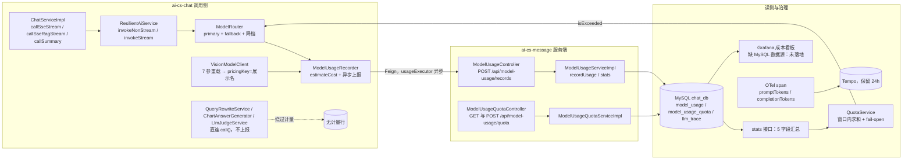
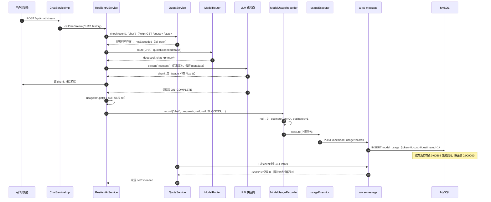

# LLM 用量计量与成本分析：把可变成本按「谁、什么场景、哪个模型」三维归集

> **一句话结论**：LLM 成本是随调用量线性变化、随单价外部波动的**可变成本**，只有做到「一次调用一行、行里带齐用户/场景/模型/token/单价快照/金额/是否估算」才谈得上优化；本仓库的表结构与异步上报链路已经具备这副骨架，但**流式对话的 token 恒为 null、null 又被折成 0，导致最贵的 `deepseek-chat` 在账面上恒为 0 元**——成本表实际只记到了便宜的辅助场景，任何"按模型/按场景/按用户"的结论都会把最烧钱的那部分算成不存在。
> **阅读前置**：先读同目录 [03-数仓分层与指标口径.md](03-数仓分层与指标口径.md)（token 口径与指标定义）与 [08-数据质量与对账.md](08-数据质量与对账.md)（对账的判定标准）；需要知道 Spring AI 的 `ChatResponse`/`Usage`、Feign 调用、MyBatis-Plus 条件构造器、Resilience4j 熔断的基本用法。
> **证据基线**：A 级 4 条（Spring AI 2.1.0 源码摘录）｜B 级 18 条（本项目真实文件，行号当次 `read` 核对）｜C 级 3 组（本机 node 24.16.0 / pwsh 实测输出，命令可复现）；口径基准 JDK 17、Spring Boot 4.2.0、Spring AI 2.1.0、MySQL 8.0；预计阅读 50 分钟。

## 证据边界

本篇每一个「本仓库有 / 没有」的判断，都按下面几档标注，不含推测：

| 维度 | 本仓库状态 | 本篇怎么处理 |
| --- | --- | --- |
| `model_usage` / `model_usage_quota` 表结构、索引、字段语义 | ✅ 真实：`deploy/mysql/llm-observability-init.sql` | B 级逐行引用，行号当次核对 |
| 计量写入链路（Recorder → Feign → message 服务 → MySQL） | ✅ 真实代码，可读可追 | B 级逐段精读 |
| 流式场景的 token 计量 | ❌ **缺陷**：`usageRef` 声明后从未赋值，token 恒 null | 写明缺陷与修法，修法标注「未在本机编译验证」 |
| 模型单价表 | ⚠️ 半落地：`tools/nacos-config/ai-cs-chat.yml` 有 3 个模型真实单价；无 `default-pricing` 节、无生效时间字段 | B 级引用 + 明确「无生效时间」属未落地 |
| 预算与硬限 | ❌ 未落地：只有软配额 + 降档；`model_usage_quota` 全仓无种子数据 | 写成"能力骨架存在、闭环不存在"，给验证命令 |
| 真实用量数据、供应商账单 | ❌ 本机无 MySQL 实例、无账单文件 | C 级用「按代码路径构造的样本」做算术，**明确标为模型演算，非线上实测** |
| 成本看板 | ❌ 未落地：Grafana 只有 Prometheus + Tempo 两个数据源，没有 MySQL 数据源 | 只给 SQL 与判读方法，不宣称有看板 |
| SLO、延迟、吞吐、告警条数 | ❌ 未本机实测 | 一律不给数字，只给命令与判读口径 |

---

## 0. 先看现象

### 现象一：流式的 usage 容器声明了，却从来没被赋值

问题出在流式那条路的收尾代码上。把 `ResilientAiService` 里与 `usageRef` 相关的行全部抓出来，再单独查它有没有被 `set` 过：

```powershell
cd D:\Projects\Persion\ai-customer-service
$f = 'ai-cs-chat/src/main/java/com/aics/chat/service/impl/ResilientAiService.java'
Select-String -Path $f -Pattern 'usageRef' | ForEach-Object { "L$($_.LineNumber): $($_.Line.Trim())" }
"usageRef.set 命中数 = " + (Select-String -Path $f -Pattern 'usageRef\.set' | Measure-Object).Count
```

```text
L277: AtomicReference<Usage> usageRef = new AtomicReference<>();      // 流式场景里 Usage 只能在最后一个 chunk 里拿到，用 AtomicReference 跨 reactive 管道传递
L303: Usage usage = usageRef.get();
usageRef.set 命中数 = 0
```

声明在 L277、读在 L303、写入 0 次。L303 读到的永远是空引用，于是传给 `ModelUsageRecorder.record(...)` 的两个 token 参数恒为 `null`。注释里写的是"用 AtomicReference 跨管道传递"，代码里传的是空——**注释描述的是意图，不是事实**。

### 现象二：价格表里没有视觉模型的键，兜底单价是 0

把 Nacos 里的价格键与"聊天侧实际写进去的 pricingKey"对一遍（脚本见 §6.2，可复跑）：

```text
价格表键（aics.usage.pricing）:
  - deepseek-chat
  - siliconflow-qwen3-32b
  - siliconflow-qwen3-8b

路由模型 id（8 参重载用 id 作 pricingKey）:
  - deepseek-chat  命中
  - siliconflow-qwen3-32b  命中
  - siliconflow-qwen3-8b  命中

视觉模型展示名（7 参重载 → pricingKey = 展示名）:
  - Qwen/Qwen3-VL-32B-Instruct  未命中 → 走 defaultPricing（0/0）
```

视觉那条路 `VisionModelClient` 用的是 7 参重载，pricingKey 被默认成**展示名**；价格表里只有路由 id，查不到就落到 `defaultPricing`，而它的初值是 `input=0 / output=0`（`ModelUsageProperties.java` L46-L52）。结果：视觉调用的 token 记对了，`estimated_cost` 永远 0，且**没有任何一行日志提示"这个模型的单价查不到"**。

### 现象三：配额表是空表，检查函数遇到异常还会放行

```powershell
cd D:\Projects\Persion\ai-customer-service
(Select-String -Path (Get-ChildItem -Recurse -Include *.sql -File . | Where-Object { $_.FullName -notmatch '\\target\\' }).FullName -Pattern 'INSERT\s+INTO\s+model_usage_quota' -ErrorAction SilentlyContinue | Measure-Object).Count
```

```text
0
```

全仓没有任何一条给 `model_usage_quota` 插数据的 SQL。而 `QuotaService.check()` 的第一道判断是"查不到配额行就按未超限返回"（`QuotaService.java` L46-L50），第二道兜底是"Feign 抛异常也按未超限返回"（L72-L80，fail-open）。两条叠起来：**本仓库任何用户在任何时刻都不可能触发配额**。

把上面三条按代码路径复刻成一本账（样本是假设的日流量，算术真实、流量非实测，详见 §3.9 与 §6.1）：

```text
真实成本合计 = 81.018200 元/日
记账成本合计 = 1.834200 元/日
漏记金额     = 79.184000 元/日
低估比例     = 97.74%（记账只有真实的 2.26%）
流式调用占比 = 48.03%（11000/22900），但占真实成本 96.67%（78.320000/81.018200）
```

这些现象指向同一件事：**计量链路里"能记对"的只有非流式那半条路，真正烧钱的流式对话在账面上恒为 0；`estimated_cost` 的问题不是"估算精度不够"，而是"结构性缺数"——三维归集的分母错了，之后所有成本结论（按模型、按场景、按用户、告警、配额）全部失效。**

---

## 1. 整体地图



读图说明：

1. **主干只有一条**：调用侧 `ResilientAiService` 拿到 token 后交给 `ModelUsageRecorder`，Recorder 算钱、异步 Feign 到 message 服务、落 `model_usage`。所有"账"都出自这条线，任何绕过它的调用（图中虚线）都不会在表里留下痕迹。
2. **两条分支口径不同**：`invokeNonStream` 从 `ChatResponse.getMetadata().getUsage()` 真拿 token；`invokeStream` 用的是一个从未被赋值的 `AtomicReference`，等于不拿。**同一个 Recorder，两条输入，一条有数一条恒 null。**
3. **写与读是两个服务**：写入走 `POST /records`，读走 `GET /stats`，二者都跨服务，靠 Feign + DTO 对齐；因此"字段语义漂移"会同时发生在两端（例如 `estimated` 的含义）。
4. **读侧只有一个消费者**：`stats` 的唯一调用方是 `QuotaService`（做配额），并没有成本看板在读它。图中 `Grafana` 用虚线框表示未落地——它当前只接了 Prometheus 和 Tempo。
5. **观测平面与成本平面是分开的**：token 作为 high-cardinality 属性写进 span，进 Tempo（block_retention 24h），成本却只在 MySQL 里；这两个平面没有交叉查询，所以"从链路点开看花了多少钱"这件事在本仓库做不到。

| 组件 | 责任 | 参与方（谁调 / 被谁调） | 出问题时的现象 |
| --- | --- | --- | --- |
| `ResilientAiService` | 路由、熔断、调用 LLM、把 usage 交给 Recorder | `ChatServiceImpl` 调用它 | token 传 null，下游全部记 0 |
| `ModelUsageRecorder` | null 折 0、按 pricingKey 查单价、算金额、异步上报 | 被 `ResilientAiService` / `VisionModelClient` 调用 | 单价 miss 时静默记 0 元 |
| `ModelUsageProperties` | 承载 `aics.usage.*`（开关、单价表、兜底价、线程数） | Spring 配置绑定 | 兜底价为 0、`executorSize` 无人读 |
| `ModelUsageFeignClient` | 跨服务上报 / 查询 / 配额 | chat 服务侧 | 超时或异常只打 warn，行丢失 |
| `ModelUsageController` | 暴露 `POST /api/model-usage/records`、`GET /stats` | 被 chat 服务调用 | 时间参数格式两侧必须一致 |
| `ModelUsageServiceImpl` | 判空落库、统计求和 | message 服务内部 | 统计全表拉回内存聚合 |
| `ModelUsageQuotaController` / `Impl` | 配额的读写（幂等 upsert） | 运维或后台调用 | 表空 → 等于不限 |
| `QuotaService` | 窗口内取 stats、判超限、失败放行 | `ResilientAiService` 路由前调用 | fail-open + 缺数 → 永不超限 |
| `ModelRouter` | 选主模型、fallback、超限降档 | 被 `ResilientAiService` 调用 | 降档逻辑存在但输入恒 false |
| `model_usage` 表 | 追加型用量明细（一次调用一行） | MySQL | 无唯一键，重复上报无法去重 |

---

## 2. 关键概念与关键要素

先把术语钉死，后面不再重复解释：

- **token**：模型计费的最小单位，一段文本被分词器切出来的片段数。**输入 token（prompt tokens）**是发给模型的全部上下文（含 system、历史、检索到的知识片段），**输出 token（completion tokens）**是模型生成的内容。同一句中文在不同模型上的 token 数不同。
- **usage**：供应商在响应里回传的用量元数据（prompt/completion/total 三个数），是"免费且最准"的计量来源；本仓库用的是 Spring AI 的 `Usage` 抽象。
- **可变成本**：随调用量和单价浮动的支出（LLM 调用费），区别于固定成本（服务器、带宽）。它有三个可动手的把手：量（谁在用、什么场景）、单价（用哪个模型）、效率（每次调用多少 token）。
- **三维归集**：把每一笔成本同时贴上「用户」「场景」「模型」三个标签，任何一维都能单独出账。少一维就等于其中一类优化没抓手。
- **pricingKey**：查单价用的键，与展示给人的模型名分开。展示名（`Qwen/Qwen3-VL-32B-Instruct`）是供应商口径，价格键（`siliconflow-qwen3-8b`）是本仓路由 id。
- **软配额 / 硬限**：软配额=超了降级（换便宜模型、限速、提示），请求仍会成功；硬限=超了直接拒绝。**本仓库只有软配额 + 降档，没有硬限。**
- **fail-open / fail-closed**：依赖不可用时是"放行"还是"拒绝"。计量与配额属典型的"不该拦业务"场景，本仓库选 fail-open，代价是失效时静默。
- **降档（downgrade）**：超限后从 standard 档换到 cheap 档模型，对应路由原因 `QUOTA_DOWNGRADE`。
- **追加型日志表**：只增不改、失败也留行的表。对账与审计都依赖"不可变"，代价是数据只增不减、需要保留策略。
- **对账**：两本独立的账相互校验。成本侧有两本可对：内部账（`llm_trace` 的调用次数 vs `model_usage` 的行数）与外部账（成本表 vs 供应商账单）。

| 名称 | 位置 | 作用 | 关键参数 / 取值 |
| --- | --- | --- | --- |
| `model_usage` | `deploy/mysql/llm-observability-init.sql` L29-L49 | 一次 LLM 调用一行，成本明细的唯一事实源 | `estimated_cost DECIMAL(12,6)`；三个复合索引 `(user_id,create_time)` / `(scenario,create_time)` / `(model,create_time)`；无唯一键 |
| `model_usage_quota` | 同文件 L52-L64 | 软配额配置表 | `uk_user_scenario`；`window_type` DAILY/WEEKLY/MONTHLY；`quota_tokens` / `quota_cost` 可空；表内无数据 |
| `llm_trace` | 同文件 L12-L26 | 调用链追踪，`request_id` 为主键 | `session_id VARCHAR(64)`（与 `model_usage.session_id BIGINT` 类型不一致） |
| `ModelUsageRecorder` | `ai-cs-chat/src/main/java/com/aics/chat/observability/ModelUsageRecorder.java` | 组织一行用量：折 0、查价、算钱、异步上报 | 7 参重载 pricingKey=展示名；8 参重载显式传 pricingKey；`PER_MILLION=1000000` |
| `ModelUsageProperties` | `ai-cs-chat/src/main/java/com/aics/chat/observability/ModelUsageProperties.java` | `aics.usage.*` 配置载体 | `enabled`、`pricing`（Map）、`defaultPricing`（初值 0/0）、`executorSize`（无人读） |
| `estimateCost` | `ModelUsageRecorder.java` L127-L137 | 单价 × token → 金额 | `divide(PER_MILLION,10,HALF_UP)`，最终 `setScale(6,HALF_UP)` |
| `estimated` 标记 | `model_usage.estimated` + `ModelUsageDTO.estimated` | 区分精确与估算 | TINYINT 0/1；写入侧等于"参数是否 null"，读侧无人过滤 |
| `QuotaService` | `ai-cs-chat/src/main/java/com/aics/chat/observability/QuotaService.java` | 路由前判断是否超限 | 窗口起点自算（不读 `period_start`）；异常 fail-open |
| `ModelRouter` | `ai-cs-chat/src/main/java/com/aics/chat/modelrouter/ModelRouter.java` | 超限时换 cheap 档 | `QUOTA_DOWNGRADE` / `QUOTA_NO_CHEAPER_MODEL` |
| `usageExecutor` | `ai-cs-chat/src/main/java/com/aics/chat/config/ObservabilityExecutorConfig.java` | 承载异步上报 | core 1 / max 4 / queue 1000；硬编码，不读配置 |
| `aics.usage.pricing` | `tools/nacos-config/ai-cs-chat.yml` L118-L128 | 模型单价表（元/百万 token） | deepseek-chat 2.0/8.0；qwen3-32b 1.0/2.0；qwen3-8b 0.2/0.6 |
| `ModelScenario` | `ai-cs-chat/src/main/java/com/aics/chat/modelrouter/ModelScenario.java` | 场景枚举，决定写入的 `scenario` 值 | CHAT/RAG/SUMMARY/INTENT/AGENT/NL2SQL/REWRITE/CHART/JUDGE，写入时转小写 |

---

## 3. 原理与证据逐段精读

### 3.1 一次调用一行：`model_usage` 为什么是"追加型日志表"

**在干什么**：把每次 LLM 调用的成本信息固化成一行不可变的记录——谁、什么场景、哪个模型、多少 token、多少钱、这笔钱是精确的还是估的、成功还是失败。

```sql (项目文件: deploy/mysql/llm-observability-init.sql#L29-L49)
CREATE TABLE IF NOT EXISTS model_usage (
    id              BIGINT          NOT NULL AUTO_INCREMENT COMMENT '主键',
    request_id      VARCHAR(64)     DEFAULT NULL COMMENT '请求ID',
    user_id         BIGINT          DEFAULT NULL COMMENT '用户ID',
    session_id      BIGINT          DEFAULT NULL COMMENT '会话ID',
    scenario        VARCHAR(32)     NOT NULL COMMENT '场景：chat/rag/agent/summary/vision/nl2sql/eval',
    provider        VARCHAR(64)     DEFAULT NULL COMMENT '模型供应商',
    model           VARCHAR(64)     NOT NULL COMMENT '模型名',
    input_tokens    INT             NOT NULL DEFAULT 0 COMMENT '输入Token数',
    output_tokens   INT             NOT NULL DEFAULT 0 COMMENT '输出Token数',
    total_tokens    INT             NOT NULL DEFAULT 0 COMMENT '总Token数',
    estimated_cost  DECIMAL(12,6)   NOT NULL DEFAULT 0 COMMENT '估算费用（元）',
    estimated       TINYINT         NOT NULL DEFAULT 0 COMMENT '是否估算（1=流式等无法获取精确usage）',
    status          VARCHAR(20)     NOT NULL DEFAULT 'SUCCESS' COMMENT '状态：SUCCESS/FAILED',
    error_summary   VARCHAR(1024)   DEFAULT NULL COMMENT '错误摘要',
    create_time     DATETIME        DEFAULT CURRENT_TIMESTAMP COMMENT '创建时间',
    PRIMARY KEY (id),
    KEY idx_user_time (user_id, create_time),
    KEY idx_scenario_time (scenario, create_time),
    KEY idx_model_time (model, create_time)
) ENGINE=InnoDB DEFAULT CHARSET=utf8mb4 COLLATE=utf8mb4_unicode_ci COMMENT='模型用量计量表';
```

**为什么这么设计**：三个决定值得单独说。

1. **金额落在行里（`estimated_cost`），而不是每次统计时用当前价乘 token。** 单价是外部变量：供应商调价、汇率、活动折扣都会让它变。如果把价格留在统计时算，一次调价会把历史账全部改写，对账永远对不平。落行时用**当时**的单价算完写死，是唯一能对账的做法。
2. **`INT NOT NULL DEFAULT 0` + `estimated_cost NOT NULL DEFAULT 0`。** 排序、求和、索引都更省事，统计侧不需要到处 `COALESCE`。代价见 §3.4：**"没测到"和"真的是 0"在库里长得一模一样**。
3. **追加型、只增不改。** 失败也留一行（`status='FAILED'`、token 为 0），这样"失败率"和"失败造成的成本损失"能同表归因；实体类注释明确写了"只增不改，失败也保留"（`ai-cs-message/src/main/java/com/aics/message/entity/ModelUsage.java` L33-L35）。

**换写法会怎样**：若改成"只存 token，金额统计时 join 价格表实时算"，则调价后所有历史报表都会漂移，而且"这个月按旧价结算的部分"无法表达；若改成"按小时预聚合成汇总表"，可以省空间，但会丢失单次调用的可追溯性，异常检测（同一用户突增）就无从下钻到具体请求。

**常见坑**（都能在本文件里指出来）：

- **没有唯一键**：`PRIMARY KEY(id)` 是自增，`request_id` 可空且无唯一约束。上游 Feign 超时重试、或调用方重放，就会插出两行同样的账，费用翻倍且**查不出哪行是重复的**——正确做法是 `UNIQUE KEY uk_request_id(request_id)` 或引入 `attempt` 计数。
- **没有 `(scenario, model, create_time)` 组合索引**：三维归集里最常见的"某场景某模型一天花多少"要跨两个维度过滤，现有三个索引都只覆盖"单维度 + 时间"，只能走一个索引再回表过滤。
- **`session_id` 类型与 `llm_trace` 不一致**：本表 `BIGINT`，`llm_trace` 是 `VARCHAR(64)`；而 Recorder 侧还会把非数字 sessionKey 转成 null（`parseSessionId`，`ModelUsageRecorder.java` L139-L149）。结果是**按会话对账/下钻时无法 join**，这个缺口在 §6.4 会具体演示。

### 3.2 token 从哪来：`usage` 是框架给的口径，不是自己数的

**在干什么**：把一次调用消耗的输入/输出 token 取出来。本仓库非流式路径走的是标准做法——从响应元数据里读 `Usage`。

```java (项目文件: ai-cs-chat/src/main/java/com/aics/chat/service/impl/ResilientAiService.java#L203-L235)
// 非流式：ResilientAiService.invokeNonStream（L203-L215）取 usage 后交给 Recorder
ChatResponse response = callWithTransientRetry(holder, call);
Usage usage = response == null || response.getMetadata() == null
        ? null : response.getMetadata().getUsage();
modelUsageRecorder.record(
        scenarioId(scenario),
        holder.getDefinition().getProvider(),
        holder.getDefinition().getModel(),
        usage == null ? null : usage.getPromptTokens(),
        usage == null ? null : usage.getCompletionTokens(),
        "SUCCESS", null,
        holder.getDefinition().getId());
```

框架侧的口径很小：`Usage` 只有三个读法，而"总数"是**派生**的，不是供应商给的独立字段。

```java (src: Usage.java.md#L37-L56)
/** Returns the number of tokens used in the prompt. */
Integer getPromptTokens();

/** Returns the number of tokens used in the generation. */
Integer getCompletionTokens();

/**
 * Returns the total number of tokens used in the prompt and in the generation.
 * The default implementation returns the sum of the prompt and generation tokens.
 */
default Integer getTotalTokens() {
    Integer promptTokens = getPromptTokens();
    int promptTokensInt = promptTokens != null ? promptTokens : 0;
    Integer completionTokens = getCompletionTokens();
    int completionTokensInt = completionTokens != null ? completionTokens : 0;
    return promptTokensInt + completionTokensInt;
}
```

`[[源码:Usage.java.md#L56-L62]]` 这段还说明一件事：**框架自己在算总数时也是把 null 当 0**。所以"null 折 0"不是本项目的发明，而是这个生态的默认习惯——问题在于本项目的 null 不是偶发，而是**结构性的、恒定的**（§3.3）。

**为什么这么设计**：token 数只能由分词器给出，分词器随模型/版本变化，业务代码自算必然与供应商账单不一致。供应商在响应里已经把 usage 附上（`ChatResponseMetadata` 持有它，`[[源码:ChatResponseMetadata.java.md#L39]]`），用它就是"与账单同源"。

**换写法会怎样**：如果改成"自己按字符数估算"，误差来自三层：中英文混排的切分、emoji 与标点、以及**工具调用/多轮场景下上下文被重复发送**（每一次工具往返都是一次完整计费，但字符只数一遍）。本机可以量化前两层的算术差：

```text
样本="AI 助手暂时繁忙，请稍后重试。" 字符数=16
口径① 字符数/4   → 4.00 token（OpenAI 英文经验的粗糙移植）
口径② 字符数/1.5 → 10.67 token（按中文约 1.5 字/token 反推）
两口径差 2.67 倍；样本固定，差额只来自除数
```

同一个句子，两种估算口径差 2.67 倍——而真实 token 数需要对应模型的分词器才能得到（**未本机实测：本机没有联网、也没有任何模型的 tokenizer，属于"不能算"，不是"懒得算"**）。这说明：估算可以作为兜底的量级判断，但**不能当成计费依据**，也不该与精确值混在同一列求和（§3.6）。

**常见坑**：

- 把 `totalTokens` 当成第三个独立字段去上报，可能出现 `total ≠ in + out`；本仓库服务端做了兜底（`ModelUsageServiceImpl.java` L60-L69），但兜底本身也说明了上游可能不一致。
- 只取 usage 不校验 `Usage` 内部三个字段的可空性——`getPromptTokens()` 返回的是 `Integer`，**可能为 null**（框架签名就是可空对象），直接拆箱会 NPE。

### 3.3 流式为什么恒为 null（核心缺陷一）

**在干什么**：流式路径把模型输出变成一个 `Flux<String>` 边收边推，然后在 `doFinally` 里收尾记账。

```java (项目文件: ai-cs-chat/src/main/java/com/aics/chat/service/impl/ResilientAiService.java#L275-L278)
Flux<String> flux = call.call(holder);
// ④ 准备三个"跨管道传递状态"的容器：流式场景里结果只能在 doFinally 里拿到
AtomicReference<Usage> usageRef = new AtomicReference<>();      // 流式场景里 Usage 只能在最后一个 chunk 里拿到，用 AtomicReference 跨 reactive 管道传递
AtomicReference<Throwable> errorRef = new AtomicReference<>();  // 同理，doOnError 里捕获异常，doFinally 里读取并上报
```

```java (项目文件: ai-cs-chat/src/main/java/com/aics/chat/service/impl/ResilientAiService.java#L303-L325)
Usage usage = usageRef.get();
// ⑧ 流结束后才能创建完整观测（因为 token 数只有结束时才知道）
Observation observation = startLlmObservation(scenario, selectedHolder, decision, null, 1);
if (usage != null) {
    observation.highCardinalityKeyValue("promptTokens", String.valueOf(usage.getPromptTokens()))
            .highCardinalityKeyValue("completionTokens", String.valueOf(usage.getCompletionTokens()));
}
...
// ⑨ 记录用量明细（同非流式，但状态由 signal 决定 SUCCESS/FAILED）
modelUsageRecorder.record(scenarioId(scenario),
        selectedHolder.getDefinition().getProvider(),
        selectedHolder.getDefinition().getModel(),
        usage == null ? null : usage.getPromptTokens(),
        usage == null ? null : usage.getCompletionTokens(),
        signal == SignalType.ON_ERROR ? "FAILED" : "SUCCESS",
        signal == SignalType.ON_ERROR ? "stream error" : null,
        selectedHolder.getDefinition().getId());
```

**这里为什么会记错账**：`usageRef` 只在 L277 被 `new` 出来、在 L303 被 `get()` 一次，**整个文件没有任何 `set`**（§0 现象一的命令与输出）。于是 `usage` 恒为 null，`record(...)` 的两个 token 参数恒为 null，`if (usage != null)` 的 span 属性也永远不写。

更靠上游还有第二个原因：流式拿到的 `Flux<String>` 从一开始就没有元数据。看它怎么建流：

```java (项目文件: ai-cs-chat/src/main/java/com/aics/chat/service/impl/ResilientAiService.java#L150-L159)
holder -> holder.getChatClient().prompt().messages(messages).stream().content()); // .stream() 返回 Flux<ChatResponse>；.content() 只提取文本内容部分，丢弃元数据（含 tool_calls 中间过程）
holder -> holder.getChatClient().prompt().user(prompt).stream().content());
```

`.content()` 把 `Flux<ChatResponse>` 降级成 `Flux<String>`——**usage 就挂在被丢掉的 `ChatResponse.getMetadata()` 上**。所以在 `Flux<String>` 层面无论怎么努力都拿不到 token，这不是"末 chunk 没取到"的问题，而是"数据类型里就没有这个信息"。

**为什么这么设计（以及为什么说这不是不可避免）**：`.stream().content()` 是最省事的写法，一行拿到可直推前端的文本流。但框架同时提供了带元数据的流式接口与聚合器：

- `ChatClientMessageAggregator.aggregateChatClientResponse(Flux<ChatClientResponse>, Consumer<ChatClientResponse>)` 把一串 chunk 聚合成单个完整响应（`[[源码:ChatClientMessageAggregator.java.md#L40-L55]]`），聚合体里就带 metadata/usage；
- `UsageAccumulator`（Spring AI 2.0.0 起）专门用于"跨轮次累计用量"，其类注释原文即"Accumulates token Usage across the iterations of a recursive advisor (for example a tool-calling loop or a structured-output validation retry loop), so that the final response reports the cumulative usage of every model call rather than only the last one."，并提供 `accumulatedResponse()`（`[[源码:UsageAccumulator.java.md#L62-L73]]`），文档明确给出流式用法：**one per stream subscription, inside a `Flux#defer`**。

也就是说：**框架给了现成的流式 usage 聚合机制，本项目是自己把数据丢了**——先后丢两次：`.content()` 丢元数据，`usageRef` 不赋值丢最后一次机会。

**顺带修正一处同批文档的描述**：同目录 [03-数仓分层与指标口径.md](03-数仓分层与指标口径.md) 把 L303-L316 描述为"用 `AtomicReference` 自己抓末 chunk 的 usage——单轮单模型下等价"。按代码复核，这个描述不成立：容器从未被写入，**等价于"什么都没抓"**。这条差异本身就值得记：*代码注释与相邻文档都可能描述"设计意图"，验证必须落到"有没有赋值"这种最小事实上。*

**换写法会怎样**：把流式改成 `chatClientResponse()` + `aggregateChatClientResponse(...)`（或 `UsageAccumulator` 包一层 `Flux.defer`），就能在 `doFinally` 拿到完整 usage；代价是每收到一个 chunk 要多包一层对象、聚合器要在内存里留一份最终响应，**长回答的内存占用会上升**（这正是 `.content()` 曾经"划算"的原因）。折中做法：只在开启计量（`aics.usage.enabled=true`）时才走聚合路径。

**常见坑**：

- 以为"流式天然拿不到 usage"。OpenAI 兼容接口的流式响应默认不返回 usage，需要请求里带 `stream_options.include_usage`；但即便供应商支持，**只要用了 `.content()`，框架拿到的元数据也已经被丢掉**——两个坑串联，缺一个都不会有数。
- 只修 `usageRef.set(...)` 而不改 `.content()`：`Flux<String>` 的 chunk 里没有 ChatResponse，无处可 `set`，修了也是空。
- 忽略 `if (usage != null)` 这层：即使后面修好了 token 落库，**span 上的 token 属性**（`finishLlmObservation`，`ResilientAiService.java` L486-L499）同样在等这个 null 判断。

### 3.4 null 折 0 与 `estimated` 标记：一次语义漂移

**在干什么**：把可能为 null 的 token 变成可入库的整数，并给这一行打上"是否估算"的标。

```java (项目文件: ai-cs-chat/src/main/java/com/aics/chat/observability/ModelUsageRecorder.java#L91-L100)
int in = inputTokens == null ? 0 : inputTokens;
int out = outputTokens == null ? 0 : outputTokens;
dto.setInputTokens(in);
dto.setOutputTokens(out);
dto.setTotalTokens(in + out);
// 学习点：pricingKey 与展示 model 分离，展示用人类可读的 model 名，计费用稳定 id
dto.setEstimatedCost(estimateCost(pricingKey, in, out));
// estimated 标记：流式调用常取不到精确 usage，此时 token 由 null 折 0 兜底，
// 打标用于成本分析时把"估算/缺失"与"精确"分开，避免"估算当精确"误导成本决策
dto.setEstimated(inputTokens == null || outputTokens == null);
```

**这里为什么会记错账**：两句话放在一起看就露馅了——第一句把 null 折成 0（金额随之变 0），第二句把"参数是 null"这件事记成 `estimated=1`。**于是在库里，`estimated=1` 的行不是"估算值"，而是"零值"**：token=0、金额=0。任何"跳过 estimated 行看精确成本"的读法会得到 0 元，任何"estimated 行是估算的近似值"的读法也得到 0 元——两种读法都错，因为没有估算发生。

而上游 DTO 的注释把这件事写成了另一回事：

```java (项目文件: ai-cs-chat/src/main/java/com/aics/chat/dto/ModelUsageDTO.java#L56-L59)
/** 是否估算 */
// true=按字符/输出估算的 token（流式取不到 usage 时）；false=模型返回的精确 usage。
// 配额强校验只认精确值，估算值仅用于成本展示
private Boolean estimated;
```

注释承诺"按字符/输出估算 token"，代码只做了"null 折 0"。**这是一处"文档写了、代码没写"的能力缺口**，也是本篇最值得记住的坑：*`estimated=true` 在本仓库等于"这行没有数据"，不等于"这行是估的"。*

**为什么这么设计**：`input_tokens`/`output_tokens`/`estimated_cost` 都是 `NOT NULL DEFAULT 0`（§3.1），写入侧不折 0 就得改表；而"统计侧不用判空"的收益是立刻能看到的（`ModelUsage.java` L76 注释：默认 0 而非 null，统计求和无需判空）。**代价是把"缺失"这个信息从数据模型里删掉了**——这是典型的"用默认值换便利，换掉了可诊断性"。

**换写法会怎样**：

- 方案 A（最小改动）：列改成可空，写入侧保留 null，统计侧 `COALESCE(sum(...),0)`。代价是所有 SQL 要改，但能区分"没测到"与"真的 0"。
- 方案 B（推荐）：保留列不可空，但新增 `usage_source` 枚举（`PROVIDER` / `ESTIMATED` / `MISSING`），把三态显式化；`estimated` 作为兼容字段保留。
- 方案 C（真正的估算）：在流式路径按输出字符数估 token 并标 `ESTIMATED`——但必须同时记录"估算口径版本"，否则两版估算不可比。

**常见坑**：

- 读侧完全没人看 `estimated`。服务端统计只对 `estimatedCost` 求和（`ModelUsageServiceImpl.java` L110-L113），没有按 `estimated` 过滤或分组，`ModelUsageStatsVO`（`ai-cs-message/src/main/java/com/aics/message/vo/ModelUsageStatsVO.java`）只有 5 个字段，**连"估算占比"都返回不了**。所以"精确"与"零值"在同一列里相加——这在配额判断里是致命的（§3.7）。
- `estimated` 是 `Boolean`（可空）而列是 `TINYINT NOT NULL`：写入侧 `dto.getEstimated() != null` 才 set（`ModelUsageServiceImpl.java` L73-L74），不传就落默认 0，会被读成"精确"。

### 3.5 单价维护：`pricingKey` 必须与展示名分离，兜底价不能是 0

**在干什么**：把 token 数乘上单价变成金额。单价来自 `aics.usage.pricing`，键是路由 id。

```java (项目文件: ai-cs-chat/src/main/java/com/aics/chat/observability/ModelUsageRecorder.java#L127-L137)
private BigDecimal estimateCost(String pricingKey, int inputTokens, int outputTokens) {
    ModelUsageProperties.ModelPrice price = properties.getPricing()
            .getOrDefault(pricingKey, properties.getDefaultPricing());
    BigDecimal inCost = BigDecimal.valueOf(inputTokens)
            .divide(PER_MILLION, 10, RoundingMode.HALF_UP)
            .multiply(price.getInput());
    BigDecimal outCost = BigDecimal.valueOf(outputTokens)
            .divide(PER_MILLION, 10, RoundingMode.HALF_UP)
            .multiply(price.getOutput());
    return inCost.add(outCost).setScale(6, RoundingMode.HALF_UP);
}
```

```yaml (项目文件: tools/nacos-config/ai-cs-chat.yml#L118-L128)
usage:
  pricing:
    deepseek-chat:
      input: 2.0
      output: 8.0
    siliconflow-qwen3-32b:
      input: 1.0
      output: 2.0
    siliconflow-qwen3-8b:
      input: 0.2
      output: 0.6
```

**为什么这么设计**：展示名是"给人看的"（`Qwen/Qwen3-VL-32B-Instruct`），价格键是"给路由用的稳定 id"（`siliconflow-qwen3-vl-32b` 之类的路由 id）。同一个模型可能在两家供应商上架、名字不同但价格不同；用 id 作键，模型升级改名不影响价格命中。Recorder 为此提供了两个重载：8 参显式传 `pricingKey`（`ModelUsageRecorder.java` L74-L76），7 参兼容旧调用、**默认 `pricingKey = model`（展示名）**（L56-L60）。

**这里为什么会记错账**：`VisionModelClient` 走的正是 7 参重载（`ai-cs-chat/src/main/java/com/aics/chat/service/impl/VisionModelClient.java` L211-L214），pricingKey 变成展示名 `Qwen/Qwen3-VL-32B-Instruct`；价格表里没有这个键 → `getOrDefault` 落到 `defaultPricing`；而兜底价的两字段初值都是 `new BigDecimal("0")`（`ModelUsageProperties.java` L46-L52），**于是视觉调用的金额恒为 0，且没有任何告警**（§0 现象二的输出即为证据）。

**换写法会怎样**：

- 若把兜底价设成"最贵档单价"（宁高不低），成本报表会偏高，但不会被静默吞掉；
- 若在 miss 时抛异常，会把计量失败升级成业务失败——与"计量不该阻断对话"冲突；
- 折中（推荐）：miss 时埋一个 `pricing_miss` 计数并 `log.warn` 一次（按 pricingKey 去重），同时把该行标成"未知单价"而不是 0 元。

**关于"价格的生效时间"（本项目未落地）**：价格是外部变量，一份可对账的价格体系至少要能回答"这笔钱是按哪一版价格算的"。当前实现只有"行内快照"（写入时算完写死，历史不会被改价污染，这点是对的），但**没有任何生效时间或价格版本**：`ModelUsageProperties` 全文只有 `enabled`/`pricing`/`defaultPricing`/`executorSize` 四个字段（L28-L41），没有 `effectiveFrom`；`model_usage` 也没有 `price_version` 列。后果是——知道"这行 3.2 元"，无法回答"按 2.0/8.0 还是按调价后的 2.6/9.4 算的"。上线级做法：价格表带 `effective_from`（且只允许新增版本、不修改历史），`model_usage` 增列 `price_version` 做外键。

**常见坑**：

- 单位混用。`aics.usage.pricing` 的单位是**元/百万 token**，代码里 `divide(PER_MILLION, 10, HALF_UP)` 先除再乘，中间保留 10 位小数，最后 `setScale(6)`——顺序不能换：先乘后除会让中间结果提前被截断，长上下文下误差会放大。
- 只配了 `input` 漏配 `output`：`ModelPrice` 的字段初值是 0，缺一个就等于"输出免费"，且不会报错。
- 价格表放在 Nacos（`tools/nacos-config/ai-cs-chat.yml`），`ai-cs-chat/src/main/resources/application.yml` 的 `aics:` 块（L172-L193）里没有 `usage.*`——所以**本地起服务不带 Nacos 时，`pricing` 是空 Map，所有模型都走兜底 0**。这一点在本地联调时极易误判成"代码不记账"。

### 3.6 金额精度、落库与统计接口的边界

**在干什么**：算出金额后跨服务落库，再由 `stats` 接口汇总。

```java (项目文件: ai-cs-message/src/main/java/com/aics/message/service/impl/ModelUsageServiceImpl.java#L89-L116)
public ModelUsageStatsVO stats(Long userId, String scenario, String model,
                               LocalDateTime startTime, LocalDateTime endTime) {
    LambdaQueryWrapper<ModelUsage> wrapper = new LambdaQueryWrapper<>();
    // 五个条件全部可空：不传就是全表（对齐"宽松查询"语义）
    ...
    List<ModelUsage> records = modelUsageMapper.selectList(wrapper);
    ModelUsageStatsVO vo = new ModelUsageStatsVO();
    vo.setCallCount((long) records.size());
    ... // 三处 mapToLong(...).sum()
    vo.setEstimatedCost(records.stream()
            .map(ModelUsage::getEstimatedCost)
            .filter(Objects::nonNull)
            .reduce(BigDecimal.ZERO, BigDecimal::add));
    return vo;
}
```

**为什么这么设计**：`stats` 的唯一消费者是 `QuotaService`，它只需要"这一窗口内总 token / 总金额"，所以接口只返回 5 个标量——够用、好写、跨服务传输小。

**这里为什么会记错账（记账口径层面）**：求和把**所有行**的 `estimated_cost` 直接相加，不看 `estimated` 标记（L110-L113）。在一个"精确行与零值行混在一起"的表里，这个和既不是"实付"，也不是"估算总额"，而是两者的混合物且以零值为主。

**换写法会怎样**：真正做成本分析，必须在 SQL 里分组而不是内存里相加：

```sql
-- 三维归集：按场景 × 模型，同时暴露"零值行"占比（真问题在这里）
SELECT scenario, model,
       COUNT(*)                                   AS calls,
       SUM(total_tokens)                          AS tokens,
       SUM(estimated_cost)                        AS cost_yuan,
       SUM(estimated = 1)                         AS est_rows,
       ROUND(SUM(estimated = 1) / COUNT(*) * 100, 2) AS est_ratio_pct
FROM model_usage
WHERE create_time >= '2026-11-01 00:00:00' AND create_time < '2026-12-01 00:00:00'
GROUP BY scenario, model
ORDER BY cost_yuan DESC;
```

> 未本机实测：本机只有 node 24.16.0 / pwsh / JDK 17.0.19，没有 MySQL 实例，也不允许起 docker。上面这条 SQL 的口径已按 `deploy/mysql/llm-observability-init.sql` 的列名逐一核对，可直接在 `chat_db` 上执行；判读见 §6.5。

**常见坑**：

- `stats` 是**全表 `selectList` 后内存聚合**（L98），没有 `LIMIT`、没有分页、没有下推的 `GROUP BY`。行数上万后这个接口会同时拖垮 chat 服务的配额判断（每次路由前都要调它）。
- `DECIMAL(12,6)` 的上限是 `999999.999999` 元——单行不可能超，但**若有人把"月的汇总金额"也写进这一列就会溢出**；汇总应放在查询里算，或另建 `DECIMAL(18,6)` 的汇总表。
- 时区/格式：`getStats` 的 `startTime`/`endTime` 在 Feign 侧用 `@DateTimeFormat(pattern="yyyy-MM-dd HH:mm:ss")` 声明（`ModelUsageFeignClient.java` L54-L61），两侧格式必须一致，否则参数会静默变成 null（`required=false`），**条件失效 → 返回全量数据**，看起来像"成本突然暴涨"。

### 3.7 异步上报与配额降档：一条链上的两个 fail-open

**在干什么**：上报不阻塞对话（线程池异步 + 失败只告警），配额检查不阻塞对话（异常放行），超限时路由器降档。

```java (项目文件: ai-cs-chat/src/main/java/com/aics/chat/observability/ModelUsageRecorder.java#L104-L114)
usageExecutor.execute(() -> {
    try {
        modelUsageFeignClient.recordUsage(dto);
    } catch (Exception e) {
        log.warn("模型用量上报失败: requestId={}, model={}, err={}",
                dto.getRequestId(), dto.getModel(), e.getMessage());
    }
});
```

```java (项目文件: ai-cs-chat/src/main/java/com/aics/chat/observability/QuotaService.java#L46-L65)
ModelUsageQuotaVO quota = modelUsageQuotaService.getQuota(userId, scenario);
if (quota == null || (quota.getQuotaTokens() == null && quota.getQuotaCost() == null)) {
    return ModelUsageQuotaVO.notExceeded();      // 没配配额 = 不限
}
LocalDateTime start = windowStart(quota.getWindowType());
ModelUsageStatsVO stats = modelUsageService.getStats(userId, scenario, null, start, LocalDateTime.now());
if (stats == null) {
    return ModelUsageQuotaVO.notExceeded();
}
long usedTokens = stats.getTotalTokens() == null ? 0L : stats.getTotalTokens();
BigDecimal usedCost = stats.getEstimatedCost() == null ? BigDecimal.ZERO : stats.getEstimatedCost();
boolean tokenExceeded = quota.getQuotaTokens() != null && usedTokens >= quota.getQuotaTokens();
boolean costExceeded = quota.getQuotaCost() != null && usedCost.compareTo(quota.getQuotaCost()) >= 0;
```

**为什么这么设计**：计量与配额是"旁路治理"，不该成为对话失败的原因。失败放行（fail-open）在可用性上是对的——一个记账服务的抖动不应该让整个客服系统不可用。

**换写法会怎样**：改成 fail-closed，一次配额服务抖动就会让全量对话被拒；改成同步上报，P99 会直接叠加一次跨服务写库的耗时（未本机实测，此处只给因果，不给数字）。

**常见坑**（这条链上真正的问题不是 fail-open，而是"三个静默叠加"）：

1. **上报失败无重试、无补偿**：`catch` 只 `log.warn`，行直接丢。线程池队列满时 `execute` 会抛 `RejectedExecutionException`——注意它在 `usageExecutor.execute(...)` 这一层，**不在 try 内**，所以会向上冒到业务线程（配置见 `ObservabilityExecutorConfig.java` L27-L40：core 1 / max 4 / queue 1000）。
2. **`executorSize` 是死配置**：`ModelUsageProperties.java` L41 声明了 `executorSize = 2`，但线程池构造是硬编码的，全仓没有任何地方读它（§6.6 给命令）。
3. **配额永不触发**：`usedCost` 来自 `stats` 汇总，而 §3.3/§3.4 已证明 chat/rag 的行恒为 0 → 一个真实花 60 元的重度用户，账面成本接近 0 → `costExceeded` 恒 false；再叠加"表里没有配额行直接放行"（L48）与 fail-open（L72-L80），**软配额 + 降档这条链在本仓库是"代码齐全、闭环不存在"**。

**补齐"硬限"要看的三件事**（本仓库均未落地，写清楚是缺口而不是已完成）：① 预算表（按用户/租户/全局，带周期与币种）；② 判定点必须在**调用前**且用**当前价**预估本次调用的最大花费（否则只能事后止损）；③ 拒绝路径要有用户可感知的文案与降级方案（本仓库 `fallbackText` 只覆盖"模型繁忙"，不覆盖"额度用尽"，`ResilientAiService.java` L451-L456）。

### 3.8 三种漏记：直连调用、第二个 usage 消费者、只进 span 不进指标

**在干什么**：盘点"花了钱但没有在 `model_usage` 留下行"的所有路径。

```powershell
cd D:\Projects\Persion\ai-customer-service
Select-String -Path (Get-ChildItem -Recurse -Include *.java -File 'ai-cs-chat/src/main/java').FullName -Pattern '(getChatModel|visionModel|chatModel)\.call\(|\.call\(\)' | ForEach-Object { "$([System.IO.Path]::GetFileName($_.Path)) L$($_.LineNumber): $($_.Line.Trim())" }
```

```text
SpringAiConfig.java L191: // add/similaritySearch 内部都会经由 EmbeddingModel.call() 取向量，装饰器让
ChartAnswerGenerator.java L118: .call()
LlmJudgeService.java L79: .call()
LlmJudgeService.java L110: * <p>非流式 {@code chatClient.call()} 返回的响应元数据携带 usage（prompt/completion tokens），
QueryRewriteService.java L126: .call()
ChatServiceImpl.java L124: *                               │       └── ChatClient.call()    // 实际调用
ResilientAiService.java L114: holder -> holder.getChatClient().prompt().messages(messages).call().chatResponse()); // .call() 同步阻塞；.chatResponse() 拿完整响应（含 Usage 元数据）
ResilientAiService.java L123: holder -> holder.getChatClient().prompt().user(prompt).call().chatResponse());
VisionModelClient.java L202: ChatResponse response = visionModel.call(new Prompt(List.of(userMessage)));
```

9 条命中里 **3 条是注释**（`SpringAiConfig` L191、`LlmJudgeService` L110、`ChatServiceImpl` L124），真实调用点 6 处——这就是纯文本 grep 做清单的第一个坑：**注释里的调用写法会被算成调用点**，必须人眼过一遍或加 `-Pattern` 排除以 `*`/`//` 开头的行。

真实调用点里，前三条是**直连**：`ChartAnswerGenerator`（chart 场景）、`LlmJudgeService`（judge 场景）、`QueryRewriteService`（rewrite 场景）都自己建 prompt、自己 `call()`，**完全不过 `ModelUsageRecorder`**，因此一行都不会有。后三条里，`ResilientAiService` 的两处是主链路（会记账），`VisionModelClient` 会记账但金额恒 0（§3.5）。

最讽刺的是 judge 场景：它拿到了完整 usage，却只写进了线程局部变量。

```java (项目文件: ai-cs-chat/src/main/java/com/aics/chat/rag/eval/LlmJudgeService.java#L119-L131)
private void recordTokenUsage(org.springframework.ai.chat.model.ChatResponse response) {
    try {
        if (response != null && response.getMetadata() != null
                && response.getMetadata().getUsage() != null) {
            int total = response.getMetadata().getUsage().getTotalTokens();
            LAST_TOTAL_TOKENS.set(total);
            return;
        }
    } catch (Exception e) {
        log.debug("Judge Token 用量读取失败: {}", e.getMessage());
    }
    LAST_TOTAL_TOKENS.remove();
}
```

同一份 `Usage` 数据，进了 `ThreadLocal` 给评估门禁用（算"单请求平均 token"），就是不进成本表。**"同一份数据被消费两次、只喂给了一个消费者"** 是计量漏记最常见的形态。

第三类漏记是"记了但查不到"：非流式路径的 token 也写进了 span 的 high-cardinality 属性（`finishLlmObservation`，`ResilientAiService.java` L486-L499），进 Tempo（`block_retention: 24h`）；而 `MeterRegistry`/`Timer.builder`/`Counter.builder` 全仓命中 0，**没有任何指标**；Grafana 只接了 Prometheus 与 Tempo 两个数据源，没有 MySQL 数据源（`deploy/observability/grafana/provisioning/datasources/datasources.yaml` 全文 16 行）。结论：**成本数据只能靠 SQL 查，且只能查 24 小时内的链路细节，超出窗口就只能看那本缺数的账。**

**为什么这么设计**：治理能力首版通常先做"能查"（表 + 接口 + 链路），再做"能看"（看板），最后做"能拦"（配额/硬限）。本仓库停在了第一阶段。

**换写法会怎样 / 常见坑**：把 token 作为 span 属性是最省事的，但 span 属性不适合做聚合（Tempo 不承诺长留存，也没有 Prometheus 那样的多维聚合）；要出成本指标，正确落点是 `Counter`（按 scenario/model 低基数标签）+ Prometheus 规则。**注意标签基数**：`user_id` 绝不能作指标标签，会打爆时间序列——它只适合留在明细表里做 SQL 下钻。

### 3.9 把三种漏记合成一本账（C 级：算术真实、流量假设）

**在干什么**：用"假设的日流量"复刻一次记账，把上面所有缺陷的金额影响算出来，证明结论不是感觉。

```powershell
cd D:\Projects\Persion\ai-customer-service\learning-docs/tools/tmp
node m14-07-cost-model.mjs
```

```text
=== A. 逐场景明细（真实 vs 记账） ===
scenario         | model            | calls            | true/call        | trueCost         | recCost          | est
chat             | deepseek-chat    | 8000             | 0.005680         | 45.440000        | 0.000000         | 1
rag              | deepseek-chat    | 3000             | 0.010960         | 32.880000        | 0.000000         | 1
intent           | siliconflow-qwen3-8b | 8000         | 0.000098         | 0.784000         | 0.784000         | 0
rewrite          | siliconflow-qwen3-8b | 2500         | 0.000194         | 0.485000         | 0.485000         | 0
summary          | siliconflow-qwen3-8b | 900          | 0.000628         | 0.565200         | 0.565200         | 0
judge            | deepseek-chat    | 300              | 0.002880         | 0.864000         | 0.000000         | 0
vision           | Qwen/Qwen3-VL-32B-Instruct | 200   | 0.000000         | 0.000000         | 0.000000         | 0
合计: calls=22900 trueCost=81.018200 recCost=1.834200

=== B. 按「模型」归集（记账数据的口径） ===
deepseek-chat                  calls=11300  recCost=0.000000     recShare=0.00%    trueCost=79.184000
siliconflow-qwen3-8b           calls=11400  recCost=1.834200     recShare=100.00%  trueCost=1.834200
Qwen/Qwen3-VL-32B-Instruct     calls=200    recCost=0.000000     recShare=0.00%    trueCost=0.000000
```

```text
=== C. 按「场景」归集（记账数据的口径） ===
intent     calls=8000   recCost=0.784000     trueCost=0.784000
summary    calls=900    recCost=0.565200     trueCost=0.565200
rewrite    calls=2500   recCost=0.485000     trueCost=0.485000
chat       calls=8000   recCost=0.000000     trueCost=45.440000
rag        calls=3000   recCost=0.000000     trueCost=32.880000
judge      calls=300    recCost=0.000000     trueCost=0.864000
vision     calls=200    recCost=0.000000     trueCost=0.000000

=== D. 低估了多少 ===
真实成本合计 = 81.018200 元/日
记账成本合计 = 1.834200 元/日
漏记金额     = 79.184000 元/日
低估比例     = 97.74%（记账只有真实的 2.26%）
流式调用占比 = 48.03%（11000/22900），但占真实成本 96.67%（78.320000/81.018200）
judge（无行）  真实成本 = 0.864000（1.07%）
vision（0 单价）真实成本 = 0.000000（0.00%）
vision（单价键 miss）token 记对了但金额恒 0：input=300000 output=24000，estimated_cost=0；价格表无此键 → 仓库内无法计价
```

```text
=== F. 敏感性：流式成本占比 s 与低估比例 ===
s=30.00%   → 账面 = 真实 × 0.70 = 70.00%，低估 30.00%
s=50.00%   → 账面 = 真实 × 0.50 = 50.00%，低估 50.00%
s=70.00%   → 账面 = 真实 × 0.30 = 30.00%，低估 70.00%
s=90.00%   → 账面 = 真实 × 0.10 = 10.00%，低估 90.00%

=== G. 按「用户」归集（假设三个用户的场景配比不同） ===
u-1001 重度对话          trueCost=60.580000    recCost=0.196000     可见率=0.32%
u-1002 一般使用          trueCost=13.528800    recCost=0.624800     可见率=4.62%
u-1003 内部评测          trueCost=1.429200     recCost=0.565200     可见率=39.55%
```

**怎么读这三张表**（这是本篇最重要的一节，因为它是"三维归集"的具体含义）：

1. **同一批 token，两种归集给出完全相反的结论**。按模型看：`deepseek-chat` 记 0 元、`qwen3-8b` 记 100%；按场景看：`chat`/`rag` 记 0 元、`intent` 排第一。**两个视角都在撒谎，且都指向错的优化动作**——按模型你会去优化一个本来就很便宜的模型，按场景你会去砍 intent。
2. **"调用量"与"成本"严重脱钩**：流式调用只占 48.03% 的调用量，却占 96.67% 的真实成本。只看调用量做容量规划、只按次数做限流，都会算错重心。
3. **低估的放大系数**：`s`（流式成本占比）为 70% 时账面只剩 30%，低估 70%——这是任务里那句"流式漏记 70% 时低估多少"的算术答案：**低估比例等于流式成本占比本身**，因为流式那部分记成了 0。本样本里这个比例是 96.67%。
4. **用户维度最荒谬**：重度对话用户真实 60.58 元/日、账面 0.196 元（可见率 0.32%），内部评测用户真实 1.43 元、账面 0.565 元（可见率 39.55%）。**成本表给出的"谁最贵"排名是反的**——花的越多，账面上越便宜。任何基于这张表的预算、限流、追责都会错误地处罚"用得少的用户"。
5. **口径纪律**：`trueCost` 全由脚本按真实单价重算，`recCost` 严格按代码路径（流式 null→0、视觉键 miss→0、judge 无行）计算；流量分布是**假设**，标注在这里就是为了避免被当成线上数据引用。真实环境请用 §3.6 的 SQL 取数后再套同一套算术。

---

## 4. 一次完整执行时序

以流式对话（`chat` 场景）为例，把"记账为什么错"落到每一次跨进程跳转上：



读图说明：

1. **第 3 步是"超限判断"唯一入口**，它在调用 LLM **之前**；而它算用的数据（第 19-21 步）来自**本次调用之前**的历史汇总。所以"先花后判"这个结构本身没问题，问题在判的输入恒 0。
2. **第 8-9 步是全篇的病根**：`.content()` 之后，usage 已经不在数据流里；到第 12 步 `usageRef.get()` 只能拿到 null。"丢两次"的顺序决定了修法必须**两处一起改**，只改一处无效。
3. **第 14-16 步是异步的**：`record` 里 `execute` 之后立刻返回，调用方不等落库。所以线上"账没出来"的第一种可能是**还没落库**，第二种是**上报失败只 warn**，第三种才是"记成 0"。排查顺序应该按"时间 → 日志 → 数据"来，别一上来就怀疑算错。
4. **第 22 步是闭环断点**：配额读的是同一批被记成 0 的行，于是"记账错"直接升级成"治理失效"——**一个记账缺陷把三个能力（成本分析、预算、限流）同时废掉**，这是为什么这类问题优先级应该高于"精度优化"。

每一步该怎么判读（对照表）：

| 步骤 | 该判读什么 | 判据 / 证据位置 |
| --- | --- | --- |
| 2-3 调用与配额检查 | 有没有打 `配额检查失败` 的 warn（fail-open 已触发） | `QuotaService.java` L72-L80 |
| 4-6 路由 | 是否走了 fallback 或降档（`routeReason`） | `RouteReason.QUOTA_DOWNGRADE` / `QUOTA_NO_CHEAPER_MODEL` |
| 7-8 建流 | 是否用了 `.content()`（丢了 metadata） | `ResilientAiService.java` L150-L159 |
| 12-13 取 usage | `usage` 是否恒 null（`usageRef.set` 命中 0） | §0 现象一命令 |
| 14-15 算钱 | 该行 pricingKey 是否命中价格表 | §6.2 脚本输出 |
| 16-18 落库 | 行内 `total_tokens` 是否为 0 且 `estimated=1` | §3.6 的 SQL |
| 19-21 配额回读 | `stats.estimatedCost` 是否为 0（记账对不对直接影响判定） | §6.3 |
| 全链路 | `llm_trace` 有记录但 `model_usage` 没有对应行 → 漏记点 | §6.4 对账 SQL |

---

## 5. 设计取舍

| 取舍点 | 本项目的选择 | 得到的 | 付出的 | 什么时候该改 |
| --- | --- | --- | --- | --- |
| 计量与追踪分表 | `model_usage` 与 `llm_trace` 分开 | 成本表可独立聚合、可加索引；链路表可自由膨胀 | 两表要靠 `request_id` 关联，且 `session_id` 类型不一致无法 join | 需要"从一笔花费跳到调用链"时，先统一 `session_id` 类型 |
| 金额落行快照 | 写入时用当时单价算 `estimated_cost` | 调价不污染历史，可对账 | 无价格版本，无法回答"按哪版价算的" | 有供应商调价、或要对账到账单时，加 `price_version` |
| 缺失值折 0 | `NOT NULL DEFAULT 0` | 统计 SQL 干净、索引友好 | 丢失"没测到"语义，零值伪装成数据 | 一开始就该用三态（`provider`/`estimated`/`missing`） |
| 上报异步 + 失败仅 warn | `usageExecutor` 异步、`catch` 只打日志 | 对话不被记账拖慢 | 丢失的行无声无息，无补偿 | 账要对得上账单时，加本地重试队列或补偿任务 |
| 配额 fail-open | 异常/无配额一律放行 | 计量服务抖动不影响可用性 | 治理静默失效，问题不暴露 | 需要硬限时，必须同时有"降级为限速"的中间态 |
| 单价放 Nacos | `aics.usage.pricing` | 改价不用重启（配置中心推送） | 本地无 Nacos 时全走兜底 0；无生效时间 | 价格变更需要审计/回溯时，迁到带版本的配置或表 |
| 统计接口只有 5 个标量 | `ModelUsageStatsVO` | 跨服务传输小、配额判断够用 | 无法分组、无法给成本看板复用 | 出现"按场景/模型看成本"的需求时，加聚合查询接口 |
| 内存聚合统计 | `selectList` 后 `sum()` | 实现最短 | 全表扫描、无 LIMIT，行数一多就慢 | 行数上万即应改成 SQL 聚合 + 复合索引 |

可扩展点清单（按"投入产出比"排序，均为本仓库尚未落地）：

1. **修流式 usage**（最高优先）：`chatClientResponse()` + `ChatClientMessageAggregator`（或 `UsageAccumulator`）→ 让流式行有数。不改这一条，后面所有分析都没有分母。
2. **三态化缺失值**：`usage_source` 枚举（`PROVIDER`/`ESTIMATED`/`MISSING`），把"零值"与"估算"分开；同时把折 0 的地方打一条计数日志。
3. **单价键守护**：Recorder 里 miss 时 `log.warn`（按 key 去重）+ `pricing_miss` 计数；`defaultPricing` 改为"最贵档"或显式必填。
4. **补索引与唯一键**：`UNIQUE(request_id)`（或 `request_id + attempt`）、`(scenario, model, create_time)`；否则重试重复与跨维查询无法收敛。
5. **三维聚合接口**：`GET /api/model-usage/cost?groupBy=scenario|model|user`，SQL 里 `GROUP BY`，返回 `estimated` 占比。
6. **异常检测任务**：同一用户日成本 vs 其 7 日均值、同一场景单次 token 中位数偏离、单价 miss 突增（三个都能只用现有表算，见 §9 练习 4）。
7. **预算硬限**：预算表 + 调用前预占（预留 token×当前价）+ 拒绝文案。
8. **账单对账**：供应商账单 CSV 与 `model_usage` 按日/按模型对齐，差异落 `recon_diff` 表（本仓库只有支付侧对账，见 [08-数据质量与对账.md](08-数据质量与对账.md)）。

---

## 6. 踩坑与调试手法

> 下面 7 条里，凡涉及 MySQL 的命令都**未本机实测**（本机没有 MySQL 实例，也不允许起 docker/mvn），SQL 的列名与索引已按 `deploy/mysql/llm-observability-init.sql` 逐一核对；文件类命令均已本机实跑并贴出真实输出。

### 6.1 看到账面成本很低就以为"没花钱"

```sql
-- 一眼看出"账面 vs 应有"的粗筛：哪些场景的行完全没有 token
SELECT scenario,
       COUNT(*)                                   AS calls,
       SUM(total_tokens = 0)                      AS zero_token_rows,
       ROUND(SUM(total_tokens = 0) / COUNT(*) * 100, 2) AS zero_ratio_pct,
       SUM(estimated_cost)                        AS cost_yuan
FROM model_usage
WHERE create_time >= CURDATE() - INTERVAL 1 DAY
GROUP BY scenario
ORDER BY cost_yuan DESC;
```

判读列：`zero_ratio_pct` 接近 100% 的场景 = 计量断链（本仓库预期是 `chat`/`rag`）；`cost_yuan=0` 但 `calls` 很大的场景 = 单价键 miss 或流式漏记。

误判风险：**正常失败行**也是 token=0（失败不消耗 token），所以要把 `status` 一起看；另外新上线当天数据量小，比例波动大，别用单日结论。

### 6.2 单价键 miss 的静默问题（含可复跑的巡检脚本）

```powershell
cd D:\Projects\Persion\ai-customer-service
node learning-docs/tools/tmp/m14-07-pricing-keys.mjs
```

```text
价格表键（aics.usage.pricing）:
  - deepseek-chat
  - siliconflow-qwen3-32b
  - siliconflow-qwen3-8b

路由模型 id（8 参重载用 id 作 pricingKey）:
  - deepseek-chat  命中
  - siliconflow-qwen3-32b  命中
  - siliconflow-qwen3-8b  命中

视觉模型展示名（7 参重载 → pricingKey = 展示名）:
  - Qwen/Qwen3-VL-32B-Instruct  未命中 → 走 defaultPricing（0/0）

默认兜底单价（ModelUsageProperties.ModelPrice 初值）: input=0 output=0
```

判读列：`未命中` 即"这个模型永远记 0 元"。改配置加键，或改调用点用 8 参重载传路由 id。

误判风险：`SELECT DISTINCT model FROM model_usage` 里出现的名字**不一定**是 pricingKey——7 参重载时二者相同，8 参重载时 `model` 是展示名、pricingKey 是 id。所以要按调用点判断，别只看库里的 `model` 列。

### 6.3 配额不触发，先确认是不是"根本没配额"

```sql
-- 1) 有没有配额行？（空表 = 所有人都不限）
SELECT COUNT(*) FROM model_usage_quota;
-- 2) 某个用户的窗口内用量（与 QuotaService 的口径对齐：窗口起点自算）
SELECT SUM(total_tokens) AS used_tokens, SUM(estimated_cost) AS used_cost
FROM model_usage
WHERE user_id = 1001 AND scenario = 'chat'
  AND create_time >= DATE_FORMAT(NOW(), '%Y-%m-%d 00:00:00');
```

判读列：第 1 条为 0 → 直接结束排查（`QuotaService.java` L48 会立即返回 `notExceeded`）；第 2 条全 0 而该用户确实在用 → 回到 §6.1。

误判风险：`QuotaService` 的窗口起点是**自己算的**（周=本周一 00:00、月=本月 1 日、默认当日 00:00，L84-L91），**不读表里的 `period_start`**；写 SQL 时若按 `period_start` 过滤，会与实际判定口径不一致。这也是 `period_start` 在本仓库属于"写了但没人读"的死字段。

### 6.4 用 `llm_trace` 对账 `model_usage`，定位漏记点

```sql
-- 同一时间窗内：链路表有调用、用量表没有对应行 → 漏记
SELECT t.scenario, COUNT(*) AS trace_calls,
       SUM(u.id IS NULL) AS usage_missing
FROM llm_trace t
LEFT JOIN model_usage u ON u.request_id = t.request_id
WHERE t.create_time >= CURDATE() - INTERVAL 1 DAY
GROUP BY t.scenario;
```

判读列：`usage_missing` 就是漏记次数（预期 `judge` 场景会全缺，因为 judge 直连不记账；`chart`/`rewrite` 同理）。

误判风险（三个都会让你得出错误结论）：

1. `model_usage.request_id` **可空且无唯一索引**，join 可能一对多（重复上报），`COUNT(*)` 会虚高；要 `COUNT(DISTINCT t.request_id)`。
2. `llm_trace.session_id` 是 `VARCHAR(64)`、`model_usage.session_id` 是 `BIGINT`，**按 session 对账永远对不上**，只能按 `request_id`。
3. 异步上报有延迟：刚发生的调用在 `model_usage` 里可能还没出现，对账窗口要往后留几分钟。

### 6.5 `estimated` 混进求和，导致"总额既不是实付也不是估算"

```sql
-- 分开列：真实精确金额 vs 零值行数量
SELECT SUM(estimated = 1)                        AS est_rows,
       SUM(CASE WHEN estimated = 1 THEN estimated_cost END) AS est_cost,
       SUM(CASE WHEN estimated = 0 THEN estimated_cost END) AS exact_cost,
       COUNT(*)                                  AS total_rows
FROM model_usage
WHERE create_time >= CURDATE() - INTERVAL 7 DAY;
```

判读列：若 `est_rows > 0 AND est_cost = 0` → 说明这些"估算行"其实是**零值行**（§3.4 的缺陷已发生）；`exact_cost` 才是可对外引用的部分。

误判风险：把 `est_cost` 当成"估算部分的金额"会低估真实花费——它恰恰是最贵那部分被抹成 0 之后的残值。

### 6.6 确认"配置项写了但没人读"（`executorSize` / `default-pricing`）

```powershell
cd D:\Projects\Persion\ai-customer-service
"executorSize 命中文件数: " + (Select-String -Path (Get-ChildItem -Recurse -Include *.java -File . | Where-Object { $_.FullName -notmatch '\\target\\' }).FullName -Pattern 'executorSize|getExecutorSize' | Select-Object -ExpandProperty Path -Unique | Measure-Object).Count
Select-String -Path 'tools\nacos-config\ai-cs-chat.yml' -Pattern 'default-pricing' | Measure-Object | ForEach-Object { "default-pricing 命中行数: $($_.Count)" }
Select-String -Path 'ai-cs-chat/src/main/java/com/aics/chat/config/ObservabilityExecutorConfig.java' -Pattern 'setCorePoolSize|setMaxPoolSize|setQueueCapacity|usage-report-' | ForEach-Object { "L$($_.LineNumber): $($_.Line.Trim())" }
```

判读列：`executorSize` 只命中定义处 = 配置项无效（线程池硬编码）；`default-pricing` 命中 0 行 = Nacos 里没有兜底价配置节（兜底走代码初值 0/0）。

误判风险：Spring 的 `@ConfigurationProperties` 允许"配了但没人读"，`grep` 只证明"代码没读"，不能证明"配置中心没有这个键"——两份都要查（`tools/nacos-config/` 与 `tools/nacos/data/...` 镜像）。

### 6.7 统计接口变慢 / 结果异常变大

```sql
-- 确认 stats 的扫描代价：它等价于无 LIMIT 的全条件扫描
EXPLAIN SELECT * FROM model_usage WHERE user_id = 1001 AND scenario = 'chat' AND create_time >= '2026-11-01 00:00:00';
-- 看索引是否被用上（预期走 idx_user_time 或 idx_scenario_time 之一）
SHOW INDEX FROM model_usage;
```

判读列：`rows` 很大 = 内存聚合会拖垮配额检查；`key` 只有一个索引 = 另一维只能回表过滤（缺 `(scenario, model, create_time)` 复合索引的直接后果）。

误判风险：结果"突然变大"常常不是数据涨了，而是**时间参数没传成功**——Feign 侧 `startTime`/`endTime` 都是 `required=false` 且依赖 `@DateTimeFormat(pattern="yyyy-MM-dd HH:mm:ss")`，格式不匹配时参数为 null，条件失效退化成全表汇总。先查请求日志里的参数，再怀疑数据。

---

## 7. 版本差异

| 旧写法 / 旧结论 | 当前基线（本仓库实测） | 变化点 | 迁移动作 |
| --- | --- | --- | --- |
| 旧稿写 `aics.usage.default-pricing: input 0.5 / output 0.5` | `ModelPrice` 两字段初值都是 `new BigDecimal("0")`（`ModelUsageProperties.java` L46-L52）；`tools/nacos-config/ai-cs-chat.yml` 里**没有** `default-pricing` 节 | 兜底价从"0.5"变成"0"（或从没配过） | 要么显式配兜底价，要么改成 miss 告警；不要假设有非零兜底 |
| 旧稿："流式拿不到精确 usage 属正常，打标过滤即可" | `usageRef` 声明于 L277、读取于 L303、`set` 命中 0 次 → 流式 token 与金额**恒为 0**；`estimated=1` 的行其实是零值行 | 从"精度问题"升级为"缺陷" | 改 `.content()` → `chatClientResponse()` 并用聚合器；同时把 `estimated` 拆成三态 |
| 旧稿："QuotaService 驱动 ModelRouter 降档是已落地闭环" | `model_usage_quota` 全仓无种子数据（§0 现象三）；`QuotaService` L48 无配额度直接放行、L72-L80 fail-open；`stats` 对 chat/rag 恒返回 0 | 从"闭环"纠正为"代码齐全、闭环不存在" | 灌种子配额 + 修流式计量 + 给配额检查加可观测性 |
| 旧稿引 `ModelUsageController.java:49 / 65` | 现状：`POST /records` 在 L47-L52，`GET /stats` 在 L64-L77 | 行号漂移 | 引用前当次 `read` 核对，不复制旧行号 |
| 旧稿把 `aics.usage.pricing` 当"示例配置" | Nacos 配置里有 3 个模型的**真实单价**（2.0/8.0、1.0/2.0、0.2/0.6 元每百万 token） | 从示例变真实资产 | 引用时给完整路径与行号，并说明"本地无 Nacos 则全走兜底" |
| Spring AI 1.x：流式拿 usage 只能自己拼 | 2.1.0 提供 `ChatClientMessageAggregator.aggregateChatClientResponse(...)`；`UsageAccumulator` 自 2.0.0 起提供跨轮次累加（`accumulatedResponse()`） | 框架补齐了聚合能力 | 流式计量按框架口径重写，不要继续自造 `AtomicReference` |
| Spring Boot 3.x / JDK 21 基线 | 本项目基线 Spring Boot 4.2.0 / Spring AI 2.1.0 / JDK 17（本地测试环境 JDK 21） | 基线上移 | 引用 API 时以 2.1.0 为准；`@ConfigurationProperties` 绑定语义不变 |
| 旧稿：成本看板"指标树已规划" | Grafana 只有 Prometheus + Tempo 两个数据源，**没有 MySQL 数据源**，`provisioning` 下无 `dashboards` 目录 | 从"已规划"落到"未落地" | 要么加 MySQL 数据源，要么把成本做成 Prometheus counter（低基数标签） |

---

## 8. 面试高频问与答

> 只列问题（答案在 §3、§9 与自测题里都能找到依据）。

1. LLM 成本为什么必须"一次调用一行"记账？如果把用量只存在 trace 里会缺什么？
2. 计费金额应该在写入时算好存下来，还是统计时用当前单价乘 token？各自的代价是什么？
3. `usage` 里的 `total_tokens` 是供应商给的独立字段吗？为什么框架可能把它实现成派生值？
4. 同样是取 token，非流式和流式的实现差异为什么这么大？`.stream().content()` 丢了什么？
5. Spring AI 里拿流式 usage 的正确姿势是什么？`UsageAccumulator` 解决的是什么场景的问题？
6. `estimated=true` 这个标记应该表达什么语义？为什么"null 折 0 + 打估算标"是危险的组合？
7. 模型价格的键（pricingKey）为什么不能直接用模型展示名？什么情况下会 miss，miss 之后应该怎样而不是记 0？
8. 模型价格是外部变量，怎么设计才能既支持调价、又保证历史账可以复盘？
9. 成本三维归集具体指哪三维？少一维分别会导致什么优化动作失准？
10. "同一用户成本突增"与"同一场景单价异常"分别怎么检测？各自用什么数据、什么阈值策略，容易误报在哪？
11. 软配额、降档、硬限三者的边界在哪？什么样的业务适合只在调用前做预算预占？
12. 计量链路上哪些地方会出现 fail-open？fail-open 与"可观测"为什么必须成对出现？
13. 为什么成本数据不适合只做成 OTel span 属性？正确的指标化落点是什么，标签基数有什么禁忌？
14. 成本表与供应商账单对账，差异一般来自哪几类原因？内部两本账（trace vs usage）怎么先自洽？

---

## 9. 动手练习

> 每条都给了验收标准。**所有 SQL 都需要一个装了 `deploy/mysql/llm-observability-init.sql` 的 MySQL 实例；本机没有，练习可在测试环境执行**。

**练习 1：把"账面 vs 应有"的差算出来**
用 §3.9 的脚本把样本改成你自己预期的流量（比如 chat 2000 次、每次输入 3000 token），重跑，得到 `低估比例`。
验收标准：能写出"低估比例 = 流式成本占比"的推导，并用两组不同的 `s` 值在脚本里验证（改 `traffic` 里 stream 行的占比），两次结果都满足该恒等式。

**练习 2：修流式 usage（代码级）**
把 `invokeStream` 的取值方式改为聚合路径：`getChatClient().prompt()...stream().chatClientResponse()` + `ChatClientMessageAggregator.aggregateChatClientResponse(...)`，把最终响应的 `Usage` 交给 `record(...)`。
验收标准：能说清"为什么仅 `usageRef.set(...)` 无效"（因为 `Flux<String>` 里没有 ChatResponse）；能给出改动后 `usage` 非空的最小验证手段（例如临时 `log.info` 打印 token 或单元测试断言）；**代码改动需本机 `mvn -pl ai-cs-chat test` 通过才算完成——本篇未编译验证，标注为待办**。

**练习 3：给单价 miss 加守护**
在 `ModelUsageRecorder.estimateCost` 的 miss 分支加 `log.warn`（按 pricingKey 去重一次）并返回一个"未知"标记；或给 `aics.usage.pricing` 补齐 `Qwen/Qwen3-VL-32B-Instruct` 的键。
验收标准：跑 §6.2 的脚本，`未命中` 行数从 1 变 0；或跑单测断言 miss 时日志被调用一次。

**练习 4：写两个异常检测 SQL**
（a）同一用户日成本 vs 其前 7 日均值超 3 倍；（b）同一场景"单次平均 token"偏离该场景 30 日均值 50% 以上。
验收标准：两条 SQL 都能在 `model_usage` 上跑通，且输出里带 `user_id`/`scenario`、当日值、基线值、比值四列；能说明为什么必须先修流式漏记，否则 (a) 对 chat 用户永远不告警。

**练习 5：三态化 `estimated`**
设计并写出 `ALTER TABLE`：新增 `usage_source ENUM('PROVIDER','ESTIMATED','MISSING')`，把历史行按"`estimated=1` 且 `total_tokens=0` → MISSING，其余 estimated=0 → PROVIDER"回填。
验收标准：回填后 `SELECT usage_source, COUNT(*) FROM model_usage GROUP BY usage_source` 中 `MISSING` 数量等于修复前 `estimated=1 AND total_tokens=0` 的数量；并说明 `ESTIMATED` 为什么在修复前恒为 0 行。

**练习 6：内部对账（trace ⟷ usage）**
按 §6.4 的 SQL，统计最近一天各场景的 `usage_missing`，并逐一解释每个非零场景的原因（judge/chart/rewrite 直连、异步延迟、上报失败）。
验收标准：能列出"漏记路径清单"并与 §3.8 的代码位置一一对应；能说出为什么 `session_id` 不能用于这条对账（类型不一致）。

---

## 小结

- LLM 成本是**可变成本**，它的三个把手是"谁在用、什么场景、哪个模型"；三者必须落在同一行明细里才能同时出账，靠 trace 或日志拼不出来。
- 本仓库的数据模型是对的：`model_usage` 一次调用一行、金额落行快照、索引按三维各配了一条时间复合索引；但**没有唯一键、没有 `(scenario, model, create_time)`、`session_id` 与 `llm_trace` 类型不一致**，对账与去重先天缺口。
- 记账的真正断点有两处，且必须同时修：`.stream().content()` 丢掉了 metadata（`ResilientAiService.java` L150/L159），`usageRef` 从未被 `set`（L277 声明、L303 读取、`set` 命中 0 次）。
- `estimated` 标记发生了语义漂移：代码里它表示"参数是 null"，而 null 已被折成 0，于是 `estimated=1` 的行是**零值行**而非估算值；上游 DTO 注释承诺的"按字符估算"并未实现。
- 单价体系是半落地的：3 个模型的真实单价在 Nacos 里，但**无 `default-pricing` 配置、兜底价为 0/0、无生效时间**，视觉模型用展示名当 pricingKey 导致金额恒 0 且无告警。
- C 级算术给出量级：样本下真实 81.02 元/日 vs 账面 1.83 元/日（低估 97.74%）；流式占调用量 48.03%、占成本 96.67%；**流式成本占比 s 即为低估比例**；重度用户可见率 0.32%——账面排名与实际花费排名相反。
- 治理闭环（软配额 + 降档 + 硬限）在本仓库只有"软配额 + 降档"的代码骨架，表空、输入恒 0、fail-open 三重叠加，实际永不触发；**先修计量，再谈预算**。
- 可操作归纳：**下一次改动按这个顺序做**——① 修流式 usage 与 `.content()`；② 单价 miss 告警 + 兜底价非零；③ `estimated` 三态化 + 统计侧分组；④ 补唯一键与复合索引；⑤ 三维聚合接口 + 两个异常检测；⑥ 预算预占与硬限；⑦ 账单对账任务。

---

## 自测题

<details>
<summary>自测 1：为什么"一次调用一行"是成本分析的底线？只保留 trace 会缺什么？</summary>

因为成本必须能做三维归集（用户/场景/模型）与金额求和。trace 是"一次请求发生了什么"（可含多个 LLM 调用、工具往返），它的结构是 span 树，不适合做 SUM 与 GROUP BY；且 trace 的留存通常很短（本项目 Tempo `block_retention: 24h`），无法支撑月度对账。用量表是"一次调用扣了多少钱"的扁平事实表，能加索引、能聚合、能对账，且失败也留行（`status='FAILED'`）用于失败损失归因。
</details>

<details>
<summary>自测 2：金额为什么在写入时算好落行，而不是统计时再用当前单价乘 token？</summary>

单价是外部变量（供应商调价）。统计时现算会让**一次调价改写全部历史账**，与供应商账单永远对不平。落行时用当时单价算成 `estimated_cost`，等价于给每笔消费打上"当时的价格快照"，是可对账的最小充分设计。代价是必须同时记录"用的是哪版价格"，否则无法回答"这行按哪版价算的"——本仓库缺这一列（无 `price_version`、无 `effective_from`）。
</details>

<details>
<summary>自测 3：`Usage.getTotalTokens()` 的实现说明了什么生态习惯？在 `model_usage` 里复制这个习惯会有什么后果？</summary>

`Usage.java` L56-L62 把 prompt/completion 的 null 各自当 0 再相加，说明"缺失按 0 处理"是这块生态的默认。但框架的使用场景是"计算一个响应级总量"，缺失是偶发；本仓库把它搬进了**持久化的成本事实表**（`NOT NULL DEFAULT 0`），于是"没测到"与"真的是 0"在库里不可区分。后果：统计侧无法识别缺数、配额判断把缺数当 0、异常检测永不触发。正确做法是三态（`PROVIDER`/`ESTIMATED`/`MISSING`）。
</details>

<details>
<summary>自测 4：流式路径为什么"修一处没用"？两处断点分别在哪、各丢了什么？</summary>

断点一在 `ResilientAiService.java` L150/L159：`.stream().content()` 把 `Flux<ChatResponse>` 降级成 `Flux<String>`，**丢掉了携带 usage 的 metadata**，此后管道里根本不存在 token 信息。断点二在 L277/L303：`usageRef` 声明后从未 `set`，`doFinally` 里读到 null。只修第二处（补 set）也无处可取数（`Flux<String>` 的 chunk 没有 ChatResponse）；只修第一处（改用 `chatClientResponse()`）而不在聚合/末 chunk 里取 usage，仍然拿不到累计值。框架给的正确答案是 `ChatClientMessageAggregator.aggregateChatClientResponse(...)` 或 `UsageAccumulator`（`accumulatedResponse()`，流式场景一次订阅一个、放在 `Flux#defer` 里）。
</details>

<details>
<summary>自测 5：`estimated=1` 在本仓库实际是什么含义？为什么说它"不是估算值而是零值"？</summary>

代码是 `dto.setEstimated(inputTokens == null || outputTokens == null)`（`ModelUsageRecorder.java` L98-L100），即"参数是否为 null"；而上一行已把 null 折成 0（L91-L95），金额随之为 0。所以 `estimated=1` 的行：`input_tokens=0`、`output_tokens=0`、`estimated_cost=0`。它标注的是"这行数据缺失"，不是"这行数据是估算出来的近似值"。上游 `ModelUsageDTO.java` L56-L59 的注释声称"按字符/输出估算 token"，但代码里没有任何估算逻辑——文档承诺与实现不符。
</details>

<details>
<summary>自测 6：视觉模型的费用为什么恒为 0？给出键、代码位置与配置证据。</summary>

`VisionModelClient` 走 7 参重载 `record(...)`（`VisionModelClient.java` L211-L214），该重载默认 `pricingKey = model`（`ModelUsageRecorder.java` L56-L60），而视觉模型的 `model` 是展示名 `Qwen/Qwen3-VL-32B-Instruct`（`tools/nacos-config/ai-cs-chat.yml` L42）。价格表只有 `deepseek-chat`、`siliconflow-qwen3-32b`、`siliconflow-qwen3-8b` 三个键（L118-L128），查不到就落到 `defaultPricing`，其两字段初值是 0（`ModelUsageProperties.java` L46-L52），于是金额恒 0 且无告警。修复：改用 8 参重载传路由 id，或给价格表补键，或让 miss 时告警。
</details>

<details>
<summary>自测 7：为什么"价格必须配置化并带生效时间"？本仓库做到了哪一半？</summary>

价格由供应商决定、随时可能变，写死在代码里就得改代码发布；配置化后才能"改价不发版"。但仅配置化不够：对账需要回答"这一笔按哪版价算的"，因此价格表必须**只追加版本、带 `effective_from`**，明细行引用一个 `price_version`。本仓库做到的是"配置化 + 写入时快照"（Nacos 配置 + `estimated_cost` 落行），**没做到"版本可追溯"**（无 `effective_from`、明细无 `price_version`），也没做到"本地无 Nacos 时的兜底可用"（`application.yml` 里无 `aics.usage.*`，兜底价 0/0）。
</details>

<details>
<summary>自测 8：三维归集里"用户"这一维为什么最容易被做废？本仓库的证据是什么？</summary>

因为成本最高的调用往往发生在流式对话里，而流式被记成 0：用户维度上"花得越多、账面越便宜"。证据（C 级）：重度对话用户真实 60.58 元/日、账面 0.196 元，可见率 0.32%；内部评测用户真实 1.43 元、账面 0.565 元，可见率 39.55%。排名完全反过来，基于此表做预算或追责会处罚"用得少的用户"。
</details>

<details>
<summary>自测 9：怎么检测"同一用户成本突增"和"同一场景单价异常"？各自的误报来源是什么？</summary>

用户突增：`用户当日成本 / 该用户前 7 日中位数` 超阈值（用中位数抗单个尖峰），并同时看 `call_count` 与 `avg_tokens_per_call`，区分"用得多"与"单次变更贵"。误报来源：新用户冷启动无基线、营销活动、批量导入任务。场景单价异常：`该场景当日 estimated_cost / total_tokens`（元每千 token）与该场景 30 日均值比，突升说明路由到了更贵的模型、或 token 结构变了（如 RAG 检索片段变长）。误报来源：降档策略生效（模型变便宜）、流式/非流式比例变化导致口径跳变——**所以必须先修流式漏记，否则 chat/rag 永远不告警**。
</details>

<details>
<summary>自测 10：软配额、降档、硬限的边界在哪？本仓库缺什么？</summary>

软配额=超限后仍服务但降级（换便宜模型、限速）；降档是软配额的一种执行手段（`RouteReason.QUOTA_DOWNGRADE`）；硬限=超限直接拒绝。本仓库：`model_usage_quota` 表与 `QuotaService`/`ModelRouter` 代码齐全，但**表空（无种子数据）→ 直接放行；`stats` 输入恒 0 → 永不超限；异常 fail-open → 静默**。缺的是：预算表与周期、调用前"预占"（用最大可能花费预估）、拒绝文案与降级路径、以及配额判定的可观测性（打点/日志）。另外 `period_start` 是写了没人读的死字段，窗口起点由 `QuotaService.windowStart()` 自算。
</details>

<details>
<summary>自测 11：为什么成本数据不该只做成 OTel span 属性？正确的指标化落点是什么？</summary>

span 属性适合"一次调用发生了什么"，不适合聚合：检索侧不承诺长期留存（本项目 Tempo 24h）、没有 Prometheus 那种多维聚合与告警能力。成本要出趋势与告警，应该做成 `Counter`（如 `llm_cost_yuan_total{scenario,model}`）并在 Prometheus 里算 `increase()`；标签必须是**低基数**的（`scenario`、`model` 可以；`user_id`、`request_id` 绝对不行，会打爆时间序列）。用户维度的成本留在明细表里，用 SQL 下钻。本仓库现状：token 只写进 span 的 `highCardinalityKeyValue`（`ResilientAiService.java` L486-L499），全仓 `MeterRegistry`/`Timer.builder`/`Counter.builder` 命中 0，**没有任何成本指标**。
</details>

<details>
<summary>自测 12：成本表与供应商账单对账，差异通常来自哪几类原因？内部怎么先自洽？</summary>

外部差异来源：① 时间归属（按调用时间 vs 按账单结算时间，跨时区/跨日切）；② 漏记（本仓库：流式恒 0、单价 miss、judge/chart/rewrite 直连不上报、上报失败只 warn）；③ 单价版本不同（无 `effective_from` 时无法解释）；④ 重复记账（无唯一键，重试插两行）；⑤ 缓存命中（语义缓存命中不该产生 LLM 成本，但请求仍存在，按请求数与账单数对比必差）；⑥ 供应商侧的免费额度/折扣/阶梯价。内部先自洽的做法：用 `llm_trace` 左连 `model_usage`（按 `request_id`，注意 `COUNT(DISTINCT)`）统计各场景 `usage_missing`，把"漏记路径"清单化——**内部两本账先对齐，再谈与外部账单对齐**。
</details>

<details>
<summary>自测 13：如果让你设计 `usage_source` 三态并回填历史数据，SQL 怎么写？为什么 `ESTIMATED` 回填后一定是 0 行？</summary>

```sql
ALTER TABLE model_usage
  ADD COLUMN usage_source ENUM('PROVIDER','ESTIMATED','MISSING') NOT NULL DEFAULT 'PROVIDER';
UPDATE model_usage
   SET usage_source = CASE
       WHEN estimated = 1 AND total_tokens = 0 THEN 'MISSING'
       ELSE 'PROVIDER' END;
```

`ESTIMATED` 为 0 行的原因：修复前的代码从未实现"按字符估算 token"，只有"null 折 0"，所以不存在"有估算值"的行；`estimated=1` 与 `total_tokens=0` 在本仓库是同一件事。修复流式计量后，才可能有真正的 `ESTIMATED` 行（若选择用估算兜底）。
</details>
