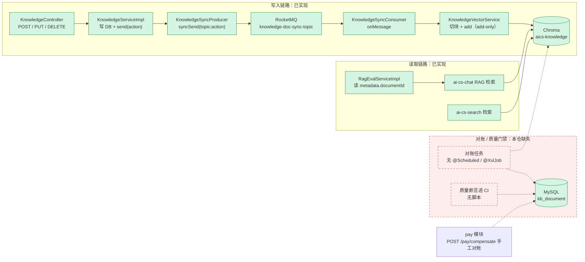
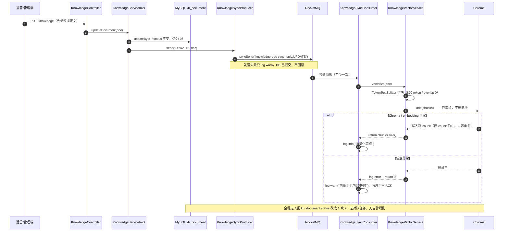
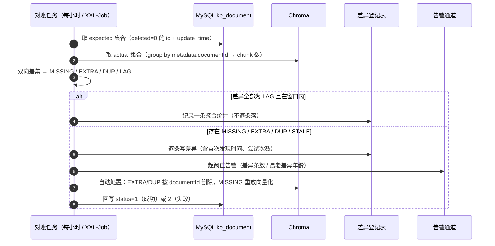

# 数据质量与对账：把"什么算对"写成可自动执行的规则

> **一句话结论**：数据质量不是"出事了查一下对不对"，而是把"什么算对"提前写成可自动执行的断言与对账差分——本仓库的 AI 数据链路（MySQL 文档表 ⇄ Chroma 向量库）已经实现了双写，却没有任何一行对账代码；唯一的对账逻辑在支付模块，而且只能手工调接口触发。
> **阅读前置**：先读同目录 [04-CDC与实时同步链路.md](04-CDC与实时同步链路.md) 与 [07-LLM用量计量与成本分析.md](07-LLM用量计量与成本分析.md)；需要了解 RocketMQ 消费、MyBatis-Plus 逻辑删除、Chroma 向量库的基本用法。
> **证据基线**：证据 A 3 条（Spring AI 源码摘录）· B 16 条（本项目真实文件，行号当次 read 核对）· C 3 组（本机 pwsh / node 实测输出，命令可复现）；预计阅读 45 分钟。

## 证据边界

本篇每一个"本仓有 / 本仓没有"的判断，都按下面三档标注，不含推测：

| 类别 | 本仓状态 | 本篇怎么处理 |
| --- | --- | --- |
| 知识文档双写链路（MySQL → RocketMQ → Chroma） | ✅ 真实存在，代码可读 | B 级逐行引用，行号当次核对 |
| 向量库分块规则（800 token / overlap 0） | ✅ Spring AI 源码摘录在库 | A 级引用 `24-源码分析/assets/source` |
| 对账任务（定时 + 差异落库 + 告警） | ❌ 只有支付模块一处手工对账，无调度、无差异表、无告警 | 明确写成"未落地"，给出可上线的 SQL 与脚本骨架 |
| 数据质量门禁进 CI | ❌ 无质量断言脚本；仅 `learning-docs/tools/check-doc.mjs` 属文档校验 | 只给"怎么接进 CI"的形态与验收判据，不谎称已接入 |
| Chroma 实际向量条数 / chunk 重复率 | ⚠️ 需连 Chroma（`localhost:8000`）才能测 | 标注"未本机实测"，给完整命令 + 判读方法 + 未测原因 |
| Prometheus 告警规则 | ❌ `prometheus.yml` 无 `rule_files`、无 alerting | 只作为"告警侧缺口"引用，不给假告警条数 |

---

## 0. 先看现象

### 现象一：实体说"我有这张表"，主初始化脚本说"没有"

把知识库两个实体与 `deploy/mysql/init.sql`、`deploy/mysql/all-init.sql` 做一次静态对撞（脚本见 6.2，本机真实输出）：

```text
=== 2) 实体 ⇄ DDL 漂移检查 ===
[OK  ] kb_document  init.sql=有  all-init.sql=有  实体字段=12
        仅 DDL 有（实体不映射）: category_id
        仅实体有（DDL 无此列）: (无)
[ERR ] kb_faq  init.sql=无  all-init.sql=无  实体字段=8
```

`ai-cs-knowledge/src/main/java/com/aics/knowledge/entity/KnowledgeFaq.java` 标着 `@TableName("kb_faq")`，但 `kb_faq` 只在 `deploy/mysql/rag-advanced-init.sql:8` 里建。谁只跑了 `init.sql`，谁就得到一个"能启动、一调就 500"的服务——这类问题不是"数据不对"，而是**"什么算对"从没写下来过**。

### 现象二：全仓"对账"提了 10 次，没有一次是自动跑的

```powershell
Get-ChildItem -Recurse -File -Include *.java |
  Where-Object { $_.FullName -notlike '*\learning-docs\*' } |
  Select-String -Pattern '对账|reconcile' | Measure-Object | Select-Object -Expand Count
```

```text
10
```

这 10 处里唯一真正做"跨系统一致性比对"的是支付模块：`ai-cs-pay/src/main/java/com/aics/pay/service/impl/PayCompensationServiceImpl.java:53-66` 检测"流水已成功但订单未支付"的单边账。但它只被 `ai-cs-pay/src/main/java/com/aics/pay/controller/PayController.java:125-128` 的一个 `POST /pay/compensate` 手工端点调用——全仓 `@Scheduled` 只出现在 `ai-cs-order` 的超时扫描里，对账没有任何调度入口（6.4 有真实扫描输出）。

### 现象三：向量化失败只留一行日志，状态字段永远停在 0

`ai-cs-knowledge/src/main/java/com/aics/knowledge/service/KnowledgeVectorService.java:88-91`：

```java
} catch (Exception e) {
    log.error("文档向量化失败: id={}, err={}", doc.getId(), e.getMessage());
    return 0;
}
```

上游 `ai-cs-knowledge/src/main/java/com/aics/knowledge/mq/KnowledgeSyncConsumer.java:66-71` 拿到这个 0 只打一句 `log.warn("向量化无内容/失败: ...")`，然后消息被正常 ACK。再看 DDL 的注释——`deploy/mysql/init.sql:248` 写着 `status TINYINT NOT NULL DEFAULT 0 COMMENT '状态：0-待处理 1-已索引 2-索引失败'`，可全仓没有任何一处把 `status` 改成 1 或 2（`KnowledgeServiceImpl.java:54` 只写了初始值 0）。

**这些现象指向同一件事：本项目把"数据应该长什么样"写在了注释和 javadoc 里，没有写成能跑、能失败、能报警的规则。**

---

## 1. 整体地图



> **读图说明**：看两条箭头。第一条是 `B → C`：`ai-cs-knowledge/src/main/java/com/aics/knowledge/mq/KnowledgeSyncProducer.java:56-60` 用 `catch` 把发送失败吞成一条 `log.warn`，所以 DB 已经写成功、消息可能没发出去——**这是第一次"漏"的机会**。第二条是 `F → G`：`vectorize` 只 `add` 不 `delete`（`KnowledgeVectorService.java:85`），重复消费就重复写——**这是"重"的来源**。如果把 `E → F` 当成"至少一次投递 = 幂等"（javadoc 就是这么写的），就会得出"不用对账"的错误结论。

| 组件 | 责任 | 本仓落点 | 状态 |
| --- | --- | --- | --- |
| 业务写入口 | 写 MySQL 并投递同步消息 | `ai-cs-knowledge/src/main/java/com/aics/knowledge/service/impl/KnowledgeServiceImpl.java:52-60`、`:116-123`、`:135-147` | ✅ |
| 消息生产者 | `syncSend` 到 `knowledge-doc-sync-topic:action` | `ai-cs-knowledge/src/main/java/com/aics/knowledge/mq/KnowledgeSyncProducer.java:44-61` | ⚠️ 失败仅 warn |
| 消息消费者 | 按 action 分发向量化 / 删除 | `ai-cs-knowledge/src/main/java/com/aics/knowledge/mq/KnowledgeSyncConsumer.java:52-78` | ⚠️ 吞异常、忽略返回值 |
| 向量化 | 切块 + 打元数据 + `add` | `ai-cs-knowledge/src/main/java/com/aics/knowledge/service/KnowledgeVectorService.java:69-92` | ⚠️ add-only、失败 return 0 |
| 向量库 | 存 chunk 与元数据 | `ai-cs-knowledge/src/main/resources/application.yml:31`（`aics-knowledge` 集合，三方共用） | ✅ |
| 状态字段 | 表达"已索引 / 索引失败" | `deploy/mysql/init.sql:248` | ❌ 无人推进 |
| 对账任务 | 比对 DB 与向量库 | 无 | ❌ |
| 差异登记表 | 落差异、可闭环 | 无（旧稿设想的 `sync_reconcile_diff` 全仓 0 命中） | ❌ |
| 质量门禁 | 断言进 CI | 无 | ❌ |

---

## 2. 关键概念与关键要素

先给结论：**数据质量的最小可执行单元是"一条会失败的断言"**，不是一张指标看板。下面这些要素决定了断言能写成什么样。

| 名称 | 位置 | 作用 | 关键参数 |
| --- | --- | --- | --- |
| `kb_document.status` | `deploy/mysql/init.sql:248` | 唯一能表达"这篇文档向量化到哪一步"的字段 | 0-待处理 / 1-已索引 / 2-索引失败（**代码只写 0**） |
| `metadata.documentId` | 写入 `KnowledgeVectorService.java:81`，读取 `ai-cs-chat/src/main/java/com/aics/chat/rag/eval/RagEvalServiceImpl.java:118-120` | 把 chunk 反指回业务主键，引用能溯源 | 写入侧存 `Long`，过滤侧拼成带引号字符串（`KnowledgeVectorService.java:109`） |
| `TokenTextSplitter` | `KnowledgeVectorService.java:77`（默认构造） | 决定 chunk 数量与边界 | 800 token / overlap 0 / 最小 350 字符 / 最多 10000 块（A 级证据见 3.6） |
| Chroma 集合 `aics-knowledge` | `ai-cs-knowledge/src/main/resources/application.yml:31`、`ai-cs-chat/src/main/resources/application.yml:49`、`ai-cs-search/src/main/resources/application.yml:43` | 知识库写入与对话/搜索检索共用的唯一集合 | `initialize-schema: false`（启动不校验集合存在） |
| MQ topic `knowledge-doc-sync-topic` | `KnowledgeSyncConsumer.java:35`、`KnowledgeSyncProducer.java:29` | 承载 DB→向量库的增量同步 | `selectorExpression = "*"`，action 作为 tag |
| 逻辑删除 `deleted` | `KnowledgeDocument.java:65-66`（`@TableLogic`）、`deploy/mysql/init.sql:252` | DB 侧"已删"，向量侧靠消息删 | 逻辑删除不产生 DB 物理行变化，**对账必须以 `deleted = 0` 为口径** |
| 对账三种方式 | 本篇 3.5 | 总数 / 明细 / 双向 | 容差、水位窗口、差异分类 |
| Prometheus 抓取 | `deploy/observability/prometheus.yml:3`、`:12-22` | 指标采集（15s、11 个 target） | **无 `rule_files`、无 alerting**：断言失败无法自动报警 |

术语首现解释：

- **断言（assertion）**：一段返回布尔结论的检查，例如"每篇 `deleted = 0` 的文档在向量库里至少有一个 chunk"。它可以写成 SQL（返回违反行）、代码（抛异常）或脚本（非 0 退出码）。
- **对账差分（reconciliation diff）**：把两个系统的同一概念取出来做集合运算，得到 `漏 / 重 / 改 / 延迟` 四类差异，而不是笼统的"不一致"。
- **幂等（idempotency）**：同一操作执行 N 次与执行 1 次结果相同。注意区分"消息幂等"与"数据幂等"——本项目消息能被重复投递，但写向量是追加语义，数据侧不幂等。
- **水位（watermark）**：对账只看"最近一段时间窗口"内的数据，窗口上界就是水位；窗口外的历史漂移必须靠周期性的总量对账兜住。
- **静默失败（silent failure）**：失败路径上只打日志、不改变任何可观测状态（不抛异常、不改状态字段、不打指标）。本仓库 `MeterRegistry` / `Timer.builder` / `Counter.builder` 全仓命中 **0**，所以静默失败连指标都留不下痕迹。

---

## 3. 原理与证据逐段精读

### 3.1 六类质量规则，各自要落成什么形状的可执行物

**在干什么**：把"数据质量"这个抽象词拆成六类可以逐个判定的性质，每类给一个可执行形式；不落到形式上的规则，等于没有规则。

| 规则 | 什么叫"对" | 可执行形式 | 断言骨架（示意，表名以本仓为准） | 本仓现状 |
| --- | --- | --- | --- | --- |
| 完整性 | 必填字段不为空、必存记录不缺 | SQL 断言：违反行数 = 0 | `SELECT COUNT(*) FROM model_usage WHERE request_id IS NULL` | ⚠️ 该列可空（`deploy/mysql/llm-observability-init.sql:31`） |
| 唯一性 | 同一业务键只有一行 | SQL 断言：`GROUP BY ... HAVING COUNT(*) > 1` 为空 | `SELECT request_id, COUNT(*) c FROM model_usage GROUP BY request_id HAVING c > 1` | ❌ 该列无唯一约束 |
| 有效性 | 值在合法域内、恒等式成立 | SQL 断言 + 代码断言（枚举校验、非法值抛异常） | `WHERE total_tokens <> input_tokens + output_tokens` | ❌ 无校验 |
| 一致性 | 两个系统/两处口径对同一事实说法相同 | 对账差分（总数 / 明细 / 双向） | `kb_document` id 集合 ⊖ 向量库 documentId 集合 | ❌ 无对账 |
| 及时性 | 数据在预期延迟内到达 | 水位断言：`MAX(update_time)` 落后当前时间 < 阈值 | `SELECT MAX(update_time) FROM kb_document WHERE deleted = 0` | ❌ 无水位检查 |
| 准确性 | 值与真实世界相符 | 抽样对账 + golden 集回归 + 人工复核 | `RagEvalServiceImpl` 的 Recall@k / HitRate 门禁 | ⚠️ 评估框架有，门禁阈值未进 CI |

**为什么这么设计**：六类规则的"成本"差别极大。完整性与唯一性是**库表内自证**（一条 SQL，毫秒级）；一致性要跨系统（要拉两边数据）；准确性只能靠抽样和标准集。把它们混成一句"数据要准"，就会得到一张永远没人看的周报。

**换写法会怎样**：如果只写"每天跑一个巡检脚本把结果发钉钉"，那叫**巡检**不叫**规则**：没人定义阈值、没人定义违反后怎么办、脚本挂了也没人知道（本仓 `prometheus.yml` 没有告警规则，巡检脚本挂了不会有任何信号）。写成"断言 + 退出码 + 断言清单版本化"，才能进 CI、才能在门禁上卡住变更。

**常见坑**：把"能查出来"当成"已经管住了"。断言必须自带三件事：**口径（哪些行算在内）、阈值（多少算违反）、动作（违反后谁被通知/被阻断）**。缺任何一件，它只是一段查询。

### 3.2 完整性：从"看空值率"到"必须有值"

**在干什么**：把"这个字段不能空"从一句口头约定，变成一条返回 0 行的 SQL 或一条抛异常的代码断言。

本仓有一处真实的完整性缺口，就在 AI 用量双写链路上：

```sql
-- deploy/mysql/llm-observability-init.sql:12-26 → llm_trace.request_id 是主键
CREATE TABLE IF NOT EXISTS llm_trace (
    request_id   VARCHAR(64) NOT NULL,
    ...
    PRIMARY KEY (request_id)
);

-- deploy/mysql/llm-observability-init.sql:29-49 → model_usage.request_id 却可空、且无唯一约束
CREATE TABLE IF NOT EXISTS model_usage (
    id           BIGINT NOT NULL AUTO_INCREMENT,
    request_id   VARCHAR(64) DEFAULT NULL,
    ...
    PRIMARY KEY (id),
    KEY idx_user_time (user_id, create_time)
);
```

同一件事（一次 LLM 调用）在两张表里，一张把 `request_id` 当主键，另一张允许它为空、还允许重复。**完整性规则的第一条就该是：`model_usage.request_id` 非空且唯一**，否则后面所有"按 request_id 关联"的对账都建立在流沙上。

```sql
-- 断言 A1（完整性）：必须非空的列，违反行数应为 0
SELECT COUNT(*) AS violations
FROM model_usage
WHERE request_id IS NULL OR request_id = '';

-- 断言 A2（完整性，向量侧）：每篇未删文档都应有至少一个 chunk（对账侧执行，见 3.5）
SELECT COUNT(*) AS docs_without_chunk
FROM kb_document d
WHERE d.deleted = 0
  AND NOT EXISTS (SELECT 1 FROM vector_chunk_landing v WHERE v.document_id = d.id);
```

**为什么这么设计**：完整性断言最便宜、最该前置。它不依赖任何外部系统，可以在 CI 里对着 schema 空跑（甚至不用真数据），把"这个字段能不能空"变成 `NOT NULL` 约束而不是查询习惯。

**换写法会怎样**：写成"每天统计空值率，超过 1% 报警"也能用，但它默认了"少量空值是正常的"——对 `request_id` 这种关联键，1% 的空值就是 1% 的账对不上。对**关联键/主键类字段**，正确的形式是二值断言（0 或非 0），不是比率监控。

**常见坑**：`DEFAULT NULL` 与 `IS NULL` 之外还有空串和 `0`。MySQL 里 `request_id = ''` 不算 NULL，`COUNT(*)` 与 `COUNT(request_id)` 的差也不是你以为的那个差；断言要么显式列三种情况（3.2 的 A1），要么用 `NULLIF(TRIM(request_id), '') IS NULL`。

### 3.3 唯一性与主键：质量的第一道闸，也是幂等的边界

**在干什么**：用主键/唯一键把"重复"挡在写入侧；挡不住的（跨系统、跨存储）才交给对账。

本仓已有的唯一约束说明作者知道这件事：

| 表 | 约束 | 位置 | 含义 |
| --- | --- | --- | --- |
| `kb_document_tag` | `UNIQUE KEY uk_document_tag (document_id, tag_id)` | `deploy/mysql/init.sql:271-279` | 同一文档同一标签只能挂一次 |
| `kb_tag` | `uk_name` | `deploy/mysql/init.sql:262-268` | 标签名全局唯一 |
| `model_usage_quota` | `UNIQUE KEY uk_user_scenario (user_id, scenario)` | `deploy/mysql/llm-observability-init.sql:52-64` | 配额行天然单例，`UPDATE` 可幂等 |
| `llm_trace` | `PRIMARY KEY (request_id)` | `deploy/mysql/llm-observability-init.sql:12-26` | 同一请求只能有一条轨迹，重放即覆盖 |
| `model_usage` | **只有自增主键** | `deploy/mysql/llm-observability-init.sql:29-49` | 双写重放会产生重复行 |

`ai-cs-knowledge/src/main/java/com/aics/knowledge/entity/KnowledgeDocument.java:29-30` 用的是 `@TableId(type = IdType.ASSIGN_ID)`（雪花 ID），代码注释的理由是"避免自增 ID 跨库冲突"。这个选择直接影响质量与幂等：**主键由应用生成，意味着"同一条业务事实"在重试时可能拿到两个不同 ID**——除非调用方复用同一个 ID。雪花 ID 保证了唯一性，但不保证幂等。

```sql
-- 断言 U1（唯一性）：用量表按 request_id 是否重复
SELECT request_id, COUNT(*) AS cnt
FROM model_usage
WHERE request_id IS NOT NULL
GROUP BY request_id
HAVING cnt > 1
ORDER BY cnt DESC
LIMIT 50;

-- 断言 U2（唯一性，业务幂等）：同一标题的未删文档是否重复（demo 数据直插 DB 的典型后果）
SELECT title, COUNT(*) AS cnt
FROM kb_document
WHERE deleted = 0
GROUP BY title
HAVING cnt > 1;
```

**为什么这么设计**：唯一键是唯一"零运维成本"的质量保证——违反时数据库直接报错，不需要任何巡检。所以规则设计的顺序应是：**能在 DDL 表达的，不要写成 SQL 断言；能写成 SQL 断言的，不要写成人工巡检。**

**换写法会怎样**：把唯一性交给"程序里先查再插"（check-then-act），在并发下必然漏；把唯一性交给"事后 GROUP BY 巡检"，则已经脏了的数据要人工清洗，而且清洗动作本身需要幂等（改一次和改十次结果一致）。

**常见坑**：逻辑删除与唯一键天然冲突——`kb_document_tag` 若带 `deleted` 列，`UNIQUE (document_id, tag_id)` 会让"删了再加"直接失败。本仓该表没有 `deleted` 列（`deploy/mysql/init.sql:271-279`），所以物理删除语义，这一点在写清理脚本时必须知道。

### 3.4 有效性：把恒等式写成断言，而不是写成注释

**在干什么**：检查"值的域"和"值之间的关系"——枚举合法、非负、恒等式成立。

`deploy/mysql/llm-observability-init.sql:37-41` 定义了三组 token 与费用字段：

```sql
    input_tokens    INT             NOT NULL DEFAULT 0 COMMENT '输入token数',
    output_tokens   INT             NOT NULL DEFAULT 0 COMMENT '输出token数',
    total_tokens    INT             NOT NULL DEFAULT 0 COMMENT '总token数',
    estimated_cost  DECIMAL(12,6)   NOT NULL DEFAULT 0 COMMENT '预估费用（元）',
    estimated       TINYINT         NOT NULL DEFAULT 1 COMMENT '是否预估值：1-是 0-否',
```

于是有三条免费的有效性断言：

```sql
-- 断言 V1（恒等式）：总 token 必须等于两段之和
SELECT COUNT(*) AS violations
FROM model_usage
WHERE total_tokens <> input_tokens + output_tokens;

-- 断言 V2（域）：费用与 token 均不得为负
SELECT COUNT(*) AS violations
FROM model_usage
WHERE estimated_cost < 0 OR input_tokens < 0 OR output_tokens < 0;

-- 断言 V3（枚举）：scenario 必须在已知集合内（集合值从代码常量/DTO 取，勿凭印象写）
SELECT scenario, COUNT(*) AS cnt
FROM model_usage
GROUP BY scenario
ORDER BY cnt DESC;
```

`DECIMAL(12,6)` 是个值得单独讲的细节：6 位小数足以表达"厘"级以下的单价折算，但**精度上限 12 位整数部分意味着金额上限 999999.999999**——如果哪天有人用"分"而不是"元"写库，这一列会静默截断（MySQL 严格模式下是报错，非严格模式下是截断加告警）。所以 V2 之外还该有一条"量级断言"：`estimated_cost` 的 P99 是否在合理数量级。

**为什么这么设计**：恒等式断言的误报率极低、解释成本极低（"3+5≠9 就是错的"），是性价比最高的一类断言。它甚至不需要你知道业务含义，只需要知道字段之间的代数关系。

**换写法会怎样**：把恒等式写进代码（每次写入前 assert）只覆盖新数据，历史脏数据永远发现不了；写进注释等于没写。写在 SQL 里则可以对着任何一份历史快照重放。

**常见坑**：`SUM()` 与 `COUNT()` 在 NULL 上的行为差异会让断言"看起来很干净"——`total_tokens` 若为 NULL，`<>` 比较结果是 NULL，`WHERE` 不会命中该行，断言返回 0 行"全对"。所以有效性断言要么先保证 `NOT NULL`（DDL 层），要么显式加 `OR total_tokens IS NULL`。

### 3.5 一致性：跨系统对账的三种方式与四类差异

**在干什么**：同一件事在两个系统里各存一份（本项目：`kb_document` 在 MySQL，chunk 在 Chroma），把它们取出来做集合运算，得出差异并分类。

| 方式 | 做法 | 成本 | 能发现 | 发现不了 |
| --- | --- | --- | --- | --- |
| 总数对账 | 两边各取 `COUNT(*)` 比大小 | 最低（一条聚合） | 粗粒度的漏/重 | 条数相等但内容错位（一篇文档多 3 个 chunk、另一篇少 3 个，总数恰好相等） |
| 明细对账 | 取主键集合做差集（左差、右差） | 中（一次全量 ID 拉取） | 精确的漏与多（EXTRA） | 主键对得上但内容过期的"改" |
| 双向对账 | 两侧各做一次"以我为基准的差集 + 内容版本比对" | 最高（要带版本/时间戳） | 漏、重、改、延迟全四类 | 两侧都没有的"该有却没有"（需要第三条基准，如源文件系统） |

四类差异必须先分类再处置，否则会写出"发现不一致就全量重建"这种把故障放大十倍的操作：

| 差异 | 判定条件（以文档双向同步为例） | 处置 |
| --- | --- | --- |
| 漏（MISSING） | MySQL 有 `deleted = 0` 的行，向量库无对应 `documentId` | 重放一次向量化（幂等的前提是先删旧 chunk） |
| 重（EXTRA/DUP） | 向量库有、MySQL 无或已 `deleted = 1`；或同一 `documentId` 的 chunk 数远超单次切块结果 | 按 `documentId` 过滤删除，再重建 |
| 改（STALE） | 两侧都有，但向量侧内容/更新时间落后于 MySQL | 以 MySQL 为准整篇重切（chunk 边界会变，不能增量打补丁） |
| 延迟（LAG） | 差异出现在"水位窗口"内且正在收敛 | **不处置**，只记录；把它当差异处理会引发对账风暴 |

**为什么这么设计**：对账的本质是**用一个便宜的事实去约束一个昂贵的系统**。总数对账便宜所以高频跑，明细对账贵所以低频跑，双向对账最贵所以只在发布后/大修后跑。四种差异分完类，才知道哪些能自动修、哪些只能人工看。

**换写法会怎样**：只做总数对账，本项目会漏掉最典型的病——`vectorize` 是 add-only（3.6），重复消费让某篇文档的 chunk 从 3 个变 6 个，总数**恰好**也被别处的漏补齐时，总数对账通过、明细对账报警。反过来只做明细对账，成本高到没人愿意每小时跑。

**常见坑**：①比较口径不一致——MySQL 侧必须 `WHERE deleted = 0`，否则"逻辑删除的文档"会被判成向量库多余的 EXTRA；②ID 类型不一致——向量侧 `documentId` 存的是 `Long`（`KnowledgeVectorService.java:81`），脚本里如果当字符串比，`123` 与 `"123"` 的集合运算结果取决于语言（JS 的 `Set` 会当成不同元素）；③把"延迟"当"漏"批量重建，等于给正在工作的消费者加压。

### 3.6 幂等：为什么 add-only 必然产生重复 chunk

**在干什么**：检查写入侧对"同一操作重复执行"的语义。`KnowledgeVectorService.vectorize` 的实现是：切块 → 打元数据 → `add`，**没有任何删除动作**。

`ai-cs-knowledge/src/main/java/com/aics/knowledge/service/KnowledgeVectorService.java:69-92`（节选，`:88-91` 是异常兜底）：

```java
List<Document> chunks = new TokenTextSplitter().split(new Document(doc.getContent()));
chunks.forEach(chunk -> {
    chunk.getMetadata().put("knowledgeBase", KNOWLEDGE_BASE);
    chunk.getMetadata().put("documentId", doc.getId());
    chunk.getMetadata().put("title", doc.getTitle());
});
vectorStore.add(chunks);
```

为什么"add-only + 重复消费"必然重复，需要看框架语义（A 级证据，`24-源码分析/assets/source` 摘录）：

```java (src: VectorStore.java.md#L46-L51)
/**
 * Adds list of {@link Document}s to the vector store.
 * @param documents the list of documents to store. Throws an exception if the
 * underlying provider checks for duplicate IDs.
 */
void add(List<Document> documents);
```

```java (src: VectorStore.java.md#L62-L82)
 * Write semantics are replace-by-id: if an entry's document id already exists, the
 * existing row is replaced; otherwise a new row is inserted. ... This is in contrast
 * to {@link #add(List)}, whose behavior for a repeated id is left to the underlying
 * provider.
default void upsert(List<EmbeddedDocument> entries) {
    throw new UnsupportedOperationException(getName() + " does not support upsert");
}
```

两块证据拼起来就是结论：`add` 对"重复 id"的行为**交给底层 provider**，而 `upsert` 才有 replace-by-id 语义。切块时 Spring AI 给每个 chunk **新生成** id（不是"文档 id + 序号"这种稳定 id），所以第二次 `add` 是"一批新 id"，provider 眼里完全没有重复——重复的是内容，不是 id。

再看切块规则（A 级，`TokenTextSplitter.java.md`）：

```java (src: TokenTextSplitter.java.md#L41-L53)
private static final int DEFAULT_CHUNK_SIZE = 800;
private static final int DEFAULT_CHUNK_OVERLAP = 0;
private static final int MIN_CHUNK_SIZE_CHARS = 350;
private static final int MAX_NUM_CHUNKS = 10000;
private static final List<Character> DEFAULT_PUNCTUATION_MARKS = List.of('.', '?', '!', '\n');
```

这四条常量决定了"重复 chunk 没法靠内容去重"：`overlap = 0` 意味着边界处没有重叠区可以当锚点，切分点由标点 + 最小 350 字符共同决定，正文改动一个句号就可能让后续所有边界平移。而写入的元数据只有 `knowledgeBase / documentId / title` 三个键（`KnowledgeVectorService.java:79-83`），**没有原文偏移量（offset）**——所以框架给不了、代码也没存"这个 chunk 对应正文第几段"。

**为什么这么设计**：这三层（框架 add 语义、切块非确定性边界、元数据无偏移）合起来意味着：**向量库里的 chunk 不可能被增量"修正"，只能整篇删掉重切**。这恰恰是幂等实现必须"先删后加"的根本原因，而不是风格偏好。

**换写法会怎样**：正确写法是 `vectorize` 开头先 `delete("documentId == '"+id+"'")` 再 `add`——本仓已有现成方法 `deleteByDocumentId`（`KnowledgeVectorService.java:103-116`），只是没人调用它。更彻底的写法是给 chunk 赋稳定 id（`docId + "#" + index`）并改用 `upsert`，但要注意 `upsert` 默认抛 `UnsupportedOperationException`（上引摘录第 80-82 行），Chroma 侧是否支持需要单独验证——本机未连 Chroma，**未实测**。

**常见坑**：javadoc 与实现不符是本仓的集中病灶：`ai-cs-knowledge/src/main/java/com/aics/knowledge/mq/KnowledgeSyncConsumer.java:25-26` 明写"基于 documentId 元数据做 delete + add，重复消费 UPDATE 会先删除旧分块再写入新分块，结果幂等"，`ai-cs-knowledge/src/main/java/com/aics/knowledge/service/impl/KnowledgeServiceImpl.java:109-110` 也这么承诺——但 `vectorize` 里没有 delete。**读代码时以实现为准，注释只能当"设计意图"读。**

### 3.7 静默失败：两次丢失机会与一个永远不推进的状态机

**在干什么**：沿着"DB 写成功 → 向量库里真的有"这条路径，数一数有多少个地方会无声地丢数据。

| 环节 | 丢失条件 | 代码位置 | 留下的痕迹 |
| --- | --- | --- | --- |
| 生产端 | `syncSend` 抛异常（MQ 不可用/超时） | `KnowledgeSyncProducer.java:56-60` | 一条 `log.warn`；DB 不回滚；无状态字段、无指标 |
| 消费端向量化 | embedding/Chroma 异常 | `KnowledgeVectorService.java:88-91` | 一条 `log.error` + `return 0` |
| 消费端分支 | `chunks == 0`（内容空或失败） | `KnowledgeSyncConsumer.java:69-71` | 一条 `log.warn`，消息正常 ACK |
| 删除分支 | `deleteByDocumentId` 返回 `false` | `KnowledgeSyncConsumer.java:57-59` | **返回值被丢弃**，仍打 `log.info("向量删除完成")` |
| 消费端异常 | 任何 RuntimeException | `KnowledgeSyncConsumer.java:73-77` | `log.error` 后吞掉，不抛 |

最刺眼的是删除分支，`ai-cs-knowledge/src/main/java/com/aics/knowledge/mq/KnowledgeSyncConsumer.java:57-59`：

```java
if ("DELETE".equals(action)) {
    knowledgeVectorService.deleteByDocumentId(message.getDocumentId());
    log.info("向量删除完成: documentId={}", message.getDocumentId());
}
```

`deleteByDocumentId` 的签名是 `public boolean`（`KnowledgeVectorService.java:103`），失败时 `return false`（`:112-115`）。上面这段把返回值丢掉并在**下一行无条件**打印"向量删除完成"——于是"删除失败"和"删除成功"在日志里长得一模一样。

**为什么这么设计**：这些 `catch` 不是随手写的，注释写明了动机——`KnowledgeSyncConsumer.java:76` 说"不抛异常，避免阻塞后续消息消费"，`KnowledgeSyncProducer.java:38`、`:57` 说"发送失败不影响 DB 操作"。这个动机本身没错（避免一个坏消息毒化整条链路），但它把"重试"和"发现"一起关掉了：不抛异常 → RocketMQ 不会重投 → 死信队列也不会有记录；而 `KnowledgeSyncConsumer.java:27-28` 的 javadoc 还写着"消费异常被 catch 吞掉（不抛出），由 RocketMQ 默认重试 16 次后进入死信队列"——**吞掉异常就不存在重试，这句话自相矛盾**。

**换写法会怎样**：正确形态是"有限重试 + 失败落库 + 状态可查"：抛出让 MQ 重试（像 `ai-cs-search/src/main/java/com/aics/search/cdc/ProductCdcConsumer.java:61-64` 那样 `throw new IllegalStateException(...)`），重试耗尽后由死信/补偿任务落一条差异记录，并把 `kb_document.status` 置为 2。本项目连状态机都没接上：`status` 的三个取值（0/1/2）里，代码只写 0。

**常见坑**：`return 0` 同时承担"内容为空"和"向量化失败"两种含义（`KnowledgeVectorService.java:70-73` 与 `:88-91`），调用方无法区分；对账时也不能用"返回值 0"当"这篇文档不该有 chunk"的依据。要区分，必须引入三态（成功 / 无内容跳过 / 失败）。

### 3.8 及时性：用"水位 + 延迟"表达，别用"有没有"

**在干什么**：检查数据是否在预期时间内抵达。及时性最容易被写成"最新一条数据的时间戳是多少"，但它真正要回答的是：**最老的那条"该到还没到"的数据，等了多久**。

本仓能提供的时间线索有限但够用：

| 线索 | 位置 | 用途 |
| --- | --- | --- |
| `kb_document.update_time` | `deploy/mysql/init.sql:251`（`ON UPDATE CURRENT_TIMESTAMP`） | 业务侧最后变更时间，水位基准 |
| 向量侧元数据 | `KnowledgeVectorService.java:79-83` 只有 `knowledgeBase/documentId/title` | **没有写入时间**，无法判断向量版本新旧 |
| binlog 保留窗 | `deploy/mysql/master.cnf:11`（`expire-logs-days=7`） | CDC 最多可回放 7 天，超过就只能全量重建 |
| 慢查询门槛 | `deploy/mysql/master.cnf:31`（`long-query-time=2`） | 对账 SQL 自己变慢时的第一手证据 |

```sql
-- 断言 T1（及时性）：未删文档里最老的"未索引"文档已经等了多久
SELECT MIN(update_time) AS oldest_pending,
       TIMESTAMPDIFF(MINUTE, MIN(update_time), NOW()) AS lag_minutes
FROM kb_document
WHERE deleted = 0 AND status = 0;

-- 断言 T2（及时性）：按小时看文档变更量，用于给 lag 阈值定基线（先观测，别拍脑袋定阈值）
SELECT DATE_FORMAT(update_time, '%Y-%m-%d %H') AS hour_bucket, COUNT(*) AS docs
FROM kb_document
WHERE deleted = 0 AND update_time >= NOW() - INTERVAL 24 HOUR
GROUP BY hour_bucket
ORDER BY hour_bucket;
```

**为什么这么设计**：`lag_minutes` 是唯一能同时表达"及时性"与"数据在动"的指标：它变大意味着积压，它恒为 NULL 意味着没有待处理数据（好事），它恒为 0 反而可疑（说明 `status` 从来没被写过 0 以外的值——本仓的现状）。

**换写法会怎样**：写成"每天看一次文档总数有没有涨"，会漏掉"涨了但没进向量库"。写成"监控 MQ 堆积量"只覆盖消息在途，覆盖不了"消息已被 ACK 但向量化失败"（3.7）。

**常见坑**：`update_time` 是 `ON UPDATE CURRENT_TIMESTAMP`，对账脚本只要 `UPDATE` 过该行就会刷新它，于是"延迟"被自己抹平——对账任务必须是**只读**的，这条不是为了"安全"，是为了不污染判据。

### 3.9 引用回指与 golden 集：AI 数据独有的两类质量

**在干什么**：检查两类只有 AI 链路才有的质量问题——①检索出来的 chunk 能不能回指到业务文档（引用可溯源）；②评估用的 golden 集是否还和当前索引对得上（评估基线漂移）。

回指链路的实现是"写入时打 `documentId`，检索时读 `documentId`"：

```java
// 写入侧：ai-cs-knowledge/src/main/java/com/aics/knowledge/service/KnowledgeVectorService.java:81
chunk.getMetadata().put("documentId", doc.getId());
```

```java
// 读取侧：ai-cs-chat/src/main/java/com/aics/chat/rag/eval/RagEvalServiceImpl.java:118-120
List<String> retrievedIds = docs.stream()
        .map(d -> String.valueOf(d.getMetadata().getOrDefault("documentId", d.getId())))
        .toList();
```

`getOrDefault` 的兜底值是 chunk 自己的 id。这意味着**一旦元数据写丢，引用不会报错，只会静默退化成 chunk id**——UI 上表现为"来源显示一串 UUID"，日志上什么异常都没有。这类"降级而不报错"的写法，必须配一条断言：

```sql
-- 断言 C1（回指）：向量侧每一行都必须带非空 documentId（在向量库侧执行，见 6.6）
SELECT COUNT(*) AS chunks_without_docid FROM <collection> WHERE metadata.documentId IS NULL;
```

golden 集的漂移则是另一个形态：`RagEvalServiceImpl.java:95` 从 `request.getGoldenSetPath()` 加载用例，用例里带 `expectedDocumentIds`（`:121`），指标由 `RetrievalMetrics.compute(retrievedIds, expectedIds, topK)` 算出（`:123`）。**如果文档被重新入库、`id` 变了（例如 demo 数据重灌、或换成雪花 ID 后重建），golden 集里写死的 `expectedDocumentIds` 立刻全部失效**——指标从"0.8"掉到"0"，看起来像"检索退化了"，实际是基线漂移。

**为什么这么设计**：业务数据的 golden 集一般用业务主键（订单号），稳定；AI 数据的 golden 集用"文档 id + chunk 命中"，而 chunk 是**派生数据**（一份文档切出 N 块，每次切分 id 都变）。用派生数据的 id 当断言基准，就必须配套"派生数据可重建且 id 稳定"的保证，否则基线会自己漂。

**换写法会怎样**：把 `expectedDocumentIds` 换成 `expectedDocumentTitles` 或业务单号，漂移率会显著下降（标题比 chunk id 稳定），但会引入"改名即失效"的新问题。折中做法是 golden 集记"业务键 + 允许的等价集合"，评估脚本先做一次"golden 集可解析性检查"（每条用例的 expected id 是否还存在于 `kb_document`），不通过就先修集再跑指标。

**常见坑**：指标全 0 时第一反应常是"检索坏了"，而真实原因往往是"golden 集过期"。两者在报告里长得一样，区别在于：检索坏了 `retrievedIds` 有值但都不匹配，golden 集过期则是 `expectedIds` 里的 id 在库里根本不存在——**先查 `expectedIds` 的存在性，再查检索质量**。

### 3.10 质量门禁进 CI：让断言有退出码

**在干什么**：把 3.1~3.9 的断言从"文档里的 SQL"变成"流水线里会红的一步"。门禁的最小形态是三条：

1. **schema 门禁**（秒级、无需数据）：实体字段 ⇄ DDL 列一致，`@TableName` 指向的表在主初始化脚本里存在。本仓现状就有两处红灯（现象一、6.2）。
2. **契约门禁**（秒级、无需数据）：写入侧元数据键 ⊇ 读取侧读取键；三服务 `collection-name` 相同。本仓这两条目前是绿的（6.3 输出）。
3. **数据门禁**（需要可连的测试库）：3.2/3.4 的断言返回 0 行，且 3.5 的明细对账差异集合为空或全部落在"延迟"类。

| 门禁 | 触发时机 | 失败后果 | 本仓现状 |
| --- | --- | --- | --- |
| schema 门禁 | 每次 PR | 阻断合并 | ❌ 无 |
| 契约门禁 | 每次 PR | 阻断合并 | ❌ 无 |
| 数据门禁（断言） | 每日 + 发布前 | 阻断发布 / 开差异单 | ❌ 无 |
| 对账（明细） | 每小时（业务低峰） | 自动修复漏/重，人工看改 | ❌ 无 |

**为什么这么设计**：质量规则的价值 = 被发现的速度 × 被修复的概率。schema 与契约门禁不需要任何环境，跑得最快，所以最该先上；数据门禁依赖测试库，可以晚一步；对账需要真实两侧数据，最后上。

**换写法会怎样**：把三类都塞进一个"每日巡检脚本"，代价是发布前的 schema 漂移要等到第二天才发现——而 schema 漂移的修复成本随时间指数上升（已经按错误 schema 写入的数据要清洗）。

**常见坑**：门禁没有"基线豁免"机制。历史脏数据（如 `model_usage.request_id` 已有空值）会让断言一上线就红，团队于是把它调成 `--warn-only`，从此形同虚设。正确做法是先跑一次"盘点"（把违反行导出成基线表），门禁只对"新增违反"报警（`违反数 > 基线数`），基线条目逐条清零。

---

## 4. 一次完整执行时序

### 4.1 现状：一次 UPDATE 从写入到"以为成功"



> **读图说明**：盯两个箭头。①`VS->>CH: add(chunks)`——这里**没有前置的 delete**，所以第 8 步的"写入新 chunk"是把结果变成"旧 3 块 + 新 3 块"。②`VS-->>C: log.error + return 0` 之后紧跟的 `消息正常 ACK`——这是整张图最贵的一条箭头：失败被"确认成功"了，RocketMQ 不会再投，死信队列也不会有记录。若把这条看成"失败会重试"，就会得出"重复只可能来自上游重放"的错误结论，进而漏掉本地最稳定的重复源（每次 UPDATE 都重复）。

### 4.2 目标态：加上对账、状态回写与差异登记



> **读图说明**：与 4.1 对比看"谁在兜底"。4.1 的终点是"日志"，4.2 的终点是"差异表 + 告警 + 状态回写"——**对账不是替代双写，而是给双写加一个闭环**。看错的关键箭头是 `J->>DB: 回写 status`：如果不回写，下一轮对账仍然只能靠"猜"文档是否已索引，`status` 继续是死字段。

### 4.3 每一步该怎么判读

| 步 | 该看什么 | 怎么判读 | 判错的后果 |
| --- | --- | --- | --- |
| 3 | `kb_document.update_time` 是否变化 | 变了但 `status` 仍 0 = 消息可能没发出去 | 只看 update_time 会以为"同步成功" |
| 5 | 生产端是否出现 `同步消息投递失败` warn | 出现即"DB 有、消息无"，属 MISSING | 当噪音忽略 → 永久漏同步 |
| 7 | 同一 `documentId` 的 chunk 数是否等于上次 | 变大 = add-only 重复（DUP） | 当成"文档变长了"→ 越滚越多 |
| 8 | `log.error("文档向量化失败")` 后是否还有重试 | 没有重试 = 必须靠对账兜 | 以为 MQ 会重试 → 差异永不自愈 |
| 10 | 消息是否被 ACK | 有 warn 但无重投 = 静默丢失 | 排查方向跑偏到 MQ |
| 目标态 3 | 差异集合的四类计数 | LAG 占比高说明是延迟不是错；DUP 占比高说明幂等没做 | 一律当"数据错了"→ 重建风暴 |

---

## 5. 设计取舍

### 5.1 六个必须做选择的点

| 取舍点 | 选项 A | 选项 B | 本仓推荐与理由 |
| --- | --- | --- | --- |
| 规则载体 | 写进业务代码（Java 断言） | 写成 SQL / 脚本（外部断言） | **以 B 为主**：规则要能被开发、DBA、CI 三种角色各自执行；只有"无库可查"的契约类规则（元数据键、collection 名）只能放代码侧（见 6.3） |
| 检测口径 | 单边自检（只看 `status` 字段） | 双向差集（两侧各取集合再比） | **B**：单边自检发现不了"向量库多出 3 份"和"DB 看着正常但向量库一条没有"这两种形态 |
| 修复动作 | 自动修复 | 只报告 | **分级**：漏（MISSING）与重（DUP）可自动；改（CHANGED）与延迟（LAG）只报告，否则会把"上游正在写"当成"数据错了"再覆盖回去 |
| 触发方式 | 服务内 `@Scheduled` | 独立脚本 / CI / 调度平台 | **独立**：本仓 `@Scheduled` 真注解只有 1 处（6.5），XXL-Job 默认关闭（`ai-cs-order/src/main/java/com/aics/order/task/XxlJobConfig.java:23`），把对账塞进知识库服务等于让业务进程承担运维职责 |
| 差异落地 | 只打日志 | 差异登记表 | **B**：`ai-cs-pay/src/main/java/com/aics/pay/service/impl/PayCompensationServiceImpl.java:68-72` 现在就是返回 `LinkedHashMap` + `log.info`，差异不落库 ⇒ 无法统计"最老差异年龄" |
| 容差 | 严格相等 | 时间窗内算延迟 | **B**：双写天然延迟是秒级，严格相等会让 LAG 天天报警，最后被静音 |

### 5.2 三条可立即上线的对账物

三条都只读、都不依赖新建表，可以直接在只读账号上跑。依据全部来自两个真实文件：`ai-cs-knowledge/src/main/java/com/aics/knowledge/service/KnowledgeVectorService.java:69-92`（写入只 `add`、失败 `return 0`）与 `ai-cs-knowledge/src/main/java/com/aics/knowledge/mq/KnowledgeSyncConsumer.java:57-59`（删除结果被丢弃），以及 `deploy/mysql/init.sql:247-253`（`category_id`、`status` 注释、`PRIMARY KEY(id)`）。

**R1：缺向量文档（MISSING，"漏"）**——expected 来自 DB，actual 来自向量库。

```sql
-- 输入：向量侧按 metadata.documentId 分组后的 id 清单（由 6.6 的脚本导出，逗号分隔）
-- 依据：kb_document.deleted(@TableLogic) + status(0-待处理 1-已索引 2-索引失败)
SELECT d.id, d.title, d.status, d.update_time,
       TIMESTAMPDIFF(MINUTE, d.update_time, NOW()) AS pending_minutes
FROM kb_document d
WHERE d.deleted = 0
  AND d.id NOT IN (9001, 9002, 9003 /* ← 向量侧 id 清单 */)
ORDER BY pending_minutes DESC;
```

判读三列：`status` / `pending_minutes` / `id`。`status=2` 是"曾经失败过"，`status=0 且 pending_minutes` 小的是 LAG（还在路上），`pending_minutes` 大且 `status` 仍是 0 的就是真漏。注意本仓**没有任何代码把 status 写成 1 或 2**（3.5），所以这一列目前恒为 0/种子值，不能当成"已索引"的证据——这也是为什么 R1 必须靠差集而不是靠 `status` 过滤。

**R2：孤儿向量（EXTRA，"多"）**——向量库有、业务表没有（或已逻辑删除）。

```sql
-- 输入：向量侧 documentId 清单，展开成派生表后反查
SELECT v.document_id, 'NOT_IN_DB' AS reason
FROM (
    SELECT 9001 AS document_id
    UNION ALL SELECT 9002
    UNION ALL SELECT 9999
) v
LEFT JOIN kb_document d ON d.id = v.document_id AND d.deleted = 0
WHERE d.id IS NULL;
```

`deleted = 0` 必须写进 `ON` 而不是 `WHERE`：写进 `WHERE` 会让"已逻辑删除的文档"和"表里根本没有"无法区分，而这两类的处置完全不同（前者是删除消息丢了，后者是历史脏数据，本仓 `deploy/mysql/demo-data.sql:48` 直插 DB 的那批就是后者）。

**R3：重复 chunk（DUP，"重"）**——同一 `documentId` 下内容重复计数 > 1。

```sql
-- 输入：向量侧落地表 vector_chunk_landing(document_id BIGINT, chunk_count INT, distinct_text INT)
-- distinct_text = COUNT(DISTINCT chunk 文本)，由导出脚本算好
SELECT l.document_id, l.chunk_count, l.distinct_text,
       l.chunk_count - l.distinct_text AS dup_extra
FROM vector_chunk_landing l
JOIN kb_document d ON d.id = l.document_id
WHERE l.chunk_count > l.distinct_text
ORDER BY dup_extra DESC;
```

这条判据是**严格**的，不需要拍阈值：切分器默认 `overlap = 0`（见 3.3 引的 `TokenTextSplitter.java.md#L41-L53`），块与块之间本应互不重复，因此"块数 > 文本去重后的块数"只能是重复写入。反过来说，如果有人把 overlap 调成 500，这条断言会立刻假阳性——**改切分参数时必须一起改判据**，这是对账与实现耦合的地方，要在代码里注释写死。

**R4（附加）：AI 用量双写差集**——`llm_trace` 与 `model_usage` 按 `request_id` 对账。

```sql
SELECT t.request_id
FROM llm_trace t
LEFT JOIN model_usage u ON u.request_id = t.request_id
WHERE u.request_id IS NULL;
```

先决条件：`model_usage.request_id` 在 `deploy/mysql/llm-observability-init.sql:31` 是 `VARCHAR(64) DEFAULT NULL` 且**没有唯一约束**，直接 JOIN 会因一对多把一行输出成多行；上线前先跑 `SELECT request_id, COUNT(*) FROM model_usage GROUP BY request_id HAVING COUNT(*) > 1` 确认基数，否则会把"重复计费"误报成"缺失计费"。

### 5.3 上线前需要的只读权限

| 对象 | 需要的最小权限 | 为什么必须是这个范围 | 不需要的 |
| --- | --- | --- | --- |
| MySQL `knowledge_db` | `SELECT` on `kb_document`（+ `kb_category`/`kb_document_tag` 若要出维度） | 对账只读；`update_time` 是 `ON UPDATE CURRENT_TIMESTAMP`（`deploy/mysql/init.sql:251`），任何 `UPDATE` 都会把延迟指标抹平 | `UPDATE`/`DELETE`/`SUPER` |
| MySQL 用量库 | `SELECT` on `llm_trace`/`model_usage` | R4 双写差集 | `INSERT` |
| 落地表 | `CREATE TEMPORARY TABLES` + 临时表 `INSERT`（仅 R3 需要） | `vector_chunk_landing` 属会话级临时表，不污染业务库 | 永久表建表权 |
| Chroma | HTTP `GET /api/v1/collections`、`POST /api/v1/collections/{name}/get` | 只把 chunk 与 metadata 取出来数一遍 | `delete`/`add`（自动修复必须走独立的高权账号，且要有审批） |
| 代码仓库 | 只读 checkout | schema/契约门禁只需要读 `*.sql`、`*.java`、`*.yml` | push 权（门禁只回报状态） |

### 5.4 可扩展点清单（每条带验收判据）

- **状态回写**：`vectorize` 成功后写 `status=1`、失败写 `status=2`。验收：更新一份文档后 `SELECT status FROM kb_document WHERE id=?` 在 10 秒内从 0 变成 1。
- **删除替代 add-only**：`vectorize` 前先 `delete("documentId == '...'")`。验收：同一文档连续改 3 次，R3 的 `dup_extra` 恒为 0。
- **差异登记表**（旧稿设想的 `sync_reconcile_diff`，本仓 `*.sql` + `*.java` 命中 0 条）：验收：表存在且含 `(biz_key, diff_type, first_seen, last_seen, attempts, status)` 六列。
- **对账任务调度**：接 XXL-Job（`@ConditionalOnProperty(name = "aics.xxl-job.enabled", havingValue = "true")` 已具备）或独立脚本 + cron。验收：`@XxlJob("knowledgeReconcileJob")` 存在且能被 admin 触发。
- **告警通道**：`deploy/observability/prometheus.yml` 目前无 `rule_files`、无 alertmanager（6.4）。验收：差异条数超阈值时能收到一条通知，且该阈值在配置里可见。
- **golden 集可解析性预检**：评估前先校验 `expectedDocumentIds` ⊆ `kb_document`。验收：故意塞一条不存在的 id，评估任务以"基线失效"而非"检索退化"退出。

---

## 6. 踩坑与调试手法

前五条都是本机真实跑出来的输出。脚本 `learning-docs/tools/tmp/reconcile-lint-213.mjs` 是我为这一篇写的只读检查器（只读文件、不连库），用它把"断言本身会不会静默失效"变成可执行检查。

### 6.1 三条对账 SQL 的表名/列名还存不存在

```powershell
cd D:\Projects\Persion\ai-customer-service\learning-docs\tools\tmp
node reconcile-lint-213.mjs
```

```text
=== 1) 三条对账 SQL 的 schema 存在性检查 ===
[OK  ] R1-孤儿向量  kb_document(id,deleted) 全部存在
[OK  ] R2-缺向量文档  kb_document(id,title,update_time,deleted,status) 全部存在
[OK  ] R3-用量双写差集  model_usage(request_id) 全部存在
[OK  ] R3-用量双写差集  llm_trace(request_id) 全部存在
```

**怎么读**：`[OK]` 只说明"这些列在 DDL 里存在"，不说明数据对。它挡住的是最廉价也最致命的失败模式——改表名后对账脚本语法报错，被人加个 `|| true` 吞掉，从此"对账通过"。

| 现象 | 判读 | 误判风险 |
| --- | --- | --- |
| 出现 `[ERR]` 且点名某列 | 该列已从 DDL 删除/改名，SQL 会直接报错 | 只看"脚本能跑完"就以为对账在做：被 `2>/dev/null` 静默掉的报错长得一模一样 |
| 全部 `[OK]` | schema 层没问题，继续查数据层 | 误以为"对账通过"：存在性检查 ≠ 数据一致 |

### 6.2 实体字段与 DDL 列的漂移

```powershell
node reconcile-lint-213.mjs
```

```text
=== 2) 实体 ⇄ DDL 漂移检查 ===
[OK  ] kb_document  init.sql=有  all-init.sql=有  实体字段=12
        仅 DDL 有（实体不映射）: category_id
        仅实体有（DDL 无此列）: (无)
[ERR ] kb_faq  init.sql=无  all-init.sql=无  实体字段=8
```

**怎么读**：`kb_document` 有 12 个实体字段（`ai-cs-knowledge/src/main/java/com/aics/knowledge/entity/KnowledgeDocument.java`）而 DDL 有 13 列 —— 少的正是 `category_id`（`deploy/mysql/init.sql:247`）。这不是致命错（MyBatis-Plus 只会不映射该列），但它意味着**分类维度在服务侧永远写不进去**，任何按分类做的质量统计都会退化。`kb_faq` 是更硬的错：`@TableName("kb_faq")` 指向的表只存在于 `deploy/mysql/rag-advanced-init.sql:8`，主初始化脚本里没有，用 `init.sql` 建库的环境会在第一次 INSERT 时报 `Table doesn't exist`。

| 现象 | 判读 | 误判风险 |
| --- | --- | --- |
| 仅 DDL 有某列 | 服务不写该列，按它做统计必然全 NULL | 以为"数据质量差"：其实是根本没采集 |
| 仅实体有某列 | 插入即报 `Unknown column`，属发布阻断级 | 本地 H2 用 `schema-test.sql` 能过，生产 MySQL 炸 |
| 某表两边都无 | `@TableName` 指向的表不在主脚本，环境不可复现 | 只在"跑过 rag-advanced-init.sql"的机器上正常 |

### 6.3 向量元数据契约：写入键 ⊇ 读取键

```powershell
node reconcile-lint-213.mjs
```

```text
=== 3) 向量元数据契约检查 ===
[INFO] 写入侧 metadata 键: knowledgeBase, documentId, title
[INFO] 检索侧读取键:     documentId
[OK  ] 读取键 "documentId" 写入侧同键存在
[OK  ] 三服务 collection-name: ai-cs-knowledge=aics-knowledge | ai-cs-chat=aics-knowledge | ai-cs-search=aics-knowledge
```

**怎么读**：这条是绿的，所以引用回指现在是通的；但它通得"很脆"——读取侧 `getOrDefault("documentId", d.getId())`（`ai-cs-chat/src/main/java/com/aics/chat/rag/eval/RagEvalServiceImpl.java:118-120`）在键丢失时不会报错，只会静默退化成 chunk id。契约检查的价值就是把这个"静默"提前到 CI。

| 现象 | 判读 | 误判风险 |
| --- | --- | --- |
| 读取键不在写入侧 | 一旦上线，引用全部退化为 chunk id，日志无异常 | 看 UI"来源"是链接就以为通：值可能是 UUID |
| `collection-name` 不一致 | 写入写进 A 集合、检索查 B 集合，表现为"检索全空但库里有数据" | 当成 embedding 模型问题查半天 |

### 6.4 仓库里到底有没有"被调度触发的对账"

```powershell
node reconcile-lint-213.mjs
```

```text
=== 4) 对账调度存在性扫描（全仓 java）===
[INFO] 含 @Scheduled 的文件 3: /ai-cs-order/src/main/java/com/aics/order/task/OrderTimeoutScanJob.java, /ai-cs-order/src/main/java/com/aics/order/task/OrderTimeoutScheduler.java, /ai-cs-order/src/main/java/com/aics/order/task/XxlJobConfig.java
[INFO] 含 @XxlJob   的文件 1: /ai-cs-order/src/main/java/com/aics/order/task/OrderTimeoutScanJob.java
[INFO] 提及 对账/reconcile 的文件 10
[WARN] 同时对账 + 调度的文件: 0 个

=== 汇总 ===
检查项结论: ERR=1  WARN=2  明细条数=3
  - [WARN] kb_document: DDL 列实体未映射: category_id
  - [ERR] kb_faq: @TableName 指向的表不在主初始化脚本里
  - [WARN] scheduling: 仓库内没有"调度触发"的对账任务
EXIT=1
```

**怎么读**：10 个文件提到"对账"，0 个被调度 —— 这正是"对账只存在于注释里"的量化形态。唯一的真实实现 `PayCompensationServiceImpl` 只能人工 `POST /pay/compensate` 触发（`ai-cs-pay/src/main/java/com/aics/pay/controller/PayController.java:125-129`）。

| 现象 | 判读 | 误判风险 |
| --- | --- | --- |
| "提及 10 / 同时有调度 0" | 对账是 javadoc 承诺，不是能力 | 数到 10 个文件就以为有对账体系 |
| `EXIT=1` | 检查器把漂移当失败，适合直接进 CI | 把它当"脚本写错了"去改检查器，而不是改数据 |

### 6.5 "零命中"也要有证据：指标与调度个数的真实计数

```powershell
cd D:\Projects\Persion\ai-customer-service
(Get-ChildItem -Recurse -File -Include *.java | Where-Object { $_.FullName -notlike '*\learning-docs\*' } |
  Select-String -Pattern 'MeterRegistry|Timer\.builder|Counter\.builder' | Measure-Object).Count
(Get-ChildItem -Recurse -File -Include *.java | Where-Object { $_.FullName -notlike '*\learning-docs\*' } |
  Select-String -Pattern '@XxlJob\(' | Measure-Object).Count
Get-ChildItem -Recurse -File -Include *.java | Where-Object { $_.FullName -notlike '*\learning-docs\*' } |
  Select-String -Pattern '^\s*@Scheduled\(' | ForEach-Object { $_.Path.Replace('D:\Projects\Persion\ai-customer-service\','') + ':' + $_.LineNumber }
```

```text
=== metrics ===
0
=== xxl ===
1
=== scheduled 真注解（排除 javadoc 中的 @code）===
ai-cs-order\src\main\java\com\aics\order\task\OrderTimeoutScheduler.java:29
```

**怎么读**：自定义指标 0 处 ⇒ 对账结果无处可写、无法被 Prometheus 抓；真注解 `@Scheduled` 只有 1 处 ⇒ 想让对账"自动跑"，必须新加调度而不是"复用现有定时任务"。用 `^\s*@Scheduled\(` 而不是 `@Scheduled` 是关键：后者会把 javadoc 里的示例也数进来（我第一次就数出 6 处，全是注释）。

| 现象 | 判读 | 误判风险 |
| --- | --- | --- |
| 指标计数 0 | 对账结论只能落日志/表，无法做趋势 | 以为"有 Grafana 就一定有指标"：看板可以只有 JVM 指标 |
| 直接 grep `@Scheduled` 得 6 | 其中 5 处是 javadoc 文本 | 得出"调度很丰富"的错误结论，进而认为对账"顺手就能挂上去" |

### 6.6 向量侧 chunk 与孤儿：把 actual 集合取出来（未本机实测）

本机不允许启动 Chroma/容器，所以下面命令**未实测**，给命令与判读方法：

```powershell
# 1) 取集合信息（条目数）
curl.exe -s http://localhost:8000/api/v1/collections/aics-knowledge
# 2) 分页取 metadata，按 documentId 聚合，导出 R1/R2/R3 需要的 id 清单与 chunk 数
curl.exe -s -X POST http://localhost:8000/api/v1/collections/aics-knowledge/get `
  -H "Content-Type: application/json" `
  -d '{\"include\":[\"metadatas\",\"documents\"],\"limit\":100,\"offset\":0}'
```

判读：第 1 步的 `count` 与第 2 步翻页累加数不等，说明分页期间有写入（对账必须取快照或接受"边比边变"）；同一 `documentId` 下 `documents` 出现完全相同的文本 ⇒ DUP 成立（overlap=0 前提下）；`metadatas` 里没有 `documentId` 键 ⇒ 引用回指失效（3.9）。

| 现象 | 判读 | 误判风险 |
| --- | --- | --- |
| `count` 远大于 DB 文档数 × 常量 | 不是"文档变多"，而是 add-only 重复（3.6） | 直接按 count 做容量规划，越规划越离谱 |
| 翻页累加 ≠ count | 比对窗口内有写入，差异属 LAG | 当成"丢失"，触发无谓的全量重建 |

### 6.7 静默失败的三处真实落点（可 grep 复核）

```powershell
cd D:\Projects\Persion\ai-customer-service
Get-ChildItem -Recurse -File -Include *.java -Path ai-cs-knowledge\src\main\java\com\aics\knowledge |
  Select-String -Pattern 'catch \(Exception|return 0;|return false;|log\.warn|log\.error' |
  ForEach-Object { $_.Path.Replace('D:\Projects\Persion\ai-customer-service\','') + ':' + $_.LineNumber + '  ' + $_.Line.Trim() }
```

下面只摘录关键 7 行（原输出 18 行，行号与内容未改动，仅删去同类的重复行与无关的文件）：

```text
ai-cs-knowledge\src\main\java\com\aics\knowledge\service\KnowledgeVectorService.java:72   return 0;
ai-cs-knowledge\src\main\java\com\aics\knowledge\service\KnowledgeVectorService.java:88   } catch (Exception e) {
ai-cs-knowledge\src\main\java\com\aics\knowledge\service\KnowledgeVectorService.java:89   log.error("文档向量化失败: id={}, err={}", doc.getId(), e.getMessage());
ai-cs-knowledge\src\main\java\com\aics\knowledge\service\KnowledgeVectorService.java:90   return 0;
ai-cs-knowledge\src\main\java\com\aics\knowledge\service\KnowledgeVectorService.java:112  } catch (Exception e) {
ai-cs-knowledge\src\main\java\com\aics\knowledge\service\KnowledgeVectorService.java:114  return false;
ai-cs-knowledge\src\main\java\com\aics\knowledge\mq\KnowledgeSyncProducer.java:58          log.warn("知识文档同步消息投递失败（不影响 DB 操作）: action={}, documentId={}, err={}",
ai-cs-knowledge\src\main\java\com\aics\knowledge\ops\EmbeddingClusterService.java:120      log.warn("提问向量化失败: err={}", e.getMessage());
ai-cs-knowledge\src\main\java\com\aics\knowledge\ops\KnowledgeGapDetector.java:81         log.warn("缺口检测检索失败: query={}, err={}", q, e.getMessage());   // 检索异常不计入分母
```

**怎么读**：`catch (Exception e)` 后面紧跟 `log.warn/log.error` 且**没有 rethrow** 的，就是"静默失败点"。三处对质量影响最大：`KnowledgeVectorService.java:88-91`（文档向量化失败 → `return 0`）、`KnowledgeVectorService.java:112-115`（删除失败 → `return false`，而调用方不看）、`EmbeddingClusterService.java:119-121`（提问向量化失败 → `return null`，聚类里该条问题被跳过，分母却仍算总数）。`KnowledgeGapDetector.java:81` 的注释"检索异常不计入分母"更直接：失败被从分母里剔掉，缺口率反而变好看。

| 现象 | 判读 | 误判风险 |
| --- | --- | --- |
| `e.getMessage()` 而不是堆栈 | 只留一行原因，超时/连接类故障不可区分 | 按日志排障会得出"偶发错误"，实际是常态失败 |
| `return false` 被调用方丢弃 | 删除失败但上层打"删除完成"（`KnowledgeSyncConsumer.java:57-59`） | 以为向量已清，实际孤儿越积越多 |
| 异常不计入分母 | 指标向好与失败率上升同时发生 | 看指标判断"系统变好了" |

---

## 7. 版本差异

| 项 | 旧写法（旧文档 / 老代码习惯） | 当前基线 | 变化点 | 迁移动作 |
| --- | --- | --- | --- | --- |
| 质量规则的组织 | 六维概念表 + 手工"查一下对不对" | 每条规则必须有可执行形态（SQL 断言 / 代码断言 / 差集） | 从"知道要查什么"到"谁来跑、跑失败怎么红" | 把 3.x 的断言搬进 CI 的门禁清单，逐条挂退出码 |
| 对账对象 | 只谈 `model_usage` 与商品 ES 索引 | 增加"知识向量 ⇄ `kb_document`"这条最脆弱链路 | AI 数据引入了派生存储（向量），双写面变大 | 用 R1/R2/R3 覆盖向量侧；R4 覆盖用量双写 |
| 差异处置 | 旧稿设计了 `sync_reconcile_diff` 表 | 全仓 `*.sql`/`*.java` 命中 0 条 | 设计存在、落地不存在 | 先建表再谈告警，否则"差异年龄"无处可查 |
| `kb_document.status` | 旧稿假设"1=已索引、2=失败"已被写入 | DDL 有注释（`deploy/mysql/init.sql:248`），但**无任何代码写入 1/2** | 字段有语义、无写入方 | 对账改用差集判定，`status` 仅作辅助列 |
| 向量更新语义 | 旧稿与 javadoc 均称"delete + add 幂等" | 实现是 add-only（`KnowledgeVectorService.java:69-92` 无 delete） | 注释与实现相反 | 要么补 delete，要么把 R3 设为常态对账项 |
| 消费失败语义 | javadoc 称"异常被吞后由 RocketMQ 重试 16 次进死信" | 吞异常 ⇒ 不重试、无死信（`KnowledgeSyncConsumer.java:73-77`） | 自相矛盾的注释 | 失败要落差异表 + 有界重投，别依赖 MQ 默认行为 |
| 切分参数 | 旧稿未给 | `chunk 800 / overlap 0`（`TokenTextSplitter.java.md#L41-L53`） | overlap=0 使 DUP 判据可严格化 | 改 overlap 必须同步改 R3 判据 |
| 证据形态 | 旧稿只有概念与设想 | 每条断言都要有"跑一次的真实输出" | 断言本身也要被测 | 用 6.1~6.5 的检查器做自检，进 CI 前先本地绿 |

---

## 8. 面试高频问与答

> 本节只列问题，答案见文末自测题对应编号。

1. 数据质量的六个维度里，哪几个能在**不写业务代码**的前提下自动检查？为什么？
2. 主键设计怎么影响数据质量？为什么 `model_usage.request_id` 没有唯一约束会直接导致"对账对不出来"？
3. 幂等和"能对账"是什么关系？一个 add-only 的写入实现，会让哪一类差异**永远无法自愈**？
4. 总数对账、明细对账、双向对账各自能发现哪类差异、漏掉哪类差异？
5. 差异分类为什么要区分"漏、重、改、延迟"四类而不是统一算"不一致条数"？
6. 对账任务的容差怎么定？定得太松和太紧分别会发生什么？
7. 为什么对账脚本必须只读？如果一个对账脚本 `UPDATE` 了被对账的表，会产生什么连锁反应？
8. 向量库条数与业务表条数不一致，可能是哪几种完全不同的原因？怎么用一次查询区分？
9. chunk 重复有哪几种来源？为什么 `overlap = 0` 能让"块数 > 去重块数"成为严格判据？
10. 引用回指失败为什么不报错？`getOrDefault` 这种兜底写法在质量上有什么代价？
11. golden 集漂移与检索能力退化在指标上长得一样，怎么在跑评估之前就把两者分开？
12. 数据质量门禁要进 CI，schema 门禁、契约门禁、数据门禁的上线顺序为什么不能反过来？
13. 没有自定义指标（`MeterRegistry` 命中 0）时，对账结果能做趋势分析吗？替代方案是什么？

---

## 9. 动手练习

| # | 练习 | 验收标准 |
| --- | --- | --- |
| 1 | 用 5.2 的 R1 在测试库跑一次，把向量侧 id 清单先手工写 3 个 | 输出包含 `status`、`pending_minutes` 两列，且能指出哪一行属 LAG、哪一行属真漏 |
| 2 | 故意把 R2 的 `d.deleted = 0` 从 `ON` 挪到 `WHERE`，再跑一次 | 能解释"已逻辑删除"与"表里没有"为什么不再可分，并给出正确写法 |
| 3 | 给 `vectorize` 加"先删后加"，自测同一文档连改 3 次 | R3 的 `dup_extra` 三次均为 0；不加 delete 时能复现 `dup_extra > 0` |
| 4 | 给 `status` 补上 1/2 回写，并在失败分支写 `status=2` | 更新一份文档后 10 秒内 `status` 由 0→1；把 embedding `base-url` 改成不可达后变 2 且日志有 error |
| 5 | 把 6.1/6.2 的检查器接进 CI（`node reconcile-lint-213.mjs`，非 0 退出即失败） | CI 里能看到 `EXIT=1` 为失败；修掉 `kb_faq` 后变 `EXIT=0` |
| 6 | 为 R4 写一条"基数检查"SQL 并接在对账前面 | 能证明 `model_usage` 里 `request_id` 存在重复，并说明为什么先查基数才能用 R4 |
| 7 | 写一条"最老差异年龄"查询（差异登记表为空时用 R1 的 `pending_minutes` 代替） | 能给出一个可配阈值，并说明阈值超限时告警字段应该是什么 |

---

## 小结

- 数据质量的本质是**把"什么算对"写成可自动执行的规则**，而不是一次性的核对动作；一条规则的三要素是判据、执行者、失败后果。
- 六类规则里，完整性/唯一性/有效性/一致性都能落成 SQL 断言；及时性落成"最老未完成项的年龄"；准确性只能靠恒等式或双口径并行，无法凭空断言。
- 主键决定了对账能不能做：`kb_document.id` 是稳定主键 ⇒ 可以差集；`model_usage.request_id` 无唯一约束 ⇒ 先查基数再对账。
- 幂等决定差异能不能自愈：add-only 写入会让"重复"只能靠删除类动作收敛，否则越跑越多。
- 三种对账方式各有盲区：总数对账发现不了"错一个补一个"，明细对账成本高，双向对账才能同时给出"漏"和"多"。
- 差异必须分类（漏/重/改/延迟），因为只有前两类适合自动修复；不分类就会把"还在路上"当"数据错了"。
- AI 数据多了一层派生存储：向量条数、chunk 重复、引用回指、golden 集漂移，这四类问题在传统业务数据里不存在对应的检查习惯。
- **可操作的一条**：先在只读账号上把 5.2 的 R1/R2/R3 跑通并固化输出格式，再把 6.1/6.2 的检查器接进 CI 拿到 `EXIT=0`；两件事做完之前，不要谈告警阈值。

---

## 自测题

**Q1. 六维里哪几个能"零业务代码"自动检查？**
<details>
<summary>参考答案</summary>
完整性、唯一性、有效性、一致性都能用 SQL 断言表达（`NOT NULL`/`COUNT`/`GROUP BY HAVING`/恒等式），不需要改 Java；及时性需要"业务上的完成时刻"语义，通常也能用 `update_time` + `status` 组合表达；准确性依赖外部真值（对账或双口径），必须有第二个数据源，无法只靠单表断言。
</details>

**Q2. 主键为什么会影响"能不能对账"？**
<details>
  <summary>参考答案</summary>
对账的数学前提是两侧都能按同一个键取集合、做差集。`kb_document.id` 稳定 ⇒ 可以 `NOT IN`/`LEFT JOIN`；`model_usage.request_id` 没有唯一约束（`deploy/mysql/llm-observability-init.sql:31`）⇒ 一个 `request_id` 可能对应多行，"缺一条"和"重复三条"在 JOIN 结果里分不开，必须先做基数检查或加唯一索引。
</details>

**Q3. 幂等与对账的关系？**
<details>
<summary>参考答案</summary>
幂等让"同一事件重复投递"不产生新差异，是差异能收敛的前提；add-only 写入（`KnowledgeVectorService.java:69-92` 不 delete）会让每次 UPDATE 都新增一份 chunk，DUP 类差异只能靠显式删除收敛，否则对账永远清不完。
</details>

**Q4. 总数/明细/双向对账各能发现什么、漏掉什么？**
<details>
<summary>参考答案</summary>
总数对账只比条数，能发现"净差"，但"错一个、多一个"会互相抵消；明细对账逐条比，能定位到具体键，但成本高且容易把延迟当差异；双向对账分别算 expected−actual 与 actual−expected，同时给出"漏（MISSING）"与"多（EXTRA）"，是 R1+R2 的组合，代价是需要两侧都能全量导出。
</details>

**Q5. 为什么差异要分成漏/重/改/延迟四类？**
<details>
<summary>参考答案</summary>
因为处置动作不同：漏要重放，重要删除，改要人工比对（无法判断哪边对），延迟只需等待。统一算"不一致条数"会导致把秒级延迟也当故障，最终触发无意义的重建风暴；而重建风暴本身是最大的数据风险。
</details>

**Q6. 容差怎么定？太松太紧的后果？**
<details>
<summary>参考答案</summary>
容差应来自"链路天然延迟"的观测值（例如先按小时桶统计 `pending_minutes` 分布，取 P99 作窗口），而不是拍数字。太紧 ⇒ LAG 天天报警 ⇒ 团队加 `--warn-only` 或静音，门禁形同虚设；太松 ⇒ 真漏被吞在窗口里，等到发现时已经跨了 binlog 保留期（`deploy/mysql/master.cnf:11` 的 `expire-logs-days=7`），只能全量重建。
</details>

**Q7. 对账脚本为什么必须只读？**
<details>
<summary>参考答案</summary>
除了"别误删数据"，更隐蔽的原因是它会污染自己的判据：`kb_document.update_time` 是 `ON UPDATE CURRENT_TIMESTAMP`（`deploy/mysql/init.sql:251`），对账过程中任何 `UPDATE` 都会把 `pending_minutes` 归零，"延迟"指标被自己对账动作抹平。自动修复必须走独立高权账号 + 审批，与只读判定分离。
</details>

**Q8. 向量条数与业务表不一致的几种原因？怎么一次查询区分？**
<details>
<summary>参考答案</summary>
三种：①生产端消息没发出去（`KnowledgeSyncProducer.java:56-60` 只 warn）⇒ DB 有、向量无，属 MISSING；②向量化失败被静默（`KnowledgeVectorService.java:88-91` return 0）⇒ 同样 MISSING，但能从 `status=2` 或日志区分；③add-only 重复 ⇒ 向量条数偏大，属 DUP。用 R1（DB−向量）与 R3（同 documentId 块数 vs 去重块数）各跑一次即可分开：R1 有行 = 漏，R1 空但块数偏大 = 重。
</details>

**Q9. chunk 重复的来源？为什么 overlap=0 能严格化判据？**
<details>
<summary>参考答案</summary>
来源有三：add-only 重复写入（最常见）、同一消息重复消费、以及上游多次触发全量导入。切分器默认 `DEFAULT_CHUNK_OVERLAP = 0`（`TokenTextSplitter.java.md#L41-L53`），块与块之间内容本应互不重复，所以同一 `documentId` 下"块数 > 文本去重块数"必然是重复写入，无需拍阈值；一旦有人调大 overlap，这条判据立刻假阳性。
</details>

**Q10. 引用回指失败为什么不报错？代价是什么？**
<details>
<summary>参考答案</summary>
读取侧写的是 `getMetadata().getOrDefault("documentId", d.getId())`（`RagEvalServiceImpl.java:118-120`），键缺失时退回 chunk 自己的 id，链路照常返回。代价是"来源"变成了不可回指的 UUID，用户点进去 404，而监控上一片正常——静默降级比直接报错更难发现，所以要用 6.3 的契约检查在 CI 阶段拦住。
</details>

**Q11. golden 集漂移 vs 检索退化，怎么提前分开？**
<details>
<summary>参考答案</summary>
先做"可解析性预检"：把 `expectedDocumentIds`（`RagEvalServiceImpl.java:121`）拿去查 `kb_document` 是否存在。若大量 expected id 不存在 ⇒ 基线失效（文档重建导致 id 变化）；若全部存在但 `retrievedIds` 不命中 ⇒ 检索质量真的退化。不做这一步，两种情况的指标都是 0，报告里无法区分。
</details>

**Q12. 三类门禁的上线顺序为什么不能反过来？**
<details>
<summary>参考答案</summary>
schema 门禁与契约门禁不需要数据和环境，秒级可跑，能在 PR 阶段拦住"表列不存在""元数据键漏写"这类会静默失效的错误；数据门禁依赖可连的测试库，对账依赖真实两侧数据。反过来先上数据门禁，会因为没有 schema 保证而天天红，最终被关掉；而 schema 漂移拖得越久，已按错 schema 写入的数据清洗成本越高。
</details>
