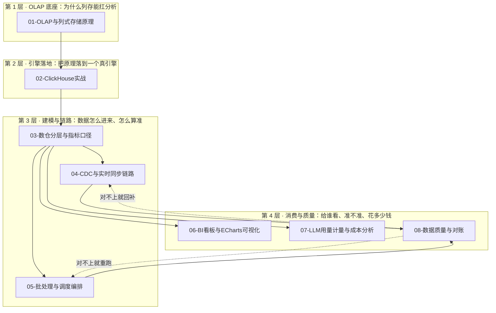

# 14 · 数据工程与 OLAP

> **一句话结论**：数据工程要解决的不是"再建一个库"，而是把「业务库里跑不动分析」「同一指标三个人算出三个数」「同步断了没人知道」这三件事分别换成可算、可对、可查；本项目在「查」和「算」上已有真实落地（NL2SQL 只读池、Chroma 向量库、`llm_trace` 计量链），在「OLAP 引擎、CDC 生产端、对账与补数」上仍是明确缺口——本篇按这四条边界把模块 8 篇串成一条可执行的路线。

> **阅读前置**：会写基本 SQL（JOIN / GROUP BY / 索引能走不能走）、知道 MySQL binlog 是干什么的、能看懂 Spring Boot 里 Controller → Service → Mapper 的调用链。**不需要**事先懂列式存储、数仓分层、CDC 或 ClickHouse——这些正是本模块要讲的东西；如果连"列存"和"行存"的差别都没听过，从 01 篇开始读。

> **证据基线**：B 级 = 本仓库真实文件（本篇引用 18 个文件，路径与行号逐次 read 核对）；C 级 = 本机 Windows / pwsh 只读命令（node 24.16.0，MySQL / JDK 未启动，命令均为静态检索与 SQL 文件解析）；A 级 = 0 条（`learning-docs/24-源码分析/assets/source/` 内检索 `ClickHouse|Binlog|Canal` 命中 0，无对应源码摘录可引）。凡"没在本机跑过"的内容一律标注「未本机实测」并给出命令与判读方法。预计阅读 30~40 分钟。

---

## 1. 这个模块解决什么问题

### 1.1 问题一：分析查询会压垮业务库

先把两个词说清：

- **OLTP**（Online Transaction Processing，联机事务处理）：逐行读写、短事务、按主键或索引点查。业务库 MySQL 干的就是这个，它靠缓冲池（buffer pool）把热页留在内存里，命中率越高越快。
- **OLAP**（Online Analytical Processing，联机分析处理）：大范围扫描、全表聚合、只取少数列。它会把大量冷数据页灌进缓冲池，把业务点查的热页挤出去——于是业务接口的耗时上去了，而**分析查询本身也不快**。

**本项目锚点（真实代码，不是假想）**：AI 智能问数（NL2SQL，自然语言转 SQL）的代码路径是「LLM 生成 SQL → 直连业务库执行」。`ai-cs-chat/src/main/java/com/aics/chat/nl2sql/Nl2SqlDataSourceConfig.java:41` 给连接串追加 `readOnly=true`，`:47` 每个库 `setMaximumPoolSize(3)`，为一个"库标识 → JDBC URL"的映射建只读池（javadoc 里标定的示例是 user / product / order / chat / knowledge 五个库，见 `ai-cs-chat/src/main/java/com/aics/chat/nl2sql/Nl2SqlProperties.java:18`）；执行侧 `ai-cs-chat/src/main/java/com/aics/chat/nl2sql/Nl2SqlQueryService.java:93` 强制 `MAX_ROWS = 100`、`:96` `QUERY_TIMEOUT_SECONDS = 10`。

**这里有一个必须说清的细节**：这份 `aics.nl2sql.urls` 配置在本仓库任何 yml / properties 里都**没有出现**（全仓检索 `nl2sql` 在配置文件里只命中 1 处，是 `ai-cs-chat/src/main/resources/application.yml:11` 的一行注释）。默认启动时 `Nl2SqlDataSourceConfig.java:34` 会走 `log.warn("未配置 aics.nl2sql.urls，AI 智能问数工具不可用")` 并返回空 map——也就是说，**问数的代码是真的，默认配置下是关的**。这类"代码在、开关关"的状态在本项目里反复出现，本篇第 4 节会系统列出。

即便把开关打开，这套写法限制的也只是**单条查询的破坏力**（只读会话 + 小池 + 限行 + 限时 + AST 白名单，见 `Nl2SqlQueryService.java:53` 起的「安全七道闸」注释），并没有改变「分析负载跑在业务库上」这个事实：10 秒的 `GROUP BY` 在业务高峰期照样占着连接和 IO。结构性解法是本模块 01 / 02 篇（列存引擎 + 预聚合），而不是继续加闸门。

### 1.2 问题二：同一个指标，三个人算出三个数

**口径** = 业务定义 + 取数范围 + 时间边界 + 去重规则。口径不一致的根因通常不是谁 SQL 写错了，而是**同一个语义在多个位置各实现了一次**，此后每次改动只改到其中一处。

**本项目锚点**：LLM 成本这件事在本仓库已经有真表。`deploy/mysql/llm-observability-init.sql:29` 定义 `model_usage`，费用字段是 `estimated_cost DECIMAL(12,6)`（`:40`，注释「估算费用（元）」），并且带一个 `estimated` 标志位区分估算值与实际值。于是同一个"今日成本"至少有三种合法算法：`SUM(estimated_cost)`、只算 `estimated=1` 的行、或用 `total_tokens × 单价` 重算。三个人各选一种，三个看板三个数——这就是 03 篇要解决的问题：把口径写进分层与命名，让"这个数只有一个地方能算出来"。

### 1.3 问题三：同步与批处理不可靠，而且坏了不报警

**CDC**（Change Data Capture，变更数据捕获）= 读数据库的 binlog 把行级变更投递出去，让搜索索引、缓存、数仓跟着变。

**本项目锚点**（这是本模块最重要的一节事实，后面第 4 节会展开成表）：

- CDC 只落地了**半条链**：消费端在、生产端不在。`ai-cs-search/src/main/java/com/aics/search/cdc/ProductCdcConsumer.java:23` 监听 topic `c-product-sync`，但全仓检索 `c-product-sync` 只有这 1 处命中（没有生产者）；部署编排里检索 `canal` 命中 0（没有 Canal server 服务）。
- 消费端还**默认关闭**：`ai-cs-search/src/main/resources/application.yml:58` 是 `enabled: ${CANAL_PRODUCT_CDC_ENABLED:false}`。
- 另一条增量链（知识文档 → 向量库）是通的，但**失败被静默吞掉**：`ai-cs-knowledge/src/main/java/com/aics/knowledge/service/KnowledgeVectorService.java:90` 在 catch 里 `return 0`，上层 `ai-cs-knowledge/src/main/java/com/aics/knowledge/mq/KnowledgeSyncConsumer.java:70` 只打一行 `log.warn` 就结束，消息不重试、也不进死信。
- 批处理侧只有 1 个真实 `@Scheduled`（`ai-cs-order/src/main/java/com/aics/order/task/OrderTimeoutScheduler.java:29`）和 1 个 `@XxlJob`（`ai-cs-order/src/main/java/com/aics/order/task/OrderTimeoutScanJob.java:27`），而 XXL-Job 默认关闭：`ai-cs-order/src/main/resources/application.yml` 里是 `enabled: ${XXL_JOB_ENABLED:false}`。

04 篇（CDC）、05 篇（批处理与调度）、08 篇（数据质量与对账）就是这三类不可靠的对应解法。

### 1.4 三个问题的共同根因

表面看是三件不相干的事，往下挖一层会发现它们共享同一个根因：**数据在"生产它的地方"被消费，而没有中间层**。分析查询直接读业务表、指标直接对业务表求和、下游直接靠事件推送 —— 一旦中间没有"约定的表形状 + 可重放的链路 + 可核对的基线"，出了问题只能靠人肉排查。

| 症状 | 表面原因 | 共同根因 | 本模块的解法 | 本项目证据 |
| --- | --- | --- | --- | --- |
| 报表一跑，业务接口就慢 | 分析 SQL 太慢 | 分析负载与事务负载共用同一份存储与缓冲池 | 01 / 02：列存 + 预聚合，把扫描挪走 | `ai-cs-chat/src/main/java/com/aics/chat/nl2sql/Nl2SqlDataSourceConfig.java:47`（每库只读池 3 连接；`aics.nl2sql.urls` 未配置时整套工具默认不可用，见 `:34`） |
| 三个看板三个数 | 有人 SQL 写错了 | 同一语义有多份实现，且没有唯一的口径定义 | 03：分层 + 口径清单，把指标钉在一层 | `deploy/mysql/llm-observability-init.sql:40`（`estimated_cost` + `estimated` 两种合法算法并存） |
| 下游数据"慢慢就不对了" | 同步偶尔失败 | 链路没有重放能力，也没有核对基线 | 04 / 05 / 08：幂等 + 水位 + 对账 | `ai-cs-knowledge/src/main/java/com/aics/knowledge/service/KnowledgeVectorService.java:90`（失败 `return 0`，无法重放） |

**读这张表的方法**：左边一列是你将来在工单里看到的描述，右边三列是"该去找哪一层"。绝大多数人第一次遇到这类问题时，会本能地去优化 SQL（调索引、加缓存），也就是停在第二列——这也是为什么这三个问题在本项目里同时存在：它们都不是靠"把 SQL 写快一点"能解决的。

### 1.5 术语速查（后文首次出现时不再重复解释）

| 术语 | 一句话解释 | 在本项目里对应什么 |
| --- | --- | --- |
| OLTP / OLAP | 事务型逐行读写 / 分析型大范围聚合 | 业务库 MySQL 是前者，报表与问数是后者（目前共用一套库） |
| 列式存储 | 按列而不是按行连续存放，只读用到的列 | 无（缺口，见 01 / 02 篇） |
| 物化视图 / 预聚合 | 把聚合结果提前算好存成表，查询直接读 | 无（无汇总表 DDL） |
| CDC | 读 binlog 把行变更投递到下游 | 半条（有消费端，无 Canal server） |
| 幂等 | 同一操作执行多次，结果与执行一次相同 | `llm_trace` 用 `request_id` 主键 + 先查后插 |
| 水位（watermark） | 记录"已处理到哪个时间点/位点"，用于续跑与补数 | 无（无水位表） |
| 对账 | 源与下游按行数、聚合、抽样三层比对 | 无（支付侧对账不属数据链路） |
| NL2SQL | 自然语言转 SQL 后直接查库 | 代码已落地；`aics.nl2sql.urls` 未配置，默认不可用 |

---

## 2. 模块地图（四层）



> **读图说明**
>
> - 纵向是**依赖方向，不是学习顺序**：上一层的结论是下一层的前提。第 1 层回答"为什么行存做聚合慢、列存为什么快"（一句话：只读用到的列 + 同列数据同质所以压缩率高 → IO 少）；第 2 层把这套原理落到 ClickHouse 的表引擎、排序键、分区上；第 3 层才开始谈"数据怎么建模、怎么进来、什么时候算"；第 4 层是消费端与质量兜底。
> - 第 3 层内部是**三条并行支线，共用一套分层与口径**：03 定义"有哪些层、每个指标在哪个层算"；04 负责实时（binlog → CDC → 消息 → 消费端写索引/写宽表）；05 负责离线（定时任务 → 明细 → 汇总表）。两条支线的产物都必须是 03 定义好的那张表的形状，否则第 4 层对不上账。
> - 第 4 层的三条线与第 3 层是**多对多**：06 看板消费 03 的汇总层；07 成本分析消费计量明细（本项目是 `llm_trace` / `model_usage` 这一组表）；08 对账则横向校验 04 / 05 两条链的落地结果与源库是否一致。
> - 两条虚线是**闭环的关键**，也是最容易被跳过的一步：08 发现差异后必须能触发 04 的补数和 05 的重跑，否则"对账"只是一份日报，不解决问题。

**推荐顺序**（按你的时间去选，不要从头到尾抄一遍）：

| 你的处境 | 读什么 | 预计 |
| --- | --- | --- |
| 只想搞清"为什么我们的报表把库拖慢了" | 01 → 02 的「最小落地清单」附录 | 2~3 小时 |
| 要把 AI 对话的成本/用量说清楚（本项目最值钱的一条） | 07 → 03 的口径部分 → 08 的重复与空值检测 | 1 天 |
| 要设计一条可靠的同步链 | 04 → 05 → 08 | 2~3 天 |
| 要备考/面试（数据方向） | 01、02、03 的概念 + 各篇第 8 节问题清单 | 2 天 |

**按症状反查篇目**（遇到问题时从上往下找，比从头读快）：

| 你看到的症状 | 先去读 | 一句话定位 |
| --- | --- | --- |
| 一条报表 SQL 把 MySQL 拖慢 | 01 的「行存 vs 列存」+ 02 的引擎选型 | 判断是"该优化"还是"该外移" |
| 同一指标两个系统不一致 | 03 的口径定义段 + 08 的口径漂移检测 | 先统一口径，再谈对账 |
| 下游索引有脏数据 / 少数据 | 04 的幂等与顺序段 | 大概率是重复消费或漏消费 |
| 定时任务跑重了、跑漏了、补不回来 | 05 的幂等与水位段 | 没有水位就没有补数 |
| 成本算不出来 / 算出来不可信 | 07 的 token 计量与单价表段 | 先确认 `estimated` 标志位语义 |
| 图表显示不对 / 页面越来越卡 | 06 的 option 生成与降采样段 | 实例泄漏与数据量两头查 |

---

## 3. 每篇一句话摘要

| 篇目 | 解决什么问题（一句话） | 本项目对应资产或缺口 | 证据类型 |
| --- | --- | --- | --- |
| [01-OLAP与列式存储原理.md](./01-OLAP与列式存储原理.md) | 讲清为什么行存做聚合会慢到压垮库、列存凭什么快（列裁剪 + 同质压缩 + 向量化执行） | **缺口**：全仓无任何列存引擎（`starrocks`/`doris`/`apache druid` 命中 0） | C（全仓检索计数） |
| [02-ClickHouse实战.md](./02-ClickHouse实战.md) | 把一个真引擎落地：表引擎选型、排序键与分区键怎么定、导入与校验怎么做 | **缺口**：`clickhouse` 全仓仅 2 处命中，均在 `ai-cs-order/eff-order.xml` 的第三方依赖清单里，不是本项目使用 | B（`ai-cs-order/eff-order.xml:8369`）+ C |
| [03-数仓分层与指标口径.md](./03-数仓分层与指标口径.md) | 用分层（ODS/DWD/DWS/ADS）把口径固定到唯一实现，消灭"三个看板三个数" | **部分资产**：`deploy/mysql/llm-observability-init.sql` 的 5 张计量表已具明细层雏形，但无汇总层、无口径文档 | B（`:12`–`:96`） |
| [04-CDC与实时同步链路.md](./04-CDC与实时同步链路.md) | 让 binlog 变更可靠地流到下游（顺序、幂等、重复投递、断点续传） | **半条链**：有消费端（`ProductCdcConsumer.java:23`）、无生产端、无 Canal server | B（三个文件）+ C |
| [05-批处理与调度编排.md](./05-批处理与调度编排.md) | 让定时计算可重跑、可补数、可观测（幂等 + 水位 + 分布式调度） | **弱资产**：1 个 `@Scheduled` + 1 个 `@XxlJob`，XXL-Job 默认关闭 | B（`OrderTimeoutScheduler.java:29`）+ C |
| [06-BI看板与ECharts可视化.md](./06-BI看板与ECharts可视化.md) | 图表怎么选型、`option` 怎么生成、大数据量怎么降采样 | **已落地**：后端 `EChartsOptionBuilder` 生成 option，前端只渲染 | B（`ai-cs-frontend/src/views/ChatDashboardView.vue:39`） |
| [07-LLM用量计量与成本分析.md](./07-LLM用量计量与成本分析.md) | token 怎么计量、按 scenario/模型怎么归因、成本怎么估、缓存命中省了多少 | **已落地**：`llm_trace` / `model_usage` / `model_usage_quota` 三表 + 采集与配额链路 | B（`deploy/mysql/llm-observability-init.sql:12`）+ C |
| [08-数据质量与对账.md](./08-数据质量与对账.md) | 空值/重复/有效性/口径漂移四类检测，以及跨存储对账与差异修复 | **缺口**：无对账任务（`ai-cs-search` 内无任何定时任务），`ProductCdcConsumer.java:18` 注释承诺的"定时对账兜底"并不存在 | B（注释与代码对照）+ C |

> **关于 06 / 07 / 08 的进度提醒**：01~05 已按本批 12 节规范改好（均 600 行以上，文首有「证据边界」表）；06 / 07 / 08 正在按同一规范重写，进度不一——**判断某篇是否已改好，看它文首有没有「## 证据边界」表和「## 0. 先看现象」**，别按标题里的中文序号去猜。旧式「一、二、三」结构的篇目缺「先看现象」「一次完整执行时序」「自测题」这几段，且对"已落地"的判断偏宽松（例如把注释里承诺的对账当成已存在），读那几篇时请用本篇第 4 节补上"本项目的真实链路"这一层。

**证据强度怎么读这张表**：本模块 0 条 A 级（框架源码摘录），因为"数据工程"这件事在本仓库主要是**配置 + SQL + 注解**，而不是某个框架的内部实现——真正值得逐行读源码的是 Spring 的容器与 AOP，那在别的模块。B 级（本项目真实文件）占主体，因为缺口恰恰需要用"注释说了什么 / 代码做了什么 / 编排里有没有"三者对照才能说清。C 级（可复现命令）在这里的作用是**把"我没有搜到"变成可被别人复算的数字**，第 4 节给了两段完整命令与真实输出。凡是标 C 的地方，你都能在自己机器上重新跑一遍得到同样的计数；凡是标 B 的地方，你都能打开文件对到那一行。

---

## 4. 本项目数据链路现状

这张表是本模块的核心资产：一眼看清「哪一环真的存在、断在哪、证据在哪」。所有"状态"都来自第 4.1 节的命令输出或第 3 节表格里的文件行号，**没有一项是"计划中就算落地"**。

| # | 链路环节 | 落地状态 | 断点 / 具体问题 | 证据（完整路径:行） |
| --- | --- | --- | --- | --- |
| 1 | 业务源库 MySQL 8 | ✅ 已落地 | 110 张表全在 `deploy/mysql/*.sql`；但既是 OLTP 又被迫扛分析 | `deploy/mysql/llm-observability-init.sql:8` |
| 2 | binlog 开关 | ✅ 已配好 | ROW + FULL 镜像已开，Canal 的前置条件具备 | `deploy/mysql/mysql.cnf`（`binlog-format=ROW` / `binlog-row-image=FULL`） |
| 3 | Canal 账号 | ✅ 已建 | 只有账号与复制权限，没有进程用它 | `deploy/mysql/canal-init.sql`（4 行，`REPLICATION SLAVE` 授权） |
| 4 | Canal server（生产端） | ❌ 缺失 | 部署编排（compose / k8s）检索 `canal` 命中 **0**；binlog 有人在写，没人读 | C 级命令输出 `canal_in_deploy = 0` |
| 5 | MQ 主题 `c-product-sync` | ⚠️ 半条 | 只有消费者，全仓命中 1 处，**无生产者**；消费者默认关闭 | `ai-cs-search/src/main/java/com/aics/search/cdc/ProductCdcConsumer.java:23`；`ai-cs-search/src/main/resources/application.yml:58` |
| 6 | 搜索索引（ES `/ product_catalog`） | ⚠️ 半条 | 索引写入逻辑存在（`elasticsearchClient.index`），但上游没数据流过来 | `ai-cs-search/src/main/java/com/aics/search/cdc/ProductCdcConsumer.java:26` |
| 7 | 向量库 Chroma | ✅ 已落地 | 0.5.20 固定版本、单副本、健康检查探 `/api/v1/heartbeat` | `deploy/k8s/chroma.yaml:44`（`replicas: 1` 在 `:33`） |
| 8 | 知识增量同步（文档 → 向量） | ⚠️ 通但静默丢 | 向量化失败 `return 0`，上层只 `log.warn`，消息不重试 | `ai-cs-knowledge/src/main/java/com/aics/knowledge/service/KnowledgeVectorService.java:90`；`ai-cs-knowledge/src/main/java/com/aics/knowledge/mq/KnowledgeSyncConsumer.java:70` |
| 9 | 分析查询入口（NL2SQL） | ⚠️ 代码在、默认未配置 | 只读池按 `aics.nl2sql.urls` 建，但该配置在本仓库 yml 里不存在 → 默认打 warn 返回空 map；限 100 行、10 秒超时 | `ai-cs-chat/src/main/java/com/aics/chat/nl2sql/Nl2SqlDataSourceConfig.java:34`；`ai-cs-chat/src/main/java/com/aics/chat/nl2sql/Nl2SqlQueryService.java:93` |
| 10 | 计量明细（`llm_trace` 等 5 表） | ✅ 已落地 | 写入尽力而为（失败只 warn）、`request_id` 做主键做幂等；**无保留/归档策略** | `deploy/mysql/llm-observability-init.sql:12`；`ai-cs-message/src/main/java/com/aics/message/service/impl/LlmTraceServiceImpl.java:48` |
| 11 | 看板消费端 | ✅ 已落地 | ECharts 5.6，前端 `dispose()` 后再 `init` 防实例泄漏 | `ai-cs-frontend/src/views/ChatDashboardView.vue:39` |
| 12 | 对账 / 补数 / 回填 | ❌ 缺失 | 无 MySQL↔ES 对账任务、无 watermark 表、无回填脚本；支付侧有对账但与数据链路无关 | C 级命令输出 `@Scheduled(real) = 1`；`ai-cs-pay/src/main/java/com/aics/pay/service/impl/PayCompensationServiceImpl.java:53` |
| 13 | OLAP 引擎 / 数仓 | ❌ 缺失 | 无 ClickHouse、无 StarRocks/Doris、无物化视图定义 | C 级命令输出 `clickhouse` 仅 2 处第三方清单 |

### 4.1 C 级实测：一条命令看清这条链

```pwsh
cd D:\Projects\Persion\ai-customer-service
"ddl_tables          = " + (Select-String -Path deploy\mysql\*.sql -Pattern 'CREATE TABLE' | Measure-Object).Count
"llm_gov_tables      = " + (Select-String -Path deploy\mysql\llm-observability-init.sql -Pattern 'CREATE TABLE' | Measure-Object).Count
"llm_retention_kw    = " + (Select-String -Path deploy\mysql\llm-observability-init.sql -Pattern 'PARTITION|TTL|EVENT|DELETE FROM|ARCHIVE' | Measure-Object).Count
"canal_in_deploy     = " + (Select-String -Path deploy\docker-compose\*.yml,deploy\k8s\*.yaml,deploy\k8s\services\*.yaml -Pattern 'canal' | Measure-Object).Count
"cdc_topic_hits      = " + (Get-ChildItem -Recurse -File -Include *.java -Path (Get-ChildItem -Directory -Filter 'ai-cs-*').FullName | Where-Object { $_.FullName -notmatch '\\target\\' } | Select-String -Pattern 'c-product-sync' | Measure-Object).Count
"@Scheduled(real)    = " + (Get-ChildItem -Recurse -File -Include *.java -Path (Get-ChildItem -Directory -Filter 'ai-cs-*').FullName | Where-Object { $_.FullName -notmatch '\\target\\' } | Select-String -Pattern '^\s*@Scheduled\(' | Measure-Object).Count
"xxl_enabled_line    = " + (Select-String -Path ai-cs-order\src\main\resources\application.yml -Pattern 'XXL_JOB_ENABLED').Line.Trim()
```

本机真实输出（2026-11，Windows / pwsh，静态检索，未启动任何服务）：

```text
ddl_tables          = 110
llm_gov_tables      = 5
llm_retention_kw    = 0
canal_in_deploy     = 0
cdc_topic_hits      = 1
@Scheduled(real)    = 1
xxl_enabled_line    = enabled: ${XXL_JOB_ENABLED:false}
```

**怎么读**：

- `ddl_tables = 110` 对 `llm_gov_tables = 5`：数据面很宽（110 张业务表），但**治理/分析面只有 5 张表**。这 5 张恰好就是第 4 节第 10 行那条计量链——本项目所有"数据工程"资产都集中在这里。
- `llm_retention_kw = 0`：这 5 张表**没有任何保留策略**（无分区、无 TTL、无清理事件）。`llm_trace` 每轮对话写一行、`spans_json` 还是 TEXT，只增不删——这是 03 / 05 篇讲"分区 + 归档"时要回头处理的第一笔技术债。
- `canal_in_deploy = 0` 对 `cdc_topic_hits = 1`：**消费端有、生产端无**。这条链现在处于"接线接到一半"的状态，任何"商品改了搜索没变"的工单都不可能靠现有代码自动修复。
- `@Scheduled(real) = 1` 加 `XXL_JOB_ENABLED:false`：批处理能力约等于"一个订单超时扫描"。在这个基线上谈"T+1 汇总表"必须先补调度骨架（05 篇）。
- 判读陷阱：`cdc_topic_hits = 1` 里的 1 是**消费者注解**，不是生产者。想复核就 `Select-String -Pattern 'rocketMQTemplate|syncSend|asyncSend'` 再按 topic 过滤，本项目该 topic 无发送点。

### 4.2 C 级实测：确认"没有 OLAP 引擎"这句话

```pwsh
cd D:\Projects\Persion\ai-customer-service
$files = Get-ChildItem -Recurse -File -Path . -Include *.java,*.yml,*.yaml,*.sql,*.vue,*.ts,*.js,*.properties,*.xml -ErrorAction SilentlyContinue |
  Where-Object { $_.FullName -notmatch 'node_modules|\\target\\|\\\.git\\|learning-docs' }
"scanned_files        = " + $files.Count
"clickhouse_hits      = " + ($files | Select-String -Pattern 'clickhouse' -SimpleMatch:$false | Measure-Object).Count
"druid_starrocks_hits = " + ($files | Select-String -Pattern 'starrocks|doris|apache druid' | Measure-Object).Count
"olap_kw_hits         = " + ($files | Select-String -Pattern 'OLAP|物化视图|materialized view' | Measure-Object).Count
$files | Select-String -Pattern 'clickhouse' | ForEach-Object { $_.Path.Replace('D:\Projects\Persion\ai-customer-service\','') + ':' + $_.LineNumber }
```

本机真实输出：

```text
scanned_files        = 929
clickhouse_hits      = 2
druid_starrocks_hits = 0
olap_kw_hits         = 0
ai-cs-order\eff-order.xml:8369
ai-cs-order\eff-order.xml:9589
```

**怎么读**：929 个文件里 `clickhouse` 只有 2 处，且都落在 `ai-cs-order/eff-order.xml`——这是 Maven Help Plugin 生成的 Effective POM（13k 行依赖清单），两行分别是 `pulsar-io-jdbc-clickhouse` 与 `testcontainers-clickhouse`，属于第三方依赖的传递清单条目，**不是本项目使用**。`starrocks`/`doris`/`apache druid` 与 `物化视图` 全为 0，说明"本项目没有 OLAP 引擎"是真结论，不是没搜到。**未本机实测**：本机没有 ClickHouse 实例，02 篇里所有建表/导入的耗时与压缩比数字均为教材值，不能当本项目的实测结论。

### 4.3 要把第 4 环（Canal 生产端）补上，最小改动是什么

这是全篇唯一一个"差一点点就通了"的洞，值得单独列清楚。前置条件**已经就绪**，缺的只是进程和接线：

| 需要的东西 | 现状 | 还缺什么 |
| --- | --- | --- |
| MySQL 开一行一变更的 binlog | ✅ 已配（`deploy/mysql/mysql.cnf` 的 `binlog-format=ROW` / `binlog-row-image=FULL`） | 无 |
| 复制账号与权限 | ✅ 已建（`deploy/mysql/canal-init.sql` 给 `canal` 用户 `REPLICATION SLAVE` / `REPLICATION CLIENT`） | 无 |
| Canal server 进程 | ❌ 无（4.1 命令 `canal_in_deploy = 0`） | 一个服务定义 + 一份 instance 配置（要订阅哪个库哪张表） |
| 变更 → MQ 的生产者 | ❌ 无（`c-product-sync` 只有消费者） | Canal 的 RocketMQ 输出配置，或消费者改读 Canal 客户端 |
| 消费端开关 | ⚠️ 默认关（`ai-cs-search/src/main/resources/application.yml:58`） | 环境变量 `CANAL_PRODUCT_CDC_ENABLED=true` |
| 对账兜底 | ❌ 不存在（`ProductCdcConsumer.java:18` 的注释承诺落空） | 先补对账，再开开关——否则丢了也不知道 |

**判读要点**：前两行"已配"很容易让人误以为 CDC 已落地。区分方法是问一句"**谁在读 binlog**"——没有进程读，binlog 只是写在磁盘上的日志。这也是本篇反复强调「有消费端 ≠ 有链路」的原因。

---

## 5. 两条路线：3 天能做完的，和 4 周才见效的

不要一上来就"建数仓"。本项目的现实是：没有 OLAP 引擎、没有 CDC 生产端、没有对账——所以先做「不需要新基础设施」的那一半，收益/投入比高得多。

### 路线 A：指标体系梳理（3 天，纯文档 + SQL，不加任何组件）

| 天 | 做什么 | 产出物 | 验收标准 |
| --- | --- | --- | --- |
| D1 | 盘点现有计量表能支撑哪些指标：读 `deploy/mysql/llm-observability-init.sql` 的 5 张表，把字段映射成指标（调用量、成功率、P95 时长、token 用量、估算成本、配额窗口） | 一张「指标 → 表 → 字段 → 过滤条件」对照表 | 每个指标能指出唯一数据来源字段；`estimated_cost` 与 `estimated` 的关系写清楚 |
| D2 | 按 03 篇定分层与命名：明细层（`llm_trace`、`model_usage`）、汇总层（按天 × scenario × model 的聚合表，仅设计不建）、口径清单 | 口径清单（每个指标写：定义 / 范围 / 时间边界 / 去重键） | 任取两个指标，非作者本人能照文档写出等价 SQL |
| D3 | 用真实表跑校验 SQL：空值、重复、口径漂移三类各一条，把"对不上"的原因记录下来 | 3 条可复现 SQL + 结论 | 每条 SQL 能解释"为什么这个数不等于那个数"，而不是只说"数据有问题" |

**为什么是 3 天**：路线 A 只读已有表，不引入任何组件，风险为 0。它解决的是 1.2 那个问题（口径不一致），而这个问题**恰恰是不建新库也能解决的**。

### 路线 B：换引擎与建仓（4 周，每周都有可验收的中间产物）

| 周 | 做什么 | 产出物 | 验收标准 |
| --- | --- | --- | --- |
| W1 | 现状量化：拿 D3 的 SQL 在业务库上跑，记录扫描行数与耗时（**本项目未本机实测，需你在自己环境跑**），据此判定"是否真的需要换引擎" | 一张"哪几条查询最贵"的清单 | 能指名至少 1 条必须外移的查询；否则不该启动 W2 |
| W2 | 按 02 篇「最小落地清单」起一个 ClickHouse（compose 单机即可）、建表、导入 5 张计量表的历史数据 | 可查询的 CH 实例 + 导入脚本 + 行数比对结果 | 源表与 CH 的行数、`SUM(estimated_cost)` 一致（对不上先解决类型精度） |
| W3 | 补链路：04 篇的 CDC 与 05 篇的批处理。本项目要先补 Canal server（第 4 节第 4 行那个洞），再做增量；离线侧先补 XXL-Job 执行器 | 一条可重跑的增量链 + 一个定时汇总任务 | 故意改一行源数据，能在约定时间内出现在下游；任务重跑两次结果不变（幂等） |
| W4 | 按 08 篇做对账与差异修复：源库 vs 索引/CH 的行数、聚合值、抽样明细三层比对；建立差异修复入口 | 对账报告 + 修复脚本（或任务） | 人为删掉下游一行，对账能发现并修回来 |

**两条路线的成本与风险对比**（人天为学习/试点尺度，不是生产排期）：

| 维度 | 路线 A（3 天） | 路线 B（4 周） |
| --- | --- | --- |
| 新增基础设施 | 0 | 1 个 ClickHouse + 1 个 Canal server + XXL-Job 执行器（+ 可能的 MQ 主题） |
| 能解决 1.1（压垮业务库） | ❌ 不能 | ✅ 能（分析负载迁出） |
| 能解决 1.2（口径不一致） | ✅ 能，且这是唯一前提 | ✅ 能，但以 A 为前提 |
| 能解决 1.3（链路不可靠） | ❌ 不能 | ✅ 能（04/05/08） |
| 失败时的代价 | 文档白写，代码零改动 | 双写期数据不一致，回滚要干净 |
| 典型失败方式 | 口径清单写成"字段字典"，没人能照着写 SQL | 跳过 W1 直接建仓，结果建出来的粒度没人用 |

**两条路线都不要做的事**：

- 不要在没跑过执行计划的情况下决定"换引擎"——`EXPLAIN` 的扫描行数是最便宜的判据，见 [05-SQL调优与执行计划.md](../12-性能工程/05-SQL调优与执行计划.md)。
- 不要在消费端**还没有对账**的时候打开 CDC 开关。本项目 `ai-cs-search/src/main/resources/application.yml:58` 默认 `false` 其实是一种保护：链路没闭环时，关着比开着更安全。
- 不要把"加了索引/缓存"当成解决分析负载的方案。索引让点查更快，但它不减少扫描的数据量，也不把负载从业务库挪走。
- 不要一次改两层（既换存储又换口径）。出问题时你无法判断是引擎算错了还是口径变了——W2 之后先只换存储、口径保持原样，跑通了再改口径。

**两条路线的关系**：A 是 B 的前置。没有口径清单，W2 建出来的表结构一定是错的——因为你还不知道该按什么粒度聚合。反过来，只做 A 不做 B，本项目也能撑很久：110 张业务表 + 5 张计量表的规模，用 MySQL 汇总表完全跑得动，这也是第 8 节"诚实清单"里第一条的现实依据。

---

## 6. 依赖关系

| 关系 | 模块 / 篇目 | 为什么需要它 | 链接 |
| --- | --- | --- | --- |
| **前置** | 03-数据库与ORM | 分层建模、分区、大表治理、主从与 binlog 都是本模块的地基；不懂索引与执行计划，01/02 的性能对比就没有判据 | [03-数据库与ORM](../03-数据库与ORM/README.md) |
| 前置（细化） | 03/05-MySQL锁机制与主从复制读写分离、03/07-建表规范与字段类型选型、03/08-大表治理-冷热分离与数据归档 | 分别对应"为什么分析查询要和主库隔离""字段类型怎么选（`DECIMAL(12,6)` 这类决定聚合精度）""`llm_trace` 这类只增表怎么归档" | [05-MySQL锁机制与主从复制读写分离.md](../03-数据库与ORM/05-MySQL锁机制与主从复制读写分离.md)、[07-建表规范与字段类型选型.md](../03-数据库与ORM/07-建表规范与字段类型选型.md)、[08-大表治理-冷热分离与数据归档.md](../03-数据库与ORM/08-大表治理-冷热分离与数据归档.md) |
| **相关** | 04-中间件 / 11-CanalCDC商品索引同步 | 本项目 CDC 断点的正面教材：Canal 怎么部署、怎么订阅、怎么投递 | [11-CanalCDC商品索引同步.md](../04-中间件/11-CanalCDC商品索引同步.md) |
| 相关 | 04-中间件 / 19-Debezium与Canal的CDC对比 | 选型环节：本项目若补生产端，需要先决定 Canal 还是 Debezium | [19-Debezium与Canal的CDC对比.md](../04-中间件/19-Debezium与Canal的CDC对比.md) |
| 相关 | 12-性能工程 / 05-SQL调优与执行计划 | 判断"这条查询该不该外移"的唯一客观手段：看执行计划与扫描行数，而不是看耗时感觉 | [05-SQL调优与执行计划.md](../12-性能工程/05-SQL调优与执行计划.md) |
| 相关 | 07-运维部署 / 05-XXL-Job分布式调度 | 05 篇（批处理）落地的前提：本项目 XXL-Job 默认关闭，需先把它跑起来 | [05-XXL-Job分布式调度.md](../07-运维部署/05-XXL-Job分布式调度.md) |
| 相关 | 07-运维部署 / README | 组件怎么起（compose / k8s）、Chroma 与 ES 的部署形态 | [07-运维部署](../07-运维部署/README.md) |
| 下游延伸 | 05-AI集成 / 05-LLM可观测性评估与成本治理实现文档 | 07 篇的对偶篇：那边讲采集与 Trace，这边讲计量与成本 | [05-LLM可观测性评估与成本治理实现文档.md](../05-AI集成/01-SpringAI框架集成/05-LLM可观测性评估与成本治理实现文档.md) |
| 下游延伸 | 05-AI集成 / 05-向量数据库 | Chroma 已落地，为什么选它、索引算法与容量规划在那组文档里 | [05-向量数据库](../05-AI集成/05-向量数据库/README.md) |
| 下游延伸 | 06-前端开发 / 04-Vue3核心基础 | 06 篇（看板）的前置：ECharts 要挂在 Vue 的生命周期上，否则实例泄漏 | [04-Vue3核心基础.md](../06-前端开发/04-Vue3核心基础.md) |
| **上游入口** | 00-学习路线总览 | 全局顺序与技术缺口全景（本篇的"缺口"清单与那儿的口径一致） | [00-学习路线总览](../00-学习路线总览/README.md)、[05-技术缺口分析与补全计划.md](../00-学习路线总览/05-技术缺口分析与补全计划.md) |

---

## 7. 检查点清单

读完这个模块，你应该能**不看文档**回答下面这些。每条都给了验证方式，能自己验的才算学会。

| # | 检查点 | 怎么验 | 通过标准 |
| --- | --- | --- | --- |
| 1 | 说清 OLTP 与 OLAP 的负载差异，以及为什么把它们放一个库会互相伤害 | 口述 2 分钟 | 能提到"缓冲池被扫描挤占"和"列裁剪减少 IO"两个机制，而不是只说"一个快一个慢" |
| 2 | 解释列存为什么压缩率高 | 口述 + 举一个具体列（如 `status` 枚举列） | 能说出"同列同类型同分布 → 字典/游程编码有效"，而不是背"列存更快" |
| 3 | 给一张事实表定排序键与分区键 | 拿 `model_usage` 的字段现场设计 | 排序键能覆盖最高频过滤（时间 + scenario），分区键不产生小分区 |
| 4 | 说出本项目分析查询的真实入口与限流参数 | 打开 `ai-cs-chat/src/main/java/com/aics/chat/nl2sql/Nl2SqlQueryService.java` 与 `ai-cs-chat/src/main/java/com/aics/chat/nl2sql/Nl2SqlDataSourceConfig.java` | 能报出 `MAX_ROWS=100`、`QUERY_TIMEOUT_SECONDS=10`、每库池大小 3，并知道 `aics.nl2sql.urls` 默认未配置 |
| 5 | 指出本项目 CDC 链断在哪一环 | 跑 4.1 的命令 | 能说出"有消费端、无生产端、无 Canal server、且默认关闭"四件事 |
| 6 | 解释幂等键为什么选 `request_id` | 打开 `deploy/mysql/llm-observability-init.sql:22` 与 `LlmTraceServiceImpl.java:48` | 能说明"先查后插"的竞态窗口，以及为什么需要主键兜底 |
| 7 | 说出至少 3 类数据质量检测及对应 SQL | 现场写 | 空值、重复、有效性各一条，能跑 |
| 8 | 说出 04 篇里"至少一次投递"为什么要求消费端幂等 | 口述 | 能举出重复消费的具体后果（索引重复写、汇总被加两次） |
| 9 | 说清"对账发现差异之后"的完整动作 | 口述闭环 | 必须包含"定位范围 → 修复 → 复验 → 记录"，只做前两步算不合格 |
| 10 | 判断一条慢查询该优化还是该外移 | 拿一条真实 SQL 看执行计划 | 能说出扫描行数量级、是否走索引、以及外移需要什么前置 |
| 11 | 说清"至少一次 + 幂等"为什么是几乎所有同步链的默认组合 | 口述 | 能解释"做不到精确一次时，宁可重复不可丢失，把去重责任推给消费端" |
| 12 | 给一个新增指标补齐"从明细到看板"的全链路 | 拿 `model_usage` 现场设计一个"昨日各 scenario 平均单次成本" | 能写出明细层 SQL、汇总层粒度、看板取数位置三件事，且口径只有一处定义 |

**怎么算真的学会**：上面 12 条里，凡标"打开某个文件"或"跑某条命令"的，请真的去打开、真的去跑——本模块有一半价值在"敢不敢确认"，而不是"记不记得概念"。如果第 5 条你能在 1 分钟内报出四个断点，说明你已经具备了团队里最稀缺的那种能力：**先确认事实，再讨论方案**。

---

## 8. 诚实清单：本模块哪些是"真"，哪些是"待建设"

下面每一条都是**当次核对过**的结论，不是推测。写在这里是为了避免下一篇文档的作者（或者三个月后的你）把注释、计划、依赖清单当成已实现能力。

| 能力 | 当前状态 | 判定依据 | 待建设动作 |
| --- | --- | --- | --- |
| OLAP 引擎（ClickHouse / StarRocks / Doris） | ❌ **无** | 4.2 命令：929 文件 `clickhouse` 命中 2（均在第三方依赖清单），`starrocks/doris/apache druid` 命中 0 | 若确需，按 02 篇「最小落地清单」单机起一套再评估 |
| 数仓分层（ODS/DWD/DWS/ADS） | ❌ **无** | 全仓无 `物化视图`/`materialized view` 定义；无汇总表 DDL，`deploy/mysql/` 110 张表全是业务表 + 5 张计量表 | 先做路线 A 的口径清单，再谈建层 |
| 对账脚本（MySQL ↔ ES ↔ 向量库） | ❌ **无** | `ai-cs-search` 内无任何 `@Scheduled`/全量同步任务；`ai-cs-*` 内 `对账` 命中只在支付模块（`PayCompensationServiceImpl.java:53` 单边账检测，属资金对账，与数据链路无关） | 按 08 篇设计"行数 → 聚合 → 抽样"三层对账 |
| 补数 / 回填机制 | ❌ **无** | 无 watermark（水位）表、无回填脚本、无重跑入口 | 先补水位表 + 任务幂等，才谈补数 |
| CDC 生产端（Canal server） | ❌ **无** | 4.1 命令 `canal_in_deploy = 0`；binlog 配置与 canal 账号已就绪（`deploy/mysql/mysql.cnf`、`deploy/mysql/canal-init.sql`），相当于"路修好了没车" | 按 04 篇 + 04-中间件/11 篇补服务 |
| CDC 消费端 | ⚠️ **有但默认关、且无对账兜底** | `ProductCdcConsumer.java:23` 注解在，`application.yml:58` 默认 `false`；类注释 `:18` 声称"最终一致性由定时对账兜底"，但该对账任务不存在 | 开启前先补对账，否则注释就是谎言 |
| 知识增量同步 | ⚠️ **通但有静默失败** | `KnowledgeVectorService.java:90` 失败 `return 0`；`KnowledgeSyncConsumer.java:70` 仅 `log.warn`，不重试不进死信 | 改成抛异常触发重试 + 死信队列 |
| LLM 计量明细 | ✅ **真实落地** | `deploy/mysql/llm-observability-init.sql` 5 张表；`ai-cs-message/src/main/java/com/aics/message/service/impl/LlmTraceServiceImpl.java:48` 先查后插幂等 | 补保留策略（`llm_trace` 只增不删） |
| 成本口径 | ⚠️ **字段在，口径不在** | `estimated_cost DECIMAL(12,6)` + `estimated` 标志位（`:40`），但无单价表、无口径文档 | 按 07 篇补单价表与算法说明 |
| BI 看板 | ✅ **真实落地** | `ai-cs-frontend/src/views/ChatDashboardView.vue:39` ECharts 5.6，后端生成 option | 补降采样与大数据量分页 |
| 分析查询外移（NL2SQL 接 OLAP） | ⚠️ **代码在、配置缺** | `Nl2SqlDataSourceConfig.java:34` 在 `aics.nl2sql.urls` 缺失时只 warn 并返回空 map；全仓 yml 里 `nl2sql` 仅 1 处注释命中 | 要么补 urls 让它可用，要么整体迁到 CH 后再改这里 |
| 批处理调度 | ⚠️ **骨架级** | 4.1 命令 `@Scheduled(real) = 1`、`@XxlJob(real) = 1`、`XXL_JOB_ENABLED:false` | 需要 T+1 汇总就必须先补调度（05 篇 + 07-运维部署/05） |

> **一条给未来的提醒**：本模块 06 / 07 / 08 的旧式版本对"已落地"的判断比上表宽松（例如把 `ProductCdcConsumer.java:18` 的注释承诺当成存在的对账任务）。**冲突时以本篇第 4 节 + 4.1 命令输出为准**，并顺手把对应的篇目改掉。

### 8.1 怎么在你自己机器上复核这份清单

三条通用命令模板，改一下关键词就能验任意一项"有没有"：

```pwsh
cd D:\Projects\Persion\ai-customer-service
# 1) 某个组件到底有没有被部署（改 canal 为 redis / kafka / clickhouse ...）
Select-String -Path deploy\docker-compose\*.yml,deploy\k8s\*.yaml -Pattern 'canal' | Measure-Object | ForEach-Object { "deploy_hits=" + $_.Count }

# 2) 某个能力到底有没有实现（改 pattern 为你要验的关键词）
(Get-ChildItem -Recurse -File -Include *.java -Path (Get-ChildItem -Directory -Filter 'ai-cs-*').FullName |
  Where-Object { $_.FullName -notmatch '\\target\\' } |
  Select-String -Pattern 'class .*Scheduler|@Scheduled|@XxlJob' | Measure-Object).Count

# 3) 某张表到底有没有保留策略（改文件名为你的 DDL）
Select-String -Path deploy\mysql\llm-observability-init.sql -Pattern 'PARTITION|TTL|EVENT' | Measure-Object | ForEach-Object { "retention_kw=" + $_.Count }
```

**判读三条铁律**：①命中数要**看文件路径**，落在 `eff-order.xml`、`node_modules`、`.venv` 里的命中一律不算；②注释里的"以后会做""由某某兜底"不算实现，必须找到那行代码；③`0` 是最有价值的结果——它说明这是一块空白，可以放心当学习材料，而不是在半成品上改。

---

## 9. 五个常见误解

这五条是本模块最容易产生的错觉，每一条后面都附了本项目的反例。

| 误解 | 事实 | 本项目反例 |
| --- | --- | --- |
| "加了索引，报表就快了" | 索引加速的是**定位**，不减少**扫描量**；聚合仍要读完命中范围的全部行 | NL2SQL 已经限 `MAX_ROWS=100` 且 10 秒超时，但聚合仍跑在业务库上 |
| "有消费者就说明 CDC 通了" | 链路要三段：抓变更（Canal）→ 投递（MQ 生产者）→ 消费（下游）。缺任一段都是断的 | `c-product-sync` 只有消费者，`canal_in_deploy = 0` |
| "列存可以随便加字段" | 列存每次加列都涉及元数据与写入路径，宽表在列存里反而要先想清楚"谁会读" | 本项目 0 个 OLAP 引擎，这条属前瞻性提醒，08 篇的宽表设计有对应讨论 |
| "对账就是比行数" | 行数一致只能证明"条数对"，证明不了"内容对"；还要比聚合值与抽样明细 | 本项目连行数对账都没有（第 8 节第 3 行） |
| "定时任务跑成功 = 数据对" | 成功只代表没抛异常；漏数、重复、口径变了都不会抛异常 | `KnowledgeVectorService.java:90` 返回 0 也算"成功执行"，上层只 `log.warn` |

**怎么用这张表**：把它当成自检清单——如果你在讨论中说出左边任何一句，先停一下，用右边那一列去反驳自己。

---

**下一篇**：从 [01-OLAP与列式存储原理.md](./01-OLAP与列式存储原理.md) 开始；若你只想解决眼前的成本口径问题，直接从 [07-LLM用量计量与成本分析.md](./07-LLM用量计量与成本分析.md) 进。

返回 [学习路线总览](../00-学习路线总览/README.md) ｜ 技术缺口全景 [05-技术缺口分析与补全计划.md](../00-学习路线总览/05-技术缺口分析与补全计划.md)
