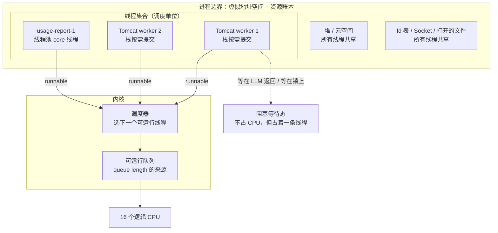
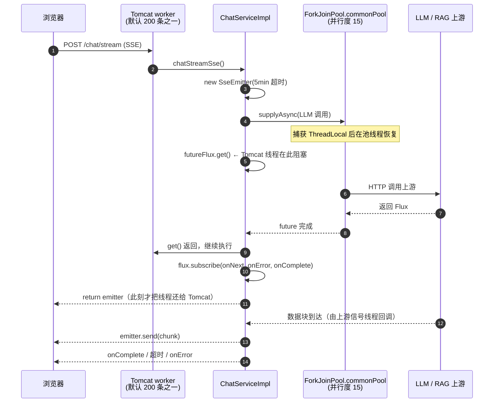

# 进程、线程与调度：工程差异只有两条——地址空间分不分享、切换代价付不付得起

> **一句话结论**：进程与线程的区别在工程上从来不是"重量级 vs 轻量级"这种形容词，而是两个可测量的量——**地址空间是否共享**（决定通信成本与故障隔离半径）、**一次切换要付多少纳秒/微秒**（决定你能同时养多少条线程）。Linux 的 CFS 与 Java 的线程模型都只是在这两个量上做取舍；调度器只在"可运行线程数 ≫ 核数"时才成为问题，而判据是可运行队列长度，不是线程总数。

> **阅读前置**：会写 `new Thread(...)`、用过 `Executors.newFixedThreadPool` 或 Spring 的 `@Async`；知道 JVM 有堆、有栈；能在 pwsh 里跑 `java` / `node` / `javac`。本文不要求读过内核源码，但要求你愿意把"我觉得"换成"我测了"。

> **证据基线**：JDK `17.0.19`（Temurin-17.0.19+10）、Spring Boot `4.2.0` / 内嵌 Tomcat `11.0.27`、本机 CPU `12th Gen Intel(R) Core(TM) i7-1260P`（`os.cpus().length = 16`）、内存 `31.7 GB`、宿主 Windows + pwsh；项目事实以 `master` 分支当前工作树为准。本篇 C 级证据全部在本机跑出，A 级仅 1 处（Spring Boot 的 Tomcat 定制扩展点）。预计阅读 45~60 分钟。

## 证据边界

先把"哪些能当场验、哪些只能给命令"说清楚，避免把设计意图读成已落地能力。

| 主题 | 本仓状态 | 证据级别 | 本篇怎么处理 |
| --- | --- | --- | --- |
| 进程/线程地址空间与切换成本 | 本机可测（Windows 计数器 + Java 探针） | ✅ C 实测 | 直接贴本机输出，并标注"Windows 计数器，不是 Linux loadavg" |
| Tomcat 工作线程默认 200 | 项目**未配置**该参数 | ✅ B（反证）+ C（字节码） | 用"配置里 grep 不到"+"javap 读默认常量"两条独立证据夹住结论 |
| `usageExecutor` core1/max4/queue1000 | 已落地 | ✅ B | 用同参数探针复现"poolSize 恒为 1"的现象 |
| CFS / vruntime / nice | 本机是 Windows，**跑不了 CFS** | ⚠️ 模拟 + 文档事实 | 明写"纯算术模拟，非内核实测"，只用来建立直觉 |
| 虚拟线程（JDK 21 M:N） | 全仓 `ofVirtual` / `virtualThreads` **0 命中**，未落地 | ❌ 未落地 | 只讲设计取舍，并贴 JDK 17 编译失败原文说明"本机测不了" |
| `-XX:ActiveProcessorCount` 覆盖核数 | 本机未设置（值为 `-1`） | ✅ C（默认值）+ ❌（覆盖效果未实测） | 讲清"-1 是什么意思"和怎么看容器核数 |
| Tomcat 线程数定制路径 | Spring Boot 提供 `TomcatProtocolHandlerCustomizer` | ✅ A（1 处） | 引 `TomcatWebServerFactory` 的定制回调，说明它作用于 ProtocolHandler 而非 Spring 的 TaskExecutor |
| docker / kubectl / helm / Prometheus 相关观测 | 本机无这些工具与服务端 | ❌ 未实测 | 一律写"未本机实测，给命令与判读方法"并说明原因 |

## 0. 先看现象

三个现象，全部来自本机或本仓库，命令可直接复现。

### 现象一：16 个逻辑核上，128 条线程把"可运行队列"堆到 232，而切换率反而掉下来

用 `learning-docs/tools/tmp/m15-load-probe.java`（N 条纯自旋线程，跑指定秒数）造负载，同时采样 Windows 的 `Processor Queue Length`（可运行但还没拿到 CPU 的线程数）与 `Context Switches/sec`：

```powershell
PS> java "-Dfile.encoding=UTF-8" learning-docs\tools\tmp\m15-load-probe.java 128 10   # 另开一个窗口先起负载
PS> Get-Counter -Counter '\System\Processor Queue Length','\System\Context Switches/sec','\Processor(_Total)\% Processor Time' -SampleInterval 1 -MaxSamples 4
```

```text
# 空闲基线（开发机，仍有 IDE / 编辑器等后台进程）
16:36:33 | queue=4  | ctxsw/s=50637 | cpu%=78.3
16:36:35 | queue=0  | ctxsw/s=42287 | cpu%=52.7
16:36:36 | queue=0  | ctxsw/s=34693 | cpu%=32.6
16:36:37 | queue=0  | ctxsw/s=33641 | cpu%=34.4

# 32 条自旋线程（16 逻辑核）
16:36:16 | queue=1 | ctxsw/s=61071 | cpu%=87.3
16:36:17 | queue=0 | ctxsw/s=68433 | cpu%=48
16:36:18 | queue=0 | ctxsw/s=34708 | cpu%=38.1
16:36:19 | queue=0 | ctxsw/s=34702 | cpu%=44.2
16:36:20 | queue=5 | ctxsw/s=42056 | cpu%=37

# 128 条自旋线程（16 逻辑核）
16:36:42 | queue=232 | ctxsw/s=19627 | cpu%=100
16:36:48 | queue=264 | ctxsw/s=28412 | cpu%=100
16:36:49 | queue=12  | ctxsw/s=22420 | cpu%=98.6
16:36:50 | queue=2   | ctxsw/s=36760 | cpu%=76.2
```

读法：`queue` 就是"可运行但没核"的线程数。32 条线程时它还是 0~5，说明 2 倍超订在自旋场景下仍能勉强消化；128 条线程（8 倍超订）时它冲到 232~264，`cpu%` 顶到 100。**注意反直觉的一点**：切换率没有随线程数线性上涨，128 线程时反而降到 19k~36k/s——因为核都被可运行线程占满后，每条线程会跑完整个时间片才被换下，切换频率由时间片长度决定，而不是由线程总数决定。

### 现象二：`core=1 / max=4 / queue=1000` 的线程池，`poolSize` 永远停在 1

项目里 `usageExecutor` 就是这三组参数（`ai-cs-chat/src/main/java/com/aics/chat/config/ObservabilityExecutorConfig.java` L31-L34：core 1、max 4、queue 1000）。用同参数探针连续提交 10 个 3 秒任务：

```powershell
PS> java "-Dfile.encoding=UTF-8" learning-docs\tools\tmp\m15-pool-probe.java
```

```text
=== 实验 A：core=1 max=4 queue=1000（项目 usageExecutor 同款），提交 10 个 3 秒任务 ===
submit #1  poolSize=1 active=1 queue=0
submit #2  poolSize=1 active=1 queue=1
submit #3  poolSize=1 active=1 queue=2
...
submit #10 poolSize=1 active=1 queue=9
```

读法：`maxPoolSize=4` 完全没生效。Java `ThreadPoolExecutor` 的扩容顺序是"核心线程 → 队列 → 最大线程"，队列容量 1000 意味着前 1001 个任务都会排队等那 1 条核心线程，第 1002 个任务进来才会把线程扩到 2。参数看着是"最多 4 条线程"，实际行为是"1 条线程 + 1000 格缓冲"。

### 现象三：一次 SSE 请求，Tomcat 工作线程被 `futureFlux.get()` 按住最长 60 秒

先确认项目从没调过 Tomcat 线程数——在配置里搜不到任何 `tomcat` 字样：

```powershell
PS> Select-String -Path ai-cs-chat\src\main\resources\application.yml -Pattern 'tomcat'
PS> (Select-String -Path ai-cs-chat\src\main\resources\application.yml -Pattern 'tomcat').Count
```
```text
0
```

再确认阻塞点存在：

```powershell
PS> Select-String -Path ai-cs-chat\src\main\java\com\aics\chat\service\impl\ChatServiceImpl.java -Pattern 'futureFlux.get\(\)|SSE_EMITTER_TIMEOUT ='
```
```text
ChatServiceImpl.java:156:    private static final long SSE_EMITTER_TIMEOUT = 5 * 60 * 1000L;
ChatServiceImpl.java:601:            Flux<String> flux = futureFlux.get();
```

而 `sseChatService` 的 TimeLimiter 上限是 60 秒（`ai-cs-chat/src/main/resources/application.yml` L80-L83，`timeout-duration: 60s`）。三者相乘得到一个很具体的风险账本：**默认 200 条 Tomcat 工作线程，每条都可能在这行 `get()` 上阻塞数十秒**。200 条线程被 60 秒量级的阻塞占满，只需要上百个并发的慢请求。

### 这些现象指向同一件事

**并发问题从来不是"线程多不多"的问题，而是四个量的组合：谁和谁共享地址空间、线程此刻在不在等、等多久、有几个核能真正跑。** 现象一说的是"核不够时线程会排队，而排队的判据是队列长度不是线程总数"；现象二说的是"线程池的数字不等于并发度，队列会吃掉你的扩容意图"；现象三说的是"阻塞式等待会直接占用最贵的资源——一条 OS 线程"。后面 8 节就是把这三句话拆开、量化、落地。

## 1. 整体地图



> **读图说明**：只有两条实线箭头方向要先看清楚——线程的"可运行"状态进入内核的调度器，再由调度器放进可运行队列等核；**虚线箭头（进入阻塞等待）是这条链的断点**：线程一旦阻塞就从可运行队列消失，不消耗 CPU，但那条 OS 线程（连同它的栈和寄存器上下文）依然被占用。看错的关键点是：很多人把虚线当成"线程没了"，于是得出"多开几条线程不会有事"的结论——恰恰相反，虚线占的是最稀缺的"线程名额"资源，而实线占的才是 CPU。图上标红的不是某个节点，而是这条"实线 vs 虚线"的分岔：**它是所有线程池容量估算的起点**。

| 组件 | 位置（本仓/本机） | 负责什么 | 参与方 |
| --- | --- | --- | --- |
| 进程 | 每个 Spring Boot 服务一个：如 `ai-cs-chat` 的 `java -jar app.jar` | 提供地址空间、fd 表、信号处理；隔离故障与内存 | `ai-cs-chat/Dockerfile` L19 `ENTRYPOINT`、`deploy/k8s/services/ai-chat-service.yaml` |
| 线程 | 进程内；Tomcat worker 池默认 200（未配置） | 真正的调度单位，各有一条栈和一份寄存器上下文 | Tomcat 11.0.27 `AbstractEndpoint` 默认常量 |
| 业务线程池 | `ObservabilityExecutorConfig` 的 `usageExecutor`(1/4/1000)、`evalExecutor`(1/2/500) | 把旁路任务（用量上报、在线评测）挪出请求线程 | `ai-cs-chat/src/main/java/com/aics/chat/config/ObservabilityExecutorConfig.java` |
| 公共池 | `ForkJoinPool.commonPool`，并行度 = 核数-1 = 15（本机实测） | `CompletableFuture.supplyAsync` 不传执行器时的默认落点 | `ai-cs-chat/src/main/java/com/aics/chat/service/impl/ResilientAiService.java` L176/L255/L382 |
| 事件循环 | 网关 `ai-cs-gateway` 走 WebFlux/Netty；Python 侧走 uvicorn/asyncio | 少量线程处理大量连接，用"就绪事件"代替"每连接一线程" | `ai-cs-gateway/pom.xml` L22、`ai-cs-py-chat/requirements.txt` |
| 内核调度器 | 本机 Windows 调度器；生产容器内是 Linux CFS/EEVDF | 从可运行队列选下一个上 CPU 的线程 | `Get-Counter`（Windows）或 `vmstat`/`pidstat`（Linux） |

## 2. 关键概念与关键要素

| 名称 | 位置 | 作用 | 关键参数 |
| --- | --- | --- | --- |
| 进程（process） | 内核 `task_struct` + 独立地址空间 | 资源分配与隔离的单位；崩溃不带走别人 | 独立页表；`fork()` 时页表复制/COW |
| 线程（thread） | 内核调度实体（Linux 上是共享 `mm` 的 task） | **调度**的单位；共享进程地址空间 | 每线程一条栈、一组寄存器 |
| 协程 / 虚拟线程 | 用户态（语言运行时） | 把"等待"变成"挂起"，用少量内核线程承载大量逻辑并发 | 挂起点由运行时决定 |
| 虚拟地址空间 | 进程级 | 让每个线程看到同一份堆；隔离靠页表 | 与本篇直接相关的是**共享**这一点 |
| 线程栈 | 每线程 | 存局部变量、调用帧 | HotSpot `ThreadStackSize = 0`（= 平台默认）；本机实测 500 线程只多提交 0.08 MB/线程 |
| 寄存器上下文 | 每线程 | 切换时必须保存/恢复 | 切换成本的主要构成之一 |
| 上下文切换 | 内核 | 换线程执行时保存/恢复现场、换页表（跨进程时） | 本机实测一次交接 7.85~11.67 μs |
| 可运行队列 | 内核 | 已就绪但没核的线程队列 | Windows `Processor Queue Length`；Linux `vmstat` 的 `r` |
| 时间片 / `sched_latency` | 内核 | 一轮里每个可运行线程至少能跑多久 | CFS 里随可运行线程数缩放 |
| nice / vruntime | 内核 | 表达"谁该多跑"的相对权重 | `weight = round(1024 × 1.25^-nice)`（模拟中用） |
| 核心/最大线程数/队列 | `ThreadPoolExecutor` | 决定并发度与缓冲策略 | 项目：`corePoolSize=1`、`maxPoolSize=4`、`queueCapacity=1000` |
| 公共池并行度 | `ForkJoinPool.commonPool` | 无执行器时的兜底并发度 | 本机实测 `15`（= 16-1） |
| `availableProcessors` | JVM | JVM 眼里的核数，决定默认并行度 | 本机 `16`；`-XX:ActiveProcessorCount=-1` 表示未覆盖 |
| 事件循环 | Netty / uvicorn | 用就绪事件驱动，避免线程-连接绑定 | `ai-cs-gateway` 与 `ai-cs-py-chat` |

## 3. 原理与证据逐段精读

### 3.1 三层并发模型的资源视图：进程 / 线程 / 协程

**在干什么。** 三层模型描述的是**谁持有资源、谁被调度**。进程持有地址空间与 fd 表；线程是被内核调度的实体，共享进程资源但各自有栈和寄存器；协程（Java 里是虚拟线程）是用户态的运行单元，由运行时决定"什么时候真正占一条内核线程"。

| 维度 | 进程 | 线程（JDK 17 的 `Thread`） | 协程 / 虚拟线程（JDK 21 设计） |
| --- | --- | --- | --- |
| 地址空间 | 独立 | **共享** | 共享（同一进程内） |
| 栈 | 独立（进程内各线程仍有栈） | 每线程一条，HotSpot 默认预留 1 MB 量级 | 栈在堆上，按需增长 |
| 寄存器上下文 | 有 | 有，且每次切换都要保存/恢复 | 有，但保存在堆上的对象里，不进内核 |
| 谁负责切换 | 内核 | 内核 | 运行时（用户态）+ 少量内核线程（carrier） |
| 切换代价量级 | 最贵（换页表、TLB 打冷） | 本机实测 7.85~11.67 μs | 数量级更低（未本机实测，JDK 17 无此 API） |
| 崩溃影响 | 只死自己 | 拖死整个 JVM | 拖死整个 JVM |
| 数量级 | 个~百 | 百~千 | 十万~百万（设计目标） |

**为什么这么设计。** 因为通信成本与隔离成本不可兼得。共享地址空间意味着线程之间传一个对象引用即可（零拷贝），也意味着任何一个线程写坏堆就会全员遭殃；独立地址空间意味着通信必须序列化（发送到内核缓冲区/管道/socket），换来故障隔离。Java 选择"进程内多线程"是一种默认站队：**绝大多数业务需要的是低通信成本，而不是强隔离**。

**换写法会怎样。** 如果改用多进程（例如每个请求 fork 一个子进程，或 Apache prefork 模型），每个进程独立的堆意味着无法共享连接池、无法共享本地缓存，一次 GC 只影响一个进程、但内存水位 ×N；`ai-cs-chat` 这类服务若走多进程，Spring 容器与 LLM 客户端都要各初始化一份。反过来，如果连线程都不用（单线程事件循环，例如 `ai-cs-py-chat` 用 uvicorn/asyncio），隔离与并发规模都不错，代价是全链路不允许出现阻塞调用——一个 `time.sleep(60)` 就能让整个 worker 停摆。

**常见坑。** ①把"线程安全"当成"共享地址空间很安全"，实际共享的只有引用，对象本身该不该被并发修改是另一件事；②在进程内用静态变量做"全局锁"跨服务同步（无效，因为每个进程一份）；③误以为虚拟线程能提升 CPU 密集吞吐（它只减少"等待"的成本，核还是那些核）。

### 3.2 上下文切换到底贵在哪

**在干什么。** 切换 = 保存当前线程的寄存器现场 → 让出 CPU → 内核选出下一个 → 恢复它的现场 → （跨进程时还要换页表、打冷 TLB、可能连带换栈）→ 返回用户态。工程上还要加上两笔隐形成本：cache/TLB 被新线程的工作集污染；以及被换下的线程下次回来时数据已不在 L1/L2。

**为什么这么设计。** 因为 CPU 核是独占的，而"等 I/O"的时候核不能空转，所以必须有"换人"的机制。切换本身没有业务价值，是纯粹的税；设计目标是把税降到最低、同时不饿死任何线程（这就是第 3.4 节 CFS 要解决的）。

**换写法会怎样。** 如果不切换（单线程跑到底），长任务会把交互延迟拖到不可接受；如果切换过于频繁（时间片极小），CPU 大部分时间用于保存/恢复而不是干活。真实系统选的是中间值：时间片按可运行线程数缩放，且给"刚醒来/欠账多"的线程优先权。

**量级。** 本机用 `learning-docs/tools/tmp/m15-switch-cost.java`（两条线程用 `LockSupport.park/unpark` 乒乓交接 40 万次）实测：

```powershell
PS> java "-Dfile.encoding=UTF-8" learning-docs\tools\tmp\m15-switch-cost.java
```

```text
第1次 pingpong: 400000 次交接, 总 3879 ms, 单次 9698 ns (9.70 us)
     busy-loop 对照: 400000 次循环 2891600 ns, 平均 7.2 ns/次
第2次 pingpong: 400000 次交接, 总 4666 ms, 单次 11667 ns (11.67 us)
     busy-loop 对照: 400000 次循环 4422100 ns, 平均 11.1 ns/次
第3次 pingpong: 400000 次交接, 总 3140 ms, 单次 7852 ns (7.85 us)
     busy-loop 对照: 400000 次循环 3167600 ns, 平均 7.9 ns/次
```

读法：一次交接 7.85~11.67 μs，是纯计算循环（7~11 ns）的约 1000 倍。这个数包含用户态 `park/unpark` 的路径与调度唤醒延迟，**不等于**纯内核 context switch 时间，只能当量级参考。

**常见坑。** ①拿"1~10 μs"当铁律去算容量，却忘了真正贵的常常是缓存污染（业务线程被换回后要重新预热数据，可能几十微秒）；②在压测里看到"CPU 100% 但 QPS 不涨"就以为线程不够，实际是切换与锁竞争在吃 CPU；③以切换率为唯一判据——下一节会看到线程数暴涨时切换率甚至下降。

### 3.3 什么时候线程数开始变成负担

**在干什么。** 线程数从 1 涨到核数，吞吐近似线性涨；越过核数后，多出来的线程只能在可运行队列里排队，收益迅速衰减；再往上，切换、栈内存、锁竞争、GC 线程争抢一起把吞吐压回去。

**为什么这么设计。** 核数是硬上限，超出的并发只能靠"等待"（阻塞）来消化，而阻塞会让线程无法贡献吞吐。所以线程数的正确锚点是：**能同时在核上跑的线程数 = 核数；能同时在等的线程数 = 你愿意为等待付出的内存与调度成本**。

**实测。** 同一份工作量（32 份纯 CPU 任务）用不同线程数并行，预热后单线程基线 1034 ms：

```text
threads=1   total=32  cost=1034 ms  speedup=1.00x
threads=2   total=32  cost= 522 ms  speedup=1.98x
threads=4   total=32  cost= 327 ms  speedup=3.16x
threads=8   total=32  cost= 191 ms  speedup=5.41x
threads=16  total=32  cost= 137 ms  speedup=7.55x
threads=32  total=32  cost= 150 ms  speedup=6.89x
```

读法有三个要点。①16 线程只拿到 7.55x，不到 16x：`i7-1260P` 是 4 个 P 核 + 8 个 E 核的异构设计，`availableProcessors = 16` 数的是**逻辑处理器**（含超线程），共享执行单元的线程不可能线性叠加；本机还有开发后台负载。②32 线程反而退到 6.89x，是"超过核数只有排队"的直接实测。③**不要把这组数字当"标准加速比"引用**：它是本机、此刻、这组参数下的结果，换机器必然变。

配合现象一的计数器，可以给出一个可操作的判据：**看 `queue length` 与 `% Processor Time` 的组合**——
- `cpu%` 高 + `queue` 小：核被有效利用，正常。
- `cpu%` 高 + `queue` 大（本机 128 线程时 232~264）：超订严重，加线程无用，只能减少并发或加核。
- `cpu%` 低 + `queue` 大：典型锁竞争 / 频繁阻塞唤醒 / 大量短命任务，去查锁和 I/O。

**常见坑。** ①把"线程池开到 200"当成"能扛 200 并发"，忽略下游与锁；②用 `availableProcessors` 决定一切，却忘了它是逻辑核（含 HT）且会被 cgroup 限制改写（见 6.3）；③在异构核机器上按核数线性外推容量。

### 3.4 CFS 的 vruntime 直觉与 nice

**在干什么。** Linux 的 CFS 不看"优先级数字"，而看每个线程已经"欠"了多少 CPU 时间：每条线程维护一个 `vruntime`（虚拟运行时间），调度器永远选 `vruntime` 最小的那条跑；线程跑完一段时间片后，`vruntime` 按 `实际运行时间 × (1024 / 权重)` 递增。`nice` 值只是权重的别名：nice 越低（"对别人越不客气"），权重越大，同样的实际时间只让 `vruntime` 涨一点，于是它更容易被再次选中。

**为什么这么设计。** 因为它把"公平"变成了一个可以红黑树维护的**单一排序键**：取最小 `vruntime` 是 O(log n)，并且能自动处理"新线程/刚醒来的线程"——它们 `vruntime` 落后，自然被优先补偿（这正是交互式任务响应快的原因）。

**模拟证据。** 本机是 Windows，跑不了 CFS，因此用 `learning-docs/tools/tmp/m15-cfs-sim.mjs` 做**纯算术模拟**（公式取自 CFS 的权重近似 `weight = round(1024 × 1.25^-nice)`，`sched_latency = 24 ms`）：

```powershell
PS> node learning-docs/tools/tmp/m15-cfs-sim.mjs
```

```text
nice   权重       相对 nice0 份额
-20    88818      86.736
-10    9537       9.313
-5     3125       3.052
0      1024       1.000
5      336        0.328
10     110        0.107
19     15         0.015

== 表2：三个任务争 1 个核（nice 0 / 5 / 10）==
权重 1024 / 336 / 110，长期 CPU 份额 = 69.7% / 22.9% / 7.5%

== 表3：一个 sched_latency = 24 ms 周期里怎么切分 ==
nice 0 : 时间片 16.72 ms  区间 [0.00, 16.72]
nice 5 : 时间片  5.49 ms  区间 [16.72, 22.20]
nice 10: 时间片  1.80 ms  区间 [22.20, 24.00]

== 表4：跑完自己的时间片后，vruntime 增量相等 ==
nice 0 : delta = 16.72 ms × (1024/1024) = 16.7184 ms
nice 5 : delta =  5.49 ms × (1024/336)  = 16.7184 ms
nice 10: delta =  1.80 ms × (1024/110)  = 16.7184 ms

== 表5：睡眠回来的任务 vruntime 落后 → 排第一 ==
排序后上 CPU 顺序：interactive(vr=-100.00ms) → cpu-a(vr=0.00ms) → cpu-b(vr=0.00ms)
```

读法：表 3 与表 4 是同一个事实的两面——nice 5 的线程只跑 5.49 ms，但它 `vruntime` 涨的量和 nice 0 跑 16.72 ms 一样多，**"公平"的定义就是"每轮结束时 vruntime 增量相等"**，所以时间片与权重成反比。表 5 解释了交互式任务为什么响应快：睡了一段时间的线程 `vruntime` 落后，一醒来就排到最前面。

一处必须说明的偏差：内核用的是预置的 `sched_prio_to_weight` 数组，模拟用的是 `round(1024 × 1.25^-nice)` 近似公式，两者在极端 nice 上会差个位百分比（例如 nice -20 内核权重是 88761，模拟算出 88818）。本表只用于建立"权重之比 = 长期份额之比"的直觉，不能当内核数值引用。

**换写法会怎样。** 如果按"优先级数字"直接映射时间片（传统实时调度器的做法），会出现饥饿：高优先级线程不断唤醒，低优先级永远拿不到 CPU。CFS 的做法天然自平衡，但缺点是**单核上巨量线程时排序与调度开销上升**，且"公平"过头会让一条 CPU 密集线程与一堆刚醒的交互线程抢不赢（它们欠账更少）。

**常见坑。** ①以为 `nice` 是"百分比"——它是**相对权重**，只在竞争时生效，没有竞争时 nice 值毫无作用；②在容器里改 `nice` 却不查 cgroup CPU quota，配额耗尽时 nice 也无能为力；③把 CFS 的 vruntime 直觉硬套到 Windows 调度器（本机就是 Windows），Windows 用的是优先级 + 时间片 + 动态提升，现象一那种 `queue length` 才是你能直接观测的信号。

### 3.5 Java 线程 = OS 线程 1:1（JDK 17），虚拟线程是 M:N（JDK 21，未落地）

**在干什么。** JDK 17 里 `new Thread()` 会落到 `pthread_create`（Windows 上是 Win32 线程），JVM 不做复用：一个 Java 线程对应一条 OS 线程，阻塞一个就阻塞一个 OS 调度实体。本机探针（`learning-docs/tools/tmp/m15-jvm-runtime.java`）能看到这个映射的直接后果：

```text
Runtime.availableProcessors() = 16
ForkJoinPool.commonPool().getParallelism() = 15
ForkJoinPool.commonPool().getPoolSize()    = 0
ThreadMXBean.getThreadCount()      = 7
probe thread: name=probe-1to1 threadId=23 state=RUNNABLE
```

`ThreadMXBean` 数出来的线程数与 OS 里看到的线程数是一一对应的（可以在任务管理器或 `Get-Process -Id <pid> | Select-Object -ExpandProperty Threads` 里对齐），这就是 1:1 的可观测证据。

**为什么这么设计。** 1:1 模型最简单：线程栈、线程本地存储、`synchronized`、`ThreadLocal`、JNI 调用全部能直接落到 OS 原语上，没有"运行时要能挂起任意栈帧"这种几乎不可能的任务（`native` 方法和 `synchronized` 阻塞都无法在用户态挂起）。代价是**线程数被内存与调度成本封顶**。

**换写法会怎样（JDK 21 虚拟线程的 M:N 设计）。** 虚拟线程把栈放在堆上，由 JVM 在阻塞点（socket 读、`Thread.sleep`、`LockSupport.park` 等）把虚拟线程从 carrier 线程上卸下来，M 个虚拟线程复用 N 条 carrier（默认 N = 核数）。于是"每请求一条线程"的写法可以扩展到十万级并发，而 OS 线程数仍然只有核数量级。但它不改 CPU 密集场景的吞吐，且对"钉住 carrier"的操作（JDK 21 里 `synchronized` 块内阻塞、部分 JNI 调用）无能为力——那时虚拟线程会被固定在 carrier 上退化成 1:1。

**本机测不了，原因与证据。** JDK 17 没有这个 API，直接编译就报错（`learning-docs/tools/tmp/m15-vt-probe.java`）：

```powershell
PS> javac "-J-Duser.language=en" "-J-Duser.country=US" -encoding UTF-8 -d learning-docs\tools\tmp\out learning-docs\tools\tmp\m15-vt-probe.java
```

```text
learning-docs\tools\tmp\m15-vt-probe.java:7: error: cannot find symbol
        Thread t = Thread.ofVirtual().name("vt-1").start(() -> System.out.println("hello from virtual thread"));
                         ^
  symbol:   method ofVirtual()
  location: class Thread
1 error
```

（`-J-Duser.language=en` 是为了拿到 ASCII 错误原文：不加时 javac 输出中文，pwsh 的 GBK 控制台会显示乱码。）

**项目落点。** 全仓 grep `ofVirtual` / `virtualThreads` / `Loom` = **0 命中**，`ai-cs-chat/pom.xml` 也没开 `<virtual-threads>`；`ai-cs-chat` 的主线程模型仍是 Servlet 阻塞栈（`ai-cs-chat/pom.xml` L22 `spring-boot-starter-web`）。所以本篇**不把虚拟线程写成已实现能力**，只在第 7 节给迁移动作。

**常见坑。** ①以为虚拟线程能让 `futureFlux.get()` 这种阻塞"免费"——它降低等待成本，但如果你在阻塞点外面还握着锁，吞吐照样塌；②用虚拟线程跑 CPU 密集任务（没有收益，还可能因 carrier 数等于核数而阻塞其它虚拟线程）；③把 `ThreadLocal` 当"线程上下文"继续在虚拟线程里大量使用（每个虚拟线程一份，生命周期短、创建频繁，容易变成分配压力）。

### 3.6 线程池三个数字怎么定：核数 → 并行度 → core/max/queue

**在干什么。** 线程池的三个参数各自回答一个不同的问题：`corePoolSize`（常驻几条）、`queueCapacity`（能缓冲多少）、`maxPoolSize`（峰值扩到几条）。它们的生效顺序是硬编码的：**先填核心线程，再进队列，队列满了才扩容，扩容到 max 还满才拒绝**。

**为什么这么设计。** 因为线程池假设"排队比开线程便宜"。对短任务、突发流量，排队能削峰且避免线程数抖动；对长阻塞任务（比如等 LLM 几十秒），这个假设直接反了——队列里躺着 1000 个任务，每一个都要等 3 秒，延迟被放大成小时级。

**实测（现象二的完整版）。** 把队列从 1000 改成 8，扩容才会露头：

```text
=== 实验 B：core=1 max=4 queue=8，提交 20 个任务 ===
submit #1  poolSize=1 active=1 queue=0
submit #2  poolSize=1 active=1 queue=1
...
submit #9  poolSize=1 active=1 queue=8
submit #10 poolSize=2 active=2 queue=8
submit #11 poolSize=3 active=3 queue=8
submit #12 poolSize=4 active=4 queue=8
submit #13 REJECTED(RejectedExecutionException) poolSize=4 active=4 queue=8
...
submit #20 REJECTED(RejectedExecutionException) poolSize=4 active=4 queue=8
=== 接受=12 拒绝=8：扩容发生在队列满之后 ===
```

读法：`#10` 才开始扩线程，因为 `#9` 把队列填满了。这条规则解释了为什么项目里 `queueCapacity=1000` + `maxPoolSize=4` 的实际语义是"1 条线程 + 1000 格缓冲，几乎不会扩到 4"，也解释了为什么拒绝策略（默认 `AbortPolicy`）在正常流量下几乎不会触发——**它在保护的东西，是先被队列长度藏起来的**。

**核数怎么换算成参数。** 经典公式是 CPU 密集 `N`（或 `N+1`）、I/O 密集 `N × (1 + W/C)`（W = 等待时间，C = 计算时间）。代入本机 `N = 16` 看它的荒谬边界：若把"等 LLM"当成 W ≈ 5 s、C ≈ 5 ms，`W/C = 1000`，得到 `16 × 1001 ≈ 16016` 条线程——显然不可能。**这说明公式只能当起点，必须被三重上限封顶**：内存（每线程栈）、下游容量（LLM 供应商的并发配额、DB 连接池）、调度成本（可运行队列长度）。

本项目三处真实参数，正好是三种不同的定位：

| 组件 | 参数 | 与核数的关系（N=16） | 定位 |
| --- | --- | --- | --- |
| Tomcat 工作线程 | 默认 200（未配置） | 12.5 × N | 面向阻塞 I/O 的请求线程池，靠"多"换"等在 I/O 上不浪费核" |
| `usageExecutor` | core 1 / max 4 / queue 1000 | ≪ N | 旁路任务，故意小：不抢请求线程，宁可排队 |
| `ForkJoinPool.commonPool` | 并行度 15（= N-1） | N-1 | CPU 型并行任务的默认落点，故意留一个核给别的 |

**常见坑。** ①`maxPoolSize` 设了但队列是 `LinkedBlockingQueue` 默认无界（或极大），永远扩不起来——本项目的 1000 就是这个形态；②把 `corePoolSize` 设 0 又指望立刻有线程接活（会先入队）；③多个池共用一个业务线程池名字前缀，排查时 `jstack` 里全是 `pool-3-thread-1`，分不清是谁；④`setWaitForTasksToCompleteOnShutdown(true)`（项目 L37 就是这么配的）让关停时等任务跑完，如果队列里有长任务，优雅停机可能超过 K8s 的默认宽限期。

### 3.7 阻塞 / 非阻塞 / 多路复用：同一件事的四种进程模型

**在干什么。** 这四种写法回答的是同一个问题：**线程在等 I/O 的时候干什么**。阻塞 I/O 让线程睡下（占着线程）；非阻塞 + 轮询让线程反复问（烧 CPU）；多路复用（`epoll`/`kqueue`/IOCP）让一个线程同时盯 N 个 fd 的"就绪"事件（线程不睡也不烧）；异步回调/协程把"等"变成状态机或挂起点。

| 模型 | 线程与连接的关系 | 谁在等 | 项目里的真实落点 | 代价 |
| --- | --- | --- | --- | --- |
| 阻塞 I/O（BIO） | 1 连接 : 1 线程（请求期内） | 线程睡在 socket 上 | `ai-cs-chat` 的 Tomcat 工作线程 + `futureFlux.get()`（`ChatServiceImpl.java` L601） | 线程数 = 并发数 |
| 异步 Servlet | 1 连接 : 0 线程（返回后释放） | 容器/回调 | `SseEmitter`（`ChatServiceImpl.java` L525 创建，L837 返回） | 需要自己管超时与清理 |
| 事件循环 + 多路复用 | 1 线程 : N 连接 | 内核通知就绪 | `ai-cs-gateway` 的 WebFlux/Netty（`ai-cs-gateway/pom.xml` L22） | 全链路不许阻塞 |
| 协程 / async-await | 1 线程 : N 协程 | 运行时挂起 | `ai-cs-py-chat` 的 FastAPI + uvicorn（`ai-cs-py-chat/requirements.txt`） | 同步库调用会堵死整个 loop |

**为什么这么设计。** 每个模型都在权衡"线程贵"和"代码复杂"这两件事。BIO 的代码最简单（顺序读、顺序写），代价是线程数线性膨胀；事件循环最省线程，代价是任何一处阻塞调用都会让整个 loop 停摆；协程把"写起来像同步、跑起来像事件驱动"这两件事合起来，代价是运行时必须能挂起你的执行流。

**项目里最值得注意的一处混搭。** `ai-cs-chat` 是 Servlet 栈（BIO 式的请求线程 + Servlet 异步的 `SseEmitter`），但它在 SSE 分支里用 `futureFlux.get()`（L601）把请求线程**又变回阻塞**：`SseEmitter` 带来的是"返回之后不再占用线程"，可 `get()` 发生在返回之前，所以那条 Tomcat 线程在返回前就已经被按住。`ResilientAiService` 那边用 `supplyAsync`（L176/L255/L382）把 LLM 调用挪到 `commonPool`，注释 L382 写得很清楚："异步执行 LLM 调用，这样才能用 `future.get(timeout)` 做超时控制"——**这不是为了省线程，而是为了能用带超时的 `get` 拿结果**。

**换写法会怎样。** 若把这段改成纯响应式（不 `get()`，直接 `flux.subscribe(...)` 并立刻返回 `emitter`），请求线程在订阅完成后即释放，200 条线程能扛的连接数上限会显著提高；代价是错误处理从 `try/catch` 变成 `onError` 回调、超时控制从 `TimeLimiter` 的 `get(timeout)` 变成 Reactor 的 `timeout()`（`ai-cs-chat/src/main/resources/application.yml` L76-L83 的 TimeLimiter 配置对"已返回"的异步流不再生效）。项目在 L646 已经用 `flux.subscribe(...)` 三参数模式（注释 L620 说明了这个选择），但订阅动作仍发生在 `get()` 之后——这是可优化的扩展点，见第 5 节。

**常见坑。** ①在 Netty 事件循环线程里做阻塞调用（`ai-cs-gateway` 里写死循环、`Thread.sleep`、JDBC 查询）→ 整个网关的该 eventLoop 卡住；②`@Async` 没指定执行器，悄悄落到 `commonPool`（`ResilientAiService` 就是这条路径），并行度只有 15，长任务会把公共池占满并影响所有 `parallelStream`；③SSE 场景忘了处理客户端断开，`emitter` 不释放，线程/连接漏。

## 4. 一次完整执行时序

场景：一次带 RAG 的 SSE 对话请求，从浏览器打到 `ai-cs-chat`，走完整的线程交接链。



> **读图说明**：关键箭头是第 6 步（`get()`）与第 13 步（`return emitter`）的先后关系——**线程是在 13 步才还给 Tomcat 的，不是第 7 步**。看错这一步会得出"用了 `SseEmitter` 就不占线程"的错误结论，从而把容量估算做高一个数量级。第二个要看的是第 5 步（`supplyAsync` 落到 `commonPool`）：全进程共享 15 个并行度，长任务会与其他所有 `supplyAsync`/`parallelStream` 抢配额。

**每一步该怎么判读**

| 步 | 判据 | 正常长什么样 | 异常长什么样 | 该看哪里 |
| --- | --- | --- | --- | --- |
| 1-2 | 请求是否进入 Servlet | 请求日志/access log 有记录，线程名形如 `http-nio-8083-exec-*` | 还没进业务就看到 503/超时 | Tomcat `maxThreads` 满则新请求进 `acceptCount` 队列（默认 100） |
| 3 | `SseEmitter` 超时值 | 5 分钟（`SSE_EMITTER_TIMEOUT`，`ChatServiceImpl.java` L156） | 客户端 60 s 断，服务端 5 min 才清理 | 两端超时不一致是最常见的"幽灵连接"来源 |
| 4 | 是否真的进了公共池 | `jstack` 里出现 `ForkJoinPool.commonPool-worker-*` | 线程名是 `http-nio-*`（说明没进异步，或执行器被换了） | `ResilientAiService.java` L176/L255/L382 |
| 5 | ThreadLocal 是否被恢复 | trace id 在异步日志里延续 | 异步日志里 trace id 为空 | `ResilientAiService.java` L173/L177（`capture()`/`restore()`） |
| 6 | 阻塞发生在哪 | 线程栈显示 `CompletableFuture.get` | 栈里是 `park`/`wait` 且无超时上限 | `ChatServiceImpl.java` L601；TimeLimiter 60 s（`application.yml` L82） |
| 7-10 | 上游超时是否被翻译 | 抛出的异常 cause 是超时/熔断 | 只看到 `CompletionException`，看不到真因 | `ChatServiceImpl.java` L808 注释、`ResilientAiService.java` L397 |
| 11-13 | 线程何时归还 | 方法返回后线程名回到池中待下个请求 | 线程长期停在 `get()` 上，`active` 计数居高不下 | 现象一/三的计数器与 `jstack` 快照对比 |
| 14-15 | 数据信号跑在哪个线程 | 由上游 Reactor 流决定（项目未显式 `publishOn`） | 误以为在自己的线程上做 I/O 是安全的 | 未本机实测：需在 `onNext` 里打印 `Thread.currentThread().getName()` |
| 16 | 结束路径 | `onComplete`/`onError`/`onTimeout` 三路都清理 | 只处理成功路径，异常时 emitter 泄漏 | `ChatServiceImpl.java` L829 `emitter.onTimeout` |

## 5. 设计取舍

| 取舍点 | 选 A（共享 + 阻塞） | 选 B（隔离 + 事件驱动） | 本项目的选择与理由 |
| --- | --- | --- | --- |
| 地址空间 | 线程共享堆，传引用零拷贝 | 进程隔离，通信要序列化 | 进程内多线程（`ai-cs-chat`），因为要共享连接池、缓存、Spring 容器 |
| 等待方式 | 阻塞线程，代码线性 | 事件循环/协程，代码回调化 | 混合：请求线程阻塞在 `get()`，LLM 调用在 `commonPool`（`ResilientAiService` L176） |
| 并发度上限 | 线程数（受栈内存、调度成本约束） | 连接数（受 event loop 数与内存约束） | 请求侧 200（Tomcat 默认），LLM 侧 15（`commonPool` 并行度） |
| 超时控制 | `future.get(timeout)`，必须有中断配合 | Reactor `timeout()` / 连接超时 | 用 TimeLimiter（30 s / 60 s / 5 s 三档）+ `cancel-running-future: true` |
| 故障隔离 | 线程池按业务拆分 | 进程/服务拆分 | 拆了 `usageExecutor`(1/4/1000) 与 `evalExecutor`(1/2/500)，但 LLM 调用仍共享 `commonPool` |
| 削峰 | 队列长度 | 背压（Reactor `request(n)`） | 队列：Tomcat `acceptCount=100`、线程池 queue 1000；SSE 侧无背压 |

**可扩展点清单（按性价比排序）**

1. **显式配置 `server.tomcat.threads.max`**，别依赖默认 200；同时配 `server.tomcat.accept-count`。当前 `application.yml` 里 `tomcat` 0 命中（见现象三）。
2. **给 LLM 调用单独的执行器**，避免 `supplyAsync` 落在 `commonPool`（并行度只有 15，且与 `parallelStream` 共享）。`ResilientAiService.java` L176/L255/L382 三处都受影响。
3. **把 SSE 分支改成"订阅即返回"**，让 `get()` 不再是唯一路径；或至少缩短 `sseChatService` 的 60 s 上限与 `SSE_EMITTER_TIMEOUT` 的 5 min 之间的落差。
4. **给 SSE 加背压/丢弃策略**：上游快、客户端慢时，`emitter.send` 会在缓冲区堆积。
5. **打开虚拟线程做一次对照实验**（需升 JDK 21+）：`spring.threads.virtual.enabled=true`，重点观察 `synchronized` 块造成的 carrier 钉住——本项目多处 `synchronized` 需先排查。
6. **把 `queueCapacity=1000` 降下来**（如 100）并观察拒绝率，让"max 4"真正可用；目前它只是名义参数。
7. **在 K8s 清单里给 JVM 显式 `-XX:ActiveProcessorCount`**：`deploy/k8s/services/ai-chat-service.yaml` L98 的 `limits.cpu: "1000m"` 只给 1 核，若 JVM 按宿主核数算并行度就会超配。
8. **补一个线程池运行期指标导出**（active/poolSize/queueSize + `Processor Queue Length` 类指标），当前项目无 Micrometer 线程池指标。

## 6. 踩坑与调试手法

### 6.1 把"忙"和"排队"分成两个计数器看

```powershell
PS> Get-Counter -Counter '\System\Processor Queue Length','\System\Context Switches/sec','\Processor(_Total)\% Processor Time' -SampleInterval 1 -MaxSamples 5
```
```text
16:36:42 | queue=232 | ctxsw/s=19627 | cpu%=100
16:36:48 | queue=264 | ctxsw/s=28412 | cpu%=100
```

| 判据 | 说明 | 误判风险 |
| --- | --- | --- |
| `queue` 持续 > 2 × 逻辑核数 | 已经明显超订，加线程只会更慢 | **单点采样不可信**：我第一次随手采样看到 `queue=32/22/118`，当时本机正在跑 `javac`/`java` 探针，那是编译器的短时高峰，不是稳态。必须连续采 5 次以上、并在"已知负载"下对照 |
| `ctxsw/s` 高但 `queue` 小 | 大量短命线程或频繁阻塞唤醒（锁竞争、`park`） | 切换率高不等于有问题：本机空闲基线就有 3.3 万~5 万/s |
| `cpu%` 高 + `queue` 大 | 核确实不够 | 异构核机器上 `cpu%` 会被 HT 拉高，看 `queue` 更可靠 |
| `cpu%` 低 + `queue` 大 | 锁竞争 / 频繁阻塞 | 需要 `jstack` 看栈，别急着加线程 |

Linux 上的等价物（**未本机实测**，本机无 Linux 环境）：`vmstat 1` 的 `r` 列（可运行队列）、`cs` 列（切换率），`pidstat -w -p <pid> 1` 看单进程的 `cswch/s`（自愿）与 `nvcswch/s`（非自愿）。判读口径相同，但数值不可跨平台比较。

### 6.2 线程池"最大线程数"不生效

```powershell
PS> java "-Dfile.encoding=UTF-8" learning-docs\tools\tmp\m15-pool-probe.java
```
```text
submit #1  poolSize=1 active=1 queue=0
submit #10 poolSize=1 active=1 queue=9
```
| 判据 | 说明 | 误判风险 |
| --- | --- | --- |
| `poolSize` 一直等于 core | 队列没满，永远不会扩 | 别只改 `maxPoolSize` 就以为调优完成 |
| `queue` 持续接近 `queueCapacity` | 任务在排队，延迟被放大 | 队列长度把"过载"藏起来了：拒绝率 0 不代表健康 |
| 出现 `RejectedExecutionException` | 队列满 + max 满 | 项目的默认 `AbortPolicy` 会**丢任务并抛异常**，注释（L33）说要"由调用方捕获告警"，得确认调用方真的捕获了 |

线上等价做法：`jstack <pid>` 里数 `usage-report-` 前缀的线程数，或用 Micrometer 的 `executor.pool.size` / `executor.queue.remaining`（**项目当前未导出**，需自行接入）。

### 6.3 核数到底谁说了算

```powershell
PS> java -XX:+PrintFlagsFinal -version | findstr ActiveProcessorCount
PS> node -e "console.log('os.cpus().length =', require('os').cpus().length); console.log('os.availableParallelism() =', require('os').availableParallelism()); console.log('model =', require('os').cpus()[0].model)"
```
```text
int ActiveProcessorCount = -1 {product} {default}

os.cpus().length = 16
os.availableParallelism() = 16
model = 12th Gen Intel(R) Core(TM) i7-1260P
```

| 判据 | 说明 | 误判风险 |
| --- | --- | --- |
| `ActiveProcessorCount = -1` | 未覆盖，JVM 自己数宿主核数 | 在容器里这个"自己数"可能是**宿主**的核数（取决于 JVM 版本与 cgroup 版本），导致按 16 核开线程、实际只给 1 核配额 |
| GC 线程数 | 实测 `ConcGCThreads = 3`、`ParallelGCThreads = 13`，由核数推导 | 改了 `ActiveProcessorCount` 会连带改 GC 线程数，压测对照时这是隐藏变量 |
| `ThreadStackSize = 0` | 表示用平台默认，不是"没有栈" | 别在报告里写"栈大小为 0" |
| `availableParallelism()` vs `cpus().length` | Node 里两者含义不同（后者可能含被 quota 限制的核） | 用 `availableParallelism()` 做默认并发度更贴近容器现实 |

**未实测**：`-XX:ActiveProcessorCount=2` 的实际效果我没跑（本机是裸机、无 container 限制），命令给你：`java -XX:ActiveProcessorCount=2 -XX:+PrintFlagsFinal -version | findstr ActiveProcessorCount`，预期输出 `= 2 {product} {command line}`。原因：本机无 docker/kubectl，无法验证 cgroup 场景。

### 6.4 线程栈的内存账：预留 ≠ 提交

```powershell
PS> java "-Dfile.encoding=UTF-8" learning-docs\tools\tmp\m15-stack-probe.java
```
```text
线程数=500
创建前 committed virtual memory = 647 MB
创建后 committed virtual memory = 688 MB
每个线程实际多提交 = 0.08 MB
ThreadMXBean.getThreadCount() = 507
```
| 判据 | 说明 | 误判风险 |
| --- | --- | --- |
| 每线程多提交 0.08 MB | 栈是"预留地址空间 + 按需提交"，`ThreadStackSize` 是**预留上限**不是实际占用 | 别用"200 线程 × 1 MB = 200 MB 堆外"去吓自己，实际提交远小于此 |
| 虚拟地址空间仍被占 | 32 位 JVM 或设了 `ulimit -v`/cgroup 虚拟内存上限时先撞墙 | K8s 的 `memory.limit` 限的是常驻内存，不管虚拟地址；别把两者混为一谈 |
| `getThreadCount() = 507` | 500 个 daemon + JVM 自带 7 条 | 用 `ThreadMXBean` 计数时记得扣掉 JVM 自身线程 |

### 6.5 量一次线程交接成本

```powershell
PS> java "-Dfile.encoding=UTF-8" learning-docs\tools\tmp\m15-switch-cost.java
```
```text
第3次 pingpong: 400000 次交接, 总 3140 ms, 单次 7852 ns (7.85 us)
     busy-loop 对照: 400000 次循环 3167600 ns, 平均 7.9 ns/次
```
| 判据 | 说明 | 误判风险 |
| --- | --- | --- |
| 单次 7.85~11.67 μs（三次运行） | 这是 `park`→唤醒→`unpark` 的完整交接路径 | **不等于**纯内核 context switch；包含用户态 park 开销与唤醒延迟，跨平台不可比 |
| 与 busy-loop 差约 1000 倍 | 用来说明"阻塞交接不是免费的" | 单次测量噪声大（三次差 49%），报告里要给多次结果或中位数 |

### 6.6 线上确认"线程都在等什么"

```powershell
# 1) 找到 JVM 进程与线程数
PS> Get-Process -Name java | Select-Object Id, ProcessName, @{n='Threads';e={$_.Threads.Count}}
# 2) 抓线程栈（JDK 17 自带 jstack，在 $env:JAVA_HOME\bin\jstack.exe）
PS> & "$env:JAVA_HOME\bin\jstack.exe" -l <pid> | Select-String -Pattern 'http-nio|commonPool|usage-report' -Context 0,3
```
| 判据 | 说明 | 误判风险 |
| --- | --- | --- |
| 大量 `http-nio-*-exec-*` 停在 `CompletableFuture.get` | 就是现象三的现场 | 需连抓 2~3 次快照；只抓一次可能正好撞上正常瞬时等待 |
| 出现 `ForkJoinPool.commonPool-worker-*` | LLM 调用确实在公共池 | 没有出现不代表没异步：池线程可能已跑完 |
| `usage-report-*` 线程数 > 4 | 说明队列已满并发生过扩容 | 线程池线程是懒创建的，数量少不等于没任务 |

**未本机实测原因**：`ai-cs-chat` 未在本机启动（需要 Nacos/MySQL/Redis/RocketMQ 等基础设施，本机无 docker 起这些），所以上面的 `jstack` 输出未采集；具体命令与判读口径如上，`jstack` 本身在 JDK 17 中可用。

## 7. 版本差异

| 主题 | 旧写法 | 当前基线（本篇） | 变化点 | 迁移动作 |
| --- | --- | --- | --- | --- |
| Java 线程模型 | JDK 1.1 时代的 green threads（用户态调度），1.3 起改为原生线程 | JDK 17：1:1 映射，`Thread` 即 OS 线程 | JDK 21 引入虚拟线程（M:N） | 升到 21+ 后可用 `Executors.newVirtualThreadPerTaskExecutor()`；本项目 0 命中，未迁移 |
| 虚拟线程 API | `Thread.ofVirtual()` 不存在 | JDK 17 编译报 `cannot find symbol: method ofVirtual()`（本篇实测原文） | JDK 21 提供 `ofVirtual`/`ofPlatform` | 迁 21 前先排查 `synchronized` 内阻塞（会钉住 carrier） |
| `Thread.getId()` | 返回自增 id | JDK 17 用 `getId()` | JDK 19+ 新增 `threadId()` | 代码里搜 `getId()`，升 19+ 后可换 `threadId()` |
| 内嵌 Tomcat 默认线程数 | Tomcat 9/10 默认 `maxThreads=200` | Tomcat **11.0.27** 仍未变：字节码 `sipush 200` / `acceptCount 100` / `maxConnections 8192` | 默认值长期稳定，但版本升级会换 jar | 别依赖默认值，显式配 `server.tomcat.threads.max` |
| 配置 Tomcat 线程数的入口 | 早期用 `WebServerFactoryCustomizer<TomcatServletWebServerFactory>` 的子类 `TomcatConnectorCustomizer` | Spring Boot 4.2.0 提供 `TomcatProtocolHandlerCustomizer`（A 级，见下） | 定制点落在 ProtocolHandler（Tomcat 自己的 `AbstractProtocol`）而不是 Spring 的 `TaskExecutor` | 用 `TomcatProtocolHandlerCustomizer` 做精细控制，或用配置属性即可 |
| Linux 调度器 | CFS（`vruntime` + 红黑树） | 6.6+ 内核转向 EEVDF | `vruntime` 直觉仍可用于理解"按欠账排序" | 老监控脚本若读 `/proc/sched_debug` 字段需复核 |
| 项目"核数"事实 | 旧稿假设 8 核 | 本机实测 16 逻辑核（`os.cpus().length = 16`、`availableProcessors = 16`） | i7-1260P 是异构核 | 所有按核数推导的容量估算要重算 |
| 项目 Dockerfile 行号 | 旧稿引 `ai-cs-chat/Dockerfile:17` | 实际 L15 `FROM eclipse-temurin:17-jre-jammy`、L19 `ENTRYPOINT` | 行号漂移 | 引用行号前必须当次核对（本仓存在同文件不同工具行数不一致的坑） |

A 级证据：Spring Boot 的 Tomcat 定制入口确实作用在 ProtocolHandler 上，而不是替换一个 `TaskExecutor`：

```java
	@SuppressWarnings("unchecked")
	private void invokeProtocolHandlerCustomizers(ProtocolHandler protocolHandler) {
		LambdaSafe
			.callbacks(TomcatProtocolHandlerCustomizer.class, this.getProtocolHandlerCustomizers(), protocolHandler)
			.invoke((customizer) -> customizer.customize(protocolHandler));
	}
```
(src: TomcatWebServerFactory.java.md#L487-L492)

这段代码说明：**改 Tomcat 线程数走的是"拿到 ProtocolHandler 再改它的属性"这条路**（`[[源码:TomcatWebServerFactory.java.md#L487-L492]]`），它和 Spring 自己的 `ThreadPoolTaskExecutor`（`ObservabilityExecutorConfig` 里那种）是两条完全不同的链路——前者管请求线程，后者管业务线程，混在一起讲是常见误解。

## 8. 面试高频问与答

1. 进程和线程的区别，为什么说"工程上只有两条"？
2. 一次上下文切换大概花多久？这个数字怎么测出来的？
3. 线程数超过核数之后，吞吐会怎样？怎么判断已经超订了？
4. CFS 的 `vruntime` 是什么？`nice` 值和它是什么关系？
5. 为什么 CFS 用红黑树而不是普通队列？新唤醒的线程为什么响应快？
6. Java 线程和 OS 线程是什么关系？JDK 17 和 JDK 21 有什么不同？
7. 虚拟线程解决什么问题、不解决什么问题？什么是"钉住 carrier"？
8. 线程池的 `corePoolSize`、`maxPoolSize`、`queueCapacity` 的生效顺序是什么？为什么 `max` 常常不生效？
9. CPU 密集型与 I/O 密集型任务的线程数该怎么估？公式的边界在哪？
10. 阻塞 I/O、非阻塞 I/O、多路复用、异步回调，在进程模型上的差别是什么？
11. 你在项目里见过哪个"用错了线程模型"的真实例子？
12. 一个 SSE 长连接请求，Tomcat 线程什么时候被释放？怎么验证？
13. `ForkJoinPool.commonPool` 的并行度是多少？为什么不建议在业务里依赖它？
14. 容器里 JVM 的核数可能算错，会有什么后果？怎么加固？

## 9. 动手练习

1. **复现超订**：用 `learning-docs/tools/tmp/m15-load-probe.java` 分别以 8/32/128 线程跑 10 秒，同时 `Get-Counter` 采样，画出"线程数 → `queue` 峰值"的三点曲线。
   *验收标准*：三个数值都来自你的机器、你的时间窗，并且你能解释"为什么 32 线程时切换率最高、128 线程反而下降"。
2. **把 `maxPoolSize` 弄生效**：修改 `learning-docs/tools/tmp/m15-pool-probe.java` 的队列容量为 8，重跑实验 B，找出"第几个任务开始扩容、第几个开始拒绝"。
   *验收标准*：报出接受数=12、拒绝数=8，并说出扩容发生在队列满之后的第几个任务。
3. **算你自己的容量账**：用 `Runtime.availableProcessors()`、你服务的 Tomcat 线程数、下游超时（P99）三个数，估"同时能容纳多少慢请求"。
   *验收标准*：写出算式（如 `200 / (60s / 平均耗时)`），并说明这个估算忽略了哪些因素（下游配额、连接池、GC）。
4. **验证栈内存不是 1 MB/线程**：跑 `m15-stack-probe.java`，把线程数改成 1000，对比提交增量。
   *验收标准*：给出"每线程实际多提交 X MB"，并说明为什么不能用 `-Xss` 值 × 线程数当堆外内存。
5. **建立 CFS 直觉**：改 `learning-docs/tools/tmp/m15-cfs-sim.mjs` 里的 nice 组合（如 0/-5/5），重跑并手工验算一个周期的时间片分配。
   *验收标准*：手算的 vruntime 增量与脚本输出一致（误差 <0.01 ms），并能解释为什么三个任务的增量相等。
6. **找一处项目里的阻塞点**：在 `ai-cs-chat` 里 grep `\.get()`，逐个判断它是"有超时的 get"还是"无界阻塞"。
   *验收标准*：列出至少 3 处（含 `ChatServiceImpl.java` L601）并标注各自的超时上限来自哪里。

## 小结

- 进程与线程的工程差异只有两条：**地址空间是否共享**（决定通信与隔离成本）、**切换代价是否可接受**（决定并发规模上限）；三层模型（进程/线程/协程）只是这两条的不同组合。
- 本机一次线程交接实测 **7.85~11.67 μs**，是纯计算循环的约 1000 倍——阻塞交接是有价格的，别把它当免费。
- 线程数越过核数后收益迅速衰减：本机 32 份 CPU 任务，16 线程只得 **7.55x**，32 线程反而退到 **6.89x**。
- 判断是否超订看**可运行队列长度**，不看线程总数：本机 128 线程时 `queue` 冲到 **232~264**、`cpu%` 顶到 100，而切换率反而降到 19k~36k/s。
- CFS 的"公平"就是**每轮结束时所有线程的 vruntime 增量相等**（模拟中三个 nice 值均为 16.7184 ms）；`nice` 只是权重的别名。
- 线程池的生效顺序是"核心 → 队列 → 最大"，所以 `core=1/max=4/queue=1000` 的实际行为是"1 条线程 + 1000 格缓冲"，`max` 几乎不会生效。
- 项目现状：Tomcat 线程数**从未配置**（`application.yml` 里 `tomcat` 0 命中，走默认 200）、LLM 调用落在并行度 15 的 `commonPool`、虚拟线程**未落地**（`ofVirtual` 0 命中）。
- **下一步最划算的一件事**：给 `ai-cs-chat` 显式配上 `server.tomcat.threads.max` 与 `server.tomcat.accept-count`，并把 `ResilientAiService` 的三处 `supplyAsync` 改到独立执行器——这两处改动小、可测、直接决定"慢请求能吃掉多少线程"，比任何架构重构都先值得做。

## 自测题

**1. 用一句话说清"进程 vs 线程"在工程上的差别，并给出各自的一个可测量指标。**

<details><summary>参考答案</summary>

两条：地址空间是否共享（可测指标：跨边界传一个 1 MB 对象的耗时/是否需要序列化；线程共享堆时是传引用，进程间必须走 socket/共享内存）、切换代价是否可接受（可测指标：一次交接的微秒数，本机实测 7.85~11.67 μs；跨进程还要加换页表与 TLB 打冷的成本）。线程共享 fd 表与堆，因此"一个线程打开的文件另一个线程能直接用"，进程不行。

</details>

**2. 为什么说"线程数超过核数以后，吞吐不会继续涨"？本机哪组数据支持这个结论？**

<details><summary>参考答案</summary>

核是硬上限，超出的线程只能进可运行队列排队，排队不产生吞吐；同时线程越多，切换、锁竞争、栈内存与 GC 争抢越严重。本机证据：32 份纯 CPU 任务，`threads=16` 得 7.55x，`threads=32` 退到 6.89x（基线 1034 ms）。注意 16 线程也没到 16x，因为 `availableProcessors` 数的是逻辑处理器（含 HT），且本机是 4P+8E 异构核并有后台负载。

</details>

**3. 你在一台 16 逻辑核的机器上看到 `Processor Queue Length = 232`，说明什么？下一步怎么做？**

<details><summary>参考答案</summary>

说明可运行线程数是核数的十几倍，已经严重超订（线程在等核，不是等 I/O）。下一步：先用 `Get-Process java | Select Id, @{n='Threads';e={$_.Threads.Count}}` 和 `jstack` 找出是哪个池/哪类线程把队列堆起来（本机复现时是 128 条自旋线程），再决定是减少并发、加大核数，还是把阻塞改成异步；不要直接"再加线程池上限"。

</details>

**4. CFS 的 `vruntime` 是怎么算的？为什么三个 nice 值不同的线程，跑完各自时间片后 `vruntime` 增量相等？**

<details><summary>参考答案</summary>

`delta = 实际运行时间 × (1024 / 权重)`，权重由 nice 决定（近似 `1024 × 1.25^-nice`）。模拟中 nice 0 跑 16.72 ms（权重 1024）、nice 5 跑 5.49 ms（权重 336）、nice 10 跑 1.80 ms（权重 110），三者 `delta` 都是 16.7184 ms——时间片与权重成反比，正是为了"每轮结束欠账相同"，这就是 CFS 定义的公平。注意：这是纯算术模拟（本机是 Windows），不是内核实测。

</details>

**5. `nice` 值在没有 CPU 竞争时有用吗？为什么？**

<details><summary>参考答案</summary>

几乎无用。`nice` 只改变相对权重，只有多条线程争同一个核时才会体现为份额差别；没有竞争时唯一可运行线程跑满整个核。这就是"低负载机器上调 nice 看不出效果"的原因。另外在有 cgroup CPU quota 的容器里，配额耗尽时 nice 也无能为力。

</details>

**6. JDK 17 的 Java 线程和 OS 线程是什么关系？怎么在本机验证？**

<details><summary>参考答案</summary>

1:1 映射，每个 `new Thread()` 落一条 OS 线程（不传执行器时 `CompletableFuture.supplyAsync` 落在 `ForkJoinPool.commonPool`，那 15 条 worker 也是 OS 线程）。验证：`ThreadMXBean.getThreadCount()` 与 `Get-Process -Id <pid> | Select -Expand Threads` 的计数对齐；本机探针输出 `probe thread: name=probe-1to1 threadId=23 state=RUNNABLE`，线程名 `probe-1to1` 在 jstack/任务管理器里能直接看到。

</details>

**7. JDK 21 的虚拟线程为什么能支持十万级并发？它不解决什么问题？**

<details><summary>参考答案</summary>

因为它把栈放到堆上，在阻塞点把虚拟线程从 carrier（少量内核线程，默认数量 = 核数）上卸下，M 个虚拟线程复用 N 条 carrier，所以"每请求一线程"的写法不再受 OS 线程数限制。它不解决：CPU 密集任务的吞吐（核还是那些核）、`synchronized` 块内阻塞导致的 carrier 钉住（JDK 21 会退化成 1:1）、以及大量 `ThreadLocal` 带来的分配压力。本机是 JDK 17，`Thread.ofVirtual()` 编译报 `cannot find symbol`，所以只讲设计。

</details>

**8. `corePoolSize=1, maxPoolSize=4, queueCapacity=1000` 的线程池，提交 10 个 3 秒任务，峰值线程数是多少？**

<details><summary>参考答案</summary>

1 条。生效顺序是"核心线程 → 队列 → 扩容"，队列容量 1000，前 10 个任务全在排队（`poolSize=1 active=1 queue=0..9`，本机实验 A 实测）。第 1002 个任务才会把线程扩到 2。要让 `max` 生效，必须把队列容量压到接近并发度，或者用 `SynchronousQueue`/自定义拒绝策略。

</details>

**9. 为什么 `CompletableFuture.supplyAsync` 不传执行器是个隐患？**

<details><summary>参考答案</summary>

它落到 `ForkJoinPool.commonPool`，并行度 = 核数-1（本机实测 15，`getPoolSize()` 初始为 0 说明是懒创建的）。全进程共享这一个池：LLM 长调用（本项目 `ResilientAiService.java` L176/L255/L382 三处）会占满 worker，导致其它 `supplyAsync`、`parallelStream` 全部排队；而且公共池的线程是 daemon、无名称前缀规则可依赖，排查困难。此外 `ThreadLocal` 不跨线程传播（该类 L61 注释已说明），必须像 L173/L177 那样显式 `capture()`/`restore()`。

</details>

**10. `SseEmitter` 返回之后请求线程就释放了吗？本项目在哪一步释放？**

<details><summary>参考答案</summary>

"SseEmitter 返回"之后才释放，不是"创建之后"。本项目 `ChatServiceImpl.java` 的顺序是：L525 创建 emitter → L584/592/596 拿 future → **L601 `futureFlux.get()` 阻塞** → L646 `flux.subscribe(...)` → L837 `return emitter`。所以 Tomcat 线程在 L601 到 L837 之间一直被占着，最长受 `sseChatService` 的 60 s TimeLimiter 限制（`application.yml` L82）。这就是"用了异步但没真正异步"的典型形态。

</details>

**11. 判断一个服务"线程够不够"，你会看哪两个指标的组合？**

<details><summary>参考答案</summary>

`% Processor Time`（或利用率）与可运行队列长度（Windows `\System\Processor Queue Length`、Linux `vmstat` 的 `r`）。四象限：高 cpu + 小 queue = 健康；高 cpu + 大 queue = 真超订，加线程无用；低 cpu + 大 queue = 锁竞争/频繁唤醒，去抓 `jstack`；低 cpu + 小 queue = 瓶颈在下游 I/O 或完全空闲。只看其中一个必然误判。

</details>

**12. `-XX:ActiveProcessorCount=-1`、`ThreadStackSize=0` 各是什么含义？误读会出什么错？**

<details><summary>参考答案</summary>

`ActiveProcessorCount = -1` 表示未在命令行覆盖，JVM 自己探测核数（本机实测 `-1`，`availableProcessors()` 得 16；GC 线程数随之推导为 `ConcGCThreads=3`、`ParallelGCThreads=13`）。`ThreadStackSize = 0` 表示用平台默认值，不是"没有栈"——误读成 0 会得出"线程不要栈"的荒谬结论；实测 500 条线程只多提交 0.08 MB/线程，说明栈是"预留上限 + 按需提交"。容器场景下要小心 JVM 数到宿主核数而 cgroup 只给 1 核，此时应显式 `-XX:ActiveProcessorCount`。

</details>

**13. 阻塞 I/O、非阻塞 I/O、多路复用、协程，四者在"线程等 I/O"这件事上的差别是什么？**

<details><summary>参考答案</summary>

阻塞 I/O：线程睡在系统调用里，占一条线程换一个连接；非阻塞 I/O：立即返回，需要应用层轮询（烧 CPU，通常不单独用）；多路复用：一个线程注册 N 个 fd，由内核在就绪时通知（`select`/`poll`/`epoll`/IOCP），线程不睡也不烧，但要求回调式编程；协程：运行时在阻塞点挂起执行流、把 carrier 让给别人，写起来像同步。本项目四种都有落点：Tomcat 阻塞线程（`ChatServiceImpl.java` L601）、`SseEmitter` 异步、`ai-cs-gateway` 的 WebFlux/Netty（`ai-cs-gateway/pom.xml` L22）、`ai-cs-py-chat` 的 FastAPI/uvicorn。

</details>

**14. 在容器里给 `limits.cpu: "1000m"`、宿主 16 核，JVM 可能发生什么？怎么加固？**

<details><summary>参考答案</summary>

JVM 若按宿主 16 核算并行度，会把 GC 线程、`commonPool`（15）、ForkJoin/`parallelStream` 都按 16 核起，而实际只有 1 核配额，结果是大量线程争抢 1 核、GC 线程互相拖慢、延迟抖动。加固：显式 `-XX:ActiveProcessorCount=N`（或升级到能正确识别 cgroup 的 JVM 版本），并把线程池容量按配额而非宿主核数配置。本项目 `deploy/k8s/services/ai-chat-service.yaml` L98 `limits.cpu: "1000m"`、`ai-cs-chat/Dockerfile` L19 的 `ENTRYPOINT` 未设任何 `-XX` 参数，属于该风险面；**本篇未在集群中实测**（本机无 kubectl）。

</details>
