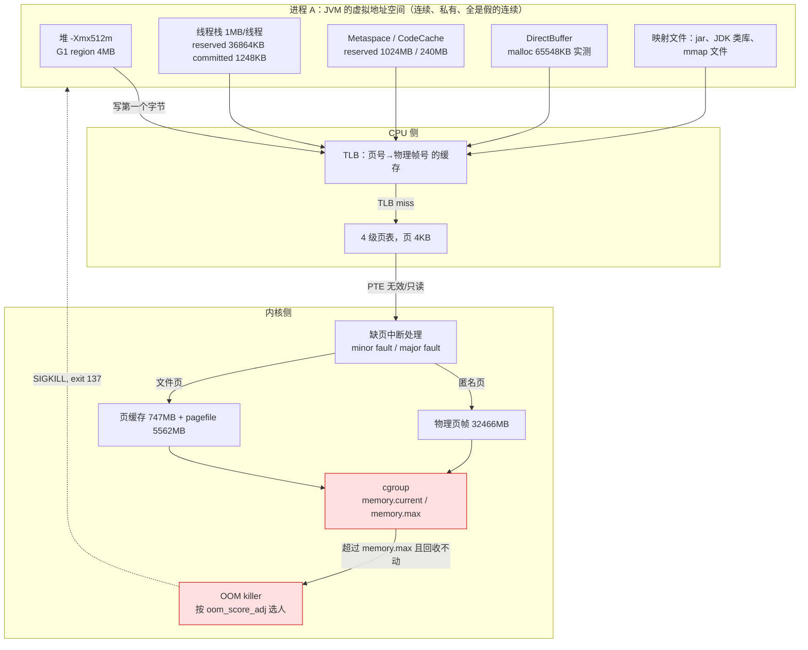
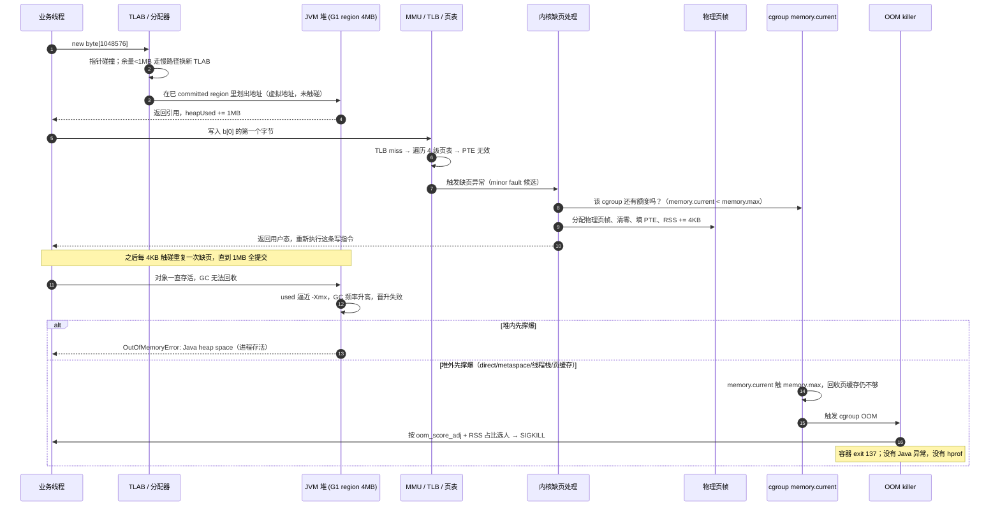

# 内存管理与虚拟内存：不是「每个进程真的独占内存」，而是「页表 + 缺页 + 换页撑起来的假象」

> **一句话结论**：进程看到的连续、私有的地址空间，是内核用页表造出来的假象；你为这个假象付三笔账——页表/TLB 的翻译成本、缺页中断的陷入成本、换页与 OOM 的真实故障成本。**看不懂这三笔账，就会把 RSS 当内存、把 VSZ 当泄漏、把 OOMKilled 当内存泄漏。**
> **阅读前置**：读过本模块 [01-进程线程与调度.md](01-进程线程与调度.md)（知道进程/线程/上下文切换）；知道 JVM 有堆和栈；会在 pwsh 里跑 `Get-Content` / `Select-String` / `Get-Counter`，能跑 `java -version` 和 `node -v`。
> **证据基线**：Windows 11 (10.0.26100) + JDK 17.0.19 Temurin + Node 24.16.0 本机实测输出（2026-11-27，仓库 `master@d6f9c33`，内存 32466MB）。本篇所有数字都来自本机实跑，不做吞吐/延迟类基准承诺。预计阅读 45~60 分钟。

## 证据边界

| 主题 | 本仓状态 | 证据 | 本篇怎么处理 |
| --- | --- | --- | --- |
| 虚拟地址翻译 / 页表 / TLB | ⚠️ 半落地（JVM 用了，但没人配） | C 级：`-Xlog:pagesize=info`、`-XX:+PrintFlagsFinal`、`Get-Counter` 实跑 | §3.1、§3.2 讲机制 + 本机输出 |
| JVM 堆 / 栈 / 堆外四件套 | ✅ 已落地（有配置） | B 级：`deploy/k8s/services/*.yaml` 的 `JAVA_OPTS` 与 `resources`；C 级 NMT 实测 | §2、§3.3、§3.8 |
| 容器内存上限（cgroup） | ⚠️ 半落地 | B 级：`deploy/k8s` 有 `limits.memory`，`deploy/docker-compose` 无 `mem_limit`（命中 0） | §3.5、§5、§7 |
| swap / swappiness | ❌ 未落地 | C 级：本机 `Win32_PageFileUsage` 实测；`deploy/k8s` 全部清单 `swap` 命中 0 | §3.7 只给命令与判读方法，**未本机实测 cgroup swap** |
| OOM Killer / `oom_score_adj` | ❌ 未落地 | 本机是 Windows，无 cgroup 与 OOM killer；`oom_score_adj` 全仓命中 0 | §3.8、§6.7 只给 Linux 命令与判读，标注「未本机实测」 |
| docker / kubectl / perf 实测 | ❌ 不可用 | `Get-Command docker,kubectl` 无输出（未安装） | 一律写「未本机实测，给命令与判读方法」+ 原因 |

### 本篇命令与脚本索引（都能重跑）

| 脚本 | 作用 | 正文引用处 |
| --- | --- | --- |
| `learning-docs/tools/tmp/m15-02-node-mem.mjs` | 用 node 分段量 `rss/heapUsed/external`，看「登记 ≠ 提交」 | §0、§3.2、§3.5 |
| `learning-docs/tools/tmp/m15-02-heap-stages.java` | JVM 三段造内存（堆 200MB / direct 64MB / 200 条 1MB 栈线程） | §0、§3.5、§3.8 |
| `learning-docs/tools/tmp/m15-02-sample-rss.ps1` | 从进程外采 RSS / Private / VSZ，与 JVM 自报堆对照 | §0、§3.5 |
| `learning-docs/tools/tmp/m15-02-nmt.ps1` | 开 NMT 让 JVM 自己列出堆/类/代码/线程/GC/Other 各占多少 | §3.8 |
| `learning-docs/tools/tmp/m15-02-stack-depth.java` | 换 `-Xss` 量递归深度，证「栈是预留、按需提交」 | §3.3 |
| `learning-docs/tools/tmp/m15-02-pagecache.mjs` | 写 128MB 再读两次，看页缓存与 RSS/external 的区别 | §3.6 |
| `learning-docs/tools/tmp/m15-02-k8s-mem-budget.mjs` | 解析 `deploy/k8s/**` 真值，算 requests/limits 合计与「堆外余量」 | §3.8、§5 |

## 0. 先看现象

### 现象 1：机器 32GB，一个「什么都没配」的 JVM 自报最大堆 8120MB

```powershell
java -XX:+PrintFlagsFinal -version 2>&1 |
  Select-String -Pattern 'MaxHeapSize|InitialHeapSize|MaxRAMPercentage|MaxDirectMemorySize|MaxMetaspaceSize|UseG1GC'
```

```text
  size_t InitialHeapSize       = 532676608                                  {product} {ergonomic}
  size_t MaxHeapSize           = 8514437120                                 {product} {ergonomic}
 double MaxRAMPercentage       = 25.000000                                  {product} {default}
  size_t MaxDirectMemorySize   = 0                                          {product} {default}
  size_t MaxMetaspaceSize      = 18446744073709551615                       {product} {default}
     bool UseG1GC              = true                                       {product} {ergonomic}
```

`8514437120 / 1024 / 1024 = 8120MB`，约等于 32466MB × 25%（32466 × 25% = 8116.5MB，再按 4MB region 对齐——同一台机器 `G1HeapRegionSize = 4194304`）。注意三件事：`InitialHeapSize` 已经是 508MB（`1/64` 物理内存），**不是 0**；`MaxDirectMemorySize = 0` 不是「不许用 direct buffer」，而是「自己算，默认等于最大堆」；`MaxMetaspaceSize` 是一个接近 2^64 的数——**等于没有上限**。本仓 `tools/*.ps1` 里 `-Xmx` 命中数是 0，也就是说本地起服务时每个 JVM 都按这个默认值要额度。

### 现象 2：同一个 JVM，RSS 392MB，VSZ 6615MB——差 16.8 倍

```powershell
cd learning-docs\tools\tmp      # 脚本在 learning-docs/tools/tmp/m15-02-sample-rss.ps1
.\m15-02-sample-rss.ps1         # 它内部 Start-Process java，并从进程外每 400ms 采一次
```

```text
 t_s RSS_MB Private_MB VSZ_MB Threads
 2.2  101.8      639  6350.9      39     <- 0.baseline：堆 6MB 用时
 5.2  324.4    643.1  6351.9      40     <- 堆 +200MB 之后
 7.3  382.1    702.6  6417.2      39     <- direct +64MB 之后
10.2  392.6    718.4  6615.2     237     <- 200 条 1MB 栈线程之后
Peak_RSS_MB = 392.6
Peak_VSZ_MB = 6615.2
=== JVM 自报 ===
0.baseline     maxHeap=512MB heapUsed=  6MB heapCommitted=508MB nonHeap= 19MB committedVirt= 639MB threads=1
3.threads+200  maxHeap=512MB heapUsed=406MB heapCommitted=512MB nonHeap= 20MB committedVirt= 717MB threads=201
```

`-Xmx512m` 的进程，VSZ 6.4GB，RSS 392MB。**拿 VSZ 判断「内存不够/内存泄漏」必错**；而 200 条线程让 VSZ 从 6417MB 涨到 6615MB（+198MB ≈ 200×1MB 栈预留），RSS 只涨 10.5MB——因为栈的页大多数根本没被碰过。

> 注意上表两处「线程数」口径不同：`Threads` 列是操作系统线程数（39→237）；JVM 自报那一列来自探针里的 `Thread.activeCount()`，只统计**当前线程组**的活跃线程（1→201），不含 GC/编译/采样线程。**同一个进程两个数字都没错，错的是拿它们互相验证。**

### 现象 3：每秒 4 万多次缺页，其中只有 42 次真的去读了盘

```powershell
(Get-Counter '\Memory\Page Faults/sec','\Memory\Pages Input/sec','\Memory\Pages Output/sec',
             '\Memory\Available MBytes','\Memory\Commit Limit' -SampleInterval 1 -MaxSamples 1).CounterSamples |
  Select-Object Path,CookedValue | Format-Table -AutoSize
```

```text
Path                               CookedValue
\\yxw\memory\available mbytes            9833
\\yxw\memory\commit limit          39875563520
\\yxw\memory\pages input/sec   42.4607401084744
\\yxw\memory\pages output/sec                0
\\yxw\memory\page faults/sec   43266.5067114631
```

缺页 43266 次/秒，`Pages Input/sec` 只有 42.46（**0.1%**），`Pages Output/sec` 是 0（**没有任何换出**）。也就是说：缺页绝大多数是「软缺页」——地址第一次被写，内核当场给个物理页，不碰磁盘；`Commit Limit = 39875563520B = 38025MB`，约等于 32466MB 物理 + 5562MB 页文件（`Win32_PageFileUsage` 实测 `AllocatedBaseSize=5562`；`TotalVirtualMemorySize` 实测 38028MB，三者差 3MB 以内）。**「内存额度」是物理 + 页文件的总和，不是物理内存。**

这些现象指向同一件事：**内存从来不是「一个数字」，而是四本口径不同的账——虚拟地址（VSZ）、驻留物理页（RSS）、提交承诺（Commit / 容器 `memory.current`）、以及 JVM 自己以为的堆用量（`heapUsed`）。你读的那本账，决定你会不会把正常现象判成故障。**

## 1. 整体地图



> **读图说明**：读这张图问三个问题。①**从左到右有几道关？** 任何一次内存访问都要经过 TLB → 页表 → 缺页处理三关中的至少一关，TLB 命中就停在第 0 关（这是为什么热点数据感觉不到「虚拟内存」的存在）。②**红色两个框为什么是红色？** 因为它们是本篇唯二「配错了会直接杀死进程」的地方：`memory.max`（容器 limit）和 OOM killer；本仓 `deploy/docker-compose` 根本没配 `mem_limit`（命中 0），所以 compose 场景下 OOM killer 只看整机，k8s 场景下才看单容器。③**虚线为什么是虚线？** OOM killer 不是内存分配路径上的同步调用，它是在内存回收失败后才由内核另起的判定，进程感知到的是「SIGKILL / exit 137」，没有任何 Java 异常——这就是「JVM 被杀时看不到内存泄漏」的图形原因。

| 组件 | 位置 | 负责什么 | 内存口径 | 参与方 |
| --- | --- | --- | --- | --- |
| 页表 | CPU/内核，每进程一套 | 虚拟页号 → 物理帧号 | 每 4KB 页 8B 的 PTE | MMU、内核 `mm_struct` |
| TLB | CPU 内部 | 缓存最近的翻译结果 | 数十~上千项（型号相关，**未本机实测**） | CPU |
| 缺页处理 | 内核 `do_page_fault` | 分配物理页、填 PTE、读文件页 | minor=不读盘 / major=读盘 | 内核、页缓存 |
| 栈 | 每线程 | 函数调用帧、局部变量 | `reserved` 1MB/线程，`committed` 按需 | JVM `-Xss`、OS |
| 堆 | JVM 管理 | 对象、TLAB | `-Xmx`、`heapUsed`、`heapCommitted` | G1 GC、应用线程 |
| Metaspace / CodeCache | JVM 管理（堆外） | 类元数据、JIT 代码 | 默认**无上限**（实测 `MaxMetaspaceSize`≈2^64） | 类加载器、C1/C2 |
| DirectBuffer | 应用 + JVM | NIO / Netty / 文件映射 | 默认 ≈ 最大堆（实测 `MaxDirectMemorySize=0`） | 应用代码 |
| 页缓存 | 内核 | 缓存文件内容 | 本机 747MB（`Cache Bytes`，采样时刻；这是随时在变的量） | 所有文件 IO |
| swap / pagefile | 内核 | 把不常用页换出 | 本机 pagefile 5562MB，占用 141MB | 内核 |
| cgroup `memory.current` | 容器运行时 | 该 cgroup 已用内存（含页缓存） | 不是 RSS，也不是 JVM 堆 | systemd / kubelet |
| OOM killer | 内核 | 超限时杀进程 | `oom_score_adj` + RSS 占比 | 内核、kubelet |

## 2. 关键概念与关键要素

先一句话解释每个术语，再进表。**虚拟地址**是进程看到的编号，硬件用它查表换成**物理帧号**；**页**是这套映射的最小单位（本机实测 4096 字节）；**页表项（PTE）** 是「虚拟页 → 物理帧 + 权限位」的一行记录；**TLB** 是这张表的 CPU 缓存；**缺页中断**是「查表发现这页还没给物理内存」时 CPU 陷入内核的事件；**RSS** 是当前真占着的物理页；**VSZ** 是整个虚拟地址空间大小（几乎全是预留）；**committed/提交** 是内核对「将来必须能给出物理页」的承诺；**页缓存** 是内核拿空闲内存缓存文件内容；**swap** 是把匿名页搬到磁盘腾出物理页；**overcommit** 是「允许承诺超过物理+swap」的策略；**OOM killer** 是承诺兑现不了时按分数杀进程的机制；**arena/TLAB** 是分配器给线程的「私有小仓库」，避免每次分配都加锁；**碎片** 分内部（分配粒度浪费）与外部（空闲总量够但没有连续块）。

| 名称 | 位置 | 作用 | 关键参数 |
| --- | --- | --- | --- |
| 页 / 页帧 | `[System.Environment]::SystemPageSize` 实测 4096 | 映射最小单位 | 4KB（x86-64 默认） |
| 虚拟地址空间 | 进程私有 | 造出「独占」假象 | x86-64 用户态 48 位可寻址 |
| 页表 / PTE | 内核 | 虚拟页→物理帧 + 权限 | 每项 8B，一级表 512 项 = 4KB = 1 页 |
| TLB | CPU | 翻译缓存 | 命中即零成本；换进程/换页表要刷 |
| minor fault | 内核 | 分配物理页、填 PTE，不读盘 | 本机 `Page Faults/sec` 43266 的主成分 |
| major fault | 内核 | 需要从磁盘/页文件读回页面 | 本机 `Pages Input/sec` 42.46 |
| RSS | 进程 | 真实驻留物理页 | Windows `WorkingSet64` |
| VSZ / 虚拟大小 | 进程 | 地址空间总量 | Windows `VirtualMemorySize64`，实测 6615MB |
| 提交 / Commit | 系统 | 承诺可兑现的额度 | 本机 `Commit Limit` 38025MB ≈ 物理 32466 + pagefile 5562 |
| 页缓存 | 内核 | 缓存文件内容，加速读写 | `Cache Bytes` 实测 747MB |
| pagefile / swap | 内核 | 换出不常用页 | 本机 5562MB，已用 141MB，峰值 159MB |
| overcommit | 内核 | 允许承诺 > 物理+swap | Linux `vm.overcommit_memory`（本机无此项） |
| cgroup memory.current | 容器 | 该容器已用（含页缓存） | 对应 v2 `memory.max` 上限（**未本机实测**） |
| `oom_score_adj` | 内核 | 调整被杀倾向 -1000~1000 | 本仓命中 0（无配置） |
| `-Xmx` | JVM | 最大堆 | 本仓：chat 512m，其余业务 256m |
| `-Xss` | JVM | 单线程栈 | 实测 0 = OS 默认（约 1MB） |
| TLAB | JVM | 线程本地分配缓冲 | 实测 `desired_size: 512KB`、`UseTLAB=true` |
| G1 region | JVM | 堆的分区粒度 | 实测 `G1HeapRegionSize=4194304`（4MB） |
| Metaspace | JVM 堆外 | 类元数据 | 实测无上限（2^64-1） |
| DirectBuffer | JVM 堆外 | 零拷贝/网络缓冲 | 实测 `MaxDirectMemorySize=0`（≈堆大小） |

## 3. 原理与证据逐段精读

### 3.1 地址翻译：页表与 TLB 到底在干什么

**在干什么。** 你的 Java 对象地址是虚拟地址，CPU 每次读写都要先把它换成物理帧号：取高 36 位当「虚拟页号」，查 4 级页表（每级 9 位索引，每级表 512 项 × 8B = 4KB，正好一页），拿到 PTE 里的物理帧号，再拼上低 12 位页内偏移。本机实测 `Heap: page_size=4K`（见 3.2 的 `-Xlog:pagesize`），`Get-Counter` 也印证了 4KB 页。查表结果会进 TLB 缓存，命中就跳过 4 次访存。

**为什么这么设计。** 因为「稀疏」：进程的 512MB 堆里实际只用了 200MB，而且分散在几十个 G1 region 里；如果按「连续虚拟 → 连续物理」直接映射，物理内存立刻碎片化。多级页表让**没用的虚拟区间连页表项都不占**，一级索引只在真正用到时才分配下一级。这是个典型的「时间换空间」：多几次访存，换掉物理内存的连续性要求。

**换写法会怎样。** 页变大（2MB/1GB huge page）→ 页表层级变浅、TLB 一条能覆盖 2MB，缺页次数降到 1/512；代价是内部碎片（哪怕只用 1KB 也要占 2MB 物理）与分配时更难找到连续大块。本机实测 JVM 没开大页：`UseLargePages = false`、`LargePageSizeInBytes = 0`。相反如果改成单级页表（32 位时代），4GB 空间就要 4MB 常驻页表，多进程立刻吃光内存。

**常见坑。** ①把 VSZ 6.4GB 归因于「页表太大」。算一下：512MB 堆全提交 = 131072 个页 × 8B ≈ 1MB 末级 PTE，加上三级索引也不到 2MB，相对 6.4GB 可忽略；VSZ 的大头是 JVM 预留区间（`-Xlog:pagesize` 实测 Class 类空间预留 1024MB、CodeCache 预留 240MB）加上 Windows 侧映射。②以为「TLB 命中和缓存命中是一回事」——TLB 命中只是省了翻译，数据仍要去 L1/L2/内存取。

### 3.2 缺页中断：物理内存是「第一次写才给」的

**在干什么。** 分配器给你一段虚拟地址时，内核只记账不发货。等第一次读/写这一页，MMU 发现 PTE 无效（或只读），触发缺页异常，内核 `do_page_fault` 检查地址是否在合法 VMA 内、cgroup 是否还有额度，然后分配物理页帧、清零、填 PTE、更新 RSS，返回用户态重执行那条指令——这一趟叫 minor fault。如果页的内容在文件里（可执行文件、mmap 的文件页），要真去读盘，叫 major fault。

```javascript
// learning-docs/tools/tmp/m15-02-node-mem.mjs 的关键两段（实跑输出见下）
const buf = new ArrayBuffer(200 * 1024 * 1024);            // 只登记 200MB 虚拟地址
const view = new Uint8Array(buf);
for (let p = 0; p < view.length; p += 4096) view[p] = 1;   // 每 4KB 触碰 1 字节 = 触碰 51200 页
```

```text
2. new ArrayBuffer(200MB) 未触碰 rss=144.3MB heapTotal=126.8MB heapUsed=73.0MB external=201.7MB arrayBuffers=200.0MB
   -> arrayBuffers 增加 200.0MB，rss 只增加 0.2MB：虚拟地址登记了，物理页还没分配
3. 每 4KB 写 1 字节（共 51200 页） rss=344.5MB heapTotal=127.1MB heapUsed=73.1MB external=201.7MB
   -> rss 从 144.3MB 涨到 344.5MB，增加 200.2MB
```

**这组数字就是「虚拟 ≠ 物理」的干净实验**：登记 200MB 只花 0.2MB RSS，逐页触碰后 RSS 才涨满 200.2MB。

**为什么这么设计。** 三个理由，都能在本机数字里看到影子：①**启动快**——JVM 一起来就 `heapCommitted=508MB`（实测），但只碰了 6MB 的页，其余等用；②**共享**——多个进程 mmap 同一个 jar，物理页只有一份，RSS 各记各的；③**能超额**——本机 `Commit Limit` 38025MB 大于物理 32466MB，靠 pagefile 兜底，进程才敢「先要一大片」。

**换写法会怎样。** 如果改成「分配即提交」（Linux `MAP_POPULATE`、JVM `-XX:+AlwaysPreTouch`），RSS 会在启动瞬间逼近 `-Xmx`，好处是容器内存账立刻暴露、运行期不再有缺页抖动，坏处是启动变慢、且一开始就吃掉全部配额。本仓 `deploy/k8s/services/*.yaml` 没有 `-XX:+AlwaysPreTouch`，所以容器 `memory.current` 会在运行几分钟后才爬到高位——**这会让「刚发布时内存正常、跑一会儿就涨」被误判成缓慢泄漏**。

**常见坑。** ①看到 `Page Faults/sec` 四万多就报警：本机同时刻 `Pages Input/sec` 只有 42.46，99.9% 是软缺页，属于正常分配路径；②把「只在 Linux 上出现」的 `/proc/vmstat` 字段名（`pgfault`/`pgmajfault`）套到 Windows 上找，命令对不上——Windows 要对 `Page Faults/sec` 与 `Pages Input/sec` 一起看。

### 3.3 栈与堆：一个按需提交，一个由 GC 回收

**在干什么。** 线程栈是一段**创建时就预留**的连续虚拟内存（本机 JVM 默认 `ThreadStackSize = 0`，即用 OS 默认，实际约 1MB），只在函数调用深入时逐页提交；栈上放栈帧（返回地址、局部变量、基本类型数组引用），函数返回就自动弹出，**不需要 GC**。堆是 JVM 向 OS 要来的大块区域，G1 把它切成 4MB 的 region（实测 `G1HeapRegionSize=4194304`），对象在里面分配，靠 GC 判活回收。

NMT 实测把这件事说得最清楚（脚本：`learning-docs/tools/tmp/m15-02-nmt.ps1`）：

```text
-                    Thread (reserved=36945KB, committed=1329KB)
                            (thread #36)
                            (stack: reserved=36864KB, committed=1248KB)
```

36 条线程预留了 36864KB（≈1MB × 36），真正提交的只有 1248KB——**平均每线程只用了 34.7KB 的栈**。同期进程 RSS 383.3MB、VSZ 6418.1MB。

**为什么这么设计。** 栈必须「确定」：编译器按栈帧布局生成指令，运行时不能搬家，所以只能预留一段固定空间，用 guard page（实测 `StackRedPages=1`、`StackYellowPages=3`、`StackShadowPages=7`）挡住越界；堆必须「灵活」：对象大小、生命周期都不可预测，所以交给 GC 而不是栈式弹出。

**换写法会怎样。** 换 `-Xss` 就换出完全不同的容量（脚本：`learning-docs/tools/tmp/m15-02-stack-depth.java`，每帧额外 64B 局部数组）：

```text
== default ==    StackOverflowError depth=14298 localArrayBytes=64 elapsedMs=8
== -Xss256k ==   StackOverflowError depth=2040  localArrayBytes=64 elapsedMs=1
== -Xss2m ==     StackOverflowError depth=30434 localArrayBytes=64 elapsedMs=16
```

默认栈约 1MB → 14298 帧 → 每帧 ≈ 73B；`-Xss256k` 只剩 2040 帧（11 个保护页 ≈44KB 先吃掉 17% 的栈）；`-Xss2m` 涨到 30434 帧。三组数字**不是严格线性**：1m→2m 容量 2 倍、深度 2.13 倍，而 256k→2m 容量 8 倍、深度 14.9 倍——小栈里固定开销（`StackRedPages` 1 + `StackYellowPages` 3 + `StackShadowPages` 7 = 11 页）占比高，且冷启动时解释执行的帧比 JIT 编译后更大。**这是单次采样，别把 73B/帧当常数，要看相对关系。** **注意方向**：把 `-Xss` 调小，省的是 VSZ 不是 RSS（实测 200 条线程只多 10.5MB RSS）；牺牲的是递归深度，`StackOverflowError` 会立刻在深递归/复杂 JSON 解析/正则回溯里出现。

**常见坑。** ①把 `StackOverflowError` 当内存不足去加 `-Xmx`——方向完全错，该调 `-Xss` 或改递归；②用线程数估算内存：实测 200 条 1MB 栈线程只让 RSS 涨 10.5MB、让 VSZ 涨 198MB，按 VSZ 估算会得出「必须 200MB 物理」的错误结论；③在容器里给 `-Xss1m` + 500 线程，然后疑惑为什么 VSZ 报警而 RSS 正常——因为栈预留几乎不进 RSS。

### 3.4 分配器、TLAB 与碎片：为什么要给每个线程一个小仓库

**在干什么。** 应用不停 `new` 对象，如果所有线程都从同一个堆顶指针分配，就得抢一把全局锁。所以 HotSpot 给每条线程发一块私有缓冲区 TLAB（Thread Local Allocation Buffer），线程在 TLAB 里用「指针碰撞」分配（几乎就是一次加法），TLAB 用完再去堆里换一块。实测日志（`java -Xmx512m -Xlog:gc+tlab=trace m15-02-heap-stages.java`）：

```text
[0.028s][trace][gc,tlab] ThreadLocalAllocBuffer::compute_size(4) returns 65536
[0.028s][trace][gc,tlab] TLAB: fill thread: 0x000001f180048560 [id: 41896] desired_size: 512KB
                         slow allocs: 0  refill waste: 8192B alloc: 1.00000  1024KB refills: 1 waste  0.0% gc: 0B slow: 0B
```

`desired_size: 512KB` 是每条线程的 TLAB 目标大小，`refill waste: 8192B` 是换块时允许浪费的上限，`waste 0.0%` 是实际浪费率。C 世界里的对应物是 glibc malloc 的 arena：线程各自用 arena，避免主 arena 争锁——**但 Windows 上没有 glibc**，本机无法实测 arena 行为，只能给 Linux 侧观察命令（见 §6.6，标注未实测）。

**为什么这么设计。** 分配是最高频操作，微秒级争锁会放大成吞吐塌陷；TLAB/arena 把「全局竞争」降级为「每线程无锁 + 偶尔换块」。代价是**内部碎片**：TLAB 里剩下的零头（实测 waste 0.0~0.1%）无法给别人用；更贵的是**外部碎片**与**大对象特殊化**：G1 里超过 region 一半（4MB/2 = 2MB）的对象算 humongous，直接独占整 region。

**换写法会怎样。** 关掉 TLAB（`-XX:-UseTLAB`，实测默认 `UseTLAB = true`）→ 每次分配都走共享路径，多线程分配密集时明显变慢；把 TLAB 调很大（`-XX:TLABSize`，实测默认 0=自动）→ 小对象多的应用浪费内存。堆也逃不掉同样的账：`-Xmx512m` 不等于「能装 512MB 活数据」。本机实测（探针 `learning-docs/tools/tmp/ProbeAlloc.java`）：

```text
maxHeap=512MB
alloc 251MB used=505MB total=512MB
OOM at 254MB allocated; used=510MB total=512MB
```

512MB 的堆只能活下约 254MB 的 1MB 数组——G1 要留复制/晋升空间，且 humongous 对象按 region 对齐。**这就是「堆没满却 OOM」的真相**，也是为什么本篇 3.8 的实测把堆阶段定在 200MB 而不是 400MB。

**常见坑。** ①拿 `heapUsed / heapCommitted` 当「还剩多少能分配」——真正决定能否分配的是**连续可用 region**，不是总量；②看到 `waste 0.0%` 就以为没碎片，这只统计 TLAB 换块浪费，不统计 region 级外部碎片；③把 `MaxDirectMemorySize=0` 读成「禁用 direct buffer」（它是「默认等于最大堆」，实测见 §0 现象 1）。

### 3.5 四本账：VSZ、RSS、提交/cgroup、JVM `heapUsed`

**在干什么。** 同一时刻，同一个进程有四个不同的「内存数字」，各自回答不同问题：

| 口径 | 本机实测（`-Xmx512m` 的 JVM，堆 200MB + direct 64MB + 200 线程） | 回答什么问题 | 会骗你什么 |
| --- | --- | --- | --- |
| VSZ / `VirtualMemorySize64` | 6615.2MB | 地址空间额度多大 | 大得离谱但与物理无关 |
| RSS / `WorkingSet64` | 392.6MB | 现在真占多少物理页 | 不含被换出的页，也不含其他进程共享的页 |
| Private / `PrivateMemorySize64` | 718.4MB | 私有提交量（含已换出） | 与 RSS 混用会得出两套结论 |
| JVM `heapUsed` | 406MB（`heapCommitted` 512MB） | 堆内对象占多少 | 完全看不到 direct/metaspace/线程栈 |
| cgroup `memory.current`（Linux） | **未本机实测**（Windows 无 cgroup） | 容器视角已用（**含页缓存**） | 把页缓存当泄漏 |

**为什么这么设计。** 因为「内存」这个词被四种不同需求借用了：调度器要额度（VSZ/commit）、内核要真实压力（RSS）、运维要 SLA 数字（RSS/WorkingSet）、应用要自救（`heapUsed`/`memory.current`）。它们**天生不相等**，而且差值有明确来源：VSZ − RSS = 预留未触碰 + 页表 + 映射；RSS − `heapUsed` = 堆外（direct/metaspace/code cache/线程栈）+ 分配器未用但已提交的堆页。

本机 node 实测给出最干净的「RSS 为什么大于 heapUsed」：

```text
3. 每 4KB 写 1 字节（共 51200 页）  rss=344.5MB heapTotal=126.3MB heapUsed= 73.1MB arrayBuffers=200.0MB
5. 200ms 后                     rss=136.3MB heapTotal= 70.9MB heapUsed=  4.2MB arrayBuffers=  0.0MB
=== 结论算术（全部来自上面同一进程的真实读数）===
rss - heapUsed = 271.4MB
heapTotal - heapUsed = 53.2MB
```

（结论算术取第 3 阶段的读数——那是 ArrayBuffer 已触碰、堆外真实存在的时刻；第 5 阶段 GC 之后 `arrayBuffers` 已归 0，差值自然不同。这两行是脚本自己算的，不是我事后凑的。）

RSS 里有 **V8 堆的已提交但未用部分（53.2MB）+ ArrayBuffer 的堆外 200MB + node 自身的代码/映射/栈**，而 `heapUsed` 只有 73.1MB。换到 JVM 上同理，NMT 实测（§3.8）显示 `-Xmx512m` 的进程堆外至少 181MB 已提交。

**换写法会怎样。** 只看 `heapUsed` 做容量规划 → 在容器里被 OOMKilled（因为堆外四件套没算）；只看 RSS 做容量规划 → 高估（RSS 含可回收的页缓存与映射文件页）；只看 VSZ → 荒诞（6.6GB vs 394MB，16.8 倍）；只看 cgroup `memory.current` → 把「写了 2GB 日志文件」当成「内存泄漏」。正确做法是**四本账同时看，并解释每一处差额**。

**常见坑。** ①在 k8s 里用 `kubectl top pod` 的 MEMORY 当 JVM 堆用量（那是 RSS 量级，不是 `heapUsed`）；②看到 RSS 掉下来就说「内存泄漏修好了」——本机实测从 344.5MB 掉到 136.4MB 是 GC + 归还，不是代码改了；③`PrivateMemorySize64` 与 `WorkingSet64` 混用，得出「容器里 703MB 却 limit 512Mi 没被杀」的悖论（前者含被换出/未触碰）。

### 3.6 页缓存与文件 IO：读写文件为什么「快得不像磁盘」

**在干什么。** `read()` 先把文件页读进内核页缓存（本机 `Cache Bytes` 实测 747MB），再从缓存拷到你的 buffer；`write()` 是拷进页缓存就返回，什么时候落盘由内核决定。所以**第一次读是磁盘速度，第二次读是内存速度**；而写完立刻读，读的是页缓存，根本没碰盘。

```javascript
// learning-docs/tools/tmp/m15-02-pagecache.mjs：造 128MB 文件 → 读两次
```

```text
1. write 128MB  writeMs=60  size=128.0MB  rss=53.6MB heapUsed=4.9MB external=2.9MB
   -> 写完立刻返回，数据只在页缓存里；writeSync 不保证落盘，落盘要 fsync
2. read#1   readMs=70 bytes=134217728  rss=181.7MB heapUsed=4.9MB external=130.9MB
3. read#2   readMs=64 bytes=134217728  rss=310.2MB heapUsed=4.4MB external=258.9MB
   -> 第二次读比第一次快 1.1x（同进程、缓存未清，只能看方向不看绝对量）
```

**怎么读这组数**：128MB 读只用 70ms（≈1.8GB/s 量级），普通磁盘做不到，说明第一次读就已经命中页缓存——因为文件刚被自己写完，页还在缓存里。**因此「热读更快」在这台机器上观察不到；能观察到的是 RSS 从 53.6MB 涨到 310.2MB，而 `heapUsed` 几乎不动**：`readFileSync` 的返回 Buffer 记在 `external`（258.9MB），不在 V8 堆里。

**为什么这么设计。** 内存比 SSD 快 3 个数量级以上，空闲内存不用就是浪费，所以内核把「没被进程要走的物理页」全拿去缓存文件。代价是：**所有内存口径都会包含页缓存**，而页缓存理论上可回收——于是「可回收内存」和「真实压力」必须分开看。

**换写法会怎样。** 直接 IO（`O_DIRECT`）绕过页缓存，避免双重拷贝与缓存污染（数据库常用），代价是每次都要等盘；`mmap` 把文件页映射进地址空间，读它就等于读内存（本机日志 747MB 缓存里大量是这种页），代价是缺页即 major fault，且**映射的文件页会计入 RSS**。

**常见坑。** ①在容器里写大文件后看到 `memory.current` 猛涨就判泄漏——那多半是页缓存，可回收；②反过来，`RSS` 不含 `read()` 走的页缓存，但**含 `mmap` 的文件页**，所以「RSS 涨了」既可能是堆涨，也可能是映射文件被触碰；③以为 `write()` 成功就持久化了，断电丢数据（本机脚本注释里那句就是提醒）。

### 3.7 swap、swappiness 与 overcommit：为什么「承诺」可以大于「物理」

**在干什么。** 本机页文件 `C:\pagefile.sys` 实测：`AllocatedBaseSize = 5562MB`、`CurrentUsage = 141MB`、`PeakUsage = 159MB`；同一时刻 `Pages Output/sec = 0`——**这台机器几乎没换出过**。而 `Commit Limit = 38025MB`（物理 32466 + 页文件 5562）说明：内核允许「承诺」超过物理内存，差额靠页文件/swap 兜底。Linux 上对应两个旋钮：`vm.swappiness`（0~100，倾向换出匿名页的程度，默认 60）和 `vm.overcommit_memory`（0=启发式、1=总是答应、2=严格）。

**为什么这么设计。** 进程申请的内存往往远大于实际使用（本机 JVM 一上来就 commit 508MB，只用 6MB），严格承诺会拒绝大量合法请求；而换页让「冷页」腾出物理内存给热页，提高整体利用率。这是**用延迟换容量**：swap 把「内存不足」变成「变慢」，直到慢到不可用才由 OOM killer 收场。

**换写法会怎样。** swap 关掉（k8s 默认，本仓 `deploy/k8s` 全部清单 `swap` 命中 0）→ 内存不足立刻 OOMKilled，行为确定但没缓冲；swap 开着且 `swappiness` 高 → JVM 的堆页被换出，GC 扫描时触发大量 major fault，**停顿从毫秒级变成秒级**；`overcommit_memory=2` → 承诺严格，Redis 之类的 fork 场景会 fork 失败。

**常见坑。** ①把 swap 当「内存扩容」用，结果 GC 停顿爆炸还找不到原因（`Pages Input/sec` 飙高、`Pages Output/sec` 同步飙高就是证据）；②在容器里只看 `free` 的 available，不看 cgroup limit；③在 Windows 上照抄 Linux 命令（`free -m`、`/proc/swaps`）——本机没有这些，要用 `Get-CimInstance Win32_PageFileUsage`。

**本机无法实测的部分**：cgroup 的 `memory.swap.max`、`vm.swappiness` 生效效果（Windows 无 cgroup，`Get-Command docker,kubectl` 也无输出）。想看时在 Linux 节点上跑：

```bash
# 未本机实测（本机 Windows，无 cgroup、无 docker/kubectl）
cat /sys/fs/cgroup/memory.max /sys/fs/cgroup/memory.current 2>/dev/null
cat /sys/fs/cgroup/memory.swap.max 2>/dev/null
vmstat 1 5 | awk 'NR==1||$7>0||$8>0'   # si/so 非 0 就是在换页
```

判读：`memory.current` 接近 `memory.max` 且 `si/so` 持续非 0 = 正在靠 swap 撑；`memory.current` 高但 `si/so` 为 0 且可回收（`memory.stat` 里 `file` 占大头）= 页缓存，不是泄漏。

### 3.8 OOM Killer 怎么选人，以及 JVM 堆外四件套加起来超 limit 的真实场景

**在干什么。** 当 cgroup 的 `memory.current` 涨到 `memory.max` 且内核回收不动（页缓存已空、匿名页全在用），内核触发 cgroup OOM，按「谁吃得多 + `oom_score_adj` 调权」挑一个进程 `SIGKILL`；容器表现为 `exit code 137`（128+9），**没有任何 Java 异常、没有 hprof、GC 日志可能干干净净**。Linux 上可以调：`oom_score_adj`（-1000 = 基本免杀，1000 = 优先杀），k8s 里通过注解或 `securityContext` 落地——**本仓 `oom_score_adj` 与 `terminationGracePeriodSeconds` 命中均为 0，未落地**。

**为什么这么设计。** 内存是「不可回收的独占资源」：CPU 超了可以限流，内存超了没得商量，只能杀一个牺牲品换整体存活。所以选择权必须交给内核，并且要有一个可调权重让运维保住关键进程。

**换写法会怎样。** 用 `oom_score_adj=-1000` 保护 MySQL/ES → 变成「杀 JVM」；完全不设 → 谁 RSS 大杀谁，通常就是刚被流量打满的 JVM。**这就是本仓 7 个 `-Xmx256m` + `limits.memory=512Mi` 工作负载最现实的风险**（6 个业务服务 api-gateway / knowledge / message / notify / search / user，加 RocketMQ Broker）：堆 256m + 堆外没上限 + limit 只剩 256Mi。

现在把「堆外四件套」算成账。NMT 实测（`-Xmx512m`，堆里 200MB 活对象 + 64MB direct + 200 条线程那一段）：

```text
Total: reserved=2092698KB, committed=710082KB
-                 Java Heap (reserved=524288KB, committed=524288KB)
-                     Class (reserved=1048843KB, committed=1675KB)   <- Metaspace/类空间：预留 1GB
-                    Thread (reserved=36945KB, committed=1329KB)     <- 36 线程
-                      Code (reserved=248038KB, committed=8942KB)    <- JIT code cache：预留 240MB
-                        GC (reserved=80865KB, committed=80865KB)    <- G1 辅助结构 79MB，随堆增长
-                     Other (reserved=65548KB, committed=65548KB)    <- 64MB direct buffer 记在这里
```

堆 committed 512MB，总 committed 693MB → **堆外已提交 ≈181MB**（GC 79 + direct 64 + Code 8.7 + Class 1.6 + Thread 1.3 + 其他）。三条硬结论：

1. `-Xmx512m` 的 JVM **不可能只占 512MB**：GC 结构（79MB）是按堆大小算的，direct 默认跟随堆（`MaxDirectMemorySize=0`），metaspace 默认无上限（`MaxMetaspaceSize=2^64-1`），每条线程栈预留 1MB。
2. 【`Class` 预留 1024MB、`Code` 预留 240MB】是 VSZ 6.4GB 的合法来源之一——**预留不等于花费**，但对「地址空间配额」类指标有影响。
3. 容器 limit 卡的是 `memory.current`（= RSS + 页缓存量级），**不是 `heapUsed`**。所以「GC 日志显示堆只用了 60%」和「容器被杀」可以同时成立。

把本仓 `deploy/k8s` 的真实配额算出来（脚本：`learning-docs/tools/tmp/m15-02-k8s-mem-budget.mjs`）：

```text
合计（20 个容器组 / 20 个清单文件）：requests.memory=7040Mi  limits.memory=16896Mi  requests.cpu=3300m  limits.cpu=14500m
=== 带 -Xmx 的工作负载：堆 vs limit 余量 ===
elasticsearch.yaml               -Xmx= 512MB  limit= 2048Mi  余量= 1536Mi
services/ai-chat-service.yaml    -Xmx= 512MB  limit= 1024Mi  余量=  512Mi
services/api-gateway.yaml        -Xmx= 256MB  limit=  512Mi  余量=  256Mi   <-- 堆外只剩这么点
services/knowledge-service.yaml  -Xmx= 256MB  limit=  512Mi  余量=  256Mi   <-- 堆外只剩这么点
services/message-service.yaml    -Xmx= 256MB  limit=  512Mi  余量=  256Mi   <-- 堆外只剩这么点
services/notify-service.yaml     -Xmx= 256MB  limit=  512Mi  余量=  256Mi   <-- 堆外只剩这么点
services/search-service.yaml     -Xmx= 256MB  limit=  512Mi  余量=  256Mi   <-- 堆外只剩这么点
services/user-service.yaml       -Xmx= 256MB  limit=  512Mi  余量=  256Mi   <-- 堆外只剩这么点
rocketmq.yaml                    -Xmx= 256MB  limit=  512Mi  余量=  256Mi   <-- 堆外只剩这么点
结论算术：9 个 -Xmx 工作负载，堆合计 2816MB，它们 limit 合计 6656Mi；未写 -Xmx 的容器组 11 个。
```

**怎么判读这张表**：9 个写了 `-Xmx` 的工作负载里，**7 个只剩 256Mi 给全部堆外**（就是上面点名的 6 个业务服务 + RocketMQ Broker）。按本机 NMT 的账，256m 堆的 JVM 堆外大约在「几十 MB（GC 结构按 256/512 缩小）+ metaspace + direct + 线程栈」这个量级——Spring Boot + Spring AI 应用的 metaspace 通常几十 MB 起，若再开 Netty direct buffer，256Mi 余量会被吃穿。`deploy/k8s/elasticsearch.yaml` L71-75 的注释写得很到位（`容器内存需大于 JVM 堆+堆外内存`，limits 2Gi 对堆 512m），恰好说明了「正确做法长什么样」。

**常见坑。** ①把 `OOMKilled` 当「Java 内存泄漏」：先分清是 `java.lang.OutOfMemoryError`（进程还活着，JVM 自己抛的）还是 exit 137（内核杀的）；②给 `-Xmx` 加 25% 当 limit，忽略 metaspace/direct/线程栈/GC 结构，实测这条账在本机是 **+181MB 起步**；③`limits` 写得很小却 `requests` 写得更小，导致调度器把多个 JVM 塞到同一节点，物理内存压满后触发**节点级** OOM（本仓 requests 合计只有 7040Mi，是 limits 合计 16896Mi 的 42%，超卖 2.4 倍）。

| 现象 | Java OOM 家族 | 内核 OOM |
| --- | --- | --- |
| 谁抛的 | JVM | 内核 |
| 进程状态 | 存活，抛 `OutOfMemoryError` | 被 SIGKILL，容器 `exit 137` |
| 典型信息 | `Java heap space` / `Metaspace` / `Direct buffer memory` / `unable to create native thread` / `GC overhead limit exceeded` | kubelet 事件 `OOMKilled`、`dmesg -T \| grep -i "killed process"`（Linux，本机无） |
| 排查起点 | 堆转储、`-Xlog:gc*`、NMT | 容器 `memory.current`/`memory.max`、RSS 曲线、堆外四件套账 |
| 本仓证据 | `-Xmx` 见 `deploy/k8s/services/ai-chat-service.yaml` L91-92 | `deploy/k8s` 无 `oom_score_adj`（命中 0），无 `terminationGracePeriodSeconds`（命中 0） |

## 4. 一次完整执行时序：从 `new byte[1MB]` 到容器 `exit 137`



> **读图说明**：这张图的关键是**两条互不相同的死亡路径**。①看第 5~10 步：一次 `new` 只登记虚拟地址，真正花物理内存是在第一次写（第 8~10 步），所以「刚启动内存低、跑一会儿才高」是设计使然，不是泄漏。②看第 8 步那个 `CG` 检查：**每次缺页都要向 cgroup 要额度**，额度不够时先回收页缓存，回收失败才走第 15~17 步——这就是「为什么内存满不一定是我的堆满」。③看 `alt` 分支的左右两侧差别：左边留下 `OutOfMemoryError` 和堆转储（可查），右边只留下 `exit 137`（不可查），**运维看到 137 却翻不到任何 Java 日志，不是日志丢了，是进程没机会写。**

**每一步该怎么判读**

| 步 | 判据 | 正常长什么样 | 异常长什么样 | 该看哪里 |
| --- | --- | --- | --- | --- |
| 1~3 | TLAB 是否换块 | `refills` 偶发、`waste <1%` | `slow allocs` 激增 | `-Xlog:gc+tlab=trace` |
| 3~4 | 堆是否够「连续」空间 | `heapCommitted` 平稳 | `heapUsed` 未满却 `OutOfMemoryError` | `learning-docs/tools/tmp/ProbeAlloc.java` 式探针 |
| 5~7 | 缺页类型 | `Page Faults/sec` 高、`Pages Input/sec` 极低 | 两者同步飙高 = 真在换页/读盘 | `Get-Counter` 两个计数器一起看 |
| 8~9 | cgroup 额度 | `memory.current` 有波动但回落到稳定带 | 单调上行不回 | 容器 `memory.current`（**未本机实测**） |
| 10 | RSS 增长幅度 | 与「触碰量」同阶（实测 +200.2MB / 200MB） | RSS 涨但 `heapUsed` 不动 = 堆外或页缓存 | `WorkingSet64` vs `heapUsed` |
| 11~12 | GC 效果 | Full GC 后 `used` 明显下降 | 降不下来，`GC overhead` 出现 | `-Xlog:gc*`、`jcmd GC.heap_info` |
| 13~15 | 内存压力来源 | 页缓存可回收（`Cache Bytes` 高） | 匿名页占满、`Pages Output/sec > 0` | `Cache Bytes`、`memory.stat`（Linux） |
| 16~17 | 谁被杀 | 关键进程 `oom_score_adj` 低 | 被杀的是刚扩容的 JVM，事件里 `OOMKilled` | kubelet 事件、`exit 137`、`dmesg`（Linux） |

## 5. 设计取舍

| 决策点 | 选项 A | 选项 B | 本仓现状 | 代价 / 收益 |
| --- | --- | --- | --- | --- |
| 堆上限怎么定 | 固定 `-Xmx` | `MaxRAMPercentage`（实测默认 25%） | ✅ 固定：compose `-Xmx512m`/`-Xmx256m`，k8s 9 处 `-Xmx` | 固定可预测、易算账；百分比会在宿主内存变化时静默漂移 |
| heap limit vs 容器 limit 比例 | limit = Xmx × 1.25 | limit = Xmx + 实测堆外（本机 ≥181MB） | ⚠️ chat 512m/1Gi（余 512Mi）尚可；7 个工作负载 256m/512Mi（余 256Mi）偏紧 | 比例法简单但踩 metaspace/direct 无上限；实测法准但要 NMT |
| 堆外是否需要显式上限 | `-XX:MaxMetaspaceSize` + `-XX:MaxDirectMemorySize` | 全部默认 | ❌ 未设（实测默认 2^64-1 与 0） | 设了会早失败（可查、可自愈）；不设会晚失败（被内核杀） |
| compose 是否限内存 | `mem_limit` | 不限 | ❌ 命中 0（`deploy/docker-compose` 与根 `docker-compose.yml`） | 不限：本地开发简单，但 88 个宿主端口全起时只能靠整机内存兜底 |
| swap | 关闭（k8s 默认） | 开启 + 低 swappiness | ❌ 未配置（`deploy/k8s` `swap` 命中 0） | 关闭行为确定；开启可能让 GC 停顿爆炸 |
| 大页 | `-XX:+UseLargePages` | 4KB 页 | ❌ 实测 `UseLargePages=false` | 大页减少 TLB miss/缺页；代价是内存浪费与配置复杂度 |
| TLAB | 默认开 | `-XX:-UseTLAB` | ✅ 默认开（实测 `UseTLAB=true`） | 开：分配无锁；关：多线程分配争锁 |
| IO 路径 | 页缓存（默认） | `O_DIRECT` / `mmap` | ⚠️ 混合：ES/MySQL 走默认，jar 走 mmap | 页缓存快但污染 `memory.current`；direct IO 稳但慢 |
| 观测口径 | 一个数字（RSS） | 四本账并看 | ❌ 仓库无内存巡检脚本 | 单口径会误判（本篇全部反例都源于此） |

**可扩展点清单**（按性价比排序，都能在仓库里核对）

1. 给 7 个 `256m/512Mi` 工作负载（6 个业务服务 + Broker）补 `-XX:MaxDirectMemorySize=64m -XX:MaxMetaspaceSize=192m`，把「堆外无上限」变成「早失败」——改 `deploy/k8s/services/*.yaml` 与 `deploy/k8s/rocketmq.yaml` 的 `JAVA_OPTS`。
2. 把 `ai-chat-service.yaml` 的 `JAVA_OPTS` 与 `resources` 抽成统一模板，避免 8 个服务 8 种写法（现状：chat 1Gi、其余 512Mi、product 无 `JAVA_OPTS`）。
3. 在 `deploy/docker-compose/docker-compose-all.yml` 给 7 个 Java 服务补 `deploy.resources.limits.memory`（现在命中 0），让本地也能复现容器内存边界。
4. 加一个「堆 vs limit 余量」巡检：把 `learning-docs/tools/tmp/m15-02-k8s-mem-budget.mjs` 常态化，任何新服务若余量 <300Mi 就告警。
5. 给 JVM 加 `-XX:NativeMemoryTracking=summary`（仅预发），配合 `jcmd <pid> VM.native_memory summary` 定期采样，把 181MB 这类堆外账变成趋势线。
6. `deploy/redis/redis.conf` L24-25 已有 `maxmemory 256mb`，但容器 limit 512Mi；补一条注释说明 fork/BGSAVE 的 COW 峰值，避免写满时被杀。
7. `deploy/mysql/mysql.cnf` L4 `innodb-buffer-pool-size=256M` + L14 `max-connections=500`，与 1Gi limit 的关系要写进注释：连接缓冲是「每连接」成本，500 连接可按数百 MB 估。
8. 给 `deploy/k8s/elasticsearch.yaml` 补 `oom_score_adj`（本仓命中 0），明确「宁可杀 JVM 也别杀 ES」。

## 6. 踩坑与调试手法

### 6.1 `wmic` 已经不存在了，别再抄旧教程

```powershell
wmic OS get TotalVisibleMemorySize,FreePhysicalMemory
```

```text
wmic : 无法将“wmic”项识别为 cmdlet、函数、脚本文件或可运行程序的名称。请检查名称的拼写，如果包括路径，请确保路径正确，然后再试一次。
```

改用：

```powershell
Get-CimInstance Win32_OperatingSystem |
  Select-Object @{n='TotalMB';e={[int]($_.TotalVisibleMemorySize/1KB)}},
                @{n='FreeMB';e={[int]($_.FreePhysicalMemory/1KB)}},
                @{n='TotalVirtualMB';e={[int]($_.TotalVirtualMemorySize/1KB)}}
```

```text
TotalMB FreeMB TotalVirtualMB
   32466   9803          38028
```

| 判据 | 正常 | 异常 | 备注 |
| --- | --- | --- | --- |
| `TotalVirtualMB` | ≈ `TotalMB` + 页文件 | 明显小于 `TotalMB` | 说明页文件被禁，overcommit 空间为 0 |
| `FreeMB` 持续走低 | 有波动 | 单调下行 | 结合 `Page Faults/sec` 判断是缓存还是真实占用 |

**误判风险**：`FreeMB` 只统计「完全空闲」的物理页，Windows 会把其余页拿去做页缓存（本机 `Cache Bytes` 747MB），所以 `FreeMB ≈ 9.8GB / 32.4GB` **不代表内存不够**；把它当「可用内存」会误判容量。真正的可用要看 `\Memory\Available MBytes`（本机 9833MB）。

### 6.2 Get-Content 按 ANSI 读 UTF-8：行号和中文一起错

```powershell
$f='learning-docs\_templates\写作规范.md'
"Get-Content 行数 = " + (Get-Content $f).Count
"[IO.File]::ReadAllLines 行数 = " + ([System.IO.File]::ReadAllLines((Resolve-Path $f))).Count
Get-Content $f -TotalCount 1
Get-Content $f -TotalCount 1 -Encoding UTF8
```

```text
Get-Content 行数 = 175
[IO.File]::ReadAllLines 行数 = 252
# learning-docs 鍐欎綔瑙勮寖锛堝叏搴撻€氱敤 路 v1锛?
# learning-docs 写作规范（全库通用 · v1）
```

| 判据 | 正常 | 异常 | 备注 |
| --- | --- | --- | --- |
| 行数 | 两种读法一致 | 175 vs 252 | 差 77 行，行号引用全错 |
| 中文 | 可读 | `鍐欎綔瑙勮寖` 乱码 | 说明按 ANSI/GBK 解码了 UTF-8 字节 |

**误判风险**：本仓踩过「同一文件 83 行 vs 123 行、行号漂移 152/166/151/144」的事故，本篇 175 vs 252 是同一种坑（`?` 与 BOM 会让 `Get-Content` 少算行）。**任何要写进行号引用的核对，必须用 `-Encoding UTF8` 显式读**；`.ps1` 脚本里的中文字面量同样会因 Windows PowerShell 5.1 按 ANSI 读脚本而乱码（本篇脚本一律用英文字面量就是这个原因）。

### 6.3 用 VSZ 判断 OOM：差 16.8 倍，必错

```powershell
# 先按名字找 java，别用 $pid——$pid 是 PowerShell 自己的 PID，采出来的是 powershell.exe
$j = Get-Process java -ErrorAction SilentlyContinue | Sort-Object StartTime | Select-Object -Last 1
Get-Process -Id $j.Id | Select-Object @{n='RSS_MB';e={[int]($_.WorkingSet64/1MB)}},
  @{n='Private_MB';e={[int]($_.PrivateMemorySize64/1MB)}},
  @{n='VSZ_MB';e={[int]($_.VirtualMemorySize64/1MB)}}
# 对 learning-docs/tools/tmp/m15-02-heap-stages.java 运行的进程采样结果：
# RSS_MB = 392.6   Private_MB = 718.4   VSZ_MB = 6615.2
```

| 判据 | 正常 | 异常 | 备注 |
| --- | --- | --- | --- |
| VSZ / RSS | 十几倍（实测 16.8x） | 你以为 1:1 | VSZ 含预留、映射、页表 |
| VSZ 随线程涨 | 每线程 +1MB（实测 200 线程 +198MB） | 涨到几倍于物理 | 栈是预留不是占用 |
| Private vs RSS | Private ≥ RSS（实测 718 ≥ 393） | Private < RSS | 说明读取时机不同，重采一次 |

**误判风险**：把 VSZ 6.6GB 当成「内存泄漏 / 内存不够 / 需要加内存」，会得出「`-Xmx512m` 的进程要 6.6GB」这种荒谬结论。**VSZ 只能回答「地址空间额度有没有被配额策略卡住」，永远不要用它判断内存压力**。反过来，只有 RSS 也不够（见 6.4）。

### 6.4 任务管理器/`Get-Process` 的「内存」列对不上 `-Xmx`

```powershell
jcmd -l                              # 先列出所有可 attach 的 JVM 及其 pid（第一列才是 pid）
jcmd <pid> GC.heap_info              # JVM 自己说堆用了多少
jcmd <pid> VM.native_memory summary  # 需要启动时加 -XX:NativeMemoryTracking=summary
```

```text
Native Memory Tracking:
Total: reserved=2092698KB, committed=710082KB
-                 Java Heap (reserved=524288KB, committed=524288KB)
-                        GC (reserved=80865KB, committed=80865KB)
-                     Other (reserved=65548KB, committed=65548KB)
```

| 判据 | 正常 | 异常 | 备注 |
| --- | --- | --- | --- |
| `Java Heap committed` | ≤ `-Xmx` | > `-Xmx` | 配置被覆盖（`JAVA_TOOL_OPTIONS` 等） |
| `Total committed` − `Java Heap` | 几十~两百 MB（实测 693−512=181MB） | 逼近 limit | 堆外快撑爆，下一步就是 137 |
| `GC` committed | 随堆增长（512MB 堆 → 79MB） | 异常巨大 | 检查是否被配置成超大堆/多 GC 线程 |

**误判风险**：①`jcmd` 没加 `-XX:NativeMemoryTracking=summary` 时直接报错/无数据，**NMT 必须启动时开**，事后无法附加；②把 `Total committed` 693MB 直接当 RSS（实际 RSS 383MB），因为 committed 里有一部分页从未触碰；③在容器里 `jcmd` 可能因 attach 权限/`/tmp` 不可写而失败，需要 `-XX:+StartAttachListener` 或直接看 `heapUsed` 日志。

### 6.5 `java Xxx.java` 探针的两个经典翻车：BOM 与 GBK

```powershell
# 用某些编辑器/Set-Content -Encoding utf8 生成 .java 会带 BOM：
java ProbeAlloc.java
```

```text
错误: 需要 class、interface、enum 或 record
```

```powershell
# 探针里写中文 println，直接 java 单文件运行：
java m15-02-heap-stages.java
```

```text
done锛堜繚鎸佸瓨娲?     <- 本机 JDK 17 默认按平台编码(GBK)写 stdout
```

| 判据 | 正常 | 异常 | 备注 |
| --- | --- | --- | --- |
| 编译报错「需要 class」 | 无 | 有 | 十有八九是 BOM，用 `Format-Hex \| Select-Object -First 1` 看前 3 字节 `EF BB BF` |
| 中文输出 | 可读 | `锛堜繚鎸?` | 源码/终端编码不一致 |

**误判风险**：把乱码当「程序输出错了」，去改逻辑；把 BOM 报错当「JDK 不支持单文件运行」。本篇所有 java 探针**只用 ASCII 文案**，就是为了让引用的输出干净可核对。

### 6.6 glibc arena / cgroup 这两个 Linux 概念在 Windows 上量不到

```powershell
# 本机是 Windows：没有 glibc、没有 cgroup、没有 docker/kubectl
Get-Command docker,kubectl      # 无输出
Test-Path /sys/fs/cgroup/memory.current   # False
```

| 判据 | 正常 | 异常 | 备注 |
| --- | --- | --- | --- |
| `docker version` | 有输出 | 命令不存在 | 本机无容器运行时，一切容器实测都不做 |
| `/sys/fs/cgroup` | Linux 存在 | Windows 不存在 | cgroup v2 只有 Linux |

**误判风险**：在 Windows 上「验证」`MALLOC_ARENA_MAX`、`memory.current` 这类 Linux-only 行为，只能得到空结果，然后误以为「配置没生效」。**本篇的处理方式是：Windows 能测的（页大小、RSS/VSZ、缺页计数器、NMT、TLAB、栈深度、页缓存）全部实测；Linux-only 的（cgroup、swap swappiness、OOM killer、arena）只给命令与判读方法并明确标注「未本机实测」。**

### 6.7 容器里 `exit 137` 而 GC 日志干净：先分清谁杀的

```bash
# 未本机实测（本机无 docker/kubectl）。在 Linux 节点上按顺序看：
kubectl describe pod <pod> | grep -A3 -i 'last state\|OOMKilled'
cat /sys/fs/cgroup/memory.current /sys/fs/cgroup/memory.max
dmesg -T | grep -i 'killed process'
kubectl exec <pod> -- jcmd 1 VM.native_memory summary   # 需启动时开 NMT
```

| 判据 | 正常 | 异常 | 备注 |
| --- | --- | --- | --- |
| `Last State.Reason` | `Completed` | `OOMKilled` | 内核杀的，不是 JVM 抛的 |
| `memory.current / memory.max` | < 0.8 | ≥ 0.95 且居高不下 | 触 limit 前就在临界 |
| `dmesg` 里的 `total-vm` | 远大于 `rss` | `rss` 接近 limit | `total-vm` 就是 VSZ，别拿它当罪证 |
| JVM 日志 | 有异常栈 | 无任何异常 | 被杀就是没有栈，别去 `grep Exception` 找 |

**误判风险**：①把 `OOMKilled` 写成「内存泄漏」结论，然后花几天查堆——实际是堆外或页缓存；②看到 `total-vm:6615MB` 就认定「容器用了 6.6GB」，而 `rss` 只有 392MB；③`docker stats`/`kubectl top` 显示的是 RSS 量级，不是 `heapUsed`，用它调 `-Xmx` 会调反方向。

## 7. 版本差异

| 旧写法 | 当前基线（本篇实测/本仓现状） | 变化点 | 迁移动作 |
| --- | --- | --- | --- |
| JDK 8：`-XX:+UseCGroupMemoryLimitForHeap` + `-XX:MaxRAMFraction=2` | JDK 17：`UseContainerSupport` 默认开，`MaxRAMPercentage=25.000000 {default}` | JDK 10 起容器感知默认生效；`MaxRAMFraction` 被 `MaxRAMPercentage` 取代 | 删掉老开关；用 `-XX:MaxRAMPercentage=50` 这类百分比替代 `-XX:Xmx` 的硬编码 |
| `-XX:PermSize/-XX:MaxPermSize` | JDK 17：Metaspace，`MaxMetaspaceSize=18446744073709551615 {default}`（无上限） | JDK 8 起永久代移除，类元数据进本地内存 | 显式设 `-XX:MaxMetaspaceSize=192m`，否则「类加载泄漏」只能在容器被杀时暴露 |
| `-XX:+PrintGCDetails` / `-XX:+PrintGCTimeStamps` | JDK 17：`-Xlog:gc*`（统一日志） | JDK 9 起统一日志框架 | 换命令；本篇 `-Xlog:gc+tlab=trace`、`-Xlog:pagesize=info` 都是新写法 |
| `-XX:+PrintTLAB`（诊断版才有效） | JDK 17：`-Xlog:gc+tlab=trace`（实测可输出 `desired_size: 512KB`） | 诊断开关并入统一日志 | 用 `-Xlog:` 选择器，而不是 `PrintXxx` 布尔开关 |
| cgroup v1：`/sys/fs/cgroup/memory/memory.limit_in_bytes` | cgroup v2：`memory.max` / `memory.current` | 内核 + 容器运行时升级 | 监控脚本按 v2 路径重写（v1 字段在 v2 下不存在） |
| compose v1：`mem_limit: 512m` | compose v2/v3：`deploy.resources.limits.memory` | Compose 规范版本差异 | 本仓两种都没写（命中 0），补的时候按 v2 语法 |
| `wmic OS get TotalVisibleMemorySize` | `Get-CimInstance Win32_OperatingSystem`（实测 wmic 已移除） | Windows 11 24H2 起 wmic 可选功能被移除 | 全仓脚本改 CIM cmdlet（本机实测报错见 §6.1） |
| 旧文档：「9 个 Java 微服务都配了 `-Xmx512m`」 | 实测：`deploy/docker-compose/docker-compose-all.yml` 只有 **7 处** `JAVA_OPTS: "-Xms256m -Xmx512m"`（另有 Nacos/ES/NameServer/Broker 各自参数），k8s 侧 **9 个**工作负载写了 `-Xmx`（chat 512m、ES 512m、其余 256m） | 数字来源不同（compose vs k8s），旧稿混用 | 引用时必须写清「compose 7 处 / k8s 9 处」，并给出文件行号 |
| 旧文档：直接引 `ai-chat-service.yaml:78-86` 等服务清单行号 | 实测 `deploy/k8s/services/ai-chat-service.yaml` L91-92 是 `JAVA_OPTS`，L95-99 是 `resources` | 清单被改过，旧行号已漂移 | 每次引用前用 `Select-String` 复核行号（本篇所有行号均当次核对） |
| `-XX:+UseLargePages`（生产常用） | 实测 `UseLargePages=false`、`LargePageSizeInBytes=0` | 本机/本仓都没开大页 | 需要大页时得先配 OS（Windows 需 `SeLockMemoryPrivilege`），不是加个 JVM 参数就行 |
| k8s 无 swap（长期默认） | 1.28+ `NodeSwap` 进入 beta，可按节点开 swap | 语义变化：swap 会让「内存压力」变成「延迟劣化」 | 若开 swap，必须同时盯 `Pages Output/sec` 类指标与 GC 停顿 |

## 8. 面试高频问与答（只列问题）

1. 虚拟内存解决了什么问题？如果让你只用物理地址，会付出什么代价？
2. 一个 4KB 页、48 位虚拟地址的机器，页表有几级？每一级为什么正好是 4KB？
3. TLB 是什么？进程切换时 TLB 为什么要处理？`mmap` 大页能改善什么？
4. minor fault 和 major fault 的区别？为什么一台正常机器每秒几万次缺页却不卡？
5. `malloc(1GB)` 为什么能瞬间返回？什么情况下它真的会失败？
6. RSS、VSZ、Commit（提交量）分别回答什么问题？为什么 VSZ 可以是 RSS 的十几倍？
7. 栈和堆在「分配/回收」上的本质区别？为什么会栈溢出而不会「堆溢出」？
8. `-Xss` 调小能省多少物理内存？能省多少虚拟内存？怎么验证？
9. TLAB 是什么？关掉它会发生什么？TLAB 浪费率和「堆碎片」是一回事吗？
10. `-Xmx512m` 的 JVM 为什么可能占 700MB 以上？请把堆外四件套都说出来并给量级。
11. 为什么 GC 日志显示堆只用了 60%，容器还是被 OOMKilled 了？怎么定位？
12. `exit code 137` 和 `java.lang.OutOfMemoryError` 的排查路径有什么不同？
13. 为什么容器里的 `memory.current` 会因为「写日志文件」而上涨？这和泄漏怎么区分？
14. OOM killer 按什么选人？`oom_score_adj=-1000` 意味什么？代价是什么？
15. 页缓存为什么让「读文件」快？`O_DIRECT` 和 `mmap` 各在什么场景下更合适？

## 9. 动手练习

1. **量出本机的「四本账」**：用 `Get-CimInstance Win32_OperatingSystem`、`Get-Counter`（`Commit Limit`、`Available MBytes`、`Cache Bytes`）、`Win32_PageFileUsage` 三组命令，写出一张表，验证 `Commit Limit ≈ 物理 + 页文件`。
   *验收标准*：三个数字的误差 <2%，并能用一句话解释差额来自哪里。
2. **复现「登记 ≠ 提交」**：跑 `learning-docs/tools/tmp/m15-02-node-mem.mjs`，改 `ArrayBuffer` 大小为 400MB 再跑一次。
   *验收标准*：给出「未触碰时 RSS 增量」与「逐页写后 RSS 增量」两个数，并解释为什么差两个数量级。
3. **算你自己服务的堆外账**：挑一个本仓服务，跑 `learning-docs/tools/tmp/m15-02-nmt.ps1` 的同款参数（`-Xmx` 用该服务 `deploy/k8s/services/*.yaml` 里的值）。
   *验收标准*：给出 `Total committed − Java Heap committed`，并与该服务 `limits.memory` 相减，判断余量是否 <300Mi。
4. **跑一遍全仓配额汇总**：`node learning-docs/tools/tmp/m15-02-k8s-mem-budget.mjs`，然后手工抽查 2 个文件的 `resources` 段，确认脚本没解析错。
   *验收标准*：手工抽查结果与脚本输出逐项一致；能指出 `requests` 合计与 `limits` 合计的超卖倍数。
5. **栈深度实验**：用 `m15-02-stack-depth.java` 跑 `-Xss256k/默认/-Xss2m` 三组，再改 `localArrayBytes` 为 512。
   *验收标准*：四组深度都给出（默认 / `-Xss256k` / `-Xss2m` / 自己再加一档），并算清每档的「字节/帧」，解释为什么深度不随栈容量严格线性（固定 11 页保护开销、解释执行与 JIT 帧大小不同），并说明这组数字为什么不能当常数用。
6. **验证页缓存**：跑 `m15-02-pagecache.mjs`，然后立刻用 `(Get-Counter '\Memory\Cache Bytes').CounterSamples.CookedValue` 看缓存总量变化。
   *验收标准*：给出读写耗时与 `Cache Bytes` 前后值，说明「为什么第二次读没有更快」。
7. **写一份 OOMKilled 复盘模板**：不看本篇正文，凭记忆写出「从 `exit 137` 到定位到堆/堆外/页缓存」的 8 步检查清单，然后与 §4 的判读表对照补漏。
   *验收标准*：8 步里有 ≥6 步能在本篇找到对应命令或判据，且能明确区分「内核杀」与「JVM 抛」。

## 小结

- 内存不是「一个数字」，而是**四本口径不同的账**：VSZ（额度）、RSS（真实驻留）、Commit/`memory.current`（承诺）、`heapUsed`（JVM 自认为）；本篇所有误判都源于混用两本账。
- 虚拟内存是**假象**：页表把分散物理页拼成连续私有地址空间，代价是翻译成本（TLB miss）、陷入成本（缺页）与容量风险（换页/OOM）。
- 物理内存是**第一次写才给**的：本机实测登记 200MB 只花 0.2MB RSS，逐页触碰才涨 200.2MB。所以「启动内存低、跑一会儿才高」是设计，不是泄漏。
- 缺页绝大多数是**软缺页**：本机 `Page Faults/sec` 43266 对 `Pages Input/sec` 42.46（0.1%）、`Pages Output/sec` 0——缺页数高≠磁盘在抖。
- 栈是**预留**、堆是**回收**：36 条线程预留 36864KB、实际提交 1248KB；200 条 1MB 栈线程让 VSZ +198MB、RSS 只 +10.5MB。`-Xss` 调小省的是地址空间，代价是递归深度（实测 14298→2040 帧）。
- `-Xmx512m` 的 JVM **不可能只占 512MB**：NMT 实测堆外已提交 181MB（GC 79MB + direct 64MB + Code 8.7MB + Class 1.6MB + Thread 1.3MB），而 metaspace 默认无上限、direct 默认跟随堆。
- 本仓的真实风险不在「堆太大」而在「**limit 太紧 + 堆外无上限**」：`deploy/k8s` 的 9 个 `-Xmx` 工作负载里 7 个只剩 256Mi 给全部堆外；compose 侧 `mem_limit` 命中 0；`oom_score_adj`、swap 配置命中 0（均未落地）。
- **下一步最划算的一件事**：把 `learning-docs/tools/tmp/m15-02-k8s-mem-budget.mjs` 接进 CI（现在 CI 只跑 `python-learning-validate.yml`），任何 `limit − Xmx < 300Mi` 的新增服务直接拦住——这是零成本消灭一类 OOMKilled 的办法。

## 自测题

<details>
<summary>1. 为什么本机一个「没配 `-Xmx`」的 JVM 自报最大堆是 8120MB？`MaxDirectMemorySize=0` 是什么意思？</summary>
参考答案：JDK 10+ 容器/宿主感知默认开启，`MaxRAMPercentage` 默认 25（实测 `25.000000 {default}`），32466MB × 25% = 8116.5MB，按 4MB region 对齐后是 8120MB（`8514437120` 字节）。`MaxDirectMemorySize=0` 不是禁用，而是「默认等于最大堆」，所以 direct buffer 的上限跟着 `-Xmx` 走。`MaxMetaspaceSize` 实测是一个接近 2^64 的数，等于没有上限。
</details>

<details>
<summary>2. 同一个进程 RSS 392MB、VSZ 6615MB，差 16.8 倍，差在哪？</summary>
参考答案：VSZ 是虚拟地址空间总量，包含大量「预留但未触碰」的区域（NMT 实测 Class 类空间预留 1024MB、Code 预留 240MB、Java Heap 预留 524288KB）+ 页表 + Windows 侧映射；RSS 只算真正驻留的物理页。200 条 1MB 栈线程让 VSZ +198MB 而 RSS 只 +10.5MB，就是最小可复现的例子。
</details>

<details>
<summary>3. `new ArrayBuffer(200MB)` 未触碰时 RSS 只涨 0.2MB，为什么？</summary>
参考答案：分配只登记虚拟地址、建立 VMA，物理页要等第一次读/写触发缺页才分配（本机两次实跑逐页写后 RSS 分别涨 200.2MB、200.0MB，而分配瞬间只涨 0.2MB、0.1MB）。这是「延迟分配」，收益是启动快、能超额、可共享零页；代价是运行期有缺页抖动，且容器 `memory.current` 会在运行后慢慢爬高。
</details>

<details>
<summary>4. `Page Faults/sec` 四万多，是不是内存出问题了？</summary>
参考答案：不是。要同时看 `Pages Input/sec`（本机 42.46）与 `Pages Output/sec`（本机 0）：缺页里 99.9% 是软缺页（分配物理页、填 PTE，不读盘），属于正常分配路径。只有 `Pages Input/sec` 与 `Pages Output/sec` 同步走高，才说明在换页/读盘。
</details>

<details>
<summary>5. 36 条线程的 JVM，线程栈占多少物理内存？为什么 <code>-Xss</code> 调小几乎不省 RSS？</summary>
参考答案：NMT 实测 `stack: reserved=36864KB, committed=1248KB`（36 线程 × 1MB 预留，平均每线程只提交 ~34.7KB）。栈是按需提交的，绝大多数页从没被触碰，所以调小 `-Xss` 省的是地址空间（VSZ），RSS 几乎不变；真正的代价是递归深度从 14298 帧掉到 2040 帧。
</details>

<details>
<summary>6. `-Xmx512m` 的堆，为什么 `alloc` 到 254MB 就 OOM 了？</summary>
参考答案：`-Xmx` 是「堆区总容量」，不是「可用活对象容量」。G1 需要复制/晋升空间，humongous 对象（> region 一半）按 region 对齐独占。本机探针实测 512MB 堆在 `used=510MB` 时 OOM，只能活下约 254MB 的 1MB 数组。所以「堆没满却 OOM」是正常的，不是内核杀的。
</details>

<details>
<summary>7. TLAB 是什么？日志里 `desired_size: 512KB`、`waste 0.0%` 各说明什么？</summary>
参考答案：TLAB 是 HotSpot 给每条线程的私有分配缓冲区，线程在里面用指针碰撞分配（无锁），用完再换一块。`desired_size: 512KB` 是目标块大小，`refill waste: 8192B` 是换块允许浪费上限，`waste 0.0%` 是实际浪费率——它只衡量 TLAB 级内部碎片，**不衡量 region 级外部碎片**。
</details>

<details>
<summary>8. 容器被 `OOMKilled`（exit 137），但 GC 日志显示堆只用了 60%，可能是什么原因？</summary>
参考答案：容器 limit 卡的是 `memory.current`（RSS + 页缓存量级），不是 `heapUsed`。堆外四件套——Metaspace（默认无上限）、DirectBuffer（默认跟随堆）、CodeCache（本机预留 240MB、committed 8.9MB）、线程栈（1MB/线程预留）+ GC 辅助结构（512MB 堆对应 79MB）——加起来可以吃掉几百 MB。本机 NMT 实测 `-Xmx512m` 的 JVM 堆外已提交 181MB。
</details>

<details>
<summary>9. `exit 137` 与 `java.lang.OutOfMemoryError` 的排查路径差别是什么？</summary>
参考答案：137 = 128+9 = 被 SIGKILL，内核/OOM killer 干的，进程没机会写异常栈与 hprof，所以「日志干净」是正常的；排查看 `Last State.Reason=OOMKilled`、`memory.current/max`、`dmesg`、`total-vm` vs `rss`。`OutOfMemoryError` 是 JVM 抛的，进程活着，排查看堆转储、`-Xlog:gc*`、NMT，并按 `Java heap space`/`Metaspace`/`Direct buffer memory`/`unable to create native thread` 分类。
</details>

<details>
<summary>10. 本仓 7 个服务是 `-Xmx256m` + `limits.memory=512Mi`，这个余量够吗？怎么判断？</summary>
参考答案：只剩 256Mi 给全部堆外。按本机 NMT 实测，512m 堆的 JVM 堆外约 181MB（其中 GC 结构会随堆变小，metaspace/direct/线程栈不会），所以 256Mi 属于「勉强但无缓冲」。判断方法：给服务加 `-XX:NativeMemoryTracking=summary` 跑一次 `jcmd VM.native_memory summary`，用 `Total committed − Java Heap` 与 `limits.memory` 相减，余量 <300Mi 就该提高 limit 或给 metaspace/direct 设显式上限。
</details>

<details>
<summary>11. 为什么「写日志文件」会把容器 `memory.current` 顶到上限，而 RSS 看起来还好？</summary>
参考答案：`write()` 只是把数据拷进内核页缓存就返回（本机实测写 128MB 只用 60ms，且没有 fsync），页缓存计入该 cgroup 的 `memory.current`（v2 里属 `file` 类，可回收）。进程 RSS 不含这些页（除非 mmap 映射）。所以「写文件 → `memory.current` 涨」不等于泄漏；区分办法是看 `memory.stat` 里 `file` 占比与能否回落。
</details>

<details>
<summary>12. 为什么在 pwsh 里核对行号前必须加 <code>-Encoding UTF8</code>？本篇踩了什么坑？</summary>
参考答案：Windows PowerShell 5.1 默认按 ANSI/GBK 解码无 BOM 的 UTF-8 文件，中文变乱码且行数算法不同：实测同一份 `learning-docs/_templates/写作规范.md` 用 `Get-Content` 得 175 行、`[IO.File]::ReadAllLines` 得 252 行，差 77 行。本仓历史上还出现过 83 vs 123 导致行号漂移 152/166/151/144 的事故。所以引用行号一律要显式 `-Encoding UTF8` 并当次核对。
</details>
