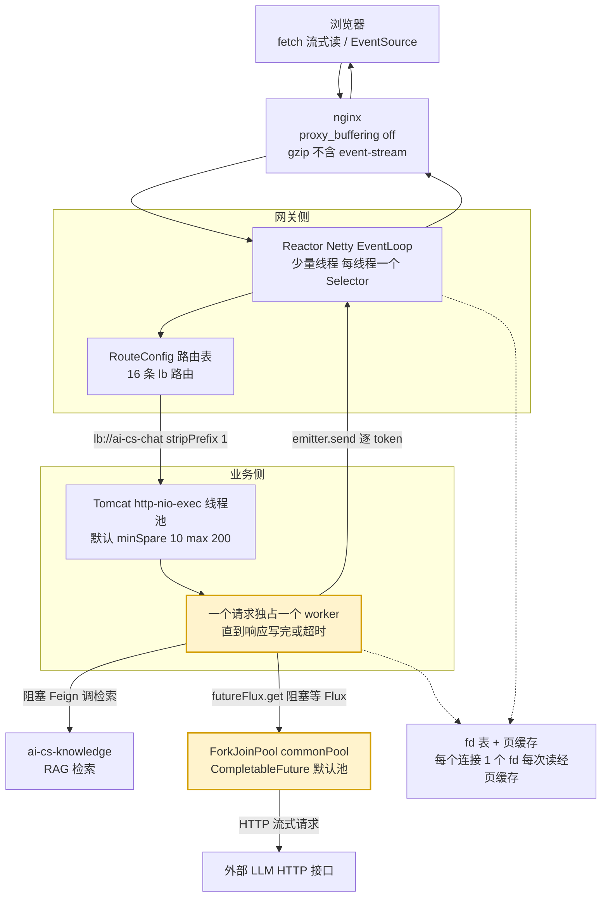
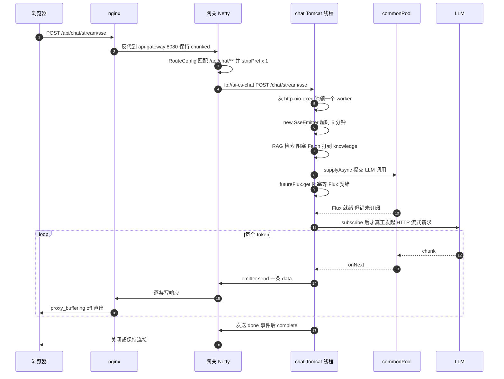

# 03 文件系统与 IO 多路复用：一次读要不要阻塞整个线程

> **一句话结论**：IO 的性能差别不在"读得快不快"，而在"一次读要不要把整个线程押上去等"——`select/poll/epoll` 的演进、Netty 的 EventLoop、nginx 的 `proxy_buffering off`、Tomcat 那 200 个 worker 线程，都是同一个问题的不同答案。
> **阅读前置**：知道进程与线程的区别（[01-进程线程与调度](./01-进程线程与调度.md)）、知道虚拟内存与页缓存的大意（[02-内存管理与虚拟内存](./02-内存管理与虚拟内存.md)）。读过 [07-IO模型与Netty基础](../01-Java基础/07-IO模型与Netty基础.md) 会更顺，但本篇不依赖它。
> **证据基线**：JDK 17.0.19 / Spring Boot 4.2.0 / Spring Cloud 2026.0.0（网关依赖 `gateway-server-webflux`）；B 级证据取自本仓库 `master` 分支真实文件，行号当次核对；C 级证据取自本机 Windows 11 + Node 24.16.0 + JDK 17 的实测脚本，脚本路径都在正文里。预计阅读 45~60 分钟。

## 证据边界

本机是 Windows，**没有 Linux 内核、没有 epoll、没有 `/proc`、没有 strace、没有 docker/kubectl**。所以凡是"内核里发生的事"，本篇只能做到三种程度的诚实：真在本仓核对的、真在本机跑出来的、给出命令和判读方法但**未本机实测**的。下表先把话说清楚，避免你把模拟结果当内核实测。

| 主题 | 本仓状态 | 证据级别 | 本篇怎么处理 |
| --- | --- | --- | --- |
| 两套 IO 模型并存（网关 WebFlux/Netty + 业务 Spring MVC/Tomcat） | ✅ 已落地，可在 pom 与代码里核对 | B | 直接引行号 |
| SSE 长连接占用 Servlet 线程 | ✅ 已落地（`SseEmitter` + 阻塞 `get()`） | B | 直接引行号 + 时序图 |
| select 全量轮询 vs epoll 就绪链表 | ❌ 本机无 epoll，无法内核实测 | C（模拟） | 用 Node 模拟两者**算法复杂度**，明确标注"模拟不是内核实测" |
| LT / ET 触发语义 | ❌ 同上 | C（模拟） | 用状态机模拟，明确标注 |
| 文件描述符上限与 `Too many open files` | ⚠️ Windows 无 `ulimit`，但有等价句柄计数 | C + 未实测命令 | 本机测句柄增量，Linux 侧给命令 |
| 零拷贝 sendfile / mmap | ❌ 本仓 nginx 配置里 `sendfile` **0 命中**（默认 off） | B + 未实测 | 讲清语义与代价，给本机跑不了的验证命令并说明原因 |
| 页缓存 / buffered vs direct IO | ❌ 本仓无 `innodb_flush_method` 配置（全仓配置 0 命中） | B + 未实测 | 讲语义 + 给 MySQL 侧判读方法 |
| 网关连接池与响应超时 | ⚠️ 依赖在、源码在，但 `spring.cloud.gateway.httpclient.*` **未配置** | A + B | 读源码默认值，指出未调优点 |
| Netty 主从 Reactor 线程数 | ❌ 本机无本项目网关进程在跑 | 语义说明 | 只讲结构与命令，不给线程数实测值 |
| 吞吐 / QPS / 延迟基准 | ❌ 本机无压测环境 | — | **一个数字都不编** |

## 0. 先看现象

### 现象一：同一个系统里，两个模块依赖的是两套完全不同的 IO 栈

```powershell
PS> Select-String -Path ai-cs-gateway\pom.xml,ai-cs-chat\pom.xml -Pattern 'gateway-server-webflux|spring-boot-starter-web<' | ForEach-Object { "{0}:{1}: {2}" -f $_.Path.Replace((Get-Location).Path + '\',''), $_.LineNumber, $_.Line.Trim() }
ai-cs-gateway\pom.xml:22: <artifactId>spring-cloud-starter-gateway-server-webflux</artifactId>
ai-cs-chat\pom.xml:22: <artifactId>spring-boot-starter-web</artifactId>
```

网关拿的是 `gateway-server-webflux`（底层 Reactor Netty，事件驱动），chat 拿的是 `spring-boot-starter-web`（底层 Servlet 容器 Tomcat，一请求一线程）。更关键的一句注释在 `ai-cs-gateway/pom.xml` 的 L43：

```xml
        <!-- Common Module（排除 Spring MVC，网关基于 WebFlux，两者不兼容） --><!--L43-->
        <dependency>
            <groupId>com.aics</groupId>
            <artifactId>ai-cs-common</artifactId>
            <exclusions>
                <exclusion>
                    <groupId>org.springframework.boot</groupId>
                    <artifactId>spring-boot-starter-webmvc</artifactId><!--L50-->
                </exclusion>
            </exclusions>
        </dependency>
```

**网关必须把 `spring-boot-starter-webmvc` 从公共模块里排掉**——否则 Spring Boot 会同时发现两套 Web 栈，启动时按"谁先声明"随机挑一个，网关变成阻塞式 Tomcat。这条 `<exclusion>` 是"两套 IO 模型不让混"的物理隔离带。

### 现象二：SSE 接口在请求线程上"阻塞等 Flux 就绪"

```powershell
PS> Select-String -Path ai-cs-chat\src\main\java\com\aics\chat\service\impl\ChatServiceImpl.java -Pattern 'SSE_EMITTER_TIMEOUT|futureFlux\.get\(\)|flux\.subscribe\(' | ForEach-Object { "L{0}: {1}" -f $_.LineNumber, $_.Line.Trim() }
L156: private static final long SSE_EMITTER_TIMEOUT = 5 * 60 * 1000L;
L525: SseEmitter emitter = new SseEmitter(SSE_EMITTER_TIMEOUT);
L601: Flux<String> flux = futureFlux.get();
L646: flux.subscribe(
L699: //   2. SseEmitter 已超时（SSE_EMITTER_TIMEOUT=5min）
```

`futureFlux` 是 `CompletableFuture<Flux<String>>`，`.get()` 是**同步阻塞**调用——它发生在 Tomcat 的 `http-nio-8080-exec-*` 线程上。也就是说：一次 AI 流式对话，从头到尾（最长 5 分钟）霸占着一个 worker 线程。同一份代码的 L627-629 还把原因写明白了：

> 为什么不用 `@ResponseBody` 直接返回 `Flux`？→ 因为本项目是 Spring MVC（Servlet 容器），不是 WebFlux（Netty 容器）。Spring MVC 无法直接将 `Flux` 渲染为 SSE 响应，必须通过 `SseEmitter` 手动桥接。

### 现象三：运行时的线程与连接实况（本机一个无关的 Tomcat 进程，仅作取样）

```powershell
PS> jps -l
43872 jdk.jcmd/sun.tools.jps.Jps
40648 org.apache.catalina.startup.Bootstrap
34972 org.gradle.launcher.daemon.bootstrap.GradleDaemon

PS> Get-Process -Id 40648 | Select-Object Id,Threads,HandleCount,WorkingSet
   Id Threads HandleCount WorkingSet
40648      90        1023  549457920

PS> netstat -ano | Select-String ':8080' | Select-Object -First 2
  TCP    0.0.0.0:8080           0.0.0.0:0              LISTENING       40648
  TCP    [::]:8080              [::]:0                 LISTENING       40648
```

再 dump 线程，按线程名前缀分组：

```powershell
PS> jcmd 40648 Thread.print | Select-String -Pattern '^"' | ForEach-Object { ($_ -split '"')[1] -replace '-\d+$','-#' } | Group-Object | Sort-Object Count -Descending | Select-Object -First 5 Count,Name
Count Name
----- ----
   10 http-nio-8080-exec-#
   10 Thread-#
   10 DefaultQuartzScheduler_Worker-#
    3 CacheScheduler_Worker-#
    2 Catalina-utility-#
```

`http-nio-8080-exec-#` 就是 Tomcat 的工作线程池（NIO endpoint 的命名规则）。空闲时只有 10 个（Tomcat 默认 `minSpareThreads=10`），满载可涨到 200（默认 `maxThreads=200`）。**注意：这是本机另一个无关 Tomcat 进程的采样，不是本项目服务；数字会随时间变，结论只看"线程是按需增长的一池，而且名字里带 NIO"。**

这些现象指向同一件事：**这个系统的吞吐上限不是 CPU 或带宽，而是"同时有多少个线程被押在一次 IO 上"。** 网关用极少的 EventLoop 线程管理几万连接，业务侧用 200 个 worker 线程扛请求，中间夹着一个会占用 5 分钟线程的 SSE——三者的矛盾全部落在"线程够不够"这一件事上。本篇就是把这件事拆开。

## 1. 整体地图



> **读图说明**：看两个箭头。① `T2 -->|futureFlux.get 阻塞等 Flux| CP`：这一条是**黄框里那条阻塞**，也是全图唯一一处"Servlet 线程停下来等 Reactor 的活干完"，SSE 场景下它要停 5 分钟——看错成"Flux 是异步的所以不占线程"，就会误判 chat 服务能同时扛几百路对话。② `RF -->|lb://ai-cs-chat| T1`：网关侧是 1 个连接进去、1 个连接出去（连接池），它自己不阻塞；看错成"网关也会被 SSE 拖住"，就会去限制网关的连接数，而真正该限的是 chat 的 worker 池。另外注意 `T2 -.-> FD` 与 `EL -.-> FD` 都是虚线：**两套模型共用同一张内核 fd 表**，所以 fd 上限是全机共享的瓶颈，跟用哪种模型无关。

### 组件与责任

| 组件 | 本仓位置 | IO 模型 | 它负责什么 | 它的上限由谁决定 |
| --- | --- | --- | --- | --- |
| nginx | `ai-cs-frontend/nginx.conf` | 事件驱动（epoll on Linux） | 静态资源 + `/api/` 反代，`proxy_buffering off` 让 SSE 直通 | worker_connections × worker_processes |
| 网关 | `ai-cs-gateway/` | Reactor Netty，主从 Reactor | 路由、限流、重试、熔断、转发 | EventLoop 线程数（默认 = CPU 核数）+ 下游连接池 |
| 业务服务 ×8 | `ai-cs-chat` `ai-cs-order` 等 | Tomcat NIO endpoint，一请求一线程 | 业务逻辑、RAG、调 LLM | `maxThreads`（默认 200）+ 下游等待时间 |
| 阻塞调用方 | `ai-cs-chat/src/main/java/com/aics/chat/service/impl/ResilientAiService.java` | `CompletableFuture.supplyAsync` → commonPool | 把 LLM 调用挪出请求线程 | commonPool 并行度 = CPU 核数 − 1（受 `-Djava.util.concurrent.ForkJoinPool.common.parallelism` 控制） |
| 内核 | 操作系统 | —— | fd 表、页缓存、socket 缓冲区 | `ulimit -n` / `fs.file-max` / 内存 |

### 参与方：谁会被这套模型影响

上表是"机器视角"，但同一张图在不同角色眼里完全不同。看懂这张表，你就知道出问题时该找谁、对方为什么不认账。

| 参与方 | 他最关心什么 | 在这个模型里被谁卡住 | 典型的错误归因 |
| --- | --- | --- | --- |
| 前端开发 | 是否逐字出、断线能不能重连 | nginx 的 `proxy_buffering`、SSE 超时 | 说"后端没流式输出"，其实是被代理攒包 |
| 业务后端 | 能不能随手写阻塞代码 | Tomcat worker 池（默认 200） | 说"服务器性能不够"，其实是线程被长连接占满 |
| 网关维护者 | 连接数、下游抖动、限流准不准 | EventLoop 线程数、下游连接池、`responseTimeout` | 说"网关扛不住"，其实网关没阻塞、是下游在等 |
| 运维 / SRE | fd 上限、内存、发布会不会掐连接 | `ulimit`、容器限制、`timeout-per-shutdown-phase` | 说"重启一下就好"，掩盖了 fd 泄漏 |
| 测试 | 并发对话怎么造 | 需要的是"并发 SSE 客户端"而不是 QPS 压测脚本 | 用 JMeter 打 QPS，测不出线程占用 |

## 2. 关键概念与关键要素

先把术语用一句话说清，再上表。

- **文件描述符（fd）**：内核给"打开的东西"发的整数编号，socket、文件、管道都是 fd。`select/poll/epoll` 管的永远是 fd，不是"连接"这个抽象概念。
- **页缓存（page cache）**：内核拿空闲内存缓存文件内容，读文件先看它在不在内存里。所以"读文件快"多半是因为没真读盘。
- **用户态 / 内核态拷贝**：`read()` 把数据从内核缓冲区拷到你的 `byte[]`，`write()` 再拷回去，每次拷贝都要一次上下文切换。
- **IO 多路复用**：一个线程同时盯 N 个 fd，谁就绪处理谁。`select`/`poll`/`epoll` 是同一件事的三代实现。
- **LT（水平触发）/ ET（边缘触发）**：就绪状态"没处理完就一直报" vs "只在状态变化时报一次"。
- **零拷贝**：让数据不经过用户态（`sendfile`）或让用户态与页缓存共享同一份内存（`mmap`），省掉拷贝与切换。
- **Reactor 模式**：把"等 IO"这件事集中交给少数线程（EventLoop），业务处理甩给别的线程或回调。
- **背压（backpressure）**：消费端跟不上时，让生产端慢下来。SSE + Tomcat 这一侧**没有**背压，只有"要么发出去要么 warn 掉"。

| 名称 | 位置（本仓 / 系统） | 作用 | 关键参数 |
| --- | --- | --- | --- |
| fd 表 | 内核 | 所有 IO 对象的句柄 | Linux `ulimit -n`（常见 1024）、`fs.file-max`；Windows 是句柄表 |
| 页缓存 | 内核 | 缓存文件页，决定 read 是否真落盘 | 可用内存；`innodb_flush_method`、`O_DIRECT` 会绕过它 |
| select | 内核 | 三代前的多路复用 | `FD_SETSIZE` 默认 1024，**每次调用都要把全量 fd 集合从用户态拷进去** |
| poll | 内核 | 去掉 1024 限制 | 仍是数组 + 全量遍历，O(N) |
| epoll | 内核（Linux） | 红黑树 + 就绪链表 | `epoll_create1` / `epoll_ctl`（增删改） / `epoll_wait`（只取就绪） |
| LT / ET | epoll 的两种模式 | 决定"没读完还报不报" | `EPOLLET` 标志；ET 必须配非阻塞 fd + 读到 EAGAIN |
| sendfile | 内核 | 文件 → socket 零拷贝 | nginx `sendfile on` + `tcp_nopush` |
| mmap | 内核 | 文件页映射进用户地址空间 | 适合随机读大文件；写回时机由内核决定 |
| EventLoop | Reactor Netty | 一个线程 + 一个 Selector 管一批连接 | `reactor.netty.ioWorkerCount`（默认 = CPU 核数） |
| Tomcat worker 池 | `spring-boot-starter-web` | 一个请求一个线程 | `server.tomcat.threads.max`（默认 200）、`min-spare`（默认 10） |
| SseEmitter | `ChatServiceImpl.java` L525 | 在 Servlet 栈上桥接 SSE | 超时 5 分钟（`SSE_EMITTER_TIMEOUT`） |
| 网关连接池 | `HttpClientProperties` | 复用到下游的 TCP 连接 | `pool.type` 默认 `ELASTIC`、`responseTimeout` 默认 **null** |
| proxy_buffering | `ai-cs-frontend/nginx.conf` L58 | 关掉 nginx 攒包，SSE 才能逐条到浏览器 | `off` + `proxy_read_timeout 300s` |

## 3. 原理与证据逐段精读

### 3.1 一次 read 到底动了什么：fd、页缓存、两次拷贝

**在干什么。** 你写 `read(fd, buf, 4096)`，内核做的事是：拿 fd 在进程的 fd 表里找到 file 对象 → 算出文件偏移 → 看这一页在不在页缓存里 → 不在就发磁盘 IO（此时你的线程**睡着**）→ 把页缓存里的数据拷到 `buf` → 返回字节数。整个过程中"睡"这一步由内核调度，不由你控制。

**为什么这么设计。** 因为磁盘比内存慢 4~5 个数量级，页缓存把"重复读同一块"变成纯内存拷贝；而 fd 这层间接让"文件、socket、管道、设备"对上层长得一样，`select/epoll` 才能统一管理它们。这不是为了快，是为了**统一与复用**。

**换写法会怎样。** 换成 `mmap` 再 memcpy：省掉一次"内核缓冲区 → 用户缓冲区"的拷贝，但多了一次缺页中断；大文件随机读划算，小文件顺序读反而更慢。换成 `O_DIRECT`：绕过页缓存直接读盘，省内存但每次读都要对齐到块大小，且失去缓存复用。

**常见坑。** ① 以为 `write()` 返回成功就是落盘了——它只是进了页缓存，`fsync` 才管落盘。② 以为读文件慢一定是磁盘慢——`free -h` 里 `buff/cache` 占满时，读同一文件根本不打盘。③ 在容器里 `ulimit -n` 是 1024，而 fd 表同时被 socket、日志文件、jar 包、`/dev/urandom` 共享，几百个连接就可能见底（见 6.1）。

### 3.2 五种 IO 模型：差别只在"等数据时谁在阻塞"

**在干什么。** 把一次网络读拆成两段：① 等数据到达内核缓冲区（数据准备）；② 把数据从内核拷到用户态（数据拷贝）。

| 模型 | 数据准备阶段谁在等 | 数据拷贝阶段谁在等 | 一个线程能同时盯几个连接 | 典型代表 |
| --- | --- | --- | --- | --- |
| 阻塞 IO | 线程睡眠 | 线程睡眠 | 1 | `socket.getInputStream().read()`、Tomcat 业务里的 `RestTemplate`/Feign |
| 非阻塞 IO | 线程轮询（返回 `EAGAIN` 就走） | 线程睡眠 | 1（但空转烧 CPU） | `SocketChannel` + 手写 while 循环 |
| IO 多路复用 | **`select/epoll` 替你等** | 线程睡眠 | N | Netty、nginx、Redis |
| 信号驱动 | 内核 SIGIO 通知 | 线程睡眠 | N（但信号处理难写） | 很少用 |
| 异步 IO | 不阻塞 | **内核拷完再通知** | N | Linux `io_uring`、Windows IOCP |

**为什么这么设计。** 前四种在"数据拷贝"阶段都还是同步的（拷贝时线程仍被占），只有第五种是真异步。这不是能力问题，而是**"谁来通知你"的成本问题**：多路复用已经能把 N 个连接压到 1 个线程，再往前走一步（异步 IO）的收益递减，而复杂度陡增——所以工程界主流停在多路复用（Netty、nginx、Redis 全在这层）。

**换写法会怎样。** 把多路复用换成"一连接一线程"：代码简单一个数量级，但线程数线性增长。本机实测（`learning-docs/tools/tmp/m15-03-thread-cost.java`，**只测平台线程创建成本，不测吞吐**）：

```text
可用处理器 = 16 个；JVM 堆上限 = 8120 MB；探测前线程数 = 7
n= 200  拉起耗时=   25.3 ms  峰值线程数= 207  全部通过闸门=是
n=1000  拉起耗时=   86.0 ms  峰值线程数=1007  全部通过闸门=是
n=2000  拉起耗时=  136.6 ms  峰值线程数=2007  全部通过闸门=是
```

怎么读：**只看"随 n 近似线性增长"这个趋势，单次数值别当基准**——同一脚本第一次跑出来是 `48.3 / 173.2 / 517.3` ms，两次差 2~4 倍，全是 JIT 编译与页缓存预热的抖动。判读风险：有人拿 `136.6ms / 2000 ≈ 0.068ms 一个线程`去推算"一万连接只要 0.68 秒"，这是错的，因为真实连接还要占 fd、占内核 socket 缓冲区、占栈内存（默认 1MB 虚拟地址空间/线程，`-Xss` 未显式设置时由平台默认决定）。

**常见坑。** ① 把"非阻塞"当性能优化——单连接场景下非阻塞 + 忙轮询比阻塞还慢（烧满一个核）。② 以为 Tomcat 是阻塞 IO——现代 Tomcat 的 NIO endpoint 在**连接建立与读请求行**阶段用的是多路复用，只有到你的 `doGet` 里它才变成"一请求一线程"。③ 在 Netty 的 EventLoop 里做阻塞调用（JDBC、`Thread.sleep`、大文件读写），一个线程被卡住，它管的几千个连接全部排队——这是 Netty 最经典的自杀方式。

### 3.3 select → poll → epoll：从"每次全量问一遍"到"就绪链表主动报"

**在干什么。** 三者都是"一次系统调用问内核：这批 fd 里谁就绪了"。区别在**谁来维护这份 fd 集合**：

- `select`：应用每次调用都要把整份 fd 集合（位图）从用户态拷进内核，内核线性扫一遍。所以是 **O(N) 拷贝 + O(N) 扫描**，且受 `FD_SETSIZE=1024` 限制。
- `poll`：去掉 1024 上限（用数组），但仍是全量拷贝 + 全量扫描，O(N)。
- `epoll`：三件事拆开——`epoll_ctl` 往**红黑树**里增删改 fd（一次注册，长期有效）；fd 就绪时内核回调把它挂到**就绪链表**；`epoll_wait` **只返回就绪链表**，复杂度 O(1)（就绪数）。

**为什么这么设计。** 因为连接数 N 和数据活跃度是两回事。1 万连接的聊天服务器，每秒真正有数据的可能只有几十个——`select` 却要为此扫 1 万次。epoll 把成本从"连接数"变成"活跃数"，这才是 C10K 问题的正解。

本机用 Node 模拟两种算法的**检查次数**（`learning-docs/tools/tmp/m15-03-select-vs-epoll.mjs`，**算法模拟，不是内核实测**）：

```text
连接数N | 到达事件数 | select式fd检查次数 | epoll式fd检查次数 | select耗时ms | epoll耗时ms | 检查次数比
   1000 |      2026 |            200000 |              2026 |         1.75 |        0.37 |    98.7x
   5000 |     10063 |           1000000 |             10063 |         3.22 |        1.52 |    99.4x
  10000 |     19912 |           2000000 |             19912 |         5.94 |        0.61 |   100.4x
```

怎么读：**看第 3、4 列，别看耗时列。** `select式检查次数 = N × 轮询次数(200)`，`epoll式 = 到达事件数`，比值稳定在 ~100 倍，且随 N 增大只会更悬殊（这里是每轮 1% 就绪）。耗时列 3.22ms > 5.94ms 这种不单调是 JIT/GC 抖动，**不能**当"epoll 快 100 倍"的证据——真实内核里 epoll 的优势在系统调用次数与线程模型，不在单次比较的常数。判读风险：把这张表读成"epoll 比 select 快 100 倍"，面试会被追问致死；正确说法是"**每轮要做的工作量从 O(N) 降到 O(就绪数)**"。

**常见坑。** ① 以为 epoll 一定比 select 快——连接少（<几十）且全部活跃时，epoll 的三次系统调用反而更重。② 忘了 `epoll_ctl` 要在 fd 关闭前 `EPOLL_CTL_DEL`（或用 `EPOLLRDHUP`），否则同一 fd 号被复用时会串事件。③ 在 ET 模式下不把数据读到 `EAGAIN`（见 3.4 与 6.2）。

epoll 这三个系统调用各管一段，参数写错就是灾难：

| 系统调用 | 作用 | 关键参数 | 常见错 |
| --- | --- | --- | --- |
| `epoll_create1` | 创建 epoll 实例，返回一个 fd | `EPOLL_CLOEXEC` | 不加 cloexec：`fork`/`exec` 时子进程继承这个 fd 并泄漏 |
| `epoll_ctl` | 增删改监听的 fd（**进红黑树**） | `EPOLL_CTL_ADD/MOD/DEL` + `struct epoll_event{events,pfd,data}` | 关 fd 前不 `DEL` → fd 号被复用后事件串到下一个人身上 |
| `epoll_wait` | 取就绪事件（**读就绪链表**） | `maxevents`、`timeout` | `maxevents` 给小了，每轮取不完，就绪链表持续积压 |

### 3.4 LT 与 ET：为什么"只读一次"在 ET 下是 bug

**在干什么。** LT（水平触发，默认）：只要缓冲区还有数据没读，`epoll_wait` 就继续返回这个 fd。ET（边缘触发，`EPOLLET`）：只在"状态从无到有"时通知一次，之后哪怕还有数据也不再通知——除非又有新数据到达。

**为什么这么设计。** LT 安全但可能反复唤醒（你读得慢就一直被叫）。ET 少唤醒、少系统调用，代价是**应用必须自己把数据读干**。Redis、Netty（Linux 上）都用 ET 换性能。

`learning-docs/tools/tmp/m15-03-lt-et.mjs` 模拟：内核缓冲区 100 字节，应用单次 read 上限 32 字节，最多唤醒 50 次。

```text
LT  + 每次只 read 一次                 |  4 次通知 | 读出 100 | 残留  0 | 读干净 是
ET  + 每次只 read 一次（典型 bug）     |  1 次通知 | 读出  32 | 残留 68 | 读干净 否
ET  + read 到 EAGAIN（正确写法）       |  1 次通知 | 读出 100 | 残留  0 | 读干净 是
```

怎么读：第二行就是事故现场——**ET 下只读一次，68 字节永久卡在内核缓冲区**，客户端明明发了请求，服务端却"看起来连接还活着但永远不回"。第三行是正确姿势：一次通知内循环 read 到 `EAGAIN`。判读风险：ET 的这个 bug 在低并发、小报文下**不会复现**（一次 read 就把整个请求读完了），只在报文变大、TCP 分段变多时爆发——所以"我本地测了没问题"完全不能作证。

**常见坑。** ① ET + 阻塞 fd：读到没数据时会永久阻塞，EventLoop 死掉。ET 必须配非阻塞。② 只处理 `EPOLLIN` 不处理 `EPOLLRDHUP`/`EPOLLHUP`，对端关闭后 fd 泄漏。③ 现代 Netty 已经把这些封装好了——但你若自己写 `Epoll` 原生传输（`Epoll.isAvailable()`）就得自己保证。

### 3.5 零拷贝：sendfile 与 mmap 到底省了什么

**在干什么。** 传统"读文件发网络"是 4 次拷贝 + 4 次上下文切换：磁盘 → 页缓存（DMA）→ 用户缓冲区（CPU 拷贝）→ socket 缓冲区（CPU 拷贝）→ 网卡（DMA）。`sendfile(out_fd, in_fd, ...)` 让内核直接把页缓存里的数据推给 socket：**2 次拷贝、2 次切换，完全不经过用户态**。`mmap` 则把文件页映射进你的地址空间，省掉"内核 → 用户"的那一次拷贝，但仍要走 socket 那次。

**为什么这么设计。** 静态文件服务的特征是"我不需要看内容，只需要搬运"。既然应用不看，为什么要把数据拷进用户态再拷出去？`sendfile` 就是把这个"不需要"变成"不做"。

四种搬运方式的成本对照（拷贝次数按"数据字节被搬运的次数"计，上下文切换按"用户态↔内核态"计）：

| 实现 | 拷贝次数 | 上下文切换 | 用户态能碰数据 | 适用 |
| --- | --- | --- | --- | --- |
| `read` + `write` | 4 | 4 | 能 | 需要处理内容（压缩、加密、改写） |
| `mmap` + `write` | 3 | 4（另有缺页中断） | 能（共享映射） | 随机读大文件、原地改内容 |
| `sendfile` | 2 | 2 | 不能 | 静态文件、纯搬运（nginx 静态服务） |
| `sendfile` + 网卡 scatter-gather | 2（全 DMA，无 CPU 拷贝） | 2 | 不能 | 支持 SG-DMA 的网卡 + 内核支持 |

**换写法会怎样。** 换回 `read/write` 循环：CPU 拷贝翻倍、上下文切换翻倍，大文件传输时 CPU 明显更忙。换成 `mmap`：省一次拷贝，但缺页中断与内存映射在大文件上会带来别的成本，且"文件被截断时访问映射区"会收到 `SIGBUS`。

**常见坑。** 本仓就有一个：`ai-cs-frontend/nginx.conf` 里 **`sendfile` 一个都没写**（全仓扫 `sendfile` 命中 0），nginx 默认 `sendfile off`——意味着前端静态资源走 nginx 时**零拷贝没启用**。这不是 bug，只是没调优。验证在 Linux 上要这么做（**本机 Windows 跑不了，故未实测**）：

```bash
# 在装有 nginx 的 Linux 上（本机无 docker，未实测）
nginx -t                                   # 先确认配置语法
nginx -V 2>&1 | tr ' ' '\n' | grep -E 'sendfile|--with-cc'   # 看编译期能力
grep -n 'sendfile' /etc/nginx/nginx.conf   # 看是否 on
sudo strace -f -e trace=sendfile,writev -p $(pgrep -f 'nginx: worker') -c   # 观察 worker 是否真的走 sendfile
```

判读：`strace -c` 里出现成规模的 `sendfile` 才说明零拷贝生效；只有 `writev` 说明仍在用户态搬运。误判风险：**`sendfile on` 对大文件有效，对几 KB 的 JSON 接口几乎无感**，别把"Nginx 加了 sendfile"当性能优化上线汇报。

### 3.6 页缓存、fsync 与 buffered / direct IO

**在干什么。** `write()` 只把数据写进页缓存就返回（dirty page），内核线程稍后刷盘；`fsync(fd)` 等到"该文件的脏页都落盘"；`fdatasync(fd)` 只等数据不等元数据（inode 大小、mtime 可以晚点）；`O_SYNC` 让每次 `write()` 都同步落盘（最慢但最安全）；`O_DIRECT` 则是绕过页缓存，直接从用户缓冲区打盘。

| 方式 | 数据何时落盘 | 元数据 | 性能代价 | 谁在用 |
| --- | --- | --- | --- | --- |
| `write()` 返回 | 不确定（可能几分钟） | 不确定 | 最低 | 日志、缓存类写入 |
| `fdatasync` | 调用返回时数据已落盘 | 不一定 | 中 | Redis AOF `everysec` 可近似看作这一档 |
| `fsync` | 调用返回时数据+元数据已落盘 | 是 | 中高 | MySQL WAL |
| `O_SYNC` / `O_DSYNC` | 每次 write 都等 | 是 / 数据 | 最高 | 审计日志 |
| `O_DIRECT` | 绕过页缓存直写 | 应用负责 | 高（要求对齐） | 数据库自管缓存 |

**为什么这么设计。** 页缓存把"随机小写"合并成"顺序大写"，这是数据库能跑起来的地基；`fsync` 的存在则是因为"缓存换性能"必须由应用自己声明"什么时候我认账"——数据库的事务持久性承诺（`innodb_flush_log_at_trx_commit=1`）本质就是"每次提交都 fsync 一次日志"。

**换写法会怎样。** 把 `innodb_flush_log_at_trx_commit` 从 1 降到 2：提交不再 fsync，只在每秒刷盘时落——吞吐上去了，代价是**操作系统崩溃丢 1 秒事务**。降低到 0 连"每秒"都不保证。这是典型的"用持久性换吞吐"。

**常见坑。** ① **本仓没有任何 `innodb_flush_method` 配置**（全仓配置文件 0 命中，只有本学习文档提到过它），意味着 MySQL 走默认 `fsync`，页缓存生效——所以"MySQL 读写慢"先别怀疑磁盘。② 在容器里给 MySQL 限制内存却没留页缓存空间，dirty page 堆到阈值触发强制刷盘，表现为"周期性卡顿"。③ 把 `O_DIRECT` 当银弹：它要求读写偏移与长度按块（常见 512B/4K）对齐，不对齐直接 `EINVAL`。

验证命令（**本机无 MySQL 实例，未实测**）：

```bash
# 在数据库容器/主机上
mysql -uroot -p -e "SHOW VARIABLES LIKE 'innodb_flush_method'; SHOW VARIABLES LIKE 'innodb_flush_log_at_trx_commit';"
cat /proc/meminfo | grep -E 'Dirty|Writeback'    # Dirty 大 = 有大量待刷盘
```

判读：`innodb_flush_method` 为空或 `fsync` 表示页缓存生效；`Dirty` 长期高位说明刷盘跟不上写入，此时看 `innodb_io_capacity` 而不是换盘。

### 3.7 Java NIO → Netty：主从 Reactor 是怎么把线程数压下来的

**在干什么。** Java NIO 把"多路复用"暴露成 `Selector` + `Channel` + `Buffer`。Netty 在此之上做了两层：**boss group** 只负责 `accept` 新连接（通常 1 个线程），**worker group** 负责已建立连接的读写（默认线程数 = CPU 核数）；每个 `EventLoop` 线程持有一个 `Selector`，一辈子只服务固定的一批 Channel——所以 Channel 上的状态不需要加锁。

**为什么这么设计。** 三个收益：① 线程数与连接数解耦（1 万连接可以只占 8 个线程）；② 单 Channel 单线程 → 无锁；③ `accept` 与读写分离 → 新连接洪峰不会拖慢已有连接的读写。

| 角色 | 数量 | 干什么 | 绝不能干什么 |
| --- | --- | --- | --- |
| boss EventLoop | 通常 1 | 只负责 `accept` 新连接并注册到 worker | 写业务逻辑（否则新连接洪峰卡死所有已建连接） |
| worker EventLoop | 默认 = CPU 核数 | 该 Group 下所有 Channel 的读、写、编解码、pipeline 回调 | 任何阻塞调用（JDBC、Feign、`Thread.sleep`、`.block()`） |
| 业务线程池（自己加） | 自定 | 放真正阻塞的活，处理完再切回 EventLoop 写响应 | 在里面直接改 Channel 状态（需 `channel.eventLoop().execute()` 切回） |

**换写法会怎样。** 用 `spring-boot-starter-web`（Tomcat）：一个请求一个线程，代码可以随便阻塞（JDBC、Feign），但线程数就是并发上限（默认 200）。这就是本仓业务服务的选择——**不是因为 Tomcat 更快，而是因为它的编程模型容忍阻塞**，而 8 个业务服务里到处是 MyBatis、Feign、Redis 同步客户端。

**常见坑。** ① 以为"用了 Reactor 就不会阻塞"——`Flux` 只有在**被订阅**时才执行；本仓 `ResilientAiService.java` L275 附近的注释就写明"返回 Flux，此时还没真正请求 LLM（lazy），订阅后才开始"。② 在 Reactor 里调 `.block()`：Netty EventLoop 线程会被卡，且 Reactor 3.3+ 直接在 EventLoop 上 `block()` 会抛异常。③ 以为 WebFlux 一定比 MVC 快——IO 密集且下游全异步时才快；下游是阻塞 JDBC 时，WebFlux 只是把等待搬到了别处。

### 3.8 本仓落点：两套 IO 模型并存的四个后果

**在干什么。** 网关（Netty，事件驱动）→ 业务服务（Tomcat，一请求一线程）→ 下游（LLM/检索，阻塞 HTTP）。三种模型叠在一起跑。

**为什么这么设计。** 网关的正确职责是"扛海量连接、少做业务"，天生适合事件驱动；业务服务里全是阻塞的 ORM 与 RPC，硬套 WebFlux 得把整条链路改成响应式（Spring Data R2DBC、WebClient、Reactive Redis），改造面远超收益。**这是合理取舍，不是技术债。**

**换写法会怎样。** 四个后果必须点名：

1. **SSE 把线程按分钟占用。** `ChatServiceImpl.java` L601 的 `futureFlux.get()` 是阻塞的，`SseEmitter` 超时 5 分钟（L156/L525）。极端情况：200 个 worker 线程全被 200 路流式对话占满，**该服务所有普通接口（登录、查订单走同进程时）一起排队**——这在 Tomcat 里叫"线程饥饿"，不是"变慢"。
2. **超时是三层且不一致的。** chat 的 SSE 超时 5 分钟（`ChatServiceImpl.java` L156）、Agent 流 2 分钟（`ai-cs-chat/src/main/java/com/aics/chat/agent/AgentController.java` L117 `AGENT_STREAM_TIMEOUT = 120_000L`）、视觉流 60 秒（`ai-cs-chat/src/main/java/com/aics/chat/service/impl/VisionChatServiceImpl.java` L205）、nginx 读超时 300 秒（`ai-cs-frontend/nginx.conf` L60）。**网关这一层却是"无限等"**：`ai-cs-gateway/src/main/resources/application.yml` 全文没有 `spring.cloud.gateway.httpclient.*`，而 `HttpClientProperties` 里 `responseTimeout` 默认是 `null`（见 6.6）。四层超时里最外层最长、第二外层没有——故障时排障顺序会很反直觉。
3. **连接数与 fd 双计。** 网关侧一个客户端连接在 Netty 里只占一个 fd + 一点点内存；业务侧一个 SSE 连接占一个 fd + 一个线程（+ 线程栈）。**同一个用户一次对话，两边的成本差两个数量级**，所以容量规划必须按业务侧算。
4. **nginx 的 `proxy_buffering off` 只在开发那份配置里。** 全仓 `proxy_buffering` 只在 `ai-cs-frontend/nginx.conf` L58 命中，`deploy/` 目录 0 命中——也就是说 K8s 部署路径上没有 nginx/Ingress 配置，SSE 是否逐字到达浏览器**取决于部署时实际塞了什么反向代理**，本仓没有证据。

**常见坑。** ① 用网关的 QPS 限流去保护 SSE——`RouteConfig.java` L174-187 的 `requestRateLimiter` 只数请求次数，**数不到"一个请求挂 5 分钟"**，限流形同虚设。② 以为 `shutdown: graceful` + `timeout-per-shutdown-phase: 30s`（`ai-cs-gateway/src/main/resources/application.yml` L3/L7）能优雅收尾 SSE——30 秒远小于 5 分钟的流，滚动发布会直接掐断长连接（应用侧没有发"请重连"事件的设计）。

## 4. 一次完整执行时序



> **读图说明**：盯第 9 步（`futureFlux.get 阻塞等 Flux 就绪`）和第 11 步（`subscribe 后才真正发起`）。这两步是 SSE 线程占用的全部原因，也是两个**极易混淆的阻塞点**：第 9 步的阻塞是"等 Flux 对象造出来"（受 TimeLimiter 保护，短），第 11 步之后 worker 线程**仍在事件回调里被反复使用**（长，直到 done）。看错成"只有第 9 步占线程"，就会误以为把 `supplyAsync` 调大就能解决并发；实际瓶颈在"一个 emitter 从创建到 complete 全程绑着一个 worker"。另外注意 4→5：`stripPrefix(1)` 意味着浏览器打 `/api/chat/stream/sse`、服务端看到的是 `/chat/stream/sse`（`ChatController.java` L51 `@RequestMapping("/chat")` + L167 `/stream/sse`），日志里对不上号时先想这一层。

### 每一步该怎么判读

| 步 | 判据 | 正常长什么样 | 异常长什么样 | 该看哪里 |
| --- | --- | --- | --- | --- |
| 1-2 | 浏览器是否收到 `Content-Type: text/event-stream` | 立即返回头，后续逐条 `data:` | 头都没返回 → 网关或 nginx 卡在连接建立 | 浏览器 Network 面板 Timing；`netstat -ano \| Select-String ':8080'` |
| 2 | nginx 是否缓冲 | 打字机式逐字出现 | 一次性"唰"出来 → proxy_buffering 未 off 或被上游 gzip | `ai-cs-frontend/nginx.conf` L58 |
| 3 | 路由是否命中 | `/api/chat/stream/sse` → stripPrefix → `/chat/stream/sse` | 404 且日志显示 `/api/chat/...` → stripPrefix 没生效 | `RouteConfig.java` L81-84；网关 debug 日志 |
| 5-6 | worker 线程是否领到 | `jcmd <pid> Thread.print` 出现新 `http-nio-<port>-exec-N` | 线程数顶到 200 且大量 `WAITING` → 线程饥饿 | `Get-Process -Id <pid> \| Select Threads`；线程 dump |
| 7 | RAG 检索耗时 | 毫秒级返回 | 检索慢会把整个 SSE 的"首字节时间"拖长 | knowledge 服务日志；Feign 超时配置 |
| 9 | `futureFlux.get()` 是否受阻 | 百毫秒级返回 | 长时间阻塞 → LLM 调用未提交成功/TimeLimiter 生效 | `ResilientAiService.java` L252-290；线程栈里 `CompletableFuture.get` |
| 11-13 | token 是否逐条到达 | 每秒若干条 `data:` | 突然停住 30 秒以上 → LLM 侧无输出或网关 write 卡住 | 网关 access 日志；`Get-Counter '\TCPv4\Connections Established'` |
| 14 | 是否发出 done | 有明确的结束事件 | 连接被掐但前端无感知 → 前端需处理 `onerror` 重连 | `ChatController.java` L167 附近的返回结构；前端 EventSource 代码 |
| 全程 | fd 是否增长到上限 | 稳定 | `Too many open files` / 句柄数持续爬升不回落 | 6.1 的句柄命令 |

## 5. 设计取舍

| 决策点 | 选项 A | 选项 B | 本仓现状 | 代价与收益 |
| --- | --- | --- | --- | --- |
| 网关 IO 模型 | Tomcat 阻塞（好写） | Reactor Netty 事件驱动（好扛） | ✅ B：`gateway-server-webflux`，且排除 `spring-boot-starter-webmvc` | 收益：少量线程扛大量连接；代价：EventLoop 里绝不能阻塞，调试栈更深 |
| 业务服务 IO 模型 | Servlet 阻塞（容忍 JDBC/Feign） | WebFlux 响应式（全链路要改） | ✅ A：8 个服务全 `spring-boot-starter-web` | 收益：生态成熟、代码直白；代价：并发上限 = worker 线程数 |
| SSE 实现方式 | `SseEmitter` 手工桥接 | 直接返回 `Flux` | ✅ A：`SseEmitter`（`ChatServiceImpl.java` L525） | 收益：不用改 Web 栈；代价：一个流占一个线程 + 手工管超时/关闭 |
| LLM 调用线程 | commonPool（零配置） | 专用线程池（隔离） | ⚠️ A：`supplyAsync` 走默认 commonPool | 收益：不用管；代价：与并行流/其他异步任务抢池，高峰期互相拖累 |
| 网关下游连接池 | ELASTIC（按需建连） | FIXED（上限明确） | ⚠️ 默认 ELASTIC，未配置 | 收益：突发不拒连；代价：下游抖动时连接数无上限 |
| 网关响应超时 | 显式 `responseTimeout` | 不设（等于无限等） | ❌ 未配置，源码默认 `null` | 代价：下游 hang 住会拖住网关连接（见 6.6） |
| nginx 对 SSE | `proxy_buffering off` | 默认开缓冲 | ✅ 开发配置已 off（L58）；`deploy/` 无 nginx 配置 | 收益：打字机效果；代价：后端写放大被直传 |
| gzip 与 SSE | `gzip_types` 排除 `text/event-stream` | 一并压缩 | ⚠️ 已"碰巧"排除（L23-28 不含 event-stream），但应用侧无 `X-Accel-Buffering` | 收益：避免压缩攒包；代价：靠配置巧合，不可依赖 |
| 静态资源零拷贝 | `sendfile on` | 默认 off | ❌ 全仓 `sendfile` 0 命中 | 代价：静态文件多两次 CPU 拷贝（小文件无感） |
| 本地文件刷盘 | 默认 `fsync` | `innodb_flush_method=O_DIRECT` | ❌ 未配置（全仓 0 命中） | 收益：页缓存复用；代价：突发写入会有刷盘抖动 |

### 可扩展点清单（本仓尚未落地，写在这里是为了让你知道"下一步该动哪里"）

1. **给网关补 `spring.cloud.gateway.httpclient.response-timeout`**，让最外层的等待有上限——否则 3.8 的"四层超时"里第二外层永远是空。
2. **给 `supplyAsync` 换专用线程池**（`ai-cs-chat/src/main/java/com/aics/chat/service/impl/ResilientAiService.java` L255），把 LLM 调用与 commonPool 上的其他任务隔离。
3. **应用侧显式声明 `X-Accel-Buffering: no`**（全仓 0 命中），不要依赖 nginx 配置巧合。
4. **SSE 路径与普通路径分端口/分线程池**（`TomcatProtocolHandlerCustomizer`，全仓 0 命中），避免流式对话饿死普通接口。
5. **`server.tomcat.threads.max` 显式化**（13 个 `application.yml` 全 0 命中，全靠默认 200），并写进配置中心便于按环境调。
6. **连接数、fd 数、活跃 SSE 数的指标暴露**（Micrometer gauge），在 Go/No-Go 时能看曲线而不是猜。
7. **`deploy/` 侧补 Ingress/nginx 配置**（当前 `proxy_buffering` 只存在于前端开发配置），保证生产路径上 SSE 不被缓冲。
8. **网关连接池上限显式化**（`pool.type=FIXED` + `max-connections` + `acquire-timeout`），给下游抖动一个硬边界。

## 6. 踩坑与调试手法

### 6.1 `Too many open files`：fd 上限不是"连接上限"，是全机共享

**现象**：服务跑一段时间后连接被拒、日志刷 `Too many open files`，重启就好。

本机等价观测（Windows 没有 `ulimit`，但句柄表同理）。用 `learning-docs/tools/tmp/m15-03-handle-count.ps1` 在同进程内开 2000 个只读文件：

```text
before=667 after_open_2000=2667 delta=2000 after_close=661
```

怎么读：`delta=2000` 说明**一个打开的文件就吃一个句柄**，且关闭后基本回到起点（`661` vs `667`，差值是脚本自身 IO）。这份脚本的价值是证明"fd/句柄是线性消耗的"，不是给阈值。

Linux 上真正该跑的命令（**本机无 Linux，未实测**）：

```bash
ulimit -n                                   # 当前 shell 的软上限，常见 1024
cat /proc/<pid>/limits | grep 'open files'  # 进程实际生效的上限（容器里常被改）
ls /proc/<pid>/fd | wc -l                   # 该进程当前打开的 fd 数
lsof -p <pid> | awk '{print $5}' | sort | uniq -c | sort -rn | head   # 按类型看谁在漏
```

| 判读项 | 正常 | 异常 | 说明 |
| --- | --- | --- | --- |
| `ls /proc/<pid>/fd \| wc -l` | 平稳波动 | 只增不减 | 泄漏，通常是 Response/InputStream 未关或 SSE 未 complete |
| `/proc/<pid>/limits` | ≥ 65535 | 1024 | 容器/镜像默认没调 |
| `lsof` 类型分布 | socket 为主 | 大量 `REG`（普通文件） | 文件句柄泄漏，常见于 `Files.lines()` 未 `try-with-resources` |

**误判风险**：把 fd 上限当成"最大连接数"。一个 HTTP 连接至少吃 1 个 fd，但还会吃 socket 缓冲区内存、event 结构体；**反过来**，fd 没见底也可能先被内存或 worker 线程卡死。fd 是必要条件不是充分条件。

### 6.2 ET 模式下只读一次：连接"假活"

**现象**：客户端发的请求服务端没反应，连接没断，抓包能看到数据进了内核，应用侧无日志。

用 `learning-docs/tools/tmp/m15-03-lt-et.mjs` 复现语义（见 3.4 表）：ET + 单次 read → 通知 1 次、只读出 32/100 字节、**残留 68 字节永远不会被读**。

判读：`ss -ti`（Linux）看到接收队列 `Recv-Q` 长期非 0 而应用没处理，即为典型特征。本机替代（**未实测，本机无对应工具**）：

```bash
ss -tni state established '( sport = :8080 )' | head -20   # 看 Recv-Q / Send-Q
```

| 判读项 | 正常 | 异常 |
| --- | --- | --- |
| `Recv-Q` | 接近 0 | 长期 >0 且不降 |
| 应用日志 | 有对应请求行 | 完全没日志（数据没被读走） |
| `epoll_wait` 返回次数 | 与新数据正相关 | 有数据但不再返回（ET 不再通知） |

**误判风险**：看到 `Recv-Q > 0` 就断定"客户端发太慢/网络堵"。上行方向堵是 `Send-Q`，`Recv-Q` 堆高更常见的原因是**应用没读**。

### 6.3 SSE 占线程：`futureFlux.get()` 卡在 Tomcat worker 上

**现象**：流式对话一多，普通接口（登录、查订单）跟着排队变慢，CPU 却不高。

```powershell
PS> jcmd <pid> Thread.print | Select-String -Pattern 'http-nio' -Context 0,6 | Select-Object -First 20
```

判读：找 `http-nio-<port>-exec-N` 线程，看栈顶是不是 `CompletableFuture.get` → `ChatServiceImpl.chatStreamSse`。若是，线程正停在 `ChatServiceImpl.java` L601。线程状态通常是 `WAITING (parking)`——**这不占 CPU，所以监控 CPU 完全看不出来，只有线程数和 RT 会动。**

| 判读项 | 正常 | 异常 |
| --- | --- | --- |
| `http-nio-*-exec-*` 线程数 | 远小于 200 | 顶到 200 且不回落 |
| 栈顶 | 业务方法里持续有进展 | 大量停在 `CompletableFuture.get` / `SocketInputStream.read` |
| CPU | 与 QPS 正相关 | CPU 低但 RT 高（典型"等"） |

**误判风险**：看到线程多是 `WAITING` 就以为是锁竞争/死锁。死锁的特征是**两个线程互相等对方持有的锁**（`jstack` 会直接报 `Found one Java-level deadlock`），而这里是在等 IO，线程之间毫无依赖。用错结论会去查锁、查 GC，全查不到。

### 6.4 nginx 缓冲与 gzip：打字机变成"一坨"

**现象**：本地直连 chat 服务是逐字输出，走 nginx/网关后变成整段"唰"一下出来。

```powershell
PS> Select-String -Path ai-cs-frontend\nginx.conf -Pattern 'proxy_buffering|proxy_cache|chunked|gzip_types|proxy_read_timeout'
```

判读要点：`proxy_buffering off`（L58）必须有；`gzip_types` 里**不能**出现 `text/event-stream`（L23-28 目前没有，是"碰巧对"）；`proxy_read_timeout 300s`（L60）要大于最长一次流（chat 侧 SSE 是 5 分钟=300 秒，**刚好相等**，边界极脆）。验证客户端是否真逐条收到：

```powershell
PS> curl.exe -N -s -X POST "http://localhost:8080/api/chat/stream/sse?sessionId=1&message=hi" -H "X-User-Id: 1"
```

`-N`（`--no-buffer`）是关键：不加它 curl 自己会缓冲，你会把"curl 在攒"误判成"服务端在攒"。

| 判读项 | 正常 | 异常 |
| --- | --- | --- |
| `proxy_buffering` | `off` | 缺失 → 攒满 buffer 才发 |
| `gzip_types` | 不含 event-stream | 含 → gzip 压缩块攒满才吐 |
| 响应头 | `Transfer-Encoding: chunked` | `Content-Length` → 整段生成完才发 |
| `curl -N` 输出 | 逐行 `data:` 出现 | 全部停几秒后一次性出现 |

**误判风险**：只查 nginx，忘了应用侧还有 `spring.codec.max-in-memory-size` 之类的聚合配置；以及**浏览器 DevTools 的 EventStream 面板本身会攒**——用 `curl -N` 交叉验证，别只看浏览器。

### 6.5 选错工具：用 libuv 句柄表数文件描述符，结论正好相反

这是我自己踩的坑，留作反面教材。`learning-docs/tools/tmp/m15-03-handle-growth.mjs` 用 `process.report.getReport().libuv` 数"活动句柄"，打开 2000 个文件前后都是：

```text
async=3 check=2 timer=1 idle=1 prepare=1 pipe=1 loop=1  合计 10
```

即**净增 0**。而 6.1 的 `HandleCount` 口径净增 2000。同一个事实，两个工具给出天差地别的结论。

| 口径 | 数字 | 结论 | 是否可信 |
| --- | --- | --- | --- |
| `process.report().libuv` | 10 → 10 | "没有 fd 压力" | ❌ 只数 libuv 管理的异步句柄，`fs.readFileSync` 用的是同步系统调用，不注册 libuv handle |
| `Get-Process.HandleCount`（Windows） | 667 → 2667 | "线性消耗" | ✅ 进程级句柄总数 |
| `ls /proc/<pid>/fd \| wc -l`（Linux） | —— | 同上 | ✅ |

**误判风险**：这不是"工具有 bug"，而是**工具的口径与你的问题不匹配**。看到"指标不动"时，先问"这个指标的定义域是否覆盖我要测的东西"，再下结论。

### 6.6 网关没有 `responseTimeout`：下游 hang 住，网关陪着等

**在干什么（A 级源码佐证）。** `HttpClientProperties` 里 `responseTimeout` 是可空的：

```java
	@ConfigurationProperties(GatewayProperties.PREFIX + ".httpclient")<!--L35-->
	...
	private Duration responseTimeout;<!--L42-L43 无默认值-->
	private Pool pool = new Pool();<!--L52-->
	public static class Pool {
		private PoolType type = PoolType.ELASTIC;<!--L173-->
```

`NettyRoutingFilter` 只有在 `responseTimeout` 非空时才加超时：

```java
		Duration responseTimeout = getResponseTimeout(route);<!--L202-->
		if (responseTimeout != null) {
			responseFlux = responseFlux.timeout(responseTimeout, Mono.defer(
					() -> Mono.error(new TimeoutException("Response took longer than timeout: " + responseTimeout))))
				.onErrorMap(TimeoutException.class,
						th -> new ResponseStatusException(HttpStatus.GATEWAY_TIMEOUT, th.getMessage(), th));
		}
		return responseFlux.then(chain.filter(exchange));<!--L212-->
```

(src: HttpClientProperties.java.md#L170-L203)、(src: NettyRoutingFilter.java.md#L202-L212)

而本仓 `ai-cs-gateway/src/main/resources/application.yml` 全文（用 `[System.IO.File]::ReadAllLines` 计 66 行）里**没有任何 `spring.cloud.gateway.httpclient.*`**，`tools/nacos-config/` 下的网关配置同样 0 命中。结论（读源码 + 读配置，非实测）：**下游不主动断开，网关就不设等待上限**。

| 判读项 | 正常 | 异常 |
| --- | --- | --- |
| 网关线程数 | 平稳 | 平稳（Reactor 不会因等待涨线程 → **更难发现**） |
| 网关到下游的连接数 | 有上限、可回落 | 持续上涨不回落 |
| HTTP 状态 | 超时是 504 | 永远挂着，客户端先超时 → 看到的是 502/504 混着来 |

**误判风险**：看到 504 就断定"网关超时了"。若网关没配 `responseTimeout`，504 多半来自**客户端或 nginx**，责任方完全不同。定位方法：比对 `ai-cs-frontend/nginx.conf` 的 `proxy_read_timeout`（300s）与客户端超时值，谁先到谁就是那个 504 的制造者。

### 6.7 direct IO / 刷盘参数：`O_DIRECT` 未对齐直接报错

**现象**：换 `innodb_flush_method=O_DIRECT` 后 MySQL 启动或写入报 `EINVAL`，或性能反而更差。

本仓状态：**全仓配置文件 `innodb_flush_method` 0 命中**（唯一出现是本文档自身），即走默认 `fsync`、页缓存生效。

| 判读项 | 正常 | 异常 |
| --- | --- | --- |
| `SHOW VARIABLES LIKE 'innodb_flush_method'` | 空 / `fsync` | `O_DIRECT` 但机器内存小 → 缓存没了，随机读变慢 |
| `/proc/meminfo` 的 `Dirty` | 周期回落 | 长期高位 → 刷盘跟不上 |
| 错误日志 | 无 | `EINVAL` → 对齐/文件系统不支持（tmpfs 不支持 O_DIRECT） |

**误判风险**：把 `O_DIRECT` 当"数据库优化必选项"。只有在数据库自管缓存（buffer pool 足够大）且页缓存重复占用内存时才有收益；小内存实例上开了只会更慢。

### 6.8 读文件本身也会骗你：两种读法行数不一致

**现象**：`Select-String` 报的行号，用编辑器打开对不上；同一份配置一会儿 60 行一会儿 66 行。

```powershell
PS> $f='ai-cs-gateway\src\main\resources\application.yml'; "Get-Content = " + (Get-Content $f).Count; "ReadAllLines = " + [System.IO.File]::ReadAllLines($f).Count
Get-Content = 60
ReadAllLines = 66
```

全仓扫 `.java`/`.yml`，**12 个文件两种读法行数不同**：`ai-cs-chat/src/main/resources/application.yml`（178 vs 193）、`ai-cs-order/src/main/java/com/aics/order/service/impl/OrderServiceImpl.java`（278 vs 294）、`ai-cs-gateway/src/main/resources/application.yml`（60 vs 66）等。

同一份代码的中文注释还会乱码——`ai-cs-chat/src/main/java/com/aics/chat/controller/ChatController.java` 默认读法与显式 UTF-8 读法的对比：

```powershell
PS> (Get-Content $f)[59]           # 默认
    /** 鍥剧墖瀵硅瘽鏀寔鐨勫浘鐗囨牸寮?*/
PS> (Get-Content $f -Encoding UTF8)[59]
    /** 图片对话支持的图片格式 */
```

| 判读项 | 正常 | 异常 |
| --- | --- | --- |
| 两种读法行数 | 相等 | 不等 → 文件里有裸 `\r` 或混用换行符 |
| 中文注释 | 可读 | `鍥剧墖` 这类乱码 → 默认编码非 UTF-8 |
| 引用行号 | 声明读法 | 不声明 → 读者复现不了 |

**误判风险**：这是"证据链"层面的坑，不是代码坑。**本文档所有行号都按 `[System.IO.File]::ReadAllLines` / `Select-String` 口径给出**，你若用 `Get-Content` 数行再去跳转，会差几行到十几行。同理，任何"我本地跑出来行号不一样"的争论，先对齐读法再讨论事实。

### 6.9 三个工具数出三个连接数：口径不同，别急着互相甩锅

**现象**：同一时刻，三个人报三个"连接数"，吵成一团。以下四条是**背靠背连续执行**（同一分钟内）的真实采样：

```powershell
PS> (Get-NetTCPConnection | Where-Object State -eq 'Established' | Measure-Object).Count
200
PS> (Get-NetTCPConnection | Where-Object State -eq 'TimeWait' | Measure-Object).Count
133
PS> (netstat -ano | Select-String 'TIME_WAIT' | Measure-Object).Count
128
PS> (Get-Counter '\TCPv4\Connections Established').CounterSamples.CookedValue
233

PS> netsh int ipv4 show dynamicport tcp
Start Port      : 49152
Number of Ports : 16384
```

怎么读：同一分钟里，`Get-NetTCPConnection` 说 TimeWait=133、`netstat` 说 128、性能计数器说 Established=233 而 cmdlet 说 200——**三套口径**（cmdlet 枚举连接对象、netstat 按文本行匹配、性能计数器读内核统计值，覆盖范围与采样时刻都不同）。差值不代表有人撒谎，但**报数时不带口径就是耍流氓**。另一个更早的完整状态分组是 `Bound 224 / Established 206 / TimeWait 154 / Listen 52 / CloseWait 31 / SynSent 6 / FinWait2 2`（同一命令，几分钟前），那个 `CloseWait 31` 才是真正值得看的信号。

真正该关注的是两条与 IO 模型有关的信号：

| 判读项 | 正常 | 异常 | 含义 |
| --- | --- | --- | --- |
| `CloseWait` | 长期接近 0 | 持续堆积（这里 31） | 对端已 FIN，**本端应用没 `close()`**——典型的连接/流没释放 |
| `TimeWait` vs 动态端口数 | TimeWait ≪ 16384 | 接近端口上限 | 短连接太多，本地端口被耗尽，新连接 `EADDRINUSE` |
| `Established` | 与业务量正相关 | 只增不减 | 泄漏，或长连接没有心跳回收 |

**误判风险**：用"我这边 `netstat | findstr ESTABLISHED` 只有 20 个"去否认别人的 234。`netstat` 默认只列本机所有连接、但不同权限/不同子系统（IPv4 vs IPv6、WSL、Hyper-V 虚拟网卡）看到的范围不同。**报连接数时必须同时报"用什么命令、什么时刻、什么范围"。**

### 6.10 拿 QPS 当并发容量：把"每秒多少个请求"当成"同时能扛多少"

**现象**：压测报告写着"支撑 500 QPS"，上线后 300 路并发对话就把服务打挂。

原因是这两个数根本不是一回事。普通接口一次请求占用 worker 线程的时长是毫秒级，SSE 是**分钟级**——同样的 200 个线程，前者能吞吐几千 QPS，后者只能扛 `200 / (单次占用秒数)` 路并发。用本仓的数字写公式（不代具体时长，避免编造）：

```text
可持续并发路数 ≈  worker 线程数  ÷  单路平均占用线程的秒数
其中 worker 线程数 = server.tomcat.threads.max（本仓 13 个 application.yml 均未配置，默认 200）
单路占用秒数 = min(SSE_EMITTER_TIMEOUT 5 分钟, Agent 流 2 分钟, nginx 读超时 5 分钟, 实际对话时长)
```

| 判读项 | 正常 | 异常 | 说明 |
| --- | --- | --- | --- |
| 压测脚本类型 | 并发保持 N 路直到超时 | 只发请求不等响应 | 后者测不出线程占用，测出的 QPS 对 SSE 无意义 |
| 线程数与并发的对应 | 线程数 ≈ 并发路数 | 线程数远低于并发的几倍 | 说明请求没真正并发到服务端（被网关/客户端串行） |
| RT 分位 | p99 与 p50 同量级 | p99 突然阶跃 | 线程池排队，先到先等的典型特征 |

**误判风险**：拿"网关 QPS 上限"当系统容量。网关是事件驱动的，几乎不因 SSE 长连接掉速；**真正先崩的一定是业务侧的 worker 池**。这两个数字差一个数量级，混用会导致容量规划系统性乐观。

## 7. 版本差异

| 旧写法 | 当前基线 | 变化点 | 迁移动作 |
| --- | --- | --- | --- |
| `spring-cloud-starter-gateway` | `spring-cloud-starter-gateway-server-webflux`（本仓 L22） | Spring Cloud 4.x 起网关拆出 webflux/webmvc 两个 starter | 旧 artifact 换成新名，且显式排除 `spring-boot-starter-webmvc` |
| `select`（1024 上限） | `epoll`（Linux）/ IOCP（Windows） | 内核能力演进，框架层已封装 | 业务代码不感知；自研网络层时用 `Epoll.isAvailable()` 判断 |
| BIO（`java.net.Socket` 一连接一线程） | NIO `Selector` → Netty 主从 Reactor | JDK 1.4 起 NIO，Netty 4.x 定型 | 新服务直接上 Netty/WebFlux；存量 Tomcat 服务不必强改 |
| `HttpClientProperties` 连接池 `ELASTIC` | 仍是默认 `ELASTIC`（L173） | 未变，但 `FIXED` 更可控 | 生产建议显式 `pool.type=fixed` + `max-connections` |
| 无 `responseTimeout` | 默认 `null`（L42-43） | 未变 | 显式配置 `response-timeout`，否则下游 hang 会传递 |
| JDK 17 平台线程（1MB 栈/线程） | JDK 21 虚拟线程（Loom） | 虚拟线程让"一请求一线程"重新变得可负担 | 升级后可考虑用虚拟线程扛 SSE，但**受限于 `synchronized` 钉住载体线程**等问题，需实测 |
| `SseEmitter` 手写桥接 | Spring 6.1+ 的 `ResponseBodyEmitter` 系列仍主流 | 未变 | 若迁 WebFlux，可直接返回 `Flux<ServerSentEvent>`，省掉线程占用 |
| nginx 默认 `sendfile off` | 生产通常 `sendfile on` + `tcp_nopush on` | 配置项，不是版本差异 | 补进 `ai-cs-frontend/nginx.conf` 并验证 |
| `netstat` 数连接与队列 | `ss -ti`（Linux）/ `Get-NetTCPConnection`（Windows） | 工具演进，`netstat` 在新发行版被逐步弱化 | 排障脚本换成 `ss`；`netstat` 看不到 `Recv-Q` 之外的定时器细节 |
| Tomcat 默认 `Http11NioProtocol` + 默认线程池 | 仍是默认；本仓 13 个 `application.yml` 无任何 `tomcat` 配置 | 未变，所以本仓跑的就是"默认 200 线程" | 要改线程池/协议必须写 `TomcatProtocolHandlerCustomizer`，本仓 0 命中 |

## 8. 面试高频问与答

1. 五种 IO 模型的本质区别是什么？为什么说前四种都是同步 IO？
2. `select`、`poll`、`epoll` 的差异，为什么 epoll 能做到 O(1)？
3. epoll 的红黑树和就绪链表分别解决什么问题？`epoll_ctl` 为什么要单独一次系统调用？
4. LT 和 ET 的区别？ET 模式下为什么必须读到 `EAGAIN`？不读会怎样？
5. epoll 一定比 select 快吗？什么场景下 select 反而更合适？
6. 零拷贝到底省了什么？`sendfile` 和 `mmap` 各适合什么场景？
7. `write()` 返回成功就代表数据落盘了吗？`fsync` 与 `fdatasync` 的差别？
8. buffered IO 与 direct IO 的取舍？`O_DIRECT` 有哪些对齐限制？
9. Netty 的主从 Reactor 模型是怎么工作的？为什么一个 Channel 只绑一个 EventLoop？
10. 为什么在 EventLoop 里做阻塞调用是灾难？Reactor 会怎么惩罚你？
11. Spring WebFlux 和 Spring MVC 各自的 IO 模型是什么？什么场景该选哪个？
12. SSE 长连接在 Tomcat 里为什么会占线程？`SseEmitter` 和直接返回 `Flux` 有什么本质区别？
13. `Too many open files` 怎么排查？fd 上限和最大连接数是同一个东西吗？
14. nginx 代理 SSE 需要哪些配置？`proxy_buffering off` 与 `X-Accel-Buffering: no` 有什么分工？
15. JDK 21 的虚拟线程能替代 IO 多路复用吗？边界在哪？

## 9. 动手练习

### 练习 1：亲手跑一遍 select vs epoll 的检查次数差异

跑 `node learning-docs\tools\tmp\m15-03-select-vs-epoll.mjs`，然后把 `READY_RATIO` 从 `0.01` 改成 `0.5`（一半连接每轮都有数据），再跑一次。

*验收标准*：能画出两组"检查次数比"的对比，并解释为什么就绪率高时 epoll 的优势被压缩（此时 O(就绪数) ≈ O(N)）。

### 练习 2：复现 ET 的"连接假活"

跑 `node learning-docs\tools\tmp\m15-03-lt-et.mjs`，读代码找到"只读一次"的分支，改成循环读到 `EAGAIN`（脚本里有注释提示）。

*验收标准*：改完后三行输出全部是"读干净 是"，且能说清"为什么这个 bug 在小报文下不会复现"。

### 练习 3：在自己的机器上量一次线程成本

用 `java '-Dfile.encoding=UTF-8' learning-docs\tools\tmp\m15-03-thread-cost.java` 跑两遍，比较两次耗时。

*验收标准*：能指出两次差异来自哪里（JIT 预热 / 页缓存 / GC），并说明为什么"单次跑出来的数字不能当基准"。注意 `-D` 参数必须加引号，否则会报 `ClassNotFoundException`。

### 练习 4：给本仓 SSE 链路画一张"线程占用时间线"

读 `ai-cs-chat/src/main/java/com/aics/chat/service/impl/ChatServiceImpl.java` 的 L520-L740 段（`SseEmitter` 创建 → 检索 → `futureFlux.get()` → `flux.subscribe` 的三个回调 → `complete`），列出：一个 worker 线程从领任务到释放，中间哪几段在等、分别等多久、由什么触发结束。

*验收标准*：时间轴上标出 5 分钟（SSE 超时）、2 分钟（Agent 流超时）、60 秒（视觉流）、300 秒（nginx）四个数字的位置，并说明"哪个先到"。

### 练习 5：写出 200 路 SSE 的容量估算（不给绝对值，给公式）

假设每路对话平均占用 worker 线程 120 秒，服务只有 200 个 worker。

*验收标准*：写出"可持续并发 = 200 / (120 / 平均对话间隔)"这类公式，并指出这个估算里哪个假设最容易错（LLM 首 token 延迟 vs 整段对话时长）。

### 练习 6：验证 nginx 缓冲对 SSE 的影响

改 `ai-cs-frontend/nginx.conf` L58 的 `proxy_buffering off` 为 `on`，重启 nginx，用 `curl.exe -N` 观察。

*验收标准*：能观察到"输出从逐条变成整段"，并说明**为什么这条配置不能靠应用侧代码解决**（应用只能发数据，攒不攒由代理决定）。

### 练习 7：给网关补一个 `response-timeout` 并验证

在 `ai-cs-gateway/src/main/resources/application.yml` 增加 `spring.cloud.gateway.httpclient.response-timeout: 10s`（**先备份，本练习只在本机**），造一个 sleep 30 秒的下游接口。

*验收标准*：能观察到 504 且耗时约 10 秒（而不是 30 秒），并说出不加这项时请求会挂多久（取决于下游/客户端超时）。

### 练习 8：亲手复现"指标不动"的假象

用 `process.report.getReport().libuv` 和 `Get-Process.HandleCount` 各数一次你刚打开的 100 个文件句柄（可以直接改 `learning-docs\tools\tmp\m15-03-handle-growth.mjs` 与 `m15-03-handle-count.ps1` 的循环次数）。

*验收标准*：能说出"为什么 libuv 的句柄表数不到同步 `fs` 调用"，并举一个你自己工作中"指标选了错口径"的例子（K8s 的 `container_cpu_usage` 数不到 page cache、监控里的 QPS 数不到长连接，都算）。

### 练习 9：把本仓的超时链条排一遍

从浏览器到底层，把 5 个超时值按"谁先触发"排成一条链：客户端 fetch/EventSource、nginx `proxy_read_timeout`（`ai-cs-frontend/nginx.conf` L60）、网关 `responseTimeout`（未配置）、chat SSE 超时（`ChatServiceImpl.java` L156）、Agent 流超时（`ai-cs-chat/src/main/java/com/aics/chat/agent/AgentController.java` L117）。

*验收标准*：能指出链条上**空缺的那一环**（网关）以及缺了它之后"504 到底是谁发的"为什么无法判断；并给出你建议的数值关系（内层短、外层长，或反之，说明理由）。

## 小结

- IO 的性能分水岭是"一次读要不要阻塞整个线程"，不是"读得快不快"。所有模型演进都在回答同一个问题：**等数据的时候，这个线程还能不能干别的**。
- 五种 IO 模型里前四种都同步（数据拷贝阶段线程仍被占），只有异步 IO 是真异步；工程主流停在多路复用，因为再往前的收益递减、复杂度陡增。
- `select` → `poll` → `epoll` 的本质是**把成本从"连接数"换成"活跃数"**：红黑树管注册，就绪链表管返回，`epoll_wait` 只取链表。
- LT 安全但会重复唤醒，ET 高效但**必须读到 `EAGAIN`**；ET 的 bug 在小报文下不复现，所以"本地测过"不能作证。
- 零拷贝省的是拷贝与上下文切换：`sendfile` 适合"只搬不看"，`mmap` 适合随机读大文件；本仓 nginx **未开 `sendfile`**，静态资源仍在用户态搬运。
- Netty 用极少的 EventLoop 线程扛连接（无锁、主从分离），Tomcat 用固定 worker 池换"允许阻塞"的编程模型——两者没有优劣，只有"你的代码会不会阻塞"。
- 本仓的现实是两套模型并存：网关 Netty 不被 SSE 拖住，**chat 的 `futureFlux.get()`（L601）真的会把 worker 线程按分钟占住**，而网关那层还没设 `responseTimeout`。容量规划必须按业务侧线程数算，不能按网关 QPS 算。
- 下一步最值得做的一件事：**给网关加 `spring.cloud.gateway.httpclient.response-timeout`，并给 `server.tomcat.threads.max` 显式化**——前者让最外层有上限，后者让最内层的上限从"默认 200"变成"你选的值"，两个数字都到手，SSE 容量才有得算。

## 自测题

**1. 为什么说"IO 多路复用"没有消除阻塞？**
<details><summary>参考答案</summary>它只消除了"数据准备阶段"的阻塞——由一个线程通过 `select/epoll` 同时等多个 fd。数据从内核缓冲区拷贝到用户缓冲区时，调用线程仍然被占，所以它属于同步 IO。真正的异步 IO（如 `io_uring`、IOCP）连拷贝阶段也不占线程。</details>

**2. `select` 的两个硬伤是什么？**
<details><summary>参考答案</summary>一是 `FD_SETSIZE` 默认 1024，fd 数量受限；二是每次调用都要把整份 fd 集合从用户态拷进内核并线性扫描，且这份集合在应用侧无法长期保存，每次都得重建。复杂度 O(N) 且带一次全量拷贝。</details>

**3. epoll 为什么能做到"只返回就绪的 fd"？**
<details><summary>参考答案</summary>因为它把三件事拆开：`epoll_ctl` 把 fd 注册进内核的红黑树（一次注册长期有效），fd 就绪时内核回调把对应节点挂到就绪链表，`epoll_wait` 只遍历这条链表。所以每次调用的工作量与"连接总数"无关，只与"就绪数"有关。</details>

**4. ET 模式下只 `read` 一次会发生什么？为什么这是最危险的一类 bug？**
<details><summary>参考答案</summary>剩余数据留在内核缓冲区，而 ET 只在状态变化（无→有）时通知一次，之后不再通知，于是应用永远不处理剩下的数据，表现为"连接活着但不响应"。危险在于它只在报文大到需要多次 read 时才触发，小报文测试完全正常，线上大 payload 或 TCP 分段时才爆发。</details>

**5. `sendfile` 具体省掉了哪几次拷贝？**
<details><summary>参考答案</summary>传统路径是 磁盘→页缓存（DMA）、页缓存→用户缓冲区（CPU）、用户缓冲区→socket 缓冲区（CPU）、socket 缓冲区→网卡（DMA），共 4 次拷贝 4 次切换。`sendfile` 让内核直接把页缓存数据推到 socket，剩 2 次拷贝（DMA + 一次到 socket 缓冲区）、2 次切换，数据完全不经过用户态。</details>

**6. `write()` 成功返回是否意味着数据已落盘？**
<details><summary>参考答案</summary>不是，只意味着数据进了内核页缓存（dirty page），落盘由内核异步刷写。要确保落盘必须 `fsync`（数据+元数据）或 `fdatasync`（只保证数据）。`O_SYNC` 是每次 `write` 都同步落盘。</details>

**7. 本仓网关为什么必须排除 `spring-boot-starter-webmvc`？**
<details><summary>参考答案</summary>因为 `ai-cs-common` 传递依赖了 MVC，而网关用的是 WebFlux。Spring Boot 同时发现两套 Web 栈时只会激活一个，且选择结果可能不稳定；一旦激活 Servlet 栈，网关就退化为阻塞式 Tomcat，失去事件驱动的能力。所以 `ai-cs-gateway/pom.xml` L47-52 用 `<exclusions>` 强行排掉。</details>

**8. `SseEmitter` 和直接返回 `Flux<String>` 的本质区别是什么？**
<details><summary>参考答案</summary>前者是 Servlet 栈上的手工桥接：请求线程被一个 `emitter` 对象绑住，直到 `complete` 才释放；后者是 WebFlux 的原生返回类型，由 Reactor Netty 直接用事件循环把每个元素写成 SSE 帧，不占用 worker 线程。本仓因为是 Spring MVC，只能选前者（`ChatServiceImpl.java` L627-629 的注释解释了原因）。</details>

**9. 为什么在 Netty 的 EventLoop 里做阻塞调用影响面特别大？**
<details><summary>参考答案</summary>因为一个 EventLoop 线程同时服务成百上千个 Channel。它被阻塞时，这成百上千个连接的处理全部停摆，而且不会像 Tomcat 那样"再加一个线程"——EventLoop 线程数是固定的（默认等于 CPU 核数）。所以症状是"少数慢请求把整机拖死"。</details>

**10. `Too many open files` 时，怎么区分是连接泄漏还是文件泄漏？**
<details><summary>参考答案</summary>看 fd 的类型分布：`lsof -p <pid> | awk '{print $5}' | sort | uniq -c | sort -rn`，socket 为主是连接泄漏（多为 SSE 未 complete、Response 未关），`REG`（普通文件）为主是文件泄漏（多为 `Files.lines`/`InputStream` 未用 try-with-resources）。</details>

**11. `proxy_buffering off` 和 `X-Accel-Buffering: no` 是什么关系？**
<details><summary>参考答案</summary>两者都能让 nginx 不攒包。`proxy_buffering off` 是 nginx 侧的全局/位置配置；`X-Accel-Buffering: no` 是应用在响应头里主动声明，让 nginx 对该响应禁用缓冲。前者需要改运维配置，后者由应用自己控制，更不容易在换环境时失效——本仓目前只有前者（且只在 `ai-cs-frontend/nginx.conf` L58），应用侧 0 命中。</details>

**12. 为什么说本仓网关的限流保护不了一次长 SSE 对话？**
<details><summary>参考答案</summary>因为 `RouteConfig.java` L174-187 的 `requestRateLimiter` 按"请求次数/秒"计数，一个请求只记一次。而一次 SSE 对话会持续 5 分钟占用一个 Tomcat worker，限流器完全感知不到"资源已被占用多久"。保护线程池需要的是"并发数/信号量"语义，而不是 QPS 语义。</details>

**13. 网关未配置 `response-timeout` 会带来什么后果？**
<details><summary>参考答案</summary>`HttpClientProperties.responseTimeout` 默认为 `null`，`NettyRoutingFilter` 里 `if (responseTimeout != null)` 的超时分支就不会生效，于是下游只要不断开连接，网关就一直等。表现为网关到下游的连接堆积，而客户端侧先超时返回，最终现象是状态码与耗时都很混乱，且很难判断责任方。</details>

**14. `O_DIRECT` 为什么可能让性能变差？**
<details><summary>参考答案</summary>它绕过页缓存，把缓存责任交给应用。如果应用自己的缓存（如 InnoDB buffer pool）不够大，原本能靠页缓存复用的读就变成每次真打盘；此外它要求读写偏移与长度按块大小对齐，不对齐会返回 `EINVAL`，并因失去合并写的机会而放大 IO 次数。</details>

**15. JDK 21 的虚拟线程能替代 epoll 那样的多路复用吗？**
<details><summary>参考答案</summary>不能替代，只是把"阻塞"的成本降低了：虚拟线程在遇到阻塞 IO 时会把载体线程让出来，所以"一请求一线程"重新可行，代码可以继续同步写法。但底层仍然是多路复用（JDK 的 NIO/Poller 机制），且存在 `synchronized` 块钉住载体线程（JDK 21/22 已大部缓解，JDK 24 起才彻底解决）等边界，仍需实测而不能假设。</details>
