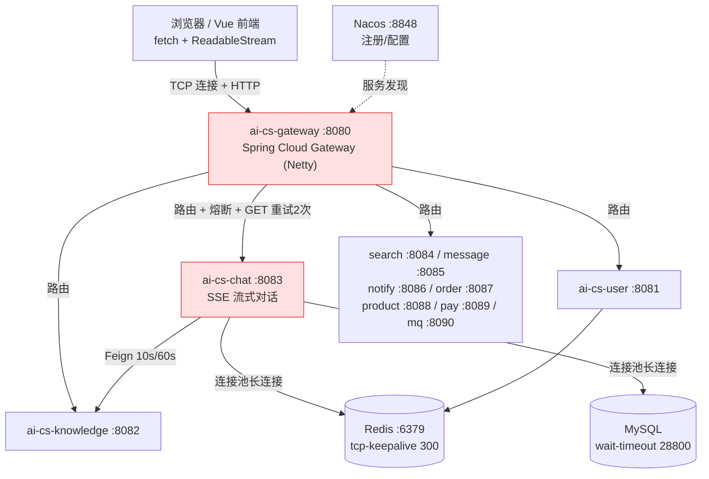
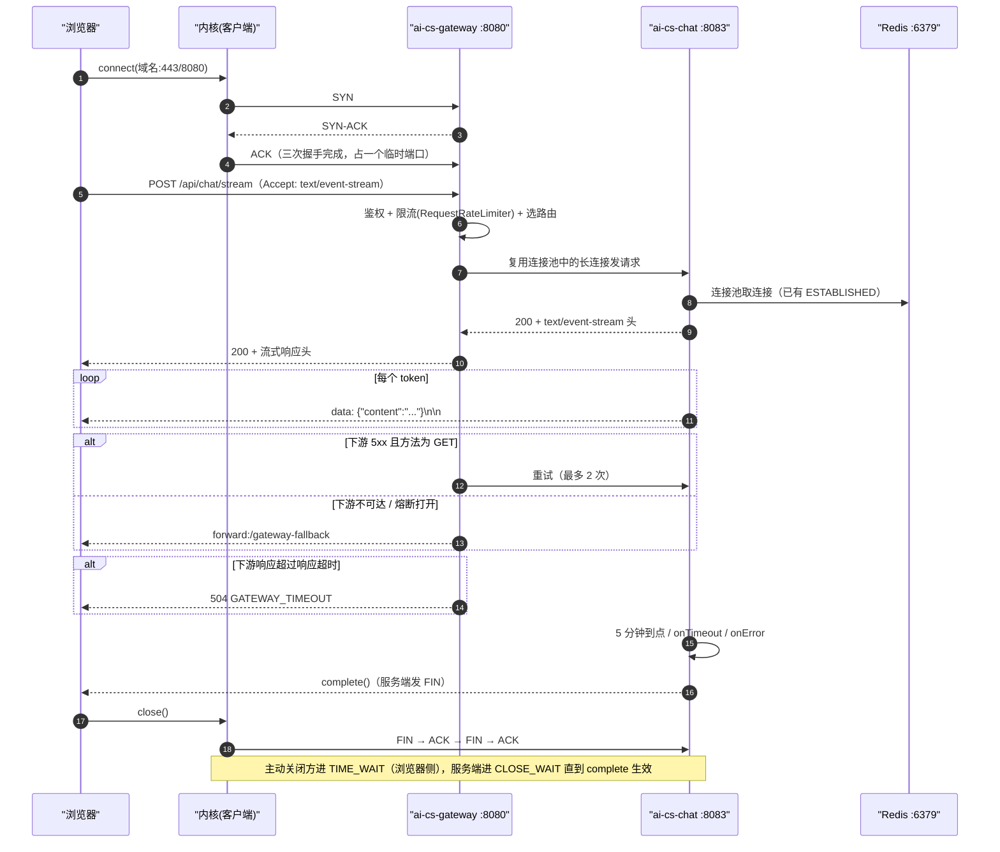

# TCP 协议实战：连接建立慢、连接断不干净、拥塞与重传

> **一句话结论**：线上被称为"网络问题"的现象，最后几乎都收敛到三件事——**连接建立慢**（握手、accept 队列、connect 超时）、**连接断不干净**（CLOSE_WAIT 堆积、TIME_WAIT 占端口、半开连接）、**拥塞与重传**（窗口、RTO、丢包重传）；判断落在哪一件上靠「状态分布 + 计数器」，不靠猜。
> **阅读前置**：知道 TCP 是"面向连接的可靠字节流"就够，不要求读过 RFC。文中命令在 Windows 11 + PowerShell 7 上真机跑过；Linux 专有命令会单独标注为"未本机实测"。
> **证据基线**：本机 Windows 11 build 26200 / node v24.16.0 / JDK 17.0.19（Temurin）/ tomcat-embed-core 11.0.27 / feign-core 13.17，仓库 `master` 分支 commit `d6f9c33`。证据分 A（源码摘录）、B（本仓文件）、C（本机实测）三级，边界见下表。预计阅读 50~65 分钟。

## 证据边界

| 主题 | 本仓/本机状态 | 证据 | 本篇怎么处理 |
|------|---------------|------|--------------|
| 三次握手 / 四次挥手 / 状态机 | ✅ 可复现 | C：java 单文件探针 + `Get-NetTCPConnection` | 直接贴实测状态迁移 |
| TIME_WAIT 持续时长 | ✅ 已测 | C：实测 116s 仍在、138s 已消失 | 给出本机数值与测量命令 |
| accept 队列（backlog）溢出 | ✅ 已复现 | C：node 脚本 `tcp-backlog-probe.mjs` | 给出 6 组实测数据 |
| Tomcat `acceptCount` / `maxConnections` 默认值 | ✅ 可验证 | C：`javap` 读 tomcat-embed-core 字节码 | 贴字节码证据 |
| Feign 默认 10s / 60s | ✅ 可验证 | A：`FeignClientFactoryBean.java.md` + C：`javap` 读 feign-core | 双证据给出数值来源 |
| 网关重试只对 GET、重试 2 次 | ✅ 已落地 | B：`ai-cs-gateway/src/main/java/com/aics/gateway/config/RouteConfig.java` | 贴代码 + 行号 |
| SSE 长连接 5 分钟超时 | ✅ 已落地 | B：`ai-cs-chat/src/main/java/com/aics/chat/service/impl/ChatServiceImpl.java` | 贴代码 + 行号 |
| socket 选项（TCP_NODELAY / SO_KEEPALIVE）显式配置 | ❌ 全仓 0 命中 | C：全仓 `Select-String` 结果为空 | 明确写"靠框架默认" |
| Linux 内核参数（`somaxconn`、`tcp_tw_reuse`、`tcp_max_syn_backlog`） | ❌ 本机是 Windows | 无 | 只给命令与判读方法，标注"未本机实测" |
| docker / k8s / NAT / LB 的空闲老化 | ❌ 本机无 docker/kubectl | 无 | 标"未本机实测，给命令与判读方法"并说明原因 |

## 0. 先看现象

### 现象一：8080 在监听，但监听它的不是本仓的网关

运维同学报"网关起来了，8080 通"，一条 `netstat` 看着确实像。

```powershell
netstat -ano | Select-String ':8080\s|:6379\s|:8005\s'
```

```text
  TCP    0.0.0.0:8080           0.0.0.0:0              LISTENING       40648
  TCP    127.0.0.1:6379         0.0.0.0:0              LISTENING       9112
  TCP    127.0.0.1:8005         0.0.0.0:0              LISTENING       40648
  TCP    [::]:8080              [::]:0                 LISTENING       40648
```

看到 `8080 LISTENING` 就下结论是第一个误判。用 PID 反查进程命令行，真相立刻变脸：

```powershell
(Get-CimInstance Win32_Process -Filter "ProcessId=40648").CommandLine
```

```text
"D:\DevTools\jdk\jdk1.8\jre\bin\java.exe"  -Djava.util.logging.config.file="D:\Projects\AsiaInfo\YunNan\AssetCentre\.tomcat-customeraccount\conf\logging.properties"  -classpath "D:\DevTools\apache-tomcat-9.0.121\bin\bootstrap.jar;D:\DevTools\apache-tomcat-9.0.121\bin\tomcat-juli.jar" -Dcatalina.base="D:\Projects\AsiaInfo\YunNan\AssetCentre\.tomcat-customeraccount" -Dcatalina.home="D:\DevTools\apache-tomcat-9.0.121"  org.apache.catalina.startup.Bootstrap  start
```

三个判据同时否定"这是本仓网关"：① 解释器是 `jdk1.8`，本仓要求 JDK 17；② `catalina.base` 指向另一个项目（AsiaInfo 云南 AssetCentre）的 Tomcat 实例；③ 同一 PID 还占着 `8005`——那是 Tomcat 的 shutdown 端口，是"这是个 Tomcat 而不是 Spring Boot 独立 jar"的指纹（本仓 11 个服务各自是 Spring Boot fat jar，不会额外开 8005）。

再补一刀，确认本仓服务此刻一个都没起：

```powershell
Get-CimInstance Win32_Process -Filter "Name='java.exe'" | Where-Object { $_.CommandLine -match 'ai-cs|aics' } | Measure-Object | Select-Object -ExpandProperty Count
```

```text
0
```

顺便注意 `127.0.0.1:6379` 那行：PID 9112 是 `redis-server.exe`，它和 40648 之间是**成对出现的 ESTABLISHED**（`netstat -ano` 里能看到 `127.0.0.1:49673 -> 127.0.0.1:6379 ESTABLISHED 40648`）。这就是长连接复用最直观的样子：一个客户端进程反复用少数几个端口访问同一个服务，根本没为每次调用新建连接。

### 现象二：31 个连接卡在 CLOSE_WAIT 不动

```powershell
Get-NetTCPConnection | Group-Object State | Select-Object Name, Count | Format-Table -AutoSize
```

```text
Name        Count
----        -----
Bound         210
Listen         52
SynSent         2
Established   191
CloseWait      31
TimeWait      166
```

`CLOSE_WAIT`（对端已发 FIN、本端还没调用 `close()`）出现 31 条，这个状态本身没有超时机制——只要应用不 close，它就一直挂着并占着文件描述符。具体是谁：

```powershell
netstat -s -p tcp | Select-Object -Last 12
```

```text
  Proto  Local Address          Foreign Address        State
  TCP    10.4.200.85:49829      10.17.6.5:https        CLOSE_WAIT
  TCP    10.4.200.85:49831      10.17.6.5:https        CLOSE_WAIT
  TCP    10.4.200.85:49834      10.17.6.5:https        CLOSE_WAIT
  TCP    10.4.200.85:49835      10.17.6.5:https        CLOSE_WAIT
  TCP    10.171.99.119:51119    10.13.0.82:9080        SYN_SENT
  TCP    10.171.99.119:55031    10.118.144.53:1521     ESTABLISHED
```

同形态的 4 条全部指向 `10.17.6.5:443`：对端已经把连接关了，本端进程还攥着 socket。这不是"网络慢"，是代码里少了 `close()`/`try-with-resources`，或者读循环没读到 EOF 就提前退出了。

### 现象三：应用忙一下，新连接被内核直接拒绝

把"应用来不及 accept"这件事放大到 200 个并发连接，本机可以稳定复现（脚本 `learning-docs/tools/tmp/tcp-backlog-probe.mjs`）：

```powershell
node tcp-backlog-probe.mjs 1 200 1200
node tcp-backlog-probe.mjs 100 200 1200
```

```text
backlog=1 clients=200 blockMs=1200 port=50475 elapsedMs=1240
kernel 侧结果（worker 视角）： {"connected":33,"error":167}
拒绝的错误码分布： {"ECONNREFUSED":167}

backlog=100 clients=200 blockMs=1200 port=51338 elapsedMs=1258
kernel 侧结果（worker 视角）： {"connected":132,"error":68}
拒绝的错误码分布： {"ECONNREFUSED":68}
```

`backlog` 传 1 时只有 33 个连接完成握手，其余 167 个拿到 `ECONNREFUSED`；传 100 时能过 132 个。注意错误码是**拒绝**而不是超时——在 Windows 上队列满时内核直接回 RST，客户端立刻收到失败；Linux 的行为是丢 SYN 让客户端重传（后面 §3.3、§6.4 会展开这个差别为什么会让"照抄 Linux 经验"的判断失效）。

这些现象指向同一件事：**TCP 的故障不靠"网速快不快"解释，而靠三条可观测的事实——连接处于什么状态、队列里排了多少、计数器涨了多少**；状态看 `Get-NetTCPConnection`/`ss`，队列看 backlog 与 `Recv-Q`，计数器看 `netstat -s`。下面所有小节都围绕这三条展开。

## 1. 整体地图



> **读图说明**：红色两个节点是本篇的两个"高危单点"。**网关**是所有南北向流量的唯一入口，它身上的三个旋钮（连接超时、响应超时、重试策略）决定了"连接建立慢"会被放大还是被吸收；**chat 服务**是唯一拿长连接说话的服务（SSE 单条连接可以活 5 分钟），它对"连接断不干净"的敏感度比其它服务高一个量级。蓝色圆形是 Redis/MySQL，它们和 Java 服务之间是**连接池长连接**——也就是"端口耗尽"问题几乎不发生在它们身上，却最容易发生在"每次调用都新建连接"的下游。虚线是 Nacos，只影响"连接往哪儿建"，不参与数据面。

| 组件 | 责任（在 TCP 这件事上） | 关键参与方 | 本篇关注点 |
|------|------------------------|-----------|-----------|
| 浏览器 / 前端 | 发起 TCP、复用连接、SSE 读流 | 用户网络、家庭路由、公司 NAT | 客户端侧临时端口、半开连接、40ms 延迟 |
| ai-cs-gateway :8080 | accept 新连接、向下游建连接、超时/重试/熔断 | Netty（Reactor Netty HttpClient） | 响应超时 504、GET 重试 2 次、上游 RST |
| ai-cs-chat :8083 | 长连接（SSE）、流式写、定时 complete | Servlet 容器线程、`SseEmitter` | 5 分钟超时、半开连接、写失败 |
| 业务服务 :8081~:8090 | 处理请求、通过 Feign 调下游 | Feign + 负载均衡 | 默认 10s 连接 / 60s 读超时 |
| Redis / MySQL | 长连接池的服务端 | Lettuce / HikariCP | `tcp-keepalive`、`wait-timeout`、空闲老化 |
| 内核 | 握手、队列、重传、TIME_WAIT | Windows TCP/IP 栈 | 状态分布、计数器、端口范围 |

## 2. 关键概念与关键要素

| 名称 | 位置（在哪看/在哪配） | 作用 | 关键参数 / 本机实测值 |
|------|----------------------|------|----------------------|
| `SYN` / `SYN-ACK` / `ACK` | 内核，抓包可见 | 建连接的三次交互 | 初始序列号 ISN 随机 |
| `FIN` | 内核，`close()` 触发 | 半关闭，表示"我没数据要发了" | 每条方向各一次 |
| `RST` | 内核 | 强制断开（拒绝、异常、进程被杀） | 队列满时 Windows 直接回 RST |
| `CLOSE_WAIT` | `Get-NetTCPConnection -State CloseWait` | 对端已 FIN，本端未 close | 无超时，泄漏 fd |
| `TIME_WAIT` | `Get-NetTCPConnection -State TimeWait` | 主动关闭方等待 2MSL | 本机实测约 120s |
| accept 队列（全连接队列） | 内核 `listen(backlog)` 参数决定 | 已完成握手、等应用 `accept()` 的连接 | `backlog=1` 时本机上限约 33 |
| SYN 队列（半连接队列） | 内核，Linux 为 `tcp_max_syn_backlog` | 收到 SYN、还在等最后 ACK | Windows 无同名参数，以 `Max SYN Retransmissions 4` 观测 |
| `MSS` | 握手时协商 | 单个 TCP 段最大载荷 | 以太网常见 1460 |
| `rwnd`（接收窗口） | 内核，随 ACK 通告 | 流量控制：别让发送方冲垮接收方 | 本机 `Receive Window Auto-Tuning: normal` |
| `cwnd`（拥塞窗口） | 内核 | 拥塞控制：别让网络冲垮自己 | 本机算法 `default`（CUBIC 系列） |
| `RTO` | 内核按 RTT 动态估算 | 超时重传的等待时间 | 本机 `Initial RTO 1000`ms |
| Nagle 算法 | socket 选项 `TCP_NODELAY=false` 生效 | 攒小包，减少 40 字节头浪费 | JDK 默认 `tcpNoDelay=false` |
| delayed ACK | 内核 | 延迟回 ACK，捎带数据 | 与 Nagle 互锁，制造约 40ms 停顿 |
| `SO_KEEPALIVE` | socket 选项 | 内核级心跳探测死连接 | JDK 默认 `keepAlive=false` |
| 应用层心跳 | 代码（SSE 注释、ping 帧） | 穿越中间设备、业务级探活 | 本项目靠 SSE 事件与 5 分钟 emitter 超时 |
| 四元组 | `netstat -ano` 每行 | 唯一定位一条连接 | 本机临时端口范围 49152 起、16384 个 |
| `SO_REUSEADDR` | socket 选项 / 服务端 | 允许绑定处于 TIME_WAIT 的本地地址 | JDK `ServerSocket` 默认 `reuseAddress=false`（Windows） |
| `acceptCount` | `server.tomcat.accept-count`（本仓未配） | 传给 `listen()` 的 backlog | Tomcat 默认 100（字节码证据见 §3.3） |
| `maxConnections` | `server.tomcat.max-connections`（本仓未配） | 同时持有的连接上限 | Tomcat 默认 8192 |
| `timeout-per-shutdown-phase` | `spring.lifecycle.*` | 优雅停机等待在途请求的上限 | 本仓 11 个服务全为 30s |

## 3. 原理与证据逐段精读

### 3.1 三次握手：为什么是三次而不是两次

**在干什么**：双方交换初始序列号（ISN），并各自确认"我能发、你能收、你能发、我能收"。客户端 `SYN(seq=x)` → 服务端 `SYN-ACK(seq=y, ack=x+1)` → 客户端 `ACK(ack=y+1)`。前两次之后服务端只是"半开"，第三次到达才算 ESTABLISHED。

**为什么这么设计**：核心不是"多握一次更可靠"，而是**让双方都确认对方的 ISN 已被对方收到**，同时防止网络里滞留的**历史重复 SYN** 在一条已关闭的旧连接上凭空建起一条新连接。两次握手时，服务端无法区分"这是新请求"还是"这是 30 秒前重传上来的旧 SYN"。

**换写法会怎样**：如果服务端在收到 SYN 后就认为连接建立（两次握手），那么一个迟到的旧 SYN 会让服务端分配资源、进入 ESTABLISHED，而客户端根本不认这条连接——这就是 SYN flood 的天然放大器。所以任何"优化握手"的方案（TFO、QUIC 的 0-RTT）都必须额外解决重放问题，而不是简单砍掉一次。

**常见坑**：把"连接建立慢"归因于带宽。真正决定首次建连耗时的是 **RTT 的整数倍**：1 个 RTT 用于握手，第 2 个 RTT 才开始发数据（除非 TFO）。跨境链路 RTT 200ms，页面要打 20 个域名连接，就是 4 秒起步——这是"慢"的来源，不是"网速"。

本机把这条链路的 `connect()` 单独拿出来量，成本是 0（loopback）：

```powershell
1..3 | ForEach-Object { Measure-Command { $c = [System.Net.Sockets.TcpClient]::new(); $c.Connect('127.0.0.1', 6379); $c.Close() } | Select-Object -ExpandProperty TotalMilliseconds }
```

```text
22.9561
0.3036
0.3206
```

**怎么读**：第二、三次的 `0.30ms` 是 loopback 上"一次完整三次握手 + 一次关闭"的墙钟时间；第一次 `22.96ms` 大两个数量级，是 .NET 类型首次加载/JIT 与 PowerShell 管道初始化的开销，**不是 TCP 慢**。**误判风险**：`Measure-Command` 把对象创建、类型加载、管道开销全算进去了，绝不能当作"握手耗时"引用；正确用法是只看稳定后的量级（这里约 0.3ms），而且它只代表 loopback 基线——跨机房调用 800ms 时，基线对照能告诉你"99% 的耗时不在本机"。

### 3.2 四次挥手：谁进 CLOSE_WAIT、谁进 TIME_WAIT

**在干什么**：TCP 是全双工，两个方向要各自关一次，所以是四次。主动关闭方 `FIN` → 对端 `ACK`（此刻**主动方**进 `FIN_WAIT_2`，**对端**进 `CLOSE_WAIT`）→ 对端把剩余数据发完再 `FIN` → 主动方 `ACK` 并进 `TIME_WAIT`，等 2MSL 后销毁。

**为什么这么设计**：`CLOSE_WAIT` 存在的意义是"给对方一个把话说完的机会"——它把"我不发了"和"我关连接"解耦。`TIME_WAIT` 存在的意义有两个：① 让最后那个 ACK 有重传机会，否则对端会一直重发 FIN；② 让本连接的旧报文在网络里自然死掉，避免污染立即复用的相同四元组的新连接。

**换写法会怎样**：如果没有 TIME_WAIT，用同一个四元组立刻重建连接，一个延迟的旧数据段就可能被新连接当成合法数据收下——这类 bug 极难复现，所以内核宁可牺牲端口。如果 `CLOSE_WAIT` 也有超时，那么"应用正在上传大文件"这种合法长尾就会被中途掐断，因此内核把它交给应用自觉。

**常见坑**：把两者混为一谈。判据只有一条：**谁先发 FIN，谁背 TIME_WAIT；谁收到 FIN 却不 close，谁背 CLOSE_WAIT**。前者是内核正常状态（无害，只是占端口），后者是应用 bug（泄漏 fd，最终 `Too many open files` 或线程/内存泄漏）。

本机实测（脚本 `learning-docs/tools/tmp/tcp_socket_defaults.java`）：一次性建立 100 条连接，**客户端**先 close、服务端读到 EOF 后 close（服务端是被动关闭方）：

```powershell
$out = & java tcp_socket_defaults.java 100
$p = (($out | Where-Object { $_ -like 'PORTS=*' }) -replace '^PORTS=','' -split ',') | ForEach-Object { [int]$_ }
Start-Sleep -Milliseconds 400
$all = Get-NetTCPConnection -State TimeWait
"ports=" + $p.Count + " inTimeWait=" + (@($all | Where-Object { $p -contains $_.LocalPort }).Count) + " hostTimeWaitTotal=" + $all.Count
```

```text
ports=100 inTimeWait=100 hostTimeWaitTotal=388
```

**怎么读**：100 个客户端端口**全部**处于 `TimeWait`，一个不漏——因为客户端是主动关闭方。`hostTimeWaitTotal` 从实验前的 166 涨到 388（中间还有别的流量），所以判断"我制造的 TIME_WAIT"必须**按端口集合过滤**，不能看总数。**误判风险**：如果你在这些连接上看到的是 0 个 TIME_WAIT，先别高兴，很可能是主动关闭方搞反了（服务端先 close 了），或者进程被 `kill` 导致内核发 RST——RST 会**跳过** TIME_WAIT，我在写这个探针时就踩过：第一版主线程先退出、daemon 线程还没 close，结果 100 条连接一条 TIME_WAIT 都没留下。

TIME_WAIT 到底持续多久，本机实测（同一个连接，每 20 秒采样一次，直到状态消失）：

```powershell
$sw=[System.Diagnostics.Stopwatch]::StartNew()
while($sw.Elapsed.TotalSeconds -lt 600){
  $st=(Get-NetTCPConnection -LocalPort $lp -ErrorAction SilentlyContinue).State
  "{0:n0}s state={1}" -f $sw.Elapsed.TotalSeconds,($st -join '/')
  if(-not $st){break}; Start-Sleep -Seconds 20
}
```

```text
3s state=TimeWait
26s state=TimeWait
49s state=TimeWait
71s state=TimeWait
92s state=TimeWait
116s state=TimeWait
138s state=
done after 138s
```

**怎么读**：116 秒时还在，138 秒时已经没了，结合采样间隔可以断定本机 `TIME_WAIT` 时长约 **120 秒**（与 Windows 未显式配置 `TcpTimedWaitDelay` 时的默认行为一致）；这也解释了为什么后面 16384 个临时端口会撑不住高频短连接。**误判风险**：TIME_WAIT 时长在 Linux 上由 `net.ipv4.tcp_fin_timeout` 与 2MSL（通常 60s）决定，本机数值不能直接搬到 Linux 生产环境——Linux 侧请用 `ss -tan state time-wait | wc -l` 与 `/proc/sys/net/ipv4/tcp_fin_timeout` 核对（**未本机实测，本机无 Linux 环境**）。

### 3.3 listen backlog 与 accept 队列：`acceptCount` 到底管什么

**在干什么**：`listen(port, backlog)` 告诉内核"这条监听套接字可以替我排队多少个已完成握手、还没被应用取走的连接"。应用调 `accept()` 取一个，队列腾一个位。队列满之后新建连接怎么办，由内核策略决定：Linux 默认丢弃 SYN（客户端会重传，表现为"慢"），Windows 则直接回 RST（客户端表现为 `ECONNREFUSED`，即"立刻失败"）。

**为什么这么设计**：accept 队列是内核与应用之间的缓冲，用来吸收"瞬时并发 vs 应用 accept 速率"的差。它的长度是**安全阀**：太长会让过载表现为"连接建立了但迟迟没响应"（更难排查），太短会让过载表现为"直接连不上"（更容易被监控发现但用户体验更差）。

**换写法会怎样**：把 backlog 调小到 1，本机实测（`learning-docs/tools/tmp/tcp-backlog-probe.mjs`，200 个客户端同时连、主线程故意忙等 1200ms 不 accept）：

| backlog | 完成握手 | 被拒（ECONNREFUSED） |
|---------|---------|---------------------|
| 1 | 33 | 167 |
| 5 | 37 | 163 |
| 10 | 42 | 158 |
| 50 | 82 | 118 |
| 100 | 132 | 68 |
| 200 | 200 | 0 |

```text
backlog=1 clients=200 blockMs=1200 port=50475 elapsedMs=1240
kernel 侧结果（worker 视角）： {"connected":33,"error":167}
拒绝的错误码分布： {"ECONNREFUSED":167}
```

**怎么读**：`connected` 大致等于 `backlog + 32` 附近（33/37/42/82/132 对应 1/5/10/50/100），说明内核实际可排队的数量并不严格等于你传的值，短 backlog 会被钳到一个最小值；`backlog=200` 时 200 个全部握手成功，说明队列够用。**误判风险**：① 这是 Windows 的行为，Linux 上你看到的会是客户端超时重传而不是 `ECONNREFUSED`，不能拿这张表去解释 Linux 生产环境的"连接慢"；② 脚本用"忙等"制造"不 accept"，真实应用更多是"accept 了但线程池满了、请求排队"，那是另一条队列（见 §3.4 的坑）。

那么 Tomcat 这条链上的默认值是多少？本仓**没有任何** `server.tomcat` 配置（全仓 `Select-String accept-count|max-connections` 只命中 Nacos/Seata 的 `connection-timeout`，不是 Tomcat 的），所以取框架默认。用 `javap` 直接读本机 m2 里的字节码：

```powershell
$jar='C:\Users\16680\.m2\repository\org\apache\tomcat\embed\tomcat-embed-core\11.0.27\tomcat-embed-core-11.0.27.jar'
javap -p -c -classpath $jar org.apache.tomcat.util.net.AbstractEndpoint | Select-String 'bipush        100|sipush        8192|putfield.*acceptCount|putfield.*maxConnections'
```

```text
139: bipush        100
141: putfield      #102                // Field acceptCount:I
107: sipush        8192
110: putfield      #82                 // Field maxConnections:I
```

**怎么读**：`acceptCount` 默认 **100**、`maxConnections` 默认 **8192**，两者都由 `AbstractEndpoint` 构造时写入。前者就是传给 `listen()` 的 backlog（受内核上限钳制），后者是"同时持有的 socket 数量上限"，满了之后 Tomcat 的 Acceptor 会暂停 accept、让连接留在内核队列里。**误判风险**：Tomcat 9/10/11 的默认值不同版本一致但内核钳制不同——Linux 上 `min(acceptCount, somaxconn)`，而 `somaxconn` 老内核常是 128/256；本仓用 tomcat-embed-core 11.0.27（Spring Boot 4.x），换版本要先重跑这条命令，不要背数字。

### 3.4 Nagle 与 delay ACK：那 40ms 是哪来的

**在干什么**：Nagle 算法（socket 选项 `TCP_NODELAY` 关闭时才生效）规定"如果还有未确认的小包在路上，就别再发新的小包，攒够一个 MSS 或等到 ACK 再发"。delayed ACK 规定"收到数据后不立刻回 ACK，最多等 40~200ms，指望能捎带在自己要发的数据里"。两个优化单独看都合理，**叠加起来就互锁**：发送方等 ACK 才肯发下一个包，接收方等"有数据要回"才肯发 ACK，最坏情况硬等一个 delayed ACK 定时器——这就是经典"约 40ms 神秘延迟"。

**为什么这么设计**：Nagle 是为了对付 40 字节头 + 1 字节载荷的"糊涂窗口"式浪费；delayed ACK 是为了减少纯 ACK 小包。它们都是带宽紧张年代的产物。

**换写法会怎样**：HTTP/1.1 之后的应用（尤其请求-响应式 RPC、SSE、游戏帧同步）几乎都要求低延迟，所以主流容器和框架改成**默认开 `TCP_NODELAY`**。反过来，如果你自己 new 一个裸 `Socket` 就写小包，就会把 Nagle 全吃下来。

本机验证 JDK 的默认值（`learning-docs/tools/tmp/tcp_socket_defaults.java`）：

```text
DEFAULTS tcpNoDelay=false keepAlive=false soTimeout=0 soLinger=-1 recvBuf=65536 sendBuf=65536
```

**怎么读**：`tcpNoDelay=false` 说明 **JDK 的裸 Socket 默认是开着 Nagle 的**；`keepAlive=false` 说明内核 keepalive 默认关闭；`soTimeout=0` 说明读操作**永不超时**——三者叠加就是"自己写 socket 客户端，小包会慢、死连接不会断、卡住永远不返回"。**误判风险**：这条输出只代表 `new Socket()`，不代表你项目里的 Tomcat/Netty/HttpClient——Spring Boot 的 Tomcat 连接器与 Reactor Netty 都默认 `TCP_NODELAY=true`。要确认运行时真实值，得看具体 client 的配置，或抓包看有没有"小包等 ACK"的锯齿。

本仓的实际情况：全仓 `Select-String -Pattern 'TCP_NODELAY|tcpNoDelay|childOption|SoKeepAlive|setKeepAlive'`（`*.java/*.yml/*.yaml/*.conf`，排除 `target/node_modules/.git`）**0 命中**——项目从未显式设置过 socket 选项，完全依赖框架默认。这意味着：**如果哪天有人在网关里引入自建 Netty 客户端却忘了 `childOption(ChannelOption.TCP_NODELAY, true)`，40ms 延迟会以"偶发慢"的形式出现，且任何应用日志都看不出来**。

### 3.5 滑动窗口与拥塞控制：`rwnd` 管别人，`cwnd` 管自己

**在干什么**：发送方实际能发多少 = `min(rwnd, cwnd)`。`rwnd`（接收窗口）由**接收方**在 ACK 里通告，是流量控制——怕把接收方缓冲区打爆；`cwnd`（拥塞窗口）由**发送方**自己维护，是拥塞控制——怕把中间链路打爆。拥塞控制四阶段：慢启动（cwnd 指数增长到阈值）、拥塞避免（线性增长）、快重传（收到 3 个重复 ACK 立即重传不等超时）、快恢复（把阈值减半后继续线性增长，而不是回到慢启动）。

**为什么这么设计**：接收方知道自己缓冲区剩多少，发送方知道自己在丢包——两者信息不对称，只能各管一段。慢启动是为了快速探到链路容量，快重传是为了区分"偶发丢包"（3 个 dup ACK 就能证明）与"真拥塞"（只能等 RTO）。

**换写法会怎样**：把 `rwnd` 固定成很小的值，高 RTT 链路上的吞吐会被 `rwnd/RTT` 卡死（长肥管道问题）；把拥塞算法从丢包型（CUBIC）换成时延型（BBR），在有随机丢包的链路上吞吐会明显更好但更"自私"。这些都属于内核级取舍，不是应用能改的。

本机内核参数（`netsh int tcp show global`）：

```text
Receive Window Auto-Tuning Level    : normal
Add-On Congestion Control Provider  : default
ECN Capability                      : disabled
Initial RTO                         : 1000
Max SYN Retransmissions             : 4
HyStart                             : enabled
Proportional Rate Reduction         : enabled
```

**怎么读**：`Auto-Tuning: normal` 表示接收窗口会自适应放大（长肥管道不至于卡死在 64KB）；`Congestion Control Provider: default` 是 Windows 的默认算法（CUBIC 系列），`HyStart`/`PRR` 是慢启动与恢复阶段的优化开关；`ECN: disabled` 说明不会用显式拥塞通知，只能靠丢包信号——**这意味着在有轻微拥塞的链路上，你会看到真实的重传**。**误判风险**：这些是全局参数，`default` 不等于"没算法"；要确认某条连接实际用的算法，Windows 上没有 `ss -i` 那样的直接输出，只能用 `Get-NetTCPSetting` 看模板，**未本机验证逐连接算法**。

拥塞与重传在本机的宏观证据（`netstat -s -p tcp`）：

```text
  Active Opens                        = 95954
  Passive Opens                       = 39824
  Failed Connection Attempts          = 57181
  Reset Connections                   = 12355
  Current Connections                 = 231
  Segments Received                   = 27452689
  Segments Sent                       = 25235954
  Segments Retransmitted              = 56900
```

**怎么读**：重传 56900 / 发送 25235954 ≈ 0.23%，属于"能接受但不算干净"的量级；而 `Failed Connection Attempts 57181` 接近 `Active Opens 95954` 的 60%，说明这台机器上有大量**建连失败**（VPN/公司网/被墙的下游），不是重传问题。**误判风险**：这些计数是**开机以来累计值**，必须"隔 60 秒采两次做差"才有意义；单看绝对值只会得出"重传很多"的错误结论。

### 3.6 重传与 RTO 估算：为什么失败往往以"秒"为单位

**在干什么**：发送方给每个段记一个定时器，超时未确认就重传，并把 RTO 翻倍（指数退避）。RTO 不是写死的常量，而是用 RTT 采样做平滑（Jacobson/Karels 算法：`SRTT`、`RTTVAR`，`RTO = SRTT + 4×RTTVAR`），并设上下界。SYN 的重传次数是单独限定的。

**为什么这么设计**：RTT 在不同链路上差几个数量级，固定超时要么误判重传（RTT 抖动时）、要么恢复太慢（真丢包时）。指数退避是为了在拥塞时快速降低发送压力。

**换写法会怎样**：把 RTO 下限调小（比如 200ms）会在高 RTT 链路上疯狂重传、把偶发延迟放大成雪崩；把上限调得极大，丢包后恢复时间会拉长到分钟级。所以"连接超时设多少"不是拍脑袋：**应用层超时必须大于 TCP 层的最坏恢复时间**，否则应用先放弃、内核还在重传，白白浪费端口。

**常见坑**：应用层 `connect timeout` 设得比 SYN 重传窗口还短。本机 `Max SYN Retransmissions: 4` + `Initial RTO: 1000ms`，意味着内核愿意花 **1+2+4+8+16 ≈ 31 秒**（指数退避）去尝试建连；而 Feign 的默认 connect 超时是 10 秒——**应用会在第 10 秒放弃，内核还在第 4 次重传上**。这类"两层超时不匹配"是所有"偶发连接失败但服务端日志干净"的典型成因：连接根本没到服务端。

Feign 的默认值用两条独立证据钉住。A 级源码摘录（`learning-docs/24-源码分析/assets/source/FeignClientFactoryBean.java.md`）显示默认值直接来自 `new Request.Options()`：

```java
private int readTimeoutMillis = new Request.Options().readTimeoutMillis();

private int connectTimeoutMillis = new Request.Options().connectTimeoutMillis();

private boolean followRedirects = new Request.Options().isFollowRedirects();
```

（src: FeignClientFactoryBean.java#L123-L127）[[源码:FeignClientFactoryBean.java.md#L123-L127]]

再用 `javap` 读本机 m2 里 `feign-core-13.17.jar` 的字节码，确认 `Request.Options()` 无参构造到底塞了什么：

```powershell
$jar='C:\Users\16680\.m2\repository\io\github\openfeign\feign-core\13.17\feign-core-13.17.jar'
javap -p -c -classpath $jar 'feign.Request$Options' | Select-String 'public feign.Request\$Options\(\);' -Context 0,12
```

```text
public feign.Request$Options();
Code:
0: aload_0
1: ldc2_w        #22                 // long 10l
4: getstatic     #24                 // Field java/util/concurrent/TimeUnit.SECONDS:Ljava/util/concurrent/TimeUnit;
7: ldc2_w        #25                 // long 60l
10: getstatic     #24                 // Field java/util/concurrent/TimeUnit.SECONDS:Ljava/util/concurrent/TimeUnit;
13: iconst_1
14: invokespecial #11                 // Method "<init>":(JLjava/util/concurrent/TimeUnit;JLjava/util/concurrent/TimeUnit;Z)V
```

**怎么读**：`10` 秒 + `SECONDS` 是 connect 超时，`60` 秒 + `SECONDS` 是 read 超时，`iconst_1` 是 `followRedirects=true`。这与"Feign 默认 10s/60s"的传言一致，但**来源是 feign-core 的默认而非 Spring 配置**——所以只要本仓 yml 里没有任何 `readTimeout/connectTimeout` 覆盖（全仓实测：只有 `tools/nacos-config/ai-cs-order.yml` 的 Redis `connect-timeout: 15000`，与 Feign 无关），线上就真的跑在 10s/60s 上。**误判风险**：`javap` 读的是**本机 m2 的 jar**，与你线上镜像里的版本要一致（本篇读的是 13.17）；另外 Spring Cloud OpenFeign 允许按 client 覆盖，覆盖点可能在 Nacos 配置里，排查时必须连带查拉取到的远端配置。

### 3.7 keepalive 与应用层心跳：两种"探活"不是一回事

**在干什么**：`SO_KEEPALIVE` 是**内核**级的：连接空闲到阈值后，内核发一个不含数据的探测段，连续 N 次无响应就判定连接死亡并回报错误。应用层心跳是**代码**级的：你自己发一个 ping 帧/注释行/空事件，靠业务协议判断对端是否活着。

**为什么这么设计**：中间设备（NAT、防火墙、负载均衡）会维护连接表，空闲一段时间就**静默丢表**——此后这条连接在内核看来仍是 ESTABLISHED，但任何数据都到不了对端。内核 keepalive 的默认间隔太长（Linux 7200s 起），远大于 NAT 表的空闲老化时间（常见 60~300s），所以**默认 keepalive 救不了穿越 NAT 的长连接**；这就是为什么所有长连接协议最终都要自己写应用层心跳。

**换写法会怎样**：只靠内核 keepalive，SSE 连接会在 NAT 清表后"假活"——客户端一直等、服务端以为连接还在、日志里什么都没有。反过来，把内核 keepalive 调到 30s 也不理想：那是全系统生效的，会给所有连接加无谓流量。

**常见坑**：把"连接还 ESTABLISHED"当作"对端还活着"。本仓最典型的长连接是 SSE，代码里对这件事是自觉的（`ai-cs-chat/src/main/java/com/aics/chat/service/impl/ChatServiceImpl.java`）：

```java
// L155-L156
/** SSE 超时时间：5 分钟（与 TimeLimiter 60s 配合，Limiter 先触发，Emiter 兜底） */
private static final long SSE_EMITTER_TIMEOUT = 5 * 60 * 1000L;

// L524-L525
// 使用合理的超时时间，替代原来的 0L（永不超时）
SseEmitter emitter = new SseEmitter(SSE_EMITTER_TIMEOUT);

// L828-L836
emitter.onTimeout(() -> {
    log.warn("SSE连接超时: sessionId={}", sessionId);
    emitter.complete();
});
emitter.onError(throwable -> {
    log.warn("SSE连接异常: sessionId={}, err={}", sessionId, throwable.getMessage());
    emitter.complete();
});
```

**怎么读**：5 分钟的 emitter 超时是"应用层兜底"——即使 NAT 清了表、即使对端悄悄消失，5 分钟后这个连接也会被主动 `complete()` 掉，不至于永久泄漏；L524 的注释还点明了一个历史坑：**这里原来是 `0L`（永不超时）**，正是"连接断不干净"的经典写法。`onTimeout`/`onError` 都调了 `complete()`，避免"半关不关"演变成 CLOSE_WAIT。**误判风险**：`SseEmitter` 超时只在"服务端还活着且能调度到这个 emitter"时触发；进程被 `kill -9` 时什么都不会执行，连接靠内核 RST 收拾。

数据面两端的长连接参数，本仓是显式配过的（B 级）：

| 位置 | 配置 | 含义 |
|------|------|------|
| `deploy/redis/redis.conf` L34-L35 | `tcp-keepalive 300`、`timeout 0` | Redis 每 300s 发一次内核级 keepalive 探测；`timeout 0` 表示**永不主动断开空闲客户端** |
| `deploy/mysql/master.cnf` L24-L26 | `max-connections=500`、`wait-timeout=28800`、`interactive-timeout=28800` | MySQL 空闲连接 8 小时才回收；连接上限 500 |
| 各服务 `application.yml` L2/L7 | `shutdown: graceful`、`timeout-per-shutdown-phase: 30s` | 停机时给在途请求 30s 收尾，尽量**正常挥手**而不是 RST |

这三行的组合含义值得记住：`timeout 0` + `tcp-keepalive 300` 是"我不主动赶你走，但我会定期戳一下确认你还活着"；而 `wait-timeout 28800` 意味着 MySQL 侧的空闲连接能活 8 小时——**远长于**任何 NAT 的空闲老化时间，所以 MySQL 连接池必须自己配 `maxLifetime`（低于 8 小时），否则会拿到"服务端已清表、客户端以为还活着"的死连接。

### 3.8 端口耗尽与连接复用：`TIME_WAIT` 的真正代价

**在干什么**：客户端每建一条连接要占一个本地临时端口（四次握手四元组 `(本地IP, 本地端口, 远端IP, 远端端口)` 唯一）。主动关闭后该端口进 TIME_WAIT，约 120 秒（本机实测）不能复用。到**同一个**下游 `IP:Port` 的连接总数受临时端口数上限约束。

**为什么这么设计**：见 §3.2——TIME_WAIT 是正确性代价，不能为了省端口而砍掉。

**换写法会怎样**：本机临时端口范围（`netsh int ipv4 show dynamicport tcp`）：

```text
Protocol tcp Dynamic Port Range
---------------------------------
Start Port      : 49152
Number of Ports : 16384
```

按"每个短连接都由本机主动关闭 + TIME_WAIT 约 120s"估算（脚本 `learning-docs/tools/tmp/tcp-port-exhaustion.mjs`）：

```text
临时端口数            = 16384
TIME_WAIT 持续时间    = 120s
持续占用（ESTABLISHED）= 200
-> 到同一目标的最大新建速率 ≈ 16384/120 = 136.53 次/秒
QPS=   50 且每连接都主动关闭 -> 需要 6000 个四元组：OK
QPS=  200 且每连接都主动关闭 -> 需要 24000 个四元组：不足（缺 7616）
```

**怎么读**：到**同一个** `IP:Port` 的短连接，每秒新建超过约 136 次就会把端口池打完；QPS 200 就会缺 7616 个四元组。这是**上界估算**（假设全指向同一目标、全部由本机主动关闭），不是吞吐实测——远端地址分散会显著放宽上限。**误判风险**：真实系统里"端口耗尽"往往出现在**连接池没配**或**池子反复重建**的场景，而不是单纯 QPS 高；只盯 QPS 会漏掉"每次调用 new 一个连接"这种低级错误。

所以工程上的正解是**复用**，本仓三处都能看到：

1. **HTTP keep-alive / 连接池**：Feign 底层的 `HttpClient` 默认复用连接；网关到下游也是 Reactor Netty 的连接池。本机 `netstat` 里那 5 对 `40648 ↔ 9112`（Redis）就是复用后的样子——一个进程长期只占少数端口。
2. **网关只对 GET 重试 2 次**（`ai-cs-gateway/src/main/java/com/aics/gateway/config/RouteConfig.java` L176-L185）：

```java
// L176-L185
f.retry(c -> c.setRetries(2)
                .setMethods(HttpMethod.GET)
                .setStatuses(HttpStatus.INTERNAL_SERVER_ERROR, HttpStatus.BAD_GATEWAY))
        .circuitBreaker(c -> c.setName(cbName)
                .setFallbackUri("forward:/gateway-fallback"))
        .requestRateLimiter(c -> {
            c.setRateLimiter(redisRateLimiter);
            c.setKeyResolver(userKeyResolver);
            // 超限默认响应 429 TOO_MANY_REQUESTS（RequestRateLimiter 内置默认）
        });
```

同文件 L32-L33 的注释把理由写得很直白：**"重试只对幂等 GET：POST/PUT 重试可能造成重复下单/重复扣款，网关层只在 GET 上对 5xx 重试"**。从 TCP 视角看，重试的代价是"再来一次建连 + 一次完整往返"——所以在限流/熔断之外，重试次数是最容易被误用的旋钮。

3. **熔断的兜底转发**：`setFallbackUri("forward:/gateway-fallback")` 让下游不可达时走本地兜底，而不是让连接一直挂着等 RTO 走完。

**常见坑**：把"连接池"和"连接复用"当成同一件事。连接池是**应用层**的对象池（借还），复用是**TCP 层**的同一四元组继续用；池子里的连接如果被中间设备静默清表，池子本身不会知道——这就是为什么 `maxLifetime` / `idleTimeout` 必须小于中间设备的空闲老化时间。本仓目前**没有任何** `idleTimeout`/`maxLifetime` 的显式配置（`deploy/redis`、HikariCP 都用默认），属于"可扩展点"而非"已治理"。

## 4. 一次完整执行时序

以"用户在页面提问 → 网关 → chat 服务 → SSE 流式返回"为主线，把 TCP 的建连、复用、超时、重试、挥手全串起来：



> **读图说明**：这张图里只有**两次**握手（浏览器→网关一次、网关→chat 是复用），`chat→Redis` 那条干脆没有握手——这就是连接池的全部意义。真正的"断不干净"风险集中在两个位置：`C-->>B: complete()` 之后浏览器侧进 TIME_WAIT（无害），以及 `G-->>B: 504` 这种**网关主动掐断**的场景——此时若 chat 还在往这条已经废弃的连接写数据，就会在 chat 侧留下写失败甚至 CLOSE_WAIT。

| 步骤 | 该怎么判读 | 看什么 |
|------|-----------|--------|
| 1~3 三次握手 | 只有 1 个 RTT 的延迟才正常；超过 3 个 RTT 说明有丢包重传 | `Get-NetTCPConnection` 里出现持续 `SynSent` |
| 4 请求进入 | 网关 `accept` 速率 vs 队列深度 | 排队满 → 客户端 `ECONNREFUSED`（Windows）或重传变慢（Linux） |
| 5 鉴权/限流 | 限流拒绝应回 429，不是连接层错误 | 429 与 RST 混在一起时要先分清应用层/传输层 |
| 6 网关→chat | 连接复用则无握手；若每次调用都新端口，说明池没生效 | `netstat` 里端口数量随时间线性增长 |
| 7~8 建流 | 响应头很快返回但首个 token 慢 = 应用慢，不是 TCP 慢 | 对比首字节时间与 `netstat -s` 重传增量 |
| 9 流式发送 | 长连接期间不该有 CLOSE_WAIT 堆积 | `Get-NetTCPConnection -State CloseWait` 按端口过滤 |
| 10 GET 重试 | 重试只发生在 500/502 且方法为 GET | 日志里重复的下游请求数 |
| 12 504 | 是网关侧响应超时，**TCP 连接本身是通的** | 网关日志 `Response took longer than timeout` |
| 13~14 收尾 | `complete()` 后服务端不该留 CLOSE_WAIT | 同端口 CLOSE_WAIT 计数应回落到 0 |

第 12 步的判据在 A 级源码里可以直接看到（`learning-docs/24-源码分析/assets/source/NettyRoutingFilter.java.md`）：

```java
Duration responseTimeout = getResponseTimeout(route);
if (responseTimeout != null) {
    responseFlux = responseFlux
        .timeout(responseTimeout,
                Mono.defer(() -> Mono
                    .error(new TimeoutException("Response took longer than timeout: " + responseTimeout))))
        .onErrorMap(TimeoutException.class,
                th -> new ResponseStatusException(HttpStatus.GATEWAY_TIMEOUT, th.getMessage(), th));
}
```

（src: NettyRoutingFilter.java#L202-L210）[[源码:NettyRoutingFilter.java.md#L202-L210]]

也就是说网关的响应超时是**在 Reactor 的流上打 `timeout()`**，超时后映射成 504——**连接是被网关主动放弃的**，不走 TCP 的正常挥手逻辑。这解释了为什么"网关 504 但下游服务日志显示请求成功"会同时出现：下游把结果写回去时，连接已经被网关丢了。

## 5. 设计取舍

| 决策点 | 选 A 的代价 | 选 B 的代价 | 本仓当前选择 |
|--------|------------|------------|-------------|
| 短连接 vs 长连接 | 短连接简单、天然隔离故障，但每次 1 个 RTT + 端口消耗 | 长连接省 RTT + 省端口，但要处理空闲老化、半开、粘包 | 业务调用走连接池长连接；SSE 是长连接；前端到网关按浏览器默认 keep-alive |
| 谁主动关闭 | 客户端主动关：客户端背 TIME_WAIT（端口压力在客户端） | 服务端主动关：服务端背 TIME_WAIT（端口压力在服务端，通常端口更富余） | 未显式控制，由谁先调 `close()` 决定；SSE 由服务端 `complete()` 收尾 |
| Nagle 开 vs 关 | 开：省带宽，小包延迟最多约 40ms | 关（`TCP_NODELAY`）：低延迟，小包变多 | 全靠框架默认（Tomcat/Reactor Netty 默认关 Nagle），未显式配置 |
| 内核 keepalive vs 应用心跳 | 内核级：零代码但默认 7200s 起，救不了 NAT 老化 | 应用级：代码可控，需自己实现与观测 | SSE 用 5 分钟 emitter 超时 + 事件流；Redis `tcp-keepalive 300`；MySQL `wait-timeout 28800` |
| 重试 vs 幂等 | 重试提升成功率，但非幂等操作会双重副作用 | 不重试，把失败暴露给用户 | 网关只在 GET 上对 500/502 重试 2 次；Feign 未配重试策略 |
| backlog 大 vs 小 | 大：吸收突发，但过载表现为"连上了没响应" | 小：快速失败，监控可见但体验差 | Tomcat 默认 `acceptCount=100`、`maxConnections=8192`，未覆盖 |
| 连接超时 vs 内核重传窗口 | 应用超时短于内核窗口 → 应用先放弃、内核还在重传 | 应用超时长 → 故障发现慢 | Feign 默认 connect 10s / read 60s，与 `Max SYN Retransmissions 4`（约 31s）不匹配 |

**可扩展点清单**（本仓当前都没有，属于"该做但没做"）：

- 给 Feign 显式配 `connectTimeout`/`readTimeout`（避免升级框架时默认值静默变化），并与网关响应超时形成"外层长、内层短"的层次。
- 给 Tomcat 显式配 `server.tomcat.accept-count` / `max-connections`，让"队列多深"成为可评审的设计参数而不是框架默认。
- 给 HikariCP/Redis 连接池配 `maxLifetime`/`idleTimeout`，确保小于中间设备空闲老化时间（本机无 docker/NAT 环境，**未实测**具体老化值，需要 k8s/LB 侧 `kubectl describe` 或云厂商文档核对）。
- 暴露"连接状态计数"指标（按状态统计的连接数、`ECONNREFUSED` 速率），否则 §0 的现象只能靠人肉 `netstat`。
- 长连接（SSE）加显式心跳事件，而不是只靠 5 分钟超时兜底。

## 6. 踩坑与调试手法

### 6.1 看到端口在监听就以为"我的服务起来了"

```powershell
netstat -ano | Select-String ':8080\s'
```

```text
  TCP    0.0.0.0:8080           0.0.0.0:0              LISTENING       40648
  TCP    [::]:8080              [::]:0                 LISTENING       40648
```

```powershell
Get-Process -Id 40648 | Select-Object Id, ProcessName, StartTime | Format-List
(Get-CimInstance Win32_Process -Filter "ProcessId=40648").CommandLine
```

```text
Id          : 40648
ProcessName : java
StartTime   : 2026/11/27 15:36:33

"D:\DevTools\jdk\jdk1.8\jre\bin\java.exe" ... -Dcatalina.base="D:\Projects\AsiaInfo\YunNan\AssetCentre\.tomcat-customeraccount" -Dcatalina.home="D:\DevTools\apache-tomcat-9.0.121"  org.apache.catalina.startup.Bootstrap  start
```

| 判读项 | 怎么读 | 结论 |
|--------|--------|------|
| 监听地址 | `0.0.0.0` 表示所有网卡；`127.0.0.1` 只有本机能连 | `0.0.0.0:8080` 不能证明是谁 | 
| PID | 只能定位到进程，不能定位到项目 | 必须再查命令行 |
| 解释器路径 | `jdk1.8` vs 本仓要求的 JDK 17 | 已经能排除本仓 |
| `-Dcatalina.base` | Tomcat 实例目录 | 指向别的项目 = 不是本仓 |
| 伴随端口 | 同 PID 是否还有 8005 | 有 = Tomcat；无 = Spring Boot 独立进程 |

**误判风险**：`netstat` 的 PID 列在连接关闭瞬间会变成 `0`（内核已回收），此时反查进程必然失败——先确认这条连接还是 `LISTENING`/`ESTABLISHED` 再反查。另外 IPv4 与 IPv6 会各占一行（`0.0.0.0:8080` 和 `[::]:8080`），统计监听数时容易重复计数。

### 6.2 CLOSE_WAIT 越堆越多：一定是你的代码没 close

复现（`learning-docs/tools/tmp/tcp_closewait_hold.java`：客户端连上就关，服务端 accept 后**故意不 close**，挂 6 秒）：

```powershell
$p = Start-Process -FilePath 'java' -ArgumentList 'tcp_closewait_hold.java','5','6000' -RedirectStandardOutput closewait-demo.out -PassThru -WindowStyle Hidden
Start-Sleep -Seconds 4
Get-Content closewait-demo.out
$port = [int](((Get-Content closewait-demo.out | Select-String 'LISTEN_PORT=').Line -split '=')[1])
Get-NetTCPConnection -State CloseWait -LocalPort $port | Select-Object LocalPort, RemoteAddress, RemotePort, State | Format-Table -AutoSize
```

```text
LISTEN_PORT=52381
HOLDING sockets=5 for_ms=6000 (all of them are in CLOSE_WAIT now)

LocalPort RemoteAddress RemotePort     State
--------- ------------- ----------     -----
    52381 127.0.0.1          52385 CloseWait
    52381 127.0.0.1          52386 CloseWait
    52381 127.0.0.1          52384 CloseWait
    52381 127.0.0.1          52383 CloseWait
    52381 127.0.0.1          52382 CloseWait
```

程序退出后再查同一端口，`CloseWait` 归 0（实测输出 `== 退出后同端口 CLOSE_WAIT 数 = 0`）。

| 判读项 | 怎么读 | 结论 |
|--------|--------|------|
| 状态名 | `CloseWait` 出现在**接收 FIN 的一方** | 本端应用忘 close |
| 数量是否随时间单调增长 | 增长 = 稳定泄漏 | 迟早 fd 耗尽 |
| 同一远端 IP/端口 | 集中在同一个下游 | 那条调用链的客户端代码有问题 |
| 本地端口 | 服务端是监听端口复用，客户端是临时端口 | 用端口判断谁是服务端 |

**误判风险**：`CLOSE_WAIT` 也可能是**短时间正常存在**的（刚收到 FIN，应用还没调度到）。判定泄漏的唯一标准是"持续采样下单调增长"，单次采样 30 条不足以定罪；另外 `netstat -ano` 里 PID 显示 `0` 说明进程已经没了，那属于"进程退出但连接残留"，与代码不 close 是两回事。

### 6.3 TIME_WAIT 很多不等于故障

```powershell
(Get-NetTCPConnection -State TimeWait).Count
Get-NetTCPConnection -State TimeWait | Group-Object RemotePort | Sort-Object Count -Descending | Select-Object -First 5 Name, Count | Format-Table -AutoSize
```

```text
154

Name  Count
----  -----
443      52
18788    47
51002    22
8790     13
80        5
```

**怎么读**：154 条 TIME_WAIT 里，`443` 占 52 条（HTTPS 下游）、`18788` 占 47 条（本机某个客户端端口）、`51002` 22 条（DSH Web GUI），说明这是**多个进程各自短连接**叠加的结果，不能归给单一服务。只有当某一行 Count 随时间持续上涨时，才说明"某个下游在被高频短连"。

| 判读项 | 怎么读 | 结论 |
|--------|--------|------|
| 总数 | 只反映"最近 2MSL 内关了多少连接" | 高不一定是坏事 |
| 远端端口聚集 | 集中在一个下游端口 = 对该下游短连接太多 | 该换连接池 |
| 本地端口是否耗尽 | 结合 `netsh int ipv4 show dynamicport tcp` | 见 §3.8 算术 |
| 是否 NAT 后共享端口 | 容器/云主机常共用出口 IP | TIME_WAIT 可能来自别的实例 |

**误判风险**：TIME_WAIT 落在**主动关闭方**身上。看到服务端 TIME_WAIT 很多，往往说明是**服务端主动断的**（比如超时踢连接），而不是客户端在狂连；反过来客户端 TIME_WAIT 多，通常是上游连接池把连接关了。搞反方向会让排查跑偏到完全无关的服务上。

### 6.4 队列满时，Windows 直接拒绝、Linux 悄悄丢包

```powershell
foreach ($b in 1,5,10,50,100,200) { node tcp-backlog-probe.mjs $b 200 1200 | Select-Object -First 3 }
```

```text
backlog=1 clients=200 blockMs=1200 port=50475 elapsedMs=1240
kernel 侧结果（worker 视角）： {"connected":33,"error":167}
拒绝的错误码分布： {"ECONNREFUSED":167}
backlog=200 clients=200 blockMs=1200 port=59259 elapsedMs=1256
kernel 侧结果（worker 视角）： {"connected":200}
拒绝的错误码分布： {}
```

| 判读项 | 怎么读 | 结论 |
|--------|--------|------|
| `ECONNREFUSED` | 立刻失败、无重传 | 队列满（Windows）或被防火墙拒 |
| 客户端超时（无错误码） | 内核在重传 SYN | 队列满（Linux）或链路丢包 |
| `connected` 上限 | 与 backlog 正相关但不成比例 | 内核有最小值钳制 |
| 应用侧 `accepted` | 明显小于 `connected` | 应用 accept 速率是瓶颈 |

**误判风险**：把 Windows 的 `ECONNREFUSED` 直接解释成"服务没启动"。`ECONNREFUSED` 有两个来源——端口没人监听，或监听队列满；区分方法是看**同时段内服务端是否有正常请求**：有则大概率是队列满。Linux 上要换一套命令：`ss -lnt` 看 `Recv-Q`（全连接队列当前长度）与 `Send-Q`（队列上限），`netstat -s | grep -i listen` 看队列溢出计数（**未本机实测，本机无 Linux 环境**）。

### 6.5 PowerShell 读 UTF-8 文件导致"行号对不上"

这条坑我在写本篇时又踩了一次：用 `Get-Content`/`Set-Content` 处理 UTF-8 源码，中文全变乱码，写回后文件被二次破坏。

```powershell
Select-String -Path tcp_socket_defaults.java -Pattern 'CLOSED'
```

```text
tcp_socket_defaults.java:62: System.out.println("CLOSED count=" + localPorts.size() + "锛堟湇鍔＄宸插叏閮?close锛屽鎴风
渚у簲鍏ㄩ儴澶勪簬 TIME_WAIT锛?);
```

同理，`javac` 的报错也会以 GBK 打出来（`tcp_closewait_hold.java:22: ����: �Ҳ�������`），完全不可读。修法三条：

```powershell
Get-Content .\某文件.java -Encoding UTF8      # 显式指定
Set-Content .\某文件.java -Value $text -Encoding UTF8
chcp 65001                                     # 或临时切控制台代码页
```

| 判读项 | 怎么读 | 结论 |
|--------|--------|------|
| 输出里有 `锛`/`銆`/`�` | 编码不匹配 | 用 `-Encoding UTF8` 重读 |
| 行数与预期不符 | 换行符/编码导致合并 | 不要用这份行号写文档引用 |
| 用 `Set-Content` 写回 | 默认按 ANSI 写出 | **会破坏原文件**，改用 `write` 工具或显式 `-Encoding UTF8` |

**误判风险**：这篇文档里所有 B 级行号都用能保证 UTF-8 的读法（`read` 工具）核对过；如果你用 `Get-Content` 复核出与我不同的行号，先怀疑编码，再怀疑文件版本。本项目已知"同一文件 `Get-Content` 计 83 行 vs `ReadAllLines` 计 123 行"的历史事故，就是这个原因。

### 6.6 分诊顺序：先分层，再看单连接

出现"接口偶发慢/偶发失败"时，按下面顺序走，避免一上来就抓包。本机实测基线可作参照：`SynSent` 2 条、`Failed Connection Attempts 57181`（约 `Active Opens 95954` 的 60%）、`Reset Connections 12355`，以及一条真实的 `10.171.99.119:51119 -> 10.13.0.82:9080 SYN_SENT`——**出站建连大面积失败，比链路重传更值得先查**。

```powershell
# 第 1 层：状态分布（判断是建连问题还是断连问题）
Get-NetTCPConnection | Group-Object State | Select-Object Name, Count

# 第 2 层：计数器增量（判断是否有重传/失败在持续发生）
$t1 = (netstat -s -p tcp | Select-String 'Segments Retransmitted|Failed Connection').Line
Start-Sleep -Seconds 60
$t2 = (netstat -s -p tcp | Select-String 'Segments Retransmitted|Failed Connection').Line
"before: $t1"; "after : $t2"

# 第 3 层：把异常状态按端口聚簇（判断是个别下游还是全局）
Get-NetTCPConnection -State CloseWait,SynSent | Group-Object RemotePort | Sort-Object Count -Descending | Select-Object -First 5
```

| 判读项 | 怎么读 | 结论 |
|--------|--------|------|
| `CloseWait` 多 | 应用没 close | 查代码，不查网络 |
| `TimeWait` 多 | 主动关闭多 | 查连接池/是否短连接滥用 |
| `SynSent` 多且持续 | 出站不通 | 查路由/防火墙/NAT |
| 重传增量大但连接正常 | 链路质量问题 | 看是否集中在某条链路 |
| 都正常但接口慢 | 不是 TCP 问题 | 去查应用线程/GC/下游 SQL |

**误判风险**：这台机器上跑了很多无关进程（52~56 个监听端口、191 条 ESTABLISHED），**全局统计会严重污染判断**。真正的定位必须收窄到"某个 PID / 某个远端端口"，否则你会追着别人的流量跑一整天。

## 7. 版本差异

| 旧写法（旧稿/旧口径） | 当前基线（本仓/本机） | 变化点 | 迁移动作 |
|---------------------|---------------------|--------|---------|
| 把 8080 直接当"本项目网关已启动" | 本机 8080 被另一个项目（AsiaInfo AssetCentre 的 Tomcat 9 + JDK 1.8）占用；本仓 11 个服务均未启动 | 端口归属需要证据，不能靠端口号推断 | 用 `Get-CimInstance Win32_Process` 查命令行 |
| `acceptCount` 默认 100 = "全连接队列长度" | `acceptCount=100` 属实（`javap` 字节码证据），但实际队列长度受内核钳制；本机实测 `backlog=1` 时仍能排 33 个 | 队列长度 ≠ 配置值 | 讨论队列深度时同时给"配置值 + 内核钳制 + 实测" |
| "Feign 默认 10s/60s"（无出处） | `feign-core-13.17` 的 `Request.Options()` 字节码为 10s/60s，本仓无覆盖配置 | 从"传言"变成可复现证据 | 升级 feign 版本后重跑 `javap` 复核 |
| 旧稿引 `ai-cs-frontend/src/views/ChatView.vue:386-394` 的 SSE 空行定界 | 当前该逻辑在 `ChatView.vue` L361（注释）、L394（`fetch`）、L401（`getReader`）、L413（`indexOf('\n\n')`） | 行号已漂移约 20 行 | 引用行号必须当次核对；改用"文件+方法名"作锚更稳 |
| keepalive 默认 `7200s / 75s×9`（Linux 口径） | 本机是 Windows，参数名与默认值均不同（`Max SYN Retransmissions 4`、`Initial RTO 1000`ms 可查）；本仓 Redis 显式 `tcp-keepalive 300`、MySQL `wait-timeout 28800` | 平台不同，默认值不可直接套 | 生产 Linux 环境需按 `sysctl net.ipv4.tcp_keepalive_*` 复核（**未本机实测**） |
| 旧稿给 `tcp_tw_reuse` / `tcp_max_tw_buckets` / `somaxconn` 调优建议 | 本机/本仓为 Windows + 云主机，无这些参数；全仓 0 处涉及 | 调优建议与运行平台不匹配 | 只在明确是 Linux 目标机时才给，并标注"需在目标机验证" |
| 旧稿未提优雅停机 | 11 个服务全部 `shutdown: graceful` + `timeout-per-shutdown-phase: 30s`（`application.yml` L2/L7） | 停机时的挥手行为是可配置的 | 排查"发布时偶发 502"要看这 30s 窗口 |
| 旧稿把"TIME_WAIT 危害"笼统写成"端口耗尽" | 本机实测 TIME_WAIT ≈ 120s，端口 16384 个 → 到同一目标上限约 136 次/秒 | 危害可量化 | 用 §3.8 的算术脚本替代定性描述 |

## 8. 面试高频问与答

1. 为什么建立连接需要三次握手，两次会有什么问题？
2. 四次挥手为什么不能像握手一样合并成三次？
3. `CLOSE_WAIT` 和 `TIME_WAIT` 分别出现在哪一方，各自意味着什么？
4. `TIME_WAIT` 为什么必须等 2MSL，能不能直接干掉？
5. 服务器上出现大量 `TIME_WAIT`，你会怎么判断是问题还是正常？
6. `listen` 的 backlog 参数到底控制什么，Tomcat 的 `acceptCount` 与它是什么关系？
7. 全连接队列满了之后，Linux 和 Windows 分别是什么行为，客户端看到的现象有什么不同？
8. Nagle 算法和 delayed ACK 为什么会互相放大延迟，什么时候必须设 `TCP_NODELAY`？
9. `rwnd` 和 `cwnd` 的区别是什么，为什么实际发送量取两者最小值？
10. 拥塞控制的四个阶段分别解决什么问题，快重传为什么可以不等 RTO？
11. RTO 是怎么算出来的，为什么应用层超时不能短于内核的重传窗口？
12. `SO_KEEPALIVE` 和业务心跳有什么区别，为什么中间设备会迫使你做应用层心跳？
13. 客户端临时端口会被耗尽吗，什么场景下最容易发生，怎么避免？
14. HTTP keep-alive、连接池、TCP 连接复用这三者是一回事吗？
15. 抓包排查"接口偶发慢"时，你会重点看哪几个字段？
16. 网关做重试时为什么通常只对幂等请求开，从 TCP 角度看重试的成本是什么？

## 9. 动手练习

1. **数清本机监听**：用两条不同命令（`netstat -ano` 与 `Get-NetTCPConnection -State Listen`）统计监听条目数，并解释为什么两者可能不相等。
   *验收标准*：给出两个数字与差异原因（IPv4/IPv6 双栈、快照时间差），并能任选 3 个端口反查到进程名与命令行。
2. **反查端口归属**：挑一个 `LISTENING` 的端口，用 PID → `Get-CimInstance Win32_Process` → 命令行，判断它属于哪个项目。
   *验收标准*：写出完整命令链，并指出至少 2 个"排除它"的判据（解释器版本、`catalina.base`/`-jar` 路径等）。
3. **复现并量化 CLOSE_WAIT**：用 `tcp_closewait_hold.java` 制造 5 条 CLOSE_WAIT，观察它们在你 close 之前一直存在。
   *验收标准*：贴出 `Get-NetTCPConnection -State CloseWait -LocalPort <port>` 的 5 行输出，以及程序退出后归 0 的输出。
4. **测出本机 TIME_WAIT 时长**：建立一个连接、由客户端主动关闭，每 20s 采样一次，直到状态消失。
   *验收标准*：给出"最后一次仍在的时间点 / 第一次消失的时间点"，并据此给出区间结论（不要直接说默认值）。
5. **画出你所在环境的 backlog 曲线**：用 `tcp-backlog-probe.mjs` 跑 4 组不同 backlog（如 1/10/50/200），记录 `connected` 与 `ECONNREFUSED`。
   *验收标准*：给出表格 + 一句结论（上限大致与 backlog 的关系），并说明该结论只在 Windows 成立。
6. **算一次端口耗尽**：用 `tcp-port-exhaustion.mjs`，按你机器的端口范围与本平台 TIME_WAIT 时长，算出"到同一目标每秒最多新建多少连接"。
   *验收标准*：给出算式与结论，并明确标注这是上界估算、不是压测结果。
7. **核对 Feign 默认超时**：用 `javap` 读你项目实际依赖版本的 feign-core，确认 connect/read 默认值。
   *验收标准*：贴出字节码片段，指出 10 与 60 分别对应哪个参数，并说明本仓是否有覆盖配置。

## 小结

- TCP 的工程问题收敛为三件事：**建立慢**（握手 RTT、accept 队列、应用超时与内核重传窗口不匹配）、**断不干净**（CLOSE_WAIT 是 bug、TIME_WAIT 是代价）、**拥塞与重传**（`min(rwnd,cwnd)`、RTO 退避、丢包信号）。
- 判断"是不是 TCP 的问题"靠三层证据：**状态分布**（`Get-NetTCPConnection`/`ss`）、**队列深度**（backlog、`Recv-Q`）、**计数器增量**（`netstat -s` 隔 60s 做差）；任何单点绝对值都可能误导。
- `CLOSE_WAIT` 永远指向应用代码（少了 `close()`），`TIME_WAIT` 永远指向主动关闭方（不一定是"出问题的那一方"），两者不可混谈。
- accept 队列满的表现随平台而变：Windows 直接 `ECONNREFUSED`（本机 `backlog=1` 时只过 33/200），Linux 丢 SYN 让客户端重传；套用错平台经验会把排查方向带偏。
- Nagle 与 delayed ACK 互锁制造约 40ms 停顿；JDK 裸 `Socket` 默认 `tcpNoDelay=false`、`keepAlive=false`、`soTimeout=0`，而 Tomcat/Reactor Netty 默认已关 Nagle——**要测运行时真实值，不要用裸 Socket 的默认值推断框架行为**。
- 端口耗尽是**可算的**：本机 16384 个临时端口、TIME_WAIT 约 120s → 到同一目标约 136 次/秒上限；解法是连接复用，而池子的 `maxLifetime` 必须小于中间设备的空闲老化时间。
- 本仓已经落地的部分：网关对 GET 重试 2 次 + 熔断兜底（`RouteConfig.java` L176-L185）、SSE 5 分钟 emitter 超时（`ChatServiceImpl.java` L156）、11 个服务优雅停机 30s；**没落地**的部分：socket 选项显式配置（全仓 0 命中）、Feign 超时显式配置、连接池生命周期参数。
- 下次再遇到"接口偶发慢/偶发失败"，先按 §6.7 的三条命令分层，把范围收窄到单个 PID 或单个远端端口，再决定要不要抓包——**别一上来就抓包，抓包是最贵的一步**。

## 自测题

**1. 为什么 TCP 建立连接是三次握手，而不是两次？**

<details><summary>参考答案</summary>
两次握手时服务端无法区分"新请求"与"网络里滞留的旧 SYN"，一个迟到的重复 SYN 就能让服务端单方面进入 ESTABLISHED 并分配资源，形成资源放大；三次握手让双方都确认对方的 ISN 已被收到，并把"历史重复连接"挡在门外。
</details>

**2. 收到 FIN 的一方进入什么状态？这个状态会自己消失吗？**

<details><summary>参考答案</summary>
进入 `CLOSE_WAIT`（用 `Get-NetTCPConnection -State CloseWait` 可查）。它没有内核超时，只有应用调用 `close()` 才会走掉，因此持续增长就是 fd 泄漏，对应代码里缺少 `close()`/`try-with-resources` 或读循环未读到 EOF。
</details>

**3. 主动关闭方为什么要等 2MSL（TIME_WAIT）？**

<details><summary>参考答案</summary>
两个理由：一是让最后一个 ACK 有重传机会，否则对端会一直重发 FIN；二是让本连接的旧报文在网络中自然消亡，避免污染立刻复用同一四元组的新连接。本机实测该时长约 120 秒（116s 仍在、138s 已消失）。
</details>

**4. `listen(fd, backlog)` 的 backlog 控制的是哪个队列？Tomcat 里对应哪个参数？**

<details><summary>参考答案</summary>
控制全连接队列（已完成三次握手、等待应用 `accept()` 的连接数上限），Linux 上实际长度受 `min(backlog, somaxconn)` 钳制。Tomcat 对应 `server.tomcat.accept-count`，默认 100（本机 `javap` 读 `AbstractEndpoint` 字节码：`bipush 100` → `putfield acceptCount`）。
</details>

**5. 队列满时，Linux 和 Windows 上客户端看到的失败方式有什么不同？**

<details><summary>参考答案</summary>
Windows 直接回 RST，客户端立刻拿到 `ECONNREFUSED`（本机实测 `backlog=1`、200 并发时 33 成功 167 被拒）；Linux 默认丢弃 SYN，客户端表现为连接超时后重传 SYN，看起来是"慢"而不是"失败"。所以同一个现象在两平台上的排查方向相反。
</details>

**6. 为什么"接口偶发慢 40ms"常被归因于 Nagle + delayed ACK？**

<details><summary>参考答案</summary>
Nagle 要求"有未确认小包就先攒着"，delayed ACK 要求"等有数据要发再回 ACK"，两者互锁时发送方要等接收方的 ACK 定时器（几十毫秒级）才能继续。解法是设 `TCP_NODELAY`；JDK 裸 `Socket` 默认 `tcpNoDelay=false`，而 Tomcat/Reactor Netty 默认已关闭 Nagle。
</details>

**7. `rwnd` 和 `cwnd` 分别由谁维护？实际发送窗口取哪个？**

<details><summary>参考答案</summary>
`rwnd` 由接收方维护并通过 ACK 通告（流量控制，防止打爆接收缓冲区）；`cwnd` 由发送方维护（拥塞控制，防止打爆中间链路）。实际可发送量取两者最小值 `min(rwnd, cwnd)`。
</details>

**8. 快重传为什么可以不等 RTO？**

<details><summary>参考答案</summary>
收到 3 个重复 ACK 说明后续报文已经到达接收方、只有中间某一个段丢了，属于"偶发丢包"的强证据，所以可以立即重传该段；而 RTO 到期只能说明"什么都没回来"，无法区分丢包与路径故障，因此还要配合指数退避。
</details>

**9. 应用层 `connect timeout` 为什么不能短于内核的 SYN 重传窗口？**

<details><summary>参考答案</summary>
本机 `Initial RTO 1000ms` + `Max SYN Retransmissions 4`，内核愿意花约 1+2+4+8+16≈31 秒重试；而 Feign 默认 connect 超时 10 秒，应用会在第 10 秒放弃、内核还在重传，结果是"客户端报连接失败、服务端日志干净"。两层超时要按"外层长、内层短"设计并显式配置。
</details>

**10. `SO_KEEPALIVE` 为什么救不了穿越 NAT 的长连接？**

<details><summary>参考答案</summary>
内核 keepalive 默认间隔太长（Linux 7200s 起），而 NAT/防火墙/AI 号负载均衡的空闲表项老化常在 60~300s，连接表在探测之前就被静默清除，此后内核仍认为连接 ESTABLISHED。所以必须靠应用层心跳穿越中间设备，本仓 SSE 用 5 分钟 `SseEmitter` 超时兜底。
</details>

**11. 客户端临时端口会被耗尽吗？给出量化思路。**

<details><summary>参考答案</summary>
会，且只对"同一远端 IP:Port"形成上限。本机 16384 个临时端口、TIME_WAIT 约 120s，则短连接速率上限约 `16384/120 ≈ 136 次/秒`；QPS 200 时缺 7616 个四元组。这是上界估算（假设全部指向同一目标且本机主动关闭），不是压测值。解法是连接复用而非调大端口范围。
</details>

**12. 网关为什么只对 GET 重试？从 TCP 成本角度看重试意味着什么？**

<details><summary>参考答案</summary>
`RouteConfig.java` L176-L185 只对 `GET` + 500/502 重试 2 次，L32-L33 注释说明 POST/PUT 重试可能导致重复下单/重复扣款。TCP 视角下每次重试可能是一次新建连接（1 个 RTT）或一次复用连接上的再次请求，成本是延迟叠加与下游压力翻倍，所以重试必须与幂等性、熔断、超时一起设计。
</details>

**13. 用 `netstat -s` 看"重传多不多"时最容易犯什么错？**

<details><summary>参考答案</summary>
用开机以来的累计值直接下结论。正确做法是隔 60 秒采两次做差，再看增量比例；同时区分 `Segments Retransmitted`（重传段）与 `Failed Connection Attempts`（建连失败），后者高说明出站不通而非链路质量差。
</details>
